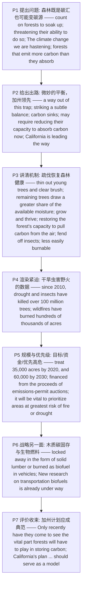

# 森林碳汇的微妙平衡 精读笔记

---

## 背景

本文是 **2019 年考研英语（一）Text 2**（第 26—30 题），主题是**"森林既是气候变化的'受害者'，也可能是'加害者'——为让它长期充当碳汇，反而要先削弱它当下固碳的能力"**。文章从一组矛盾切入：人类指望森林 `soak up a good share of the carbon dioxide`（**吸收掉我们排放的相当一部分二氧化碳**），却在 `threatening their ability to do so`（**威胁森林这样做的能力**），而我们正在**加速**（`hastening`）的气候变化，`could one day leave us with forests that emit more carbon than they absorb`（**有朝一日会让森林排放的碳多于吸收的碳**）——**第 26 题**：作者说"one of the harder challenges"是在暗示**森林可能成为潜在威胁** → [D] `forests may become a potential threat`。

结构上，全文是一条 **"提出问题（森林可能由碳汇变碳源）→ 出路（微妙的平衡，加州领先）→ 计划机制（疏伐如何恢复森林健康）→ 紧迫性（干旱／虫害／野火的惨痛数据）→ 规模与优先级（目标、资金、优先高危区）→ 战略另一面（木质碳的固存与生物燃料）→ 定位与评价（加州计划应成典范）"** 的推进链。P2 给出全文的**题眼**：`Helping forests flourish as valuable "carbon sinks" long into the future may require reducing their capacity to absorb carbon now`（**第 27 题**：要维持森林作为碳汇，我们可能需要**降低它们当下的固碳能力** → [D] `lower their present carbon-absorbing capacity`）。

文章重心在 **P3—P6 的机制与数据**：P3 讲《森林碳计划》`aims to double efforts to thin out young trees and clear brush`（**疏伐幼树、清理灌木**；**第 28 题** → [B] `reduce the density of some of its forests`），并说明机理——`the remaining trees draw a greater share of the available moisture, so they grow and thrive, restoring the forest's capacity to pull carbon from the air`（**剩余树木汲取更多水分 → 长得更好 → 恢复固碳能力**），`Healthy trees are also better able to fend off insects`、`The landscape is rendered less easily burnable`；P4 用`Since 2010 … have killed over 100 million trees … and wildfires have burned hundreds of thousands of acres`渲染**紧迫性**；P5 落到**规模与优先级**——`treat 35,000 acres … by 2020, and 60,000 by 2030`、`financed from the proceeds of the state's emissions-permit auctions`，`it will be vital to prioritize areas at greatest risk of fire or drought`（**第 29 题**：加州计划的关键是**优先处理风险严重的地区** → [A] `handle the areas in serious danger first`）；P6 补上战略的另一面——把木质材料中的碳 `locked away in the form of solid lumber or burned as biofuel`；P7 收束评价——州政府传统上只关注 `wildlife, watersheds and opportunities for recreation`，`Only recently have they come to see the vital part forests will have to play in storing carbon`，故 `California's plan … should serve as a model`（**第 30 题**：作者对加州计划的态度是**支持** → [C] `supportive`）。

**一句话概括**：这篇文章真正想说的是——**"森林不是一道简单的'多种树'算术：为了让它长久地固碳，反而要先'减负'，通过疏伐让林分更健康；加州用砍伐收益补贴这一'先减后增'的计划，并把有限的钱花在火灾／干旱风险最高的地方——这是一场'当下'与'长远'之间的微妙平衡，也应当成为各州的范本。"**

---

## 文章原文

# 2019 Passage 2

Forests give us **shade**, quiet and one of the harder challenges in the fight against **climate change**.

Even as we humans **count on** forests to **soak up** a good share of the **carbon dioxide** we produce, we are threatening their ability to do so.

> [!abstract]- 长难句分析
> **原句**：Even as we humans **count on** forests to **soak up** a good share of the **carbon dioxide** we produce, we are threatening their ability to do so.
>
> **主干提取**：
>
> - 时间状语从句（even as 引导）: Even as we humans count on forests to soak up a good share of the carbon dioxide we produce
> - 状语从句·主语 S: we humans
> - 状语从句·谓语 V: count on
> - 状语从句·宾语 O: forests
> - 状语从句·宾语补足语 C: to soak up a good share of the carbon dioxide (we produce)
> - 主句·主语 S: we
> - 主句·谓语 V: are threatening
> - 主句·宾语 O: their ability
> - 主句·后置定语: to do so
>
> **修饰成分**：
>
> | 类型 | 引导词 / 形式 | 修饰对象 |
> |------|--------------|----------|
> | even as 引导时间状语从句 | Even as … | 主句 we are threatening … |
> | 不定式作宾语补足语 | to soak up … | forests |
> | 省略关系词的定语从句 | (that) we produce | carbon dioxide |
> | 不定式作后置定语 | to do so | their ability |
>
> **结构图解**：
>
> ```
> 主句: 〔Even as we humans count on forests to soak up a good share of the carbon dioxide (that) we produce〕, we + are threatening + their ability + (to do so)
>   ├── even as 状语从句: we humans count on forests to soak up …
>   │      └── 省略关系词定语从句: (that) we produce（修饰 carbon dioxide）
>   └── 不定式作后置定语: to do so（修饰 their ability）
> ```
>
> **参考译文**：就在我们人类指望森林吸收掉我们排放的相当一部分二氧化碳的同时，我们却在威胁它们这样做的能力。
>
> **考点提示**：① `even as` = "正当……之时"，引导**时间状语从句**，兼含对比语气。② `count on sb to do sth` 中 `to soak up …` 是**宾语补足语**，补充说明 forests 的作用。③ `the carbon dioxide we produce` 中从句缺宾语，前面**省略了关系代词 that/which**。④ `their ability to do so` 中 `to do so` 是**不定式作后置定语**，`do so` 代指"soak up carbon dioxide"。⑤ 本句是**第 26 题的解题依据**：即便指望森林，人类却在破坏其能力 → 森林可能反成威胁。

The climate change we are hastening could one day leave us with forests that **emit** more carbon than they **absorb**.

> [!abstract]- 长难句分析
> **原句**：The climate change we are hastening could one day leave us with forests that **emit** more carbon than they **absorb**.
>
> **主干提取**：
>
> - 主语 S: The climate change (we are hastening)
> - 定语从句（省略关系词）: we are hastening
> - 谓语 V: could leave
> - 宾语 O: us
> - 宾语补足语 C: with forests
> - 定语从句: that emit more carbon than they absorb
>
> **修饰成分**：
>
> | 类型 | 引导词 / 形式 | 修饰对象 |
> |------|--------------|----------|
> | 省略关系词的定语从句 | (that) we are hastening | climate change |
> | leave sb with sth 结构 | leave us with forests | us |
> | that 引导限制性定语从句 | that emit … | forests |
> | 比较结构 | more … than … | emit 的宾语 carbon |
>
> **结构图解**：
>
> ```
> 主句: The climate change 〔(that) we are hastening〕 + could leave + us + 〔with forests (that emit more carbon than they absorb)〕
>   ├── 省略关系词定语从句: (that) we are hastening（修饰 climate change）
>   └── with 短语（宾补/结果）: with forests …
>         └── 定语从句: that emit more carbon than they absorb
>               └── 比较结构: more … than …
> ```
>
> **参考译文**：我们正在加速的气候变化，有朝一日也许会让我们面对这样一片森林：它们排放的碳反而比吸收的更多。
>
> **考点提示**：① `The climate change we are hastening` 中 `we are hastening` 前**省略关系代词**，作定语从句修饰 climate change。② `leave sb with sth` = "给某人留下某物"，此处指气候变化的**后果**。③ `that emit more carbon than they absorb` 是**定语从句中套比较结构**，`they` 回指 forests。④ 本句与上一句构成"**威胁**"论据，共同支撑第 26 题。

Thankfully, there is a way out of this **trap**—but it involves striking a **subtle** balance.

Helping forests **flourish** as valuable "**carbon sinks**" long into the future may require reducing their **capacity** to absorb carbon now.

> [!abstract]- 长难句分析
> **原句**：Helping forests **flourish** as valuable "**carbon sinks**" long into the future may require reducing their **capacity** to absorb carbon now.
>
> **主干提取**：
>
> - 主语 S（动名词短语）: Helping forests flourish as valuable "carbon sinks" long into the future
> - 动名词短语·宾语 O: forests
> - 动名词短语·宾语补足语 C: flourish
> - 谓语 V: may require
> - 宾语 O: reducing their capacity to absorb carbon now
>
> **修饰成分**：
>
> | 类型 | 引导词 / 形式 | 修饰对象 |
> |------|--------------|----------|
> | 动名词短语作主语 | Helping forests flourish … | 全句主语 |
> | 方式状语（as 短语） | as valuable "carbon sinks" | flourish |
> | 时间状语 | long into the future | flourish |
> | 动名词作宾语 | reducing … | require |
>
> **结构图解**：
>
> ```
> 主句: 〔Helping forests flourish (as valuable "carbon sinks") (long into the future)〕 + may require + 〔reducing their capacity (to absorb carbon now)〕
>   ├── 动名词短语作主语: Helping forests flourish …
>   │      ├── 方式状语: as valuable "carbon sinks"
>   │      └── 时间状语: long into the future
>   └── 动名词作宾语: reducing their capacity to absorb carbon now
> ```
>
> **参考译文**：要让森林在今后长久地作为宝贵的"碳汇"茁壮成长，或许反而需要暂时降低它们当下吸收碳的能力。
>
> **考点提示**：① 本句主干为 `Helping … may require reducing …`，**动名词短语作主语**，谓语用单数 `may require`。② `require doing` 表**被动含义**（"需要被做"），此处 = "需要降低固碳能力"。③ `as valuable "carbon sinks"` 作方式状语，`long into the future` 作时间状语，均修饰 `flourish`。④ 本句是**第 27 题的定位依据**：`reducing their capacity to absorb carbon now` → 选项 `lower their present carbon-absorbing capacity`（lower = reduce，present = now）。

California is leading the way, as it does on so many climate efforts, in figuring out the details.

The state's proposed Forest Carbon Plan aims to double efforts to **thin out** young trees and **clear brush** in parts of the forest.

> [!abstract]- 长难句分析
> **原句**：The state's proposed Forest Carbon Plan aims to double efforts to **thin out** young trees and **clear brush** in parts of the forest.
>
> **主干提取**：
>
> - 主语 S: The state's proposed Forest Carbon Plan
> - 谓语 V: aims
> - 宾语 O（不定式）: to double efforts (to thin out …)
> - efforts 的后置定语: to thin out young trees and clear brush
>
> **修饰成分**：
>
> | 类型 | 引导词 / 形式 | 修饰对象 |
> |------|--------------|----------|
> | 不定式作宾语 | to double efforts | aims |
> | 不定式作后置定语 | to thin out … and clear brush | efforts |
> | 并列动词 | thin out … and clear brush | 不定式内部 |
> | 地点状语 | in parts of the forest | thin out / clear |
>
> **结构图解**：
>
> ```
> 主句: The state's proposed Forest Carbon Plan + aims + 〔to double efforts (to thin out young trees and clear brush) (in parts of the forest)〕
>   ├── 不定式作宾语: to double efforts
>   └── 不定式作后置定语: to thin out … and clear brush（修饰 efforts）
>         └── 地点状语: in parts of the forest
> ```
>
> **参考译文**：该州提出的《森林碳计划》旨在加倍努力，在部分林区疏伐幼树、清理灌木。
>
> **考点提示**：① 主干 `… Plan aims to double efforts`，`to double efforts` 作**宾语**。② `efforts to do` 中 `to thin out …` 是**不定式作后置定语**。③ `thin out`（疏伐）与 `clear brush`（清理灌木）由 `and` **并列**。④ 本句是**第 28 题的定位依据**：`thin out young trees and clear brush` = 降低森林密度 → 选项 `reduce the density`。

This temporarily lowers carbon-carrying capacity.

But the remaining trees **draw** a greater share of the available **moisture**, so they grow and **thrive**, restoring the forest's capacity to pull carbon from the air.

> [!abstract]- 长难句分析
> **原句**：But the remaining trees **draw** a greater share of the available **moisture**, so they grow and **thrive**, restoring the forest's capacity to pull carbon from the air.
>
> **主干提取**：
>
> - 主语 S: the remaining trees
> - 谓语 V: draw
> - 宾语 O: a greater share of the available moisture
> - 结果状语从句: so they grow and thrive
> - 现在分词作结果状语: restoring the forest's capacity to pull carbon from the air
>
> **修饰成分**：
>
> | 类型 | 引导词 / 形式 | 修饰对象 |
> |------|--------------|----------|
> | so 引导结果 | so they grow and thrive | 前句 draw … moisture |
> | 现在分词作结果状语 | restoring … | 主句整体 |
> | 不定式作后置定语 | to pull carbon from the air | capacity |
>
> **结构图解**：
>
> ```
> 主句: the remaining trees + draw + a greater share of the available moisture
>   ├── so 结果: so they grow and thrive
>   └── 现在分词作结果状语: restoring the forest's capacity (to pull carbon from the air)
>         └── 不定式后置定语: to pull carbon from the air（修饰 capacity）
> ```
>
> **参考译文**：但保留下来的树木能汲取更大份额的水分，因而生长旺盛、茁壮成长，从而恢复森林从空气中吸收碳的能力。
>
> **考点提示**：① `so they grow and thrive` 由**并列连词 so 引导结果**。② `restoring …` 是**现在分词作结果状语**，逻辑主语为 `the remaining trees`，表"从而恢复……"。③ `capacity to do` 中 `to pull carbon from the air` 是**不定式作后置定语**。

Healthy trees are also better able to **fend off** insects.

The landscape is **rendered** less easily **burnable**.

Even in the event of a fire, fewer trees are **consumed**.

The need for such planning is increasingly urgent. Already, since 2010, **drought** and insects have killed over 100 million trees in California, most of them in 2016 alone, and **wildfires** have burned hundreds of thousands of **acres**.

California plans to treat 35,000 acres of forest a year by 2020, and 60,000 by 2030—**financed** from the **proceeds** of the state's **emissions-permit auctions**.

> [!abstract]- 长难句分析
> **原句**：California plans to treat 35,000 acres of forest a year by 2020, and 60,000 by 2030—**financed** from the **proceeds** of the state's **emissions-permit auctions**.
>
> **主干提取**：
>
> - 主语 S: California
> - 谓语 V: plans
> - 宾语 O（不定式）: to treat 35,000 acres of forest a year by 2020, and 60,000 by 2030
> - 后置定语（过去分词短语）: financed from the proceeds of the state's emissions-permit auctions
>
> **修饰成分**：
>
> | 类型 | 引导词 / 形式 | 修饰对象 |
> |------|--------------|----------|
> | 不定式作宾语 | to treat … a year by 2020 | plans |
> | 省略结构 | and (to treat) 60,000 by 2030 | 与上句并列 |
> | 破折号插入 | —financed from … | 补充资金来源 |
> | 过去分词作后置定语 | financed from …（= which is financed …） | 前面的治理计划 |
>
> **结构图解**：
>
> ```
> 主句: California + plans + 〔to treat 35,000 acres of forest a year by 2020, and (to treat) 60,000 by 2030〕
>   └── 破折号插入: —financed from the proceeds of the state's emissions-permit auctions
>         └── 过去分词后置定语: financed from …（省略 which is）
> ```
>
> **参考译文**：加州计划到 2020 年每年治理 3.5 万英亩森林，到 2030 年增至 6 万英亩——资金来自该州碳排放许可拍卖的收益。
>
> **考点提示**：① `plans to treat …` 中不定式作**宾语**。② `and 60,000 by 2030` 是**省略结构**（承前省略 `to treat`）。③ 破折号后 `financed from …` 是**过去分词短语作后置定语**（= which is financed from …），说明资金来源。④ `proceeds` = "收益、收入"（名词，勿与动词 proceed 混淆）。

That's only a small share of the total **acreage** that could benefit, about half a million acres in all, so it will be vital to **prioritize** areas at greatest risk of fire or drought.

> [!abstract]- 长难句分析
> **原句**：That's only a small share of the total **acreage** that could benefit, about half a million acres in all, so it will be vital to **prioritize** areas at greatest risk of fire or drought.
>
> **主干提取**：
>
> - 主语 S: That
> - 系动词 V: is
> - 表语 P: only a small share of the total acreage (that could benefit, about half a million acres in all)
> - 结果状语从句: so it will be vital to prioritize areas at greatest risk of fire or drought
>
> **修饰成分**：
>
> | 类型 | 引导词 / 形式 | 修饰对象 |
> |------|--------------|----------|
> | that 引导定语从句 | that could benefit | acreage |
> | 同位补充 | about half a million acres in all | the total acreage |
> | so 引导结果 | so it will be vital … | 前句 |
> | it 形式主语 + 不定式 | it will be vital to prioritize … | 真正主语 to prioritize … |
>
> **结构图解**：
>
> ```
> 主句: That + is + only a small share of the total acreage 〔(that could benefit), (about half a million acres in all)〕
>   ├── 定语从句: that could benefit（修饰 acreage）
>   ├── 同位补充: about half a million acres in all
>   └── so 结果: so it will be vital to prioritize areas (at greatest risk of fire or drought)
>         └── it 形式主语 → 真正主语: to prioritize areas …
> ```
>
> **参考译文**：这仅占可能受益的总面积（总共约 50 万英亩）的一小部分，因此，优先治理火灾或干旱风险最大的地区将至关重要。
>
> **考点提示**：① `that could benefit` 是**定语从句**修饰 `acreage`。② `about half a million acres in all` 是**同位补充**。③ `so` 引导**结果**。④ `it will be vital to prioritize …` 中 `it` 是**形式主语**，真正主语是 `to prioritize …`。⑤ 本句是**第 29 题的定位依据**：`prioritize areas at greatest risk` → 选项 `handle the areas in serious danger first`。

The strategy also aims to ensure that carbon in woody material removed from the forests is locked away in the form of solid **lumber** or burned as **biofuel** in vehicles that would otherwise run on **fossil fuels**.

> [!abstract]- 长难句分析
> **原句**：The strategy also aims to ensure that carbon in woody material removed from the forests is locked away in the form of solid **lumber** or burned as **biofuel** in vehicles that would otherwise run on **fossil fuels**.
>
> **主干提取**：
>
> - 主语 S: The strategy
> - 谓语 V: aims
> - 宾语 O（不定式）: to ensure
> - 宾语从句: that carbon in woody material (removed from the forests) is locked away … or burned …
> - 宾语从句·主语 S: carbon in woody material (removed from the forests)
> - 宾语从句·谓语 V: is locked away … or (is) burned …
>
> **修饰成分**：
>
> | 类型 | 引导词 / 形式 | 修饰对象 |
> |------|--------------|----------|
> | 不定式作宾语 | to ensure | aims |
> | that 引导宾语从句 | that carbon … is locked away … or burned … | ensure |
> | 过去分词作后置定语 | removed from the forests | woody material |
> | 并列被动 | is locked away … or (is) burned … | carbon |
> | that 引导定语从句 | that would otherwise run on fossil fuels | vehicles |
>
> **结构图解**：
>
> ```
> 主句: The strategy + aims + 〔to ensure + (that carbon in woody material (removed from the forests) is locked away … or burned …)〕
>   ├── that 宾语从句: carbon … is locked away … or burned …
>   │      ├── 过去分词后置定语: removed from the forests（修饰 woody material）
>   │      └── 并列被动: is locked away or (is) burned
>   └── 定语从句: that would otherwise run on fossil fuels（修饰 vehicles）
> ```
>
> **参考译文**：该战略还力求确保：从森林中移除的木质材料所含的碳，要么以实木木材的形式被固存起来，要么作为生物燃料、在原本要使用化石燃料的车辆中燃烧。
>
> **考点提示**：① `aims to ensure that …` 中 `that` 引导**宾语从句**。② `removed from the forests` 是**过去分词作后置定语**，修饰 `woody material`。③ `is locked away … or burned …` 是**并列被动**（后一个省略 is）。④ `that would otherwise run on fossil fuels` 中 `otherwise` 是**含蓄虚拟**的标志（"否则会烧化石燃料"）。

New research on transportation biofuels is already **under way**.

State governments are well **accustomed to** managing forests, but traditionally they've focused on wildlife, **watersheds** and opportunities for **recreation**.

Only recently have they come to see the vital part forests will have to play in storing carbon.

> [!abstract]- 长难句分析
> **原句**：Only recently have they come to see the vital part forests will have to play in storing carbon.
>
> **主干提取**：
>
> - 状语 A: Only recently
> - 谓语 V（倒装提前的助动词）: have
> - 主语 S: they
> - 谓语 V: come to see
> - 宾语 O: the vital part (forests will have to play in storing carbon)
>
> **修饰成分**：
>
> | 类型 | 引导词 / 形式 | 修饰对象 |
> |------|--------------|----------|
> | only + 状语置于句首 → 部分倒装 | Only recently have they … | 全句 |
> | come to do | come to see | 表"逐渐……" |
> | 省略关系词的定语从句 | (that) forests will have to play … | the vital part |
> | 介词短语 | in storing carbon | play a part in |
>
> **结构图解**：
>
> ```
> 主句（倒装）: Only recently + have + they + 〔come to see + the vital part (that) forests will have to play (in storing carbon)〕
>   ├── Only + 状语 → 部分倒装: 助动词 have 提前
>   ├── come to see: 表"逐渐认识到"
>   └── 省略关系词定语从句: (that) forests will have to play …（修饰 the vital part）
>         └── play a part in doing: in storing carbon
> ```
>
> **参考译文**：直到最近，它们才开始认识到森林在固碳方面将要发挥的关键作用。
>
> **考点提示**：① `Only recently have they come …` 是 **only + 状语置于句首引起的部分倒装**，助动词 `have` 提前。② `come to see` = "逐渐认识到"，`come` 表**状态的变化**。③ `the vital part forests will have to play …` 中 `forests will have to play` 前**省略了关系代词 that**。④ `play a part in doing` = "在……中发挥作用"。

California's plan, which is expected to be **finalized** by the governor next year, should serve as a **model**.

> [!abstract]- 长难句分析
> **原句**：California's plan, which is expected to be **finalized** by the governor next year, should serve as a **model**.
>
> **主干提取**：
>
> - 主语 S: California's plan
> - 谓语 V: should serve (as a model)
> - 非限制性定语从句: which is expected to be finalized by the governor next year
>
> **修饰成分**：
>
> | 类型 | 引导词 / 形式 | 修饰对象 |
> |------|--------------|----------|
> | which 引导非限制性定语从句 | which is expected to be finalized … | California's plan |
> | 双重被动 | is expected to be finalized | the plan |
> | should + do | should serve as a model | 表作者建议/主张 |
>
> **结构图解**：
>
> ```
> 主句: California's plan, 〔which is expected to be finalized by the governor next year〕, should serve as a model
>   ├── 非限制性定语从句: which is expected to be finalized …（割裂主谓）
>   │      └── 双重被动: is expected + to be finalized
>   └── 主句谓语: should serve as a model
> ```
>
> **参考译文**：加州的这项计划预计将于明年由州长最终敲定，它应当成为一个典范。
>
> **考点提示**：① `which` 引导**非限制性定语从句**，把主语 `California's plan` 与谓语 `should serve` **割裂**，答题须跳过插入成分找主谓。② `is expected to be finalized` 是 **be expected to + 被动不定式**的**双重被动**。③ `should serve as a model` 表**作者主张**——本句是**第 30 题的定位依据**（作者态度 `supportive`）。

---

## 题目

### 26. By saying "one of the harder challenges," the author implies that ____.

- [A] global climate change may get out of control
- [B] people may misunderstand global warming
- [C] extreme weather conditions may arise
- [D] forests may become a potential threat

### 27. To maintain forests as valuable "carbon sinks," we may need to ____.

- [A] preserve the diversity of species in them
- [B] accelerate the growth of young trees
- [C] strike a balance among different plants
- [D] lower their present carbon-absorbing capacity

### 28. California's Forest Carbon Plan endeavors to ____.

- [A] cultivate more drought-resistant trees
- [B] reduce the density of some of its forests
- [C] find more effective ways to kill insects
- [D] restore its forests quickly after wildfires

### 29. What is essential to California's plan according to Paragraph 5?

- [A] To handle the areas in serious danger first.
- [B] To carry it out before the year of 2020.
- [C] To perfect the emissions-permit auctions.
- [D] To obtain enough financial support.

### 30. The author's attitude to California's plan can best be described as ____.

- [A] ambiguous
- [B] tolerant
- [C] supportive
- [D] cautious

---

## 翻译对照

# 2019 Passage 2 中英对照翻译

## Paragraph 1

Forests give us shade, quiet and one of the harder challenges in the fight against climate change. Even as we humans count on forests to soak up a good share of the carbon dioxide we produce, we are threatening their ability to do so. The climate change we are hastening could one day leave us with forests that emit more carbon than they absorb.

森林为我们提供荫凉、宁静，同时也带来了对抗气候变化之战中最棘手的难题之一。就在我们人类指望森林吸收掉我们排放的相当一部分二氧化碳的同时，我们却在威胁它们这样做的能力。我们正在加速的气候变化，有朝一日也许会让我们面对这样一片森林：它们排放的碳反而比吸收的更多。

> [!note] 翻译说明
> - `count on` = "指望、依靠"；`soak up` = "吸收、吸纳"；`a good share` = "相当大的一部分"。
> - `hasten` = "加速、催促"；此处 `the climate change we are hastening` 中省略了关系词，`we are hastening` 是**定语从句**修饰 `climate change`。
> - `leave us with forests that ...` 为 `leave sb with sth` 结构，`that emit more carbon than they absorb` 是**定语从句**修饰 `forests`，其中 `more ... than ...` 为比较结构。

## Paragraph 2

Thankfully, there is a way out of this trap—but it involves striking a subtle balance. Helping forests flourish as valuable "carbon sinks" long into the future may require reducing their capacity to absorb carbon now. California is leading the way, as it does on so many climate efforts, in figuring out the details.

所幸，摆脱这一困境是有出路的——但这需要达成一种微妙的平衡。要让森林在今后长久地作为宝贵的"碳汇"茁壮成长，或许反而需要暂时降低它们当下吸收碳的能力。加利福尼亚州正走在前列，正如它在众多气候事务上所做的那样，率先探究其中的细节。

> [!note] 翻译说明
> - `trap` = "陷阱、困境"；`striking a subtle balance` = "达成一种微妙的平衡"，`striking` 为动名词。
> - `carbon sinks` = "碳汇"（指能够吸收并储存碳的天然或人工系统）。
> - `flourish` = "茂盛生长、繁荣"；`capacity` = "能力、容量"。
> - `leading the way ... in figuring out the details` = "在弄清细节方面走在前列"；`as it does on so many climate efforts` 是**as 引导的方式状语从句**，`does` 代指 `leads the way`。

## Paragraph 3

The state's proposed Forest Carbon Plan aims to double efforts to thin out young trees and clear brush in parts of the forest. This temporarily lowers carbon-carrying capacity. But the remaining trees draw a greater share of the available moisture, so they grow and thrive, restoring the forest's capacity to pull carbon from the air. Healthy trees are also better able to fend off insects. The landscape is rendered less easily burnable. Even in the event of a fire, fewer trees are consumed.

该州提出的《森林碳计划》旨在加倍努力，在部分林区疏伐幼树、清理灌木。这会暂时降低森林的碳承载能力。但保留下来的树木能汲取更大份额的水分，因而生长旺盛、茁壮成长，从而恢复森林从空气中吸收碳的能力。健康的树木也更能抵御昆虫。整片林地因此变得不那么容易燃烧。即便发生火灾，被烧毁的树木也更少。

> [!note] 翻译说明
> - `thin out` = "疏伐、间苗（使变稀疏）"；`clear brush` = "清理灌木丛"；`brush` 此处指"灌木"。
> - `moisture` = "水分、湿气"；`thrive` = "茁壮成长、兴旺"；`fend off` = "抵挡、抵御"。
> - `The landscape is rendered less easily burnable` 为**被动语态**，`render` = "使成为、致使"。
> - `restoring ...` 是**现在分词作结果状语**，逻辑主语为前面的 `they`（即保留下来的树木）。

## Paragraph 4

The need for such planning is increasingly urgent. Already, since 2010, drought and insects have killed over 100 million trees in California, most of them in 2016 alone, and wildfires have burned hundreds of thousands of acres.

对此类规划的需求正日益紧迫。自 2010 年以来，干旱和虫害已使加州超过一亿棵树木死亡，其中仅 2016 年一年就占了大多数，而野火已烧毁了数十万英亩林地。

> [!note] 翻译说明
> - `drought` = "干旱"；`wildfires` = "野火、山火"；`acres` = "英亩"。
> - 本段使用**现在完成时** `have killed` / `have burned` 强调从过去持续到现在的累计影响。
> - `most of them in 2016 alone` 是**代词 + 独立主格结构**（`them` 指代前面的树木），`alone` 表"仅仅（某一年）"。

## Paragraph 5

California plans to treat 35,000 acres of forest a year by 2020, and 60,000 by 2030—financed from the proceeds of the state's emissions-permit auctions. That's only a small share of the total acreage that could benefit, about half a million acres in all, so it will be vital to prioritize areas at greatest risk of fire or drought.

加州计划到 2020 年每年治理 3.5 万英亩森林，到 2030 年增至 6 万英亩——资金来自该州碳排放许可拍卖的收益。这仅占可能受益的总面积（总共约 50 万英亩）的一小部分，因此，优先治理火灾或干旱风险最大的地区将至关重要。

> [!note] 翻译说明
> - `treat` 此处 = "治理、处置"；`proceeds` = "（拍卖等的）收益、收入"（注意与动词 proceed 区分）。
> - `emissions-permit auctions` = "碳排放许可（配额）拍卖"；`acreage` = "（以英亩计）面积、林地面积"。
> - `prioritize` = "优先处理、按轻重缓急安排"；`at greatest risk of` = "面临……最大风险的"。
> - `financed from ...` 是**过去分词短语作后置定语/方式状语**，修饰前面的治理计划。

## Paragraph 6

The strategy also aims to ensure that carbon in woody material removed from the forests is locked away in the form of solid lumber or burned as biofuel in vehicles that would otherwise run on fossil fuels. New research on transportation biofuels is already under way.

该战略还力求确保：从森林中移除的木质材料所含的碳，要么以实木木材的形式被固存起来，要么作为生物燃料、在原本要使用化石燃料的车辆中燃烧。关于交通生物燃料的新研究已经在进行中。

> [!note] 翻译说明
> - `lock away` = "把……锁起来、固存"；`solid lumber` = "实木木料、成材"；`woody material` = "木质材料"。
> - `biofuel` = "生物燃料"；`fossil fuels` = "化石燃料"；`under way` = "在进行中、已启动"。
> - `ensure that ... is locked ... or burned ...` 中 `that` 引导**宾语从句**，其中 `locked away ... or burned ...` 为**并列的被动结构**。
> - `that would otherwise run on fossil fuels` 是**定语从句**修饰 `vehicles`，`otherwise` 表"否则会……"，暗含虚拟。

## Paragraph 7

State governments are well accustomed to managing forests, but traditionally they've focused on wildlife, watersheds and opportunities for recreation. Only recently have they come to see the vital part forests will have to play in storing carbon. California's plan, which is expected to be finalized by the governor next year, should serve as a model.

州政府早已习惯于管理森林，但传统上它们的关注点一直是野生动物、流域以及休闲娱乐的机会。直到最近，它们才开始认识到森林在固碳方面将要发挥的关键作用。加州的这项计划预计将于明年由州长最终敲定，它应当成为一个典范。

> [!note] 翻译说明
> - `be accustomed to` = "习惯于"，`to` 后接动名词，故 `managing`；`watersheds` = "流域"；`recreation` = "休闲、娱乐"。
> - `Only recently have they come to see ...` 是 **Only + 状语置于句首引起的部分倒装**，助动词 `have` 提前。
> - `come to see` = "逐渐认识到"；`the vital part forests will have to play` 中 `forests will have to play` 是**省略关系词的定语从句**，修饰 `part`。
> - `finalize` = "最终确定、定稿"；`serve as a model` = "充当/成为典范"。

## 题目翻译

### 26. 作者说 "one of the harder challenges" 是在暗示 ____。

- [A] 全球气候变化可能失控
- [B] 人们可能误解全球变暖
- [C] 可能出现极端天气
- [D] 森林可能成为潜在威胁

### 27. 要让森林成为宝贵的"碳汇"，我们可能需要 ____。

- [A] 保护其中的物种多样性
- [B] 加速幼树的生长
- [C] 在不同植物之间取得平衡
- [D] 降低它们当下的固碳能力

### 28. 加州的《森林碳计划》致力于 ____。

- [A] 培育更多耐旱树木
- [B] 降低其部分森林的密度
- [C] 寻找更有效的灭虫方法
- [D] 在野火之后迅速恢复其森林

### 29. 根据第 5 段，对加州的计划而言什么是关键？

- [A] 首先处理处于严重危险中的地区。
- [B] 在 2020 年之前实施。
- [C] 完善碳排放许可拍卖。
- [D] 获得足够的资金支持。

### 30. 作者对加州计划的态度最好可描述为 ____。

- [A] 含糊的
- [B] 宽容的
- [C] 支持的
- [D] 谨慎的

---

## 语法要点

# 2019 Passage 2 语法整理

> [!note] 来源说明
> 本篇**用户未提供语法源笔记**，以下语法点由 `formatted-article.md` 与 `translation.md` **从本文推断提取**，仅收录本篇实际出现的语法现象。
> 每一条均给出**原文语境**，便于回原文核对；标注"（联动）"的条目与相邻专题互为参照。
> 固定搭配与词组见 [[intermediate/2019-passage2-forest-carbon-plan/固定搭配与词组笔记.md|2019 Passage 2 固定搭配与词组]]。

---

## 一、从句

### 从句：省略关系词的定语从句

**概述**：当关系代词在从句中作**宾语**时，常可省略；识别时要看"名词 + 主谓结构"是否构成完整从句。

| 结构 | 用法 | 例句 |
|------|------|------|
| `名词 + (that) + 主语 + 谓语` | 关系词作宾语被省略 | … a good share of the carbon dioxide **(that) we produce**. |
| 同上 | 关系词作宾语被省略 | The climate change **(that) we are hastening** could one day leave us … |
| 同上 | 关系词作宾语被省略 | … the vital part **(that) forests will have to play** in storing carbon. |

> [!tip] 解题技巧
> `the carbon dioxide we produce` 中 `we produce` 缺宾语，故前面省略了关系代词 `that/which`。省略关系代词的定语从句**没有引导词作为标志**，只能靠"句子成分是否残缺"判断。

### 从句：that 引导的限制性定语从句

**概述**：`that` 引导定语从句，**不能引导非限制性定语从句**，修饰先行词且不可省略。

| 结构 | 用法 | 例句 |
|------|------|------|
| `先行词 + that + 从句` | 修饰具体名词 | … leave us with forests **that emit more carbon than they absorb**. |
| `先行词 + that + 从句` | 从句中含含蓄虚拟 | … in vehicles **that would otherwise run on fossil fuels**. |

> [!note] 补充说明
> `forests that emit more carbon than they absorb` 中从句内部又含 `more ... than ...` 比较结构，是"定语从句 + 比较结构"的**嵌套**，属长难句高频考点。

### 从句：which 引导的非限制性定语从句

**概述**：`which` 引导非限制性定语从句，用逗号隔开，作**补充说明**，先行词既可以是名词，也可以是**整个主句**。

| 结构 | 用法 | 例句 |
|------|------|------|
| `名词, which + 从句,` | 插入补充说明，割裂主谓 | California's plan, **which is expected to be finalized by the governor next year**, should serve as a model. |

> [!warning] 易错点
> `which` 从句把主语 `California's plan` 与谓语 `should serve` **隔开**，是不定式/从句"插在中间"的典型干扰；答题时须跳过插入成分找到主谓。

### 从句：that 引导的宾语从句

**概述**：`that` 引导宾语从句，不作成分、常可省略，用于陈述内容。

| 结构 | 用法 | 例句 |
|------|------|------|
| `ensure + that 从句` | 动词后接宾语从句 | The strategy also aims to ensure **that carbon in woody material … is locked away … or burned …**. |

> [!note] 补充说明
> `ensure that` 从句内部为 `is locked away … or burned …` 两个**并列的被动谓语**，主语同为 `carbon`。

### 从句：as 引导的方式状语从句

**概述**：`as` 引导方式状语从句，表示"正如……"，常用助动词 `do/does` **代指前文动词**以避免重复。

| 结构 | 用法 | 例句 |
|------|------|------|
| `as + 主语 + do/does` | 代动词避免重复 | California is leading the way, **as it does on so many climate efforts**, in figuring out the details. |

> [!tip] 解题技巧
> `as it does` 中的 `does` = `leads the way`。见到 `as + 主语 + do/does/did`，先还原被替代的动词，句意立刻清晰。

### 从句：so 引导的结果状语从句

**概述**：`so`（因此、所以）连接结果，此处表"因为汲取了更多水分，所以生长旺盛"。

| 结构 | 用法 | 例句 |
|------|------|------|
| `原因 + so + 结果` | 表因果结果 | … the remaining trees draw a greater share of the available moisture, **so they grow and thrive** … |

> [!note] 补充说明
> `so` 作"因此"时是**并列连词**（等同 `and so`/`therefore`）；与 `so that`（目的/结果状语从句）区分。

### 从句：even as 引导的时间状语从句

**概述**：`even as` = "正当……的时候、恰在……之时"，兼含**对比/让步**意味。

| 结构 | 用法 | 例句 |
|------|------|------|
| `even as + 从句, 主句` | 表"正当……（却……）" | **Even as** we humans count on forests to soak up a good share of the carbon dioxide we produce, we are threatening their ability to do so. |

> [!tip] 解题技巧
> 第 26 题问"one of the harder challenges"暗示什么，答案落在"**森林可能成为潜在威胁**"。解题依据即本段 `Even as ... we are threatening ...` 与末句 `forests that emit more carbon than they absorb` 的**反差对比**——`even as` 正是这一反差的标志。

---

## 二、非谓语动词

### 非谓语：动名词短语作主语

**概述**：动名词（短语）作主语时示动作，谓语用**单数**。

| 结构 | 用法 | 例句 |
|------|------|------|
| `Doing ... + 单数谓语` | 动名词短语作主语 | **Helping forests flourish as valuable "carbon sinks" long into the future** may require reducing their capacity to absorb carbon now. |

> [!tip] 解题技巧
> 第 27 题（要维持森林作为"碳汇"，我们可能需要……）答案落在"**降低它们当前的固碳能力**"，依据即本句 `may require reducing their capacity to absorb carbon now`。`require doing`（需要做）是解题信号。

### 非谓语：动名词作宾语

**概述**：动名词作动词或介词的宾语。

| 结构 | 用法 | 例句 |
|------|------|------|
| `involve + doing` | 动名词作宾语 | … but it involves **striking a subtle balance**. |
| `require + doing` | 动名词作宾语 | … may require **reducing** their capacity to absorb carbon now. |
| `介词 + doing` | 动名词作介词宾语 | … as it does on so many climate efforts, in **figuring out the details**. |

> [!warning] 易错点
> `require` 后接动名词表被动含义（`require doing` = "需要被做"），如 `The car requires repairing`（车需要修），与 `require sb to do`（要求某人做）不同。

### 非谓语：不定式作后置定语

**概述**：不定式作定语，通常修饰前面的名词，表"要做的事"。

| 结构 | 用法 | 例句 |
|------|------|------|
| `名词 + to do` | 不定式作后置定语 | … double efforts **to thin out young trees and clear brush** … |
| 同上 | 同上 | … reducing their capacity **to absorb carbon** now. |
| 同上 | 同上 | … we are threatening their ability **to do so**. |

> [!note] 补充说明
> `efforts to do`、`capacity to do`、`ability to do`、`way to do` 是考研高频"**名词 + 不定式**"搭配，`to do` 均作后置定语。

### 非谓语：不定式作宾语补足语

**概述**：`count on sb to do` 中不定式作宾语补足语，补充说明宾语的行为。

| 结构 | 用法 | 例句 |
|------|------|------|
| `count on sb to do` | 不定式作宾补 | Even as we humans **count on forests to soak up** a good share of the carbon dioxide … |

> [!note] 补充说明
> 同类结构：`rely on / depend on / ask / want / expect sb to do`。

### 非谓语：不定式作目的状语

**概述**：不定式表目的，此处含 `aim to do`（旨在做）与 `come to do`（逐渐……）。

| 结构 | 用法 | 例句 |
|------|------|------|
| `aim to do` | 不定式表目的 | The state's proposed Forest Carbon Plan **aims to double efforts** … |
| `come to do` | 表"逐渐……、开始……" | Only recently have they **come to see** the vital part forests will have to play … |

> [!tip] 解题技巧
> `come to do` 中的 `come` 不表"来"，而是表**状态的逐渐变化**（"逐渐认识到"），是阅读中的常见语义陷阱。

### 非谓语：过去分词作后置定语

**概述**：过去分词作定语表**被动/完成**。

| 结构 | 用法 | 例句 |
|------|------|------|
| `名词 + done` | 过去分词作后置定语 | … carbon in woody material **removed from the forests** … |
| 同上 | 同上 | … **financed from the proceeds of the state's emissions-permit auctions**. |

> [!note] 补充说明
> `financed from ...` 紧跟 2030 年的数字，作**后置定语/方式状语**，说明"资金从何而来"，是 `which was financed from ...` 的省略形式。

### 非谓语：现在分词作结果状语

**概述**：现在分词放句末，表前面动作带来的**自然结果**。

| 结构 | 用法 | 例句 |
|------|------|------|
| `主句, doing ...` | 现在分词作结果状语 | … so they grow and thrive, **restoring the forest's capacity to pull carbon from the air**. |

> [!tip] 解题技巧
> `restoring ...` 的逻辑主语是前面的 `they`（保留下来的树木），表"从而恢复了……"。见到句末 `, doing`，优先判断是否为**结果状语**。

### 非谓语：it + be + adj + to do 结构

**概述**：`it` 作形式主语，真正主语是后面的不定式。

| 结构 | 用法 | 例句 |
|------|------|------|
| `it is + adj + to do` | it 作形式主语 | … so **it will be vital to prioritize** areas at greatest risk of fire or drought. |

> [!tip] 解题技巧
> 第 29 题（第 5 段中加州计划的关键是什么）答案落在"**优先处理风险严重的地区**"，依据即 `it will be vital to prioritize areas at greatest risk of fire or drought`——`prioritize`（优先处理）对应选项 `handle ... first`。

---

## 三、语态

### 语态：被动语态

**概述**：说明主语是动作的承受者；本文大量使用被动，聚焦"森林/碳"等受事。

| 结构 | 用法 | 例句 |
|------|------|------|
| `be + done` | 一般被动 | The landscape **is rendered** less easily burnable. |
| `be + done + and + done` | 并列被动 | … carbon … **is locked away** in the form of solid lumber or **burned** as biofuel … |
| `be + done` | 被动 | Even in the event of a fire, fewer trees **are consumed**. |
| `be expected to be done` | 双重被动 | California's plan, which **is expected to be finalized** by the governor next year … |

> [!warning] 易错点
> `render` = "使成为、致使"，`The landscape is rendered less easily burnable` 意为"林地**变得**不易燃烧"；`is expected to be finalized` 是 **be expected to + 被动不定式**的"双重被动"，译作"预计将被……确定"。

---

## 四、时态与情态

### 时态：现在完成时

**概述**：`have/has done` 强调**从过去延续至今的累计影响**。

| 结构 | 用法 | 例句 |
|------|------|------|
| `have done + 时间跨度` | 表累计结果 | Already, since 2010, drought and insects **have killed** over 100 million trees … |
| 同上 | 同上 | … and wildfires **have burned** hundreds of thousands of acres. |

> [!tip] 解题技巧
> `since 2010` + `have killed/have burned`：**since + 时间点** 是现在完成时的典型标志，与"从那时起到现在累计"的量（`over 100 million`、`hundreds of thousands`）呼应。

### 情态：情态动词 could / would / should

**概述**：本文三个情态动词分别表**推测、含蓄虚拟、建议**。

| 结构 | 用法 | 例句 |
|------|------|------|
| `could + do` | 表将来可能性 | The climate change we are hastening **could** one day leave us with forests that emit more carbon … |
| `would otherwise do` | 含蓄虚拟（否则会……） | … vehicles that **would otherwise run** on fossil fuels. |
| `should + do` | 表"应当"（建议/主张） | California's plan … **should serve** as a model. |

> [!note] 补充说明
> `would otherwise run on fossil fuels` 表"（若不用生物燃料）本来会烧化石燃料"，`otherwise` 是**含蓄虚拟**的标志词。
> `should serve as a model` 中的 `should` 表**作者态度**——第 30 题（作者对加州计划的态度）答案 `supportive`（支持），依据即此处的 `should serve as a model` 及全篇的正面措辞。

---

## 五、倒装与强调

### 倒装：only + 状语置于句首的部分倒装

**概述**：`only + 状语` 置于句首时，主句用**部分倒装**（助动词/情态动词提前）。

| 结构 | 用法 | 例句 |
|------|------|------|
| `Only + 状语 + 助动词 + 主语 + 谓语` | 部分倒装 | **Only recently have they come to see** the vital part forests will have to play in storing carbon. |

> [!warning] 易错点
> 倒装句中 `have` 提前，实义动词 `come` 保持原形（`come to see`）。注意 `only` **修饰状语**才倒装；若 `only` 修饰主语，则**不倒装**（如 `Only he knows`）。

---

## 六、介词短语与复合结构

### 结构：more ... than 比较结构

**概述**：`more A than B` 表"比 B 更多的 A"，用于数量或程度的对比。

| 结构 | 用法 | 例句 |
|------|------|------|
| `more + 名词 + than + 从句` | 数量比较 | … forests that emit **more** carbon **than** they absorb. |
| `a greater share of` | 比较级 + 名词 | … the remaining trees draw **a greater share of** the available moisture … |

> [!note] 补充说明
> `emit more carbon than they absorb` = "排放的碳多于吸收的碳"，是**比较结构作定语从句内部的谓语延伸**，也是本文核心矛盾（森林可能由"碳汇"变成"碳源"）的语言载体。

### 结构：in the event of（插入条件）

**概述**：`in the event of + 名词` = "如果……发生、万一……"，表**条件**。

| 结构 | 用法 | 例句 |
|------|------|------|
| `Even in the event of a fire` | 介词短语表条件 | **Even in the event of a fire**, fewer trees are consumed. |

> [!note] 补充说明
> `in the event of` = `in case of`；`even` 强化让步语气（"即便发生火灾"）。

### 结构：独立主格

**概述**：`代词 + 介词短语` 构成的独立主格，对前面名词作**补充说明**。

| 结构 | 用法 | 例句 |
|------|------|------|
| `名词/代词 + 介词短语/非谓语` | 独立主格补充说明 | Already, since 2010, drought and insects have killed over 100 million trees … , **most of them in 2016 alone** … |

> [!note] 补充说明
> `most of them in 2016 alone` 中 `them` 指代前面的 `trees`，无谓语动词，是**独立主格结构**，表"其中大多数（仅 2016 年一年就死了）"。

---

## 七、修饰与插入（补充要点）

### 修饰：破折号插入语

**概述**：破折号引出**补充说明或转折**，可插入到主句中间。

| 结构 | 用法 | 例句 |
|------|------|------|
| `主句 — 插入 —` | 破折号补充/转折 | … there is a way out of this trap **—but it involves striking a subtle balance**. |
| `… — 插入 —` | 破折号补充说明 | … by 2020, and 60,000 by 2030**—financed from the proceeds of the state's emissions-permit auctions**. |

> [!tip] 解题技巧
> 破折号内容常为**补充或转折**，阅读时可先跳过、抓主干。第一处 `—but ...` 表**转折**（"……但需要平衡"），第二处补充**资金来源**。

### 修饰：并列结构

**概述**：由 `and` 连接的并列成分，须注意**层次**（词并列词、句并列句）。

| 结构 | 用法 | 例句 |
|------|------|------|
| `A and B and C` | 三项并列 | Forests give us **shade, quiet and** one of the harder challenges … |
| `do A and do B` | 动词并列 | … aims to **thin out** young trees **and clear** brush … |

> [!note] 补充说明
> 第一句中 `shade, quiet and one of the harder challenges` 是**三项并列宾语**，其中第三项带定语 `in the fight against climate change`——注意不要误读为"森林只是遮荫和宁静"。

### 修饰：代词指代

**概述**：长难句中代词须回指准确，否则句意易错。

| 代词 | 回指对象 | 原文语境 |
|------|----------|----------|
| `they` | forests | … forests that emit more carbon than **they** absorb. |
| `them` | trees | … have killed over 100 million trees … most of **them** in 2016 alone … |
| `it` | the plan / 前句 | … **it** will be vital to prioritize areas … |
| `they` | state governments | … **they**'ve focused on wildlife, watersheds … |

> [!tip] 解题技巧
> 代词指代是**考研阅读推理题的常见考点**：`it will be vital to ...` 的 `it` 为**形式主语**（非指代），而 `they`（州政府）在末段回指 `State governments`——判断指代须结合**单复数**与**语义逻辑**。

---

## 固定搭配与词组

# 2019 Passage 2 固定搭配与词组

> [!note] 来源说明
> 本篇**用户未提供词组源笔记**，以下词组由 `formatted-article.md` 与 `translation.md` 提取，收录本篇实际出现的**固定搭配、动词短语与重点表达**。
> 纯语法现象见 [[intermediate/2019-passage2-forest-carbon-plan/grammar-notes.md|2019 Passage 2 语法整理]]。

---

## 一、气候与森林主题词

| 词组 | 中文 | 原文语境 |
|------|------|----------|
| climate change | 气候变化 | … in the fight against **climate change**. |
| carbon dioxide | 二氧化碳 | … a good share of the **carbon dioxide** we produce … |
| carbon sinks | 碳汇 | … as valuable "**carbon sinks**" long into the future … |
| emit carbon | 排放碳 | … forests that **emit** more **carbon** than they absorb. |
| absorb carbon | 吸收碳 | … than they **absorb**. |
| carbon-carrying capacity | 碳承载能力 | This temporarily lowers **carbon-carrying capacity**. |
| store carbon | 固碳、储存碳 | … the vital part forests will have to play in **storing carbon**. |
| pull carbon from the air | 从空气中吸收碳 | … restoring the forest's capacity to **pull carbon from the air**. |
| woody material | 木质材料 | … carbon in **woody material** removed from the forests … |
| forests flourish | 森林繁茂生长 | Helping **forests flourish** as valuable "carbon sinks" … |

> [!tip] 解题技巧
> 全篇核心是 **carbon sink（碳汇）↔ carbon source（碳源）** 的张力：开头即点出"森林可能排放更多碳而非吸收"，这是第 26 题的解题依据。抓住 `emit ... more ... than ... absorb` 即可锁定答案 **forests may become a potential threat**。

---

## 二、森林管理措施词

| 词组 | 中文 | 原文语境 |
|------|------|----------|
| thin out | 疏伐、间苗 | … double efforts to **thin out** young trees … |
| clear brush | 清理灌木 | … and **clear brush** in parts of the forest. |
| available moisture | 可用水分 | … the remaining trees draw a greater share of the **available moisture** … |
| grow and thrive | 生长旺盛、茁壮成长 | … so they **grow and thrive** … |
| fend off insects | 抵御昆虫 | Healthy trees are also better able to **fend off insects**. |
| be rendered less easily burnable | 变得不那么容易燃烧 | The landscape is **rendered less easily burnable**. |
| treat X acres of forest | 治理 X 英亩森林 | California plans to **treat 35,000 acres of forest** a year … |
| be financed from the proceeds of | 由……的收益提供资金 | … **financed from the proceeds of** the state's emissions-permit auctions. |
| emissions-permit auctions | 碳排放许可（配额）拍卖 | … the proceeds of the state's **emissions-permit auctions**. |
| acreage | （以英亩计的）面积 | … a small share of the total **acreage** that could benefit … |
| prioritize areas at greatest risk | 优先处理风险最大的地区 | … it will be vital to **prioritize areas at greatest risk of** fire or drought. |
| lock away | 固存、锁存 | … carbon … is **locked away** in the form of solid lumber … |
| solid lumber | 实木木材 | … in the form of **solid lumber** … |
| biofuel | 生物燃料 | … or burned as **biofuel** in vehicles … |
| fossil fuels | 化石燃料 | … vehicles that would otherwise run on **fossil fuels**. |
| under way | 在进行中 | New research on transportation biofuels is already **under way**. |
| be accustomed to | 习惯于 | State governments are well **accustomed to** managing forests … |
| watersheds | 流域 | … focused on wildlife, **watersheds** and opportunities for recreation. |
| opportunities for recreation | 休闲娱乐的机会 | … and **opportunities for recreation**. |

> [!tip] 解题技巧
> 第 28 题（加州的《森林碳计划》致力于……）答案 **reduce the density of some of its forests**（降低部分森林的密度），对应 `thin out young trees and clear brush`（疏伐幼树、清理灌木）——**动作同义替换**是本题机关。
> 第 29 题答案 **To handle the areas in serious danger first**（优先处理危险地区），对应 `prioritize areas at greatest risk`——`prioritize` = `handle ... first`。

---

## 三、逻辑连接与论述表达

| 词组 | 中文 | 原文语境 |
|------|------|----------|
| count on | 指望、依靠 | Even as we humans **count on** forests to soak up … |
| soak up | 吸收、吸纳 | … forests to **soak up** a good share of the carbon dioxide … |
| a good share of | 相当大的一部分 | … **a good share of** the carbon dioxide we produce … |
| a way out of this trap | 摆脱这一困境的办法 | … there is **a way out of this trap** … |
| strike a subtle balance | 达成微妙的平衡 | … but it involves **striking a subtle balance**. |
| lead the way | 走在前列、率先 | California is **leading the way** … |
| figure out the details | 弄清细节 | … in **figuring out the details**. |
| in the event of | 万一、如果发生 | Even **in the event of** a fire, fewer trees are consumed. |
| Only recently | 直到最近 | **Only recently** have they come to see … |
| come to see | 逐渐认识到 | … have they **come to see** the vital part forests will have to play … |
| play a vital part in | 在……中起关键作用 | … see the **vital part** forests will have to **play in** storing carbon. |
| serve as a model | 成为典范 | … should **serve as a model**. |

> [!note] 补充说明
> `count on`（= rely on，指望）与 `soak up`（= absorb，吸收）是本文开篇两个关键动词短语；`serve as a model`（成为典范）表**作者对加州计划的肯定态度**，是第 30 题（作者态度）的定位句。

---

## 四、评价与程度表达

| 词组 | 中文 | 原文语境 |
|------|------|----------|
| the harder challenges | 更棘手的难题 | Forests give us shade, quiet and one of **the harder challenges** … |
| the need for | 对……的需求 | **The need for** such planning is increasingly urgent. |
| increasingly urgent | 日益紧迫 | … is **increasingly urgent**. |
| drought | 干旱 | Already, since 2010, **drought** and insects have killed … |
| wildfires | 野火、山火 | … and **wildfires** have burned hundreds of thousands of acres. |
| hundreds of thousands of acres | 数十万英亩 | … burned **hundreds of thousands of acres**. |
| a small share of | 一小部分 | That's only **a small share of** the total acreage … |
| be finalized | 被最终确定、定稿 | … which is expected to **be finalized** by the governor next year … |

> [!tip] 解题技巧
> 第 27 题（要维持森林作为"碳汇"，我们可能需要……）答案 **lower their present carbon-absorbing capacity**，对应 `may require reducing their capacity to absorb carbon now`——`lower` = `reduce`，`present` = `now`，**同义替换**是解题关键。

---

## 五、核心考点速记

| 考点 | 原文锚点 | 对应题目 |
|------|----------|----------|
| 森林可能成为威胁 | `emit more carbon than they absorb` | 26 |
| 暂时降低固碳能力 | `reducing their capacity to absorb carbon now` | 27 |
| 疏伐降低森林密度 | `thin out young trees and clear brush` | 28 |
| 优先处理高危地区 | `prioritize areas at greatest risk` | 29 |
| 作者持支持态度 | `should serve as a model` | 30 |

---

<!-- VOCABULARY_SLOT -->

---

## 心得

> [!tip] 主旨把握
> 全文回答的是**"森林究竟是不是对抗气候变化的'好帮手'，以及该如何让它长期当个好帮手"**，行文是一条**"提出问题（森林可能由碳汇变碳源）→ 出路（微妙的平衡）→ 计划机制（疏伐恢复健康）→ 紧迫性（数据）→ 规模与优先级 → 战略另一面 → 定位与评价"**的递进链。
> 第一层**提出问题**：人类 `count on forests to soak up` 二氧化碳，却在 `threatening their ability to do so`；`The climate change we are hastening could one day leave us with forests that emit more carbon than they absorb`（P1）——森林可能由"碳汇"变"碳源"。
> 第二层**给出出路**：`Helping forests flourish as valuable "carbon sinks" long into the future may require reducing their capacity to absorb carbon now`，`striking a subtle balance`，`California is leading the way`（P2）。
> 第三层**讲清机制**：`The state's proposed Forest Carbon Plan aims to double efforts to thin out young trees and clear brush`——`the remaining trees draw a greater share of the available moisture, so they grow and thrive, restoring the forest's capacity to pull carbon from the air`（P3）。
> 第四层**渲染紧迫**：`since 2010, drought and insects have killed over 100 million trees … and wildfires have burned hundreds of thousands of acres`（P4）。
> 第五层**落到规模与优先级**：`treat 35,000 acres … by 2020, and 60,000 by 2030—financed from the proceeds of the state's emissions-permit auctions`，`it will be vital to prioritize areas at greatest risk of fire or drought`（P5）。
> 第六层**补另一面**：把木质材料中的碳 `locked away in the form of solid lumber or burned as biofuel`（P6）。
> 第七层**评价收束**：`Only recently have they come to see the vital part forests will have to play in storing carbon`，故 `California's plan … should serve as a model`（P7）。
> **一句话概括**：这篇文章真正的意思是**"森林不是简单的'多种树'算术——为了让它长久固碳，反而要先'减负'：通过疏伐让林分更健康；加州用排放许可拍卖的收益补贴这场'先减后增'的计划，并把有限的钱花在火灾／干旱风险最高的地方；这既是一场'当下'与'长远'的微妙平衡，也应当成为各州的范本"**。最能定性的是三处：`striking a subtle balance`（**微妙的平衡**）、`reducing their capacity to absorb carbon now`（**先降后升**的取舍）、`should serve as a model`（**应成范本**）。

> [!tip] 命题线索
> - **推断／句意题（第 26 题）**：题干 `By saying "one of the harder challenges," the author implies that ____`。P1 `Even as we humans count on forests to soak up … we are threatening their ability to do so` 与 `forests that emit more carbon than they absorb` → **[D] forests may become a potential threat**。[A] `global climate change may get out of control`、[B] `people may misunderstand global warming`、[C] `extreme weather conditions may arise` 均**偷换对象**（把"森林"的问题换成"气候/天气/认知"）。**对策：`one of the harder challenges` 的答案必须落在"森林"本身，`emit more carbon than they absorb` 是关键依据。**
> - **细节题（第 27 题）**：题干 `To maintain forests as valuable "carbon sinks," we may need to ____`。P2 `may require reducing their capacity to absorb carbon now` → **[D] lower their present carbon-absorbing capacity**（`lower` = `reduce`，`present` = `now`）。[B] `accelerate the growth of young trees` 与原文"疏伐幼树"**方向相反**；[A]、[C] **无据**。**对策：把 `reduce … now` 回译为选项里的 `lower … present`，是标准的同义替换。**
> - **细节题（第 28 题）**：题干 `California's Forest Carbon Plan endeavors to ____`。P3 `aims to double efforts to thin out young trees and clear brush` → **[B] reduce the density of some of its forests**（`thin out … and clear brush` ↔ `reduce the density`）。[A] `cultivate more drought-resistant trees` 是把"抵御昆虫"张冠李戴、又误加"耐旱"；[C] `find more effective ways to kill insects`、[D] `restore … quickly after wildfires` 均**无据**。**对策：动作同义替换——`thin out`（疏伐、使之稀疏）= `reduce the density`。**
> - **细节题（第 29 题）**：题干 `What is essential to California's plan according to Paragraph 5?`。P5 `it will be vital to prioritize areas at greatest risk of fire or drought` → **[A] To handle the areas in serious danger first**（`prioritize` ↔ `handle … first`，`at greatest risk` ↔ `in serious danger`）。[D] `To obtain enough financial support` 是**偷梁换柱**——资金来源（`financed from the proceeds of … auctions`）只是背景，`it will be vital` 才点明"关键"；[B]、[C] **无据**。**对策：区分"背景信息"与"`it will be vital` 强调的信息"，后者才对应题干 essential。**
> - **态度题（第 30 题）**：题干 `The author's attitude to California's plan can best be described as ____`。P7 `California's plan … should serve as a model`，且全篇以 `leading the way`、`should serve as a model` 等正面措辞描述 → **[C] supportive**。[A] `ambiguous`（含糊）、[B] `tolerant`（容忍）、[D] `cautious`（谨慎）均与"应成典范"的明确肯定**不符**。**对策：态度题抓"评价性的情态动词与形容词"——`should serve as a model` 直接给出作者立场。**

> [!warning] 易错点
> - **`even as` 兼含时间与对比**：`Even as we humans count on forests to soak up …, we are threatening their ability to do so` 中 `even as` = "**正当……之时**"，暗含"**一边指望、一边破坏**"的**反差**，不是单纯的条件或让步。
> - **省略关系词的定语从句无标志**：`the carbon dioxide we produce`、`The climate change we are hastening`、`the vital part forests will have to play` 三处都**省略了关系代词 that/which**，只能靠"从句缺成分"判断。
> - **`require doing` 表被动含义**：`may require reducing their capacity …` = "**需要（被）降低**固碳能力"，`require doing` 不能按主动译成"要求降低"。
> - **`so` 是并列连词不是目的连词**：`… draw a greater share …, so they grow and thrive` 中 `so` 表"**因此**"（= therefore），与 `so that`（目的/结果状语从句）**不同**。
> - **`financed from …` 是过去分词短语**：`… and 60,000 by 2030—financed from the proceeds …` 中 `financed from …` 是**过去分词作后置定语／方式状语**（= which is financed from …），不是句子谓语。
> - **`would otherwise run on fossil fuels` 是含蓄虚拟**：`otherwise` 表"**否则会……**"，指"若不用生物燃料，原本会烧化石燃料"，属无 if 的**含蓄条件句**。
> - **`Only recently have they come to see …` 是部分倒装**：`only + 状语` 置于句首 → **助动词提前**；`come to do` 表"**逐渐……**"，`come` 不表"来"。
> - **`should serve as a model` 表作者主张**：情态动词 `should` 在此表**建议／主张**，是判断"作者态度"的关键；`serve as a model` = "**成为范本**"。
> - **数字与单位的表意**：`acres`（英亩）、`over 100 million trees`、`hundreds of thousands of acres`、`35,000 / 60,000 acres`——数据密集是本文段落 P4—P5 的特征，命题常借"数字对应"设陷阱（如第 29 题 [B] "before 2020" 即挪用数字）。
> - **`proceeds` ≠ `proceed`**：`proceeds`（名词）= "**收益、收入**"（特指拍卖、销售的进款）；`proceed`（动词）= "继续进行"。

### 论证结构



---

## 延伸

- **语体背景**：本篇是**说明性议论文 / 政策评述（expository policy commentary）**，与 [[2018阅读/2018-passage2-renewable-energy-精读笔记]]（可再生能源与政策）、[[2018阅读/2018-passage3-digital-giants-精读笔记]]（对科技巨头的规制）同属**"一个现实问题 + 一套应对方案 + 作者评价"的议论文**，但本篇的**独特之处在于它承认"方案本身自相矛盾"**——`may require reducing their capacity to absorb carbon now`（要长远固碳，得先削弱当下固碳），这种"**以退为进**"的论证姿态是本文最值得品味处。其句法特征是**"长主语（动名词短语） + 大量被动 + 部分倒装 + 数据铺陈"四件套**：用 `Helping forests flourish … may require reducing …`（**动名词短语作主语**）点出核心取舍、用 `is locked away / burned / is rendered / are consumed`（**被动语态**）聚焦"森林与碳"这些受事、用 `Only recently have they come to see …`（**only 引导的部分倒装**）强调观念的转折、用 `over 100 million trees`、`hundreds of thousands of acres`（**数据**）制造紧迫感。
- **读法建议**：本篇的**命题坐标是"一段一个功能"**——P1 提出问题（第 26 题）、P2 给出出路（第 27 题）、P3 讲机制（第 28 题）、P4 渲染紧迫、P5 讲规模与优先级（第 29 题）、P6 补另一面、P7 评价（第 30 题）。考研阅读的惯例是**"题干问什么，就回哪一段找"**。三个好习惯：① **遇"取舍型"表达要抓住 `but` / `require` / `reduce`**——第 27 题的答案不在"多种树"，而在 `reducing their capacity to absorb carbon now`；② **遇数字段落要辨"背景 vs 关键"**——第 29 题的关键是 `it will be vital to prioritize …`，而非资金来源这一背景；③ **遇结尾的评价要抓情态动词**——`should serve as a model` 直接回答第 30 题的态度。
- **概念延伸**：**"碳汇（carbon sink）"** 与 **"碳源（carbon source）"** 是气候科学的一对核心范畴，森林**通常是碳汇，但干旱、火灾、虫害可使其转为碳源**（`emit more carbon than they absorb`）。文中的**森林管理手段**——`thin out`（疏伐）、`clear brush`（清理灌木）——本质是**通过降低林分密度来提升整体健康度与抗逆性**（`fend off insects`、`less easily burnable`），这与生态学中**"森林疏伐（forest thinning）""计划烧除（prescribed burning）"**的实践一致。文中的**资金来源** `emissions-permit auctions`（**碳排放许可拍卖**）属于"**碳定价 / 总量管制与交易（cap-and-trade）**"机制，把**排放权变成可交易的收入**，再投入森林治理——**"污染者付费 → 修复自然"**的闭环。文中 **`carbon sink`、`emissions-permit auctions`、`biofuel`、`fossil fuels`、`watersheds`、`acreage`** 构成一条线索：**气候治理不是单一技术，而是"森林管理 + 碳定价 + 生物能源"的组合拳**。
- **对比阅读**：**"现实问题的两难"这一母题在题库中反复出现**——本篇用"**要长远固碳，先削弱当下固碳**"（`a subtle balance`）与"**森林可能反成威胁**"（`a potential threat`）两次翻转直觉，与 [[2018阅读/2018-passage2-renewable-energy-精读笔记]]（可再生能源的推广难题）、[[2017阅读/2017-passage4-wildfire-精读笔记]]（野火与森林管理）**形异而神同**：**都在追问"看起来显然正确的做法（多种树／多绿能）背后有什么代价"**。串起来读，可以看到考研阅读如何围绕"**主流方案 vs 隐藏的代价**"反复命题：本篇是典型的"**作者立场鲜明赞成一州方案**"——读者须紧盯 `leading the way` 与 `should serve as a model` 这类**评价性表达**，切勿把"提出问题、承认代价"误当成"作者在质疑"。
- **词汇复习**：`shade / climate change / count on / soak up / carbon dioxide / emit / absorb / trap / subtle balance / carbon sink / flourish / capacity / lead the way / figure out the details / thin out / clear brush / moisture / thrive / fend off / render / burnable / consume / drought / wildfire / acre / finance / proceeds / emissions-permit auction / acreage / prioritize / at greatest risk of / lock away / woody material / solid lumber / biofuel / fossil fuel / under way / be accustomed to / watershed / recreation / come to see / play a vital part in / store carbon / finalize / serve as a model`。
- **联动复习**：语法结构见 [[语法总结笔记]]，固定搭配与辨析见 [[固定搭配与词组笔记]]；建议用 `Helping forests flourish as valuable "carbon sinks" long into the future may require reducing their capacity to absorb carbon now.`（**动名词短语作主语 + require doing**）、`The strategy also aims to ensure that carbon in woody material removed from the forests is locked away … or burned as biofuel in vehicles that would otherwise run on fossil fuels.`（**that 宾语从句 + 过去分词后置定语 + 并列被动 + 含蓄虚拟**）、`Only recently have they come to see the vital part forests will have to play in storing carbon.`（**only 引导的部分倒装 + 省略关系词定语从句**）各写一句，以巩固本篇最核心的三组结构。

---

## 思考题

1. P1 的 `Even as we humans count on forests to soak up a good share of the carbon dioxide we produce, we are threatening their ability to do so.` 中，句首 `Even as …` 引导的是什么从句、它兼含哪两种语气？`count on forests to soak up …` 中 `to soak up` 是什么成分？`the carbon dioxide we produce` 中从句是否缺成分、前面省略了什么？`their ability to do so` 中 `to do so` 是什么成分？再想：**这一句与紧随其后的 `forests that emit more carbon than they absorb` 如何共同支撑第 26 题"森林可能成为威胁"？**
2. P1 的 `The climate change we are hastening could one day leave us with forests that emit more carbon than they absorb.` 中，`we are hastening` 是什么从句、前面省略了什么？`could one day leave us with forests` 是什么结构？`that emit more carbon than they absorb` 是什么从句、`they` 回指谁？句中的 `more … than …` 比较的是什么？再想：**把 `emit` 与 `absorb` 对调，句意会变成什么——这对理解"碳汇变碳源"有何意义？**
3. P2 的 `Helping forests flourish as valuable "carbon sinks" long into the future may require reducing their capacity to absorb carbon now.` 中，句子的**主语是什么形式**、为何谓语用 `may require`（单数）？`as valuable "carbon sinks"` 与 `long into the future` 各作什么状语、修饰谁？`reducing …` 作什么成分、`require doing` 表主动还是被动？再想：**这一句的"先降后升"逻辑，如何为第 27 题"我们可能需要降低当下固碳能力"提供直接依据？**
4. P3 的 `But the remaining trees draw a greater share of the available moisture, so they grow and thrive, restoring the forest's capacity to pull carbon from the air.` 中，`so they grow and thrive` 中的 `so` 是并列连词还是从属连词？`restoring …` 是什么形式作状语、它的逻辑主语是谁、表结果还是伴随？`capacity to pull carbon from the air` 中 `to pull …` 是什么成分？再想：**这一句说明了"疏伐"（thin out）为何反而能增强固碳能力——它与第 28 题对 "reduce the density" 的判断有何关联？**
5. P7 的 `Only recently have they come to see the vital part forests will have to play in storing carbon.` 中，句首 `Only recently` 为什么导致**部分倒装**、被提前的助动词是什么？`come to see` 中的 `come` 表什么含义？`the vital part forests will have to play …` 中 `forests will have to play` 前省略了什么、`play a part in doing` 是什么搭配？再想：**紧接着的 `California's plan … should serve as a model.` 中 `should` 表什么语气——两者合起来如何回答第 30 题作者对加州计划的态度？**

---

## 相关笔记

- [[语法总结笔记]]
- [[固定搭配与词组笔记]]
- [[单词辨析]]
- [[阅读心得]]
- [[2018阅读/2018-passage2-renewable-energy-精读笔记]]
- [[2018阅读/2018-passage3-digital-giants-精读笔记]]
- [[2017阅读/2017-passage4-wildfire-精读笔记]]
- [[2019阅读/2019-passage1-guilt-精读笔记]]
