# 美国农业劳动力短缺与移民规则 精读笔记

---

## 背景

本文是 **2019 年考研英语（一）Text 3**（第 31—35 题），主题是**"美国农业劳动力短缺源于移民规则的缺陷；'机械化'与'本土工人回归'两条常见出路都行不通，最终把问题逼成一个'要么进口食物、要么进口劳工'的两难"**。文章从一组矛盾切入：`American farmers have been complaining of labor shortages for several years`（**美国农民多年来一直抱怨劳动力短缺**），而 `The complaints are unlikely to stop without an overhaul of immigration rules for farm workers`（**若不彻底改革针对农场工人的移民规则，这些抱怨难以平息**）——**第 31 题**：前两段要解决的问题是**美国农场工人移民规则的缺陷** → [C] `Flaws in U.S. immigration rules for farm workers`。

结构上，全文是一条 **"提出问题（劳工短缺源于移民规则缺陷）→ 规则受阻（国会阻挠签证改革）→ 劳动力结构变化（无证移民减少、劳工老龄化）→ 否掉两条出路（本土工人回归 / 机械化）→ 转向外籍劳工（H-2A 签证激增）→ 制度弊病（流程繁琐、突击检查）→ 数据与迁厂（迁往墨西哥、进口上升）→ 两难收束（进口食物还是进口劳工）"** 的推进链。

文章重心在 **P3—P6**：P3 讲劳动力特征变化——`more likely to be settled rather than migrating and more likely to be married than single`（**更倾向定居而非迁徙、更可能已婚**）、`They're also aging … about one-third of crop workers were over the age of 35. Now more than half are`（**第 32 题**：美国农业劳动力的问题是**移民农场工人老龄化** → [D] `the aging of immigrant farm workers`），并否掉"本土工人回归"这一对策——`One oft-debated cure … remains as implausible as it's been all along: Native U.S. workers won't be returning to the farm`（**第 33 题**：争论已久的对策是**让美国本土工人重返农业** → [B] `To get native U.S. workers back to farming`）；P4 否掉"机械化"——`Mechanization isn't the answer, either—not yet, at least`、`many high-value, labor-intensive crops, such as strawberries, need labor`、`Even dairy farms … have a long way to go before they're automated`；P5 转向现实出路——`farms have grown increasingly reliant on temporary guest workers using the H-2A visa`；P6 揭示 H-2A 自身的弊病——`has no numerical cap`、`The process is cumbersome, expensive, and unreliable`、`bureaucratic delays led the average H-2A worker to arrive on the job 22 days late`（**第 34 题**：雇主抱怨 H-2A 签证的**发证程序缓慢** → [A] `slow granting procedures`）、`The shortage is compounded by federal immigration raids, which remove some workers and drive others underground`；P7 用数据坐实后果——`71 percent … and almost 80 percent … said they were short of labor`、`moving operations to Mexico`、进口份额 `from … 14.5 percent … to 25.8 percent`；P8 收束——`In effect, the U.S. can import food or it can import the workers who pick it`（**第 35 题**：最佳标题是**进口食物还是进口劳工** → [B] `Import Food or Labor?`）。

**一句话概括**：这篇文章真正想说的是——**"美国农业的劳工短缺不是靠'机械化'或'本土工人回归'能解决的：前者在高价值劳动密集型作物上力不从心，后者因移民规则缺陷而不切实际；真正的出路只能靠 H-2A 外籍劳工，可这套制度本身又繁琐、昂贵、不可靠，还被突击检查进一步收紧——于是问题最终被逼成一个非此即彼的两难：要么进口食物，要么进口采摘食物的工人。"**

---

## 文章原文

# 2019 Passage 3

American farmers have been complaining of **labor shortages** for several years. The complaints are unlikely to stop without an **overhaul** of **immigration rules** for farm workers.

Congress has **obstructed** efforts to create a more straightforward **visa** for agricultural workers that would let foreign workers stay longer in the U.S. and change jobs within the industry.

> [!abstract]- 长难句分析
> **原句**：Congress has **obstructed** efforts to create a more straightforward **visa** for agricultural workers that would let foreign workers stay longer in the U.S. and change jobs within the industry.
>
> **主干提取**：
>
> - 主语 S: Congress
> - 谓语 V: has obstructed
> - 宾语 O: efforts
> - 宾语·后置定语: to create a more straightforward visa (for agricultural workers)
> - 定语从句: that would let foreign workers stay longer in the U.S. and change jobs within the industry
>
> **修饰成分**：
>
> | 类型 | 引导词 / 形式 | 修饰对象 |
> |------|--------------|----------|
> | 不定式作后置定语 | to create a more straightforward visa | efforts |
> | 介词短语 | for agricultural workers | visa |
> | that 引导限制性定语从句 | that would let … | visa |
> | 并列宾补（let sb do） | stay longer … and change jobs | foreign workers |
>
> **结构图解**：
>
> ```
> 主句: Congress + has obstructed + efforts 〔to create a more straightforward visa (for agricultural workers)〕
>   ├── 不定式作后置定语: to create a more straightforward visa（修饰 efforts）
>   │     └── 介词短语: for agricultural workers（修饰 visa）
>   └── 定语从句: that would let foreign workers 〔stay longer in the U.S.〕 and 〔change jobs within the industry〕
>         └── 并列宾补: stay longer … and change jobs
> ```
>
> **参考译文**：国会一直阻挠为农业工人设立一种更简便签证的努力——这种签证本可让外国工人更长久地留在美国，并能在行业内更换工作。
>
> **考点提示**：① 主干为 `Congress has obstructed efforts`，`to create ... visa` 是**不定式作后置定语**修饰 efforts。② `that would let ...` 是**定语从句**修饰 `visa`（不是修饰 workers），`would` 表假设性结果。③ `let foreign workers stay ... and change jobs` 是 `let sb do` 的**并列宾补**（省略 to）。④ 长定语把主谓宾拉开，须先抓主干 `Congress obstructed efforts`。⑤ `obstruct` = "阻挠"，是第 31 题的语境句。

If this doesn't change, American businesses, communities, and consumers will be the **losers**.

Perhaps half of U.S. farm laborers are **undocumented immigrants**. As fewer such workers enter the country, the characteristics of the agricultural **workforce** are changing.

Today's farm laborers, while still **predominantly** born in Mexico, are more likely to be **settled** rather than migrating and more likely to be married than single.

> [!abstract]- 长难句分析
> **原句**：Today's farm laborers, while still **predominantly** born in Mexico, are more likely to be **settled** rather than migrating and more likely to be married than single.
>
> **主干提取**：
>
> - 主语 S: Today's farm laborers
> - 谓语 V（系动词）: are
> - 表语 P: more likely to be settled rather than migrating and more likely to be married than single
> - 让步状语（插入）: while still predominantly born in Mexico
>
> **修饰成分**：
>
> | 类型 | 引导词 / 形式 | 修饰对象 |
> |------|--------------|----------|
> | while 引导的让步状语（省略 they are） | while still predominantly born in Mexico | 主语 farm laborers |
> | 过去分词作状语 | born in Mexico | 逻辑主语 farm laborers |
> | 副词修饰 | predominantly | born |
> | 平行比较结构 1 | more likely to be settled rather than migrating | be 的表语 |
> | 平行比较结构 2 | more likely to be married than single | 与结构 1 并列 |
>
> **结构图解**：
>
> ```
> 主句: Today's farm laborers, 〔while (they are) still predominantly born in Mexico〕, + are + 〔more likely to be settled rather than migrating〕 and 〔more likely to be married than single〕
>   ├── 让步状语（省略式）: while still predominantly born in Mexico
>   │     └── 过去分词作状语: born in Mexico（被动）
>   └── 平行表语: more likely to do A (rather than B) and more likely to do C (than D)
> ```
>
> **参考译文**：如今的农场劳工虽然仍以墨西哥出生者为主，但更倾向于定居而非迁徙，更可能已婚而非单身。
>
> **考点提示**：① `while still predominantly born in Mexico` 是**省略式让步状语**（省略 `they are`），`while` 表"尽管"。② `born in Mexico` 是**过去分词作状语**（被动，人"被生于"某地）。③ 两个 `more likely to ... than ...` **平行并列**，`settled` 对 `migrating`、`married` 对 `single`。④ 处理关键：跳过插入的让步状语，抓住主句 `farm laborers are more likely to be settled ... and married`。

They're also aging. At the start of this century, about one-third of crop workers were over the age of 35. Now more than half are. And picking crops is hard on older bodies.

One oft-debated **cure** for this labor shortage remains as **implausible** as it's been all along: Native U.S. workers won't be returning to the farm.

> [!abstract]- 长难句分析
> **原句**：One oft-debated **cure** for this labor shortage remains as **implausible** as it's been all along: Native U.S. workers won't be returning to the farm.
>
> **主干提取**：
>
> - 主语 S: One oft-debated cure for this labor shortage
> - 系动词 V: remains
> - 表语 P: as implausible as it's been all along
> - 冒号后解释: Native U.S. workers won't be returning to the farm
>
> **修饰成分**：
>
> | 类型 | 引导词 / 形式 | 修饰对象 |
> |------|--------------|----------|
> | 过去分词作定语 | oft-debated | cure |
> | 介词短语 | for this labor shortage | cure |
> | as ... as 同级比较（从句用现在完成时） | as implausible as it's been all along | remains 的表语 |
> | 冒号解释性同位 | Native U.S. workers won't be returning … | 说明 cure 的具体内容 |
> | 将来进行时 | won't be returning | 表否定推测/断言 |
>
> **结构图解**：
>
> ```
> 主句: One oft-debated cure (for this labor shortage) + remains + 〔as implausible as it's been all along〕
>   ├── as ... as 同级比较: as implausible as it has been all along
>   │     └── 比较从句: it's been（现在完成时，表"一直如此"）
>   └── 冒号解释: Native U.S. workers won't be returning to the farm
>         └── 将来进行时: won't be returning（否定推测/断言）
> ```
>
> **参考译文**：针对这一劳动力短缺、争论已久的对策始终和以往一样不切实际：美国本土工人不会重返农场。
>
> **考点提示**：① `remains as implausible as it's been all along` 是 **as ... as 同级比较**，比较从句 `it's been` 用**现在完成时**表"一直以来"。② 冒号后 `Native U.S. workers won't be returning ...` 是对 `cure` 的**解释/同位**。③ `won't be returning` 用**将来进行时**（而非 won't return），语气更肯定，暗含"别指望了"。④ `oft-debated cure` 与**第 33 题**题干"the much-argued solution"构成同义替换（cure = solution，oft-debated ≈ much-argued）。

**Mechanization** isn't the answer, either—not yet, at least. Production of corn, cotton, rice, soybeans, and wheat has been largely mechanized, but many high-value, **labor-intensive** crops, such as strawberries, need labor.

Even dairy farms, where robots do a small share of milking, have a long way to go before they're **automated**.

> [!abstract]- 长难句分析
> **原句**：Even dairy farms, where robots do a small share of milking, have a long way to go before they're **automated**.
>
> **主干提取**：
>
> - 主语 S: Even dairy farms
> - 谓语 V: have
> - 宾语 O: a long way to go
> - 非限制性定语从句（插入）: where robots do a small share of milking
> - 时间状语从句: before they're automated
>
> **修饰成分**：
>
> | 类型 | 引导词 / 形式 | 修饰对象 |
> |------|--------------|----------|
> | where 引导的非限制性定语从句 | where robots do a small share of milking | dairy farms |
> | 不定式作后置定语 | to go | a long way |
> | before 引导的时间状语从句 | before they're automated | have a long way to go |
> | 被动语态 | they're automated | they（= dairy farms） |
>
> **结构图解**：
>
> ```
> 主句: Even dairy farms, 〔where robots do a small share of milking〕, + have + a long way 〔to go〕
>   ├── where 非限制性定语从句: where robots do a small share of milking（修饰 dairy farms，割裂主谓）
>   └── 时间状语从句: before they're automated
>         └── 被动: they're automated（they = dairy farms）
> ```
>
> **参考译文**：即便是机器人只承担一小部分挤奶工作的奶牛场，距离完全自动化也还有很长的路要走。
>
> **考点提示**：① `where ...` 从句插在主语 `dairy farms` 与谓语 `have` 之间，**割裂主谓**，答题须跳过插入成分。② `where` = `in which`，修饰地点名词 `dairy farms`。③ `have a long way to go before ...` 是固定句式"距离……还有很长的路要走"，`before` 从句用**一般现在时**表将来。④ `they're automated` 为**被动语态**。

As a result, farms have grown increasingly **reliant** on temporary **guest workers** using the H-2A visa to fill the gaps in the workforce.

> [!abstract]- 长难句分析
> **原句**：As a result, farms have grown increasingly **reliant** on temporary **guest workers** using the H-2A visa to fill the gaps in the workforce.
>
> **主干提取**：
>
> - 状语 A: As a result
> - 主语 S: farms
> - 谓语 V: have grown
> - 表语 P: increasingly reliant on temporary guest workers
> - 现在分词作后置定语: using the H-2A visa
> - 不定式作目的状语: to fill the gaps in the workforce
>
> **修饰成分**：
>
> | 类型 | 引导词 / 形式 | 修饰对象 |
> |------|--------------|----------|
> | 现在完成时 | have grown | farms（系动词变化） |
> | 副词修饰 | increasingly | reliant |
> | 介词短语 | reliant on temporary guest workers | 表语延伸 |
> | 现在分词作后置定语 | using the H-2A visa | guest workers |
> | 不定式作目的状语 | to fill the gaps in the workforce | have grown reliant … |
>
> **结构图解**：
>
> ```
> 主句: As a result, farms + have grown + increasingly reliant (on temporary guest workers)
>   ├── 现在分词作后置定语: using the H-2A visa（修饰 guest workers）
>   └── 不定式作目的状语: to fill the gaps in the workforce
> ```
>
> **参考译文**：其结果是，农场日益依赖持 H-2A 签证的临时外籍劳工来填补劳动力缺口。
>
> **考点提示**：① `have grown reliant on` 中 `grow` 作**系动词**（变得），`have grown` 是**现在完成时**。② `using the H-2A visa` 是**现在分词作后置定语**（= who use …，主动关系），修饰 `guest workers`。③ `to fill the gaps in the workforce` 是**不定式作目的状语**。④ 分词与不定式多层后置修饰叠加，须逐层还原。

Starting around 2012, requests for the visas rose sharply; from 2011 to 2016 the number of visas issued more than doubled.

The H-2A visa has no numerical **cap**, unlike the H-2B visa for nonagricultural work, which is limited to 66,000 a year.

> [!abstract]- 长难句分析
> **原句**：The H-2A visa has no numerical **cap**, unlike the H-2B visa for nonagricultural work, which is limited to 66,000 a year.
>
> **主干提取**：
>
> - 主语 S: The H-2A visa
> - 谓语 V: has
> - 宾语 O: no numerical cap
> - 对比介词短语: unlike the H-2B visa for nonagricultural work
> - 非限制性定语从句: which is limited to 66,000 a year
>
> **修饰成分**：
>
> | 类型 | 引导词 / 形式 | 修饰对象 |
> |------|--------------|----------|
> | 对比介词短语 | unlike the H-2B visa for nonagricultural work | 与主语 H-2A visa 对比 |
> | 介词短语 | for nonagricultural work | the H-2B visa |
> | which 引导的非限制性定语从句 | which is limited to 66,000 a year | the H-2B visa |
> | 被动语态 | is limited to | which（= H-2B visa） |
>
> **结构图解**：
>
> ```
> 主句: The H-2A visa + has + no numerical cap, 〔unlike the H-2B visa (for nonagricultural work)〕
>   └── which 非限制性定语从句: which is limited to 66,000 a year（先行词 = the H-2B visa）
>         └── 被动: is limited to（被限制为）
> ```
>
> **参考译文**：与每年限额 66,000 个的非农业工作 H-2B 签证不同，H-2A 签证没有数量上限。
>
> **考点提示**：① `unlike` 是**介词**表对比，后接名词短语。② `which` 的先行词是最近的 `the H-2B visa`（**不是** H-2A）——被限制 66,000 的是 H-2B，须结合语义判断。③ `is limited to` 是**被动语态**，= "被限制为"。④ 本句点出 H-2A **无上限**，为后文"问题不在名额而在流程"作铺垫。

Even so, employers complain they aren't given all the workers they need. The process is **cumbersome**, expensive, and unreliable.

One survey found that **bureaucratic delays** led the average H-2A worker to arrive on the job 22 days late.

> [!abstract]- 长难句分析
> **原句**：One survey found that **bureaucratic delays** led the average H-2A worker to arrive on the job 22 days late.
>
> **主干提取**：
>
> - 主语 S: One survey
> - 谓语 V: found
> - 宾语从句: that bureaucratic delays led the average H-2A worker to arrive on the job 22 days late
> - 宾语从句·主语 S: bureaucratic delays
> - 宾语从句·谓语 V: led
> - 宾语从句·宾语 O: the average H-2A worker
> - 宾语从句·宾语补足语 C: to arrive on the job 22 days late
>
> **修饰成分**：
>
> | 类型 | 引导词 / 形式 | 修饰对象 |
> |------|--------------|----------|
> | that 引导的宾语从句 | that bureaucratic delays led … | found |
> | lead sb to do 复合结构 | led the average H-2A worker to arrive … | 宾语从句 |
> | 时间/结果状语 | on the job 22 days late | arrive |
>
> **结构图解**：
>
> ```
> 主句: One survey + found + 〔that bureaucratic delays + led + the average H-2A worker + (to arrive on the job 22 days late)〕
>   └── that 宾语从句: bureaucratic delays led the average H-2A worker to arrive …
>         └── lead sb to do: led … to arrive on the job 22 days late
> ```
>
> **参考译文**：一项调查发现，官僚主义的拖延导致 H-2A 工人平均晚到岗 22 天。
>
> **考点提示**：① `found that ...` 中 `that` 引导**宾语从句**。② `led sb to do` 是**复合结构**，`to arrive` 作**宾语补足语**（不是目的状语）。③ `22 days late` 是**程度/时间状语**修饰 arrive。④ 本句是**第 34 题的定位句**：`bureaucratic delays` + `arrive … 22 days late` → 选项 `slow granting procedures`（发证程序缓慢）。

The shortage is **compounded** by federal immigration **raids**, which remove some workers and drive others underground.

> [!abstract]- 长难句分析
> **原句**：The shortage is **compounded** by federal immigration **raids**, which remove some workers and drive others underground.
>
> **主干提取**：
>
> - 主语 S: The shortage
> - 谓语 V（被动）: is compounded
> - 施事（by 短语）: by federal immigration raids
> - 非限制性定语从句: which remove some workers and drive others underground
>
> **修饰成分**：
>
> | 类型 | 引导词 / 形式 | 修饰对象 |
> |------|--------------|----------|
> | 被动语态 + by 施事 | is compounded by federal immigration raids | the shortage |
> | which 引导的非限制性定语从句 | which remove some workers and drive others underground | federal immigration raids |
> | 并列谓语 | remove … and drive … | which |
> | 副词作宾补（结果） | underground | drive others |
>
> **结构图解**：
>
> ```
> 主句: The shortage + is compounded + (by federal immigration raids)
>   └── which 非限制性定语从句: which remove some workers and drive others underground
>         └── 并列谓语: remove … and drive …
>               └── 宾补/结果: underground（迫使……转入地下）
> ```
>
> **参考译文**：联邦移民突击检查更是加剧了短缺——它们遣走了一些工人，也迫使另一些工人转入地下。
>
> **考点提示**：① `is compounded by` 是**被动语态 + by 引出施事**，`compound` = "使恶化、加重"（勿误译为"组成"）。② `which` 引导**非限制性定语从句**，先行词是 `federal immigration raids`。③ 从句内 `remove … and drive …` 是**并列谓语**，`drive others underground` 中 `underground` 是**副词作宾补**（表结果"转入地下"）。④ 本句进一步说明劳动力短缺的成因（突击检查驱逐并驱赶工人），与上段"外籍劳工填补缺口"呼应。

In a 2012 survey, 71 percent of tree-fruit growers and almost 80 percent of raisin and berry growers said they were short of labor. Some western farmers have responded by moving operations to Mexico. From 1998 to 2000, 14.5 percent of the fruit Americans consumed was imported. Little more than a decade later, the share of imports was 25.8 percent.

In effect, the U.S. can import food or it can import the workers who pick it.

> [!abstract]- 长难句分析
> **原句**：In effect, the U.S. can import food or it can import the workers who pick it.
>
> **主干提取**：
>
> - 状语 A: In effect
> - 主语 S: the U.S.
> - 谓语 V: can import
> - 宾语 O: food
> - 并列分句: or it can import the workers who pick it
> - 定语从句: who pick it
>
> **修饰成分**：
>
> | 类型 | 引导词 / 形式 | 修饰对象 |
> |------|--------------|----------|
> | or 表选择（并列分句） | or it can import the workers … | 与 import food 并列 |
> | who 引导的定语从句 | who pick it | the workers |
> | 代词指代 | it | food |
>
> **结构图解**：
>
> ```
> 主句: In effect, the U.S. + can import + food
>   └── or 并列分句: or it can import the workers 〔who pick it〕
>         └── who 定语从句: who pick it（修饰 the workers，it = food）
> ```
>
> **参考译文**：实际上，美国要么进口食物，要么进口采摘食物的工人。
>
> **考点提示**：① `can import food **or** it can import the workers` 用 `or` 表**选择对立**（二选一）。② `who pick it` 是**定语从句**修饰 `the workers`，`it` 回指 `food`。③ 本句是全篇**主旨句**——"进口食物还是进口劳工"点明两难，对应**第 35 题标题** `Import Food or Labor?`。④ 抓句意关键：`or` 前后的 `import food` / `import the workers` 构成**对照**。

---

## 题目

### 31. What problem should be addressed according to the first two paragraphs?

- [A] Discrimination against foreign workers in the U.S.
- [B] Biased laws in favor of some American businesses.
- [C] Flaws in U.S. immigration rules for farm workers.
- [D] Decline of job opportunities in U.S. agriculture.

### 32. One trouble with U.S. agricultural workforce is ____.

- [A] the rising number of illegal immigrants
- [B] the high mobility of crop workers
- [C] the lack of experienced laborers
- [D] the aging of immigrant farm workers

### 33. What is the much-argued solution to the labor shortage in U.S. farming?

- [A] To attract younger laborers to farm work.
- [B] To get native U.S. workers back to farming.
- [C] To use more robots to grow high-value crops.
- [D] To strengthen financial support for farmers.

### 34. Agricultural employers complain about the H-2A visa for its ____.

- [A] slow granting procedures
- [B] limit on duration of stay
- [C] tightened requirements
- [D] control of annual admissions

### 35. Which of the following could be the best title for this text?

- [A] U.S. Agriculture in Decline?
- [B] Import Food or Labor?
- [C] America Saved by Mexico?
- [D] Manpower vs. Automation?

---

## 翻译对照

# 2019 Passage 3 中英对照翻译

## Paragraph 1

American farmers have been complaining of labor shortages for several years. The complaints are unlikely to stop without an overhaul of immigration rules for farm workers.

多年来，美国农民一直在抱怨劳动力短缺。若不彻底改革针对农场工人的移民规则，这些抱怨不太可能停止。

> [!note] 翻译说明
> - `complain of` = "抱怨、诉说"（也可用 `complain about`）；`labor shortages` = "劳动力短缺"。
> - `overhaul` = "彻底改革、大修"；`immigration rules` = "移民规则"。
> - `be unlikely to stop without ...` = "若不……就不太可能停止"，`without` 短语在此表**否定条件**。

## Paragraph 2

Congress has obstructed efforts to create a more straightforward visa for agricultural workers that would let foreign workers stay longer in the U.S. and change jobs within the industry. If this doesn't change, American businesses, communities, and consumers will be the losers.

国会一直阻挠为农业工人设立一种更简便签证的努力——这种签证本可让外国工人更长久地留在美国，并能在行业内更换工作。如果这一点得不到改变，美国的商界、社区和消费者都将是输家。

> [!note] 翻译说明
> - `obstruct` = "阻挠、妨碍"；`a more straightforward visa` = "一种更简便的签证"。
> - `that would let foreign workers stay longer ... and change jobs` 是**定语从句**修饰 `visa`，`would` 表假设性结果。
> - `the losers` = "输家、吃亏的一方"，此处指移民规则不改会殃及商界、社区与消费者。

## Paragraph 3

Perhaps half of U.S. farm laborers are undocumented immigrants. As fewer such workers enter the country, the characteristics of the agricultural workforce are changing. Today's farm laborers, while still predominantly born in Mexico, are more likely to be settled rather than migrating and more likely to be married than single. They're also aging. At the start of this century, about one-third of crop workers were over the age of 35. Now more than half are. And picking crops is hard on older bodies. One oft-debated cure for this labor shortage remains as implausible as it's been all along: Native U.S. workers won't be returning to the farm.

美国农场劳工中也许有一半是无证移民。随着这类工人越来越少地进入美国，农业劳动力的特征正在发生变化。如今的农场劳工虽然仍以墨西哥出生者为主，但更倾向于定居而非迁徙，更可能已婚而非单身。他们也在变老。本世纪初，约三分之一的农作物工人超过 35 岁；如今超过一半的工人年龄在 35 岁以上。而采摘农作物对年长的身体而言是件吃力的事。针对这一劳动力短缺、争论已久的对策始终和以往一样不切实际：美国本土工人不会重返农场。

> [!note] 翻译说明
> - `undocumented immigrants` = "无证移民"（即非法移民）；`workforce` = "劳动力"。
> - `predominantly` = "主要地、占多数地"；`settled rather than migrating` = "定居而非迁徙"。
> - `hard on older bodies` = "对年长的身体是负担"；`aging` = "老龄化、变老"。
> - `oft-debated` = "长期争论的"；`cure` = "对策、疗法"；`implausible` = "不切实际的"。
> - `as implausible as it's been all along` 是 **as ... as 同级比较**，意为"一如既往地不切实际"。

## Paragraph 4

Mechanization isn't the answer, either—not yet, at least. Production of corn, cotton, rice, soybeans, and wheat has been largely mechanized, but many high-value, labor-intensive crops, such as strawberries, need labor. Even dairy farms, where robots do a small share of milking, have a long way to go before they're automated.

机械化也不是答案——至少目前还不是。玉米、棉花、水稻、大豆和小麦的生产已基本实现机械化，但许多高价值、劳动密集型的作物（如草莓）仍需要人工。即便是机器人只承担一小部分挤奶工作的奶牛场，距离完全自动化也还有很长的路要走。

> [!note] 翻译说明
> - `mechanization` = "机械化"；`automated` = "自动化的"；`the answer` = "解决办法"。
> - `high-value, labor-intensive crops` = "高价值、劳动密集型作物"。
> - `where robots do a small share of milking` 是**非限制性定语从句**修饰 `dairy farms`。
> - `have a long way to go` = "还有很长的路要走"。

## Paragraph 5

As a result, farms have grown increasingly reliant on temporary guest workers using the H-2A visa to fill the gaps in the workforce. Starting around 2012, requests for the visas rose sharply; from 2011 to 2016 the number of visas issued more than doubled.

其结果是，农场日益依赖持 H-2A 签证的临时外籍劳工来填补劳动力缺口。大约从 2012 年起，此类签证的申请量急剧上升；从 2011 年到 2016 年，签发的签证数量增加了一倍多。

> [!note] 翻译说明
> - `reliant on` = "依赖于"；`guest workers` = "外籍劳工、客工"。
> - `fill the gaps in the workforce` = "填补劳动力缺口"。
> - `rose sharply` = "急剧上升"；`more than doubled` = "增加了一倍以上"。

## Paragraph 6

The H-2A visa has no numerical cap, unlike the H-2B visa for nonagricultural work, which is limited to 66,000 a year. Even so, employers complain they aren't given all the workers they need. The process is cumbersome, expensive, and unreliable. One survey found that bureaucratic delays led the average H-2A worker to arrive on the job 22 days late. The shortage is compounded by federal immigration raids, which remove some workers and drive others underground.

与每年限额 66,000 个的非农业工作 H-2B 签证不同，H-2A 签证没有数量上限。即便如此，雇主仍抱怨他们得不到所需的全部工人。这一流程繁琐、昂贵且不可靠。一项调查发现，官僚主义的拖延导致 H-2A 工人平均晚到岗 22 天。联邦移民突击检查更是加剧了短缺——它们遣走了一些工人，也迫使另一些工人转入地下。

> [!note] 翻译说明
> - `numerical cap` = "数量上限"；`unlike` = "与……不同"，表**对比**。
> - `cumbersome` = "繁琐的、笨重的"；`bureaucratic delays` = "官僚拖延"。
> - `led the average H-2A worker to arrive ... 22 days late` 是 `lead sb to do` 结构，"导致……晚到 22 天"。
> - `is compounded by` = "被……进一步加剧"；`raids` = "突击搜查"；`drive ... underground` = "迫使……转入地下"。

## Paragraph 7

In a 2012 survey, 71 percent of tree-fruit growers and almost 80 percent of raisin and berry growers said they were short of labor. Some western farmers have responded by moving operations to Mexico. From 1998 to 2000, 14.5 percent of the fruit Americans consumed was imported. Little more than a decade later, the share of imports was 25.8 percent.

在 2012 年的一项调查中，71% 的树生水果种植者和近 80% 的葡萄干与浆果种植者表示他们缺少劳动力。一些西部农民已通过将生产经营迁往墨西哥来应对。1998 年至 2000 年间，美国人消费的水果中有 14.5% 是进口的；仅仅十多年后，进口份额已升至 25.8%。

> [!note] 翻译说明
> - `tree-fruit growers` = "树生水果种植者"（如苹果、樱桃）；`raisin and berry growers` = "葡萄干和浆果种植者"。
> - `be short of` = "缺少、短缺"；`responded by moving operations to Mexico` = "通过把生产经营迁往墨西哥来应对"。
> - `Little more than a decade later` = "仅仅十多年后"；`the share of imports` = "进口所占份额"。

## Paragraph 8

In effect, the U.S. can import food or it can import the workers who pick it.

实际上，美国要么进口食物，要么进口采摘食物的工人。

> [!note] 翻译说明
> - `In effect` = "实际上、事实上"。
> - `can import food or ... import the workers who pick it` 中 `or` 表**选择**；`who pick it` 是**定语从句**修饰 `the workers`，`it` 回指 `food`。
> - 本句是全篇的**主旨句**，点明"进口食物还是进口劳工"的两难，对应第 35 题标题选择。

---

## 语法要点

# 2019 Passage 3 语法整理

> [!note] 来源说明
> 本篇**用户未提供语法源笔记**，以下语法点由 `formatted-article.md` 与 `translation.md` **从本文推断提取**，仅收录本篇实际出现的语法现象。
> 每一条均给出**原文语境**，便于回原文核对；标注"（联动）"的条目与相邻专题互为参照。
> 固定搭配与词组见 [[intermediate/2019-passage3-farm-labor/固定搭配与词组笔记.md|2019 Passage 3 固定搭配与词组]]。

---

## 一、从句

### 从句：that 引导的定语从句

**概述**：`that` 引导限制性定语从句，修饰先行词且不可省略（不能引导非限制性定语从句）。

| 结构 | 用法 | 例句 |
|------|------|------|
| `先行词 + that + 从句` | 修饰名词，从句含假设性 `would` | … a more straightforward visa for agricultural workers **that would let foreign workers stay longer in the U.S. and change jobs within the industry**. |

> [!note] 补充说明
> 本句 `that would let ... stay ... and change jobs` 修饰 `visa`，从句内部 `let ... stay` 与 `(let ...) change` 为**并列宾补结构**，`would` 表"（若能设立）本可以产生的效果"。

### 从句：which 引导的非限制性定语从句

**概述**：`which` 用逗号隔开，作**补充说明**，先行词可以是名词，也可以是**整个主句**。

| 结构 | 用法 | 例句 |
|------|------|------|
| `名词, which + 从句` | 插入补充说明 | The H-2A visa has no numerical cap, unlike the H-2B visa for nonagricultural work, **which is limited to 66,000 a year**. |
| `名词, which + 从句` | 修饰前面名词，补充原因 | The shortage is compounded by federal immigration raids, **which remove some workers and drive others underground**. |

> [!warning] 易错点
> 第一处 `which` 紧跟 `the H-2B visa`，指代的是 **H-2B 签证**（而非 H-2A）；第二处 `which` 指代 `federal immigration raids`。`which` 的先行词往往最近，但须结合**单复数与语义**判断，不能想当然。

### 从句：省略关系词的定语从句

**概述**：关系代词在从句中作**宾语**时可省略；识别时看"名词 + 主谓结构"是否构成完整从句。

| 结构 | 用法 | 例句 |
|------|------|------|
| `名词 + (that) + 主语 + 谓语` | 关系词作宾语被省略 | … complain they aren't given all the workers **(that) they need**. |

> [!tip] 解题技巧
> `all the workers they need` 中 `they need` 缺宾语，故前面省略了关系代词 `that`。**"all + 名词 + 主谓"** 结构里常省略关系词，是长难句常见隐藏点。

### 从句：where 引导的非限制性定语从句

**概述**：`where` = `in which`，修饰表**地点**的先行词。

| 结构 | 用法 | 例句 |
|------|------|------|
| `地点名词, where + 从句` | 非限制性定语从句 | Even dairy farms, **where robots do a small share of milking**, have a long way to go before they're automated. |

> [!note] 补充说明
> `where` 从句插在主语 `dairy farms` 与谓语 `have a long way to go` 之间，**割裂主谓**；答题时跳过插入成分直接找主谓。

### 从句：who 引导的定语从句

**概述**：`who` 修饰表**人**的先行词，作从语主语或宾语。

| 结构 | 用法 | 例句 |
|------|------|------|
| `人 + who + 谓语` | 定语从句修饰人 | … or it can import the workers **who pick it**. |

> [!note] 补充说明
> 本句 `who pick it` 修饰 `the workers`，`it` 回指 `food`，与前面的 `import food` 构成"要么进口食物、要么进口采果工人"的**选择对照**，是全篇主旨句。

### 从句：that 引导的宾语从句（省略 that）

**概述**：`that` 引导宾语从句时不作成分、常可省略，用于陈述内容。

| 结构 | 用法 | 例句 |
|------|------|------|
| `动词 + (that) 从句` | 宾语从句省略 that | … employers complain **(that) they aren't given all the workers they need**. |
| `find + that 从句` | 宾语从句 | One survey **found that bureaucratic delays led the average H-2A worker to arrive on the job 22 days late**. |

> [!warning] 易错点
> `complain` 后从句常省略 `that`，易与"complain of + 名词"混淆；此处 `complain (that) ...` 后接**完整主谓**，是宾语从句。`led the average H-2A worker to **arrive**` 是 `lead sb to do` 结构，`to arrive` 为**宾补**。

### 从句：as 引导的时间/原因状语从句

**概述**：`as` 可引导时间状语从句（"随着……"）或原因状语从句，需按语义判断。

| 结构 | 用法 | 例句 |
|------|------|------|
| `As + 从句, 主句` | 表"随着……"（时间/原因兼有） | **As fewer such workers enter the country**, the characteristics of the agricultural workforce are changing. |

> [!tip] 解题技巧
> 此处 `as` 表"**随着**"（时间），`进入的工人越少 → 劳动力特征变化`。`as` 兼含时间与原因，翻译时可视语境取"随着/因为"。

### 从句：while 引导的让步状语从句（省略结构）

**概述**：`while` 引导让步状语从句，可省略"主语 + be"，仅留形容词/分词短语。

| 结构 | 用法 | 例句 |
|------|------|------|
| `while + (主语 be) + 分词/形容词` | 省略式的让步状语 | Today's farm laborers, **while still predominantly born in Mexico**, are more likely to be settled rather than migrating … |

> [!note] 补充说明
> `while still predominantly born in Mexico` = `while they are still predominantly born in Mexico`，省略 `they are`。`while` 在此表**让步**（"尽管仍以墨西哥出生者为主"）。

### 从句：before 引导的时间状语从句

**概述**：`before` 引导时间状语从句，表"在……之前"。

| 结构 | 用法 | 例句 |
|------|------|------|
| `主句 + before + 从句` | 时间状语从句 | Even dairy farms … have a long way to go **before they're automated**. |

> [!note] 补充说明
> `have a long way to go before ...` = "距离……还有很长的路要走"，是**固定句式**；`before` 后从句用一般现在时表将来。

### 从句：if 引导的条件状语从句

**概述**：`if` 引导条件状语从句，主句常用一般将来时。

| 结构 | 用法 | 例句 |
|------|------|------|
| `If + 从句, 主句(will do)` | 主将从现 | **If this doesn't change**, American businesses, communities, and consumers will be the losers. |

> [!tip] 解题技巧
> **"主将从现"**：主句 `will be` 用将来时，if 从句 `doesn't change` 用**一般现在时**表将来。第 31 题（前两段应解决的问题）依据即本句——`this doesn't change` 指前文"**针对农场工人的移民规则有缺陷**"。

---

## 二、非谓语动词

### 非谓语：动名词作主语

**概述**：动名词（短语）作主语时示动作，谓语用**单数**。

| 结构 | 用法 | 例句 |
|------|------|------|
| `Doing ... + 单数谓语` | 动名词短语作主语 | And **picking crops** is hard on older bodies. |

> [!note] 补充说明
> 动名词短语作主语，谓语用单数 `is`。与其并列的 `And` 承接上句"工人日益老龄化"的逻辑。

### 非谓语：动名词作介词宾语

**概述**：动名词作介词宾语。

| 结构 | 用法 | 例句 |
|------|------|------|
| `介词 + doing` | 动名词作介词宾语 | Some western farmers have responded **by moving operations to Mexico**. |

> [!warning] 易错点
> `respond by doing` = "通过做某事来应对"，`by` 后必须接**动名词**，不可用不定式（× `respond by to move`）。同类：`benefit from doing`、`succeed in doing`。

### 非谓语：不定式作后置定语

**概述**：不定式作定语，修饰前面的名词，表"要做的事"。

| 结构 | 用法 | 例句 |
|------|------|------|
| `名词 + to do` | 不定式作后置定语 | Congress has obstructed **efforts to create a more straightforward visa** … |
| 同上 | 同上 | … equally reliant on temporary guest workers … to **fill the gaps in the workforce**. |

> [!note] 补充说明
> `efforts to do`、`the ability to do`、`capacity to do` 等为考研高频"**名词 + to do**"搭配。注意 `fill the gaps` 前承前省略了 `to`。

### 非谓语：不定式作目的状语

**概述**：不定式表目的（"为了……、来……"）。

| 结构 | 用法 | 例句 |
|------|------|------|
| `主句 + to do` | 表的目的 | … rely on temporary guest workers … **to fill the gaps in the workforce**. |

> [!tip] 解题技巧
> `to fill the gaps` 表**目的**（农场引进外籍劳工是为了填补缺口），与作后置定语的不定式区分：看 `to do` 是否说明"前面动作的目的"。

### 非谓语：现在分词作后置定语

**概述**：现在分词作定语表**主动/进行**。

| 结构 | 用法 | 例句 |
|------|------|------|
| `名词 + doing` | 现在分词作后置定语 | … increasingly reliant on temporary guest workers **using the H-2A visa** … |

> [!note] 补充说明
> `using the H-2A visa` = `who use the H-2A visa`（持 H-2A 签证的），修饰 `guest workers`，是**现在分词作定语**（主动关系）。

### 非谓语：现在分词作时间状语

**概述**：现在分词短语放句首，表**时间/伴随**。

| 结构 | 用法 | 例句 |
|------|------|------|
| `Doing ..., 主句` | 现在分词作时间状语 | **Starting around 2012**, requests for the visas rose sharply … |

> [!tip] 解题技巧
> `Starting around 2012` = `When it started around 2012`，作**时间状语**修饰主句。句首 `, doing` 多为时间/原因/伴随状语，非谓语逻辑主语与主句一致。

### 非谓语：过去分词作后置定语

**概述**：过去分词作定语表**被动/完成**。

| 结构 | 用法 | 例句 |
|------|------|------|
| `名词 + done` | 过去分词作后置定语 | … the number of visas **issued** more than doubled. |

> [!note] 补充说明
> `visas issued` = `visas that were issued`（签发的签证），`issued` 与 `visas` 为**被动关系**，故用过去分词作后置定语。

### 非谓语：过去分词作状语

**概述**：过去分词短语作状语，表**让步/被动**。

| 结构 | 用法 | 例句 |
|------|------|------|
| `while + done, 主句` | 过去分词作让步状语 | Today's farm laborers, **while still predominantly born in Mexico**, are more likely to be settled … |

> [!note] 补充说明
> `born in Mexico` 是**过去分词短语作状语**（表被动，人"被生于"某地），与 `while` 连用构成**省略式让步状语**（见上"while 引导让步状语从句"条，联动）。

---

## 三、语态

### 语态：被动语态

**概述**：说明主语是动作的承受者；本文多处被动，聚焦"工人/签证/短缺"等受事。

| 结构 | 用法 | 例句 |
|------|------|------|
| `be + done` | 一般现在被动 | … unlike the H-2B visa …, which **is limited to** 66,000 a year. |
| `be + done` | 被动 | Even so, employers complain they **aren't given** all the workers they need. |
| `be + done + by` | 被动 + 施事 | The shortage **is compounded by** federal immigration raids. |

> [!warning] 易错点
> `is compounded by` 中 `compound` = "使恶化、加重"，全句 = "短缺**被**联邦移民突击检查**进一步加剧**"，是被动 + **by 引出施事**，勿译为"由……组成"。

---

## 四、时态与情态

### 时态：现在完成时

**概述**：`have/has done` 强调**从过去延续至今的累计影响**。

| 结构 | 用法 | 例句 |
|------|------|------|
| `have been doing + 时间跨度` | 现在完成进行时（持续） | American farmers **have been complaining** of labor shortages for several years. |
| `has done` | 现在完成时（已完成且影响现在） | Congress **has obstructed** efforts to create a more straightforward visa … |
| `have grown` | 现在完成时 | … farms **have grown** increasingly reliant on temporary guest workers … |

> [!tip] 解题技巧
> `have been complaining ... for several years` 是**现在完成进行时**，强调"抱怨这一行为持续数年"；`have obstructed`、`have grown` 则强调**已产生并延续至今的结果**，是理解"问题由来已久"的关键。

### 时态：现在完成时被动

**概述**：`have/has been done`，兼表**被动**与**完成**。

| 结构 | 用法 | 例句 |
|------|------|------|
| `has been done` | 现在完成时被动 | Production of corn, cotton, rice, soybeans, and wheat **has been largely mechanized**. |

> [!note] 补充说明
> `has been largely mechanized` = "已基本实现机械化"，是**现在完成时 + 被动**，主语为并列的多项作物生产。

### 时态：一般将来时

**概述**：`will do` 表将来。

| 结构 | 用法 | 例句 |
|------|------|------|
| `will be` | 一般将来时（主系表） | If this doesn't change, American businesses … **will be the losers**. |

> [!note] 补充说明
> 与 if 从句的"主将从现"呼应（联动）：主句 `will be the losers` 用将来时。

### 时态：将来进行时

**概述**：`will be doing` 表将来某时正在发生的动作，或表**委婉的否定推测**。

| 结构 | 用法 | 例句 |
|------|------|------|
| `won't be doing` | 将来进行时（表否定推测/断言） | Native U.S. workers **won't be returning** to the farm. |

> [!tip] 解题技巧
> `won't be returning` 用**将来进行时**而非 `won't return`，语气更肯定、更口语化，暗含"（别指望了）本土工人不会回来了"。第 33 题（争论已久的对策）依据即本句——被否定的对策 = `get native U.S. workers back to farming`。

### 情态：情态动词 would

**概述**：`would` 表**假设性结果/虚拟**。

| 结构 | 用法 | 例句 |
|------|------|------|
| `that would do` | 定语从句中表假设结果 | … visa … that **would let** foreign workers stay longer in the U.S. … |

> [!note] 补充说明
> `would let` 表"（这种签证若能设立）**本可以**让……"，是**含蓄条件**（隐含 if 从句"如果国会不阻挠"），非真实过去将来。

---

## 五、倒装与强调

### 强调：否定转移与 either 的使用

**概述**：`either` 用于**否定句**末尾表"也（不）"，与 `too`（肯定句）相对。

| 结构 | 用法 | 例句 |
|------|------|------|
| `否定句 + either` | 表"也不" | Mechanization isn't the answer, **either**—not yet, at least. |

> [!warning] 易错点
> `Mechanization isn't the answer, either` = "机械化**也不是**答案"，`either` 须配合**否定**；若用 `too` 则须为肯定句。`—not yet, at least` 用破折号补充限定"至少目前还不是"。

---

## 六、介词短语与复合结构

### 结构：as ... as 同级比较

**概述**：`as + 形容词/副词 + as + 从句` 表**同等程度**。

| 结构 | 用法 | 例句 |
|------|------|------|
| `as + adj + as + 从句` | 同级比较（"和……一样"） | … remains **as implausible as it's been all along**. |

> [!note] 补充说明
> `as implausible as it's been all along` = "一如既往地不切实际"，`as` 从句用**现在完成时** `it's been` 表"一直如此"。可理解为 `remains as implausible as it has been all along`。

### 结构：more ... than 比较结构

**概述**：`more likely to ... than ...` 表**可能性比较**。

| 结构 | 用法 | 例句 |
|------|------|------|
| `more likely to do A than B` | 可能性比较 | … are **more likely to be settled rather than migrating** and **more likely to be married than single**. |

> [!tip] 解题技巧
> 两个 `more likely ... than ...` **平行并列**：`settled` 对 `migrating`、`married` 对 `single`，共同刻画农场劳工"**定居化、家庭化**"的变化。`more than` 结构平行出现时优先找**对比项的对仗**。

### 结构：rather than 并列

**概述**：`rather than` 表"**而不是**"，连接两个**平行成分**。

| 结构 | 用法 | 例句 |
|------|------|------|
| `A rather than B` | 表取舍对比 | … more likely to be **settled rather than migrating** … |

> [!note] 补充说明
> `rather than` 连接的成分**形式一致**（此处 `settled` 与 `migrating` 均为分词/动名词式的平行项）；表"倾向于 A 而非 B"。

### 结构：without 表否定条件

**概述**：`without + 名词` 表"若**不**……"的**否定条件**。

| 结构 | 用法 | 例句 |
|------|------|------|
| `主句 + without + 名词` | 否定条件（= if ... not） | The complaints are unlikely to stop **without an overhaul of immigration rules** for farm workers. |

> [!tip] 解题技巧
> `unlikely to stop without an overhaul` = "若不彻底改革……就不太可能停止" = `unless there is an overhaul ...`。`without + 名词` 是**否定条件**的紧凑表达，第 31 题答案"**移民规则有缺陷**"即由本句 `overhaul of immigration rules` 推出。

### 结构：unlike 表对比

**概述**：`unlike + 名词` 表"**与……不同**"。

| 结构 | 用法 | 例句 |
|------|------|------|
| `unlike + 名词` | 表对比（介词短语） | The H-2A visa has no numerical cap, **unlike the H-2B visa** for nonagricultural work … |

> [!note] 补充说明
> `unlike` 是**介词**，后接名词短语（此处 `the H-2B visa`），对比 H-2A（无上限）与 H-2B（限 66,000）。勿与连词 `unless`（除非）混淆。

---

## 七、修饰与插入（补充要点）

### 修饰：破折号插入语

**概述**：破折号引出**补充说明**或**追加限定**，可插入主句中间或末尾。

| 结构 | 用法 | 例句 |
|------|------|------|
| `主句 — 补充 —` | 破折号追加限定 | Mechanization isn't the answer, either**—not yet, at least**. |
| `主句 — 补充说明 —` | 破折号补充解释 | … federal immigration raids, which remove some workers and drive others underground**.** |

> [!tip] 解题技巧
> 破折号内容多为**补充或转折限定**，可先跳过抓主干。`—not yet, at least` 把"机械化不是答案"**限定为"至少目前不是"**，语气更严谨；若漏读易误解作者全盘否定机械化。

### 修饰：并列结构

**概述**：由 `and`/`or` 连接并列成分，须注意**层次**（词并列词、句并列句）。

| 结构 | 用法 | 例句 |
|------|------|------|
| `A, B, and C` | 三项并列 | … American businesses, communities, **and** consumers … |
| `do A and do B` | 动词并列 | … stay longer in the U.S. **and** change jobs within the industry. |
| `A or B` | 选择并列（表两难） | In effect, the U.S. can **import food** **or** it can **import the workers who pick it**. |

> [!note] 补充说明
> 末句 `import food **or** import the workers` 用 `or` 表**选择对立**，是全篇点睛：**要么进口食物，要么进口采果工人**——两条路二选一，对应第 35 题标题 `Import Food or Labor?`。

### 修饰：代词指代

**概述**：长难句中代词须回指准确，否则句意易错。

| 代词 | 回指对象 | 原文语境 |
|------|----------|----------|
| `this` | 前面所述"国会阻挠签证改革"一事 | If **this** doesn't change, … will be the losers. |
| `they` | the workers | … they aren't given all the workers they need. |
| `they` | this century's farm laborers | **They**'re also aging. |
| `them` | trees | … most of **them** in 2016 alone … |
| `it` | food | … import the workers who pick **it**. |

> [!tip] 解题技巧
> `this`, `it`, `they` 等**代词回指**是阅读推理题的常见考点：`If this doesn't change` 的 `this` 指代上一句"**国会阻挠签证改革**"，据此前溯即得第 31 题答案"针对农场工人的移民规则存在缺陷"。

---

> [!note] 跨节联动复习
> - **省略式让步状语**：`while (they are) born in Mexico`（第二节·过去分词作状语）与 `while` 让步从句（第一节）互为参照。
> - **比较结构与平行**：`more likely to ... than ...`（第六节）内部又含 `rather than` 取舍，二者常叠加出现。
> - **被动与 completion**：`has been mechanized`（第四节·现在完成被动）与 `is compounded by`（第三节·一般被动 + by 施事）共同体现本文"客观陈述"语体。
> - **条件与否定条件**：`if this doesn't change`（第一节）与 `without an overhaul`（第六节）语义等价，均为"若不……"的两种表达。

---

## 固定搭配与词组

# 2019 Passage 3 固定搭配与词组

> [!note] 来源说明
> 本篇**用户未提供词组源笔记**，以下词组由 `formatted-article.md` 与 `translation.md` 提取，收录本篇实际出现的**固定搭配、动词短语与重点表达**。
> 纯语法现象见 [[intermediate/2019-passage3-farm-labor/grammar-notes.md|2019 Passage 3 语法整理]]。

---

## 一、农场劳工与移民主题词

| 词组 | 中文 | 原文语境 |
|------|------|----------|
| labor shortages | 劳动力短缺 | American farmers have been complaining of **labor shortages** for several years. |
| immigration rules | 移民规则 | … without an overhaul of **immigration rules** for farm workers. |
| farm workers | 农场工人 | … an overhaul of immigration rules for **farm workers**. |
| agricultural workers | 农业工人 | … to create a more straightforward visa for **agricultural workers** … |
| undocumented immigrants | 无证移民 | Perhaps half of U.S. farm laborers are **undocumented immigrants**. |
| guest workers | 外籍劳工、客工 | … reliant on temporary **guest workers** using the H-2A visa … |
| agricultural workforce | 农业劳动力 | … the characteristics of the **agricultural workforce** are changing. |
| crop workers | 农作物工人 | … about one-third of **crop workers** were over the age of 35. |
| native U.S. workers | 美国本土工人 | **Native U.S. workers** won't be returning to the farm. |
| H-2A visa | H-2A 签证（农业临时工） | … using the **H-2A visa** to fill the gaps in the workforce. |
| H-2B visa | H-2B 签证（非农业临时工） | … unlike the **H-2B visa** for nonagricultural work … |

> [!tip] 解题技巧
> 全篇围绕**农业劳动力短缺 ↔ 移民规则**展开。第 31 题答案 **Flaws in U.S. immigration rules for farm workers**（美国农场工人移民规则的缺陷），依据即开篇 `complaining of labor shortages ... without an overhaul of immigration rules` 与 `If this doesn't change ... will be the losers`。

---

## 二、政策与措施表达

| 词组 | 中文 | 原文语境 |
|------|------|----------|
| overhaul | 彻底改革、大修 | … without an **overhaul** of immigration rules … |
| obstruct efforts to do | 阻挠做某事的努力 | Congress has **obstructed efforts to create** a more straightforward visa … |
| a more straightforward visa | 更简便的签证 | … to create **a more straightforward visa** for agricultural workers … |
| change jobs within the industry | 在行业内更换工作 | … stay longer in the U.S. and **change jobs within the industry**. |
| fill the gaps in the workforce | 填补劳动力缺口 | … to **fill the gaps in the workforce**. |
| have no numerical cap | 没有数量上限 | The H-2A visa **has no numerical cap** … |
| be limited to | 被限制为、上限为 | … which **is limited to** 66,000 a year. |
| bureaucratic delays | 官僚拖延 | One survey found that **bureaucratic delays** led the average H-2A worker to arrive late. |
| federal immigration raids | 联邦移民突击检查 | The shortage is compounded by **federal immigration raids** … |
| drive ... underground | 迫使……转入地下 | … which remove some workers and **drive others underground**. |
| move operations to Mexico | 将生产经营迁往墨西哥 | Some western farmers have responded by **moving operations to Mexico**. |

> [!tip] 解题技巧
> 第 34 题（农业雇主抱怨 H-2A 签证的什么）答案 **slow granting procedures**（发证程序缓慢），依据即 `bureaucratic delays led the average H-2A worker to arrive on the job 22 days late`——**"程序拖延 → 到岗迟到"** 对应"发证慢"。

---

## 三、劳工特征与产业描述

| 词组 | 中文 | 原文语境 |
|------|------|----------|
| predominantly | 主要地、占多数地 | … while still **predominantly** born in Mexico … |
| be settled rather than migrating | 定居而非迁徙 | … more likely to be **settled rather than migrating** … |
| be more likely to do | 更可能做某事 | … **more likely to be married than single**. |
| aging | 老龄化 | They're also **aging**. |
| hard on older bodies | 对年长的身体是负担 | And picking crops is **hard on older bodies**. |
| high-value, labor-intensive crops | 高价值、劳动密集型作物 | … many **high-value, labor-intensive crops**, such as strawberries, need labor. |
| be mechanized | 实现机械化 | Production of corn, cotton, rice … **has been largely mechanized**. |
| automated | 自动化的 | … have a long way to go before they're **automated**. |
| have a long way to go | 还有很长的路要走 | Even dairy farms … **have a long way to go** before they're automated. |
| be reliant on | 依赖于 | … farms have grown increasingly **reliant on** temporary guest workers … |
| cumbersome | 繁琐的、笨重的 | The process is **cumbersome**, expensive, and unreliable. |

> [!tip] 解题技巧
> 第 32 题（美国农业劳动力的问题）答案 **the aging of immigrant farm workers**（移民农场工人老龄化），依据即 `They're also aging ... Now more than half are [over 35]`。

---

## 四、评价、程度与趋势表达

| 词组 | 中文 | 原文语境 |
|------|------|----------|
| be unlikely to stop | 不太可能停止 | The complaints are **unlikely to stop** without an overhaul … |
| the losers | 输家、吃亏的一方 | … American businesses … will be **the losers**. |
| oft-debated | 长期争论的 | One **oft-debated** cure for this labor shortage … |
| cure | 对策、疗法 | One oft-debated **cure** for this labor shortage … |
| implausible | 不切实际的、难以置信的 | … remains as **implausible** as it's been all along. |
| as ... as it's been all along | 一如既往地…… | … remains as implausible **as it's been all along**. |
| rise sharply | 急剧上升 | … requests for the visas **rose sharply** … |
| more than doubled | 增加了一倍以上 | … the number of visas issued **more than doubled**. |
| be short of | 缺少、短缺 | … said they were **short of labor**. |
| be compounded by | 被……进一步加剧 | The shortage is **compounded by** federal immigration raids. |
| in effect | 实际上、事实上 | **In effect**, the U.S. can import food or it can import the workers who pick it. |

> [!tip] 解题技巧
> 第 33 题（争论已久的对策是什么）答案 **To get native U.S. workers back to farming**（让美国本土工人重返农业），依据即 `One oft-debated cure ... Native U.S. workers won't be returning to the farm`——`oft-debated cure`（争论已久的对策）正是题干的同义替换。
> 第 35 题（最佳标题）答案 **Import Food or Labor?**，依据即末句 `the U.S. can import food or it can import the workers who pick it`——**选择对照**即标题的两难。

---

## 生词表

> [!note] 收录说明
> 以下词汇取自本文**文章原文**中用 `**粗体**` 标记的考研重点词，按字母顺序分组排列；短语中的关键单词（如 `shortage`、`immigration`、`delay`、`guest`）也单独列出。
> 词义以**考研常考义项**优先，例句一律取自本篇原文，便于回原文核对。

### A-C

| 词汇 | 词性 | 含义 | 原文例句 |
|------|------|------|----------|
| **automated** | adj. | 自动化的 | "Even dairy farms … have a long way to go before they're **automated**." |
| **bureaucratic** | adj. | 官僚主义的 | "One survey found that **bureaucratic** delays led the average H-2A worker to arrive late." |
| **bureaucratic delays** | n. | 官僚拖延、程序拖延 | "One survey found that **bureaucratic delays** led the average H-2A worker to arrive on the job 22 days late." |
| **cap** | n. | 上限、限额 | "The H-2A visa has no numerical **cap**…" |
| **compounded** | v. | 使恶化、加重（compound 的过去分词） | "The shortage is **compounded** by federal immigration raids…" |
| **cumbersome** | adj. | 繁琐的、笨重的 | "The process is **cumbersome**, expensive, and unreliable." |
| **cure** | n. | 对策、疗法 | "One oft-debated **cure** for this labor shortage…" |

### D-F

| 词汇 | 词性 | 含义 | 原文例句 |
|------|------|------|----------|
| **delay** | n. | 延迟、拖延（见 `bureaucratic delays`） | "…bureaucratic **delays** led the average H-2A worker to arrive on the job 22 days late." |
| **guest** | n. | 客人；客籍（见 `guest workers`） | "…reliant on temporary **guest** workers using the H-2A visa…" |
| **guest workers** | n. | 外籍劳工、客工 | "…increasingly reliant on temporary **guest workers** using the H-2A visa…" |

### G-L

| 词汇 | 词性 | 含义 | 原文例句 |
|------|------|------|----------|
| **immigrant** | n. | 移民 | "Perhaps half of U.S. farm laborers are undocumented **immigrants**." |
| **immigration** | n. | 移民（入境） | "…without an overhaul of **immigration** rules for farm workers." |
| **immigration rules** | n. | 移民规则 | "…an overhaul of **immigration rules** for farm workers." |
| **implausible** | adj. | 不切实际的、难以置信的 | "One oft-debated cure … remains as **implausible** as it's been all along…" |
| **labor-intensive** | adj. | 劳动密集型的 | "…many high-value, **labor-intensive** crops, such as strawberries, need labor." |
| **labor shortages** | n. | 劳动力短缺 | "American farmers have been complaining of **labor shortages** for several years." |
| **losers** | n. | 输家、吃亏的一方（loser 的复数） | "…American businesses, communities, and consumers will be the **losers**." |

### M-R

| 词汇 | 词性 | 含义 | 原文例句 |
|------|------|------|----------|
| **Mechanization** | n. | 机械化 | "**Mechanization** isn't the answer, either—not yet, at least." |
| **obstructed** | v. | 阻挠、妨碍（obstruct 的过去分词） | "Congress has **obstructed** efforts to create a more straightforward visa…" |
| **overhaul** | n. | 彻底改革、大修 | "…without an **overhaul** of immigration rules for farm workers." |
| **predominantly** | adv. | 主要地、占多数地 | "Today's farm laborers, while still **predominantly** born in Mexico…" |
| **raids** | n. | 突击搜查（raid 的复数） | "The shortage is compounded by federal immigration **raids**…" |
| **reliant** | adj. | 依赖的（`be reliant on`） | "…farms have grown increasingly **reliant** on temporary guest workers…" |

### S-Z

| 词汇 | 词性 | 含义 | 原文例句 |
|------|------|------|----------|
| **settled** | adj./v. | 定居的；安顿下来（settle 的过去分词） | "…are more likely to be **settled** rather than migrating…" |
| **shortage** | n. | 短缺、不足（见 `labor shortages`） | "…complaining of labor **shortages** for several years." |
| **undocumented** | adj. | 无证的 | "Perhaps half of U.S. farm laborers are **undocumented** immigrants." |
| **undocumented immigrants** | n. | 无证移民 | "Perhaps half of U.S. farm laborers are **undocumented immigrants**." |
| **visa** | n. | 签证 | "…to create a more straightforward **visa** for agricultural workers…" |
| **worker** | n. | 工人（见 `guest workers`） | "…temporary guest **workers** using the H-2A visa…" |
| **workforce** | n. | 劳动力、劳动人口 | "…the characteristics of the agricultural **workforce** are changing." |

### 生词练习

**一、选词填空**

从方框中选择合适的词汇填入空白处（每词限用一次）：

> overhaul / obstructed / visa / reliant / cap / cumbersome / compounded / predominantly / implausible / automated

1. Congress has ________ efforts to reform the immigration system, leaving workers in limbo.
2. The application process is so ________ that many farmers simply give up.
3. Their difficulties were ________ by a sudden rise in transport costs.
4. The workforce is ________ made up of newcomers from the same region.
5. Many small farms remain heavily ________ on seasonal guest laborers.
6. The government finally agreed to ________ the outdated farm-labor rules.
7. There is a strict ________ on how many workers may be admitted each year.
8. His excuse sounded ________ — nobody at the meeting believed it.
9. She applied for a work ________ so she could stay in the country legally.
10. Once the dairy was fully ________, several laborers were no longer needed.

> [!abstract]- 答案
> 1. **obstructed**（阻挠）
> 2. **cumbersome**（繁琐的）
> 3. **compounded**（被进一步加剧）
> 4. **predominantly**（主要地）
> 5. **reliant**（依赖的）
> 6. **overhaul**（彻底改革）
> 7. **cap**（上限、限额）
> 8. **implausible**（不切实际的）
> 9. **visa**（签证）
> 10. **automated**（自动化的）

**二、短语翻译**

将下列短语翻译成中文：

1. labor shortages
2. bureaucratic delays
3. be compounded by

> [!abstract]- 答案
> 1. **labor shortages** = 劳动力短缺（`shortage` = 短缺、不足）
> 2. **bureaucratic delays** = 官僚拖延、程序上的拖延
> 3. **be compounded by** = 被……进一步加剧（`compound` = 使恶化、加重，勿误作"由……组成"）

**三、语境理解**

根据上下文，选择正确的词义：

1. "The H-2A visa has no numerical **cap**…" 中 **cap** 的含义是：
   - A. 帽子
   - B. 上限、限额
   - C. 盖子
   - D. 大写字母

2. "The shortage is **compounded** by federal immigration raids…" 中 **compounded** 的含义是：
   - A. 由……组成
   - B. 被……进一步加剧
   - C. 与……混合
   - D. 按复利计算

3. "One oft-debated **cure** … remains as **implausible** as it's been all along." 中 **cure** 的含义是：
   - A. 治疗、治愈
   - B. 对策、解决办法
   - C. 腌制（食品）
   - D. 疗程

> [!abstract]- 答案
> 1. **B** — `cap` 在此为名词，指"上限、限额"；`no numerical cap` = "没有数量上限"（对比 H-2B 的 `limited to 66,000`）。
> 2. **B** — `compound` 作动词时表"使恶化、加重"；`be compounded by` = "被……进一步加剧"，是被动 + `by` 引出施事。
> 3. **B** — `oft-debated cure` 中 `cure` = "对策、解决办法"（对应第 33 题题干 `much-argued solution`），`implausible` = "不切实际的"，二者共同说明该对策行不通。

---

## 心得

> [!tip] 主旨把握
> 全文回答的是**"美国农业劳动力短缺的根源是什么、又有哪些出路"**，行文是一条**"提出问题（劳工短缺源于移民规则缺陷）→ 规则受阻（国会阻挠）→ 结构变化（无证移民减少、老龄化）→ 否掉两条出路（本土工人回归／机械化）→ 转向外籍劳工（H-2A）→ 制度弊病（繁琐、突击检查）→ 数据与迁厂 → 两难收束"**的递进链。
> 第一层**提出问题**：`American farmers have been complaining of labor shortages for several years`，`The complaints are unlikely to stop without an overhaul of immigration rules for farm workers`（P1）。
> 第二层**规则受阻**：`Congress has obstructed efforts to create a more straightforward visa …`、`If this doesn't change … will be the losers`（P2）。
> 第三层**结构变化**：`Perhaps half of U.S. farm laborers are undocumented immigrants`，`while still predominantly born in Mexico, are more likely to be settled rather than migrating …`，`They're also aging`（P3）。
> 第四层**否掉两条出路**：`One oft-debated cure … Native U.S. workers won't be returning to the farm`、`Mechanization isn't the answer, either`（P3—P4）。
> 第五层**转向外籍劳工**：`farms have grown increasingly reliant on temporary guest workers using the H-2A visa`，`the number of visas issued more than doubled`（P5）。
> 第六层**揭示制度弊病**：`The H-2A visa has no numerical cap … Even so, employers complain …`、`The process is cumbersome, expensive, and unreliable`、`bureaucratic delays … 22 days late`、`The shortage is compounded by federal immigration raids`（P6）。
> 第七层**数据与迁厂**：`71 percent … said they were short of labor`、`moving operations to Mexico`、进口份额 `14.5% → 25.8%`（P7）。
> 第八层**两难收束**：`In effect, the U.S. can import food or it can import the workers who pick it`（P8）。
> **一句话概括**：这篇文章真正的意思是**"美国农业的劳工短缺是移民规则的缺陷造成的；'机械化'与'本土工人回归'两条路都被否掉，现实只能依赖 H-2A 外籍劳工，而这套制度又繁琐、昂贵、不可靠——最终问题被逼成一个非此即彼的两难：要么进口食物，要么进口采摘食物的工人"**。最能定性的是三处：`overhaul of immigration rules`（**规则须改**）、`Native U.S. workers won't be returning`（**旧路不通**）、`import food or … import the workers`（**两难二选一**）。

> [!tip] 命题线索
> - **主旨／推断题（第 31 题）**：题干 `What problem should be addressed according to the first two paragraphs?`。P1 `complaining of labor shortages ... without an overhaul of immigration rules for farm workers` + P2 `Congress has obstructed efforts to create a more straightforward visa ... If this doesn't change ... will be the losers` → **[C] Flaws in U.S. immigration rules for farm workers**。[A] `Discrimination against foreign workers`、[B] `Biased laws in favor of some American businesses`、[D] `Decline of job opportunities` 均**无据或偷换**。**对策：前两段的"问题"落在"移民规则有缺陷"上，`overhaul of immigration rules` 是解题锚点。**
> - **细节题（第 32 题）**：题干 `One trouble with U.S. agricultural workforce is ____`。P3 `They're also aging. At the start of this century, about one-third of crop workers were over the age of 35. Now more than half are` → **[D] the aging of immigrant farm workers**。[B] `the high mobility of crop workers` 与原文 `more likely to be settled rather than migrating`（**倾向于定居而非迁徙**）**正好相反**；[A]、[C] **无据**。**对策：原文说劳工"更倾向于定居"（低流动），选项 B 用"高流动"设反义陷阱。**
> - **细节题（第 33 题）**：题干 `What is the much-argued solution to the labor shortage in U.S. farming?`。P3 `One oft-debated cure ... Native U.S. workers won't be returning to the farm`（`oft-debated` ≈ `much-argued`，`cure` = `solution`）→ **[B] To get native U.S. workers back to farming**。[A]、[C]、[D] **无据**。**对策：题干 `much-argued solution` 与原文 `oft-debated cure` 是同义替换；被作者否掉的对象（本土工人回归）正是题干所指的"争论已久的对策"。**
> - **细节题（第 34 题）**：题干 `Agricultural employers complain about the H-2A visa for its ____`。P6 `The process is cumbersome, expensive, and unreliable`、`One survey found that bureaucratic delays led the average H-2A worker to arrive on the job 22 days late` → **[A] slow granting procedures**（发证程序缓慢）。[B] `limit on duration of stay` 与原文 `has no numerical cap` 及"更长久停留"的诉求**矛盾**；[D] `control of annual admissions` 是 **H-2B** 的特征，**张冠李戴**。**对策：`bureaucratic delays`（官僚拖延）↔ `slow procedures`，是解题的直接同义替换。**
> - **标题题（第 35 题）**：题干 `Which of the following could be the best title for this text?`。P8 `In effect, the U.S. can import food or it can import the workers who pick it` → **[B] Import Food or Labor?**。[A]、[C]、[D] 均只覆盖局部。**对策：标题须概括全篇的"两难"主旨，末句的 `or`（选择对照）就是标题的原型。**

> [!warning] 易错点
> - **`which` 的先行词就近判断**：`The H-2A visa has no numerical cap, unlike the H-2B visa ..., which is limited to 66,000 a year` 中 `which` 指 **the H-2B visa**（不是 H-2A）——被限制 66,000 的是 H-2B。
> - **`unlike` 是介词不是连词**：`unlike the H-2B visa for nonagricultural work` 中 `unlike` 后接**名词短语**，表对比；勿与连词 `unless`（除非）混淆。
> - **`compound` 的义项**：`The shortage is compounded by federal immigration raids` 中 `compound` = "**使恶化、加重**"，不是"组成、复合"；全句 = "短缺**被……进一步加剧**"。
> - **省略关系词的定语从句**：`employers complain they aren't given all the workers they need` 处**省略了关系代词 that**（`workers (that) they need`），须靠"从句缺宾语"判断。
> - **`while` 的省略式让步状语**：`Today's farm laborers, while still predominantly born in Mexico, ...` = `while they are still predominantly born in Mexico`，省略 `they are`，表"**尽管**"。
> - **`respond by doing` 的搭配**：`responded by moving operations to Mexico` 中 `by` 后接**动名词**，不可用不定式。
> - **`won't be returning` 是将来进行时**：`Native U.S. workers won't be returning to the farm` 用**将来进行时**而非 `won't return`，语气更肯定，暗含"别指望了"。
> - **`either` 须搭配否定句**：`Mechanization isn't the answer, either` 中 `either` 表"也（不）"，用在**否定句**末尾（肯定句用 `too`）。
> - **`have no numerical cap` ≠ 流程顺畅**：`The H-2A visa has no numerical cap` 是作者的**铺垫**——名额不是问题，`unreliable` 的流程才是雇主抱怨的症结（对应第 34 题）。
> - **数字与专有名词陷阱**：`H-2A`（农业临时工）与 `H-2B`（非农业临时工）易混；`22 days late`、`66,000`、`14.5% → 25.8%` 等数字常被用来"偷换对象"设陷阱。

### 论证结构

```mermaid
graph TD
    A[P1 提出问题: 农场劳工短缺与移民规则缺陷 —— complaining of labor shortages; unlikely to stop without an overhaul of immigration rules for farm workers] --> B[P2 规则受阻: 国会阻挠签证改革 —— Congress has obstructed efforts to create a more straightforward visa; If this doesn't change ... will be the losers]
    B --> C[P3 结构变化与否掉本土工人回归: 无证移民减少、劳工老龄化 —— half ... undocumented immigrants; more likely to be settled rather than migrating; They're also aging; One oft-debated cure ... Native U.S. workers won't be returning to the farm]
    C --> D[P4 否掉机械化: 高价值劳动密集作物仍需人工 —— Mechanization isn't the answer, either; high-value, labor-intensive crops ... need labor; Even dairy farms ... have a long way to go before they're automated]
    D --> E[P5 转向外籍劳工: 依赖 H-2A 签证、申请激增 —— farms have grown increasingly reliant on temporary guest workers using the H-2A visa; the number of visas issued more than doubled]
    E --> F[P6 制度弊病: 名额无上限但流程繁琐、突击检查加剧 —— has no numerical cap; The process is cumbersome, expensive, and unreliable; bureaucratic delays ... 22 days late; compounded by federal immigration raids]
    F --> G[P7 数据与迁厂: 缺工比例、迁往墨西哥、进口上升 —— 71 percent ... said they were short of labor; moving operations to Mexico; 14.5 percent ... 25.8 percent]
    G --> H[P8 两难收束: 进口食物还是进口劳工 —— In effect, the U.S. can import food or it can import the workers who pick it]
```



---

## 延伸

- **语体背景**：本篇是**现象分析型说明文 / 政策评论（expository commentary）**，与 [[2019阅读/2019-passage2-forest-carbon-plan-精读笔记]]（森林碳汇与政策）同属**"一个现实难题 + 现有对策的失效 + 作者呈现的取舍"**的议论结构，但本篇的**独特之处在于它靠"否掉两条众望所归的出路"来逼出结论**——`One oft-debated cure ... remains as implausible as it's been all along`（本土工人回归不切实际）、`Mechanization isn't the answer, either`（机械化也不灵），这种"**先破后立**"的论证姿态是本文最值得品味处。其句法特征是**"大量定语从句 + 从句套从句 + 被动 + 数据铺陈"四件套**：用 `that would let ... / which is limited to ... / which remove ... / who pick it`（**定语从句**）层层限定中心词、用 `found that ...`（**宾语从句**）引出调查结论、用 `is compounded by / has been mechanized`（**被动语态**）作客观陈述、用 `22 days late`、`more than doubled`、`14.5% → 25.8%`（**数据**）坐实论点。
- **读法建议**：本篇的**命题坐标是"一段一个功能"**——P1 提出问题（第 31 题）、P2 讲规则受阻、P3 讲结构变化并否掉本土工人回归（第 32、33 题）、P4 否掉机械化、P5 转向 H-2A、P6 讲制度弊病（第 34 题）、P7 数据、P8 两难（第 35 题）。三个好习惯：① **遇"对策被否"要抓作者态度**——`implausible`、`isn't the answer` 直接否定；② **遇调查／数据要辨"结论 vs 论据"**——`bureaucratic delays ... 22 days late` 是论据，`slow granting procedures` 才是结论；③ **遇结尾的两难要抓 `or`**——`import food or ... import the workers` 就是标题的原型。
- **概念延伸**：**"H-2A / H-2B 签证"** 是美国**临时外籍劳工签证（guest worker visa）**的两类：H-2A 供**农业**临时用工（**无年度名额上限**），H-2B 供**非农业**临时用工（**每年限 66,000 个**）。文中的**劳动力供给链**——`undocumented immigrants`（无证移民，历史主力）→ 数量减少、老龄化 → `guest workers`（外籍合同工，现实主力）→ 受 `bureaucratic delays` 与 `federal immigration raids`（突击检查）双重挤压——本质上是一条**"移民政策 → 劳动力结构 → 农业成本 → 食品来源"的传导链**。文中 `import food or import the workers` 的**两难**，指向全球化背景下**农业对移民劳工的结构性依赖**：一国要么在本土完成劳动密集型环节，要么把环节外包（迁厂、进口）——这正是当代**农业经济学与移民政策**的核心张力。
- **对比阅读**：**"劳动力短缺与自动化能否替代人工"这一母题在题库中反复出现**——本篇用 `Mechanization isn't the answer, either` 明确回答"至少目前不能"，与 [[2018阅读/2018-passage3-digital-giants-精读笔记]]（技术巨头的规制难题）、[[2017阅读/2017-passage4-wildfire-精读笔记]]（自然与管理的博弈）**形异而神同**：**都在追问"看起来显然的解法背后有什么被忽略的约束"**。串起来读，可以看到考研阅读如何围绕"**主流方案 vs 隐藏的约束**"反复命题：本篇是典型的"**作者不站队、只呈现两难**"——读者须紧盯 `remains as implausible`、`isn't the answer, either` 这类**否定性评价**与末句 `or` 的**选择对照**，切勿把"提出问题、承认无解"误当成"作者在给方案"。
- **词汇复习**：`labor shortage / immigration rules / farm worker / agricultural worker / undocumented immigrant / guest worker / workforce / crop worker / native worker / visa / overhaul / obstruct / straightforward / labor shortage / loss / predominantly / settled / migrating / aging / cure / implausible / mechanization / labor-intensive / automated / reliant on / guest worker / cap / cumbersome / unreliable / bureaucratic delay / survey / compound / raid / underground / scarce / import / share / in effect`。
- **联动复习**：语法结构见 [[语法总结笔记]]，固定搭配与辨析见 [[固定搭配与词组笔记]]；建议用 `Congress has obstructed efforts to create a more straightforward visa for agricultural workers that would let foreign workers stay longer in the U.S. and change jobs within the industry.`（**不定式作后置定语 + that 定语从句 + let sb do 并列宾补**）、`One survey found that bureaucratic delays led the average H-2A worker to arrive on the job 22 days late.`（**that 宾语从句 + lead sb to do 复合结构**）、`The H-2A visa has no numerical cap, unlike the H-2B visa for nonagricultural work, which is limited to 66,000 a year.`（**unlike 对比介词短语 + which 非限制性定语从句 + 被动**）各写一句，以巩固本篇最核心的三组结构。

---

## 思考题

1. P2 的 `Congress has obstructed efforts to create a more straightforward visa for agricultural workers that would let foreign workers stay longer in the U.S. and change jobs within the industry.` 中，`to create a more straightforward visa ...` 作什么成分？`that would let ...` 引导的是什么从句、修饰哪个词（visa 还是 workers）？`let foreign workers stay ... and change jobs` 是什么结构？`would` 在此表什么语气？再想：**紧随其后的 `If this doesn't change ... will be the losers` 中 `this` 指代什么——这两句如何共同支撑第 31 题"移民规则有缺陷"？**
2. P3 的 `Today's farm laborers, while still predominantly born in Mexico, are more likely to be settled rather than migrating and more likely to be married than single.` 中，`while still predominantly born in Mexico` 是什么状语、省略了哪两个词、`while` 在此表什么？`born in Mexico` 是哪种非谓语、表主动还是被动？两个 `more likely to ... than ...` 是什么关系、分别对比了什么？再想：**为什么第 32 题的选项 B "the high mobility of crop workers" 与原文的"定居而非迁徙"构成反义陷阱？**
3. P4 的 `Even dairy farms, where robots do a small share of milking, have a long way to go before they're automated.` 中，`where robots do a small share of milking` 是什么从句、修饰哪个词、它把什么成分"割裂"了？`have a long way to go before ...` 是什么句式、`before` 从句用一般现在时表什么？`they're automated` 是什么语态？再想：**这一句与 `Mechanization isn't the answer, either` 如何共同否定"机械化"这条出路？**
4. P6 的 `The H-2A visa has no numerical cap, unlike the H-2B visa for nonagricultural work, which is limited to 66,000 a year.` 中，`unlike` 是什么词性、后接什么？`which is limited to 66,000 a year` 的先行词是谁（H-2A 还是 H-2B）、依据是什么？`is limited to` 是什么语态？再想：**作者先讲"H-2A 无上限"，紧接着 `Even so, employers complain ...`，这一"让步"如何把问题从"名额"引向"流程"，从而对应第 34 题？**
5. P8 的 `In effect, the U.S. can import food or it can import the workers who pick it.` 中，`In effect` 是什么意思？`or` 连接的是什么、表什么关系？`who pick it` 是什么从句、修饰谁、`it` 回指什么？再想：**这一句为什么成为全篇的"主旨句"，其"选择对照"如何对应第 35 题标题 `Import Food or Labor?`？**

---

## 相关笔记

- [[语法总结笔记]]
- [[固定搭配与词组笔记]]
- [[单词辨析]]
- [[阅读心得]]
- [[2019阅读/2019-passage1-guilt-精读笔记]]
- [[2019阅读/2019-passage2-forest-carbon-plan-精读笔记]]
- [[2018阅读/2018-passage3-digital-giants-精读笔记]]
- [[2017阅读/2017-passage4-wildfire-精读笔记]]
