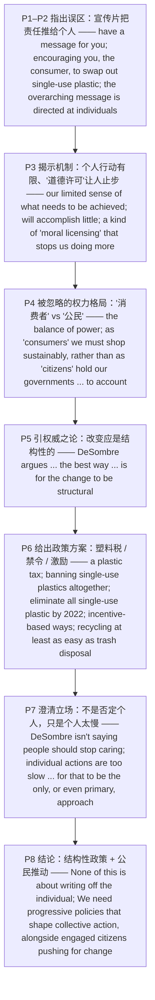

# 塑料危机：从个人行动到结构性变革 精读笔记

---

## 背景

> 本文是 **2019 年考研英语（一）Text 4**（第 36—40 题），一篇围绕**环保责任归属**的**评论性议论文**。文章从一组名人公益视频切入：施瓦辛格等明星为世界环境日拍片，`encouraging you, the consumer, to swap out your single-use plastic staples to combat the plastics crisis`（**鼓励你这样的消费者淘汰一次性塑料用品，以对抗塑料危机**）——**第 36 题**：明星拍新宣传片的目的是**敦促消费者减少塑料使用** → `[B] urge consumers to cut the use of plastics`。

> 结构上，全文是一条 **"指出误区（把责任推给个人）→ 揭示机制（'道德许可'让个人止步）→ 指出被忽略的权力格局（'消费者' vs '公民'）→ 引权威之论（改变应是结构性的）→ 给出政策方案（塑料税 / 禁令 / 激励机制）→ 澄清立场（不是否定个人）→ 结论（结构性政策 + 公民推动）"** 的推进链。

- **P1—P2 指出误区**：宣传片虽也 `do include a call for governments to enact legislation`（**确实包含要求政府立法的呼吁**），但 `the overarching message is directed at individuals`（**最核心的信息却冲着个人而来**）。`do` 为**强调助动词**，译"确实"。
- **P3 揭示机制**：作者的担忧在于个人行动的 `our limited sense of what needs to be achieved`；`taking our own bags … or quitting plastic straws … will accomplish little`，`They could even be harmful`——`a kind of "moral licensing" that eases our concerns and stops us doing more`（**一种"道德许可"，抚平了担忧、使人不再多做事**）。**第 37 题** → `[B] prevent us from making further efforts`。
- **P4 被忽略的权力格局**：`the balance of power`——`as "consumers" we must shop sustainably, rather than as "citizens" hold our governments and industries to account to push for real systemic change`（**我们被规训成只顾可持续消费的"消费者"，而不是问责政府与产业、推动真正系统性变革的"公民"**）。**第 38 题** → `[D] we should press our government to lead the combat`。
- **P5 引权威之论**：韦尔斯利学院教授 DeSombre 在其新书中主张 `the best way to collectively change the behavior of large numbers of people is for the change to be structural`（**要整体改变大众行为，最佳途径是让改变具有结构性**）。**第 39 题** → `[D] a top-down process`。
- **P6 给出政策方案**：`a plastic tax`、`banning single-use plastics altogether`、印度 `eliminate all single-use plastic … by 2022`、`incentive-based ways`、`ensuring recycling is at least as easy as trash disposal`。
- **P7 澄清立场**：`DeSombre isn't saying people should stop caring`；`individual actions are too slow … for that to be the only, or even primary, approach`（**个人行动太慢，不足以成为唯一甚至主要途径**）。**第 40 题** → `[C] are far from sufficient`。
- **P8 结论**：`None of this is about writing off the individual`；`We need progressive policies that shape collective action, alongside engaged citizens pushing for change`（**既需要塑造集体行动的进步政策，也需要推动变革的积极参与的公民**）。

> **为什么选这篇**：它是考研英语"**环保议题 + 观点论证**"的典型样本；难点集中在：①`that` 从句套从句（P4 一句内三层 `that`）；②**破折号同位命名 + 分词状语**（P1、P3）；③**省略结构**（P4 `rather than as "citizens" (we must) hold …`）；④**被插入语割裂的 too…to 结构**（P7）。全文 **8 段、300 余词**，难度 **中等偏上**，最适合练"**观点态度题 + 指代/省略推断题**"。

---

## 文章原文

# 2019 Passage 4

Arnold Schwarzenegger, Dia Mirza and Adrian Grenier have a message for you: It's easy to beat plastic.

They're part of a bunch of **celebrities** starring in a new video for World Environment Day—encouraging you, the consumer, to **swap out** your **single-use plastic** staples to **combat** the **plastics crisis**.

> [!abstract]- 长难句分析
> **原句**：They're part of a bunch of **celebrities** starring in a new video for World Environment Day—encouraging you, the consumer, to **swap out** your **single-use plastic** staples to **combat** the **plastics crisis**.
>
> **主干提取**：
>
> - 主语 S: They
> - 系动词 V: 're (are)
> - 表语 P: part of a bunch of celebrities (starring in a new video …)
> - 后置定语（现在分词）: starring in a new video for World Environment Day
> - 补充状语（现在分词，破折号引出）: encouraging you … to swap out …
> - 同位语: the consumer
>
> **修饰成分**：
>
> | 类型 | 引导词 / 形式 | 修饰对象 |
> |------|--------------|----------|
> | 现在分词作后置定语 | starring in a new video … | celebrities |
> | 破折号引出分词状语 | —encouraging you … to swap out … | 主句整体（补充说明） |
> | 同位语 | the consumer | you |
> | 不定式作宾语补足语 | to swap out your single-use plastic staples | you |
> | 不定式作目的状语 | to combat the plastics crisis | encouraging … |
>
> **结构图解**：
>
> ```
> 主句: They + 're + part of a bunch of celebrities 〔starring in a new video for World Environment Day〕
>   ├── 现在分词后置定语: starring in a new video …（≈ who star …，修饰 celebrities）
>   └── 破折号引出分词状语: —encouraging you, (the consumer), to swap out your single-use plastic staples
>         ├── 同位语: the consumer（说明 you）
>         ├── 宾语补足语: to swap out your single-use plastic staples
>         └── 目的状语: to combat the plastics crisis
> ```
>
> **参考译文**：他们是一众明星中的成员，正出演一部为世界环境日拍摄的新宣传片——鼓励你这样的消费者淘汰一次性塑料必需品，以对抗塑料危机。
>
> **考点提示**：① 主干 `They're part of a bunch of celebrities`，`starring …` 是**现在分词作后置定语**（= who star）。② 破折号后 `encouraging …` 是**现在分词作补充状语**，逻辑主语为 celebrities。③ `you, the consumer` 中 `the consumer` 是**同位语**。④ `encourage sb to do` 中 `to swap out …` 是**宾语补足语**，`to combat …` 才是**目的状语**。⑤ 本句是**第 36 题定位句**：明星拍片 → 呼吁消费者减少塑料（urge consumers to cut the use of plastics）。

The key messages that have been put together for World Environment Day do include a call for governments to **enact legislation** to **curb** single-use plastics.

> [!abstract]- 长难句分析
> **原句**：The key messages that have been put together for World Environment Day do include a call for governments to **enact legislation** to **curb** single-use plastics.
>
> **主干提取**：
>
> - 主语 S: The key messages (that have been put together for World Environment Day)
> - 定语从句: that have been put together for World Environment Day
> - 强调助动词: do
> - 谓语 V: include
> - 宾语 O: a call (for governments to enact legislation …)
> - 后置定语（不定式复合结构）: for governments to enact legislation
> - 目的状语: to curb single-use plastics
>
> **修饰成分**：
>
> | 类型 | 引导词 / 形式 | 修饰对象 |
> |------|--------------|----------|
> | that 引导定语从句 | that have been put together … | The key messages |
> | 现在完成时被动 | have been put together | messages |
> | 强调助动词 | do include | 强调谓语 |
> | 不定式复合结构作后置定语 | for governments to enact legislation | a call |
> | 不定式作目的状语 | to curb single-use plastics | enact legislation |
>
> **结构图解**：
>
> ```
> 主句: The key messages 〔(that) have been put together for World Environment Day〕 + do + include + 〔a call (for governments to enact legislation)〕
>   ├── that 定语从句: that have been put together …（修饰 messages，含现在完成时被动）
>   ├── 强调助动词: do include（确实包含）
>   └── 不定式复合结构后置定语: for governments to enact legislation（修饰 a call）
>         └── 目的状语: to curb single-use plastics
> ```
>
> **参考译文**：为世界环境日汇总的核心理念中，确实包含一项呼吁，即要求各国政府制定立法以限制一次性塑料。
>
> **考点提示**：① `do include` 中 `do` 为**强调助动词**，译作"确实包含"，仅用于肯定句。② `that have been put together …` 是**定语从句**修饰 messages，其中 `have been put together` 为**现在完成时被动**。③ `a call for sb to do` 中 `for governments to enact legislation` 是**不定式复合结构作后置定语**。④ 句末 `to curb …` 是**目的状语**。⑤ 本句与下一句构成**转折**：政府立法只是"核心理念之一"，重点其实在个人（overarching message is directed at individuals），由此引出作者的批判。

But the **overarching** message is directed at individuals.

My **concern** with leaving it up to the individual, however, is our **limited sense** of what needs to be achieved.

On their own, taking our own bags to the grocery store or quitting plastic straws, for example, will **accomplish little** and require very little of us.

They could even be harmful, satisfying a need to have “done our bit” without ever progressing onto bigger, bolder, more effective actions—a kind of “**moral licensing**” that **eases** our concerns and stops us doing more and asking more of those in charge.

> [!abstract]- 长难句分析
> **原句**：They could even be harmful, satisfying a need to have “done our bit” without ever progressing onto bigger, bolder, more effective actions—a kind of “**moral licensing**” that **eases** our concerns and stops us doing more and asking more of those in charge.
>
> **主干提取**：
>
> - 主语 S: They
> - 谓语 V: could even be
> - 表语 P: harmful
> - 分词状语: satisfying a need to have “done our bit” without ever progressing …
> - 同位命名（破折号引出）: a kind of “moral licensing” (that …)
> - 定语从句: that eases our concerns and stops us doing more and asking more of those in charge
>
> **修饰成分**：
>
> | 类型 | 引导词 / 形式 | 修饰对象 |
> |------|--------------|----------|
> | 现在分词作伴随/结果状语 | satisfying a need … | 主句 They could be harmful |
> | 介词 without + 动名词 | without ever progressing onto … | satisfying 的补充 |
> | 不定式作后置定语 | to have “done our bit” | a need |
> | 破折号引出同位命名 | —a kind of “moral licensing” | 前面的 actions |
> | that 引导定语从句 | that eases … and stops … | moral licensing |
> | 并列谓语 | eases … and stops … | that 从句内部 |
> | 比较级并列递进 | bigger, bolder, more effective | actions |
> | 引号标记术语 | “done our bit” / “moral licensing” | 特定说法/概念 |
>
> **结构图解**：
>
> ```
> 主句: They + could even be + harmful
>   ├── 现在分词状语: satisfying a need (to have “done our bit”) 〔without ever progressing onto bigger, bolder, more effective actions〕
>   │      └── 比较级递进: bigger, bolder, more effective（修饰 actions）
>   └── 破折号同位命名: —a kind of “moral licensing” 〔that eases our concerns and stops us doing more and asking more of those in charge〕
>         └── that 定语从句: that eases … and stops …
>               ├── 并列谓语1: eases our concerns
>               └── 并列谓语2: stops us doing more and asking more of those in charge
> ```
>
> **参考译文**：这类做法甚至可能有害：它们满足了我们"已经尽了一份力"的心理需求，却让我们止步不前，不去采取更大、更果断、更有效的行动——这是一种"道德许可"，它抚平了我们的担忧，使我们不再多做事，也不再对当权者提出更多要求。
>
> **考点提示**：① 主干 `They could even be harmful`；`satisfying …` 是**现在分词作伴随/结果状语**，逻辑主语为 They。② `a need to have “done our bit”` 中 `to have …` 是**不定式作后置定语**。③ 破折号后 `a kind of “moral licensing”` 是**同位命名**，其后 `that eases … and stops …` 是**定语从句**，含**并列谓语**。④ `bigger, bolder, more effective` 为**比较级并列递进**。⑤ 本句是**第 37 题定位句**：`stops us doing more` → prevent us from making further efforts。

While the conversation around our environment and our responsibility toward it remains **centered on** shopping bags and straws, we're ignoring the **balance of power** that implies that as “consumers” we must shop **sustainably**, rather than as “citizens” **hold** our governments and industries **to account** to push for real **systemic change**.

> [!abstract]- 长难句分析
> **原句**：While the conversation around our environment and our responsibility toward it remains **centered on** shopping bags and straws, we're ignoring the **balance of power** that implies that as “consumers” we must shop **sustainably**, rather than as “citizens” **hold** our governments and industries **to account** to push for real **systemic change**.
>
> **主干提取**：
>
> - 对比状语从句: While the conversation … remains centered on shopping bags and straws
> - 主句·主语 S: we
> - 主句·谓语 V: 're ignoring
> - 主句·宾语 O: the balance of power (that …)
> - 定语从句: that implies that …
> - 宾语从句: that as “consumers” we must shop sustainably, rather than as “citizens” (we must) hold …
> - 目的状语: to push for real systemic change
>
> **修饰成分**：
>
> | 类型 | 引导词 / 形式 | 修饰对象 |
> |------|--------------|----------|
> | while 引导对比状语从句 | While the conversation … remains centered on … | 主句 we're ignoring … |
> | that 引导定语从句 | that implies that … | the balance of power |
> | that 引导宾语从句 | that as “consumers” we must shop … | implies |
> | rather than 并列 | as “consumers” … rather than as “citizens” … | we must shop … |
> | 省略结构 | as “citizens” (we must) hold … | 与前半并列（承前省略 we must） |
> | 固定搭配 | hold sb to account | 问责某人 |
> | 不定式作目的状语 | to push for real systemic change | hold … to account |
>
> **结构图解**：
>
> ```
> 主句: 〔While the conversation … remains centered on shopping bags and straws〕, we + 're ignoring + the balance of power
>   ├── while 对比状语从句: the conversation … remains centered on …
>   └── that 定语从句: that implies 〔that as “consumers” we must shop sustainably, rather than as “citizens” (we must) hold … to account〕
>         └── that 宾语从句: as “consumers” we must shop … , rather than as “citizens” …
>               ├── 并列1: as “consumers” we must shop sustainably
>               ├── rather than 并列2: as “citizens” (we must) hold our governments … to account（省略 we must）
>               └── 目的状语: to push for real systemic change
> ```
>
> **参考译文**：当围绕环境以及我们对环境之责任的讨论仍聚焦于购物袋和吸管时，我们却忽略了一种权力格局——它暗示我们作为"消费者"必须可持续地消费，而不是作为"公民"去问责政府和产业界，以推动真正的系统性变革。
>
> **考点提示**：① 主干 `we're ignoring the balance of power`，`while` 引导**对比状语从句**。② `that implies that …` 是**定语从句套宾语从句**，需逐层剥离：外层 that 从句修饰 `balance of power`，内层 that 从句作 `implies` 的宾语。③ `as “consumers” … rather than as “citizens” …` 为 **rather than 并列**，后半省略了 `we must`。④ `hold sb to account` = 问责某人；`to push for …` 是**目的状语**。⑤ 本句是**第 38 题定位句**：作为公民应问责政府 → press our government to lead the combat。

It's important to **acknowledge** that the environment isn't everyone's **priority**—or even most people's.

We shouldn't expect it to be.

In her latest book, Why Good People Do Bad Environmental Things, Wellesley College professor Elizabeth R. DeSombre **argues** that the best way to **collectively** change the behavior of large numbers of people is for the change to be **structural**.

> [!abstract]- 长难句分析
> **原句**：In her latest book, Why Good People Do Bad Environmental Things, Wellesley College professor Elizabeth R. DeSombre **argues** that the best way to **collectively** change the behavior of large numbers of people is for the change to be **structural**.
>
> **主干提取**：
>
> - 状语 A: In her latest book, … 
> - 同位语: Why Good People Do Bad Environmental Things
> - 主语 S: Wellesley College professor Elizabeth R. DeSombre
> - 谓语 V: argues
> - 宾语从句: that the best way (to … change …) is for the change to be structural
> - 宾语从句·主语 S: the best way (to collectively change the behavior of large numbers of people)
> - 宾语从句·系动词 V: is
> - 宾语从句·表语 P: for the change to be structural
>
> **修饰成分**：
>
> | 类型 | 引导词 / 形式 | 修饰对象 |
> |------|--------------|----------|
> | 介词短语作状语 | In her latest book, … | 全句 |
> | 同位语 | Why Good People Do Bad Environmental Things | her latest book |
> | 同位语 | Wellesley College professor | Elizabeth R. DeSombre |
> | that 引导宾语从句 | that the best way … is … | argues |
> | 不定式作后置定语 | to collectively change the behavior … | the best way |
> | 不定式复合结构作表语 | for the change to be structural | is |
>
> **结构图解**：
>
> ```
> 主句: 〔In her latest book, Why Good People Do Bad Environmental Things〕, 〔Wellesley College professor〕 Elizabeth R. DeSombre + argues + 〔that the best way (to collectively change the behavior of large numbers of people) is (for the change to be structural)〕
>   ├── 同位语: Why Good People Do Bad Environmental Things（说明 her latest book）
>   ├── 同位语: Wellesley College professor（说明 DeSombre 的身份）
>   └── that 宾语从句: the best way 〔to … change …〕 is 〔for the change to be structural〕
>         ├── 不定式后置定语: to collectively change the behavior …（修饰 the best way）
>         └── 不定式复合结构作表语: for the change to be structural
> ```
>
> **参考译文**：韦尔斯利学院教授伊丽莎白·R·德松布尔在其新书《为什么好人会做对环境不利的事》中主张：要从整体上改变大量人群的行为，最佳途径是让这种改变具有结构性。
>
> **考点提示**：① 主语被两个**同位语**（书名、身份）层层包裹，答题须**跳过同位语**抓主谓 `DeSombre argues`。② `argues that …` 引导**宾语从句**。③ `the best way to do` 中 `to collectively change …` 是**不定式作后置定语**。④ `is for the change to be structural` 中 `for the change to be …` 是**不定式复合结构作表语**。⑤ 本句是**第 39 题定位句**：`structural`（结构性的）→ a top-down process。

This might mean **implementing** policy such as a **plastic tax** that adds a cost to environmentally problematic action, or **banning** single-use plastics **altogether**.

> [!abstract]- 长难句分析
> **原句**：This might mean **implementing** policy such as a **plastic tax** that adds a cost to environmentally problematic action, or **banning** single-use plastics **altogether**.
>
> **主干提取**：
>
> - 主语 S: This
> - 谓语 V: might mean
> - 宾语 O（动名词短语 1）: implementing policy (such as a plastic tax that …)
> - 插入举例: such as a plastic tax (that …)
> - 宾语 O（动名词短语 2）: banning single-use plastics altogether
>
> **修饰成分**：
>
> | 类型 | 引导词 / 形式 | 修饰对象 |
> |------|--------------|----------|
> | 并列动名词作宾语 | implementing … or banning … | mean |
> | such as 插入举例 | such as a plastic tax … | policy |
> | that 引导定语从句 | that adds a cost to … action | plastic tax |
> | 副词作状语 | altogether | banning single-use plastics |
>
> **结构图解**：
>
> ```
> 主句: This + might mean + 〔implementing policy, or banning single-use plastics altogether〕
>   ├── 动名词宾语1: implementing policy 〔such as a plastic tax (that adds a cost to environmentally problematic action)〕
>   │      ├── such as 插入举例: such as a plastic tax
>   │      └── that 定语从句: that adds a cost to …（修饰 plastic tax）
>   └── 动名词宾语2（并列）: banning single-use plastics altogether
> ```
>
> **参考译文**：这可能意味着推行诸如"塑料税"这样的政策——为对环境不利的行为增加成本，或者彻底禁止一次性塑料。
>
> **考点提示**：① 主干 `This might mean implementing … or banning …`，`mean` 后接**两个并列的动名词短语**作宾语（`mean doing` = 意味着）。② `such as a plastic tax` 是**插入举例**，`that adds a cost to …` 是**定语从句**修饰 plastic tax。③ `or banning …` 与 `implementing …` **并列**，勿误读为主句谓语。④ `altogether` = 彻底地。⑤ 本句是**第 39 题**的政策例证（`plastic tax` / `banning` 皆属自上而下的结构性手段）。

India has just announced it will “**eliminate** all single-use plastic in the country by 2022.”

There are also **incentive-based** ways of making better environmental choices easier, such as ensuring recycling is at least as easy as **trash disposal**.

DeSombre isn't saying people should stop caring about the environment.

It's just that individual actions are too slow, she says, for that to be the only, or even **primary**, approach to changing **widespread** behavior.

> [!abstract]- 长难句分析
> **原句**：It's just that individual actions are too slow, she says, for that to be the only, or even **primary**, approach to changing **widespread** behavior.
>
> **主干提取**：
>
> - 主语 S: It
> - 系动词 V: 's (is)
> - 表语从句: that individual actions are too slow … for that to be the only … approach …
> - 插入语: she says
> - 表语从句·主语 S: individual actions
> - 表语从句·系动词 V: are
> - 表语从句·表语 P: too slow … for that to be the only, or even primary, approach to changing widespread behavior
>
> **修饰成分**：
>
> | 类型 | 引导词 / 形式 | 修饰对象 |
> |------|--------------|----------|
> | that 引导表语从句 | that individual actions are too slow … | is |
> | 插入语 | she says | 全句（补充信息来源） |
> | too … to … 结构（被割裂） | too slow … for that to be … | individual actions |
> | 不定式复合结构 | for that to be the only … approach | too … to 中的 to |
> | or even 递进 | or even primary | the only |
> | 介词短语作后置定语 | to changing widespread behavior | approach（to 为介词） |
>
> **结构图解**：
>
> ```
> 主句: It + 's + 〔just that individual actions are too slow, (she says,) for that to be the only, or even primary, approach (to changing widespread behavior)〕
>   ├── that 表语从句: individual actions are too slow … for that to be …
>   │      ├── 插入语: she says
>   │      ├── too … to … 结构: too slow … for that to be …（= 太慢以致不能成为……）
>   │      └── 不定式复合结构: for that to be the only … approach
>   └── 后置定语: to changing widespread behavior（修饰 approach，to 为介词）
> ```
>
> **参考译文**：她只是说，个人行动太慢了，不足以成为改变普遍行为的唯一途径，甚至不足以成为主要途径。
>
> **考点提示**：① `It's just that …` 是**表语从句**句式，表"只是……罢了"，用于补充、弱化前句语气。② `she says` 是**插入语**，把 `too slow` 与 `for that to be …` **割裂**，断句时要还原。③ `too … for sth to be …` 是 **too…to 结构**（本身含否定），= 太……以致不能……。④ `approach to doing` 中 `to` 是**介词**，后接动名词。⑤ 本句是**第 40 题定位句**：`too slow … for that to be the only … approach` → individual efforts are far from sufficient。

None of this is about **writing off** the individual.

It's just about **putting things into perspective**.

We don't have time to wait.

We need **progressive policies** that shape **collective action**, **alongside** **engaged citizens** pushing for change.

> [!abstract]- 长难句分析
> **原句**：We need **progressive policies** that shape **collective action**, **alongside** **engaged citizens** pushing for change.
>
> **主干提取**：
>
> - 主语 S: We
> - 谓语 V: need
> - 宾语 O: progressive policies (that …), alongside engaged citizens (pushing …)
> - 定语从句: that shape collective action
> - 后置定语（现在分词）: pushing for change
>
> **修饰成分**：
>
> | 类型 | 引导词 / 形式 | 修饰对象 |
> |------|--------------|----------|
> | that 引导定语从句 | that shape collective action | progressive policies |
> | alongside 并列 | alongside engaged citizens … | progressive policies |
> | 现在分词作后置定语 | pushing for change | engaged citizens |
>
> **结构图解**：
>
> ```
> 主句: We + need + progressive policies 〔that shape collective action〕, 〔alongside engaged citizens (pushing for change)〕
>   ├── that 定语从句: that shape collective action（修饰 progressive policies）
>   └── alongside 并列: alongside engaged citizens
>         └── 现在分词后置定语: pushing for change（修饰 citizens）
> ```
>
> **参考译文**：我们既需要能够塑造集体行动的进步政策，也需要积极参与、推动变革的公民。
>
> **考点提示**：① `that shape collective action` 是**定语从句**修饰 progressive policies。② `alongside` 作介词连接**并列名词短语**，表"既需要 A，也需要 B"。③ `engaged citizens pushing for change` 中 `pushing …` 是**现在分词作后置定语**。④ 本句是**全篇主旨句**：结构性政策 + 公民推动 = 作者的解决方案（呼应第 40 题的立场）。

## 题目

### 36. Some celebrities star in a new video to ____.

- [A] demand new laws on the use of plastics
- [B] urge consumers to cut the use of plastics
- [C] invite public opinion on the plastics crisis
- [D] disclose the causes of the plastics crisis

### 37. The author is concerned that “moral licensing” may ____.

- [A] mislead us into doing worthless things
- [B] prevent us from making further efforts
- [C] weaken our sense of accomplishment
- [D] suppress our desire for success

### 38. By pointing out our identity as “citizens”, the author indicates that ____.

- [A] our focus should be shifted to community welfare
- [B] our relationship with local industries is improving
- [C] we have been actively exercising our civil rights
- [D] we should press our government to lead the combat

### 39. DeSombre argues that the best way for a collective change should be ____.

- [A] a win-win arrangement
- [B] a self-driven mechanism
- [C] a cost-effective approach
- [D] a top-down process

### 40. The author concludes that individual efforts ____.

- [A] can be too aggressive
- [B] can be too inconsistent
- [C] are far from sufficient
- [D] are far from rational

---

## 翻译对照

# 2019 Passage 4 中英对照翻译

## Paragraph 1

Arnold Schwarzenegger, Dia Mirza and Adrian Grenier have a message for you: It's easy to beat plastic. They're part of a bunch of celebrities starring in a new video for World Environment Day—encouraging you, the consumer, to swap out your single-use plastic staples to combat the plastics crisis.

阿诺德·施瓦辛格、迪亚·米尔扎和阿德里安·格伦尼给你捎来一个信息：战胜塑料很容易。他们是一众明星中的成员，正在为世界环境日拍摄一部新宣传片——鼓励你这样的消费者淘汰一次性塑料必需品，以对抗塑料危机。

> [!note] 翻译说明
> - `have a message for you` = "给你带个话 / 有个信息要告诉你"；`beat plastic` 中 `beat` = "战胜、打败"，此处名词化的 `plastic` 泛指"塑料（污染）"。
> - `starring in a new video` 是**现在分词短语作后置定语**，修饰 `celebrities`；破折号后的 `encouraging ...` 是**现在分词作伴随/补充说明**，逻辑主语为 `celebrities`。
> - `swap out` = "换掉、淘汰"；`single-use plastic staples` = "一次性塑料必需品"（`staples` = "主要用品、基本物品"）；`combat` = "对抗、抗击"。

## Paragraph 2

The key messages that have been put together for World Environment Day do include a call for governments to enact legislation to curb single-use plastics. But the overarching message is directed at individuals.

为世界环境日汇总的核心理念中，确实包含一项呼吁，即要求各国政府制定立法以限制一次性塑料。但最主要的信息却是冲着个人而来的。

> [!note] 翻译说明
> - `do include` 中 `do` 为**强调助动词**，译作"确实包含"；`enact legislation` = "制定/颁布立法"；`curb` = "限制、抑制"。
> - `that have been put together for World Environment Day` 是**定语从句**修饰 `The key messages`。
> - `be directed at sb` = "针对某人 / 以某人为对象"；`overarching` = "首要的、统领一切的"。

## Paragraph 3

My concern with leaving it up to the individual, however, is our limited sense of what needs to be achieved. On their own, taking our own bags to the grocery store or quitting plastic straws, for example, will accomplish little and require very little of us. They could even be harmful, satisfying a need to have "done our bit" without ever progressing onto bigger, bolder, more effective actions—a kind of "moral licensing" that eases our concerns and stops us doing more and asking more of those in charge.

然而，我对于把问题推给个人的担忧在于，我们对需要达成的目标认识有限。举例来说，仅凭个人之力，自带购物袋去杂货店、或戒掉塑料吸管，收效甚微，也几乎不需要我们付出多少。这类做法甚至可能有害：它们满足了我们"已经尽了一份力"的心理需求，却让我们止步不前，不去采取更大、更果断、更有效的行动——这是一种"道德许可"，它抚平了我们的担忧，使我们不再多做事，也不再对当权者提出更多要求。

> [!note] 翻译说明
> - `leave it up to sb` = "把（某事）交给某人决定 / 由某人负责"；`limited sense of what needs to be achieved` = "对需要达成什么认识有限"。
> - `On their own` = "仅凭自身之力"；`accomplish little` = "收效甚微"；`require very little of us` = "对我们要求很少"。
> - `done our bit` = "尽了自己的一份力"；`moral licensing` = "道德许可"（心理学概念：做了小善举后为自己的不作为开脱）。
> - `satisfying a need ...` 是**现在分词作伴随/结果状语**；`that eases our concerns and stops us doing more` 是**定语从句**修饰 `moral licensing`；`those in charge` = "当权者、负责人"。

## Paragraph 4

While the conversation around our environment and our responsibility toward it remains centered on shopping bags and straws, we're ignoring the balance of power that implies that as "consumers" we must shop sustainably, rather than as "citizens" hold our governments and industries to account to push for real systemic change.

当围绕环境以及我们对环境之责任的讨论仍聚焦于购物袋和吸管时，我们却忽略了一种权力格局——它暗示我们作为"消费者"必须可持续地消费，而不是作为"公民"去问责政府和产业界，以推动真正的系统性变革。

> [!note] 翻译说明
> - `While ... , we're ignoring ...` 中 `While` 引导**让步/对比状语从句**，译作"当……时 / 尽管……"。
> - `remain centered on` = "仍然聚焦于"；`balance of power` = "权力格局、力量平衡"。
> - `hold sb to account` = "要求某人作出解释 / 问责某人"；`push for` = "推动、争取"；`systemic change` = "系统性变革"（注意与 `systematic` 系统性/有条理的区分）。
> - `rather than` 并列的是 `as "consumers" we must shop ...` 与 `as "citizens" (we must) hold ...`，后半句省略了 `we must`。

## Paragraph 5

It's important to acknowledge that the environment isn't everyone's priority—or even most people's. We shouldn't expect it to be. In her latest book, Why Good People Do Bad Environmental Things, Wellesley College professor Elizabeth R. DeSombre argues that the best way to collectively change the behavior of large numbers of people is for the change to be structural.

必须承认，环境并非人人关心的事——甚至不是大多数人关心的事。我们也不该指望它会是。韦尔斯利学院教授伊丽莎白·R·德松布尔在其新书《为什么好人会做对环境不利的事》中主张：要从整体上改变大量人群的行为，最佳途径是让这种改变具有结构性。

> [!note] 翻译说明
> - `acknowledge` = "承认、认可"；`priority` = "优先事项、头等大事"。
> - `or even most people's` 后省略了 `priority`，即"甚至不是大多数人的优先事项"。
> - `argues that ...` 引导**宾语从句**；`for the change to be structural` 是**不定式复合结构**（for sb/sth to do）作表语，表"改变应是结构性的"。

## Paragraph 6

This might mean implementing policy such as a plastic tax that adds a cost to environmentally problematic action, or banning single-use plastics altogether. India has just announced it will "eliminate all single-use plastic in the country by 2022." There are also incentive-based ways of making better environmental choices easier, such as ensuring recycling is at least as easy as trash disposal.

这可能意味着推行诸如"塑料税"这样的政策——为对环境不利的行为增加成本，或者彻底禁止一次性塑料。印度刚刚宣布，将在"2022 年前消除全国所有一次性塑料"。此外还有一些以激励为基础的办法，能让更环保的选择变得更容易，例如确保回收至少和丢弃垃圾一样方便。

> [!note] 翻译说明
> - `implementing policy` 与 `banning single-use plastics` 是 `mean` 后**并列的两个动名词短语**作宾语。
> - `plastic tax` = "塑料税"；`adds a cost to ... action` = "为……行为增加成本"；`altogether` = "完全、彻底"。
> - `eliminate` = "消除、根除"；`incentive-based` = "以激励为基础的"；`trash disposal` = "垃圾处理/丢弃"。
> - `at least as easy as ...` 是**同级比较**结构，表"至少和……一样容易"。

## Paragraph 7

DeSombre isn't saying people should stop caring about the environment. It's just that individual actions are too slow, she says, for that to be the only, or even primary, approach to changing widespread behavior.

德松布尔并不是说人们应当不再关心环境。她只是说，个人行动太慢了，不足以成为改变普遍行为的唯一途径，甚至不足以成为主要途径。

> [!note] 翻译说明
> - `stop caring about` = "不再关心"，`stop doing` 表"停止做某事"（区别于 `stop to do`）。
> - `It's just that ...` = "只是……罢了"，`that` 引导**表语从句**。
> - `too slow ... for that to be ...` 是**too ... to ... 结构**，被插入语 `she says` 割裂，译作"太慢，以至于不能成为……"；`approach to doing` = "做某事的方法"，`to` 为介词。

## Paragraph 8

None of this is about writing off the individual. It's just about putting things into perspective. We don't have time to wait. We need progressive policies that shape collective action, alongside engaged citizens pushing for change.

这一切绝不是要否定个人。它只是要让我们摆正视角。我们没有时间再等下去。我们既需要能够塑造集体行动的进步政策，也需要积极参与、推动变革的公民。

> [!note] 翻译说明
> - `write off` = "否定、一笔勾销、看轻"；`put things into perspective` = "摆正视角、从全局看待"。
> - `progressive policies` = "进步性政策"；`shape` = "塑造、影响"；`collective action` = "集体行动"。
> - `alongside` = "与……一起、连同"；`engaged citizens pushing for change` 中 `pushing for change` 是**现在分词作后置定语**修饰 `citizens`。
> - 末句 `We need A, alongside B` 结构表"我们既需要 A，也需要 B"，作者最终诉求 = 结构性政策 + 公民推动。

## 题目翻译

### 36. 一些明星出演一部新宣传片，是为了 ____。

- [A] 要求就塑料的使用制定新法律
- [B] 敦促消费者减少塑料的使用
- [C] 就塑料危机征求公众意见
- [D] 披露塑料危机的成因

### 37. 作者担心，"道德许可"可能会 ____。

- [A] 误导我们去做毫无价值的事
- [B] 使我们不再作出进一步的努力
- [C] 削弱我们的成就感
- [D] 压制我们对成功的渴望

### 38. 作者指出我们作为"公民"的身份，意在表明 ____。

- [A] 我们的注意力应转向社区福祉
- [B] 我们与本地产业的关系正在改善
- [C] 我们一直在积极行使公民权利
- [D] 我们应当向政府施压，促其主导这场抗争

### 39. 德松布尔主张，实现集体性改变的最佳途径应当是 ____。

- [A] 一种双赢的安排
- [B] 一种自我驱动的机制
- [C] 一种划算的方法
- [D] 一个自上而下的过程

### 40. 作者最后总结道，个人的努力 ____。

- [A] 可能过于激进
- [B] 可能过于反复无常
- [C] 远远不够
- [D] 远远不够理性

---

## 语法要点

# 2019 Passage 4 语法整理

> [!note] 来源说明
> 本篇**用户未提供语法源笔记**，以下语法点由 `formatted-article.md` 与 `translation.md` **从本文推断提取**，仅收录本篇实际出现的语法现象。
> 每一条均给出**原文语境**，便于回原文核对；标注"（联动）"的条目与相邻专题互为参照。
> 固定搭配与词组见 [[intermediate/2019-passage4-plastic-crisis/固定搭配与词组笔记.md|2019 Passage 4 固定搭配与词组]]。

---

## 一、从句

### 从句：that 引导的定语从句

**概述**：关系代词 `that` 在从句中作**主语或宾语**，紧跟在先行词后引导**限制性定语从句**，修饰名词。本篇多作主语。

| 结构 | 用法 | 例句 |
|------|------|------|
| `先行词 + that + 谓语 …` | that 作主语，修饰前面的名词 | The key messages **that have been put together** for World Environment Day … |
| 同上 | that 作主语 | a kind of “moral licensing” **that eases our concerns and stops us doing more** |
| 同上 | that 作主语（从句内部再套宾语从句） | the balance of power **that implies that …** |
| 同上 | that 作主语 | progressive policies **that shape collective action** |

> [!tip] 解题技巧
> 遇到"**名词 + that + 谓语**"先判断 `that` 是**关系代词（引导定语从句）**还是**连词（引导宾语/表语从句）**：若 `that` 后面紧跟的从句**不完整**（缺主语/宾语），则 `that` 是关系代词；若从句**结构完整**，则是连词。（联动）见"从句：that 引导的宾语从句"。

### 从句：that 引导的宾语从句

**概述**：`that` 作**连词**，引导宾语从句，本身不充当成分但常可省略；从句结构完整。

| 结构 | 用法 | 例句 |
|------|------|------|
| `v. + that + 主谓 …` | that 引导宾从，作 acknowledge 的宾语 | It's important to acknowledge **that the environment isn't everyone's priority** |
| 同上 | 作 implies 的宾语 | the balance of power that implies **that as “consumers” we must shop sustainably** |
| 同上 | 作 argues 的宾语 | professor … DeSombre argues **that the best way … is for the change to be structural** |
| 同上 | 作 ensuring 的宾语（that 常省略） | such as ensuring **(that) recycling is at least as easy as trash disposal** |

> [!warning] 易混点
> `implies that …` 与"从句：that 引导的定语从句"中的 `the balance of power that implies …` 是**从句套从句**：外层 `that implies …` 是定语从句修饰 `balance of power`，内层 `that as “consumers” we must shop sustainably` 才是宾语从句。断句时要逐层剥离。

### 从句：省略 that 的宾语从句

**概述**：口语/书面中，宾语从句的连词 `that` 常被省略，识别时看动词后是否直接跟主谓结构。

| 结构 | 用法 | 例句 |
|------|------|------|
| `v. + (that) + 主语 + 谓语` | 连词 that 省略 | DeSombre isn't saying **(that) people should stop caring about the environment** |

### 从句：that 引导的表语从句

**概述**：`It's just that …` 是固定句式，`that` 引导**表语从句**，表"只是……罢了"，用于补充、弱化前句语气。

| 结构 | 用法 | 例句 |
|------|------|------|
| `It's just that + 主语 + 谓语` | that 引导表语从句 | It's just **that individual actions are too slow** for that to be the only … approach |

> [!tip] 解题技巧
> `It's just that …` 常出现在**转折/让步**语境，作用是"退一步解释原因"，不是新论点的开始，答题时勿把它当成新观点。

### 从句：while 引导的对比/让步状语从句

**概述**：`while` 可引导**时间、对比、让步**状语从句。此处表**对比**（"当……时 / 而……"），主从句形成反差。

| 结构 | 用法 | 例句 |
|------|------|------|
| `While + 从句, 主句` | while 引导对比状语从句 | **While** the conversation … remains centered on shopping bags and straws, we're ignoring the balance of power … |

> [!note] 补充说明
> 本句 `While` 表**对比**而非单纯时间，译作"当……时，我们却……"，暗示"关注点错位"。（联动）对比语气亦可见"结构：rather than 并列"。

### 从句：what 引导的名词性从句（介词宾语）

**概述**：`what` 引导名词性从句，**本身充当从句的成分**（此处作 `needs to be achieved` 的宾语——句中缺主语），整个从句作介词 `of` 的宾语。

| 结构 | 用法 | 例句 |
|------|------|------|
| `介词 + what + 从句` | what 从句作介词宾语 | our limited sense of **what needs to be achieved** |

> [!warning] 易混点
> 与"从句：that 引导的宾语从句"对比：`that` 引导宾从时从句**结构完整**、`that` 不作成分；`what` 引导时从句**缺主语/宾语**，由 `what` 补位。

---

## 二、非谓语动词

### 非谓语：现在分词作后置定语

**概述**：现在分词短语作后置定语，相当于一个**主动语态的定语从句**（`= who/which + 谓语`）。

| 结构 | 用法 | 例句 |
|------|------|------|
| `名词 + 现在分词短语` | = who star，修饰 celebrities | a bunch of celebrities **starring in a new video for World Environment Day** |
| 同上 | = who push，修饰 citizens | engaged citizens **pushing for change** |

> [!tip] 解题技巧
> 现在分词作后置定语表**主动、进行**；过去分词作后置/前置定语表**被动、完成**。（联动）见"非谓语：分词作前置定语"。

### 非谓语：现在分词作伴随/补充状语

**概述**：分词短语作**状语**，逻辑主语通常为句子主语或前文名词，表伴随、方式、结果或补充说明。

| 结构 | 用法 | 例句 |
|------|------|------|
| `…,—现在分词短语` | 破折号后作补充说明，逻辑主语为 celebrities | … World Environment Day**—encouraging you, the consumer, to swap out …** |
| `主句, 现在分词短语` | 作伴随/方式状语，逻辑主语为 They | They could even be harmful, **satisfying a need to have “done our bit”** |

> [!note] 补充说明
> `encouraging …` 前有破折号，属**补充性分词状语**；`satisfying …` 前有逗号，属**伴随/结果分词状语**，二者都不要误读为谓语。

### 非谓语：动名词作宾语

**概述**：动名词（`doing`）作动词或介词的宾语，兼具名词与动词性质。`mean doing` 表"意味着"。

| 结构 | 用法 | 例句 |
|------|------|------|
| `mean + doing` | 动名词作 mean 宾语 | This might mean **implementing policy … or banning single-use plastics altogether** |
| `介词 + doing` | 动名词作介词宾语 | ways of **making better environmental choices easier**; when it comes to … |

### 非谓语：动名词作介词宾语

**概述**：介词后必须接**名词性成分**，故动词须变 **-ing**。本篇介词 `about / of / to` 后多为动名词。

| 结构 | 用法 | 例句 |
|------|------|------|
| `about + doing` | 动名词作 about 的宾语 | None of this is about **writing off** the individual. It's just about **putting things into perspective**. |
| `of + doing` | 动名词作 of 的宾语 | our limited sense of … / ways of **making … easier** |
| `approach to + doing` | to 为介词，后接动名词 | the … approach **to changing** widespread behavior |

> [!warning] 易混点
> `approach to doing`、`leave it up to sb` 中的 `to` 都是**介词**，后接名词/动名词；而 `way to do sth` 中的 `to` 是**不定式符号**，后接动词原形。二者不可混淆。

### 非谓语：不定式作后置定语

**概述**：不定式常作名词后置定语，与被修饰名词有"动宾/同位"关系。

| 结构 | 用法 | 例句 |
|------|------|------|
| `need + to do` | 不定式修饰 need | a need **to have “done our bit”** |
| `way + to do` | 不定式修饰 way | the best way **to collectively change** the behavior of large numbers of people |
| `time + to do` | 不定式修饰 time | We don't have time **to wait**. |

### 非谓语：不定式作目的状语

**概述**：不定式常表**目的**，可译为"为了/以……"。

| 结构 | 用法 | 例句 |
|------|------|------|
| `… to do` | 表目的 | to **swap out** your single-use plastic staples **to combat** the plastics crisis |
| 同上 | 表目的 | a call for governments to enact legislation **to curb** single-use plastics |
| 同上 | 表目的 | … hold our governments … to account **to push for** real systemic change |

### 非谓语：不定式复合结构 for sb to do

**概述**：`for + 名词/代词 + 不定式`，`for` 后的名词是**不定式的逻辑主语**；整体可作定语、表语、主语等。

| 结构 | 用法 | 例句 |
|------|------|------|
| `名词 + for sb to do` | 作 a call 的后置定语 | a call **for governments to enact legislation** |
| `be for sb/sth to do` | 作表语 | the best way … is **for the change to be structural** |
| `too … for sth to do` | 作结果状语 | individual actions are too slow … **for that to be the only … approach** |

### 非谓语：分词作前置定语

**概述**：单个分词或分词化形容词作**前置**定语，直接修饰名词。

| 结构 | 用法 | 例句 |
|------|------|------|
| `过去分词 + 名词` | 表被动/状态 | our **limited** sense of what needs to be achieved |
| `现在分词 + 名词` | 表主动/特征 | the **overarching** message |
| `过去分词 + 名词` | 表状态 | **widespread** behavior；**engaged** citizens |

> [!note] 补充说明
> `limited / engaged` 已形容词化，但仍可作**过去分词作定语**理解（= which is limited / citizens who are engaged）。

---

## 三、语态

### 语态：被动语态

**概述**：`be + 过去分词`，主语是动作的承受者。识别被动有助于判断"谁对谁做了某事"。

| 结构 | 用法 | 例句 |
|------|------|------|
| `have been + p.p.` | 现在完成时的被动 | The key messages that **have been put together** for World Environment Day |
| `be directed at` | 一般现在时的被动 | the overarching message **is directed at** individuals |

> [!tip] 解题技巧
> 被动句是**细节题/推断题**的常见陷阱：谓语用被动时，主语往往是"被处理的对象"，真正的施动者可能被省略（by …），答题时要还原逻辑。

---

## 四、时态与情态

### 时态：现在完成时

**概述**：`have/has + 过去分词`，强调**对现在的影响**或**刚刚发生**，常与 `just / already / yet` 连用。

| 结构 | 用法 | 例句 |
|------|------|------|
| `have been + p.p.` | 现在完成（被动），强调结果 | messages that **have been put together** for World Environment Day |
| `has just + p.p.` | 现在完成 + just，表"刚刚" | India **has just announced** it will “eliminate …” |

### 时态：一般将来时

**概述**：`will + 动词原形` 表**将来预测**或**决心**。

| 结构 | 用法 | 例句 |
|------|------|------|
| `will + do` | 表预测/推断 | will **accomplish** little and require very little of us |
| `will + do` | 表承诺/计划 | India has just announced it **will “eliminate”** all single-use plastic |

### 情态：情态动词 could / must / should

**概述**：情态动词表**可能性、义务、建议**，是**态度题、推断题**的解题关键。

| 结构 | 用法 | 例句 |
|------|------|------|
| `could + do` | 表可能性（较弱） | They **could** even be harmful … |
| `must + do` | 表义务/必要性 | as “consumers” we **must** shop sustainably |
| `shouldn't + do` | 表建议（否定） | We **shouldn't** expect it to be. |
| `should + do` | 表建议/应然 | people **should** stop caring about the environment |

> [!tip] 解题技巧
> 态度题常靠情态动词定调：`could` 表**保留**，`must / should` 表**主张**。本句群中作者用 `shouldn't / should` 反复表达"应然"，呼应其**主张结构性改变**的立场。

---

## 五、倒装与强调

### 强调：强调助动词 do

**概述**：`do/does/did + 动词原形` 表**强调**，译为"确实/的确"，仅用于**肯定句**。

| 结构 | 用法 | 例句 |
|------|------|------|
| `do + v.` | 强调谓语 | The key messages … **do include** a call for governments to enact legislation |

> [!warning] 易混点
> 此处 `do include` 不是疑问，也非助动词对应否定，而是**强调用法**，去掉 `do` 句意不变而语气减弱。译作"确实包含"。

### 强调：全部否定 none of

**概述**：`none of + 名词/代词` 表**全部否定**（"都不"），作主语时谓语用单/复数均可。

| 结构 | 用法 | 例句 |
|------|------|------|
| `None of + 复数/不可数 + 谓语` | 全部否定 | **None of** this is about writing off the individual. |

> [!note] 补充说明
> 本句用 `None of this is about …` 先**排除误解**，再以 `It's just about …` 给出正解，是议论文常见的"**先否定后肯定**"论证句式。本篇无明显倒装句；否定前置的强调主要体现在 `None of …`。

---

## 六、介词短语与复合结构

### 结构：同级比较 as ... as

**概述**：`as + 形容词/副词原级 + as` 表**两者程度相同**；`at least as … as` 表"至少和……一样"。

| 结构 | 用法 | 例句 |
|------|------|------|
| `(at least) as + 原级 + as` | 同级比较 | ensuring recycling is at least **as easy as** trash disposal |

### 结构：比较级并列递进

**概述**：多个比较级并列，表**程度递进**，常与 `bigger, bolder …` 等叠用，增强语气。

| 结构 | 用法 | 例句 |
|------|------|------|
| `比较级, 比较级, 比较级 + 名词` | 并列递进 | bigger, bolder, **more effective** actions |

### 结构：too ... to ... 结构

**概述**：`too + 形容词 + to do` 表"太……以致不能做……"，`to` 后表**否定结果**。此处被插入语 `she says` 割裂。

| 结构 | 用法 | 例句 |
|------|------|------|
| `too + adj + (插入语) + for sth to do` | 被插入语割裂的 too…to 结构 | individual actions are **too slow**, she says, **for that to be** the only … approach |

> [!warning] 易混点
> `too … to do` **本身已含否定**，不可再加 not；本句 `too slow … for that to be …` = "太慢，以至于不能成为……"。

### 结构：rather than 并列

**概述**：`rather than` 连接**两个并列成分**，表"是前者而不是后者"，其后可接名词、动名词、不定式（省略 to）等。

| 结构 | 用法 | 例句 |
|------|------|------|
| `A rather than B` | 并列，前肯后否 | as “consumers” we must shop sustainably, **rather than** as “citizens” hold our governments … to account |

### 结构：alongside 并列

**概述**：`alongside` 作介词表"连同、与……一起"，可连接两个并列名词短语，表"既需要 A，也需要 B"。

| 结构 | 用法 | 例句 |
|------|------|------|
| `A, alongside B` | 并列补充 | We need progressive policies that shape collective action, **alongside** engaged citizens pushing for change. |

---

## 七、修饰与插入（补充要点）

### 修饰：破折号补充说明

**概述**：破折号在句中引出**补充说明、解释或同位命名**，朗读时略作停顿。

| 结构 | 用法 | 例句 |
|------|------|------|
| `…—分词短语` | 引出补充说明 | … World Environment Day—**encouraging you, the consumer, to swap out …** |
| `…—名词短语` | 引出同位命名 | … more effective actions—**a kind of “moral licensing” that eases our concerns …** |

### 修饰：同位语

**概述**：同位语紧跟在名词后，**指同一事物**，起解释、限定作用。

| 结构 | 用法 | 例句 |
|------|------|------|
| `名词, 名词短语,` | 书名作同位语 | In her latest book, **Why Good People Do Bad Environmental Things**, Wellesley College professor … argues … |
| `名词 + 同位语` | 身份作同位语 | **Wellesley College professor Elizabeth R. DeSombre** |

### 修饰：代词指代

**概述**：代词回指前文名词，是**指代题**与**长难句断句**的关键。

| 结构 | 用法 | 例句 |
|------|------|------|
| `They / their` | 回指 celebrities | **They're** part of a bunch of celebrities … |
| `it` | 回指 the environment | the environment isn't everyone's priority … We shouldn't expect **it** to be. |
| `those` | 回指 people（in charge） | asking more of **those in charge** |

### 修饰：引号的强调与转义用法

**概述**：引号可标记**特定概念**、术语或作者**略带质疑/反讽**的态度。

| 结构 | 用法 | 例句 |
|------|------|------|
| `“term”` | 标记术语 | a kind of “**moral licensing**” |
| `“word”` | 表反讽/质疑 | as “**consumers**” … rather than as “**citizens**” … |
| `“短语”` | 引用特定说法 | a need to have “**done our bit**” |

> [!note] 补充说明
> 作者给 `consumers / citizens` 加引号，暗示这两个身份是**被话语建构的标签**，而非理所当然——这是本篇**关键态度线索**。

---

## 固定搭配与词组

# 2019 Passage 4 固定搭配与词组

> [!note] 来源说明
> 本篇**用户未提供词组源笔记**，以下词组由 `formatted-article.md` 与 `translation.md` 提取，收录本篇实际出现的**固定搭配、动词短语与重点表达**。
> 纯语法现象见 [[intermediate/2019-passage4-plastic-crisis/grammar-notes.md|2019 Passage 4 语法整理]]。

---

## 一、塑料危机主题词

| 词组 | 中文 | 原文语境 |
|------|------|----------|
| have a message for sb | 给某人带个话、有个信息要告诉某人 | Arnold Schwarzenegger … **have a message for you** … |
| beat plastic | 战胜塑料（污染） | It's easy to **beat plastic**. |
| be part of | 是……的一部分 | They're **part of** a bunch of celebrities … |
| a bunch of | 一堆、一群 | … **a bunch of** celebrities starring in a new video … |
| star in | 出演、主演 | … celebrities **starring in** a new video for World Environment Day … |
| swap out | 换掉、淘汰 | … to **swap out** your single-use plastic staples … |
| single-use plastic | 一次性塑料 | … your **single-use plastic** staples … |
| combat the plastics crisis | 对抗塑料危机 | … to **combat the plastics crisis**. |
| curb | 限制、抑制 | … to enact legislation to **curb** single-use plastics. |
| trash disposal | 垃圾处理、丢弃垃圾 | … ensuring recycling is at least as easy as **trash disposal**. |

> [!tip] 解题技巧
> 全篇的**问题设定**在第 1、2 段：明星拍片呼吁消费者 `swap out single-use plastic`（第 36 题依据，选 **urge consumers to cut the use of plastics**）。注意 `combat / curb / eliminate` 三个动词都围绕"减少塑料"，是同义替换的**答案信号群**。

---

## 二、个人行动与"道德许可"词

| 词组 | 中文 | 原文语境 |
|------|------|----------|
| leave it up to sb | 交给某人决定、把（问题）推给某人 | My concern with **leaving it up to** the individual … |
| limited sense of | 对……认识有限 | … our **limited sense of** what needs to be achieved. |
| on one's own | 仅凭自身之力 | **On their own**, taking our own bags to the grocery store … |
| grocery store | 杂货店 | … taking our own bags to the **grocery store** … |
| quit plastic straws | 戒掉塑料吸管 | … or **quitting plastic straws**, for example … |
| accomplish little | 收效甚微 | … will **accomplish little** and require very little of us. |
| require little of sb | 对某人要求很少 | … will accomplish little and **require very little of us**. |
| do one's bit | 尽自己的一份力 | … a need to have “**done our bit**” … |
| moral licensing | 道德许可 | … a kind of “**moral licensing**” that eases our concerns … |
| stop sb doing sth | 阻止某人做某事 | … and **stops us doing more** and asking more … |
| those in charge | 当权者、负责人 | … asking more of **those in charge**. |

> [!tip] 解题技巧
> 第 3 段是**作者态度**的核心段。`moral licensing` 后紧跟定语从句 `that eases our concerns and stops us doing more`，直接给出后果——"让人不再努力"，即第 37 题答案 **prevent us from making further efforts**。

---

## 三、公民、政策与变革词

| 词组 | 中文 | 原文语境 |
|------|------|----------|
| be centered on | 聚焦于、以……为中心 | … remains **centered on** shopping bags and straws … |
| balance of power | 权力格局、力量平衡 | … the **balance of power** that implies that … |
| hold sb to account | 要求某人作出解释、问责某人 | … **hold** our governments and industries **to account** … |
| push for | 推动、争取 | … **to push for** real systemic change. |
| systemic change | 系统性变革 | … to push for real **systemic change**. |
| acknowledge | 承认、认可 | It's important to **acknowledge** that … |
| argue that | 主张、论证说 | professor … DeSombre **argues that** … |
| collectively | 从整体上、集体地 | … the best way to **collectively** change the behavior … |
| structural | 结构性的 | … for the change to be **structural**. |
| implement policy | 推行政策 | This might mean **implementing policy** such as a plastic tax … |
| plastic tax | 塑料税 | … such as a **plastic tax** that adds a cost … |
| add a cost to | 为……增加成本 | … **adds a cost to** environmentally problematic action … |
| ban altogether | 彻底禁止 | … or **banning** single-use plastics **altogether**. |
| eliminate | 消除、根除 | India … will “**eliminate** all single-use plastic …” |
| incentive-based | 以激励为基础的 | There are also **incentive-based** ways … |
| widespread behavior | 普遍行为 | … approach to changing **widespread** behavior. |
| write off | 否定、一笔勾销、看轻 | None of this is about **writing off** the individual. |
| put things into perspective | 摆正视角、从全局看待 | It's just about **putting things into perspective**. |
| progressive policies | 进步性政策 | We need **progressive policies** that shape collective action … |
| collective action | 集体行动 | … **collective action**, alongside engaged citizens … |
| alongside | 与……一起、连同 | … **alongside** engaged citizens pushing for change. |
| engaged citizens | 积极参与的公民 | … **engaged citizens** pushing for change. |
| push for change | 推动变革 | … engaged citizens **pushing for change**. |

> [!tip] 解题技巧
> 第 4、8 段点明作者的**核心主张**：`as “consumers” … rather than as “citizens” hold our governments … to account`（第 38 题依据，选 **we should press our government to lead the combat**）；`DeSombre` 的 `structural`（第 39 题，选 **a top-down process**）；结尾 `individual actions are too slow`（第 40 题，选 **are far from sufficient**）。掌握 `hold … to account / structural / too slow` 三个信号词即可串起全篇主旨。

---

## 生词表

> [!note] 收录说明
> 以下词汇取自本文**文章原文**中用 `**粗体**` 标记的考研重点词，按字母顺序分组排列；短语中的关键单词（如 `swap`、`enact`、`incentive`）也单独列出。
> 词义以**考研常考义项**优先，例句一律取自本篇原文，便于回原文核对。

### A-C

| 词汇 | 词性 | 含义 | 原文例句 |
|------|------|------|----------|
| **accomplish** | v. | 完成；实现（`accomplish little` 收效甚微） | "… taking our own bags to the grocery store or quitting plastic straws … will **accomplish little** …" |
| **acknowledge** | v. | 承认、认可 | "It's important to **acknowledge** that the environment isn't everyone's priority—or even most people's." |
| **alongside** | prep. | 与……一起、连同（表并列：既需要 A 也需要 B） | "We need progressive policies that shape collective action, **alongside** engaged citizens pushing for change." |
| **altogether** | adv. | 完全、彻底 | "This might mean implementing policy …, or banning single-use plastics **altogether**." |
| **argues** | v. | 主张、论证说（argue 的第三人称单数） | "… professor Elizabeth R. DeSombre **argues** that the best way … is for the change to be structural." |
| **balance of power** | n. | 权力格局、力量平衡 | "… we're ignoring the **balance of power** that implies that as 'consumers' we must shop sustainably …" |
| **banning** | v. | 禁止（ban 的现在分词 / 动名词；`banning sth altogether` 彻底禁止） | "This might mean implementing policy …, or **banning** single-use plastics altogether." |
| **celebrities** | n. | 名人、明星（celebrity 的复数） | "They're part of a bunch of **celebrities** starring in a new video for World Environment Day …" |
| **centered on** | phr. | 以……为中心、聚焦于 | "While the conversation around our environment … remains **centered on** shopping bags and straws …" |
| **collective action** | n. | 集体行动 | "We need progressive policies that shape **collective action**, alongside engaged citizens pushing for change." |
| **collectively** | adv. | 整体地、集体地 | "… the best way to **collectively** change the behavior of large numbers of people is for the change to be structural." |
| **combat** | v. | 对抗、抗击（此处作动词，非名词"战斗"） | "… encouraging you, the consumer, to swap out your single-use plastic staples to **combat** the plastics crisis." |
| **concern** | n. | 担忧、关切 | "My **concern** with leaving it up to the individual, however, is our limited sense of what needs to be achieved." |
| **curb** | v. | 限制、抑制（此处非名词"路缘"） | "… a call for governments to enact legislation to **curb** single-use plastics." |

### D-J

| 词汇 | 词性 | 含义 | 原文例句 |
|------|------|------|----------|
| **disposal** | n. | 处理、丢弃（`trash disposal` 垃圾处理） | "… such as ensuring recycling is at least as easy as trash **disposal**." |
| **eases** | v. | 减轻、缓解、抚平（ease 的三单） | "… a kind of 'moral licensing' that **eases** our concerns and stops us doing more …" |
| **eliminate** | v. | 消除、根除 | "India has just announced it will '**eliminate** all single-use plastic in the country by 2022.'" |
| **enact** | v. | 颁布、制定（`enact legislation` 制定立法） | "… a call for governments to **enact** legislation to curb single-use plastics." |
| **engaged** | adj. | 积极参与的、投入的 | "… alongside **engaged** citizens pushing for change." |
| **hold** | v. | 要求（某人负责）；持有（`hold sb to account` 问责某人） | "… rather than as 'citizens' **hold** our governments and industries to account …" |
| **implementing** | v. | 推行、实施（implement 的现在分词 / 动名词） | "This might mean **implementing** policy such as a plastic tax …" |
| **incentive** | n. | 激励、刺激、诱因 | "There are also **incentive-based** ways of making better environmental choices easier …" |
| **incentive-based** | adj. | 以激励为基础的 | "There are also **incentive-based** ways of making better environmental choices easier …" |

### K-R

| 词汇 | 词性 | 含义 | 原文例句 |
|------|------|------|----------|
| **legislation** | n. | 立法、法规 | "… a call for governments to enact **legislation** to curb single-use plastics." |
| **limited** | adj. | 有限的（`limited sense of` 对……认识有限） | "… our **limited** sense of what needs to be achieved." |
| **moral licensing** | n. | 道德许可（做了小善举后为不作为开脱的心理） | "… a kind of '**moral licensing**' that eases our concerns and stops us doing more …" |
| **overarching** | adj. | 首要的、统领一切的 | "But the **overarching** message is directed at individuals." |
| **perspective** | n. | 视角、观点（`put things into perspective` 摆正视角） | "It's just about putting things into **perspective**." |
| **plastic tax** | n. | 塑料税 | "This might mean implementing policy such as a **plastic tax** that adds a cost to environmentally problematic action …" |
| **plastics crisis** | n. | 塑料危机 | "… to swap out your single-use plastic staples to combat the **plastics crisis**." |
| **primary** | adj. | 主要的、首要的 | "… for that to be the only, or even **primary**, approach to changing widespread behavior." |
| **priority** | n. | 优先事项、头等大事 | "It's important to acknowledge that the environment isn't everyone's **priority**—or even most people's." |
| **progressive** | adj. | 进步的、渐进的 | "We need **progressive** policies that shape collective action …" |
| **progressive policies** | phr. | 进步性政策 | "We need **progressive policies** that shape collective action, alongside engaged citizens pushing for change." |
| **putting things into perspective** | phr. | 摆正视角、从全局看待 | "It's just about **putting things into perspective**." |

### S-Z

| 词汇 | 词性 | 含义 | 原文例句 |
|------|------|------|----------|
| **single-use** | adj. | 一次性的 | "… your **single-use** plastic staples to combat the plastics crisis." |
| **single-use plastic** | n. | 一次性塑料 | "… to swap out your **single-use plastic** staples to combat the plastics crisis." |
| **structural** | adj. | 结构性的、根本性的（指制度 / 结构层面） | "… the best way … is for the change to be **structural**." |
| **sustainably** | adv. | 可持续地 | "… as 'consumers' we must shop **sustainably** …" |
| **swap** | v. | 交换、替换（`swap out` 换掉、淘汰） | "… encouraging you, the consumer, to **swap** out your single-use plastic staples …" |
| **swap out** | phr. | 换掉、淘汰 | "… encouraging you, the consumer, to **swap out** your single-use plastic staples …" |
| **systemic** | adj. | 系统的、整体的（`systemic change` 系统性变革） | "… to push for real **systemic** change." |
| **systemic change** | n. | 系统性变革 | "… hold our governments and industries to account to push for real **systemic change**." |
| **to account** | phr. | 作出解释、负责（`hold sb to account` 问责某人） | "… hold our governments and industries **to account** …" |
| **trash disposal** | phr. | 垃圾处理、丢弃垃圾 | "… ensuring recycling is at least as easy as **trash disposal**." |
| **widespread** | adj. | 普遍的、广泛的 | "… approach to changing **widespread** behavior." |
| **writing off** | phr. | 否定、一笔勾销、看轻（write off 的现在分词 / 动名词） | "None of this is about **writing off** the individual." |

### 生词练习

**一、选词填空**

从方框中选择合适的词汇填入空白处（每词限用一次）：

> curb / structural / accomplish / incentive / acknowledge / widespread / priority / primary / eliminate / progressive

1. To fight the plastics crisis, governments should ________ single-use plastics rather than leaving it to individuals.

2. DeSombre argues that the best way to change mass behavior is for the change to be ________.

3. On their own, small gestures such as bringing your own bag will ________ little.

4. A plastic tax can work as an ________ to make people choose more sustainable options.

5. We must first ________ that protecting the environment is not everyone's top priority.

6. Plastic pollution has become a ________ problem that affects oceans all over the world.

7. For most people, jobs and family still take ________ over saving the planet.

8. Individual actions are too slow to be the only, or even ________, approach.

9. India has announced it will ________ all single-use plastic in the country by 2022.

10. We need ________ policies that shape collective action, alongside engaged citizens.

> [!abstract]- 答案
> 1. **curb**（限制、抑制）
> 2. **structural**（结构性的）
> 3. **accomplish**（完成；`accomplish little` 收效甚微）
> 4. **incentive**（激励、诱因）
> 5. **acknowledge**（承认）
> 6. **widespread**（普遍的、广泛的）
> 7. **priority**（优先事项）
> 8. **primary**（主要的、首要的）
> 9. **eliminate**（消除、根除）
> 10. **progressive**（进步的）

**二、短语翻译**

将下列短语翻译成中文：

1. hold sb to account

2. swap out single-use plastic

3. put things into perspective

> [!abstract]- 答案
> 1. **hold sb to account** = 要求某人作出解释；问责某人
> 2. **swap out single-use plastic** = 淘汰 / 换掉一次性塑料用品
> 3. **put things into perspective** = 摆正视角；从全局看待事物

**三、语境理解**

根据上下文，选择画线词在句中的准确含义：

1. "… a call for governments to enact legislation to **curb** single-use plastics." 中 **curb** 的含义是：
   - A. 路缘、路边石
   - B. 限制、抑制
   - C. 覆盖、遮盖
   - D. 弯曲、使弯曲

2. "… the best way … is for the change to be **structural**." 中 **structural** 的含义是：
   - A. 建筑的、房屋构造的
   - B. 制度 / 结构层面的、根本性的
   - C. 有组织的、条理分明的
   - D. 有杀伤力的、破坏性的

3. "… to swap out your single-use plastic staples to **combat** the plastics crisis." 中 **combat** 的词性和含义是：
   - A. n. 战斗、格斗
   - B. v. 对抗、抗击
   - C. adj. 战斗的、作战的
   - D. v. 结合、联合

> [!abstract]- 答案
> 1. **B** — 文中 `curb` 作动词，意为"限制、抑制"；"路缘"是其名词义，此处不符。
> 2. **B** — `structural` 在此指"制度 / 结构层面"的变革，与 `systemic change`（系统性变革）呼应，而非物理"建筑结构"。
> 3. **B** — 句中 `combat` 前有 `to`，后面直接跟宾语 `the plastics crisis`，是**动词**，意为"对抗、抗击"，非名词"战斗"。

---

## 心得

> [!tip] 主旨把握
> 全文回答的是**"抗击塑料危机，究竟该靠个人的点滴行动，还是靠结构性的政策变革"**，行文是一条**"指出误区 → 揭示机制 → 指出被忽略的权力格局 → 引权威之论 → 给出政策方案 → 澄清立场 → 结论"**的递进链。
> 第一层**指出误区**：世界环境日的宣传片虽也 `include a call for governments to enact legislation`，但 `the overarching message is directed at individuals`（P1—P2）——把责任推给个人。
> 第二层**揭示机制**：作者的担忧是个人行动的 `limited sense of what needs to be achieved`；`taking our own bags … or quitting plastic straws … will accomplish little`，`They could even be harmful`——`a kind of "moral licensing" that eases our concerns and stops us doing more`（P3）。
> 第三层**指出被忽略的权力格局**：`as "consumers" we must shop sustainably, rather than as "citizens" hold our governments and industries to account to push for real systemic change`（P4）。
> 第四层**引权威之论**：DeSombre 主张 `the best way to collectively change the behavior of large numbers of people is for the change to be structural`（P5）。
> 第五层**给出政策方案**：`a plastic tax`、`banning single-use plastics altogether`、印度 `eliminate` 承诺、`incentive-based ways`、`ensuring recycling is at least as easy as trash disposal`（P6）。
> 第六层**澄清立场**：`DeSombre isn't saying people should stop caring`；`individual actions are too slow`（P7）。
> 第七层**结论**：`None of this is about writing off the individual`；`We need progressive policies that shape collective action, alongside engaged citizens pushing for change`（P8）。
> **一句话概括**：这篇文章真正的意思是——**"把责任推给个人是一种'道德许可'式的自我安慰，它让人满足于'尽了力'，却回避了真正的权力格局；真正的解法是结构性变革（塑料税 / 禁令 / 激励机制），再加上作为'公民'去问责政府、推动变革。"** 最能定性的是三处：`moral licensing`（**道德许可**的陷阱）、`for the change to be structural`（**结构性**的解法）、`individual actions are too slow`（**个人行动太慢**）。

> [!tip] 命题线索
> - **细节 / 目的题（第 36 题）**：题干 `Some celebrities star in a new video to ____`。P1 `encouraging you, the consumer, to swap out your single-use plastic staples to combat the plastics crisis` → **[B] urge consumers to cut the use of plastics**（`encouraging … to swap out` ↔ `urge … to cut`）。[A] `demand new laws` 是**张冠李戴**——政府立法只是 P2 提到的"核心理念之一"，明星宣传片针对的是**个人**；[C]、[D] **无据**。**对策：抓住 `encouraging you, the consumer` 这条"对象 = 消费者"的线索，即可排除 [A] 的"政府 / 法律"方向。**
> - **推断题（第 37 题）**：题干 `The author is concerned that "moral licensing" may ____`。P3 `a kind of "moral licensing" that eases our concerns and stops us doing more` → **[B] prevent us from making further efforts**（`stops us doing more` ↔ `prevent us from making further efforts`）。[A] `doing worthless things` 曲解（原文并未说个人行动"毫无价值"）；[C]、[D] **无据**。**对策：`that` 定语从句直接给出 `moral licensing` 的后果，答案即这句从句的同义改写。**
> - **推断题（第 38 题）**：题干 `By pointing out our identity as "citizens", the author indicates that ____`。P4 `rather than as "citizens" hold our governments and industries to account to push for real systemic change` → **[D] we should press our government to lead the combat**（`hold … to account` ↔ `press`，`governments … to push for real systemic change` ↔ `lead the combat`）。[A] `community welfare`、[B] `relationship with local industries is improving`、[C] `actively exercising our civil rights` 均**无据 / 偷换**。**对策：`hold sb to account` = 问责、施压，方向落在"政府"，而非"社区 / 产业 / 权利"。**
> - **细节题（第 39 题）**：题干 `DeSombre argues that the best way for a collective change should be ____`。P5 `the best way to collectively change the behavior of large numbers of people is for the change to be structural` → **[D] a top-down process**（`structural` 的结构性变革 = 自上而下的政策推动）。[A] `win-win`、[B] `self-driven`、[C] `cost-effective` 均**与"structural"无关**。**对策：`structural`（结构性的）是本题唯一信号词，"自上而下"是其标准同义替换。**
> - **推断题（第 40 题）**：题干 `The author concludes that individual efforts ____`。P7—P8 `individual actions are too slow … for that to be the only, or even primary, approach`；`We need progressive policies … alongside engaged citizens` → **[C] are far from sufficient**（`too slow … for that to be the only … approach` ↔ `far from sufficient`）。[A] `too aggressive`、[B] `too inconsistent`、[D] `too rational` 均**无据**。**对策：结尾处 `too slow` 与 `the only, or even primary` 共同指向"不够"，即 `far from sufficient`。**

> [!warning] 易错点
> - **`do include` 是强调而非疑问**：`The key messages … do include a call for governments to enact legislation` 中 `do` 是**强调助动词**，译作"**确实包含**"，不是疑问或否定。
> - **`leave it up to sb` 是固定搭配**：`My concern with leaving it up to the individual` 中 `leave it up to sb` = "**把（某事）交给某人决定 / 推给某人**"。
> - **`done our bit` / `moral licensing` 须看引号**：两处引号标记的是**特定概念**（"尽了力"的心理与"道德许可"），是理解 P3 论证的关键。
> - **`hold sb to account` 是成语动词**：`hold our governments … to account` = "**要求……作出解释 / 问责**"，`to account` 不可拆开理解。
> - **`rather than` 后是并列省略**：`as "consumers" we must shop … rather than as "citizens" hold …` 中后半**承前省略了 `we must`**。
> - **`It's just that …` 是表语从句**：`It's just that individual actions are too slow …` 中 `that` 引导**表语从句**，表"只是……罢了"，勿与强调句混淆。
> - **`too slow, she says, for that to be …` 是割裂的 too…to 结构**：插入语 `she says` 把 `too slow` 与 `for that to be …` 分开，实为 **too…to 结构**（本身含否定）。
> - **`approach to changing` 中 `to` 是介词**：后接**动名词** `changing`，不是不定式符号。
> - **`structural` vs `systematic`**：`structural`（**结构性的**）指制度 / 结构层面，`systemic change`（**系统性变革**）指整个系统的改变，二者常同现但含义侧重不同，勿混。
> - **`write off` 是"否定"不是"写"**：`None of this is about writing off the individual` = "**这一切绝不是要否定个人**"。

### 论证结构



> [!note] 论证手法
> 全文用足"**欲扬先抑 + 层层递进**"：先承认个人行动（`It's important to acknowledge …`）、澄清立场（`DeSombre isn't saying people should stop caring`），再以 `It's just that …` 转折亮出核心主张——**个人行动太慢，结构性政策才是关键**。结尾 `We need … alongside …` 用**并列结构**收束，把"政策"与"公民"两条腿同时立稳。

---

## 延伸

- **语体背景**：本篇是典型的**评论性议论文（op-ed / argumentative commentary）**，与 [[2019阅读/2019-passage2-forest-carbon-plan-精读笔记.md|2019 Passage 2（森林碳汇）]] 同属"环保议题"，但本篇更进一步：它**挑战"个人行动"这一常识性解法**，把矛头指向被话语建构的"消费者 / 公民"身份，是考研英语里罕见的**批判"个人责任论"** 的选文。
- **读法建议**：第一遍先分清**"作者本人立场"** 与 **"作者转述的对象"**——P5 起大量内容是 DeSombre 的观点（`argues that …`），P7 又以 `DeSombre isn't saying …` 澄清，答题时须锁定**作者借他人之口表达的主张**，不要误当作"作者在批评 DeSombre"。
- **概念延伸**：`moral licensing`（**道德许可**）是行为经济学 / 环境心理学的核心概念——指人做了某件"好事"后，反而为后续的"坏行为"开脱。它解释了为什么"买环保袋"可能**降低**而非提高总体环保投入。可对照 `moral hazard`（道德风险）、`nudge`（助推）一起理解政策工具的"结构 vs 个人"之争。
- **对比阅读**：与 `2019 Passage 1`（[[2019阅读/2019-passage1-guilt-精读笔记.md|guilt / 内疚]]）对比——两篇都在谈"**个人情绪 / 行动**"与"**真正有效的改变**"之间的距离；与 2018 Passage 2（[[2018阅读/2018-passage2-renewable-energy-精读笔记.md|renewable energy]]）对比"政策工具 vs 市场机制"的论证路径。
- **词汇复习**：重点吃透 `moral licensing`、`balance of power`、`hold sb to account`、`structural vs systemic`、`write off`、`put things into perspective` 六组；它们既是本篇信号词，也是"社会议题"类文章的高频语块。
- **联动复习**：语法上回看 [[intermediate/2019-passage4-plastic-crisis/grammar-notes.md|本篇语法整理]] 的"that 从句套从句""省略结构""too…to 结构"三节；搭配上回看 [[intermediate/2019-passage4-plastic-crisis/固定搭配与词组笔记.md|本篇固定搭配]]。

---

## 思考题

### 1. 主旨题
本文作者最可能同意下列哪一说法？
- [A] 消费者只要改变消费习惯，就足以解决塑料危机。
- [B] 把环保责任推给个人，会掩盖真正需要的结构性变革。
- [C] 政府立法比个人行动更不重要。
- [D] 德松布尔主张人们应当停止关心环境。

### 2. 词义题
文中 `moral licensing` 最可能的意思是 ____。
- [A] 为个人小善举所做的正式认证
- [B] 因做了小善举而放松、进而止步于更大行动的心理
- [C] 政府发放的环保许可
- [D] 一种可持续消费的营销策略

### 3. 推断题
从 P4 的 `rather than as "citizens" hold our governments and industries to account` 可以推知，作者认为 ____。
- [A] 消费者与公民两种身份互相排斥，只能二选一
- [B] 真正的变革需要公民去问责政府与产业界
- [C] "公民"这一身份已经过时
- [D] 产业界的自我监管已经足够

### 4. 细节题
根据 P6，下列哪一项**不属于**作者列举的"结构性"手段？
- [A] 塑料税
- [B] 彻底禁止一次性塑料
- [C] 让回收至少和丢弃垃圾一样方便
- [D] 劝导消费者自带购物袋

### 5. 态度题
作者对"把环保责任外包给个人"这一做法的态度是 ____。
- [A] 完全赞同
- [B] 谨慎质疑，认为其掩盖了结构性解法
- [C] 毫不在意
- [D] 认为它是唯一有效途径

---

## 相关笔记

- [[语法总结笔记.md|语法总结笔记]]（跨篇语法汇总）
- [[固定搭配与词组笔记.md|固定搭配与词组笔记]]（跨篇搭配汇总）
- [[单词辨析.md|易混淆单词辨析]]
- [[阅读心得.md|阅读心得]]
- [[2019阅读/2019-passage1-guilt-精读笔记.md|2019 Passage 1（guilt / 内疚）精读笔记]]
- [[2019阅读/2019-passage2-forest-carbon-plan-精读笔记.md|2019 Passage 2（forest carbon plan）精读笔记]]
- [[2018阅读/2018-passage2-renewable-energy-精读笔记.md|2018 Passage 2（renewable energy）精读笔记]]
- 中间文件：
  - [[intermediate/2019-passage4-plastic-crisis/formatted-article.md|2019 Passage 4 排版原文]]
  - [[intermediate/2019-passage4-plastic-crisis/translation.md|2019 Passage 4 中英对照翻译]]
  - [[intermediate/2019-passage4-plastic-crisis/grammar-notes.md|2019 Passage 4 语法整理]]
  - [[intermediate/2019-passage4-plastic-crisis/固定搭配与词组笔记.md|2019 Passage 4 固定搭配与词组]]
