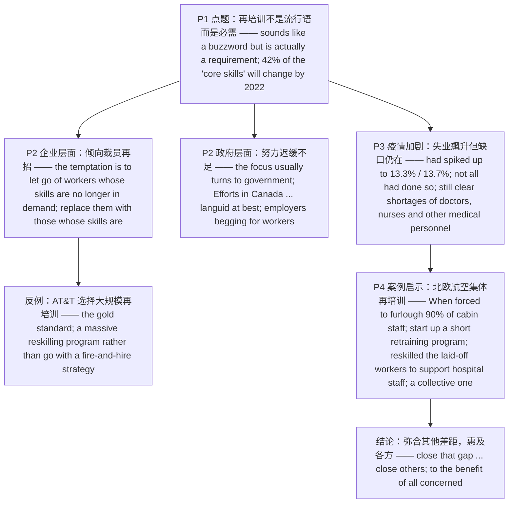

---

# 技能重塑：谁该为再培训买单 精读笔记

---

## 背景

本文选自 **2021 年考研英语（一）Text 1**，主题为 **"再培训"（reskilling）**——在技术变革与疫情冲击下，劳动者技能与岗位需求之间出现的**错配**，以及"**该由谁来为再培训买单**"这一棘手问题。

文章沿"**提出问题 → 企业层面 → 政府层面 → 疫情加剧 → 案例启示**"的链条展开：

- **提出问题**：再培训不是流行语而是必需；世界经济论坛预测，到 2022 年各职位平均 **42% 的"核心技能"**将改变。
- **企业层面**：企业倾向于**解雇技能过时的员工、换上技能对口的人**（"fire-and-hire"），AT&T 则以**大规模再培训**作为反例（gold standard）。
- **政府层面**：当技能错配出现在更广泛的经济中，人们转向政府；但加拿大等地的努力**迟缓不足**，导致"雇主招不到人"与"高失业率"并存。
- **疫情加剧**：失业率飙升，但**结构性缺口仍在**（医疗人员持续短缺）。
- **案例启示**：北欧航空在被迫让 90% 客舱员工停职后，启动**短期再培训**，让被裁员工去支援医院——**集体性的努力**惠及各方。

**难度说明**：中等。结构清晰，但**长难句密集**，含大量**定语从句**（that / where / whose）、**状语从句省略**（`When forced to …`）、**倒装**（`as will …`）与**平行省略**（`rather than go …`），是练习从句与平行结构的良好素材。

---

## 文章原文

# 2021 Passage 1

"**Reskilling**" is something that sounds like a **buzzword** but is actually a requirement if we plan to have a future in which a lot of **would-be workers** do not get **left behind**.

> [!abstract]- 长难句分析
> **原句**："Reskilling" is something that sounds like a buzzword but is actually a requirement if we plan to have a future in which a lot of would-be workers do not get left behind.
>
> **主干提取**：
>
> - 主语 S: "Reskilling"
> - 系动词 V: is
> - 表语 P: something
> - 定语从句: that sounds like a buzzword but is actually a requirement
> - 条件状语从句: if we plan to have a future in which ...
>
> **修饰成分**：
>
> | 类型 | 引导词 / 形式 | 修饰对象 |
> |------|--------------|----------|
> | 定语从句 | that sounds like a buzzword but is actually a requirement | something |
> | 条件状语从句 | if we plan to have a future … | 主句 |
> | 定语从句（介词 + which） | in which a lot of would-be workers do not get left behind | a future |
> | 被动语态 | do not get left behind | would-be workers |
>
> **结构图解**：
>
> ```
> 主句: "Reskilling" + is + something
>   └── 定语从句: that sounds like a buzzword but is actually a requirement
>         ├── 并列谓语 1: sounds like a buzzword
>         └── 并列谓语 2: is actually a requirement
>               └── 条件状语从句: if we plan to have a future 〔in which …〕
>                     └── 介词+which 定语从句: in which a lot of would-be workers do not get left behind
> ```
>
> **参考译文**："再培训"这个词听起来像是个流行语，但如果我们希望拥有这样一个未来——大量潜在的劳动者不至于被甩在后面——那么它其实是一项必需之举。
>
> **考点提示**：① 主干 `"Reskilling" is something`。② `that …` 是**定语从句**修饰 `something`，`that` 作从句主语，从句内含 `but` 并列的两个谓语 `sounds` / `is`。③ `if …` 是**条件状语从句**。④ `in which …` 是**介词 + which 引导的定语从句**，修饰 `a future`。⑤ `get left behind` 是 **`get` + 过去分词**表示的被动，含"被落下"的不利色彩。

We know we are moving into a period where the jobs in demand will change rapidly, as will the requirements of the jobs that remain.

> [!abstract]- 长难句分析
> **原句**：We know we are moving into a period where the jobs in demand will change rapidly, as will the requirements of the jobs that remain.
>
> **主干提取**：
>
> - 主语 S: We
> - 谓语 V: know
> - 宾语从句 O: (that) we are moving into a period …
> - 定语从句: where the jobs in demand will change rapidly
> - 倒装分句: as will the requirements of the jobs that remain
>
> **修饰成分**：
>
> | 类型 | 引导词 / 形式 | 修饰对象 |
> |------|--------------|----------|
> | 宾语从句 | (that) we are moving into a period … | know |
> | 定语从句 | where the jobs in demand will change rapidly | a period |
> | 介词短语作后置定语 | in demand | the jobs |
> | as 引导的倒装分句 | as will the requirements … | 承接前句谓语 |
> | 定语从句 | that remain | the jobs |
>
> **结构图解**：
>
> ```
> 主句: We + know
>   └── 宾语从句: (that) we are moving into a period 〔where …〕
>         └── where 定语从句: where the jobs 〔in demand〕 will change rapidly
>   └── as 引导的倒装分句: as will the requirements of the jobs 〔that remain〕
>         └── 定语从句: that remain
> ```
>
> **参考译文**：我们知道，我们正步入一个时期：市场需求的岗位将迅速变化，留存下来的岗位对其能力的要求也将随之改变。
>
> **考点提示**：① 主干 `We know (that) …`，宾语从句**省略连词 that**。② `where …` 是**定语从句**修饰 `a period`（抽象名词也可用 `where`，= in which）。③ `as will the requirements …` 是**部分倒装**，表"……也一样"，还原为 `the requirements … will change rapidly as well`，是高频考点。④ `that remain` 是**定语从句**修饰 `the jobs`。

Research by the World Economic Forum finds that on average 42 per cent of the "**core skills**" within job roles will change by 2022.

That is a very short timeline.

The question of who should pay for reskilling is a **thorny** one.

For individual companies, the **temptation** is always to **let go of** workers whose skills are no longer in demand and replace them with those whose skills are.

> [!abstract]- 长难句分析
> **原句**：For individual companies, the temptation is always to let go of workers whose skills are no longer in demand and replace them with those whose skills are.
>
> **主干提取**：
>
> - 状语 A: For individual companies
> - 主语 S: the temptation
> - 系动词 V: is
> - 表语 P: always to let go of workers … and (to) replace them with those …
> - 定语从句 1: whose skills are no longer in demand
> - 定语从句 2: whose skills are (in demand)
>
> **修饰成分**：
>
> | 类型 | 引导词 / 形式 | 修饰对象 |
> |------|--------------|----------|
> | 不定式作表语 | to let go of workers … and (to) replace them … | the temptation |
> | 定语从句 | whose skills are no longer in demand | workers |
> | 定语从句 | whose skills are (in demand) | those |
> | 省略 | (in demand) | whose skills are |
>
> **结构图解**：
>
> ```
> 主句: 〔For individual companies〕, the temptation + is + 〔to let go of workers … and (to) replace them with those …〕
>   ├── 不定式 1 作表语: to let go of workers 〔whose skills are no longer in demand〕
>   │     └── 定语从句: whose skills are no longer in demand（修饰 workers）
>   └── 不定式 2 作表语（省略 to）: (to) replace them with those 〔whose skills are (in demand)〕
>         └── 定语从句: whose skills are (in demand)（修饰 those，末尾省略 in demand）
> ```
>
> **参考译文**：对单个公司而言，诱惑始终存在：把技能不再被需要的员工解雇，换上技能被需要的人。
>
> **考点提示**：① 主干 `the temptation is to let go of … and (to) replace …`，**两个不定式并列作表语**，第二个省略 `to`。② 第一个 `whose skills are no longer in demand` 是**定语从句**修饰 `workers`。③ 第二个 `whose skills are` 是**定语从句**修饰 `those`，**末尾省略了 `in demand`**，是易错陷阱。④ `those` 指代前文的 `workers`。

That does not always happen.

AT&T is often given as the **gold standard** of a company that decided to do a **massive** reskilling program rather than go with a **fire-and-hire** strategy.

> [!abstract]- 长难句分析
> **原句**：AT&T is often given as the gold standard of a company that decided to do a massive reskilling program rather than go with a fire-and-hire strategy.
>
> **主干提取**：
>
> - 主语 S: AT&T
> - 谓语 V: is often given
> - 状语 A: as the gold standard of a company …
> - 定语从句: that decided to do a massive reskilling program rather than go with a fire-and-hire strategy
>
> **修饰成分**：
>
> | 类型 | 引导词 / 形式 | 修饰对象 |
> |------|--------------|----------|
> | 被动语态 | is often given as … | AT&T |
> | 定语从句 | that decided to do … | a company |
> | 不定式作宾语 | to do a massive reskilling program | decided |
> | rather than 平行取舍 | rather than (to) go with a fire-and-hire strategy | to do … |
>
> **结构图解**：
>
> ```
> 主句: AT&T + is often given + as the gold standard of a company 〔that …〕
>   └── 定语从句: that decided 〔to do a massive reskilling program〕 〔rather than (to) go with a fire-and-hire strategy〕
>         ├── 不定式作宾语: to do a massive reskilling program
>         └── rather than 并列: (to) go with a fire-and-hire strategy（省略 to）
> ```
>
> **参考译文**：美国电话电报公司（AT&T）常被视为"黄金标准"——它选择实施一项大规模再培训计划，而非采取"裁员再招"的策略。
>
> **考点提示**：① 主干 `AT&T is often given as the gold standard`，为**被动语态**。② `that …` 是**定语从句**修饰 `a company`。③ `rather than` 连接并列成分，前为 `to do …`，后为**省略 `to` 的动词原形** `go with …`，前后结构对等。④ 本句是**第 22 题定位句**：AT&T 提供的是"裁员再招"之外的**替代方案**（an alternative to the fire-and-hire strategy）。

Other companies had also **pledged** to create their own plans.

When the **skills mismatch** is in the broader economy, though, the focus usually turns to government to handle.

> [!abstract]- 长难句分析
> **原句**：When the skills mismatch is in the broader economy, though, the focus usually turns to government to handle.
>
> **主干提取**：
>
> - 状语从句: When the skills mismatch is in the broader economy
> - 插入语: though
> - 主语 S: the focus
> - 谓语 V: usually turns to
> - 宾语 O: government
> - 目的状语: to handle
>
> **修饰成分**：
>
> | 类型 | 引导词 / 形式 | 修饰对象 |
> |------|--------------|----------|
> | 时间/条件状语从句 | When the skills mismatch is … | 主句 |
> | 副词插入语 | though（= however） | 主句（表"然而"） |
> | 不定式作目的状语 | to handle | turns to government |
>
> **结构图解**：
>
> ```
> 〔When the skills mismatch is in the broader economy〕, 〔though〕, the focus + usually turns to + government 〔to handle〕
>   ├── 时间/条件状语从句: When the skills mismatch is in the broader economy
>   ├── 插入语: though（= however，"然而"）
>   └── 目的状语: to handle（去处理）
> ```
>
> **参考译文**：然而，当技能错配出现在更广泛的经济层面时，人们的目光通常会转向政府去处理。
>
> **考点提示**：① `When …` 是**时间/条件状语从句**。② `though` 是**副词插入语**（= however），不是引导让步从句的连词，前后逗号是判据。③ `to handle` 是**不定式作目的状语**。④ `turn to sb (to do sth)` = "转向某人（求助）"。

Efforts in Canada and elsewhere have been arguably **languid** at best, and have given us a situation where we frequently hear of employers **begging for** workers, even at times and in regions where **unemployment** is high.

> [!abstract]- 长难句分析
> **原句**：Efforts in Canada and elsewhere have been arguably languid at best, and have given us a situation where we frequently hear of employers begging for workers, even at times and in regions where unemployment is high.
>
> **主干提取**：
>
> - 主语 S: Efforts in Canada and elsewhere
> - 谓语 V1: have been (arguably languid at best)
> - 谓语 V2: and have given
> - 宾语 O1: us
> - 宾语 O2: a situation …
> - 定语从句 1: where we frequently hear of employers begging for workers
> - 定语从句 2: where unemployment is high
>
> **修饰成分**：
>
> | 类型 | 引导词 / 形式 | 修饰对象 |
> |------|--------------|----------|
> | 介词短语作后置定语 | in Canada and elsewhere | Efforts |
> | 现在完成时并列谓语 | have been … and have given | Efforts |
> | 定语从句 | where we frequently hear of … | a situation |
> | 现在分词作宾语补足语 | begging for workers | employers |
> | 并列状语 | even at times and in regions … | 定语从句 1 |
> | 定语从句 | where unemployment is high | regions |
>
> **结构图解**：
>
> ```
> 主句: Efforts 〔in Canada and elsewhere〕 + have been arguably languid at best, and + have given + us + a situation 〔where …〕
>   └── where 定语从句 1: where we frequently hear of employers 〔begging for workers〕, even at times and in regions 〔where …〕
>         ├── 现在分词作宾补: begging for workers（修饰 employers）
>         └── where 定语从句 2: where unemployment is high（修饰 regions）
> ```
>
> **参考译文**：加拿大及其他地方的努力充其量可以说是迟缓无力，这给我们造成了一种局面：我们时常听说雇主求贤若渴，甚至在一些失业率居高不下的时期和地区也是如此。
>
> **考点提示**：① 主干 `Efforts have been … and have given …`，**两个现在完成时谓语并列**。② `at best` = "充其量、往好里说"。③ `where we frequently hear of …` 是**定语从句**修饰 `a situation`。④ `hear of employers begging` 中 `begging` 是**现在分词作宾语补足语**。⑤ 末尾 `where unemployment is high` 是**定语从句**修饰 `regions`。⑥ 本句是**第 23 题定位句**：加拿大等地应对技能错配的努力"迟缓无力"，即**做得不够**（insufficient）。

With the pandemic, unemployment is very high indeed.

In February, at 3.5 per cent and 5.5 per cent respectively, unemployment rates in Canada and the United States were at **generational lows** and **worker shortages** were everywhere.

As of May, those rates had **spiked up** to 13.3 per cent and 13.7 per cent, and although many worker shortages had disappeared, not all had done so.

> [!abstract]- 长难句分析
> **原句**：As of May, those rates had spiked up to 13.3 per cent and 13.7 per cent, and although many worker shortages had disappeared, not all had done so.
>
> **主干提取**：
>
> - 状语 A: As of May
> - 主语 S1: those rates
> - 谓语 V1: had spiked up to 13.3 per cent and 13.7 per cent
> - 让步状语从句: although many worker shortages had disappeared
> - 主语 S2: not all
> - 谓语 V2: had done so
>
> **修饰成分**：
>
> | 类型 | 引导词 / 形式 | 修饰对象 |
> |------|--------------|----------|
> | 过去完成时 | had spiked up / had disappeared | 表"过去的过去" |
> | 让步状语从句 | although many worker shortages had disappeared | 后一分句 |
> | 部分否定 | not all | 后一分句主语 |
> | 代动词 | had done so（= had disappeared） | 替代前文谓语 |
>
> **结构图解**：
>
> ```
> 〔As of May〕, those rates + had spiked up + to 13.3 per cent and 13.7 per cent,
>   and 〔although many worker shortages had disappeared〕, not all + had done so
>   ├── 过去完成时: had spiked up（截至五月已飙升）
>   ├── 让步状语从句: although many worker shortages had disappeared
>   └── 代动词: had done so = had disappeared
> ```
>
> **参考译文**：到五月份，这两个数字已分别飙升到 13.3% 和 13.7%；尽管许多岗位的用工短缺已消失，但并非全部如此。
>
> **考点提示**：① `As of May` = "截至五月"，配合**过去完成时** `had spiked up`。② `although …` 是**让步状语从句**。③ `not all` 是**部分否定**："并非全部"，**不是**"全都没有消失"。④ `had done so` = `had disappeared`，`do so` 是**代动词**，避免重复。

In the medical field, to take an obvious example, the pandemic meant that there were still clear shortages of doctors, nurses and other **medical personnel**.

> [!abstract]- 长难句分析
> **原句**：In the medical field, to take an obvious example, the pandemic meant that there were still clear shortages of doctors, nurses and other medical personnel.
>
> **主干提取**：
>
> - 状语 A: In the medical field
> - 插入语: to take an obvious example
> - 主语 S: the pandemic
> - 谓语 V: meant
> - 宾语从句 O: that there were still clear shortages of doctors, nurses and other medical personnel
>
> **修饰成分**：
>
> | 类型 | 引导词 / 形式 | 修饰对象 |
> |------|--------------|----------|
> | 不定式插入语 | to take an obvious example | 全句 |
> | 宾语从句 | that there were still clear shortages … | meant |
> | there be 句型 | there were … shortages | 宾语从句内部 |
>
> **结构图解**：
>
> ```
> 〔In the medical field〕, 〔to take an obvious example〕, the pandemic + meant + 〔that there were still clear shortages of doctors, nurses and other medical personnel〕
>   ├── 插入语: to take an obvious example
>   └── 宾语从句: that there were … shortages …（there be 句型）
> ```
>
> **参考译文**：以医疗领域这个显而易见的例子来说，疫情意味着医生、护士及其他医务人员的缺口依然明显。
>
> **考点提示**：① `to take an obvious example` 是**不定式插入语**，去掉后主干完整。② `meant that …` 是**宾语从句**。③ 从句内部为 **there be 句型** `there were still clear shortages of …`。④ 本句是**第 24 题定位句**：第 3 段说明医疗领域仍缺医务人员（a lack of medical workers）。

Of course, it is not like you can take an unemployed waiter and train him to be a doctor in a few weeks.

But even if you cannot **close that gap**, maybe you can close others, and doing so would be **to the benefit of all concerned**.

> [!abstract]- 长难句分析
> **原句**：But even if you cannot close that gap, maybe you can close others, and doing so would be to the benefit of all concerned.
>
> **主干提取**：
>
> - 让步状语从句: even if you cannot close that gap
> - 主句 1: maybe you can close others
> - 主语 S: doing so
> - 系动词 V: would be
> - 表语 P: to the benefit of all concerned
>
> **修饰成分**：
>
> | 类型 | 引导词 / 形式 | 修饰对象 |
> |------|--------------|----------|
> | 让步状语从句 | even if you cannot close that gap | 后文 |
> | 动名词短语作主语 | doing so | 后一分句 |
> | 代动词 | do so（= close others） | 回指前文动作 |
>
> **结构图解**：
>
> ```
> 〔even if you cannot close that gap〕, maybe you + can close + others,
>   and 〔doing so〕 + would be + to the benefit of all concerned
>   ├── 让步状语从句: even if …（即便……）
>   └── 动名词作主语: doing so（这样做），谓语用单数 would be
> ```
>
> **参考译文**：但即便你无法弥合这道鸿沟，也许你可以弥合其他一些差距，而这样做将惠及所有相关方。
>
> **考点提示**：① `even if …` 是**让步状语从句**（"即便"，承认前提仍推进结论），与 `if`（如果）不同。② `doing so` 是**动名词短语作主语**，谓语用**单数** `would be`。③ `so` 回指前文的 `close others`。④ `to the benefit of` = "对……有利"。

That seems to be the case in Sweden: When forced to **furlough** 90 per cent of their **cabin staff**, Scandinavian Airlines decided to start up a short **retraining program** that reskilled the **laid-off workers** to support hospital staff.

> [!abstract]- 长难句分析
> **原句**：That seems to be the case in Sweden: When forced to furlough 90 per cent of their cabin staff, Scandinavian Airlines decided to start up a short retraining program that reskilled the laid-off workers to support hospital staff.
>
> **主干提取**：
>
> - 主语 S: That
> - 系动词 V: seems
> - 表语 P: to be the case in Sweden
> - 主语 S2: Scandinavian Airlines
> - 谓语 V2: decided
> - 宾语 O: to start up a short retraining program …
>
> **修饰成分**：
>
> | 类型 | 引导词 / 形式 | 修饰对象 |
> |------|--------------|----------|
> | 不定式作表语 | to be the case in Sweden | seems |
> | 状语从句的省略 | When (SAS was) forced to furlough … | 后文主句 |
> | 过去分词作状语 | forced to furlough … | Scandinavian Airlines |
> | 不定式作宾语 | to start up a short retraining program | decided |
> | 定语从句 | that reskilled the laid-off workers … | a short retraining program |
> | 不定式作目的状语 | to support hospital staff | reskilled |
>
> **结构图解**：
>
> ```
> 主句: That + seems + 〔to be the case in Sweden〕
>   └── 冒号说明: 〔When (SAS was) forced to furlough 90 per cent of their cabin staff〕, Scandinavian Airlines + decided + 〔to start up a short retraining program〕 〔that …〕
>         ├── 状语从句的省略: When (was) forced to furlough …
>         ├── 不定式作宾语: to start up a short retraining program
>         └── 定语从句: that reskilled the laid-off workers 〔to support hospital staff〕
>               └── 目的状语: to support hospital staff
> ```
>
> **参考译文**：瑞典的情况似乎正是如此：在被迫让 90% 的客舱员工停职待岗后，北欧航空决定启动一项短期再培训计划，让被裁员工接受再培训，去支援医院的工作人员。
>
> **考点提示**：① 主干 `That seems to be the case in Sweden`。② `When forced to furlough …` 是**状语从句的省略**，补全为 `When (Scandinavian Airlines was) forced to furlough …`。③ `to start up …` 是**不定式作宾语**。④ `that reskilled …` 是**定语从句**修饰 `a short retraining program`。⑤ `to support hospital staff` 是**目的状语**。⑥ 本句是**第 25 题定位句**：北欧航空让被裁员工接受再培训去从事**其他岗位**（支援医院），对应选项 B（prepare their laid-off workers for other jobs）。

The effort was a **collective** one and involved other companies as well as a Swedish university.

---

## 题目

### 21. Research by the World Economic Forum suggests ____.

- [A] an increase in full-time employment
- [B] an urgent demand for new job skills
- [C] a steady growth of job opportunities
- [D] a controversy about the "core skills"

### 22. AT&T is cited to show ____.

- [A] an alternative to the fire-and-hire strategy
- [B] an immediate need for government support
- [C] the importance of staff appraisal standards
- [D] the characteristics of reskilling programs

### 23. Efforts to resolve the skills mismatch in Canada ____.

- [A] have driven up labour costs
- [B] have proved to be inconsistent
- [C] have met with fierce opposition
- [D] have appeared to be insufficient

### 24. We can learn from Paragraph 3 that there was ____.

- [A] a call for policy adjustment
- [B] a change in hiring practices
- [C] a lack of medical workers
- [D] a sign of economic recovery

### 25. Scandinavian Airlines decided to ____.

- [A] create job vacancies for the unemployed
- [B] prepare their laid-off workers for other jobs
- [C] retrain their cabin staff for better services
- [D] finance their staff's college education

---

## 翻译对照

# 2021 Passage 1 中英对照翻译

## Paragraph 1

"Reskilling" is something that sounds like a buzzword but is actually a requirement if we plan to have a future in which a lot of would-be workers do not get left behind. We know we are moving into a period where the jobs in demand will change rapidly, as will the requirements of the jobs that remain. Research by the World Economic Forum finds that on average 42 per cent of the "core skills" within job roles will change by 2022. That is a very short timeline.

"再培训"（reskilling）这个词听起来像是个流行语，但如果我们希望拥有这样一个未来——大量潜在的劳动者不至于被甩在后面——那么它其实是一项必需之举。我们知道，我们正步入一个时期：市场需求的岗位将迅速变化，留存下来的岗位对其能力的要求也将随之改变。世界经济论坛的研究发现，到 2022 年，各职位中平均 42% 的"核心技能"将会改变。这是一个非常短的时间线。

> [!note] 翻译说明
> - `reskilling` = "（职业）再培训 / 技能重塑"，指帮助在职或失业者获得新岗位所需技能；`buzzword` = "流行语、时髦术语"。
> - `would-be workers` = "潜在的劳动者、未来的劳动力"；`get left behind` = "被甩在后面、被落下"。
> - `in which a lot of would-be workers do not get left behind` 是**介词 + which 引导的定语从句**，修饰 `a future`。
> - `as will the requirements of the jobs that remain` 是**"as + 助动词 + 主语"的倒装结构**，表示"……也一样"，此处相当于 `the requirements of the jobs that remain will change rapidly as well`。
> - `core skills` = "核心技能"；`job roles` = "职位、岗位职责"；`timeline` = "时间线、时间期限"。

## Paragraph 2

The question of who should pay for reskilling is a thorny one. For individual companies, the temptation is always to let go of workers whose skills are no longer in demand and replace them with those whose skills are. That does not always happen. AT&T is often given as the gold standard of a company that decided to do a massive reskilling program rather than go with a fire-and-hire strategy. Other companies had also pledged to create their own plans. When the skills mismatch is in the broader economy, though, the focus usually turns to government to handle. Efforts in Canada and elsewhere have been arguably languid at best, and have given us a situation where we frequently hear of employers begging for workers, even at times and in regions where unemployment is high.

该由谁来为再培训买单，这个问题很棘手。对单个公司而言，诱惑始终存在：把技能不再被需要的员工解雇，换上技能被需要的人。但这种情况并非总会发生。美国电话电报公司（AT&T）常被视为"黄金标准"——它选择实施一项大规模再培训计划，而非采取"裁员再招"（fire-and-hire）的策略。其他公司也曾承诺制定自己的方案。然而，当技能错配出现在更广泛的经济层面时，人们的目光通常会转向政府去处理。加拿大及其他地方的努力充其量可以说是迟缓无力，这给我们造成了一种局面：我们时常听说雇主求贤若渴，甚至在一些失业率居高不下的时期和地区也是如此。

> [!note] 翻译说明
> - `thorny` = "棘手的、难办的"；`temptation` = "诱惑、倾向"。
> - `let go of` = "解雇、放走"（此处为委婉语，指裁员）；`whose skills are no longer in demand` 是**定语从句**修饰 `workers`。
> - `replace them with those whose skills are` 中 `those` 代指 `workers`，`whose skills are` 后**省略了** `in demand`。
> - `gold standard` = "黄金标准、标杆"；`massive` = "大规模的"；`fire-and-hire` = "先解雇再招聘"，指裁员与招新并行的用工策略。
> - `pledge to do` = "承诺做某事"；`skills mismatch` = "技能错配"。
> - `arguably languid at best` = "往好里说也只能算是迟缓的"，`languid` = "无精打采的、迟缓的"，`at best` = "充其量"。
> - `begging for workers` = "急求工人、招不到人"；`where unemployment is high` 是**定语从句**修饰 `regions`。

## Paragraph 3

With the pandemic, unemployment is very high indeed. In February, at 3.5 per cent and 5.5 per cent respectively, unemployment rates in Canada and the United States were at generational lows and worker shortages were everywhere. As of May, those rates had spiked up to 13.3 per cent and 13.7 per cent, and although many worker shortages had disappeared, not all had done so. In the medical field, to take an obvious example, the pandemic meant that there were still clear shortages of doctors, nurses and other medical personnel.

受疫情影响，失业率确实非常高。二月份时，加拿大和美国的失业率分别为 3.5% 和 5.5%，处于几代人以来的低点，各地都缺工人。到五月份，这两个数字已分别飙升到 13.3% 和 13.7%；尽管许多岗位的用工短缺已消失，但并非全部如此。以医疗领域这个显而易见的例子来说，疫情意味着医生、护士及其他医务人员的缺口依然明显。

> [!note] 翻译说明
> - `generational lows` = "一代人以来的最低点、历史低位"；`respectively` = "分别地"。
> - `spike up` = "急剧上升、飙升"；`As of May` = "截至五月"。
> - `although many worker shortages had disappeared, not all had done so` 中 `not all had done so` = "并非全部都消失了"，`done so` 代指 `disappeared`。
> - `to take an obvious example` 是**插入语**；`medical personnel` = "医务人员"。

## Paragraph 4

Of course, it is not like you can take an unemployed waiter and train him to be a doctor in a few weeks. But even if you cannot close that gap, maybe you can close others, and doing so would be to the benefit of all concerned. That seems to be the case in Sweden: When forced to furlough 90 per cent of their cabin staff, Scandinavian Airlines decided to start up a short retraining program that reskilled the laid-off workers to support hospital staff. The effort was a collective one and involved other companies as well as a Swedish university.

当然，这并不是说你可以把一个失业的服务员找来，几周内就把他培训成医生。但即便你无法弥合这道鸿沟，也许你可以弥合其他一些差距，而这样做将惠及所有相关方。瑞典的情况似乎正是如此：在被迫让 90% 的客舱员工停职待岗后，北欧航空决定启动一项短期再培训计划，让被裁员工接受再培训，去支援医院的工作人员。这项努力是集体性的，还牵涉到其他公司以及一所瑞典大学。

> [!note] 翻译说明
> - `it is not like ...` = "这并不是说……"；`close that gap` / `close others` 中 `close` = "弥合、缩小"，`gap` = "差距、鸿沟"。
> - `to the benefit of all concerned` = "对各方都有利"，`all concerned` = "所有相关方"。
> - `furlough` = "让……暂时停职（无薪休假）"；`cabin staff` = "客舱乘务人员"。
> - `start up` = "启动、开办"；`that reskilled the laid-off workers` 是**定语从句**修饰 `a short retraining program`；`laid-off workers` = "被裁员工"。
> - `collective` = "集体的、共同的"；`as well as` = "以及、和……一样"。

## 题目翻译

### 21. Research by the World Economic Forum suggests ____.

21. 世界经济论坛的研究表明 ____。

- [A] 全职就业的增长
- [B] 对新工作技能的迫切需求
- [C] 就业机会的稳步增长
- [D] 关于"核心技能"的争议

### 22. AT&T is cited to show ____.

22. 引用 AT&T 是为了说明 ____。

- [A] "裁员再招"策略的一种替代方案
- [B] 对政府支持的迫切需求
- [C] 员工考核标准的重要性
- [D] 再培训计划的特点

### 23. Efforts to resolve the skills mismatch in Canada ____.

23. 加拿大为解决技能错配所做的努力 ____。

- [A] 推高了劳动力成本
- [B] 被证明前后不一致
- [C] 遭遇了激烈反对
- [D] 显得不够充分

### 24. We can learn from Paragraph 3 that there was ____.

24. 从第 3 段我们可以得知，当时 ____。

- [A] 有政策调整的呼声
- [B] 招聘方式发生了变化
- [C] 医务人员短缺
- [D] 有经济复苏的迹象

### 25. Scandinavian Airlines decided to ____.

25. 北欧航空决定 ____。

- [A] 为失业者创造岗位空缺
- [B] 让被裁员工为其他岗位做准备
- [C] 再培训客舱员工以提供更好的服务
- [D] 资助员工接受大学教育

---

## 语法要点

# 2021 Passage 1 语法整理

> [!note] 来源说明
> 本篇**用户未提供语法源笔记**，以下语法点由 `formatted-article.md` 与 `translation.md` **从本文推断提取**，仅收录本篇实际出现的语法现象。
> 每一条均给出**原文语境**，便于回原文核对；标注"（联动）"的条目与相邻专题互为参照。
> 固定搭配与词组见 [[intermediate/2021-passage1-reskilling/固定搭配与词组笔记.md|2021 Passage 1 固定搭配与词组]]。

---

## 一、从句

### 从句：that 引导的定语从句

**概述**：关系代词 `that` 在从句中作**主语或宾语**，紧跟在先行词后引导**限制性定语从句**，修饰名词。本篇多作主语。

| 结构 | 用法 | 例句 |
|------|------|------|
| `先行词 + that + 谓语 …` | that 作主语，修饰前面的名词 | “Reskilling” is something **that sounds like a buzzword but is actually a requirement** … |
| 同上 | that 作主语（从句内部含 but 并列谓语） | the requirements of the jobs **that remain** |
| 同上 | that 作主语 | AT&T is often given as the gold standard of a company **that decided to do a massive reskilling program** |
| 同上 | that 作主语 | a short retraining program **that reskilled the laid-off workers to support hospital staff** |

> [!tip] 解题技巧
> 遇到"**名词 + that + 谓语**"先判断 `that` 是**关系代词（引导定语从句）**还是**连词（引导宾语/表语从句）**：若 `that` 后面紧跟的从句**不完整**（缺主语/宾语），则 `that` 是关系代词；若从句**结构完整**，则是连词。（联动）见"从句：that 引导的宾语从句"。

### 从句：that 引导的宾语从句

**概述**：连词 `that` 引导**宾语从句**，`that` 在从句中不作成分、仅起连接作用，从句**结构完整**。本篇中 `finds`、`meant` 后均接 that 从句。

| 结构 | 用法 | 例句 |
|------|------|------|
| `动词 + that + 完整从句` | that 作连词，无实义 | Research by the World Economic Forum **finds that on average 42 per cent of the “core skills” … will change by 2022** |
| 同上 | that 作连词 | the pandemic **meant that there were still clear shortages of doctors, nurses and other medical personnel** |

> [!warning] 易错点
> 同一句中 `finds that …` 的 `that` 是**连词**，而紧邻的 `the jobs that remain` 的 `that` 是**关系代词**——不要因为都出现 `that` 就一律按同一种处理。判据仍是"从句是否缺成分"。

### 从句：介词 + which 引导的定语从句

**概述**：`介词 + which` 引导定语从句，`which` 指代先行词（多为物/抽象名词），介词的选择取决于从句中的搭配。

| 结构 | 用法 | 例句 |
|------|------|------|
| `名词 + in which + 完整从句` | in which = where，修饰表"时期/未来"的抽象名词 | a future **in which a lot of would-be workers do not get left behind** |

> [!tip] 记忆方法
> `in which` 常可替换为 `where`（先行词表地点/抽象情境时）。（联动）见"从句：关系副词 where 引导的定语从句"。

### 从句：关系副词 where 引导的定语从句

**概述**：`where` 在定语从句中作**地点/情境状语**，先行词可以是地点，也可以是**抽象名词**（period、situation、regions 等）。

| 结构 | 用法 | 例句 |
|------|------|------|
| `抽象名词 + where + 完整从句` | where 修饰表"时期"的名词 | a period **where the jobs in demand will change rapidly** |
| 同上 | where 修饰 situation | a situation **where we frequently hear of employers begging for workers** |
| 同上 | where 修饰 regions | regions **where unemployment is high** |

> [!warning] 易错点
> 先行词是 `period`、`situation` 这类**抽象名词**时，关系词仍可用 `where`（= in which），不必是具体地点。（联动）见"从句：介词 + which 引导的定语从句"。

### 从句：关系代词 who / whose 引导的从句

**概述**：`who` 指人，在从句中作主语/宾语；`whose` 表所属关系，作定语。`who` 也可引导**宾语从句**（此处作介词 `of` 的宾语）。

| 结构 | 用法 | 例句 |
|------|------|------|
| `of + who + 完整从句` | who 引导宾语从句，作介词 of 的宾语 | The question **of who should pay for reskilling** is a thorny one |
| `先行词 + whose + 名词` | whose 引导定语从句，表所属 | workers **whose skills are no longer in demand** |
| 同上 | whose 引导定语从句（后省略 in demand） | those **whose skills are** |

> [!tip] 解题技巧
> `The question of who …` 中，`who …` 整体是**介词 of 的宾语从句**，`of` 后不能直接接 that 从句，需用 `who/what/whether` 等。（联动）见"代词 those 的指代"。

### 从句：状语从句（条件 / 让步 / 时间）

**概述**：本篇集中出现 `if`（条件）、`even if`（让步）、`although`（让步）、`when`（时间/条件）四类引导词。

| 结构 | 用法 | 例句 |
|------|------|------|
| `if + 从句` | 条件状语从句 | **if we plan to have a future** in which … |
| `even if + 从句` | 让步状语从句（"即便"） | **even if you cannot close that gap**, maybe you can close others |
| `although + 从句` | 让步状语从句（"尽管"） | **although many worker shortages had disappeared**, not all had done so |
| `When + 从句` | 时间/条件状语从句（"当……时"） | **When the skills mismatch is in the broader economy**, though, the focus usually turns to government |

> [!note] 补充说明
> `even if`（即便，表让步假设）与 `if`（如果，表条件）语义不同：`even if you cannot …` 承认"做不到"这一前提，仍推进结论。`though` 在此为**插入语副词**，作"然而"解。（联动）见"补充要点：插入语 though"。

### 从句：状语从句的省略（when + 过去分词）

**概述**：当状语从句的主语与主句主语一致（或为泛指）时，可省略主语和 be 动词，留下**分词**等成分。

| 结构 | 用法 | 例句 |
|------|------|------|
| `When + 过去分词短语, 主句` | 省略"主语 + be"，表被动 | **When forced to furlough 90 per cent of their cabin staff**, Scandinavian Airlines decided … |

> [!tip] 还原技巧
> 补全为 `When (Scandinavian Airlines was) forced to furlough …`，可见 `forced` 的逻辑主语即主句主语 `Scandinavian Airlines`。（联动）见"非谓语动词：过去分词短语作状语"。

---

## 二、非谓语动词

### 非谓语：不定式作宾语 / 表语 / 目的状语

**概述**：不定式 `to do` 不充当谓语，可作宾语、表语或目的状语。

| 结构 | 用法 | 例句 |
|------|------|------|
| `动词 + to do` | 不定式作宾语 | decided **to do a massive reskilling program** / pledged **to create their own plans** |
| `be + to do` | 不定式作表语 | the temptation is always **to let go of workers** … and **replace them with those** … |
| `to do` 表目的 | 不定式作目的状语 | that reskilled the laid-off workers **to support hospital staff** |
| `plan to do` | 不定式作宾语 | if we **plan to have a future** in which … |

> [!note] 补充说明
> 一个句子里可连用多个不定式表不同功能，如 `decided to do a massive reskilling program rather than go with a fire-and-hire strategy` 中 `to do …` 作宾语，`rather than go …` 为并列取舍结构。（联动）见"否定与比较：rather than 并列取舍"。

### 非谓语：动名词作主语

**概述**：动名词短语可作句子主语，谓语用**单数**。

| 结构 | 用法 | 例句 |
|------|------|------|
| `doing … + 谓语单数` | 动名词短语作主语 | **doing so** would be to the benefit of all concerned |

> [!tip] 解题技巧
> `doing so` = "这样做"，是**动名词短语作主语**；其后 `would be` 用单数。`so` 回指上文所述动作。（联动）见"补充要点：代动词 do so"。

### 非谓语：现在分词作宾语补足语

**概述**：`hear / see / find` 等感官或使役动词后可用**现在分词**作宾语补足语，表动作**正在进行**。

| 结构 | 用法 | 例句 |
|------|------|------|
| `hear + 宾语 + doing` | 现在分词作宾语补足语 | we frequently **hear of employers begging for workers** |

> [!warning] 易错点
> 此处 `of employers begging …` 是 `hear of` 的宾语，`begging` 是 `employers` 的补足语；不要误判为定语从句或独立主格。

### 非谓语：过去分词短语作状语

**概述**：过去分词短语作状语，表**被动/完成**，逻辑主语与主句主语一致。

| 结构 | 用法 | 例句 |
|------|------|------|
| `When + 过去分词短语, 主句` | 过去分词作时间/条件状语 | **When forced to furlough 90 per cent of their cabin staff**, Scandinavian Airlines decided … |

> [!note] 补充说明
> 与"状语从句的省略"是同一现象的两个视角：从**从句**看是省略主语与 be；从**分词**看是过去分词作状语。

---

## 三、语态

### 语态：被动语态与 get + 过去分词

**概述**：本篇既有 `be + 过去分词` 的常规被动，也有 `get + 过去分词` 表"遭受"的口语化被动。

| 结构 | 用法 | 例句 |
|------|------|------|
| `be + 过去分词` | 常规被动语态 | AT&T **is often given as** the gold standard … |
| `get + 过去分词` | 表"被……（不利结果）"，口语化被动 | a lot of would-be workers do not **get left behind** |

> [!tip] 解题技巧
> `get left behind` = "被落下"，`get + 过去分词` 多含"遭遇"色彩，比 `be + 过去分词` 更强调**结果或不利处境**。

---

## 四、时态

### 时态：一般将来时 / 过去完成时 / 现在完成时

**概述**：本篇用将来时预测趋势，用过去完成时叙述"先于过去某时点完成"的动作。

| 结构 | 用法 | 例句 |
|------|------|------|
| `will + do` | 一般将来时，表预测 | the jobs in demand **will change** rapidly / “core skills” … **will change** by 2022 |
| `had + 过去分词` | 过去完成时，表"过去的过去" | those rates **had spiked up** to 13.3 per cent / many worker shortages **had disappeared** |
| `have + 过去分词` | 现在完成时，表已完成并影响现在 | Efforts … **have given** us a situation where … |

> [!note] 补充说明
> 过去完成时常与 `As of May`、`although` 等时间/让步标记连用，表示"到过去某时点为止已经……"。

---

## 五、倒装与强调

### 倒装：as 引导的“……也一样”倒装

**概述**：`as` 引导"……也一样"的分句时，用**部分倒装**（`as + 助动词 + 主语`）。

| 结构 | 用法 | 例句 |
|------|------|------|
| `, as + 助动词 + 主语` | 表"……也是如此"，部分倒装 | the jobs in demand will change rapidly, **as will the requirements of the jobs that remain** |

> [!tip] 还原技巧
> 还原为 `the requirements of the jobs that remain will change rapidly as well`；`as` 分句承接前句谓语，故用 `will` 并倒装。（联动）见"从句：that 引导的定语从句"（`that remain` 修饰 jobs）。

### 强调：副词 indeed 的强调用法

**概述**：副词 `indeed` 置于被强调词之后，加强语气，意为"确实、的确"。

| 结构 | 用法 | 例句 |
|------|------|------|
| `形容词/副词 + indeed` | 副词强调，"确实" | With the pandemic, unemployment is very high **indeed** |

> [!note] 补充说明
> 本篇用 `indeed` 加强语气（"确实非常高"），属**副词强调**。`do/does/did` 型强调助动词在本文未出现于肯定句谓语；`That does not always happen` 中的 `does` 是普通助动词，用于否定。（联动）见"否定与比较：部分否定 not always"。

---

## 六、否定与比较

### 否定：部分否定 not always / not all

**概述**：`not` 与 `always`、`all` 等**全体词**连用，表**部分否定**（"并非总是""并非全部"），而非全部否定。

| 结构 | 用法 | 例句 |
|------|------|------|
| `not always` | 部分否定："并非总是" | That **does not always** happen. |
| `not all + 谓语` | 部分否定："并非全部" | **not all** had done so |

> [!warning] 易错点
> `not all had done so` = "并非全部都消失了"，**不是**"全都没有消失"。全部否定应用 `none` / `no one`。（联动）见"补充要点：代动词 do so"。

### 比较：rather than 并列取舍

**概述**：`rather than` 连接两个并列成分，表"是……而非……"，前后成分需**结构对等**。

| 结构 | 用法 | 例句 |
|------|------|------|
| `do A rather than do B` | 取舍并列 | decided to do a massive reskilling program **rather than go with** a fire-and-hire strategy |

> [!tip] 解题技巧
> `rather than` 后接与前面**平行**的成分：此处前为不定式 `to do …`，后为**省略 to 的动词原形** `go with …`，属常见平行省略。

### 比较：at best 退一步表述

**概述**：`at best` = "充其量、往好里说"，用于把评价**下调到最乐观的下限**。

| 结构 | 用法 | 例句 |
|------|------|------|
| `… at best` | 退一步的弱化评价 | Efforts in Canada … have been arguably languid **at best** |

> [!note] 补充说明
> `at best` 常与 `arguably` 连用，构成"即便往好里说也……"的委婉批评。

---

## 七、补充要点

### 补充要点：代词 those 的指代

**概述**：`those` 作代词，指代前文复数名词，后常接定语从句。

| 结构 | 用法 | 例句 |
|------|------|------|
| `those + who/whose …` | those 指人，后接定语从句 | replace them with **those whose skills are** |

> [!tip] 解题技巧
> `those whose skills are` 后**省略了** `in demand`，完整为 `those whose skills are in demand`；`those` 与前文 `workers` 对应。

### 补充要点：代动词 do so

**概述**：`do so` 替代前文已出现的**动词短语**，避免重复。

| 结构 | 用法 | 例句 |
|------|------|------|
| `do so` | 替代前述动作 | although many worker shortages had disappeared, **not all had done so** |

> [!note] 补充说明
> `had done so` = `had disappeared`；`do so` 与 `doing so`（动名词）同源，后者可作主语。（联动）见"非谓语：动名词作主语"。

### 补充要点：插入语 though

**概述**：`though` 可作**副词**，置于句中或句末，表"然而"，与连词 `though`（虽然）不同。

| 结构 | 用法 | 例句 |
|------|------|------|
| `, though,` | 副词插入语，"然而" | When the skills mismatch is in the broader economy, **though**, the focus usually turns to government |

> [!warning] 易错点
> 此处 `though` 是**副词插入语**（= however），不是引导让步从句的连词；前后用逗号隔开即可判断。

### 补充要点：插入语 to take an obvious example

**概述**：不定式短语可作**插入语**，起举例、说明作用，不影响句子主干。

| 结构 | 用法 | 例句 |
|------|------|------|
| `, to take an obvious example,` | 插入语，表"举个明显的例子" | In the medical field, **to take an obvious example**, the pandemic meant that … |

> [!note] 补充说明
> 去掉插入语后主干完整：`In the medical field, the pandemic meant that there were still clear shortages of …`。

### 补充要点：介词短语作后置定语

**概述**：介词短语紧跟名词之后，作**后置定语**。

| 结构 | 用法 | 例句 |
|------|------|------|
| `名词 + of + 名词` | 介词短语作后置定语 | the jobs **in demand** / the requirements **of the jobs** / a future **in which …** |

> [!tip] 解题技巧
> `the jobs in demand` = "有需求的岗位"，`in demand` 是固定搭配作后置定语，勿与句子谓语混淆。

---

## 固定搭配与词组

# 2021 Passage 1 固定搭配与词组

> [!note] 来源说明
> 本篇固定搭配与词组由 `formatted-article.md` **从本文提取**，仅收录本篇实际出现的表达。
> 纯语法内容见 [[intermediate/2021-passage1-reskilling/grammar-notes.md|2021 Passage 1 语法整理]]。

---

## 一、主题词与核心概念

| 搭配 | 释义 | 原文语境 |
|------|------|----------|
| **reskilling** | 再培训、技能重塑 | “**Reskilling**” is something that sounds like a buzzword … |
| **core skills** | 核心技能 | 42 per cent of the “**core skills**” within job roles will change by 2022 |
| **job roles** | 职位、岗位职责 | the “core skills” within **job roles** |
| **skills mismatch** | 技能错配 | When the **skills mismatch** is in the broader economy … |
| **would-be workers** | 潜在劳动者、未来劳动力 | a lot of **would-be workers** do not get left behind |
| **retraining program** | 再培训计划 | start up a short **retraining program** |
| **fire-and-hire strategy** | 裁员再招策略 | rather than go with a **fire-and-hire strategy** |

> [!tip] 解题技巧
> `fire-and-hire`（先裁后招）与 `reskilling`（留人再培训）构成**对立策略**，是第 22 题 AT&T 例证的核心对照。

## 二、动词短语

| 搭配 | 释义 | 原文语境 |
|------|------|----------|
| **sound like** | 听起来像 | something that **sounds like** a buzzword |
| **get left behind** | 被落下、被甩在后面 | workers do not **get left behind** |
| **pay for** | 为……买单 | who should **pay for** reskilling |
| **let go of** | 解雇、放走 | the temptation is always to **let go of** workers |
| **replace A with B** | 用 B 替换 A | **replace** them **with** those whose skills are |
| **pledge to do** | 承诺做某事 | Other companies had also **pledged to** create their own plans |
| **turn to sb** | 转向某人（求助） | the focus usually **turns to** government to handle |
| **beg for** | 急求、恳求 | employers **begging for** workers |
| **spike up** | 急剧上升、飙升 | those rates had **spiked up** to 13.3 per cent |
| **close the gap** | 弥合差距 | even if you cannot **close that gap** |
| **start up** | 启动、开办 | decided to **start up** a short retraining program |
| **furlough** | 让……停职待岗 | forced to **furlough** 90 per cent of their cabin staff |

> [!warning] 易错点
> `let go of` 在此是"解雇"的**委婉表达**，勿按字面理解为"松开手"。

## 三、名词与固定表达

| 搭配 | 释义 | 原文语境 |
|------|------|----------|
| **jobs in demand** / **in demand** | 需求岗位 / 有需求 | the **jobs in demand** will change rapidly |
| **gold standard** | 黄金标准、标杆 | AT&T is often given as the **gold standard** |
| **at best** | 充其量、往好里说 | have been arguably languid **at best** |
| **generational lows** | 历史低位 | unemployment rates … were at **generational lows** |
| **worker shortages** | 用工短缺 | **worker shortages** were everywhere |
| **medical personnel** | 医务人员 | shortages of doctors, nurses and other **medical personnel** |
| **to the benefit of** | 对……有利 | doing so would be **to the benefit of** all concerned |
| **all concerned** | 相关各方 | to the benefit of **all concerned** |
| **cabin staff** | 客舱乘务人员 | furlough 90 per cent of their **cabin staff** |
| **laid-off workers** | 被裁员工 | reskilled the **laid-off workers** |

## 四、介词与连接短语

| 搭配 | 释义 | 原文语境 |
|------|------|----------|
| **as of** | 截至 | **As of** May, those rates had spiked up … |
| **as well as** | 以及、和……一样 | involved other companies **as well as** a Swedish university |
| **even at times and in regions where** | 甚至在一些……的时期和地区 | **even at times and in regions where** unemployment is high |

> [!note] 补充说明
> `as of + 时间` 引出"截至某时"的统计口径，常与完成时/过去完成时连用。

---

## 生词表

> [!note] 收录说明
> 以下词汇取自本文**文章原文**中用 `**粗体**` 标记的考研重点词，按字母顺序分组排列；短语中的关键单词（如 `gap`、`mismatch`、`personnel`、`shortage`）也单独列出。
> 词义以**考研常考义项**优先，例句一律取自本篇原文，便于回原文核对。

### A-C

| 词汇 | 词性 | 含义 | 原文例句 |
|------|------|------|----------|
| **begging for** | phr. | 急求、恳求（`beg for` 的现在分词形式） | "… we frequently hear of employers **begging for** workers, even at times and in regions where unemployment is high." |
| **buzzword** | n. | 流行语、时髦术语 | "'Reskilling' is something that sounds like a **buzzword** but is actually a requirement …" |
| **cabin staff** | n. | 客舱乘务人员 | "When forced to furlough 90 per cent of their **cabin staff**, Scandinavian Airlines decided to start up a short retraining program …" |
| **close that gap** | phr. | 弥合那道鸿沟（`close a/the gap` 弥合差距） | "But even if you cannot **close that gap**, maybe you can close others …" |
| **collective** | adj. | 集体的、共同的 | "The effort was a **collective** one and involved other companies as well as a Swedish university." |
| **concerned** | adj. | 相关的、关切的（`all concerned` 所有相关方） | "… doing so would be to the benefit of **all concerned**." |
| **core skills** | n. | 核心技能 | "… on average 42 per cent of the '**core skills**' within job roles will change by 2022." |

### D-J

| 词汇 | 词性 | 含义 | 原文例句 |
|------|------|------|----------|
| **fire-and-hire** | adj. | 先解雇再招聘的（`fire-and-hire strategy` 裁员再招策略） | "… decided to do a massive reskilling program rather than go with a **fire-and-hire** strategy." |
| **furlough** | v. | 让……暂时停职（无薪休假） | "When forced to **furlough** 90 per cent of their cabin staff, Scandinavian Airlines decided to start up a short retraining program …" |
| **gap** | n. | 差距、鸿沟 | "But even if you cannot close that **gap**, maybe you can close others …" |
| **generational lows** | n. | 一代人以来的最低点、历史低位 | "… unemployment rates in Canada and the United States were at **generational lows** and worker shortages were everywhere." |
| **gold standard** | n. | 黄金标准、标杆 | "AT&T is often given as the **gold standard** of a company that decided to do a massive reskilling program …" |

### K-R

| 词汇 | 词性 | 含义 | 原文例句 |
|------|------|------|----------|
| **laid-off** | adj. | 被裁员的（`laid-off workers` 被裁员工） | "… a short retraining program that reskilled the **laid-off** workers to support hospital staff." |
| **languid** | adj. | 迟缓的、无精打采的 | "Efforts in Canada and elsewhere have been arguably **languid** at best …" |
| **left behind** | phr. | 被落下、被甩在后面（`get left behind`） | "… a lot of would-be workers do not get **left behind**." |
| **let go of** | phr. | 解雇、放走 | "… the temptation is always to **let go of** workers whose skills are no longer in demand …" |
| **massive** | adj. | 大规模的 | "… decided to do a **massive** reskilling program rather than go with a fire-and-hire strategy." |
| **medical personnel** | n. | 医务人员 | "… there were still clear shortages of doctors, nurses and other **medical personnel**." |
| **mismatch** | n. | 错配、不匹配 | "When the skills **mismatch** is in the broader economy, though, the focus usually turns to government to handle." |
| **personnel** | n. | 人员、员工 | "… doctors, nurses and other medical **personnel**." |
| **pledged** | v. | 承诺（pledge 的过去式 / 过去分词） | "Other companies had also **pledged** to create their own plans." |
| **reskilling** | n. | 再培训、技能重塑 | "'**Reskilling**' is something that sounds like a buzzword but is actually a requirement …" |
| **retraining program** | n. | 再培训计划 | "… decided to start up a short **retraining program** that reskilled the laid-off workers …" |

### S-Z

| 词汇 | 词性 | 含义 | 原文例句 |
|------|------|------|----------|
| **shortage** | n. | 短缺、不足 | "… worker **shortages** were everywhere." |
| **skills mismatch** | n. | 技能错配 | "When the **skills mismatch** is in the broader economy, though, the focus usually turns to government to handle." |
| **spiked up** | phr. | 急剧上升、飙升 | "As of May, those rates had **spiked up** to 13.3 per cent and 13.7 per cent …" |
| **temptation** | n. | 诱惑、倾向 | "For individual companies, the **temptation** is always to let go of workers whose skills are no longer in demand …" |
| **thorny** | adj. | 棘手的、难办的 | "The question of who should pay for reskilling is a **thorny** one." |
| **to the benefit of** | phr. | 对……有利 | "… doing so would be **to the benefit of** all concerned." |
| **unemployment** | n. | 失业、失业率 | "… even at times and in regions where **unemployment** is high." |
| **worker shortages** | n. | 用工短缺 | "… **worker shortages** were everywhere." |
| **would-be workers** | n. | 潜在劳动者、未来劳动力 | "… a lot of **would-be workers** do not get left behind." |

### 生词练习

**一、选词填空**

从方框中选择合适的词汇填入空白处（每词限用一次）：

> furlough / languid / thorny / temptation / massive / pledged / collective / unemployment / shortage / reskilling

1. The company decided to ________ 20 per cent of its staff during the slow season rather than lay them off.

2. Finding a fair way to share the cost is a ________ problem.

3. She resisted the ________ to check her phone during the meeting.

4. The government has ________ to invest heavily in clean energy.

5. The response to the disaster was slow and ________, leaving many people without help.

6. There is a serious ________ of nurses in rural hospitals.

7. The firm launched a ________ training program to upgrade its workers' skills.

8. Only through ________ effort can the team finish the project on time.

9. ________ has risen sharply since the factory closed.

10. ________ helps workers whose jobs have been automated move into new roles.

> [!abstract]- 答案
> 1. **furlough**（让……暂时停职）
> 2. **thorny**（棘手的）
> 3. **temptation**（诱惑）
> 4. **pledged**（承诺）
> 5. **languid**（迟缓无力的）
> 6. **shortage**（短缺）
> 7. **massive**（大规模的）
> 8. **collective**（集体的）
> 9. **unemployment**（失业）
> 10. **reskilling**（再培训）

**二、短语翻译**

将下列短语翻译成中文：

1. let go of

2. fire-and-hire strategy

3. to the benefit of all concerned

> [!abstract]- 答案
> 1. **let go of** = 解雇、放走（此处为"裁员"的委婉说法）
> 2. **fire-and-hire strategy** = "裁员再招"策略（先解雇技能过时者、再招聘技能对口者）
> 3. **to the benefit of all concerned** = 对（所有）相关各方都有利

**三、语境理解**

根据上下文，选择正确的词义：

1. "Efforts in Canada and elsewhere have been arguably **languid** at best." 中 **languid** 的含义是：
   - A. 充满活力的
   - B. 迟缓无力的
   - C. 有争议的
   - D. 代价高昂的

2. "As of May, those rates had **spiked up** to 13.3 per cent and 13.7 per cent." 中 **spiked up** 的含义是：
   - A. 缓慢下降
   - B. 急剧上升
   - C. 保持平稳
   - D. 小幅波动

3. "AT&T is often given as the **gold standard** of a company …" 中 **gold standard** 的含义是：
   - A. 金本位货币制度
   - B. 由黄金打造的标准
   - C. 公认的标杆、典范
   - D. 价格昂贵的产品

> [!abstract]- 答案
> 1. **B** — `languid` 意为"迟缓的、无精打采的"，`at best`（充其量）进一步把评价压低为"往好里说也只能算迟缓"，即负面评价。
> 2. **B** — `spike up` 意为"急剧上升、飙升"，与前文 2 月的低点（`generational lows`）形成鲜明对比。
> 3. **C** — `gold standard` 在此为比喻义"公认的标杆、典范"，指 AT&T 被视为再培训的正面范例。

---

## 心得

> [!tip] 主旨把握
> 全文回答的是 **"当技能需求快速变化时，再培训的成本该由谁承担、又该怎么做才有效"**。行文是一条 **"点题（再培训是必需）→ 企业层面（裁员再招 vs 再培训）→ 政府层面（努力迟缓）→ 疫情加剧（缺口仍在）→ 案例（集体再培训）"** 的递进链。
> - **第一层 点题**：`"Reskilling" is something that sounds like a buzzword but is actually a requirement`；`42 per cent of the "core skills" … will change by 2022`（P1）。
> - **第二层 企业层面**：`the temptation is always to let go of workers whose skills are no longer in demand`；AT&T 则是 `the gold standard`，选择 `a massive reskilling program rather than go with a fire-and-hire strategy`（P2）。
> - **第三层 政府层面**：`the focus usually turns to government to handle`；但 `Efforts in Canada and elsewhere have been arguably languid at best`（P2）。
> - **第四层 疫情加剧**：失业率 `spiked up` 到 13.3% / 13.7%，但 `not all` 缺口消失，`still clear shortages of doctors, nurses and other medical personnel`（P3）。
> - **第五层 案例启示**：`Scandinavian Airlines decided to start up a short retraining program that reskilled the laid-off workers to support hospital staff`；`The effort was a collective one`（P4）。
> **一句话概括**：文章真正的意思是——**"技能错配是结构性问题，单靠企业的'裁员再招'或迟缓的政府努力都不够；可行的路径是各方集体投入再培训，让被淘汰的劳动者转入仍有缺口的岗位，从而惠及所有相关方。"** 最能定性的是三处：`fire-and-hire strategy`（**裁员再招**的短视解法）、`languid at best`（**政府努力迟缓**）、`a collective one`（**集体投入**的解法）。

> [!tip] 命题线索
> - **细节题（第 21 题）**：题干 `Research by the World Economic Forum suggests ____`。P1 `42 per cent of the "core skills" … will change by 2022. That is a very short timeline.` → **[B] an urgent demand for new job skills**（`will change by 2022` + `a very short timeline` ↔ `urgent demand for new job skills`）。[A]、[C] 谈"就业数量增长"，原文谈的是**技能需求变化**；[D] `controversy` **无据**。
> - **例证题（第 22 题）**：题干 `AT&T is cited to show ____`。P2 `AT&T … decided to do a massive reskilling program rather than go with a fire-and-hire strategy` → **[A] an alternative to the fire-and-hire strategy**（`rather than go with a fire-and-hire strategy` ↔ `an alternative to …`）。[B] 政府支持是**后文**才转向的话题；[C] `staff appraisal`、[D] `characteristics` 均**无据**。**对策：例证题看"例子前后"的观点句，AT&T 的对照对象就是 fire-and-hire。**
> - **推断题（第 23 题）**：题干 `Efforts to resolve the skills mismatch in Canada ____`。P2 `have been arguably languid at best` → **[D] have appeared to be insufficient**（`languid at best` ↔ `insufficient`）。[B] `inconsistent` 是"前后不一致"，与"迟缓无力"**不同**，是**偷换**；[A]、[C] **无据**。
> - **细节题（第 24 题）**：题干 `We can learn from Paragraph 3 that there was ____`。P3 `there were still clear shortages of doctors, nurses and other medical personnel` → **[C] a lack of medical workers**。[A]、[B]、[D] 均为**无据推断**。**对策：段内定位 `shortages of doctors, nurses … personnel` 即 `lack of medical workers`。**
> - **细节题（第 25 题）**：题干 `Scandinavian Airlines decided to ____`。P4 `start up a short retraining program that reskilled the laid-off workers to support hospital staff` → **[B] prepare their laid-off workers for other jobs**（`reskilled the laid-off workers to support hospital staff` ↔ `prepare … for other jobs`）。[A] `create job vacancies` **曲解**；[C] `for better services` **偷换目的**（目的是支援医院）；[D] `college education` **无据**。

> [!warning] 易错点
> - **`get left behind` 是 `get` + 过去分词**：`do not get left behind` = "不至于**被落下**"，是口语化被动，含"遭遇不利结果"色彩，勿按主动理解。
> - **`as will the requirements …` 是倒装**：`the jobs in demand will change rapidly, as will the requirements of the jobs that remain` 中后半是**部分倒装**，表"**……也一样**"，还原为 `the requirements … will change rapidly as well`。
> - **`whose skills are` 末尾省略 `in demand`**：`replace them with those whose skills are` 中从句末尾**省略了 `in demand`**，是理解"用人倾向"的关键，勿补错。
> - **`rather than` 后省略 `to`**：`decided to do … rather than go with …` 中 `rather than` 连接的两个不定式，后者**省略 `to`**，属常见平行省略。
> - **`though` 是副词插入语**：`When the skills mismatch … is in the broader economy, though, …` 中 `though` = `however`（**然而**），**不是**引导让步从句的连词，前后逗号是判据。
> - **`at best` 是"充其量"**：`have been arguably languid at best` = "往好里说也只能算迟缓"，是**弱化式批评**，方向为负。
> - **`not all had done so` 是部分否定**：= "**并非全部**（缺口）都已消失"，**不是**"全都没消失"；全部否定应用 `none`。
> - **`When forced to furlough …` 是状语从句省略**：补全为 `When (Scandinavian Airlines was) forced to furlough …`，逻辑主语是**主句主语**，勿误判为被动句主干。
> - **`to take an obvious example` 是插入语**：去掉后主干完整，勿当作目的状语。
> - **`fire-and-hire` vs `reskilling`**：前者是"**先裁后招**"的短视策略，后者是"**留人再培训**"，二者构成第 22 题的**核心对照**，勿混。

### 论证结构



> [!note] 论证手法
> 全文用足"**先让步、再转向可行方案**"：`Of course, it is not like you can take an unemployed waiter and train him to be a doctor in a few weeks`（承认极端情形做不到），随即以 `But even if you cannot close that gap, maybe you can close others` 转折，亮出**务实主张**——不追求一步到位，而是**让被淘汰者转入仍有缺口的岗位**，并以瑞典案例收束为"**集体性努力**"。

---

## 延伸

- **语体背景**：本篇是典型的**问题—对策型议论文（problem–solution）**，属考研英语（一）Text 1 高频的"**经济 / 就业 / 科技变革**"主题；与 [[2018阅读/2018-passage1-vocational-education-精读笔记.md|2018 Passage 1（职业教育）]] 同属"**技能与就业市场匹配**"议题，可对照"谁该为技能投资买单"的论证框架。
- **读法建议**：先分清**作者本人主张**与**转述的他人做法**——P2 的 AT&T、`Other companies`、`Efforts in Canada` 都是**论据**，作者真正的主张落在 P4 的 `close others` 与 `a collective one`（**集体投入、务实地弥合其他缺口**）。
- **概念延伸**：`reskilling`（**再培训**）与 `upskilling`（**技能升级**）常并现——前者指**转换到新岗位**所需技能，后者指**在现有岗位上提升**；`skills mismatch`（**技能错配**）是劳动经济学的核心概念，指**劳动力技能与岗位需求之间的不匹配**。
- **对比阅读**：与 [[2015阅读/2015-passage2-first-generation-students-精读笔记.md|2015 Passage 2（first-generation students）]] 对比"**制度性支持 vs 个人努力**"的论证路径；与 [[2013阅读/2013-passage1-average-is-over-精读笔记.md|2013 Passage 1（the average is over）]] 对比"**技术变革对就业结构的冲击**"。
- **词汇复习**：重点吃透 `reskilling`、`skills mismatch`、`fire-and-hire`、`let go of`、`gold standard`、`at best`、`languid`、`furlough`、`laid-off workers` 九组；它们既是本篇信号词，也是"就业 / 经济"类文章的高频语块。
- **联动复习**：语法上回看 [[intermediate/2021-passage1-reskilling/grammar-notes.md|本篇语法整理]] 的"定语从句""状语从句的省略""as 倒装""部分否定"四节；搭配上回看 [[intermediate/2021-passage1-reskilling/固定搭配与词组笔记.md|本篇固定搭配与词组]]。

---

## 思考题

### 1. 主旨题
本文主要讨论的是 ____。
- [A] 失业率上升的原因
- [B] 谁该为再培训买单，以及怎样做才有效
- [C] 疫情对就业市场的全面影响
- [D] 北欧航空再培训计划的成功经验

### 2. 词义题
第二段中 `languid` 一词最接近的意思是 ____。
- [A] 精力充沛的
- [B] 迟缓乏力的
- [C] 有争议的
- [D] 代价高昂的

### 3. 推断题
从第二段可以推知，企业往往会 ____。
- [A] 总是优先再培训现有员工
- [B] 选择换人而非培训
- [C] 依法必须出资再培训
- [D] 依赖政府弥合技能缺口

### 4. 细节题
根据第四段，瑞典的再培训计划 ____。
- [A] 把服务员培训成了医生
- [B] 由单一公司独立完成
- [C] 帮助被裁员工去支援医院工作人员
- [D] 用客舱员工替换了医院员工

### 5. 态度题
作者对政府应对技能错配的努力所持的态度是 ____。
- [A] 赞赏
- [B] 漠不关心
- [C] 批评
- [D] 含糊不清

---

## 相关笔记

- [[语法总结笔记.md|语法总结笔记]]（跨篇语法汇总）
- [[固定搭配与词组笔记.md|固定搭配与词组笔记]]（跨篇搭配汇总）
- [[单词辨析.md|易混淆单词辨析]]
- [[阅读心得.md|阅读心得]]
- [[2018阅读/2018-passage1-vocational-education-精读笔记.md|2018 Passage 1（vocational education）精读笔记]]
- [[2013阅读/2013-passage1-average-is-over-精读笔记.md|2013 Passage 1（the average is over）精读笔记]]
- [[2015阅读/2015-passage2-first-generation-students-精读笔记.md|2015 Passage 2（first-generation students）精读笔记]]
- 中间文件：
  - [[intermediate/2021-passage1-reskilling/formatted-article.md|2021 Passage 1 排版原文]]
  - [[intermediate/2021-passage1-reskilling/translation.md|2021 Passage 1 中英对照翻译]]
  - [[intermediate/2021-passage1-reskilling/grammar-notes.md|2021 Passage 1 语法整理]]
  - [[intermediate/2021-passage1-reskilling/固定搭配与词组笔记.md|2021 Passage 1 固定搭配与词组]]
