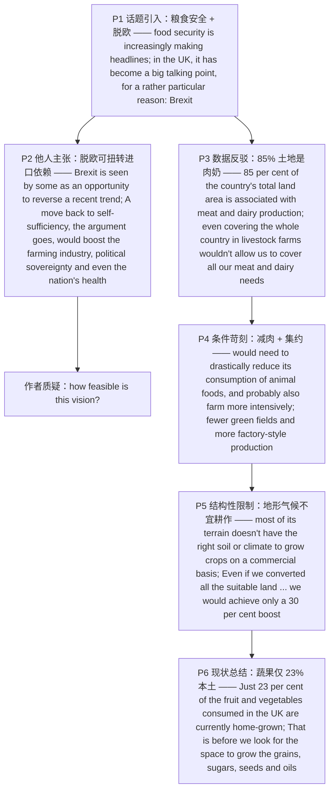

---

# 英国能否实现粮食自给自足 精读笔记

---

## 背景

本文选自 **2021 年考研英语（一）Text 2**，主题为**英国的"粮食自给自足"（food self-sufficiency）**——在脱欧（Brexit）背景下，一些人把脱欧视为**扭转英国依赖进口食品**的机会，主张回归自给自足；作者则用**土地与人口、气候与土壤、蔬果进口比例**等一连串数据，冷静质疑这一设想的**可行性**。

文章沿"**话题引入 → 他人主张 → 数据反驳 → 条件苛刻 → 结构性限制 → 现状总结**"的链条展开：

- **话题引入**：2050 年全球人口将逼近 **100 亿**，部分地区农业须近乎翻番，**粮食安全**成为头条；英国则因 **Brexit** 让这一话题升温。
- **他人主张**：脱欧被一些人视为**扭转进口趋势**的机会；回归自给自足据称可提振**农业、主权与健康**（`the argument goes`）。
- **数据反驳**：利兹大学报告指出，**85% 的国土与肉类奶制品生产相关**；即使全国变牧场也满足不了需求。
- **条件苛刻**：要实现自给，需**大幅削减动物性食品消费**并**更集约化耕作**——代价是更少绿地和**工厂化生产**。
- **结构性限制**：转素食也无用；英国多**地形不宜耕作**，仅 25% 土地适合作物种植，即便全部改种也只增产 30%。
- **现状总结**：蔬果仅 **23%** 本土种植，极端措施下也仅满足 **30%** 需求，**更不必说**谷物、糖料、油料等热量主来源。

**难度说明**：中等偏上。句式上**长难句密集**，含大量**介词短语连缀**、**被动语态**、**同位语从句**（`forecasts that …`）、**非限制性定语从句**（`which` 指代整句）、**让步 + 虚拟**（`Even if we converted … we would achieve …`）以及贯穿全文的**百分比 / 分数数据论证**，是练习"长句 + 数据定位"的良好素材。

---

## 文章原文

# 2021 Passage 2

With the **global population** predicted to hit close to 10 billion by 2050, and **forecasts** that **agricultural production** in some regions will need to nearly **double** to **keep pace**, **food security** is increasingly **making headlines**. In the UK, it has become a big **talking point** recently too, for a rather particular reason: **Brexit**.

> [!abstract]- 长难句分析
> **原句**：With the global population predicted to hit close to 10 billion by 2050, and forecasts that agricultural production in some regions will need to nearly double to keep pace, food security is increasingly making headlines.
>
> **主干提取**：
>
> - 状语 A: With the global population predicted to hit close to 10 billion by 2050, and forecasts that …
> - 主语 S: food security
> - 谓语 V: is increasingly making
> - 宾语 O: headlines
>
> **修饰成分**：
>
> | 类型 | 引导词 / 形式 | 修饰对象 |
> |------|--------------|----------|
> | with 复合结构 | With + 宾语 + 过去分词 | 全句（背景状语） |
> | 过去分词（被动） | predicted to hit … | the global population |
> | 同位语从句 | that agricultural production … will need to nearly double | forecasts |
> | 不定式作目的状语 | to keep pace | need to nearly double |
> | 副词修饰 | increasingly | making headlines |
>
> **结构图解**：
>
> ```
> 主句: 〔With the global population predicted to hit … and forecasts that …〕, food security + is increasingly making + headlines
>   ├── with 复合结构: With the global population 〔predicted to hit close to 10 billion by 2050〕
>   │     └── 过去分词（被动）: predicted to hit …（修饰 the global population）
>   └── 并列的 with 结构: and forecasts 〔that agricultural production … will need to nearly double〕
>         └── 同位语从句: that agricultural production in some regions will need to nearly double 〔to keep pace〕
>               └── 目的状语: to keep pace
> ```
>
> **参考译文**：预计到 2050 年全球人口将逼近 100 亿，且有预测称部分地区的农业生产须近乎翻番才能跟上需求，粮食安全正日益成为新闻头条。
>
> **考点提示**：① 主干 `food security is making headlines`。② `With + 宾语 + 过去分词` 复合结构作状语，`predicted` 与 `population` 是被动关系。③ `forecasts that …` 为**同位语从句**，`that` 不作成分、从句完整。④ `to keep pace` 为**目的状语**。

**Brexit** is seen by some as an opportunity to **reverse** a recent **trend** towards the UK importing food.

The country produces only about 60 per cent of the food it eats, down from almost three-quarters in the late 1980s.

> [!abstract]- 长难句分析
> **原句**：The country produces only about 60 per cent of the food it eats, down from almost three-quarters in the late 1980s.
>
> **主干提取**：
>
> - 主语 S: The country
> - 谓语 V: produces
> - 宾语 O: only about 60 per cent of the food
> - 定语从句: (that) it eats
> - 插入对比: down from almost three-quarters in the late 1980s
>
> **修饰成分**：
>
> | 类型 | 引导词 / 形式 | 修饰对象 |
> |------|--------------|----------|
> | 定语从句（省略关系代词） | (that) it eats | the food |
> | 介词短语（插入对比） | down from almost three-quarters in the late 1980s | 60 per cent |
>
> **结构图解**：
>
> ```
> 主句: The country + produces + only about 60 per cent of the food 〔(that) it eats〕, 〔down from almost three-quarters in the late 1980s〕
>   ├── 定语从句（省略 that）: (that) it eats（修饰 the food）
>   └── 插入对比: down from almost three-quarters in the late 1980s
> ```
>
> **参考译文**：英国生产的粮食仅占其消费量的约 60%，而 20 世纪 80 年代末这一比重还接近四分之三。
>
> **考点提示**：① 主干 `The country produces 60 per cent of the food`。② `the food it eats` **省略了作宾语的关系代词** `(that/which)`，勿把 `eats` 误读为主干谓语。③ `down from …` 作插入性的对比状语，表"从……降下来"。

A move back to **self-sufficiency**, the argument goes, would **boost** the farming industry, political **sovereignty** and even the nation's health.

> [!abstract]- 长难句分析
> **原句**：A move back to self-sufficiency, the argument goes, would boost the farming industry, political sovereignty and even the nation's health.
>
> **主干提取**：
>
> - 主语 S: A move back to self-sufficiency
> - 插入语: the argument goes
> - 谓语 V: would boost
> - 宾语 O: the farming industry, political sovereignty and even the nation's health
>
> **修饰成分**：
>
> | 类型 | 引导词 / 形式 | 修饰对象 |
> |------|--------------|----------|
> | 介词短语作后置定语 | back to self-sufficiency | A move |
> | 插入语 | the argument goes | 全句 |
> | 并列宾语 | the farming industry / political sovereignty / the nation's health | boost |
>
> **结构图解**：
>
> ```
> 主句: A move 〔back to self-sufficiency〕, 〔the argument goes〕, + would boost + the farming industry, political sovereignty and even the nation's health
>   ├── 介词短语作后置定语: back to self-sufficiency（修饰 A move）
>   ├── 插入语: the argument goes（引出他人观点）
>   └── 并列宾语: the farming industry / political sovereignty / the nation's health
> ```
>
> **参考译文**：按这种说法，回归自给自足将提振农业、政治主权乃至国民健康。
>
> **考点提示**：① 主干 `A move would boost A, B and C`。② `the argument goes` 是**插入语**，割裂主谓，表"按这种论点"。③ `would boost` 用 `would` 表**假设性推测**。④ 后接**三个并列宾语**。

Sounds great—but how **feasible** is this **vision**?

> [!abstract]- 长难句分析
> **原句**：Sounds great—but how feasible is this vision?
>
> **主干提取**：
>
> - 省略主语: (It) Sounds great
> - 转折连词: but
> - 疑问倒装: how feasible is this vision
>
> **修饰成分**：
>
> | 类型 | 引导词 / 形式 | 修饰对象 |
> |------|--------------|----------|
> | 省略主语 | (It) | Sounds |
> | 疑问倒装 | how feasible is this vision | 全句（how + adj + be + 主语） |
>
> **结构图解**：
>
> ```
> 〔(It) Sounds great〕— but 〔how feasible is this vision?〕
>   ├── 省略主语: (It) Sounds great
>   └── 疑问倒装: how feasible + is + this vision（how + adj + be + 主语）
> ```
>
> **参考译文**：听起来很棒——但这一设想究竟有多可行？
>
> **考点提示**：① `Sounds great` 省略了主语 `It`。② `how feasible is this vision?` 为**疑问句倒装**，正常语序 `how feasible this vision is`。③ 破折号 + `but` 表**转折**，是**作者态度句**（质疑"自给自足"设想）。

According to a report on UK food production from the University of Leeds, UK, 85 per cent of the country's total land area is **associated with** meat and **dairy** production.

> [!abstract]- 长难句分析
> **原句**：According to a report on UK food production from the University of Leeds, UK, 85 per cent of the country's total land area is associated with meat and dairy production.
>
> **主干提取**：
>
> - 状语 A: According to a report on UK food production from the University of Leeds, UK
> - 主语 S: 85 per cent of the country's total land area
> - 谓语 V: is associated with
> - 宾语 O: meat and dairy production
>
> **修饰成分**：
>
> | 类型 | 引导词 / 形式 | 修饰对象 |
> |------|--------------|----------|
> | 介词短语作状语 | According to a report … | 全句 |
> | 介词短语作后置定语 | on UK food production … | a report |
> | 介词短语作后置定语 | from the University of Leeds, UK | food production |
> | 被动语态 | is associated with | 85 per cent of the land area |
>
> **结构图解**：
>
> ```
> 〔According to a report 〔on UK food production〕 〔from the University of Leeds, UK〕〕, 85 per cent of the country's total land area + is associated with + meat and dairy production
>   ├── 状语: According to a report …
>   │     ├── 后置定语: on UK food production
>   │     └── 后置定语: from the University of Leeds, UK
>   └── 被动语态: is associated with（主语核心为 per cent，谓语随 of 后名词定单复数）
> ```
>
> **参考译文**：根据英国利兹大学一份关于英国食品生产的报告，该国 85% 的国土面积与肉类和奶制品生产相关。
>
> **考点提示**：① 主干 `85 per cent … is associated with meat and dairy production`。② 主语核心是 `per cent`，谓语单复数随 `of` 后名词；此处 `land area` 为单数，故用 `is`。③ `According to …` 表**消息来源**。④ 本句是**第 27 题定位句**（大部分土地用于肉奶生产）。

That supplies 80 per cent of what is consumed, so even covering the whole country in **livestock** farms wouldn't allow us to cover all our meat and dairy needs.

> [!abstract]- 长难句分析
> **原句**：That supplies 80 per cent of what is consumed, so even covering the whole country in livestock farms wouldn't allow us to cover all our meat and dairy needs.
>
> **主干提取**：
>
> - 主语 S1: That
> - 谓语 V1: supplies
> - 宾语 O1: 80 per cent of what is consumed
> - 结果连词: so
> - 主语 S2: even covering the whole country in livestock farms
> - 谓语 V2: wouldn't allow
> - 宾语 O2: us
> - 宾语补足语: to cover all our meat and dairy needs
>
> **修饰成分**：
>
> | 类型 | 引导词 / 形式 | 修饰对象 |
> |------|--------------|----------|
> | 名词性从句（what） | what is consumed | 介词 of 的宾语 |
> | 结果分句 | so even covering … wouldn't allow … | 前一分句 |
> | 动名词短语作主语 | covering the whole country in livestock farms | 结果分句主语（单数谓语） |
> | 不定式作宾语补足语 | to cover all our meat and dairy needs | us |
>
> **结构图解**：
>
> ```
> 主句 1: That + supplies + 80 per cent of 〔what is consumed〕,
>   └── 名词性从句: what is consumed（作 of 的宾语）
> so 结果分句: 〔even covering the whole country in livestock farms〕 + wouldn't allow + us + 〔to cover all our meat and dairy needs〕
>   ├── 动名词短语作主语: covering …（谓语用单数）
>   └── 不定式作宾补: to cover all our meat and dairy needs
> ```
>
> **参考译文**：这满足了 80% 的消费量，因此即便把全国都变成畜牧场，也无法满足我们对肉类和奶制品的全部需求。
>
> **考点提示**：① `so` 引导**结果分句**。② `of what is consumed` 中 `what` 从句作**介词宾语**。③ `so` 后主语是**动名词短语** `covering …`，故谓语用**单数** `wouldn't allow`。④ `allow sb to do` 结构。

There are many **caveats** to those figures, but they are still **grave**. To become much more self-sufficient, the UK would need to **drastically** reduce its **consumption** of animal foods, and probably also farm more **intensively**—meaning fewer green fields and more factory-style production.

But switching to a mainly **plant-based diet** wouldn't help.

There is a good reason why the UK is **dominated by** animal **husbandry**: most of its **terrain** doesn't have the right soil or climate to grow crops on a **commercial basis**.

> [!abstract]- 长难句分析
> **原句**：There is a good reason why the UK is dominated by animal husbandry: most of its terrain doesn't have the right soil or climate to grow crops on a commercial basis.
>
> **主干提取**：
>
> - there be 句型: There is
> - 主语 S1: a good reason
> - 定语从句: why the UK is dominated by animal husbandry
> - 主语 S2: most of its terrain
> - 谓语 V2: doesn't have
> - 宾语 O2: the right soil or climate
> - 不定式作定语: to grow crops on a commercial basis
>
> **修饰成分**：
>
> | 类型 | 引导词 / 形式 | 修饰对象 |
> |------|--------------|----------|
> | 定语从句 | why the UK is dominated by animal husbandry | a good reason |
> | 被动语态 | is dominated by | the UK |
> | 冒号解释 | most of its terrain doesn't have … | 前文 reason |
> | 不定式作后置定语 | to grow crops on a commercial basis | soil or climate |
>
> **结构图解**：
>
> ```
> 主句 1: There + is + a good reason 〔why the UK is dominated by animal husbandry〕
>   └── 定语从句: why the UK is dominated by animal husbandry（修饰 reason）
>         └── 被动语态: is dominated by
> 主句 2（冒号解释）: most of its terrain + doesn't have + the right soil or climate 〔to grow crops on a commercial basis〕
>   └── 不定式作后置定语: to grow crops on a commercial basis
> ```
>
> **参考译文**：英国以畜牧业为主是有充分理由的：它的多数地形并不具备大规模商业化种植作物所需的土壤或气候条件。
>
> **考点提示**：① `There is a good reason why …` 中 `why` 引导**定语从句**修饰 `reason`。② 冒号后为**解释说明**。③ `to grow crops on a commercial basis` 是**后置定语**，修饰 `soil or climate`。（联动）见语法笔记"从句：why 引导的定语从句"。

Just 25 per cent of the country's land is **suitable for** crop-growing, most of which is already occupied by **arable** fields.

Even if we **converted** all the suitable land to fields of fruit and veg—which would involve taking out all the nature reserves and removing thousands of people from their homes—we would achieve only a 30 per cent boost in crop production.

> [!abstract]- 长难句分析
> **原句**：Even if we converted all the suitable land to fields of fruit and veg—which would involve taking out all the nature reserves and removing thousands of people from their homes—we would achieve only a 30 per cent boost in crop production.
>
> **主干提取**：
>
> - 让步状语从句: Even if we converted all the suitable land to fields of fruit and veg
> - 非限制性定语从句（插入）: which would involve taking out … and removing …
> - 主语 S: we
> - 谓语 V: would achieve
> - 宾语 O: only a 30 per cent boost in crop production
>
> **修饰成分**：
>
> | 类型 | 引导词 / 形式 | 修饰对象 |
> |------|--------------|----------|
> | 让步状语从句 | Even if we converted … | 主句 |
> | 非限制性定语从句 | which would involve … | 前面整个假设（整句） |
> | 并列动名词 | taking out … / removing … | involve 的宾语 |
> | 介词短语 | to fields of fruit and veg | converted … to |
>
> **结构图解**：
>
> ```
> 〔Even if we converted all the suitable land to fields of fruit and veg〕—〔which would involve 〔taking out all the nature reserves〕 and 〔removing thousands of people from their homes〕〕—we + would achieve + only a 30 per cent boost in crop production
>   ├── 让步状语从句（虚拟）: Even if we converted …（用过去式表不现实假设）
>   ├── 插入的非限制性定语从句: which would involve …
>   │     └── 并列动名词: taking out … / removing …
>   └── 主句（虚拟结果）: we would achieve …
> ```
>
> **参考译文**：即便我们把所有适合的土地都改成果蔬田——这将意味着取消所有自然保护区并让成千上万的人迁离家园——我们也只能使作物产量提高 30%。
>
> **考点提示**：① `Even if` 引导**让步状语从句**，此处用过去式 `converted` 表**虚拟假设**。② 破折号插入 `which` 引导的**非限制性定语从句**，`which` 指代前面**整句话**（整个假设）。③ `involve doing` 结构，后接两个**并列动名词**。④ 主句用 `would achieve` 表**虚拟结果**。

Just 23 per cent of the fruit and vegetables consumed in the UK are currently home-grown, so even with the most extreme measures we could meet only 30 per cent of our fresh produce needs.

That is before we look for the space to grow the grains, sugars, seeds and oils that provide us with the **vast bulk** of our current **calorie intake**.

> [!abstract]- 长难句分析
> **原句**：That is before we look for the space to grow the grains, sugars, seeds and oils that provide us with the vast bulk of our current calorie intake.
>
> **主干提取**：
>
> - 主语 S: That
> - 系动词 V: is
> - 表语 P: before we look for the space …
> - 状语从句: before we look for the space to grow …
> - 定语从句: that provide us with the vast bulk of our current calorie intake
>
> **修饰成分**：
>
> | 类型 | 引导词 / 形式 | 修饰对象 |
> |------|--------------|----------|
> | 时间状语从句 | before we look for the space … | is |
> | 不定式作后置定语 | to grow the grains, sugars, seeds and oils | the space |
> | 定语从句 | that provide us with the vast bulk of our current calorie intake | the grains, sugars, seeds and oils |
>
> **结构图解**：
>
> ```
> 主句: That + is + 〔before we look for the space 〔to grow the grains, sugars, seeds and oils 〔that provide us with the vast bulk of our current calorie intake〕〕〕
>   └── 时间状语从句: before we look for the space …
>         ├── 不定式作后置定语: to grow the grains, sugars, seeds and oils（修饰 the space）
>         └── 定语从句: that provide us with …（修饰 the grains … and oils）
> ```
>
> **参考译文**：而这还没有算上我们为种植谷物、糖料、种子和油料作物所需的空间——这些作物提供了我们当前绝大部分的热量摄入。
>
> **考点提示**：① `That is before …` 表"这还没算上……之前"，即"更不用说"。② `the space to grow …` 中**不定式作后置定语**。③ `that provide` **定语从句**修饰前面并列的四种作物，谓语用复数 `provide`（与就近名词 `oils` 一致）。④ 本句是**第 29 题定位句**（水果蔬菜大量依赖进口）。

---

## 题目

### 26. Some people argue that food self-sufficiency in the UK would ____.

- [A] be hindered by its population growth
- [B] contribute to the nation's well-being
- [C] become a priority of the government
- [D] pose a challenge to its farming industry

### 27. The report by the University of Leeds shows that in the UK ____.

- [A] farmland has been inefficiently utilized
- [B] factory-style production needs reforming
- [C] most land is used for meat and dairy production
- [D] more green fields will be converted for farming

### 28. Crop-growing in the UK is restricted due to ____.

- [A] its farming technology
- [B] its dietary tradition
- [C] its natural conditions
- [D] its commercial interests

### 29. It can be learned from the last paragraph that British people ____.

- [A] rely largely on imports for fresh produce
- [B] enjoy a steady rise in fruit consumption
- [C] are seeking effective ways to cut calorie intake
- [D] are trying to grow new varieties of grains

### 30. The author's attitude to food self-sufficiency in the UK is ____.

- [A] defensive
- [B] doubtful
- [C] tolerant
- [D] optimistic

---

## 翻译对照

# 2021 Passage 2 中英对照翻译

## Paragraph 1

With the global population predicted to hit close to 10 billion by 2050, and forecasts that agricultural production in some regions will need to nearly double to keep pace, food security is increasingly making headlines. In the UK, it has become a big talking point recently too, for a rather particular reason: Brexit.

预计到 2050 年全球人口将逼近 100 亿，且有预测称部分地区的农业生产须近乎翻番才能跟上需求，粮食安全正日益成为新闻头条。在英国，它近来也成了一个热门话题，原因颇为特殊：脱欧。

> [!note] 翻译说明
> - `be predicted to do` = "被预测将会……"；`hit close to 10 billion` 中 `hit` = "达到（某一数量）"。
> - `keep pace` = "跟上（步伐）、保持同步"，这里指粮食供给跟上人口增长。
> - `food security` = "粮食安全"（注意与 `food safety`"食品安全"区分）；`make headlines` = "成为头条新闻、引人关注"。
> - `talking point` = "话题、议论点"；`for a rather particular reason` 中 `particular` = "特别的、特定的"。

## Paragraph 2

Brexit is seen by some as an opportunity to reverse a recent trend towards the UK importing food. The country produces only about 60 per cent of the food it eats, down from almost three-quarters in the late 1980s. A move back to self-sufficiency, the argument goes, would boost the farming industry, political sovereignty and even the nation's health. Sounds great—but how feasible is this vision?

一些人把脱欧视为扭转英国近年来依赖进口食品这一趋势的机会。英国生产的粮食仅占其消费量的约 60%，而 20 世纪 80 年代末这一比重还接近四分之三。按这种观点，回归自给自足将提振农业、政治主权乃至国民健康。听起来很棒——但这一设想究竟有多可行？

> [!note] 翻译说明
> - `be seen by some as ...` = "被一些人视为……"，`reverse the trend` = "扭转趋势"。
> - `down from almost three-quarters` 中 `down from` = "从……下降而来"，`three-quarters` = "四分之三"。
> - `the argument goes` 是**插入语**，= "按（上述）观点的说法 / 正如这种论点所言"。
> - `self-sufficiency` = "自给自足"；`sovereignty` = "主权"；`boost` = "提振、促进"。
> - `feasible` = "可行的、行得通的"；`vision` = "设想、愿景"。

## Paragraph 3

According to a report on UK food production from the University of Leeds, UK, 85 per cent of the country's total land area is associated with meat and dairy production. That supplies 80 per cent of what is consumed, so even covering the whole country in livestock farms wouldn't allow us to cover all our meat and dairy needs.

根据英国利兹大学一份关于英国食品生产的报告，该国 85% 的国土面积与肉类和奶制品生产相关。这满足了 80% 的消费量，因此即便把全国都变成畜牧场，也无法满足我们对肉类和奶制品的全部需求。

> [!note] 翻译说明
> - `be associated with` = "与……相关联"；`meat and dairy production` = "肉类和奶制品生产"，`dairy` = "奶制品（的）"。
> - `what is consumed` 是**由 what 引导的宾语从句**，作 `supplies` 的宾语，= "被消费的部分"。
> - `livestock` = "家畜、牲畜"；`cover all our ... needs` 中 `cover` = "满足、覆盖（需求）"。

## Paragraph 4

There are many caveats to those figures, but they are still grave. To become much more self-sufficient, the UK would need to drastically reduce its consumption of animal foods, and probably also farm more intensively—meaning fewer green fields and more factory-style production.

这些数字有许多需要说明的限定条件，但它们仍然严峻。要实现更大程度的自给自足，英国将不得不大幅削减动物性食品的消费，而且很可能还要更集约地耕作——这意味着更少的绿地和更多的工厂化生产。

> [!note] 翻译说明
> - `caveat` = "（附加的）说明、限制性条件、告诫"；`grave` = "严峻的、严重的"。
> - `drastically` = "大幅度地、急剧地"；`consumption` = "消费、消耗"。
> - `farm more intensively` 中 `intensively` = "集约地、高强度地"，`factory-style production` = "工厂化生产"。

## Paragraph 5

But switching to a mainly plant-based diet wouldn't help. There is a good reason why the UK is dominated by animal husbandry: most of its terrain doesn't have the right soil or climate to grow crops on a commercial basis. Just 25 per cent of the country's land is suitable for crop-growing, most of which is already occupied by arable fields. Even if we converted all the suitable land to fields of fruit and veg—which would involve taking out all the nature reserves and removing thousands of people from their homes—we would achieve only a 30 per cent boost in crop production.

但转向以植物为主的饮食也无济于事。英国以畜牧业为主是有充分理由的：它的多数地形并不具备大规模商业化种植作物所需的土壤或气候条件。全国仅有 25% 的土地适合种植作物，而其中大部分已被耕地占据。即便我们把所有适合的土地都改成果蔬田——这将意味着取消所有自然保护区并让成千上万的人迁离家园——我们也只能使作物产量提高 30%。

> [!note] 翻译说明
> - `switch to` = "转向、改换为"；`plant-based diet` = "以植物为主的饮食"；`wouldn't help` = "无济于事"。
> - `be dominated by` = "以……为主、由……主导"；`animal husbandry` = "畜牧业"。
> - `terrain` = "地形、地势"；`on a commercial basis` = "以商业化的方式"。
> - `be suitable for` = "适合……"；`arable` = "（土地）可耕的、适于耕作的"。
> - `convert A to B` = "把 A 改造成 B"；`nature reserves` = "自然保护区"（`reserve` 此处 = "保护区"）。
> - `Even if ...` 是**让步状语从句**；`which would involve ...` 是**非限制性定语从句**，修饰前面整个 "把土地改成农田" 的假设。

## Paragraph 6

Just 23 per cent of the fruit and vegetables consumed in the UK are currently home-grown, so even with the most extreme measures we could meet only 30 per cent of our fresh produce needs. That is before we look for the space to grow the grains, sugars, seeds and oils that provide us with the vast bulk of our current calorie intake.

目前英国消费的水果和蔬菜中仅有 23% 是本土种植的，因此即便采取最极端的措施，我们也只能满足自身 30% 的新鲜农产品需求。而这还没有算上我们为种植谷物、糖料、种子和油料作物所需的空间——这些作物提供了我们当前绝大部分的热量摄入。

> [!note] 翻译说明
> - `home-grown` = "本土种植的、自产的"；`fresh produce` = "新鲜农产品"，`produce` 此处作名词 = "农产品"。
> - `extreme measures` = "极端措施"；`meet ... needs` = "满足……需求"。
> - `That is before ...` = "这还没算上……之前"，即"更不用说后面还没考虑的情况"。
> - `the vast bulk of` = "……的绝大部分"；`calorie intake` = "热量摄入"，`intake` = "摄入量"。

## 题目翻译

### 26. Some people argue that food self-sufficiency in the UK would ____.

26. 一些人认为，英国的粮食自给自足将会 ____。

- [A] 因其人口增长而受阻
- [B] 有助于该国福祉
- [C] 成为政府的优先事项
- [D] 对该国农业构成挑战

### 27. The report by the University of Leeds shows that in the UK ____.

27. 利兹大学的报告表明，在英国 ____。

- [A] 农田利用效率低下
- [B] 工厂化生产需要改革
- [C] 大部分土地用于肉类和奶制品生产
- [D] 更多绿地将被改作农田

### 28. Crop-growing in the UK is restricted due to ____.

28. 英国的作物种植受到限制，是因为 ____。

- [A] 其农业技术
- [B] 其饮食传统
- [C] 其自然条件
- [D] 其商业利益

### 29. It can be learned from the last paragraph that British people ____.

29. 从最后一段可以得知，英国人 ____。

- [A] 在很大程度上依赖进口获取新鲜农产品
- [B] 水果消费量稳步上升
- [C] 正在寻求减少热量摄入的有效方法
- [D] 正试图种植新品种谷物

### 30. The author's attitude to food self-sufficiency in the UK is ____.

30. 作者对英国粮食自给自足的态度是 ____。

- [A] 辩护的（支持的）
- [B] 怀疑的
- [C] 宽容的
- [D] 乐观的

---

## 语法要点

# 2021 Passage 2 语法整理

> [!note] 来源说明
> 本篇**用户未提供语法源笔记**，以下语法点由 `formatted-article.md` 与 `translation.md` **从本文推断提取**，仅收录本篇实际出现的语法现象。
> 每一条均给出**原文语境**，便于回原文核对；标注"（联动）"的条目与相邻专题互为参照。
> 固定搭配与词组见 [[intermediate/2021-passage2-food-self-sufficiency/固定搭配与词组笔记.md|2021 Passage 2 固定搭配与词组]]。

---

## 一、从句

### 从句：with 复合结构（with + 宾语 + 分词）

**概述**：`with + 宾语 + 分词/形容词/介词短语` 构成**独立复合结构**，在句中作**状语**（原因、背景、伴随）。宾语与其后的分词存在**被动关系**时用**过去分词**。

| 结构 | 用法 | 例句 |
|------|------|------|
| `With + 宾语 + 过去分词` | 复合结构作状语，表被动/完成 | **With the global population predicted to hit close to 10 billion by 2050** … |
| `With + 宾语 + 名词/介词短语` | 复合结构，可并列 | With the global population predicted … **and forecasts that …** |

> [!tip] 还原技巧
> `the global population predicted to hit …` 中 `predicted` 与 `population` 是**被动关系**（人口"被预测"），故用过去分词。去掉 `With` 后补全主谓即 `the global population is predicted to hit …`。（联动）见"语态：be predicted to do"。

### 从句：that 引导的同位语从句

**概述**：`that` 引导**同位语从句**，解释前面**抽象名词**（forecast、fact、idea、news 等）的具体内容；`that` 只起连接作用，不作成分，从句**结构完整**。

| 结构 | 用法 | 例句 |
|------|------|------|
| `抽象名词 + that + 完整从句` | that 引导同位语从句，说明 forecast 的内容 | forecasts **that agricultural production in some regions will need to nearly double** |

> [!warning] 易错点
> 同位语从句与定语从句形式相似，判据是：`that` 后的从句**结构完整**且 `that` 不作成分 → **同位语从句**（此处 forecasting 的具体内容）；若从句缺主语/宾语 → **定语从句**。`forecast`、`fact`、`belief` 等抽象名词后常接同位语从句。

### 从句：what 引导的名词性从句

**概述**：`what` 引导名词性从句（主语/宾语/表语），`what` 在从句中**作主语或宾语**，= "……的东西/部分"。

| 结构 | 用法 | 例句 |
|------|------|------|
| `of + what + 从句` | what 从句作介词 of 的宾语 | 80 per cent of **what is consumed** |

> [!tip] 解题技巧
> `80 per cent of what is consumed` = "（被消费量的）80%"，`what is consumed` 整体作 `of` 的宾语，`what` 在从句中作**主语**。`of` 后不能直接接 that 从句，需用 `what / who / whether` 等。

### 从句：why 引导的定语从句

**概述**：`why` 引导定语从句，修饰表**原因**的名词 `reason`，从句说明"为什么"。

| 结构 | 用法 | 例句 |
|------|------|------|
| `reason + why + 完整从句` | why 修饰 reason，表原因 | There is a good reason **why the UK is dominated by animal husbandry** |

> [!note] 补充说明
> `why/the reason why` 常可转换为 `the reason for which`；此处 `why` 从句修饰 `a good reason`。（联动）见"补充要点：there be 句型"。

### 从句：that 引导的定语从句（省略关系代词）

**概述**：定语从句中，关系代词作**宾语**时可**省略**，形成"名词 + 主谓"紧邻结构，容易被误读为句子谓语。

| 结构 | 用法 | 例句 |
|------|------|------|
| `名词 + (that/which) + 主谓` | 关系代词作宾语时省略 | 60 per cent of the food **(that) it eats** |
| `名词 + (that/which) + 主谓` | 同上 | the grains, sugars, seeds and oils **(that) provide us with …** |

> [!warning] 易错点
> `the food it eats` = `the food that it eats`，中间**省略了作宾语的关系代词**；`it eats` 是从句，不是主句谓语，别把 `eats` 误当成主干动词。

### 从句：非限制性定语从句（most of which / which 指代整句）

**概述**：非限制性定语从句用逗号与主句隔开，补充说明；`which` 既可指代前面**某个名词**（`most of which`），也可指代**前面整句话/整个假设**。

| 结构 | 用法 | 例句 |
|------|------|----------|
| `, most of which + 谓语` | which 指代前面的名词（the land） | most of **which** is already occupied by arable fields |
| `, which + 谓语` | which 指代前面**整个句子** | —**which would involve taking out all the nature reserves and removing thousands of people from their homes** |

> [!tip] 解题技巧
> `, which would involve …` 中 `which` 指代前面"把所有适合土地改成农田"这一**假设性做法**（整句内容），故从句谓语用**单数** `would involve`，后接**动名词** `taking out` / `removing` 两项并列。

### 从句：even if 引导的让步状语从句

**概述**：`even if` 引导**让步状语从句**，表"即便、即使"，承认某一假设前提仍推进结论；此处用**过去式** `converted` 表**虚拟/不太可能实现的假设**。

| 结构 | 用法 | 例句 |
|------|------|------|
| `Even if + 从句（虚拟）, 主句（would + do）` | 让步 + 虚拟假设 | **Even if we converted all the suitable land to fields of fruit and veg**, we would achieve only a 30 per cent boost |

> [!note] 补充说明
> `even if`（即便，让步假设）与 `if`（如果，条件）不同；从句用过去式 `converted`、主句用 `would achieve`，构成**虚拟语气**，暗示该做法"事实上不现实"。（联动）见"语气：虚拟/假设语气（would + do）"。

### 从句：so 引导的结果分句

**概述**：`so` 作**并列连词**连接结果分句，表"因此、所以"。

| 结构 | 用法 | 例句 |
|------|------|------|
| `主句 + so + 结果分句` | so 表结果 | That supplies 80 per cent of what is consumed, **so even covering the whole country in livestock farms wouldn't allow us to cover all our meat and dairy needs** |

> [!note] 补充说明
> `so` 后结果分句的主语是**动名词短语** `covering the whole country in livestock farms`，谓语用单数 `wouldn't allow`。（联动）见"非谓语：动名词短语作主语"。

---

## 二、非谓语动词

### 非谓语：不定式作目的状语

**概述**：`to do` 作**目的状语**，表"为了……"，是阅读中常见的逻辑点，但**不是**句子主干。

| 结构 | 用法 | 例句 |
|------|------|------|
| `to do` 表目的 | 不定式作目的状语 | need to nearly double **to keep pace** |
| `to do` 表目的 | 同上 | the right soil or climate **to grow crops** on a commercial basis |
| `to do` 表目的 | 同上 | wouldn't allow us **to cover all our meat and dairy needs** |
| `to do` 表目的 | 同上 | we look for the space **to grow the grains, sugars, seeds and oils** |

> [!tip] 解题技巧
> `to keep pace`、`to grow crops` 等均为**目的状语**，问"为什么"时它们是关键信息，但删去后主干仍完整。

### 非谓语：不定式作后置定语

**概述**：不定式跟在名词后作**后置定语**，表"要……的、用来……的"。

| 结构 | 用法 | 例句 |
|------|------|------|
| `名词 + to do` | 不定式作后置定语 | an opportunity **to reverse a recent trend** |
| `名词 + to do` | 同上 | the food **to eat**（此处以 `the food it eats` 定语从句形式出现） |

> [!note] 补充说明
> `an opportunity to reverse …` 中 `to reverse` 是**后置定语**修饰 `opportunity`，表示"扭转……的机会"。不定式作定语时，被修饰名词常是 opportunity、chance、need、space 等。

### 非谓语：动名词短语作主语

**概述**：动名词短语作句子**主语**，谓语用**单数**。

| 结构 | 用法 | 例句 |
|------|------|------|
| `doing … + 谓语单数` | 动名词短语作主语 | **covering the whole country in livestock farms** wouldn't allow us to cover all our meat and dairy needs |
| `doing … + 谓语单数` | 同上（并列的动名词短语作宾语） | switching to a mainly plant-based diet wouldn't help |

> [!tip] 解题技巧
> `covering …` / `switching …` 均为**动名词短语作主语**，故谓语 `wouldn't allow` / `wouldn't help` 用**单数**；`to cover all …` 才是目的/宾语补足成分。

### 非谓语：现在分词短语作补充说明（meaning …）

**概述**：破折号后 `meaning …` 为**现在分词短语**，对上文作**补充/结果说明**，= "这意味着……"。

| 结构 | 用法 | 例句 |
|------|------|------|
| `— meaning + 名词/that` | 现在分词作补充说明 | farm more intensively—**meaning fewer green fields and more factory-style production** |

> [!note] 补充说明
> `meaning` 的逻辑主语是前面整句所述做法，起"结果/解释"作用，不是谓语。

### 非谓语：过去分词作后置定语

**概述**：过去分词短语作**后置定语**，表**被动/完成**。

| 结构 | 用法 | 例句 |
|------|------|------|
| `名词 + 过去分词短语` | 过去分词作后置定语 | the fruit and vegetables **consumed in the UK** |
| `名词 + 过去分词短语` | 同上 | With the global population **predicted to hit …** |

> [!tip] 解题技巧
> `the fruit and vegetables consumed in the UK` = "（被）在英国消费的水果和蔬菜"，`consumed …` 是**后置定语**修饰前面的名词，表被动。

---

## 三、语态

### 语态：被动语态（be + 过去分词 + 介词）

**概述**：本篇大量使用 **be + 过去分词** 的被动语态，且多带**固定介词搭配**，是阅读定位的关键。

| 结构 | 用法 | 例句 |
|------|------|------|
| `be associated with` | 与……相关（被动 + with） | 85 per cent of the country's total land area **is associated with** meat and dairy production |
| `be dominated by` | 由……主导（被动 + by） | the UK **is dominated by** animal husbandry |
| `be occupied by` | 被……占据（被动 + by） | most of which **is already occupied by** arable fields |
| `be seen as` | 被视为（被动 + as） | Brexit **is seen by some as** an opportunity … |
| `be home-grown` | 是本土种植的（复合形容词作表语） | 23 per cent … **are** currently **home-grown** |

> [!warning] 易错点
> `be associated with` = "与……相关"（**不是**"由……导致"）；`be dominated by` = "以……为主"，两者常出现在因果/占比类信息中，是第 27、28 题的定位点。（联动）见"从句：非限制性定语从句"。

### 语态：be predicted to do

**概述**：`be predicted to do` = "被预测将会……"，是**被动语态 + 不定式**的固定结构。

| 结构 | 用法 | 例句 |
|------|------|------|
| `be predicted to do` | 被预测将会…… | the global population **is predicted to hit** close to 10 billion by 2050 |

> [!note] 补充说明
> 同类结构还有 `be expected/estimated/said to do`；此处出现在 `with` 复合结构中，省略了 `is`，写作 `the global population predicted to hit …`。

### 语态：be seen as

**概述**：`be seen as + 名词` = "被视为……"，表**他人观点**，常与 `by some`（被某些人）连用。

| 结构 | 用法 | 例句 |
|------|------|------|
| `be seen (by sb) as + 名词` | 被视为…… | Brexit **is seen by some as** an opportunity to reverse a recent trend |

> [!tip] 解题技巧
> `is seen by some as …` 引出**部分人的观点**，作者本人未必认同。第 26 题问"一些人认为……"，答案即出自此类"观点引入句"。

---

## 四、语气与时态

### 语气：虚拟/假设语气（would + do）

**概述**：本篇用 `would + 动词原形` 表达**假设、推测性结论**，常与让步/条件从句配合，暗示"事实上难以实现"。

| 结构 | 用法 | 例句 |
|------|------|------|
| `would + do` | 假设条件下的推测结果 | livestock farms **wouldn't allow** us to cover all our needs |
| `would + do` | 同上 | the UK **would need to** drastically reduce its consumption |
| `would + do` | 虚拟假设的主句 | we **would achieve** only a 30 per cent boost in crop production |
| `would + do` | 同上 | switching … **wouldn't help** |

> [!note] 补充说明
> `would` 在此多表**与事实相反的假设结果**，是作者论证"自给自足不可行"的语言标志，与第 30 题"作者态度（怀疑 doubt）"直接相关。（联动）见"从句：even if 引导的让步状语从句"。

### 时态：一般现在时与现在完成时

**概述**：本篇主句大量使用**一般现在时**陈述现状与普遍事实。

| 结构 | 用法 | 例句 |
|------|------|------|
| `do/does` | 一般现在时，陈述现状 | The country **produces** only about 60 per cent of the food it eats |
| `have/has + 过去分词` | 现在完成时，表已成事实 | In the UK, it **has become** a big talking point recently |

> [!note] 补充说明
> `has become … recently` 用**现在完成时**配合 `recently`，强调"近来"的变化。统计数字多用**一般现在时**，构成客观陈述语气。

---

## 五、句式与倒装

### 句式：疑问句倒装（how + adj + be + 主语）

**概述**：`how + 形容词 + 系动词 + 主语` 构成**疑问句的部分倒装**，用于质疑、反问。

| 结构 | 用法 | 例句 |
|------|------|------|
| `how + adj + be + 主语` | 疑问倒装，表质疑 | Sounds great—but **how feasible is this vision**? |

> [!tip] 解题技巧
> 破折号后 `how feasible is this vision?` 是**作者态度句**：以反问质疑"自给自足"设想，与第 30 题"怀疑（doubtful）"呼应。

### 句式：there be 句型

**概述**：`there be` 表"存在"，其后的名词才是**真正主语**；`There is a reason why …` 是高频结构。

| 结构 | 用法 | 例句 |
|------|------|------|
| `There is/are + 名词` | 表存在 | **There is** a good reason why … |
| `There are + 名词 + to 短语` | 表存在 | **There are** many caveats to those figures |

> [!note] 补充说明
> `There are many caveats to those figures` 中 `to those figures` 是 `caveats` 的**后置定语**（"对这些数字的说明/保留意见"）。

---

## 六、补充要点

### 补充要点：破折号插入语

**概述**：破折号（`—`）引出**插入语**，对前文作补充、解释或转折；可先略去不读，抓住主句。

| 结构 | 用法 | 例句 |
|------|------|------|
| `主句—插入语` | 破折号补充说明 | Sounds great—**but how feasible is this vision?** |
| `名词—从句` | 破折号引出补充/转折 | farm more intensively—**meaning fewer green fields and more factory-style production** |

> [!tip] 解题技巧
> 阅读时遇到破折号先**跨过插入成分**读主干，再回头看补充内容；`—but …` 表**转折**，往往是作者真实态度所在。

### 补充要点：插入语 the argument goes

**概述**：`the argument goes` = "（这种）论点认为、按这种说法"，是**插入语**，标明所引内容为**他人的观点**。

| 结构 | 用法 | 例句 |
|------|------|------|
| `, the argument goes,` | 插入语，引出他人观点 | A move back to self-sufficiency, **the argument goes**, would boost the farming industry … |

> [!note] 补充说明
> 与 `is seen by some as …` 类似，`the argument goes` 提示这是**待商榷的观点**，作者随后用数据反驳。（联动）见"语态：be seen as"。

### 补充要点：主谓一致（That supplies …）

**概述**：指示代词 `That` 作主语，指代**单数概念**，谓语用**单数**；`percent of + 复数名词` 作主语时谓语单复数依实际含义而定。

| 结构 | 用法 | 例句 |
|------|------|------|
| `That + 谓语单数` | That 指代单数主语 | **That supplies** 80 per cent of what is consumed |
| `X per cent of + 名词 + 谓语` | 谓语随 of 后名词定单复数 | **Just 23 per cent of** the fruit and vegetables **are** currently home-grown |

> [!warning] 易错点
> `Just 23 per cent of the fruit and vegetables are …` 中谓语用 **are**（复数），因为 of 后是可数复数 `fruit and vegetables`；若 of 后是不可数名词则用单数。

### 补充要点：副词修饰不定式（nearly double）

**概述**：副词可插入 `to` 与动词之间，修饰不定式（**分裂不定式**），表程度。

| 结构 | 用法 | 例句 |
|------|------|------|
| `to + 副词 + do` | 副词修饰不定式 | agricultural production … will need to **nearly double** |

> [!note] 补充说明
> `to nearly double` 中 `nearly`（几乎、将近）修饰 `double`，表"将近翻番"的程度；类似还有 `to drastically reduce`（大幅削减）。

### 补充要点：分数的表达（three-quarters / per cent）

**概述**：英语分数与百分比的表达，及其作主语/定语时的用法。

| 结构 | 用法 | 例句 |
|------|------|------|
| `基数词-序数词` | 分数：四分之三 | down from almost **three-quarters** in the late 1980s |
| `分数 + of + 名词` | 分数的所属 | **80 per cent of** what is consumed |
| `per cent` | 百分比，常用于占比统计 | **85 per cent** of the country's total land area |

> [!tip] 解题技巧
> `three-quarters` = 3/4；`per cent` 前用**数字**、后常接 `of`。本篇用大量百分比与分数构成"数据论证"，是定位细节题（27、28、29 题）的关键。

---

## 固定搭配与词组

# 2021 Passage 2 固定搭配与词组

> [!note] 来源说明
> 本篇固定搭配与词组由 `formatted-article.md` **从本文提取**，仅收录本篇实际出现的表达。
> 纯语法内容见 [[intermediate/2021-passage2-food-self-sufficiency/grammar-notes.md|2021 Passage 2 语法整理]]。

---

## 一、主题词与核心概念

| 搭配 | 释义 | 原文语境 |
|------|------|----------|
| **food security** | 粮食安全 | **food security** is increasingly making headlines |
| **agricultural production** | 农业生产 | forecasts that **agricultural production** in some regions will need to nearly double |
| **self-sufficiency** | 自给自足 | A move back to **self-sufficiency** … would boost … |
| **meat and dairy production** | 肉类与奶制品生产 | land area is associated with **meat and dairy production** |
| **animal husbandry** | 畜牧业 | the UK is dominated by **animal husbandry** |
| **plant-based diet** | 以植物为主的饮食 | switching to a mainly **plant-based diet** |
| **livestock** | 牲畜、家畜 | covering the whole country in **livestock** farms |
| **fresh produce** | 新鲜农产品 | meet only 30 per cent of our **fresh produce** needs |
| **calorie intake** | 热量摄入 | provide us with the vast bulk of our current **calorie intake** |

> [!tip] 解题技巧
> `food security`（粮食**安全/供给保障**）≠ `food safety`（食品**卫生安全**）；本文谈的是"能不能自给"，故取"供给安全"义。

## 二、动词短语

| 搭配 | 释义 | 原文语境 |
|------|------|----------|
| **make headlines** | 成为头条新闻、引人关注 | food security is increasingly **making headlines** |
| **keep pace** | 跟上（步伐）、保持同步 | will need to nearly double to **keep pace** |
| **reverse a trend** | 扭转趋势 | an opportunity to **reverse** a recent **trend** |
| **boost** | 提振、促进 | would **boost** the farming industry |
| **be associated with** | 与……相关 | 85 per cent … **is associated with** meat and dairy production |
| **be dominated by** | 以……为主、由……主导 | the UK **is dominated by** animal husbandry |
| **be suitable for** | 适合…… | land **is suitable for** crop-growing |
| **convert A to B** | 把 A 改造成 B | we **converted** all the suitable land **to** fields of fruit and veg |
| **take out** | 拆除、取消 | involve **taking out** all the nature reserves |
| **switch to** | 转向、改换为 | **switching to** a mainly plant-based diet |
| **be predicted to do** | 被预测将会 | the global population **is predicted to** hit close to 10 billion |
| **be seen as** | 被视为 | Brexit **is seen** by some **as** an opportunity |

> [!warning] 易错点
> `be associated with` 表"**与……相关联**"（中性），勿理解成"由……造成"；`be dominated by` 表"**以……为主导**"，二者都出现在百分比/占比语境中，是第 27 题的定位点。

## 三、名词与固定表达

| 搭配 | 释义 | 原文语境 |
|------|------|----------|
| **talking point** | 话题、议论点 | it has become a big **talking point** recently |
| **the argument goes** | 按这种说法、这种论点认为 | **the argument goes**, would boost the farming industry … |
| **caveat** | 保留意见、限制条件 | There are many **caveats** to those figures |
| **grave** | 严峻的、严重的 | but they are still **grave** |
| **factory-style production** | 工厂化生产 | more **factory-style production** |
| **nature reserve** | 自然保护区 | taking out all the **nature reserves** |
| **arable field** | 耕地 | most of which is already occupied by **arable fields** |
| **home-grown** | 本土种植的、自产的 | 23 per cent … are currently **home-grown** |
| **the vast bulk of** | ……的绝大部分 | **the vast bulk of** our current calorie intake |
| **sovereignty** | 主权 | political **sovereignty** |
| **terrain** | 地形、地势 | most of its **terrain** doesn't have the right soil or climate |
| **consumption** | 消费、消耗 | reduce its **consumption** of animal foods |

> [!note] 补充说明
> `the argument goes` 是**插入语**，用于引出"他人的观点"，作者未必赞同；本文中它引出的"回归自给自足"观点随后被数据反驳。

## 四、副词与连接短语

| 搭配 | 释义 | 原文语境 |
|------|------|----------|
| **drastically** | 大幅度地、急剧地 | the UK would need to **drastically** reduce its consumption |
| **intensively** | 集约地、高强度地 | farm more **intensively** |
| **on a commercial basis** | 以商业化的方式 | grow crops **on a commercial basis** |
| **nearly** | 将近、几乎 | will need to **nearly** double |
| **even if** | 即便、即使 | **Even if** we converted all the suitable land … |
| **down from** | 从……下降而来 | down **from** almost three-quarters in the late 1980s |

> [!tip] 解题技巧
> `farm more intensively` 与 `factory-style production` 语义呼应（**集约化 = 工厂化**），后文 "fewer green fields" 是其代价，构成第 27 题对工厂化生产的描述线索。

---

## 生词表

> [!note] 收录说明
> 以下词汇取自本文**文章原文**中用 `**粗体**` 标记的考研重点词，按字母顺序分组排列；短语中的关键单词（如 `bulk`、`intake`、`diet`、`husbandry`、`pace`、`produce`）也单独列出。
> 词义以**考研常考义项**优先，例句一律取自本篇原文，便于回原文核对。

### A-C

| 词汇 | 词性 | 含义 | 原文例句 |
|------|------|------|----------|
| **agricultural production** | n. | 农业生产 | "… forecasts that **agricultural production** in some regions will need to nearly double to keep pace …" |
| **arable** | adj. | 可耕的、适于耕作的（`arable field` 耕地） | "… most of which is already occupied by **arable** fields." |
| **associated with** | phr. | 与……相关联 | "… 85 per cent of the country's total land area is **associated with** meat and dairy production." |
| **boost** | v. | 提振、促进 | "A move back to self-sufficiency … would **boost** the farming industry …" |
| **Brexit** | n. | 英国脱欧 | "In the UK, it has become a big talking point recently too, for a rather particular reason: **Brexit**." |
| **bulk** | n. | 大部分、主体（`the vast bulk of` 的绝大部分） | "… the grains, sugars, seeds and oils that provide us with the **vast bulk** of our current calorie intake." |
| **calorie intake** | n. | 热量摄入 | "… provide us with the vast bulk of our current **calorie intake**." |
| **caveat** | n. | 保留意见、限制条件 | "There are many **caveats** to those figures, but they are still grave." |
| **commercial basis** | n. | 商业化基础（`on a commercial basis` 以商业化方式） | "… the right soil or climate to grow crops on a **commercial basis**." |
| **consumption** | n. | 消费、消耗 | "… the UK would need to drastically reduce its **consumption** of animal foods …" |
| **convert … to** | v. | 把……改造成 | "Even if we **converted** all the suitable land **to** fields of fruit and veg …" |

### D-J

| 词汇 | 词性 | 含义 | 原文例句 |
|------|------|------|----------|
| **dairy** | n./adj. | 奶制品；（乳）奶的 | "… 85 per cent of the country's total land area is associated with meat and **dairy** production." |
| **diet** | n. | 饮食、日常食物（`plant-based diet` 的饮食） | "But switching to a mainly **plant-based diet** wouldn't help." |
| **dominated by** | phr. | 由……主导、以……为主 | "There is a good reason why the UK is **dominated by** animal husbandry …" |
| **double** | v. | 翻番、加倍 | "… agricultural production in some regions will need to nearly **double** to keep pace …" |
| **drastically** | adv. | 大幅度地、急剧地 | "… the UK would need to **drastically** reduce its consumption of animal foods …" |
| **feasible** | adj. | 可行的、行得通的 | "Sounds great—but how **feasible** is this vision?" |
| **food security** | n. | 粮食安全、粮食供给保障 | "… **food security** is increasingly making headlines." |
| **forecast** | n. | 预测、预报 | "… and **forecasts** that agricultural production in some regions will need to nearly double …" |
| **global population** | n. | 全球人口 | "With the **global population** predicted to hit close to 10 billion by 2050 …" |
| **grave** | adj. | 严峻的、严重的 | "There are many caveats to those figures, but they are still **grave**." |
| **headline** | n. | 头条新闻（`make headlines` 成为头条） | "… food security is increasingly **making headlines**." |
| **husbandry** | n. | 农牧经营（`animal husbandry` 畜牧业） | "… the UK is dominated by animal **husbandry** …" |
| **intake** | n. | 摄入量、吸收量 | "… the vast bulk of our current calorie **intake**." |
| **intensively** | adv. | 集约地、高强度地 | "… and probably also farm more **intensively** …" |

### K-R

| 词汇 | 词性 | 含义 | 原文例句 |
|------|------|------|----------|
| **keep pace** | phr. | 跟上（步伐）、保持同步 | "… will need to nearly double to **keep pace** …" |
| **livestock** | n. | 牲畜、家畜 | "… even covering the whole country in **livestock** farms wouldn't allow us to cover all our meat and dairy needs." |
| **pace** | n. | 步伐、速度 | "… will need to nearly double to keep **pace**." |
| **plant-based diet** | n. | 以植物为主的饮食 | "But switching to a mainly **plant-based diet** wouldn't help." |
| **reverse** | v. | 扭转、逆转 | "Brexit is seen by some as an opportunity to **reverse** a recent trend towards the UK importing food." |

### S-Z

| 词汇 | 词性 | 含义 | 原文例句 |
|------|------|------|----------|
| **self-sufficiency** | n. | 自给自足 | "A move back to **self-sufficiency**, the argument goes, would boost the farming industry …" |
| **sovereignty** | n. | 主权 | "… would boost the farming industry, political **sovereignty** and even the nation's health." |
| **suitable for** | phr. | 适合……的 | "Just 25 per cent of the country's land is **suitable for** crop-growing …" |
| **talking point** | n. | 话题、议论点 | "In the UK, it has become a big **talking point** recently too …" |
| **terrain** | n. | 地形、地势 | "… most of its **terrain** doesn't have the right soil or climate to grow crops …" |
| **the vast bulk of** | phr. | ……的绝大部分 | "… that provide us with **the vast bulk of** our current calorie intake." |
| **trend** | n. | 趋势、趋向 | "… an opportunity to reverse a recent **trend** towards the UK importing food." |
| **vision** | n. | 设想、愿景、（对未来的）构想 | "Sounds great—but how feasible is this **vision**?" |

### 生词练习

**一、选词填空**

从方框中选择合适的词汇填入空白处（每词限用一次）：

> feasible / drastically / caveats / livestock / terrain / sovereignty / grave / reverse / consumption / boost

1. The plan sounds appealing, but we must first ask how ________ it really is.
2. To meet the target, the country would have to ________ cut its energy use.
3. The report adds several ________ about the reliability of the figures.
4. Much of the land is used for raising ________ such as cattle and sheep.
5. The region's mountainous ________ makes large-scale farming difficult.
6. Rising food prices have become a ________ concern for many families.
7. The government hopes to ________ the recent decline in exports.
8. Cutting the ________ of fossil fuels is essential to reducing emissions.
9. Better energy efficiency could ________ the economy without harming growth.
10. The debate over trade rules touches on national ________ as well as economics.

> [!abstract]- 答案
> 1. **feasible**（可行的）
> 2. **drastically**（大幅度地）
> 3. **caveats**（保留意见、限定条件）
> 4. **livestock**（牲畜）
> 5. **terrain**（地形）
> 6. **grave**（严峻的）
> 7. **reverse**（扭转）
> 8. **consumption**（消费、消耗）
> 9. **boost**（提振）
> 10. **sovereignty**（主权）

**二、短语翻译**

将下列短语翻译成中文：

1. keep pace
2. be associated with
3. be dominated by
4. the vast bulk of
5. on a commercial basis

> [!abstract]- 答案
> 1. **keep pace** = 跟上（步伐）、保持同步
> 2. **be associated with** = 与……相关联（注意：此处**不是**"由……造成"）
> 3. **be dominated by** = 由……主导、以……为主
> 4. **the vast bulk of** = ……的绝大部分
> 5. **on a commercial basis** = 以商业化的方式

**三、语境理解**

根据上下文，选择正确的词义：

1. "… food security is increasingly **making headlines**." 中 **food security** 的含义是：
   - A. 食品安全（卫生）
   - B. 粮食安全、粮食供给保障
   - C. 食品价格
   - D. 粮食进口

2. "A move back to self-sufficiency, **the argument goes**, would boost …" 中 **the argument goes** 的含义是：
   - A. 争论持续进行
   - B. 按这种论点（说法）所言
   - C. 论证站不住脚
   - D. 争吵不断升级

3. "… we could meet only 30 per cent of our **fresh produce** needs." 中 **fresh produce** 的含义是：
   - A. 新鲜农产品
   - B. 新生产的产品
   - C. 生鲜超市
   - D. 新鲜地生产（动词短语）

> [!abstract]- 答案
> 1. **B** — `food security` 在本文语境中指"粮食安全 / 供给保障"（能否自给），**不是** `food safety`（食品卫生安全）。
> 2. **B** — `the argument goes` 是**插入语**，标明所引内容为**他人的观点**，作者随后用数据反驳。
> 3. **A** — `produce` 在此作**名词**（读作 /ˈprɒdjuːs/），意为"农产品"，`fresh produce` = "新鲜农产品"。

---

## 心得

> [!tip] 主旨把握
> 全文回答的是 **"英国能否靠脱欧回归'粮食自给自足'？"**——作者给出的答案是**很难**。行文是一条 **"话题引入（粮食安全 + 脱欧）→ 他人主张（自给自足可提振农业/主权/健康）→ 数据反驳（85% 土地是肉奶）→ 条件苛刻（要减肉、要集约）→ 结构性限制（地形/气候不宜耕作）→ 现状总结（仅 23% 蔬果本土种植）"** 的**层层递进的反驳链**。
> - **一层 话题引入**：`food security is increasingly making headlines`；英国因 `Brexit` 让话题升温（P1）。
> - **二层 他人主张**：`Brexit is seen by some as an opportunity to reverse a recent trend towards the UK importing food`；`A move back to self-sufficiency, the argument goes, would boost the farming industry, political sovereignty and even the nation's health`（P2）。
> - **三层 数据反驳**：`85 per cent of the country's total land area is associated with meat and dairy production`；`even covering the whole country in livestock farms wouldn't allow us to cover all our meat and dairy needs`（P3）。
> - **四层 条件苛刻**：`the UK would need to drastically reduce its consumption of animal foods, and probably also farm more intensively—meaning fewer green fields and more factory-style production`（P4）。
> - **五层 结构性限制**：`most of its terrain doesn't have the right soil or climate to grow crops on a commercial basis`；`Even if we converted all the suitable land … we would achieve only a 30 per cent boost`（P5）。
> - **六层 现状总结**：`Just 23 per cent of the fruit and vegetables consumed in the UK are currently home-grown`；`That is before we look for the space to grow the grains, sugars, seeds and oils …`（P6）。
> **一句话概括**：文章真正的意思是——**"在脱欧语境下'粮食自给自足'听起来美好，但英国的土地、气候与消费结构决定了它既不现实、代价又高；自给自足的设想更多是一种政治口号，而非可行的农业方案。"** 最能定性的是三处：`how feasible is this vision?`（**质疑可行性**）、`wouldn't allow us to cover all our needs`（**数据否定**）、`we would achieve only a 30 per cent boost`（**即便极端措施也杯水车薪**）。

> [!tip] 命题线索
> - **细节题（第 26 题）**：题干 `Some people argue that food self-sufficiency in the UK would ____`。P2 `A move back to self-sufficiency, the argument goes, would boost the farming industry, political sovereignty and even the nation's health` → **[B] contribute to the nation's well-being**（`the nation's health` ↔ `the nation's well-being`）。[D] `pose a challenge to its farming industry` **反了**（原文说 `boost the farming industry`）；[A] 人口增长是全篇背景，**非"这些人"的主张**；[C] `priority of the government` **无据**。**对策：注意 `would boost … and even the nation's health` 的并列成分，`health` 即"福祉"。**
> - **细节题（第 27 题）**：题干 `The report by the University of Leeds shows that in the UK ____`。P3 `85 per cent of the country's total land area is associated with meat and dairy production` → **[C] most land is used for meat and dairy production**（85% ↔ `most land`）。[A] `inefficiently utilized` **无据推断**；[B] `factory-style production` 是 P4 才提的**条件**，不是报告内容；[D] `more green fields` **与原文相反**（原文说会 `fewer green fields`）。
> - **细节题（第 28 题）**：题干 `Crop-growing in the UK is restricted due to ____`。P5 `most of its terrain doesn't have the right soil or climate to grow crops on a commercial basis` → **[C] its natural conditions**（`soil or climate` / `terrain` ↔ `natural conditions`）。[A] 技术、[B] 饮食传统、[D] 商业利益均**无据**。**对策：`soil or climate`、`terrain` 是"自然条件"的同义概括。**
> - **推断题（第 29 题）**：题干 `It can be learned from the last paragraph that British people ____`。P6 `Just 23 per cent of the fruit and vegetables consumed in the UK are currently home-grown` → **[A] rely largely on imports for fresh produce**（本土仅 23% ↔ 大量依赖进口）。[B] 水果消费"稳步上升"**无据**；[C] `cut calorie intake` **曲解**（原文说的是热量来源作物所需空间）；[D] `new varieties of grains` **无据**。
> - **态度题（第 30 题）**：题干 `The author's attitude to food self-sufficiency in the UK is ____`。全文以数据层层否定其可行性，并以 `Sounds great—but how feasible is this vision?` 反问 → **[B] doubtful**。[A] `defensive`（辩护）、[D] `optimistic`（乐观）**与作者立场相反**；[C] `tolerant`（宽容）**不成立**——作者并非中立容忍，而是**明确质疑**。**对策：态度题看"转折 + 反问 + 让步虚拟"三处信号，作者的 `would only achieve …`、`wouldn't allow …` 都是否定性判断。**

> [!warning] 易错点
> - **`food security` ≠ `food safety`**：前者是"**粮食安全 / 供给保障**"（能否自给），后者是"**食品安全**"（是否卫生）。本文谈的是前者，勿按"食品安全"理解。
> - **`the food it eats` 省略了关系代词**：`60 per cent of the food it eats` = `the food that it eats`，`it eats` 是**定语从句**而非主句谓语，勿把 `eats` 当成主干动词。
> - **`the argument goes` 是插入语**：`A move back to self-sufficiency, the argument goes, would boost …` 中它是**插入语**，标明所引内容为**他人观点**，作者未必赞同，割裂主谓后仍以 `A move` 为主语。
> - **`be associated with` ≠ "由……造成"**：`85 per cent … is associated with meat and dairy production` = "**与……相关联**"（中性），勿理解为因果。
> - **`so` 后主语是动名词短语**：`so even covering the whole country in livestock farms wouldn't allow us …` 中主语是 `covering …`（**动名词短语**），故谓语用**单数** `wouldn't allow`。
> - **`why` 从句修饰 `reason`**：`There is a good reason why the UK is dominated by animal husbandry` 中 `why …` 是**定语从句**修饰 `reason`，不是状语从句。
> - **`Even if` 从句用过去式是虚拟语气**：`Even if we converted all the suitable land … we would achieve only …` 用过去式 + `would`，暗示该做法**事实上不现实**，是与事实相反的假设。
> - **破折号后的 `which` 指代整句**：`—which would involve taking out all the nature reserves …` 中 `which` 指代前面**"把所有适合土地改成果蔬田"这一整个假设**，故从句谓语用单数 `would involve`。
> - **`That is before …` 是"更不用说"**：`That is before we look for the space to grow …` = "这**还没算上**……之前"，即"更不必说"，表示**情况只会更糟**。
> - **`per cent of + 名词` 决定谓语单复数**：`Just 23 per cent of the fruit and vegetables are …` 用 **are**（of 后为可数复数）；`85 per cent … area is …` 用 **is**（of 后为单数/不可数）。

### 论证结构



> [!note] 论证手法
> 全文用足"**先转述主张、再用数据与让步虚拟逐层反驳**"：P2 先摆出他人主张（`Brexit is seen by some as an opportunity …`、`the argument goes …`），随即以反问 `how feasible is this vision?` 亮出**质疑**；随后 P3 用 85% 土地数据、P5 用 `Even if … we would achieve only a 30 per cent boost` 的**让步虚拟**，把"即便最极端措施也杯水车薪"推到极致；P6 以 23% 的**现实比例**收束，形成"**理想很美好、现实很骨感**"的完整反证链。

---

## 延伸

- **语体背景**：本篇是典型的**观点反驳型说明文（argumentative / expository）**，属考研英语（一）Text 2 高频的"**经济 / 社会政策**"主题；与 [[2018阅读/2018-passage2-renewable-energy-精读笔记.md|2018 Passage 2（可再生能源）]] 同属"**政策理想与现实约束**"的议题，可对照"**政策目标 vs 现实可行性**"的论证框架。
- **读法建议**：先分清**作者本人立场**与**转述的他人主张**——P2 的 `Brexit is seen by some as …`、`the argument goes` 都是**待反驳的观点**，作者自己的判断落在 P3 起的**数据与让步虚拟**中；读这类文章要盯住**转折词**（`but`）、**反问句**（`how feasible …?`）与**让步虚拟**（`Even if … we would …`）。
- **概念延伸**：`food security`（**粮食安全 / 供给保障**）与 `food safety`（**食品安全 / 卫生**）常被混淆；`self-sufficiency`（**自给自足**）是农业与贸易政策的核心概念；`animal husbandry`（**畜牧业**）与 `arable farming`（**耕作农业**）构成土地利用的两大类别。
- **对比阅读**：与 [[2019阅读/2019-passage3-farm-labor-精读笔记.md|2019 Passage 3（farm labor）]] 对比"**农业政策的现实约束**"；与 [[2018阅读/2018-passage2-renewable-energy-精读笔记.md|2018 Passage 2（renewable energy）]] 对比"**理想方案 vs 落地代价**"的论证路径。
- **词汇复习**：重点吃透 `food security`、`self-sufficiency`、`the argument goes`、`be associated with`、`animal husbandry`、`factory-style production`、`be suitable for`、`convert … to`、`fresh produce`、`the vast bulk of`、`calorie intake` 十一组；它们既是本篇信号词，也是"经济 / 农业 / 政策"类文章的高频语块。
- **联动复习**：语法上回看 [[intermediate/2021-passage2-food-self-sufficiency/grammar-notes.md|本篇语法整理]] 的"with 复合结构""同位语从句""非限制性定语从句（which 指代整句）""让步 + 虚拟"四节；搭配上回看 [[intermediate/2021-passage2-food-self-sufficiency/固定搭配与词组笔记.md|本篇固定搭配与词组]]。

---

## 思考题

### 1. 主旨题
本文主要讨论的是 ____。
- [A] 英国脱欧对欧洲农业的整体影响
- [B] 英国能否实现粮食自给自足，以及为何困难重重
- [C] 全球人口增长与粮食危机的成因
- [D] 英国畜牧业的现代化改造路径

### 2. 词义题
第二段中 `feasible` 一词最接近的意思是 ____。
- [A] 昂贵的
- [B] 可行的
- [C] 紧急的
- [D] 有争议的

### 3. 推断题
从第四、五段可以推知，英国若想大幅提高自给率，将不得不 ____。
- [A] 完全放弃粮食进口
- [B] 削减动物性食品消费并改造土地用途
- [C] 用素食替代所有肉类
- [D] 依赖进口谷物和油料

### 4. 细节题
根据最后一段，英国消费的水果和蔬菜中本土种植的比例约为 ____。
- [A] 23%
- [B] 30%
- [C] 60%
- [D] 85%

### 5. 态度题
作者对"英国回归粮食自给自足"这一设想的态度是 ____。
- [A] 乐观
- [B] 怀疑
- [C] 支持
- [D] 无所谓

---

## 相关笔记

- [[语法总结笔记.md|语法总结笔记]]（跨篇语法汇总）
- [[固定搭配与词组笔记.md|固定搭配与词组笔记]]（跨篇搭配汇总）
- [[单词辨析.md|易混淆单词辨析]]
- [[阅读心得.md|阅读心得]]
- [[2021阅读/2021-passage1-reskilling-精读笔记.md|2021 Passage 1（reskilling）精读笔记]]
- [[2018阅读/2018-passage2-renewable-energy-精读笔记.md|2018 Passage 2（renewable energy）精读笔记]]
- [[2019阅读/2019-passage3-farm-labor-精读笔记.md|2019 Passage 3（farm labor）精读笔记]]
- 中间文件：
  - [[intermediate/2021-passage2-food-self-sufficiency/formatted-article.md|2021 Passage 2 排版原文]]
  - [[intermediate/2021-passage2-food-self-sufficiency/translation.md|2021 Passage 2 中英对照翻译]]
  - [[intermediate/2021-passage2-food-self-sufficiency/grammar-notes.md|2021 Passage 2 语法整理]]
  - [[intermediate/2021-passage2-food-self-sufficiency/固定搭配与词组笔记.md|2021 Passage 2 固定搭配与词组]]
