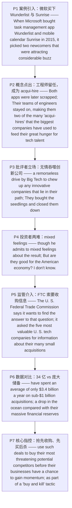

---

# 科技巨头的小额收购：抢人才还是扼杀竞争 精读笔记

---

## 背景

本文选自 **2021 年考研英语（一）Text 3**，主题为**科技巨头对初创公司的"小额收购"**——微软 2015 年买下 Wunderlist 与 Sunrise 后又将其关停，引出"**acqui-hire（收购式招聘）**"与"**buy and kill（先买后杀）**"两种动机之争；随后美国**联邦贸易委员会（FTC）**要求五大科技公司交代十年间的小额收购，把"**这些收购究竟是好是坏**"推上监管议程。

文章沿"**案例引入 → 概念点出 → 批评者立场 → 投资者两难 → 监管介入 → 数据对比 → 核心指控**"的链条展开：

- **案例引入**：微软 2015 年收购 Wunderlist 与 Sunrise，二者随后被**砍掉**，工程师团队**留任**（P1–P2）。
- **概念点出**：这类"买公司、留人才"的做法被称为 **acqui-hire**——大公司借此满足对**技术人才**的渴求（P2）。
- **批评者立场**：在微软的批评者看来，这是科技巨头**无情吞噬**挡路创新公司的表现，"买下幼苗再关停"（P3）。
- **投资者两难**：投资人阿诺德承认对此**心情复杂**——对自己有利，但对**美国经济**是否有益存疑（P4）。
- **监管介入**：FTC 要求五大科技公司提供**过去十年间小额收购**的信息，或使监管者**介入早期科技市场**（P5）。
- **数据对比**：相对于五大公司**庞大的资金储备**与去年 **1300 亿美元风投资本**，每年 34 亿美元的收购额**沧海一粟**（P6）。
- **核心指控**：批评者称，大公司借此**抢先收购最具威胁的潜在对手**，甚至作为"**先买后杀**"策略的一部分直接关停（P7）。

**难度说明**：中等。句式上以**介词短语连缀**、**非谓语动词**（现在分词作结果/伴随状语、不定式作目的状语）、**定语从句**为主，兼有**动名词短语作主语 + 独立主格插入**（`rifling through such small deals—many of them much less prominent …—might seem beside the point`）与**让步从句省略**（`Although only a research project at this stage`）；论证上属于"**现象 + 争议 + 监管**"的科技/经济类说明文，是练习"**态度辨析**"与"**数据对比定位**"的好材料。

---

## 文章原文

# 2021 Passage 3

When Microsoft bought **task management** app Wunderlist and mobile calendar Sunrise in 2015, it picked two newcomers that were attracting **considerable buzz** in Silicon Valley. Microsoft's own Office **dominates** the market for "**productivity**" software, but the **start-ups** represented a new wave of technology designed **from the ground up** for the smartphone world.

> [!abstract]- 长难句分析
> **原句**：Microsoft's own Office dominates the market for "productivity" software, but the start-ups represented a new wave of technology designed from the ground up for the smartphone world.
>
> **主干提取**：
>
> - 主语 S1: Microsoft's own Office
> - 谓语 V1: dominates
> - 宾语 O1: the market for "productivity" software
> - 并列连词: but
> - 主语 S2: the start-ups
> - 谓语 V2: represented
> - 宾语 O2: a new wave of technology
>
> **修饰成分**：
>
> | 类型 | 引导词 / 形式 | 修饰对象 |
> |------|--------------|----------|
> | 介词短语作后置定语 | for "productivity" software | the market |
> | 并列分句 | but the start-ups represented … | 前一分句 |
> | 过去分词短语作后置定语 | designed from the ground up for the smartphone world | a new wave of technology |
> | 介词短语作状语 | from the ground up | designed |
>
> **结构图解**：
>
> ```
> 并列句: Microsoft's own Office + dominates + the market 〔for "productivity" software〕
>   └── 介词短语作后置定语: for "productivity" software
> but 并列分句: the start-ups + represented + a new wave of technology 〔designed from the ground up for the smartphone world〕
>   └── 过去分词短语作后置定语: designed from the ground up for the smartphone world
>         └── 介词短语作状语: from the ground up
> ```
>
> **参考译文**：微软自家的 Office 主导着"生产力"软件市场，但这些初创公司代表着为智能手机世界从头设计的一波新技术。
>
> **考点提示**：① 主干为 `but` 连接的**并列句**，两个分句各有主谓。② `designed from the ground up for the smartphone world` 是**过去分词短语作后置定语**（= `that was designed …`），修饰 `a new wave of technology`，勿误读为谓语。③ `from the ground up` = "从头、彻底地"。

Both apps, however, were later **scrapped** after Microsoft said it had used their best features in its own products. Their teams of engineers stayed on, making them two of the many "**acqui-hires**" that the biggest companies have used to feed their great **hunger** for tech talent.

> [!abstract]- 长难句分析
> **原句**：Their teams of engineers stayed on, making them two of the many "acqui-hires" that the biggest companies have used to feed their great hunger for tech talent.
>
> **主干提取**：
>
> - 主语 S: Their teams of engineers
> - 谓语 V: stayed on
> - 结果状语: making them two of the many "acqui-hires" …
>
> **修饰成分**：
>
> | 类型 | 引导词 / 形式 | 修饰对象 |
> |------|--------------|----------|
> | 现在分词短语作结果状语 | making them two of the many "acqui-hires" | 整个前句 |
> | 定语从句 | that the biggest companies have used | "acqui-hires" |
> | 不定式作目的状语 | to feed their great hunger for tech talent | have used |
>
> **结构图解**：
>
> ```
> 主句: Their teams of engineers + stayed on, 〔making them two of the many "acqui-hires" 〔that the biggest companies have used 〔to feed their great hunger for tech talent〕〕〕
>   └── 现在分词作结果状语: making them two of the many "acqui-hires"（逻辑主语为前句所述情形）
>         └── 定语从句: that the biggest companies have used（that 作 used 的宾语，修饰 acqui-hires）
>               └── 不定式作目的状语: to feed their great hunger for tech talent
> ```
>
> **参考译文**：它们的工程师团队留了下来，使二者成为众多"收购式招聘（acqui-hire）"案例中的两个——大公司借此满足其对技术人才的巨大渴求。
>
> **考点提示**：① 主干 `Their teams stayed on`。② `making them …` 是**现在分词作结果状语**，逻辑主语为**前面整个情形**，`them` 指两家公司。③ `that the biggest companies have used` 是**定语从句**，`that` 作 `used` 的**宾语**（可省略），先行词为 `acqui-hires`。④ `to feed …` 是**不定式作目的状语**。⑤ 现在完成时 `have used` 配合 `have` 表"至今仍在用"。

To Microsoft's critics, the fates of Wunderlist and Sunrise are examples of a **remorseless drive** by Big Tech to **chew up** any **innovative** companies that lie in their path.

> [!abstract]- 长难句分析
> **原句**：To Microsoft's critics, the fates of Wunderlist and Sunrise are examples of a remorseless drive by Big Tech to chew up any innovative companies that lie in their path.
>
> **主干提取**：
>
> - 状语 A: To Microsoft's critics
> - 主语 S: the fates of Wunderlist and Sunrise
> - 谓语 V: are
> - 表语 P: examples of a remorseless drive
>
> **修饰成分**：
>
> | 类型 | 引导词 / 形式 | 修饰对象 |
> |------|--------------|----------|
> | 介词短语作状语 | To Microsoft's critics | 全句（引出视角） |
> | 介词短语作后置定语 | of Wunderlist and Sunrise | the fates |
> | 介词短语作后置定语 | of a remorseless drive | examples |
> | 介词短语作后置定语 | by Big Tech | a remorseless drive |
> | 不定式作后置定语 | to chew up any innovative companies … | a remorseless drive |
> | 定语从句 | that lie in their path | any innovative companies |
>
> **结构图解**：
>
> ```
> 主句: 〔To Microsoft's critics〕, the fates 〔of Wunderlist and Sunrise〕 + are + examples 〔of a remorseless drive 〔by Big Tech〕 〔to chew up any innovative companies 〔that lie in their path〕〕〕
>   ├── 状语: To Microsoft's critics（引出"批评者"视角）
>   ├── 后置定语: of Wunderlist and Sunrise（修饰 the fates）
>   └── 后置定语链: examples of a remorseless drive by Big Tech to chew up …
>         └── 定语从句: that lie in their path（修饰 any innovative companies）
> ```
>
> **参考译文**：在微软的批评者看来，Wunderlist 和 Sunrise 的命运正是科技巨头无情扩张的例证——它们吞噬一切挡在路上的创新公司。
>
> **考点提示**：① 主干 `the fates … are examples`（**主系表**）。② `To sb's critics` 作**评注性状语**，= "在某人的批评者看来"。③ `examples of a remorseless drive by Big Tech to chew up …` 是**多层后置修饰**，其中 `to chew up …` 为**不定式作后置定语**（说明 drive 的内容）。④ 句末 `that lie in their path` 是**定语从句**修饰 `companies`，`lie in one's path` = "挡在某人路上"。

"They bought the **seedlings** and closed them down," complained Paul Arnold, a partner at San Francisco-based Switch Ventures, putting an end to businesses that might one day turn into **competitors**.

> [!abstract]- 长难句分析
> **原句**："They bought the seedlings and closed them down," complained Paul Arnold, a partner at San Francisco-based Switch Ventures, putting an end to businesses that might one day turn into competitors.
>
> **主干提取**：
>
> - 引语（宾语前置）: "They bought the seedlings and closed them down,"
> - 谓语 V: complained
> - 主语 S: Paul Arnold
> - 同位语: a partner at San Francisco-based Switch Ventures
> - 状语（结果/伴随）: putting an end to businesses …
>
> **修饰成分**：
>
> | 类型 | 引导词 / 形式 | 修饰对象 |
> |------|--------------|----------|
> | 引语前置 + 主谓倒装 | "They bought … ," complained Paul Arnold | 全句（引述结构） |
> | 同位语 | a partner at San Francisco-based Switch Ventures | Paul Arnold |
> | 现在分词短语作状语 | putting an end to businesses … | 整个前句 |
> | 定语从句 | that might one day turn into competitors | businesses |
>
> **结构图解**：
>
> ```
> 引述句: "They bought the seedlings and closed them down," + complained + Paul Arnold, 〔a partner at San Francisco-based Switch Ventures〕, 〔putting an end to businesses 〔that might one day turn into competitors〕〕
>   ├── 引语前置 + 倒装: 引语作宾语前置，主语 Paul Arnold 后置
>   ├── 同位语: a partner at San Francisco-based Switch Ventures（说明 Paul Arnold 身份）
>   └── 现在分词作状语: putting an end to businesses …
>         └── 定语从句: that might one day turn into competitors（修饰 businesses）
> ```
>
> **参考译文**："他们买下这些幼苗，然后把它们关停，"旧金山 Switch Ventures 的合伙人保罗·阿诺德抱怨道，称这扼杀了那些有朝一日可能成长为竞争对手的企业。
>
> **考点提示**：① 这是**引语前置 + 主谓倒装**的引述句：`"…" complained Paul Arnold`，正常语序为 `Paul Arnold complained "…"`。② `a partner at …` 是**同位语**，说明说话人身份。③ `putting an end to …` 为**现在分词作状语**，逻辑主语是**整个引述内容**。④ `that might one day turn into competitors` 是**定语从句**修饰 `businesses`，`might` 表**推测**。

Microsoft **declined to comment**.

Like other **start-up investors**, Mr. Arnold's own business often depends on selling start-ups to larger tech companies, though he admits to **mixed feelings** about the result: "I think these things are good for me, if I put my **selfish hat** on. But are they good for the American economy? I don't know."

> [!abstract]- 长难句分析
> **原句**：Like other start-up investors, Mr. Arnold's own business often depends on selling start-ups to larger tech companies, though he admits to mixed feelings about the result: "I think these things are good for me, if I put my selfish hat on. But are they good for the American economy? I don't know."
>
> **主干提取**：
>
> - 状语 A: Like other start-up investors
> - 主语 S: Mr. Arnold's own business
> - 谓语 V: depends on
> - 宾语 O: selling start-ups to larger tech companies
> - 让步状语从句: though he admits to mixed feelings about the result
> - 引语: "I think … I don't know."
>
> **修饰成分**：
>
> | 类型 | 引导词 / 形式 | 修饰对象 |
> |------|--------------|----------|
> | 介词短语作状语 | Like other start-up investors | 全句 |
> | 动名词短语作介词宾语 | selling start-ups to larger tech companies | depends on |
> | 让步状语从句 | though he admits to mixed feelings about the result | 主句 |
> | 宾语从句（省略 that） | (that) these things are good for me | think |
> | 条件状语从句（插入） | if I put my selfish hat on | I think … |
>
> **结构图解**：
>
> ```
> 主句: 〔Like other start-up investors〕, Mr. Arnold's own business + often depends on + 〔selling start-ups to larger tech companies〕, 〔though he admits to mixed feelings about the result: "…"〕
>   ├── 状语: Like other start-up investors
>   ├── 动名词作介词宾语: selling start-ups to larger tech companies
>   └── 让步状语从句: though he admits to mixed feelings …
>         └── 引语（冒号引出）: "I think 〔(that) these things are good for me〕, 〔if I put my selfish hat on〕. But are they good for the American economy? I don't know."
>               ├── 宾语从句（省略 that）: (that) these things are good for me
>               └── 条件状语从句（插入）: if I put my selfish hat on
> ```
>
> **参考译文**：和其他初创投资者一样，阿诺德先生自己的生意常常依赖于把初创公司卖给更大的科技公司，不过他也承认对这一结果心情复杂："如果戴上我自私的帽子（从个人利益出发），我觉得这些事对我有好处。但它们对美国经济有好处吗？我不知道。"
>
> **考点提示**：① 主干 `Mr. Arnold's business depends on selling …`。② `depend on` 后接**动名词** `selling` 作介词宾语。③ `though` 引导**让步状语从句**，引出"态度转折"，是本句重心，也是**第 33 题态度线索**。④ 冒号后为**直接引语**，内含省略 `that` 的**宾语从句**与插入的**条件状语从句**。

The U. S. **Federal Trade Commission** says it wants to find the answer to that question. This week, it asked the five most valuable U. S. tech companies for information about their many small **acquisitions** over the past decade. Although only a research project at this stage, the request has raised the prospect of **regulators** **wading into** early-stage tech markets that until now have been beyond their reach.

> [!abstract]- 长难句分析
> **原句**：Although only a research project at this stage, the request has raised the prospect of regulators wading into early-stage tech markets that until now have been beyond their reach.
>
> **主干提取**：
>
> - 让步状语（省略）: Although (it is) only a research project at this stage
> - 主语 S: the request
> - 谓语 V: has raised
> - 宾语 O: the prospect of regulators wading into early-stage tech markets
>
> **修饰成分**：
>
> | 类型 | 引导词 / 形式 | 修饰对象 |
> |------|--------------|----------|
> | 让步状语从句（省略主谓） | Although (it is) only a research project at this stage | 主句 |
> | 动名词复合结构 | regulators wading into early-stage tech markets | the prospect of |
> | 定语从句 | that until now have been beyond their reach | early-stage tech markets |
>
> **结构图解**：
>
> ```
> 主句: 〔Although (it is) only a research project at this stage〕, the request + has raised + the prospect 〔of regulators wading into early-stage tech markets 〔that until now have been beyond their reach〕〕
>   ├── 让步状语从句（省略 it is）: Although only a research project at this stage
>   └── 动名词复合结构: the prospect of + 〔regulators wading into …〕（regulators 为 wading 的逻辑主语）
>         └── 定语从句: that until now have been beyond their reach（修饰 markets）
> ```
>
> **参考译文**：尽管这目前只是一个研究项目，但该要求已使监管者有可能介入此前一直不在其管辖范围内的早期科技市场。
>
> **考点提示**：① `Although only a research project …` 是**省略了主谓**的让步状语从句（= `Although it is only …`），省略后直接接名词短语，是考研常见省略结构。② `the prospect of regulators wading into …` 是**动名词复合结构**，`regulators` 为 `wading` 的**逻辑主语**。③ `that until now have been beyond their reach` 是**定语从句**，用**现在完成时**呼应 `until now`。

Given their **combined market value** of more than $5.5 trillion, **rifling through** such small deals—many of them much less **prominent** than Wunderlist and Sunrise—might seem **beside the point**.

> [!abstract]- 长难句分析
> **原句**：Given their combined market value of more than $5.5 trillion, rifling through such small deals—many of them much less prominent than Wunderlist and Sunrise—might seem beside the point.
>
> **主干提取**：
>
> - 状语 A: Given their combined market value of more than $5.5 trillion
> - 主语 S: rifling through such small deals
> - 谓语 V: might seem
> - 表语 P: beside the point
>
> **修饰成分**：
>
> | 类型 | 引导词 / 形式 | 修饰对象 |
> |------|--------------|----------|
> | 过去分词短语作状语 | Given their combined market value … | 全句（表依据） |
> | 动名词短语作主语 | rifling through such small deals | might seem |
> | 独立主格（插入语） | many of them much less prominent than Wunderlist and Sunrise | such small deals |
> | 比较结构 | much less … than … | many of them |
>
> **结构图解**：
>
> ```
> 主句: 〔Given their combined market value 〔of more than $5.5 trillion〕〕, 〔rifling through such small deals〕—〔many of them much less prominent than Wunderlist and Sunrise〕— + might seem + beside the point
>   ├── 过去分词作状语: Given …（= "鉴于"）
>   ├── 动名词短语作主语: rifling through such small deals（谓语用单数）
>   └── 独立主格（插入语）: many of them much less prominent than …
>         └── 比较结构: much less … than …
> ```
>
> **参考译文**：鉴于这五家公司合计市值超过 5.5 万亿美元，翻查这类小额交易——其中许多远不如 Wunderlist 和 Sunrise 引人注目——似乎显得无关紧要。
>
> **考点提示**：① `Given …` 是**过去分词作状语**，此处已**介词化**，= "鉴于、考虑到"。② 真正主语是**动名词短语** `rifling through such small deals`，谓语用**单数** `might seem`。③ 破折号中间是**独立主格结构**（`many of them + 形容词短语`，省略 `being`），插入语把**主语与谓语割裂**，阅读须跳过它找谓语。④ `beside the point` = "无关紧要的"。

Between them, the five biggest tech companies have spent an average of only $3.4 billion a year on sub-$1 billion acquisitions over the past five years—**a drop in the ocean** compared with their massive **financial reserves**, and the more than $130 billion of **venture capital** that was invested in the U.S. last year.

> [!abstract]- 长难句分析
> **原句**：Between them, the five biggest tech companies have spent an average of only $3.4 billion a year on sub-$1 billion acquisitions over the past five years—a drop in the ocean compared with their massive financial reserves, and the more than $130 billion of venture capital that was invested in the U.S. last year.
>
> **主干提取**：
>
> - 状语 A: Between them
> - 主语 S: the five biggest tech companies
> - 谓语 V: have spent
> - 宾语 O: an average of only $3.4 billion a year
> - 状语 A: on sub-$1 billion acquisitions over the past five years
>
> **修饰成分**：
>
> | 类型 | 引导词 / 形式 | 修饰对象 |
> |------|--------------|----------|
> | 前置介词短语作状语 | Between them | 全句（表"合计"） |
> | 同位语（破折号） | a drop in the ocean compared with … | an average of only $3.4 billion a year |
> | 过去分词短语作比较状语 | compared with their massive financial reserves, and … | a drop in the ocean |
> | 并列名词短语 | A, and B（两个比较对象） | compared with |
> | 定语从句 | that was invested in the U.S. last year | venture capital |
>
> **结构图解**：
>
> ```
> 主句: 〔Between them〕, the five biggest tech companies + have spent + an average of only $3.4 billion a year + 〔on sub-$1 billion acquisitions over the past five years〕—〔a drop in the ocean 〔compared with their massive financial reserves, and the more than $130 billion of venture capital 〔that was invested in the U.S. last year〕〕〕
>   ├── 前置状语: Between them（= "它们合计"，非主语）
>   ├── 同位语（破折号）: a drop in the ocean …（说明前面的 34 亿美元）
>   └── 比较状语: compared with A, and B
>         ├── 并列比较对象: their massive financial reserves / the more than $130 billion of venture capital
>         └── 定语从句: that was invested in the U.S. last year（修饰 venture capital）
> ```
>
> **参考译文**：过去五年间，五大科技公司平均每年仅花费 34 亿美元用于金额低于 10 亿美元的收购——与它们庞大的资金储备以及去年美国投入的逾 1300 亿美元风险资本相比，不过是沧海一粟。
>
> **考点提示**：① `Between them` 是**前置状语**（= "它们合计"），**不是主语**；真正主语 `the five biggest tech companies` 为复数，故用 `have spent`。② `over the past five years` 是**现在完成时信号词**。③ 破折号后 `a drop in the ocean` 是**同位语**，说明 34 亿美元的"分量"。④ `compared with A, and B` 中 `A` 与 `B` 是**并列的比较对象**，`and` 连接的是两个比较项而非谓语。

However, critics say the big companies use such deals to buy their most **threatening** potential competitors before their businesses have a chance to **gain momentum**, in some cases as part of a "**buy and kill**" **tactic** to simply close them down.

> [!abstract]- 长难句分析
> **原句**：However, critics say the big companies use such deals to buy their most threatening potential competitors before their businesses have a chance to gain momentum, in some cases as part of a "buy and kill" tactic to simply close them down.
>
> **主干提取**：
>
> - 连接副词: However
> - 主语 S: critics
> - 谓语 V: say
> - 宾语从句 O: (that) the big companies use such deals to buy …
>
> **宾语从句内部**：
>
> - 主语 S: the big companies
> - 谓语 V: use
> - 宾语 O: such deals
> - 目的状语: to buy their most threatening potential competitors
> - 时间状语从句: before their businesses have a chance to gain momentum
>
> **修饰成分**：
>
> | 类型 | 引导词 / 形式 | 修饰对象 |
> |------|--------------|----------|
> | 转折连接副词 | However | 全句 |
> | 宾语从句（省略 that） | (that) the big companies use such deals … | say |
> | 不定式作目的状语 | to buy their most threatening potential competitors | use such deals |
> | 时间状语从句 | before their businesses have a chance to gain momentum | to buy |
> | 不定式作后置定语 | to gain momentum | a chance |
> | 介词短语作状语 | in some cases as part of a "buy and kill" tactic | to buy |
> | 不定式作后置定语 | to simply close them down | a "buy and kill" tactic |
>
> **结构图解**：
>
> ```
> 主句: 〔However〕, critics + say + 〔(that) the big companies use such deals 〔to buy their most threatening potential competitors〕 〔before their businesses have a chance 〔to gain momentum〕〕, 〔in some cases as part of a "buy and kill" tactic 〔to simply close them down〕〕〕
>   ├── 宾语从句（省略 that）: the big companies use such deals …
>   │     ├── 不定式作目的状语: to buy their most threatening potential competitors
>   │     ├── 时间状语从句: before their businesses have a chance 〔to gain momentum〕
>   │     │     └── 不定式作后置定语: to gain momentum（修饰 a chance）
>   │     └── 介词短语作状语: in some cases as part of a "buy and kill" tactic
>   │           └── 不定式: to simply close them down
> ```
>
> **参考译文**：然而，批评者称，大公司利用这类交易收购最具威胁的潜在竞争对手，赶在其业务有机会发展壮大之前下手，有些情况下更是"先买后杀"策略的一部分，只为把它们直接关停。
>
> **考点提示**：① `critics say` 后是**省略 `that` 的宾语从句**，从句才是信息核心。② 从句主干 `the big companies use such deals`，其后接**不定式作目的状语** `to buy …`。③ `before their businesses have a chance to gain momentum` 是**时间状语从句**，表"抢在对手壮大之前"，凸显收购的**时机性动机**，是**第 32 题依据**。④ `in some cases as part of a "buy and kill" tactic to simply close them down` 是**介词短语作状语**，末尾 `to close them down` 说明该策略的目的。

---

## 题目

### 31. What is true about Wunderlist and Sunrise after their acquisitions?

- [A] Their engineers were retained.
- [B] Their market values declined.
- [C] Their tech features improved.
- [D] Their products were re-priced.

### 32. Microsoft's critics believe that the big tech companies tend to ____.

- [A] exaggerate their product quality
- [B] eliminate their potential competitors
- [C] treat new tech talent unfairly
- [D] ignore public opinions

### 33. Paul Arnold is concerned that small acquisitions might ____.

- [A] weaken big tech companies
- [B] worsen market competition
- [C] harm the national economy
- [D] discourage start-up investors

### 34. The U.S. Federal Trade Commission intends to ____.

- [A] limit Big Tech's expansion
- [B] encourage research collaboration
- [C] examine small acquisitions
- [D] supervise start-ups' operations

### 35. For the five biggest tech companies, their small acquisitions have ____.

- [A] brought little financial pressure
- [B] raised few management challenges
- [C] set an example for future deals
- [D] generated considerable profits

---

## 翻译对照

# 2021 Passage 3 中英对照翻译

## Paragraph 1

When Microsoft bought task management app Wunderlist and mobile calendar Sunrise in 2015, it picked two newcomers that were attracting considerable buzz in Silicon Valley. Microsoft's own Office dominates the market for "productivity" software, but the start-ups represented a new wave of technology designed from the ground up for the smartphone world.

2015 年，微软收购了任务管理应用 Wunderlist 和移动日历 Sunrise，挑中的这两家新公司在硅谷引起了相当大的关注。微软自家的 Office 主导着"生产力"软件市场，但这些初创公司代表着为智能手机世界从头设计的一波新技术。

> [!note] 翻译说明
> - `task management app` = "任务管理应用"；`mobile calendar` = "移动日历"。
> - `considerable buzz` = "相当大的热度/关注"，`buzz` 此处 = "（媒体、公众的）热议、关注"。
> - `dominate the market` = "主导市场"；`productivity software` = "生产力软件、效率软件"。
> - `from the ground up` = "从头开始、彻底地"，此处指为智能手机世界量身设计。

## Paragraph 2

Both apps, however, were later scrapped after Microsoft said it had used their best features in its own products. Their teams of engineers stayed on, making them two of the many "acqui-hires" that the biggest companies have used to feed their great hunger for tech talent.

然而，微软表示已把它们的最佳功能用到了自家产品中，随后这两款应用都被砍掉了。它们的工程师团队留了下来，使二者成为众多"收购式招聘（acqui-hire）"案例中的两个——大公司借此满足其对技术人才的巨大渴求。

> [!note] 翻译说明
> - `scrap` = "废弃、砍掉（项目/产品）"；`feature` = "功能、特色"。
> - `stay on` = "留下来（继续任职）"。
> - `acqui-hire` = "收购式招聘"，由 acquisition + hire 缩合而成，指收购公司主要为获得其人才。
> - `feed one's hunger for ...` = "满足对……的渴求"，`feed` 此处 = "满足（欲望）"。

## Paragraph 3

To Microsoft's critics, the fates of Wunderlist and Sunrise are examples of a remorseless drive by Big Tech to chew up any innovative companies that lie in their path. "They bought the seedlings and closed them down," complained Paul Arnold, a partner at San Francisco-based Switch Ventures, putting an end to businesses that might one day turn into competitors. Microsoft declined to comment.

在微软的批评者看来，Wunderlist 和 Sunrise 的命运正是科技巨头无情扩张的例证——它们吞噬一切挡在路上的创新公司。"他们买下这些幼苗，然后把它们关停，"旧金山 Switch Ventures 的合伙人保罗·阿诺德抱怨道，称这扼杀了那些有朝一日可能成长为竞争对手的企业。微软拒绝置评。

> [!note] 翻译说明
> - `to sb's critics` = "在某人的批评者看来"；`fate` = "命运、结局"。
> - `remorseless drive` = "无情的驱动力/势头"，`remorseless` = "冷酷无情的"。
> - `chew up` = "吞噬、嚼碎"，比喻吞并小公司。
> - `seedling` 本义 = "幼苗"，此处比喻"尚处起步阶段的初创公司"。
> - `put an end to` = "终结、扼杀"；`decline to comment` = "拒绝置评"。

## Paragraph 4

Like other start-up investors, Mr. Arnold's own business often depends on selling start-ups to larger tech companies, though he admits to mixed feelings about the result: "I think these things are good for me, if I put my selfish hat on. But are they good for the American economy? I don't know."

和其他初创投资者一样，阿诺德先生自己的生意常常依赖于把初创公司卖给更大的科技公司，不过他也承认对这一结果心情复杂："如果戴上我自私的帽子（从个人利益出发），我觉得这些事对我有好处。但它们对美国经济有好处吗？我不知道。"

> [!note] 翻译说明
> - `start-up investor` = "初创企业投资者"；`depend on` = "依赖于"。
> - `admit to mixed feelings about ...` = "承认对……心情复杂"，`mixed feelings` = "矛盾的心情"。
> - `put my selfish hat on` = 习语，"戴上自私的帽子"，意为"从自私的角度看、只顾自己的利益"。

## Paragraph 5

The U. S. Federal Trade Commission says it wants to find the answer to that question. This week, it asked the five most valuable U. S. tech companies for information about their many small acquisitions over the past decade. Although only a research project at this stage, the request has raised the prospect of regulators wading into early-stage tech markets that until now have been beyond their reach.

美国联邦贸易委员会表示，它想找出这个问题的答案。本周，它要求美国市值最高的五家科技公司提供信息，说明它们在过去十年中进行的众多小额收购。尽管这目前只是一个研究项目，但该要求已使监管者有可能介入此前一直不在其管辖范围内的早期科技市场。

> [!note] 翻译说明
> - `Federal Trade Commission` = "联邦贸易委员会"（美国反垄断与消费者保护机构，缩写 FTC）。
> - `the five most valuable U. S. tech companies` = "美国市值最高的五家科技公司"。
> - `acquisition` = "收购、并购"；`over the past decade` = "在过去十年中"。
> - `raise the prospect of ...` = "使……成为可能/提上日程"；`wade into` = "插手、介入（本不愿涉足之事）"。
> - `beyond one's reach` = "超出……的管辖/触及范围"。

## Paragraph 6

Given their combined market value of more than $5.5 trillion, rifling through such small deals—many of them much less prominent than Wunderlist and Sunrise—might seem beside the point. Between them, the five biggest tech companies have spent an average of only $3.4 billion a year on sub-$1 billion acquisitions over the past five years—a drop in the ocean compared with their massive financial reserves, and the more than $130 billion of venture capital that was invested in the U.S. last year.

鉴于这五家公司合计市值超过 5.5 万亿美元，翻查这类小额交易——其中许多远不如 Wunderlist 和 Sunrise 引人注目——似乎显得无关紧要。过去五年间，五大科技公司平均每年仅花费 34 亿美元用于金额低于 10 亿美元的收购——与它们庞大的资金储备以及去年美国投入的逾 1300 亿美元风险资本相比，不过是沧海一粟。

> [!note] 翻译说明
> - `Given ...` = "鉴于、考虑到"；`combined market value` = "合计市值"。
> - `rifle through` = "翻查、搜寻"；`prominent` = "引人注目的、重要的"。
> - `beside the point` = "无关紧要的、不切题的"。
> - `sub-$1 billion acquisitions` = "低于 10 亿美元的收购"，`sub-` 前缀 = "低于……"。
> - `a drop in the ocean` = 习语，"沧海一粟、杯水车薪"；`financial reserves` = "资金储备"；`venture capital` = "风险资本、风投资本"。

## Paragraph 7

However, critics say the big companies use such deals to buy their most threatening potential competitors before their businesses have a chance to gain momentum, in some cases as part of a "buy and kill" tactic to simply close them down.

然而，批评者称，大公司利用这类交易收购最具威胁的潜在竞争对手，赶在其业务有机会发展壮大之前下手，有些情况下更是"先买后杀"策略的一部分，只为把它们直接关停。

> [!note] 翻译说明
> - `threatening` = "有威胁的、构成威胁的"；`potential competitor` = "潜在竞争对手"。
> - `gain momentum` = "获得发展势头、渐入佳境"，`momentum` = "势头、冲劲"。
> - `in some cases` = "在某些情况下"；`tactic` = "策略、手段"。
> - `buy and kill` = "先买后杀"，指收购后直接关停以消灭竞争；`close down` = "关闭、关停"。

## 题目翻译

### 31. What is true about Wunderlist and Sunrise after their acquisitions?

31. 关于 Wunderlist 和 Sunrise 被收购后的情况，以下哪项属实？

- [A] 它们的工程师被留用。
- [B] 它们的市值下跌了。
- [C] 它们的技术功能得到改进。
- [D] 它们的产品被重新定价。

### 32. Microsoft's critics believe that the big tech companies tend to ____.

32. 微软的批评者认为，大型科技公司倾向于 ____。

- [A] 夸大其产品质量
- [B] 消灭其潜在竞争对手
- [C] 不公平地对待新技术人才
- [D] 无视公众意见

### 33. Paul Arnold is concerned that small acquisitions might ____.

33. 保罗·阿诺德担心小额收购可能 ____。

- [A] 削弱大型科技公司
- [B] 加剧市场竞争
- [C] 损害国家经济
- [D] 打击初创企业投资者的积极性

### 34. The U.S. Federal Trade Commission intends to ____.

34. 美国联邦贸易委员会打算 ____。

- [A] 限制科技巨头的扩张
- [B] 鼓励研究合作
- [C] 审查小额收购
- [D] 监管初创企业的运营

### 35. For the five biggest tech companies, their small acquisitions have ____.

35. 对五大科技公司而言，它们的小额收购 ____。

- [A] 几乎没有带来财务压力
- [B] 几乎没有带来管理挑战
- [C] 为未来交易树立了榜样
- [D] 产生了可观的利润

---

## 语法要点

# 2021 Passage 3 语法整理

> [!note] 来源说明
> 本篇**用户未提供语法源笔记**，以下语法点由 `formatted-article.md` 与 `translation.md` **从本文推断提取**，仅收录本篇实际出现的语法现象。
> 每一条均给出**原文语境**，便于回原文核对；标注"（联动）"的条目与相邻专题互为参照。
> 固定搭配与词组见 [[intermediate/2021-passage3-big-tech-acquisitions/固定搭配与词组笔记.md|2021 Passage 3 固定搭配与词组]]。

---

## 一、从句

### 从句：when 引导的时间状语从句

**概述**：`when` 引导**时间状语从句**，表示主句动作发生的**时间背景**。从句可置于句首，与主句用逗号隔开。

| 结构 | 用法 | 例句 |
|------|------|------|
| `When + 从句, 主句` | 时间状语从句置于句首，交代背景 | **When Microsoft bought** task management app Wunderlist and mobile calendar Sunrise in 2015, it picked two newcomers … |

> [!tip] 阅读技巧
> 句首的 `When` 从句往往只是**时间背景**，主句才是信息核心。快速定位主干时，可先跳过 `When` 从句，直接读 `it picked two newcomers`。（联动）见"从句：before 引导的时间状语从句"。

### 从句：that 引导的定语从句（限定性）

**概述**：`that` 引导**限定性定语从句**，紧跟先行词，`that` 在从句中**作主语或宾语**。作宾语时可省略。

| 结构 | 用法 | 例句 |
|------|------|------|
| `先行词 + that + 不完整从句` | that 作从句主语 | two newcomers **that were attracting considerable buzz** in Silicon Valley |
| `先行词 + that + 从句（that 作宾语）` | that 作从句宾语，可省略 | the many "acqui-hires" **that the biggest companies have used** … |
| `先行词 + that + 从句` | that 作从句主语 | early-stage tech markets **that until now have been beyond their reach** |
| `先行词 + that + 从句` | that 作从句主语（修饰并列先行词） | the more than $130 billion of venture capital **that was invested in the U.S. last year** |

> [!warning] 易错点
> 判据：`that` 后的从句**缺主语或宾语** → **定语从句**；从句**结构完整** → **同位语从句**。本篇四处 `that` 从句均缺成分，故都是定语从句。`that the biggest companies have used` 中 `that` 作 `used` 的**宾语**（被省略亦成立）。（联动）见 2021 Passage 2 语法笔记"从句：that 引导的同位语从句"。

### 从句：although 引导的让步状语从句

**概述**：`although` 引导**让步状语从句**，表"尽管、虽然"，从句与主句构成**让步—转折**关系。`although` 与 `though` 语义相近，但 `although` 更正式、多置于句首。

| 结构 | 用法 | 例句 |
|------|------|------|
| `Although + 从句, 主句` | 让步状语从句置于句首 | **Although only a research project at this stage**, the request has raised the prospect of … |

> [!tip] 解题技巧
> `Although` 从句常为**次要信息**（此处仅说"目前只是研究项目"），主句才是作者强调的重点（"已使监管介入成为可能"）。做题时重心放主句。

### 从句：though 引导的让步状语从句

**概述**：`though` 引导**让步状语从句**，可置于句中，起**插入补充**作用，语气比 `although` 稍轻、更口语化。

| 结构 | 用法 | 例句 |
|------|------|------|
| `主句 + though + 从句` | 让步从句后置作补充 | Mr. Arnold's own business often depends on selling start-ups … , **though he admits to mixed feelings** about the result |

> [!note] 补充说明
> `though` 置于主句之后时，常表"**不过、话虽如此**"，是对前句的**自我修正或补充**。此处引出阿诺德对"收购是否有利"的**矛盾态度**，是第 33 题的态度线索。（联动）见"评注性插入语（however / in some cases）"。

### 从句：if 引导的条件状语从句

**概述**：`if` 引导**条件状语从句**，表"如果"。此处为**真实条件**（非虚拟），主句用一般现在时。

| 结构 | 用法 | 例句 |
|------|------|------|
| `if + 一般现在时从句, 主句` | 真实条件，主将从现 | **if I put my selfish hat on**, I think these things are good for me |

> [!tip] 阅读技巧
> `if I put my selfish hat on`（"如果从自私的角度看"）是**插入性的条件从句**，插在 `I think these things are good for me` 中间，用于**限定说话立场**，非句子主干。

### 从句：before 引导的时间状语从句

**概述**：`before` 引导**时间状语从句**，表"在……之前"。此处置于句尾，说明"抢在……之前下手"。

| 结构 | 用法 | 例句 |
|------|------|------|
| `主句 + before + 从句` | 时间状语从句后置 | the big companies use such deals to buy … **before their businesses have a chance to gain momentum** |

> [!tip] 解题技巧
> `before` 从句在此表**"抢在（对手壮大）之前"**，凸显大公司收购的**时机性动机**——不是等对手长大再竞争，而是**提前扼杀**。这是第 32 题"消灭潜在竞争对手"的语义依据。（联动）见"从句：when 引导的时间状语从句"。

---

## 二、非谓语动词

### 非谓语：过去分词短语作后置定语

**概述**：过去分词短语作**后置定语**，修饰前面名词，与其构成**被动**或**完成**关系。

| 结构 | 用法 | 例句 |
|------|------|------|
| `名词 + 过去分词短语` | 被动关系，后置定语 | a new wave of technology **designed from the ground up for the smartphone world** |

> [!tip] 还原技巧
> `technology designed from the ground up` = `technology that was designed from the ground up`，`technology` 与 `design` 是**被动关系**（技术"被设计"），故用过去分词。去掉分词短语，主干 `the start-ups represented a new wave of technology` 依然完整。

### 非谓语：现在分词短语作结果状语

**概述**：现在分词短语置于主句之后，作**结果状语**，表"从而……、使得……"。其逻辑主语通常是**前面整个主句**。

| 结构 | 用法 | 例句 |
|------|------|------|
| `主句 + , + 现在分词短语` | 结果状语，逻辑主语为前句 | Their teams of engineers stayed on, **making them two of the many "acqui-hires"** … |
| `主句 + , + 现在分词短语` | 结果状语 | … complained Paul Arnold …, **putting an end to businesses** that might one day turn into competitors |

> [!warning] 易错点
> `making them two of the many "acqui-hires"` 中 `them` 指 **Wunderlist 和 Sunrise**，`making` 的逻辑主语是**整个前句所述情形**（"工程师留任"这件事使二者成为 acqui-hires）。勿误读为 `stayed on` 的并列谓语。

### 非谓语：现在分词短语作伴随状语

**概述**：现在分词短语可作**伴随状语**，说明主句动作**同时发生**的另一种动作或状态。

| 结构 | 用法 | 例句 |
|------|------|------|
| `主句 + , + 现在分词短语` | 伴随/补充说明 | … complained Paul Arnold, a partner at San Francisco-based Switch Ventures, **putting an end to businesses** … |

> [!note] 补充说明
> 与上一条"结果状语"形式上相同（`主句 + , + doing`），**语义判断**取决于语境：此处 `putting an end to …` 既可视作**结果**（抱怨的内容即"扼杀企业"），也可视作**伴随说明**。考研中无需强分，能读出"这是对前句的补充描述"即可。

### 非谓语：不定式作目的状语

**概述**：不定式作**目的状语**，表"为了……、以……"。

| 结构 | 用法 | 例句 |
|------|------|------|
| `不定式 + 名词` | 目的状语 | … "acqui-hires" that the biggest companies have used **to feed their great hunger for tech talent** |
| `不定式 + 名词` | 目的状语 | as part of a "buy and kill" tactic **to simply close them down** |

> [!tip] 解题技巧
> 两个目的状语分别点出**收购的两种动机**：`to feed their great hunger for tech talent`（**抢人才**）与 `to simply close them down`（**扼杀竞争**）。这是区分"acqui-hire（留人）"与"buy and kill（关停）"的关键线索。

### 非谓语：不定式作后置定语

**概述**：不定式作**后置定语**，修饰前面名词，表"要做的事、机会"。

| 结构 | 用法 | 例句 |
|------|------|------|
| `名词 + 不定式` | 后置定语 | before their businesses have a chance **to gain momentum** |

> [!tip] 还原技巧
> `a chance to gain momentum` = "发展壮大的机会"。`chance`、`opportunity`、`way`、`ability` 等抽象名词后常接不定式作定语。

### 非谓语：动名词短语作主语

**概述**：动名词短语作**主语**，视为**单数**，谓语用**单数**形式。

| 结构 | 用法 | 例句 |
|------|------|------|
| `动名词短语 + 单数谓语` | 动名词作主语，谓语单数 | **rifling through such small deals** … **might seem** beside the point |

> [!warning] 易错点
> 本句主语很长——`rifling through such small deals—many of them much less prominent than Wunderlist and Sunrise—`，中间被**破折号插入的独立主格**隔开，谓语是 **`might seem`**（单数）。阅读时须**跳过插入语**找到真正谓语。

### 非谓语：过去分词作状语（Given / compared with）

**概述**：过去分词（短语）可作**状语**，`Given …` 表"**鉴于、考虑到**"（已语法化为介词性引导词），`compared with …` 表"**与……相比**"。

| 结构 | 用法 | 例句 |
|------|------|------|
| `Given + 名词短语, 主句` | 过去分词作状语，表依据 | **Given their combined market value of more than $5.5 trillion**, rifling through such small deals … might seem beside the point |
| `名词 + compared with + 名词` | 过去分词作比较状语 | a drop in the ocean **compared with** their massive financial reserves |

> [!note] 补充说明
> `Given` 后接名词短语（非从句）时，已是**固定引导词**，= "鉴于"。`compared with / compared to` 同理，是考研高频的**比较状语**结构。（联动）见"比较结构（much less ... than / compared with）"。

---

## 三、语态

### 语态：被动语态（be + 过去分词）

**概述**：被动语态 `be + 过去分词`，强调**动作的承受者**；常与 `by` 连用引出施动者。

| 结构 | 用法 | 例句 |
|------|------|------|
| `be + 过去分词` | 一般过去时被动 | Both apps … **were later scrapped** |
| `be + 过去分词` | 被动语态（定语从句中） | the more than $130 billion of venture capital that **was invested** in the U.S. last year |
| `be + 过去分词` | 被动语态（分词短语作定语） | a new wave of technology **designed from the ground up**（省略 `that was`） |
| `be + 过去分词` | 被动语态（作状语） | **Given** their combined market value … / **compared with** their massive financial reserves |

> [!tip] 阅读技巧
> 本文被动句多用于**淡化施动者或突出结果**：`were scrapped`（被砍掉）不点名谁砍，`was invested`（被投入）突出资本规模。判断被动时看"**主语是否发出动作**"即可。注意 `designed`、`Given`、`compared with` 都是**被动形式的非谓语**，句中并非谓语动词。（联动）见"非谓语：过去分词短语作后置定语"。

---

## 四、时态

### 时态：现在完成时

**概述**：现在完成时 `have/has + 过去分词`，表**过去发生、影响延续到现在**，常与 `over the past decade`、`until now` 等时间状语连用。

| 结构 | 用法 | 例句 |
|------|------|------|
| `have + 过去分词` | 现在完成时，配合"过去十年" | the biggest companies **have used** to feed their great hunger for tech talent |
| `has + 过去分词` | 现在完成时，表"至今" | the request **has raised** the prospect of regulators wading into … |
| `have + 过去分词` | 现在完成时 | tech markets that **until now have been** beyond their reach |
| `have + 过去分词` | 现在完成时 | the five biggest tech companies **have spent** an average of only $3.4 billion a year |

> [!tip] 解题技巧
> 出现 `over the past decade`、`until now`、`over the past five years` 等**时间跨度**状语时，谓语**优先用现在完成时**。这是考研**时态题**的固定信号词。

### 时态：过去完成时

**概述**：过去完成时 `had + 过去分词`，表**"过去的过去"**——在某个过去动作**之前**已完成。

| 结构 | 用法 | 例句 |
|------|------|------|
| `had + 过去分词` | 过去完成时，先于过去动作 | Both apps … were later scrapped after Microsoft said it **had used** their best features in its own products |

> [!warning] 易错点
> `said it had used` 中，`had used` 发生在 `said` **之前**（先用了功能，后对外表态），故用**过去完成时**。这是"**主句过去时 + 从句更早动作**"的典型结构。

---

## 五、独立主格与插入语

### 独立主格结构（many of them + 形容词短语）

**概述**：**独立主格**由"**名词/代词 + 形容词/分词/介词短语**"构成，内部有**自己的逻辑主语**，整体作**状语或插入语**，起补充说明作用。

| 结构 | 用法 | 例句 |
|------|------|------|
| `代词 + 形容词短语` | 独立主格作插入语 | such small deals—**many of them much less prominent than Wunderlist and Sunrise**—might seem beside the point |

> [!tip] 还原技巧
> `many of them much less prominent than …` 中省略了 `being`（= `many of them being much less prominent than …`）。它**不是句子谓语**，而是插入性的补充说明，阅读时用**破折号对**把它整体括起来跳过。

### 评注性插入语（however / in some cases）

**概述**：**评注性插入语**（连接副词、介词短语）不充当句子成分，用于**标示逻辑关系**或**限定范围**，通常用逗号与句子隔开。

| 结构 | 用法 | 例句 |
|------|------|------|
| `However, + 主句` | 转折连接副词 | **However**, critics say the big companies use such deals to buy … |
| `in some cases` | 介词短语作评注状语，限定范围 | **in some cases** as part of a "buy and kill" tactic |

> [!note] 补充说明
> `However` 是**转折连接副词**（非连词），前后用逗号隔开，连接的是**与上一段的语义对立**（上段说"小额收购似乎无关紧要"，本段转折说"批评者认为这是扼杀竞争"）。（联动）见"从句：though 引导的让步状语从句"。

---

## 六、比较结构

### 比较结构（much less ... than / compared with）

**概述**：比较级 `less/more + 形容词 + than` 表**程度对比**；`compared with / compared to` 表**两者相比**，作**比较状语**。`much` 可修饰比较级表**程度加强**。

| 结构 | 用法 | 例句 |
|------|------|------|
| `much less + 形容词 + than` | 比较级 + 程度加强 | many of them **much less prominent than** Wunderlist and Sunrise |
| `more than + 数字` | 表"超过" | their combined market value of **more than $5.5 trillion** |
| `compared with + 名词` | 比较状语 | a drop in the ocean **compared with** their massive financial reserves |

> [!tip] 解题技巧
> `a drop in the ocean compared with …` = "与……相比不过是沧海一粟"，是**数据对比**的修辞表达，用于说明"小额收购相对于巨头体量微不足道"。（联动）见"非谓语：过去分词作状语（Given / compared with）"。

---

## 七、主谓一致与并列

### 主谓一致（between them + 复数主语）

**概述**：谓语须与**真正的主语**保持**数的一致**。主语被介词短语修饰时，谓语**不受介词宾语影响**。

| 结构 | 用法 | 例句 |
|------|------|------|
| `Between them, 复数主语 + 复数谓语` | 前置状语 + 复数主语 | **Between them**, the five biggest tech companies **have spent** an average of only $3.4 billion a year |

> [!warning] 易错点
> `Between them` 是**前置的介词短语状语**（= "它们合计"），**不是主语**。真正主语是 `the five biggest tech companies`（复数），故用 `have spent`。切勿被句首介词短语误导。

### 并列宾语与并列名词短语

**概述**：`and` 连接**并列成分**，可并列宾语、名词短语、分词短语等，须保持**结构对称**。

| 结构 | 用法 | 例句 |
|------|------|------|
| `A and B` | 并列宾语 | it bought task management app **Wunderlist and mobile calendar Sunrise** |
| `名词 + and + 名词` | 并列名词（介词宾语） | the fates of **Wunderlist and Sunrise** |
| `名词短语, and 名词短语` | 并列名词短语作比较对象 | compared with their massive financial reserves, **and the more than $130 billion of venture capital** … |

> [!note] 补充说明
> 本句 `a drop in the ocean compared with A, and B` 中，`A`（`their massive financial reserves`）与 `B`（`the more than $130 billion of venture capital`）是**并列的比较对象**，`and` 前有逗号，须辨清 `and` 连接的是**两个比较项**而非两个谓语。

---

_最后更新：2026-10-17_

---

## 固定搭配与词组

# 2021 Passage 3 固定搭配与词组

> [!note] 来源说明
> 本篇固定搭配与词组由 `formatted-article.md` **从本文提取**，仅收录本篇实际出现的表达。
> 纯语法内容见 [[intermediate/2021-passage3-big-tech-acquisitions/grammar-notes.md|2021 Passage 3 语法整理]]。

---

## 一、主题词与核心概念

| 搭配 | 释义 | 原文语境 |
|------|------|----------|
| **task management app** | 任务管理应用 | Microsoft bought **task management app** Wunderlist |
| **mobile calendar** | 移动日历 | and **mobile calendar** Sunrise in 2015 |
| **Silicon Valley** | 硅谷 | attracting considerable buzz in **Silicon Valley** |
| **productivity software** | 生产力软件、效率软件 | Office dominates the market for "**productivity**" **software** |
| **Big Tech** | 科技巨头（大型科技公司） | a remorseless drive by **Big Tech** |
| **acqui-hire** | 收购式招聘（为获人才而收购） | two of the many "**acqui-hires**" |
| **buy and kill** | 先买后杀（收购后关停） | as part of a "**buy and kill**" tactic |
| **Federal Trade Commission** | 联邦贸易委员会（美国，FTC） | The U. S. **Federal Trade Commission** says … |
| **venture capital** | 风险资本、风投资本 | more than $130 billion of **venture capital** |
| **financial reserves** | 资金储备 | their massive **financial reserves** |
| **market value** | 市值 | their combined **market value** of more than $5.5 trillion |
| **tech talent** | 技术人才 | feed their great hunger for **tech talent** |

> [!tip] 解题技巧
> `acqui-hire`（**留人**）与 `buy and kill`（**关停**）是本文一组**对立概念**：前者指收购后保留工程师团队，后者指收购后直接关闭。第 31 题问"被收购后怎么样"，定位 `Their teams of engineers stayed on`，即 **acqui-hire** 模式。

## 二、动词短语

| 搭配 | 释义 | 原文语境 |
|------|------|----------|
| **dominate the market** | 主导市场 | Microsoft's own Office **dominates the market** |
| **from the ground up** | 从头开始、彻底地 | technology designed **from the ground up** |
| **feed one's hunger for** | 满足对……的渴求 | used to **feed their great hunger for** tech talent |
| **stay on** | 留任、留下来 | Their teams of engineers **stayed on** |
| **chew up** | 吞噬、嚼碎（喻吞并） | a remorseless drive … to **chew up** any innovative companies |
| **close down** | 关闭、关停 | closed them down / close them down |
| **put an end to** | 终结、扼杀 | **putting an end to** businesses that might one day … |
| **turn into** | 变成、转变为 | businesses that might one day **turn into** competitors |
| **decline to comment** | 拒绝置评 | Microsoft **declined to comment** |
| **admit to** | 承认 | though he **admits to** mixed feelings |
| **depend on** | 依赖、取决于 | often **depends on** selling start-ups to larger tech companies |
| **wade into** | 介入、插手 | regulators **wading into** early-stage tech markets |
| **rifle through** | 翻查、搜寻 | **rifling through** such small deals |
| **gain momentum** | 获得发展势头、渐入佳境 | before their businesses have a chance to **gain momentum** |
| **be beyond one's reach** | 超出……的管辖/触及范围 | markets that until now have been **beyond their reach** |
| **raise the prospect of** | 使……成为可能、提上日程 | the request **has raised the prospect of** regulators wading into … |

> [!warning] 易错点
> `raise the prospect of` 中 `raise` = "**提高、使出现**"（不是"举起"），整句 = "使监管者介入成为可能"；`be beyond one's reach` = "**超出……的触及范围**"，此处指"此前不在监管权限内"。二者共同支撑第 34 题"**审查小额收购**"的推理。

## 三、名词与固定表达

| 搭配 | 释义 | 原文语境 |
|------|------|----------|
| **considerable buzz** | 相当大的关注、热度 | attracting **considerable buzz** in Silicon Valley |
| **remorseless drive** | 无情的驱动力 | examples of a **remorseless drive** by Big Tech |
| **seedling** | 幼苗（喻起步阶段的初创公司） | They bought the **seedlings** and closed them down |
| **mixed feelings** | 矛盾的心情 | he admits to **mixed feelings** about the result |
| **selfish hat** | "自私的帽子"（喻从私利出发） | if I put my **selfish hat** on |
| **combined market value** | 合计市值 | their **combined market value** of more than $5.5 trillion |
| **a drop in the ocean** | 沧海一粟、杯水车薪 | **a drop in the ocean** compared with their massive financial reserves |
| **beside the point** | 无关紧要的、不切题的 | might seem **beside the point** |
| **potential competitor** | 潜在竞争对手 | buy their most threatening **potential competitors** |
| **acquisition** | 收购、并购 | their many small **acquisitions** over the past decade |
| **start-up investor** | 初创企业投资者 | Like other **start-up investors** |
| **tactic** | 策略、手段 | as part of a "buy and kill" **tactic** |

> [!note] 补充说明
> `a drop in the ocean`（= a drop in the bucket）是**习语**，字面"海里的一滴水"，喻"**微不足道**"。本文用它对比：五大公司每年 34 亿美元的收购额，相对其庞大储备与 1300 亿风投资本**微不足道**——这正是第 35 题"**几乎没有带来财务压力**"的依据。

## 四、副词与连接短语

| 搭配 | 释义 | 原文语境 |
|------|------|----------|
| **however** | 然而（转折连接副词） | Both apps, **however**, were later scrapped |
| **although** | 尽管（让步） | **Although** only a research project at this stage |
| **though** | 不过、尽管（让步） | **though** he admits to mixed feelings |
| **in some cases** | 在某些情况下 | **in some cases** as part of a "buy and kill" tactic |
| **much less ... than** | 远不如…… | much **less prominent than** Wunderlist and Sunrise |
| **compared with** | 与……相比 | a drop in the ocean **compared with** their massive financial reserves |
| **Given** | 鉴于、考虑到 | **Given** their combined market value of more than $5.5 trillion |

> [!tip] 解题技巧
> 本文**转折词密集**（`however`、`though`、`although`），作者态度通过**让步—转折**推进：先承认"小额收购看似无关紧要"（第 6 段），再用 `However` 转折引出"批评者认为是扼杀竞争"（第 7 段）。读议论文时**转折词后往往才是作者真正要强调的观点**。

---

_最后更新：2026-10-17_

---

## 生词表

> [!note] 收录说明
> 以下词汇取自本文**文章原文**中用 `**粗体**` 标记的考研重点词，按字母顺序分组排列；短语中的关键单词（如 `buzz`、`scrap`、`prominent`、`tactic`、`hunger`、`talent`）也单独列出。
> 词义以**考研常考义项**优先，例句一律取自本篇原文，便于回原文核对。

### A-C

| 词汇 | 词性 | 含义 | 原文例句 |
|------|------|------|----------|
| **a drop in the ocean** | phr. | 沧海一粟、杯水车薪 | "… **a drop in the ocean** compared with their massive financial reserves …" |
| **acqui-hire** | n. | 收购式招聘（为获取人才而收购公司） | "… making them two of the many "**acqui-hires**" that the biggest companies have used …" |
| **acquisition** | n. | 收购、并购 | "… information about their many small **acquisitions** over the past decade." |
| **beside the point** | phr. | 无关紧要的、不切题的 | "… rifling through such small deals … might seem **beside the point**." |
| **Big Tech** | n. | 科技巨头（大型科技公司） | "… examples of a remorseless drive by **Big Tech** to chew up any innovative companies …" |
| **buy and kill** | phr. | 先买后杀（收购后直接关停） | "… in some cases as part of a "**buy and kill**" tactic to simply close them down." |
| **buzz** | n. | 热议、关注（`considerable buzz` 相当大的热度） | "… two newcomers that were attracting considerable **buzz** in Silicon Valley." |
| **chew up** | phr. | 吞噬、吞并 | "… a remorseless drive by Big Tech to **chew up** any innovative companies …" |
| **combined market value** | n. | 合计市值 | "Given their **combined market value** of more than $5.5 trillion …" |
| **competitor** | n. | 竞争对手 | "… putting an end to businesses that might one day turn into **competitors**." |
| **considerable** | adj. | 相当大的、可观的 | "… it picked two newcomers that were attracting **considerable** buzz …" |

### D-J

| 词汇 | 词性 | 含义 | 原文例句 |
|------|------|------|----------|
| **decline to comment** | phr. | 拒绝置评 | "Microsoft **declined to comment**." |
| **dominate** | v. | 主导、支配 | "Microsoft's own Office **dominates** the market for "productivity" software …" |
| **Federal Trade Commission** | n. | 联邦贸易委员会（美国，FTC） | "The U. S. **Federal Trade Commission** says it wants to find the answer to that question." |
| **financial reserves** | n. | 资金储备 | "… compared with their massive **financial reserves** …" |
| **from the ground up** | phr. | 从头开始、彻底地 | "… a new wave of technology designed **from the ground up** for the smartphone world." |
| **gain momentum** | phr. | 获得发展势头、渐入佳境 | "… before their businesses have a chance to **gain momentum** …" |
| **hunger** | n. | 渴求、饥饿（`hunger for` 对……的渴求） | "… to feed their great **hunger** for tech talent." |
| **innovative** | adj. | 创新的、有创意的 | "… to chew up any **innovative** companies that lie in their path." |

### K-R

| 词汇 | 词性 | 含义 | 原文例句 |
|------|------|------|----------|
| **mixed feelings** | n. | 矛盾的心情 | "… though he admits to **mixed feelings** about the result …" |
| **potential** | adj. | 潜在的、可能的 | "… to buy their most threatening **potential** competitors …" |
| **productivity** | n. | 生产力、效率 | "Microsoft's own Office dominates the market for "**productivity**" software …" |
| **prominent** | adj. | 引人注目的、显眼的 | "… many of them much less **prominent** than Wunderlist and Sunrise …" |
| **regulator** | n. | 监管者、监管机构 | "… the prospect of **regulators** wading into early-stage tech markets …" |
| **remorseless drive** | n. | 无情的驱动力 | "… examples of a **remorseless drive** by Big Tech …" |
| **rifle through** | phr. | 翻查、搜寻 | "… **rifling through** such small deals …" |

### S-Z

| 词汇 | 词性 | 含义 | 原文例句 |
|------|------|------|----------|
| **scrap** | v. | 废弃、砍掉 | "Both apps, however, were later **scrapped** …" |
| **seedling** | n. | 幼苗（喻起步阶段的初创公司） | "They bought the **seedlings** and closed them down." |
| **selfish hat** | n. | "自私的帽子"（喻从私利出发） | "… if I put my **selfish hat** on." |
| **Silicon Valley** | n. | 硅谷 | "… attracting considerable buzz in **Silicon Valley**." |
| **start-up** | n. | 初创企业（`start-up investor` 初创企业投资者） | "… but the **start-ups** represented a new wave of technology …" |
| **tactic** | n. | 策略、手段 | "… as part of a "buy and kill" **tactic** to simply close them down." |
| **task management** | n. | 任务管理（`task management app` 任务管理应用） | "When Microsoft bought **task management** app Wunderlist …" |
| **tech talent** | n. | 技术人才 | "… to feed their great hunger for **tech talent**." |
| **threatening** | adj. | 有威胁的、构成威胁的 | "… to buy their most **threatening** potential competitors …" |
| **venture capital** | n. | 风险资本、风投资本 | "… the more than $130 billion of **venture capital** that was invested in the U.S. last year." |
| **wade into** | phr. | 介入、插手 | "… the prospect of regulators **wading into** early-stage tech markets …" |

### 生词练习

**一、选词填空**

从方框中选择合适的词汇填入空白处（每词限用一次）：

> considerable / scrapped / regulators / reserve / tactic / momentum / innovative / prominent / threatening / buzz

1. The startup attracted ________ attention after its app went viral.
2. The company's new product was quietly ________ after it failed to win users.
3. Several ________ have begun to look into the market power of the largest platforms.
4. The firm has built up a large financial ________ to fund future acquisitions.
5. Laying off staff may be a short-term ________, but it can damage morale.
6. The reform gained ________ only after a series of scandals came to light.
7. A rival with a ________ new business model can overturn an entire industry.
8. The website was the most ________ source of news in the country.
9. Rivals saw the merger as a ________ move against smaller players.
10. There was a lot of ________ around the launch of the new device.

> [!abstract]- 答案
> 1. **considerable**（相当大的）
> 2. **scrapped**（被废弃、被砍掉）
> 3. **regulators**（监管机构）
> 4. **reserve**（储备）
> 5. **tactic**（策略、手段）
> 6. **momentum**（势头、发展动力）
> 7. **innovative**（创新的）
> 8. **prominent**（引人注目的、著名的）
> 9. **threatening**（有威胁的）
> 10. **buzz**（热议、关注）

**二、短语翻译**

将下列短语翻译成中文：

1. a drop in the ocean
2. chew up
3. gain momentum
4. be beside the point
5. wade into

> [!abstract]- 答案
> 1. **a drop in the ocean** = 沧海一粟、杯水车薪（喻微不足道）
> 2. **chew up** = 吞噬、吞并（本文喻大公司吞掉小公司）
> 3. **gain momentum** = 获得发展势头、渐入佳境
> 4. **be beside the point** = 无关紧要、不切题
> 5. **wade into** = 介入、插手（本文指监管者介入早期市场）

**三、语境理解**

根据上下文，选择正确的词义：

1. "Both apps, however, were later **scrapped** after Microsoft said it had used their best features in its own products." 中 **scrap** 的含义是：
   - A. 争吵、打架
   - B. 废弃、砍掉（产品）
   - C. 拼凑、凑合
   - D. 报废金属

2. "… making them two of the many "**acqui-hires**" that the biggest companies have used to feed their great hunger for tech talent." 中 **acqui-hire** 的含义是：
   - A. 被裁掉的员工
   - B. 为获取人才而进行的收购
   - C. 被关停的产品线
   - D. 临时雇佣合同

3. "… many of them much less **prominent** than Wunderlist and Sunrise …" 中 **prominent** 的含义是：
   - A. 突出的、引人注目的
   - B. 卓越的领袖
   - C. 即将过时的
   - D. 盈利的

> [!abstract]- 答案
> 1. **B** — `scrap` 此处为**动词**，指"把（产品）废弃、砍掉"；下一句 `closed them down` 与之呼应，故 A/C/D 均不合语境。
> 2. **B** — `acqui-hire` 由 `acquisition` + `hire` 合成，指"**为获取人才而进行的收购**"；原文 `their teams of engineers stayed on`（团队留任）即其表现。
> 3. **A** — `prominent` = "引人注目的、显眼的"，此处指这些小交易"远不如 Wunderlist 和 Sunrise 那么受关注"，与"领袖"（B）无关。

---

## 心得

> [!tip] 主旨把握
> 全文回答的是 **"科技巨头对小公司的小额收购，究竟是'抢人才'还是'扼杀竞争'？"**——作者的态度是**保留中立的呈现、把争议交给监管与读者**：一边是 `acqui-hire` 的"留人"叙事，一边是批评者"**买下幼苗再关停**"的指控；全文以 **FTC 介入**收束，落点在"**这些收购是好是坏，尚无答案**"。
> - **一层 案例引入**：`When Microsoft bought task management app Wunderlist and mobile calendar Sunrise in 2015`；`Both apps … were later scrapped`（P1–P2）。
> - **二层 概念点出**：`Their teams of engineers stayed on, making them two of the many "acqui-hires" that the biggest companies have used to feed their great hunger for tech talent`（P2）。
> - **三层 批评者立场**：`the fates of Wunderlist and Sunrise are examples of a remorseless drive by Big Tech to chew up any innovative companies that lie in their path`；`They bought the seedlings and closed them down`（P3）。
> - **四层 投资者两难**：`though he admits to mixed feelings about the result: "… But are they good for the American economy? I don't know."`（P4）。
> - **五层 监管介入**：`The U. S. Federal Trade Commission says it wants to find the answer to that question`；`it asked the five most valuable U. S. tech companies for information about their many small acquisitions over the past decade`（P5）。
> - **六层 数据对比**：`have spent an average of only $3.4 billion a year on sub-$1 billion acquisitions … a drop in the ocean compared with their massive financial reserves, and the more than $130 billion of venture capital`（P6）。
> - **七层 核心指控**：`the big companies use such deals to buy their most threatening potential competitors before their businesses have a chance to gain momentum … as part of a "buy and kill" tactic`（P7）。
> **一句话概括**：文章真正的意思是——**"大科技公司用'小额收购'吞下潜在对手：对外说是在抢人才（acqui-hire），批评者却认为是先买后杀（buy and kill）；由于金额相对其体量微不足道，监管此前无从下手，FTC 的调查正是要把这笔'小账'摆上台面。"** 最能定性的是三处：`They bought the seedlings and closed them down`（**批评者定性**）、`But are they good for the American economy? I don't know.`（**争议未决**）、`might seem beside the point`（**体量悬殊、监管缺位**）。

> [!tip] 命题线索
> - **细节题（第 31 题）**：题干 `What is true about Wunderlist and Sunrise after their acquisitions?`。P2 `Their teams of engineers stayed on` → **[A] Their engineers were retained**（`stayed on` ↔ `were retained`）。[B] `market values declined` **无据**；[C] `tech features improved` **曲解**（原文说微软把功能用到了**自家产品**，不等于这两款应用功能变好）；[D] `re-priced` **无据**。**对策：`stayed on` 是"留任"的同义替换，锁定 [A]。**
> - **细节题（第 32 题）**：题干 `Microsoft's critics believe that the big tech companies tend to ____`。P3 `a remorseless drive by Big Tech to chew up any innovative companies that lie in their path` + P7 `buy their most threatening potential competitors before their businesses have a chance to gain momentum` → **[B] eliminate their potential competitors**。[A] `exaggerate product quality` **无据**；[C] `treat new tech talent unfairly` **偏离**（批评针对"消灭竞争"，非"对待人才"）；[D] `ignore public opinions` **无据**。
> - **推断题（第 33 题）**：题干 `Paul Arnold is concerned that small acquisitions might ____`。P4 `though he admits to mixed feelings about the result: "… But are they good for the American economy? I don't know."` → **[C] harm the national economy**（`the American economy` ↔ `the national economy`）。[A] `weaken big tech companies` **反了**（是巨头收购别人）；[B] `worsen market competition` **偏离**（担忧的是竞争被**消灭**）；[D] `discourage start-up investors` **反了**（原文说 `these things are good for me`）。**对策：抓 `mixed feelings` 后的疑问句，担忧对象是"国家经济"。**
> - **细节题（第 34 题）**：题干 `The U.S. Federal Trade Commission intends to ____`。P5 `it asked the five most valuable U. S. tech companies for information about their many small acquisitions over the past decade` → **[C] examine small acquisitions**（`asked … for information` ↔ `examine`）。[A] `limit Big Tech's expansion` **过度推断**（目前只是 `a research project`）；[B] `encourage research collaboration` **无据**；[D] `supervise start-ups' operations` **对象错**（调查的是**巨头**的收购，不是初创企业的运营）。
> - **细节题（第 35 题）**：题干 `For the five biggest tech companies, their small acquisitions have ____`。P6 `have spent an average of only $3.4 billion a year … a drop in the ocean compared with their massive financial reserves` → **[A] brought little financial pressure**（`a drop in the ocean` ↔ `little financial pressure`）。[B] `raised few management challenges` **无据**；[C] `set an example` **无据**；[D] `generated considerable profits` **无据**（原文谈的是**支出规模**，不是收益）。

> [!warning] 易错点
> - **`acqui-hire` 与 `buy and kill` 是一组对立概念**：前者指收购后**保留团队**（抢人才），后者指收购后**直接关停**（灭竞争）。第 31 题考的是 **acqui-hire** 面，第 32/35 题考的是 **buy and kill** 面，勿混。
> - **`To sb's critics` 是"在某人的批评者看来"**：`To Microsoft's critics, the fates … are examples of a remorseless drive` 中 `To sb's critics` 是**评注性状语**，引出的是**批评者的视角**，**不是作者自己的判断**。态度题须分清"谁的看法"。
> - **`making them …` 的逻辑主语是整句**：`Their teams of engineers stayed on, making them two of the many "acqui-hires"` 中 `making` 是**结果状语**，`them` 指两家公司，逻辑主语是**前面整个情形**，勿误读为 `stayed on` 的并列谓语。
> - **`that` 定语从句 vs 同位语从句**：本篇四处 `that` 从句（`newcomers that were attracting …`、`"acqui-hires" that the biggest companies have used …`、`markets that until now have been beyond their reach`、`venture capital that was invested …`）后**从句都缺成分**，故均为**定语从句**；若从句结构完整才是同位语从句。
> - **`Between them` 不是主语**：`Between them, the five biggest tech companies have spent …` 中 `Between them`（= "它们合计"）是**前置状语**，真正主语 `the five biggest tech companies` 为复数，故用 `have spent`。
> - **动名词短语作主语时谓语用单数**：`rifling through such small deals … might seem beside the point` 主语是**动名词短语** `rifling …`，故谓语用**单数** `might seem`。
> - **独立主格把主谓割裂**：`such small deals—many of them much less prominent than Wunderlist and Sunrise—might seem …` 中破折号中间是**独立主格**（`many of them + 形容词短语`，省略 `being`），阅读时须**跳过插入语**找谓语 `might seem`。
> - **`Although only a research project …` 省略了主谓**：= `Although it is only a research project at this stage`，省略后直接接名词短语，是考研高频**省略结构**。
> - **`over the past decade / five years`、`until now` 是现在完成时信号词**：`have used`、`has raised`、`have been`、`have spent` 均由此触发。
> - **`Given …` 是过去分词作状语（已介词化）**：`Given their combined market value of more than $5.5 trillion` = "**鉴于**……"，勿当成谓语。
> - **`a drop in the ocean` 是习语**：= "**沧海一粟、杯水车薪**"，第 35 题的"财务压力很小"即由此得出。

### 论证结构



> [!note] 论证手法
> 全文用"**案例叙事 + 观点并置 + 监管悬念**"三层推进：先用微软的 `Wunderlist / Sunrise` 案例**落地**（P1–P2），点出 `acqui-hire` 的中性说法；随即并置**批评者的激烈指控**（P3 `chew up`、`bought the seedlings and closed them down`）与**投资者本人的矛盾**（P4 `mixed feelings`），制造"**好坏难断**"的张力；再用 **FTC 调查**把争议升级为**公共议题**（P5），以 **34 亿 vs 1300 亿**的悬殊数据说明"**监管此前无从下手**"（P6），最后用 `buy and kill` 收束到**最强指控**（P7）。全文**没有替读者下结论**，而是把判断权交给调查与事实。

---

## 延伸

- **语体背景**：本篇是典型的**现象—争议型说明文（expository with competing views）**，属考研英语（一）Text 3 高频的"**科技 / 商业 / 监管**"主题；与 [[2018阅读/2018-passage3-digital-giants-精读笔记.md|2018 Passage 3（digital giants）]] 同属"**科技巨头与竞争监管**"的议题，可对照"**巨头扩张 vs 监管介入**"的论证框架。
- **读法建议**：先分清**事实**（微软买了什么、砍了什么）与**评价**（批评者怎么说、投资人怎么想）——P3 的 `To Microsoft's critics …`、P4 的引语都是**他人立场**，作者自己的判断藏在**并置与数据**之中；读这类文章要盯住**立场标记词**（`To sb's critics`、`critics say`、`complains`）与**对比数据**（`a drop in the ocean compared with …`）。
- **概念延伸**：`acqui-hire`（**收购式招聘**）与 `buy and kill`（**先买后杀**）是本文一组对立概念；`acquisition`（**收购**）、`venture capital`（**风险资本**）、`antitrust / regulator`（**反垄断 / 监管者**）构成科技并购议题的核心词族；`start-up`（**初创企业**）与 `Big Tech`（**科技巨头**）是这一议题的两端。
- **对比阅读**：与 [[2018阅读/2018-passage3-digital-giants-精读笔记.md|2018 Passage 3（digital giants）]] 对比"**科技巨头的市场权力与监管**"；与 [[2019阅读/2019-passage1-guilt-精读笔记.md|2019 Passage 1（guilt）]] 对比"**同一现象的不同立场如何组织成文**"。
- **词汇复习**：重点吃透 `acqui-hire`、`buy and kill`、`remorseless drive`、`chew up`、`feed one's hunger for`、`decline to comment`、`put an end to`、`wade into`、`rifle through`、`gain momentum`、`beside the point`、`a drop in the ocean`、`venture capital`、`financial reserves`、`potential competitor` 十五组；它们既是本篇信号词，也是"科技 / 商业"类文章的高频语块。
- **联动复习**：语法上回看 [[intermediate/2021-passage3-big-tech-acquisitions/grammar-notes.md|本篇语法整理]] 的"that 引导的定语从句""现在分词作结果状语""动名词短语作主语""过去分词作状语（Given / compared with）""独立主格结构"五节；搭配上回看 [[intermediate/2021-passage3-big-tech-acquisitions/固定搭配与词组笔记.md|本篇固定搭配与词组]]。

---

## 思考题

### 1. 主旨题
本文主要讨论的是 ____。
- [A] 微软公司产品线的调整过程
- [B] 科技巨头的小额收购究竟是抢人才还是扼杀竞争
- [C] 美国风险投资行业的兴衰
- [D] 初创企业如何避免被收购

### 2. 词义题
第二段中 `acqui-hires` 一词最接近的意思是 ____。
- [A] 被彻底关停的公司
- [B] 为获取人才而进行的收购
- [C] 被重新定价的产品
- [D] 拒绝被收购的企业

### 3. 推断题
从第五、六段可以推知，FTC 此前难以监管这类收购，主要是因为 ____。
- [A] 相关交易金额相对巨头体量微不足道
- [B] 初创企业拒绝配合调查
- [C] 法律明确禁止调查早期市场
- [D] 科技公司不承认曾进行收购

### 4. 细节题
根据最后一段，批评者认为大公司收购潜在竞争对手的主要目的是 ____。
- [A] 吸收对方的技术人才
- [B] 提升自身产品质量
- [C] 在对手壮大之前将其消灭
- [D] 扩大自身的市场份额

### 5. 态度题
作者对"科技巨头小额收购"这一现象的态度是 ____。
- [A] 明确支持
- [B] 强烈谴责
- [C] 呈现争议、不作定论
- [D] 漠不关心

---

## 相关笔记

- [[语法总结笔记.md|语法总结笔记]]（跨篇语法汇总）
- [[固定搭配与词组笔记.md|固定搭配与词组笔记]]（跨篇搭配汇总）
- [[单词辨析.md|易混淆单词辨析]]
- [[阅读心得.md|阅读心得]]
- [[2021阅读/2021-passage1-reskilling-精读笔记.md|2021 Passage 1（reskilling）精读笔记]]
- [[2021阅读/2021-passage2-food-self-sufficiency-精读笔记.md|2021 Passage 2（food self-sufficiency）精读笔记]]
- [[2018阅读/2018-passage3-digital-giants-精读笔记.md|2018 Passage 3（digital giants）精读笔记]]
- 中间文件：
  - [[intermediate/2021-passage3-big-tech-acquisitions/formatted-article.md|2021 Passage 3 排版原文]]
  - [[intermediate/2021-passage3-big-tech-acquisitions/translation.md|2021 Passage 3 中英对照翻译]]
  - [[intermediate/2021-passage3-big-tech-acquisitions/grammar-notes.md|2021 Passage 3 语法整理]]
  - [[intermediate/2021-passage3-big-tech-acquisitions/固定搭配与词组笔记.md|2021 Passage 3 固定搭配与词组]]
