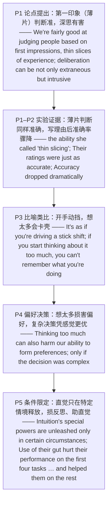

---

# 直觉的力量：薄片判断为何胜过深思 精读笔记

---

## 背景

本文选自 **2021 年考研英语（一）Text 4**，主题为**直觉（intuition）与深思（deliberation）在社会判断中的优劣**。文章以一个反直觉的发现开篇——**基于"薄片"（thin slices）的第一印象往往相当准确，而过度思考反而会干扰判断**——随后用一系列实验证据展开论证，最终落在"**直觉的力量只在特定情境下才被释放**"这一边界条件上。

文章沿"**论点提出 → 实验证据 → 比喻类比 → 偏好决策 → 条件限定**"的链条展开：

- **论点提出**：我们擅长基于**第一印象**（经验的薄片）判断他人，而**深思可能多余甚至有害**（P1）。
- **实验证据**：Ambady 的"**薄片判断**"实验中，边分心边看视频的评分同样准确；而**被要求写下理由后准确率骤降**（P1–P2）。
- **比喻类比**：Judith Hall 以"**开手动挡**"作比——想得太多反而会卡壳，凭本能则顺畅（P3）。
- **偏好决策**：想得太多也**损害偏好的形成**；在**复杂决策**中，凭感觉做出的购车决策**客观上更优、主观上更满意**（P4）。
- **条件限定**：直觉的特殊力量**只在特定情境下释放**——它**损害反思性任务、帮助直觉性任务**（P5）。

**难度说明**：中等。句式以**宾语从句（含省略 that）**、**非谓语动词**（现在分词作后置定语／结果状语、动名词作介词宾语、不定式作宾补）与**状语从句的省略**（`when asked to …`）为主，兼有**介词 + which 定语从句**（`the degree to which …`）与**关联结构**（`not only … but …`、`both … and …`、`rather than`）；论证上属于"**观点 + 实验 + 条件限定**"的科普／心理类说明文，适合练习**态度辨析**与**实验结论定位**。

---

## 文章原文

# 2021 Passage 4

We're fairly good at judging people based on **first impressions**, **thin slices** of experience ranging from a glimpse of a photo to a five-minute interaction, and **deliberation** can be not only **extraneous** but **intrusive**.

> [!abstract]- 长难句分析
> **原句**：We're fairly good at judging people based on **first impressions**, **thin slices** of experience ranging from a glimpse of a photo to a five-minute interaction, and **deliberation** can be not only **extraneous** but **intrusive**.
>
> **主干提取**：
>
> - 并列分句 1 主语 S1: We
> - 并列分句 1 谓语 V1: are
> - 并列分句 1 表语 C1: fairly good at judging people based on first impressions …
> - 并列连词: and
> - 并列分句 2 主语 S2: deliberation
> - 并列分句 2 谓语 V2: can be
> - 并列分句 2 表语 C2: not only extraneous but intrusive
>
> **修饰成分**：
>
> | 类型 | 引导词 / 形式 | 修饰对象 |
> |------|--------------|----------|
> | 动名词作介词宾语 | at judging | good |
> | 过去分词短语作状语 | based on first impressions | judging people |
> | 同位语 | thin slices of experience | first impressions |
> | 现在分词短语作后置定语 | ranging from … to … | thin slices of experience |
> | 关联并列结构 | not only … but … | extraneous / intrusive |
>
> **结构图解**：
>
> ```
> 并列句: We + are + good at judging people 〔based on first impressions〕
>   ├── 介词短语: at judging people（be good at）
>   ├── 过去分词短语作状语: based on first impressions
>   └── 同位语: thin slices of experience 〔ranging from a glimpse of a photo to a five-minute interaction〕
>         └── 现在分词短语作后置定语: ranging from … to …
> and 并列分句: deliberation + can be + not only extraneous but intrusive
>   └── 关联结构: not only … but …
> ```
>
> **参考译文**：我们相当擅长基于第一印象来判断他人——这些印象是经验的薄片，从瞥一眼照片到五分钟的互动不等——而深思熟虑可能不仅是多余的，甚至是一种干扰。
>
> **考点提示**：① 主干为 `and` 连接的**并列句**，两个分句各有主谓（`We're …` / `deliberation can be …`）。② `thin slices of experience` 是 `first impressions` 的**同位语**，其后 `ranging from … to …` 是**现在分词短语作后置定语**，修饰 `thin slices`。③ `not only … but …` 是**关联并列结构**，连接两个表语形容词，`intrusive` 比 `extraneous` 语义更重，构成**递进**。④ `based on` 是过去分词短语作状语。

In one study of the ability she called "**thin slicing**," the late psychologist Nalini Ambady asked participants to watch silent 10-second video clips of professors and to rate the instructor's overall effectiveness.

> [!abstract]- 长难句分析
> **原句**：In one study of the ability she called "**thin slicing**," the late psychologist Nalini Ambady asked participants to watch silent 10-second video clips of professors and to rate the instructor's overall effectiveness.
>
> **主干提取**：
>
> - 主语 S: the late psychologist Nalini Ambady
> - 谓语 V: asked
> - 宾语 O: participants
> - 宾语补足语 C: to watch … and to rate …
> - 状语 A: In one study of the ability she called "thin slicing"
>
> **修饰成分**：
>
> | 类型 | 引导词 / 形式 | 修饰对象 |
> |------|--------------|----------|
> | 介词短语作状语 | In one study | 全句 |
> | 介词短语作后置定语 | of the ability | one study |
> | 定语从句（省略 that） | (that) she called "thin slicing" | the ability |
> | 不定式作宾语补足语 | to watch … | participants |
> | 不定式作宾语补足语（并列） | and to rate … | participants |
>
> **结构图解**：
>
> ```
> 主句: Nalini Ambady + asked + participants + 〔to watch … and to rate …〕
>   ├── 介词短语作状语: In one study 〔of the ability (that) she called "thin slicing"〕
>   │     └── 定语从句（省略 that，that 作 called 的宾语）: she called "thin slicing"
>   ├── 不定式作宾语补足语: to watch silent 10-second video clips of professors
>   └── 不定式作宾语补足语（并列）: to rate the instructor's overall effectiveness
> ```
>
> **参考译文**：在一项被她称为"薄片判断（thin slicing）"的能力研究中，已故心理学家 Nalini Ambady 让参与者观看教授们无声的 10 秒视频片段，并评价这位教师的总体教学效果。
>
> **考点提示**：① 主干是 `asked participants to watch … and to rate …`（`ask sb to do sth`）。② `the ability she called "thin slicing"` 是**省略 that 的定语从句**，`that` 作 `called` 的**宾语**（`called` 后接宾补 `"thin slicing"`）。③ `to watch … and to rate …` 是**两个并列的不定式作宾语补足语**。④ `the late` 表"已故的"，作前置定语。

Their ratings **correlated** strongly with students' end-of-semester ratings.

Another set of participants had to count backward from 1,000 by nines as they watched the clips, occupying their **conscious working memory**.

> [!abstract]- 长难句分析
> **原句**：Another set of participants had to count backward from 1,000 by nines as they watched the clips, occupying their **conscious working memory**.
>
> **主干提取**：
>
> - 主语 S: Another set of participants
> - 谓语 V: had to count
> - 状语 A: backward from 1,000 by nines
> - 时间状语从句: as they watched the clips
> - 结果状语: occupying their conscious working memory
>
> **修饰成分**：
>
> | 类型 | 引导词 / 形式 | 修饰对象 |
> |------|--------------|----------|
> | 介词短语作后置定语 | of participants | Another set |
> | 时间状语从句 | as | had to count |
> | 现在分词短语作结果状语 | occupying … | 整个前句 |
>
> **结构图解**：
>
> ```
> 主句: Another set 〔of participants〕 + had to count + backward from 1,000 by nines
>   ├── 介词短语作后置定语: of participants
>   ├── 时间状语从句: as + they + watched + the clips
>   └── 现在分词短语作结果状语: occupying their conscious working memory
> ```
>
> **参考译文**：另一组参与者在观看片段的同时，还必须从 1,000 开始每次减 9 倒着数数，以此占用他们的有意识工作记忆。
>
> **考点提示**：① `as` 引导**时间状语从句**，强调主从句动作**同时发生**（"一边看一边数"）。② `occupying …` 是**现在分词短语作结果状语**，其逻辑主语是**前面的整个情形**（"边看边数"这件事占用了工作记忆），**不是** `they` 的谓语。③ `count backward from A by B` = "从 A 起每次减 B 倒数"。

Their ratings were just as accurate, demonstrating the **intuitive** nature of the social processing.

**Critically**, another group was asked to spend a minute writing down reasons for their judgment, before giving the rating.

Accuracy dropped dramatically.

Ambady suspected that deliberation focused them on **vivid** but **misleading cues**, such as certain **gestures** or **utterances**, rather than letting the complex **interplay** of **subtle signals** form a **holistic impression**.

> [!abstract]- 长难句分析
> **原句**：Ambady suspected that deliberation focused them on **vivid** but **misleading cues**, such as certain **gestures** or **utterances**, rather than letting the complex **interplay** of **subtle signals** form a **holistic impression**.
>
> **主干提取**：
>
> - 主语 S: Ambady
> - 谓语 V: suspected
> - 宾语从句: that deliberation focused them on … rather than letting …
> - 从句主语 S: deliberation
> - 从句谓语 V: focused
> - 从句宾语 O: them
> - 从句状语 A: on vivid but misleading cues … rather than letting …
>
> **修饰成分**：
>
> | 类型 | 引导词 / 形式 | 修饰对象 |
> |------|--------------|----------|
> | 宾语从句 | that | suspected |
> | 介词短语作状语 | on … cues | focused |
> | 同位语（举例） | such as … | cues |
> | 对比结构 | rather than | focused them on … cues |
> | 现在分词（对比项） | letting … | rather than |
> | 使役结构（宾补） | form … | the complex interplay |
>
> **结构图解**：
>
> ```
> 主句: Ambady + suspected + 〔that 从句〕
>   └── 宾语从句: deliberation + focused + them + 〔on vivid but misleading cues〕 〔rather than letting …〕
>         ├── 介词短语作状语: on vivid but misleading cues
>         │     └── 同位语（举例）: such as certain gestures or utterances
>         └── 对比结构（介词短语）: rather than letting the complex interplay of subtle signals form a holistic impression
>               └── 使役结构: let + the complex interplay + form + a holistic impression
> ```
>
> **参考译文**：Ambady 推测，深思熟虑使他们把注意力集中在生动却具有误导性的线索上，比如某些手势或话语，而不是让各种细微信号的复杂相互作用形成一个整体印象。
>
> **考点提示**：① `suspected that …` 后是**宾语从句**，从句才是信息核心。② `focus sb on sth` = "**使某人聚焦于……**"，宾语是人（`them`）。③ `rather than` 连接**对比成分**，后接**动名词** `letting`（与 `focused … on …` 对照）。④ `let sb do sth` 用**动词原形** `form`，`letting … form …` 构成使役结构。⑤ 本句是**第 37 题依据**——"关注具体线索而非整体印象"导致准确率下降。

She found similar **interference** when participants watched 15-second clips of pairs of people and judged whether they were strangers, friends, or dating partners.

> [!abstract]- 长难句分析
> **原句**：She found similar **interference** when participants watched 15-second clips of pairs of people and judged whether they were strangers, friends, or dating partners.
>
> **主干提取**：
>
> - 主语 S: She
> - 谓语 V: found
> - 宾语 O: similar interference
> - 时间状语从句: when participants watched … and judged whether …
>
> **修饰成分**：
>
> | 类型 | 引导词 / 形式 | 修饰对象 |
> |------|--------------|----------|
> | 时间状语从句 | when | found |
> | 并列谓语（从句内） | and | watched / judged |
> | 宾语从句 | whether | judged |
>
> **结构图解**：
>
> ```
> 主句: She + found + similar interference
>   └── 时间状语从句: when + participants + watched + 15-second clips of pairs of people
>         └── 并列谓语: and + judged + 〔whether 从句〕
>               └── 宾语从句: whether they were strangers, friends, or dating partners
> ```
>
> **参考译文**：当参与者观看成对人物的 15 秒片段、并判断他们是陌生人、朋友还是恋人时，她发现了类似的干扰。
>
> **考点提示**：① `when` 引导**时间状语从句**，从句内有**两个并列谓语** `watched … and judged …`。② `judged whether …` 后是**宾语从句**，`whether` 列举三个**并列表语** `strangers, friends, or dating partners`。③ `pairs of people` = "成对的人"。

Other research shows we're better at detecting **deception** from thin slices when we rely on **intuition** instead of **reflection**.

> [!abstract]- 长难句分析
> **原句**：Other research shows we're better at detecting **deception** from thin slices when we rely on **intuition** instead of **reflection**.
>
> **主干提取**：
>
> - 主语 S: Other research
> - 谓语 V: shows
> - 宾语从句: (that) we're better at detecting deception from thin slices when …
> - 从句主语 S: we
> - 从句谓语 V: are
> - 从句表语 C: better at detecting deception from thin slices
> - 时间状语从句: when we rely on intuition instead of reflection
>
> **修饰成分**：
>
> | 类型 | 引导词 / 形式 | 修饰对象 |
> |------|--------------|----------|
> | 宾语从句（省略 that） | (that) | shows |
> | 介词短语 | at detecting … | better |
> | 动名词作介词宾语 | detecting | at |
> | 时间状语从句 | when | are better |
> | 对比结构 | instead of | rely on intuition |
>
> **结构图解**：
>
> ```
> 主句: Other research + shows + 〔(that) 从句〕
>   └── 宾语从句（省略 that）: we + are + better at detecting deception from thin slices
>         ├── 介词短语: at detecting deception from thin slices
>         │     └── 动名词作介词宾语: detecting
>         └── 时间状语从句: when + we + rely on + intuition 〔instead of reflection〕
>               └── 对比结构: instead of reflection
> ```
>
> **参考译文**：其他研究表明，当我们在薄片判断中依靠直觉而非反思时，更善于识破欺骗。
>
> **考点提示**：① `shows` 后是**省略 that 的宾语从句**（`we're better at …`），从句是信息核心。② `be better at doing` = "更擅长做……"，`at` 后接**动名词** `detecting`。③ `when` 引导**时间状语从句**。④ `instead of` 表**对比**（选直觉、弃反思）。

"It's as if you're driving a **stick shift**," says Judith Hall, a psychologist at Northeastern University, "and if you start thinking about it too much, you can't remember what you're doing. But if you go on **automatic pilot**, you're fine. Much of our social life is like that."

Thinking too much can also harm our ability to form **preferences**.

College students' ratings of strawberry jams and college courses **aligned** better with experts' opinions when the students weren't asked to analyze their **rationale**.

And people made car-buying decisions that were both objectively better and more personally satisfying when asked to focus on their feelings rather than on details, but only if the decision was complex—when they had a lot of information to process.

> [!abstract]- 长难句分析
> **原句**：And people made car-buying decisions that were both objectively better and more personally satisfying when asked to focus on their feelings rather than on details, but only if the decision was complex—when they had a lot of information to process.
>
> **主干提取**：
>
> - 主语 S: people
> - 谓语 V: made
> - 宾语 O: car-buying decisions
> - 定语从句: that were both objectively better and more personally satisfying
> - 状语（省略）: when (they were) asked to focus on their feelings rather than on details
> - 条件状语从句: but only if the decision was complex
> - 补充说明: —when they had a lot of information to process
>
> **修饰成分**：
>
> | 类型 | 引导词 / 形式 | 修饰对象 |
> |------|--------------|----------|
> | 定语从句 | that | car-buying decisions |
> | 关联并列 | both … and … | better / satisfying |
> | 时间状语从句（省略） | when (they were) asked | made |
> | 对比结构 | rather than | focus on their feelings |
> | 条件状语从句 | only if | 全句 |
> | 时间状语从句（补充） | when | complex |
>
> **结构图解**：
>
> ```
> 主句: people + made + car-buying decisions 〔that were both objectively better and more personally satisfying〕
>   ├── 定语从句: that + were + both objectively better and more personally satisfying
>   │     └── 关联结构: both … and …
>   ├── 时间状语从句（省略 when they were）: asked to focus on their feelings 〔rather than on details〕
>   │     └── 对比结构: rather than on details
>   └── 条件状语从句: but only if + the decision + was + complex
>         └── 补充说明: —when they had a lot of information to process
> ```
>
> **参考译文**：而且，当人们被要求关注自己的感受而非细节时，他们做出的购车决策不仅客观上更优，个人也更满意——但前提是这个决策很复杂，即他们需要处理大量信息时。
>
> **考点提示**：① `that were both objectively better and more personally satisfying` 是**定语从句**，修饰 `car-buying decisions`，从句内 `both … and …` 并列两个表语。② `when asked to …` 是**状语从句的省略**（= `when they were asked to …`）。③ `only if` 表**唯一条件**（"只有在……时才"），是**第 39 题的限定条件**——决策复杂时凭感觉才更优。④ 破折号后的 `when …` 对 `complex` 作**补充解释**。

Intuition's special powers are **unleashed** only in certain circumstances.

In one study, participants completed a **battery** of eight tasks, including four that **tapped reflective thinking** (discerning rules, comprehending vocabulary) and four that tapped intuition and creativity (generating new products or figures of speech).

> [!abstract]- 长难句分析
> **原句**：In one study, participants completed a **battery** of eight tasks, including four that **tapped reflective thinking** (discerning rules, comprehending vocabulary) and four that tapped intuition and creativity (generating new products or figures of speech).
>
> **主干提取**：
>
> - 主语 S: participants
> - 谓语 V: completed
> - 宾语 O: a battery of eight tasks
> - 状语 A: In one study
> - 补充说明: including four … and four …
>
> **修饰成分**：
>
> | 类型 | 引导词 / 形式 | 修饰对象 |
> |------|--------------|----------|
> | 介词短语作状语 | In one study | 全句 |
> | 现在分词短语作补充说明 | including … | eight tasks |
> | 定语从句 | that | four（tasks） |
> | 定语从句（并列） | that | four（tasks） |
> | 动名词（括号内举例） | discerning / comprehending / generating | four / four |
>
> **结构图解**：
>
> ```
> 主句: participants + completed + a battery of eight tasks
>   ├── 介词短语作状语: In one study
>   └── 现在分词短语作补充说明: including four 〔that tapped reflective thinking (discerning rules, comprehending vocabulary)〕 and four 〔that tapped intuition and creativity (generating new products or figures of speech)〕
>         ├── 定语从句: that + tapped + reflective thinking
>         └── 定语从句（并列）: that + tapped + intuition and creativity
> ```
>
> **参考译文**：在一项研究中，参与者完成了一组八项任务，其中包括四项考察反思性思维的任务（辨析规则、理解词汇）和四项考察直觉与创造力的任务（生成新产品或修辞手法）。
>
> **考点提示**：① `including …` 是**现在分词短语作补充说明**，引出对 `eight tasks` 的举例。② `four that tapped …` 与 `four that tapped …` 是**结构对称的并列定语从句**，`that` 在从句中作主语。③ 括号内的 `discerning / comprehending / generating` 均为**动名词**，作举例说明。④ `tap` 此处 = "**考察、挖掘、利用**"。

Then they rated the degree to which they had used intuition ("**gut feelings**," "**hunches**," "my heart").

> [!abstract]- 长难句分析
> **原句**：Then they rated the degree to which they had used intuition ("**gut feelings**," "**hunches**," "my heart").
>
> **主干提取**：
>
> - 主语 S: they
> - 谓语 V: rated
> - 宾语 O: the degree
> - 定语从句: to which they had used intuition
> - 同位语: ("gut feelings," "hunches," "my heart")
>
> **修饰成分**：
>
> | 类型 | 引导词 / 形式 | 修饰对象 |
> |------|--------------|----------|
> | 定语从句（介词 + which） | to which | the degree |
> | 过去完成时 | had used | — |
> | 同位语（举例） | (…) | intuition |
>
> **结构图解**：
>
> ```
> 主句: they + rated + the degree 〔to which they had used intuition〕
>   ├── 定语从句（介词 + which）: to + which + they + had used + intuition
>   └── 同位语（举例）: ("gut feelings," "hunches," "my heart")
> ```
>
> **参考译文**：随后，他们评估了自己运用直觉的程度（"直觉感受""预感""内心"）。
>
> **考点提示**：① `the degree to which …` 是**介词 + which 引导的定语从句**，`to` 与 `degree` 是固定搭配（"……的程度"）。② `had used` 是**过去完成时**，表"过去的过去"（先"用过直觉"，后"评估"）。③ 括号内三个短语是 `intuition` 的**同位语（举例说明）**。

Use of their gut hurt their performance on the first four tasks, as expected, and helped them on the rest.

Sometimes the heart is smarter than the head.

---

## 题目

### 36. Nalini Ambady's study deals with ____.

- [A] the power of people's memory
- [B] the reliability of first impressions
- [C] instructor-student interaction
- [D] people's ability to influence others

### 37. In Ambady's study, rating accuracy dropped when participants ____.

- [A] focused on specific details
- [B] gave the rating in limited time
- [C] watched shorter video clips
- [D] discussed with one another

### 38. Judith Hall mentions driving to show that ____.

- [A] reflection can be distracting
- [B] memory may be selective
- [C] social skills must be cultivated
- [D] deception is difficult to detect

### 39. When you are making complex decisions, it is advisable to ____.

- [A] collect enough data
- [B] list your preferences
- [C] seek expert advice
- [D] follow your feelings

### 40. What can we learn from the last paragraph?

- [A] Generating new products takes time.
- [B] Intuition may affect reflective tasks.
- [C] Vocabulary comprehension needs creativity.
- [D] Objective thinking may boost intuitiveness.

---

## 翻译对照

# 2021 Passage 4 中英对照翻译

## Paragraph 1

We're fairly good at judging people based on first impressions, thin slices of experience ranging from a glimpse of a photo to a five-minute interaction, and deliberation can be not only extraneous but intrusive. In one study of the ability she called "thin slicing," the late psychologist Nalini Ambady asked participants to watch silent 10-second video clips of professors and to rate the instructor's overall effectiveness. Their ratings correlated strongly with students' end-of-semester ratings. Another set of participants had to count backward from 1,000 by nines as they watched the clips, occupying their conscious working memory. Their ratings were just as accurate, demonstrating the intuitive nature of the social processing.

我们相当擅长基于第一印象来判断他人——这些印象是经验的薄片，从瞥一眼照片到五分钟的互动不等——而深思熟虑可能不仅是多余的，甚至是一种干扰。在一项被她称为"薄片判断（thin slicing）"的能力研究中，已故心理学家 Nalini Ambady 让参与者观看教授们无声的 10 秒视频片段，并评价这位教师的总体教学效果。他们的评分与学生期末的评分高度相关。另一组参与者在观看片段的同时，还必须从 1,000 开始每次减 9 倒着数数，以此占用他们的有意识工作记忆。他们的评分同样准确，这证明了这种社会信息处理过程的直觉性。

> [!note] 翻译说明
> - `thin slices of experience` = "经验的薄片"，指极短暂、碎片化的观察片段；`thin slicing` = "薄片判断"，指依据极少量信息迅速做出判断的能力。
> - `deliberation` = "深思熟虑、仔细斟酌"，与后文 `intuition`（直觉）相对。
> - `extraneous` = "无关的、多余的"；`intrusive` = "侵入性的、造成干扰的"。
> - `the late psychologist` = "已故的心理学家"，`late` 作定语表"已故的"。
> - `count backward from 1,000 by nines` = "从 1,000 开始每次减 9 倒着数"；`conscious working memory` = "有意识的工作记忆"。
> - `correlated strongly with` = "与……高度相关"。

## Paragraph 2

Critically, another group was asked to spend a minute writing down reasons for their judgment, before giving the rating. Accuracy dropped dramatically. Ambady suspected that deliberation focused them on vivid but misleading cues, such as certain gestures or utterances, rather than letting the complex interplay of subtle signals form a holistic impression. She found similar interference when participants watched 15-second clips of pairs of people and judged whether they were strangers, friends, or dating partners.

关键在于，还有一组被要求先花一分钟写下他们做出判断的理由，然后再给出评分。准确率大幅下降。Ambady 推测，深思熟虑使他们把注意力集中在生动却具有误导性的线索上，比如某些手势或话语，而不是让各种细微信号的复杂相互作用形成一个整体印象。当参与者观看成对人物的 15 秒片段、并判断他们是陌生人、朋友还是恋人时，她发现了类似的干扰。

> [!note] 翻译说明
> - `critically` 此处为**句首副词**，= "关键在于、重要的是"，而非"批判性地"。
> - `vivid but misleading cues` = "生动却具误导性的线索"；`cue` = "提示、线索"。
> - `gestures or utterances` = "手势或话语"，`utterance` = "（说出的）话语、言语"。
> - `the complex interplay of subtle signals` = "各种细微信号的复杂相互作用"，`interplay` = "相互作用、相互影响"。
> - `holistic impression` = "整体印象"，`holistic` = "整体的、全面的"。
> - `interference` = "干扰、妨碍"。

## Paragraph 3

Other research shows we're better at detecting deception from thin slices when we rely on intuition instead of reflection. "It's as if you're driving a stick shift," says Judith Hall, a psychologist at Northeastern University, "and if you start thinking about it too much, you can't remember what you're doing. But if you go on automatic pilot, you're fine. Much of our social life is like that."

其他研究表明，当我们在薄片判断中依靠直觉而非反思时，更善于识破欺骗。"这就像你开手动挡汽车，"东北大学的心理学家 Judith Hall 说，"如果你开始过多地去想它，你反而记不住自己在做什么。但如果你进入自动巡航状态，就没问题。我们的社交生活大多也是如此。"

> [!note] 翻译说明
> - `detect deception` = "识破欺骗"；`deception` = "欺骗、欺骗行为"。
> - `reflection` = "反思、思考"，此处与 `intuition`（直觉）相对。
> - `driving a stick shift` = "开手动挡（换挡）汽车"，比喻需要凭感觉自动完成的操作。
> - `go on automatic pilot` = "进入自动模式、凭本能行事"，`automatic pilot` 原指飞机的自动驾驶仪。

## Paragraph 4

Thinking too much can also harm our ability to form preferences. College students' ratings of strawberry jams and college courses aligned better with experts' opinions when the students weren't asked to analyze their rationale. And people made car-buying decisions that were both objectively better and more personally satisfying when asked to focus on their feelings rather than on details, but only if the decision was complex—when they had a lot of information to process.

想得太多也会损害我们形成偏好的能力。当大学生没有被要求分析自己的理由时，他们对草莓果酱和大学课程的评分与专家的意见更为一致。而且，当人们被要求关注自己的感受而非细节时，他们做出的购车决策不仅客观上更优，个人也更满意——但前提是这个决策很复杂，即他们需要处理大量信息时。

> [!note] 翻译说明
> - `form preferences` = "形成偏好"；`preference` = "偏好、偏爱"。
> - `aligned better with experts' opinions` = "与专家意见更为一致"，`align with` = "与……一致、相符"。
> - `analyze their rationale` = "分析他们的（判断）理由/依据"；`rationale` = "理由、基本原理"。
> - `objectively better and more personally satisfying` = "客观上更优、个人也更满意"。
> - `complex` 此处指决策**涉及信息量大、需要处理的变量多**，而非"复杂难懂"。

## Paragraph 5

Intuition's special powers are unleashed only in certain circumstances. In one study, participants completed a battery of eight tasks, including four that tapped reflective thinking (discerning rules, comprehending vocabulary) and four that tapped intuition and creativity (generating new products or figures of speech). Then they rated the degree to which they had used intuition ("gut feelings," "hunches," "my heart"). Use of their gut hurt their performance on the first four tasks, as expected, and helped them on the rest. Sometimes the heart is smarter than the head.

直觉的特殊力量只有在特定情境下才会被释放出来。在一项研究中，参与者完成了一组八项任务，其中包括四项考察反思性思维的任务（辨析规则、理解词汇）和四项考察直觉与创造力的任务（生成新产品或修辞手法）。随后，他们评估了自己运用直觉的程度（"直觉感受""预感""内心"）。动用直觉损害了他们在前四项任务上的表现——这在意料之中，却帮助了他们在其余任务上的表现。有时，心比头脑更聪明。

> [!note] 翻译说明
> - `unleashed` = "被释放、被激发"；`unleash` 本义 = "解开（皮带）放出（狗）"，引申为"释放（力量）"。
> - `a battery of` = "一组、一系列（测试/任务）"。
> - `tapped reflective thinking` = "考察反思性思维"；`tap` 此处 = "开发、挖掘、利用"。
> - `figures of speech` = "修辞手法、比喻性表达"。
> - `gut feelings` = "直觉感受、本能的感觉"；`hunches` = "预感、直觉"。
> - `the heart is smarter than the head` = "心比头脑更聪明"，`heart` 喻"直觉、情感"，`head` 喻"理性、头脑"。

## 题目翻译

### 36. Nalini Ambady's study deals with ____.

36. Nalini Ambady 的研究涉及 ____。

- [A] 人们记忆的力量
- [B] 第一印象的可靠性
- [C] 师生互动
- [D] 人们影响他人的能力

### 37. In Ambady's study, rating accuracy dropped when participants ____.

37. 在 Ambady 的研究中，当参与者 ____ 时，评分准确率下降了。

- [A] 关注具体细节
- [B] 在有限时间内给出评分
- [C] 观看更短的视频片段
- [D] 互相讨论

### 38. Judith Hall mentions driving to show that ____.

38. Judith Hall 提到开车是为了表明 ____。

- [A] 反思可能造成干扰
- [B] 记忆可能有选择性
- [C] 社交技能必须培养
- [D] 欺骗难以识破

### 39. When you are making complex decisions, it is advisable to ____.

39. 当你做复杂决策时，明智的做法是 ____。

- [A] 收集足够的数据
- [B] 列出你的偏好
- [C] 寻求专家建议
- [D] 听从你的感受

### 40. What can we learn from the last paragraph?

40. 从最后一段我们可以了解到什么？

- [A] 生成新产品需要时间。
- [B] 直觉可能影响反思性任务。
- [C] 词汇理解需要创造力。
- [D] 客观思考可能增强直觉。

---

## 语法要点

# 2021 Passage 4 语法整理

> [!note] 来源说明
> 本篇**用户未提供语法源笔记**，以下语法点由 `formatted-article.md` 与 `translation.md` **从本文推断提取**，仅收录本篇实际出现的语法现象。
> 每一条均给出**原文语境**，便于回原文核对；标注"（联动）"的条目与相邻专题互为参照。
> 固定搭配与词组见 [[intermediate/2021-passage4-intuition/固定搭配与词组笔记.md|2021 Passage 4 固定搭配与词组]]。

---

## 一、从句

### 从句：省略 that 的定语从句（the ability she called）

**概述**：定语从句中 `that/which` 作**宾语**时可**省略**，从句直接紧跟在先行词之后，中间不出现关系词。

| 结构 | 用法 | 例句 |
|------|------|------|
| `先行词 + (that) + 主谓宾` | that 作宾语被省略 | In one study of the ability **(that) she called "thin slicing,"** … |

> [!tip] 还原技巧
> `the ability she called "thin slicing"` = `the ability that she called "thin slicing"`，`that` 作 `called` 的**宾语**（`called` 后接宾语补足语 `"thin slicing"`），故可省略。阅读时遇到"**名词 + 主谓结构**"紧跟其后，先怀疑此处省略了作宾语的关系代词。

### 从句：that 引导的定语从句（并列先行词）

**概述**：`that` 引导**限定性定语从句**，修饰先行词，`that` 在从句中作**主语**。当先行词为**并列的两个名词**时，可用 `that` 分别引导**并列的两个定语从句**。

| 结构 | 用法 | 例句 |
|------|------|------|
| `先行词 + that + 不完整从句` | that 作从句主语 | a battery of eight tasks, including four **that tapped reflective thinking** … and four **that tapped intuition and creativity** … |

> [!note] 补充说明
> `four that tapped …` 与 `four that tapped …` 是**结构对称的并列定语从句**，`that` 均在从句中作主语（`tapped` 的宾语分别是 `reflective thinking` 和 `intuition and creativity`）。（联动）见"非谓语：动名词作介词宾语"（两个 `that` 从句后括号内的动名词列举）。

### 从句：介词 + which 引导的定语从句（the degree to which）

**概述**：`介词 + which` 引导**定语从句**，`which` 指代先行词，介词由从句中的**搭配关系**决定。

| 结构 | 用法 | 例句 |
|------|------|------|
| `名词 + 介词 + which + 从句` | 介词 which 引导定语从句 | they rated the degree **to which they had used intuition** |

> [!warning] 易错点
> `the degree to which …` = "……的程度"，介词 `to` 与 `degree` 是**固定搭配**（`to the degree of / to the extent that`）。**不能**把 `to which` 拆开理解，也不能换成 `in which`。先行词是 `the degree`，`which` 在从句中作 `to` 的宾语。（联动）见 2021 Passage 3 语法笔记"从句：that 引导的定语从句"。

### 从句：that 引导的宾语从句（suspected that）

**概述**：`that` 引导**宾语从句**，作及物动词（如 `suspect`、`say`、`show`）的宾语，`that` 仅起**连接**作用、不作成分。

| 结构 | 用法 | 例句 |
|------|------|------|
| `动词 + that + 完整从句` | 宾语从句，that 不作成分 | Ambady suspected **that deliberation focused them on vivid but misleading cues** … |

> [!warning] 易错点
> 判据：`that` 后的从句**结构完整**（主谓宾齐全）→ **宾语从句**；从句**缺主语或宾语** → **定语从句**。此处 `that deliberation focused them on … cues` 主谓宾完整，故是宾语从句。

### 从句：省略 that 的宾语从句（shows we're better）

**概述**：`show`、`say`、`think` 等动词后的宾语从句，连词 `that` 常**省略**，从句直接跟在动词后。

| 结构 | 用法 | 例句 |
|------|------|------|
| `动词 + (that) + 完整从句` | 宾语从句，that 省略 | Other research shows **(that) we're better at detecting deception** … |

> [!tip] 阅读技巧
> 遇到 `shows / says / finds` 后**直接跟一个完整句子**（而非名词），即知这是**省略 that 的宾语从句**。从句才是信息核心，主句动词只是"引出观点"。（联动）见"从句：that 引导的宾语从句（suspected that）"。

### 从句：whether ... or ... 引导的宾语从句

**概述**：`whether ... or ...` 引导**宾语从句**，表"是……还是……"，列出**两个（或多个）并列选项**。

| 结构 | 用法 | 例句 |
|------|------|------|
| `动词 + whether + A, B, or C` | 宾语从句，列举并列选项 | judged **whether they were strangers, friends, or dating partners** |

> [!note] 补充说明
> `whether` 从句在此作 `judged` 的**宾语**，三个并列成分 `strangers, friends, or dating partners` 结构对称。`whether` 与 `if` 在宾语从句中可互换，但在**介词后或与 `or not` 连用**时只能用 `whether`。

### 从句：as 引导的时间状语从句

**概述**：`as` 引导**时间状语从句**，表"当……的时候"，强调**主句与从句动作同时发生**（"一边……一边……"）。

| 结构 | 用法 | 例句 |
|------|------|------|
| `主句 + as + 从句` | 时间状语从句，动作同时 | Another set of participants had to count backward from 1,000 by nines **as they watched the clips** … |

> [!tip] 阅读技巧
> `as` 表时间时强调"**同时性**"（此处"一边看视频一边倒数"），区别于 `when`（时间点）、`while`（时间段）。此处 `as` 从句说明**分心任务与观看同时进行**，是理解"占用工作记忆"这一实验设计的关键。（联动）见"从句：when 引导的时间状语从句"。

### 从句：when 引导的时间状语从句

**概述**：`when` 引导**时间状语从句**，表"当……时"，可置于句中或句尾，交代主句动作发生的**时间背景或条件**。

| 结构 | 用法 | 例句 |
|------|------|------|
| `主句 + when + 从句` | 时间状语从句后置 | She found similar interference **when participants watched 15-second clips** … |
| `主句 + when + 从句` | 时间状语从句（含省略） | … when **(they were) asked to focus on their feelings** … |
| `主句 + when + 从句` | 时间状语从句，解释"复杂" | … but only if the decision was complex—**when they had a lot of information to process** |

> [!tip] 解题技巧
> 末句中 `when asked to focus …` 是**状语从句的省略**（= `when they were asked to focus …`），主从句主语一致时，可省略从句的"**主语 + be**"。破折号后的 `when they had a lot of information to process` 则是对 `complex` 的**补充解释**，是第 39 题"复杂决策应凭感觉"的依据。

### 从句：if 引导的条件状语从句

**概述**：`if` 引导**条件状语从句**，表"如果"。此处均为**真实条件**（非虚拟），主句用一般现在时，从句用一般现在时（"主将从现"的变体）。

| 结构 | 用法 | 例句 |
|------|------|------|
| `if + 一般现在时从句, 主句` | 真实条件 | **if you start thinking about it too much**, you can't remember what you're doing |
| `if + 一般现在时从句, 主句` | 真实条件 | **if you go on automatic pilot**, you're fine |
| `only if + 从句` | 强调"只有在……时" | but **only if the decision was complex** |

> [!warning] 易错点
> `only if`（只有在……才）**不等于** `if only`（但愿……）。`only if` 强调**唯一条件**，此处指"**只有**当决策复杂时，凭感觉才更优"，是第 39 题的**限定条件**，勿漏读。

### 从句：as if 引导的表语从句

**概述**：`as if / as though` 引导**表语从句**（跟在 `be` 之后），表"**好像、仿佛**"，常用**比喻**。

| 结构 | 用法 | 例句 |
|------|------|------|
| `It is as if + 从句` | 表语从句，表比喻 | **It's as if you're driving a stick shift** |

> [!note] 补充说明
> `It's as if …` 是**比喻性表达**的固定句式（"就好像……"）。此处用"开手动挡汽车"比喻**依赖直觉的社会认知**——过度思考反而会"卡壳"。从句用**陈述语气**（`you're driving`），表示说话人认为这一比喻**贴近事实**；若用虚拟（`were`）则暗示"与事实相反"。

---

## 二、非谓语动词

### 非谓语：现在分词短语作后置定语

**概述**：现在分词短语作**后置定语**，修饰前面名词，与其构成**主动**或**进行**关系。

| 结构 | 用法 | 例句 |
|------|------|------|
| `名词 + 现在分词短语` | 主动关系，后置定语 | thin slices of experience **ranging from a glimpse of a photo to a five-minute interaction** |

> [!tip] 还原技巧
> `thin slices of experience ranging from A to B` = `thin slices of experience that range from A to B`，`slices` 与 `range` 是**主动关系**（"薄片**涵盖**从……到……"），故用现在分词。`ranging from … to …`（从……到……不等）是考研高频**后置定语**结构。（联动）见"从句：省略 that 的定语从句（the ability she called）"。

### 非谓语：现在分词短语作结果状语

**概述**：现在分词短语置于主句之后，用逗号隔开，作**结果状语**（"从而……"）或**伴随状语**（"同时……"），其逻辑主语通常是**前面整个主句**。

| 结构 | 用法 | 例句 |
|------|------|------|
| `主句 + , + 现在分词短语` | 结果状语 | … as they watched the clips, **occupying their conscious working memory** |
| `主句 + , + 现在分词短语` | 结果状语 | Their ratings were just as accurate, **demonstrating the intuitive nature of the social processing** |

> [!warning] 易错点
> `occupying their conscious working memory` 中 `occupying` 的逻辑主语是**前面的整个情形**（"边看边倒数"这件事**占用了**工作记忆），**不是** `they` 的谓语。判断方法：分词短语**无连词**、**不构成并列谓语**，即为状语。

### 非谓语：动名词短语作主语

**概述**：动名词短语作**主语**，视为**单数**，谓语用**单数**形式。

| 结构 | 用法 | 例句 |
|------|------|------|
| `动名词短语 + 单数谓语` | 动名词作主语，谓语单数 | **Thinking too much** can also harm our ability to form preferences |

> [!warning] 易错点
> `Thinking too much` 是**动名词短语作主语**（= "想得太多"这件事），谓语用**单数** `can harm`。切勿把 `Thinking` 误当现在分词作状语。判断方法：句首 `doing` 若能**回译为名词性短语**（"……这件事"）且**后面紧跟谓语**，即为主语。

### 非谓语：不定式作宾语补足语

**概述**：`ask / want / tell / expect sb to do sth` 结构中，不定式作**宾语补足语**，补充说明宾语的动作。

| 结构 | 用法 | 例句 |
|------|------|------|
| `ask sb to do sth` | 不定式作宾补 | Ambady asked participants **to watch silent 10-second video clips** … and **to rate the instructor's overall effectiveness** |
| `be asked to do sth` | 被动 + 不定式作主语补足语 | another group **was asked to spend a minute writing down reasons** … |

> [!note] 补充说明
> `asked participants to watch … and to rate …` 是**两个并列的不定式**（`to watch` 与 `to rate`），由 `and` 连接，共同作 `participants` 的**宾补**。变为被动后（`was asked to spend`），不定式随之成为**主语补足语**。（联动）见"语态：被动语态"。

### 非谓语：不定式作后置定语

**概述**：不定式作**后置定语**，修饰前面名词，表"要做的事"或"……的能力/机会"。

| 结构 | 用法 | 例句 |
|------|------|------|
| `名词 + 不定式` | 后置定语 | harm our ability **to form preferences** |

> [!tip] 还原技巧
> `ability to form preferences` = "形成偏好的能力"。`ability`、`chance`、`opportunity`、`way`、`attempt` 等抽象名词后常接不定式作定语。（联动）见 2021 Passage 3 语法笔记"非谓语：不定式作后置定语"。

### 非谓语：动名词作介词宾语

**概述**：介词（`at`、`before`、`instead of`、`on`、`in`、`by` 等）后接**动名词**作宾语，构成介词短语。

| 结构 | 用法 | 例句 |
|------|------|------|
| `介词 + 动名词` | be good at doing | We're fairly good **at judging people** based on first impressions |
| `介词 + 动名词` | before + doing | … before **giving the rating** |
| `介词 + 动名词` | instead of + doing | … rely on intuition **instead of reflection**（`reflection` 为名词） |
| `介词 + 动名词` | rather than + doing | … rather than **letting the complex interplay of subtle signals form a holistic impression** |

> [!warning] 易错点
> `be good at`、`before`、`instead of`、`rather than` 后的动词一律用**动名词**（`-ing`），不用原形。注意 `rather than letting …` 中 `rather than` 连接的是与 `focused them on … cues` **并列的对比成分**，`letting` 的逻辑主语是 `deliberation`。（联动）见"对比结构（rather than / instead of）"。

---

## 三、语态

### 语态：被动语态（be + 过去分词）

**概述**：被动语态 `be + 过去分词`，强调**动作的承受者**；常与 `by` 连用引出施动者。

| 结构 | 用法 | 例句 |
|------|------|------|
| `be + 过去分词` | 一般过去时被动 | another group **was asked to** spend a minute writing down reasons … |
| `be + 过去分词` | 一般过去时被动（否定） | when the students **weren't asked to** analyze their rationale |
| `be + 过去分词` | 一般现在时被动 | Intuition's special powers **are unleashed** only in certain circumstances |

> [!tip] 阅读技巧
> 本文被动句多用于**淡化施动者或突出结果**：`was asked`（被要求）不点名谁要求，`are unleashed`（被释放）突出"直觉力量"的**被动触发**。判断被动时看"**主语是否发出动作**"即可。注意 `be asked to do` 是"**被动 + 不定式**"的组合，不定式随之作**主语补足语**。（联动）见"非谓语：不定式作宾语补足语"。

---

## 四、时态

### 时态：过去完成时

**概述**：过去完成时 `had + 过去分词`，表**"过去的过去"**——在某个过去动作**之前**已完成，常出现在**宾语从句**中，与主句的过去时形成先后。

| 结构 | 用法 | 例句 |
|------|------|------|
| `had + 过去分词` | 过去完成时（宾语从句中） | they rated the degree to which they **had used** intuition |

> [!warning] 易错点
> `the degree to which they had used intuition` 中，`had used`（用过直觉）发生在 `rated`（评估）**之前**，故用**过去完成时**。这是"**主句过去时 + 从句更早动作**"的典型结构。（联动）见 2021 Passage 3 语法笔记"时态：过去完成时"。

---

## 五、并列与关联结构

### 关联结构：not only ... but (also) ...

**概述**：`not only A but (also) B` 表"**不仅 A 而且 B**"，连接**并列成分**（此处为两个形容词），语意**递进**。

| 结构 | 用法 | 例句 |
|------|------|------|
| `not only + 形容词 + but + 形容词` | 并列形容词，递进 | deliberation can be **not only extraneous but intrusive** |

> [!note] 补充说明
> `not only extraneous but intrusive` 中两个形容词并列作 `be` 的**表语**，`intrusive`（干扰性的）比 `extraneous`（多余的）**语义更重**，构成**递进**——作者借此强调"深思熟虑不只是无用，更是有害"。

### 关联结构：both ... and ...

**概述**：`both A and B` 表"**A 和 B 都**"，连接**并列成分**，谓语用**复数**。

| 结构 | 用法 | 例句 |
|------|------|------|
| `both + 形容词 + and + 形容词` | 并列形容词，两者皆然 | car-buying decisions that were **both objectively better and more personally satisfying** |

> [!note] 补充说明
> `both … and …` 连接两个**并列的形容词短语**（`objectively better` 与 `more personally satisfying`），共同作定语从句的**表语**。此处强调购车决策"**客观上更优**"与"**主观上更满意**"**两者兼得**。

### 对比结构（rather than / instead of）

**概述**：`rather than` 与 `instead of` 均表"**而不是**"，用于**对比**两个选项，凸显作者取舍。

| 结构 | 用法 | 例句 |
|------|------|------|
| `A rather than B` | 对比，选 A 弃 B | focused them on vivid but misleading cues … **rather than letting the complex interplay of subtle signals form a holistic impression** |
| `A instead of B` | 对比，选 A 弃 B | rely on intuition **instead of reflection** |
| `focus on A rather than on B` | 对比，两个介词宾语 | focus on their feelings **rather than on details** |

> [!tip] 解题技巧
> `rather than` / `instead of` 前后是**对照关系**，答案往往在"**被选中的那一项**"。第 37 题问"评分准确率为何下降"，依据正是 `focused them on vivid but misleading cues … rather than …`——**关注具体细节**（A）而非整体印象，故答案选 [A]。（联动）见"非谓语：动名词作介词宾语"。

---

## 六、比较结构

### 比较结构：as ... as

**概述**：`as + 形容词/副词 + as` 表**同级比较**（"和……一样"）；`just as ... as` 加强语气（"**正好/恰恰**和……一样"）。

| 结构 | 用法 | 例句 |
|------|------|------|
| `just as + 形容词 + as` | 同级比较，加强语气 | Their ratings were **just as accurate**（as …） |

> [!tip] 阅读技巧
> `Their ratings were just as accurate` 后省略了比较对象（= `as the other group's ratings`）。`just as … as` 表"**完全一样地……**"，此处强调"边倒数边看"的评分**与正常评分同样准确**，凸显**直觉判断的可靠性**。

### 比较结构：比较级（better / smarter than）

**概述**：比较级 `-er / more + 形容词` + `than` 表**两者对比**；`better at doing` 表"更擅长做……"。

| 结构 | 用法 | 例句 |
|------|------|------|
| `better at + 动名词` | be better at doing | we're **better at detecting deception** from thin slices |
| `比较级 + than` | 两者对比 | Sometimes the heart is **smarter than** the head |
| `比较级 + with` | align better with | College students' ratings … **aligned better with** experts' opinions |

> [!tip] 解题技巧
> `Sometimes the heart is smarter than the head` 是全文**主旨句**：`heart`（心）喻**直觉**，`head`（头脑）喻**理性**，用**比较级**点明"直觉有时胜过理性"。抓住这句即可把握作者态度。（联动）见 2021 Passage 3 语法笔记"比较结构（much less ... than / compared with）"。

---

## 七、插入语与评注

### 评注性插入语（Critically / as expected）

**概述**：**评注性插入语**（副词、短语）不充当句子成分，用于**标示逻辑关系**或**限定态度**，通常用逗号与句子隔开。

| 结构 | 用法 | 例句 |
|------|------|------|
| `Critically, + 主句` | 评注性副词，标示重要性 | **Critically**, another group was asked to spend a minute writing down reasons … |
| `as expected` | 插入语，表"如预期" | Use of their gut hurt their performance on the first four tasks, **as expected**, and helped them on the rest |

> [!note] 补充说明
> `Critically` 此处为**评注性副词**，= "**关键在于、重要的是**"，而非"批判性地"，用逗号与主句隔开，标示**下文是本段重点**。`as expected` 是**插入语**（= `as was expected`），插在并列谓语之间，表"**在意料之中**"，不影响句子主干 `hurt … and helped …`。（联动）见 2021 Passage 3 语法笔记"评注性插入语（however / in some cases）"。

---

## 八、主谓一致

### 主谓一致（Much of ... / Use of ...）

**概述**：谓语须与**真正的主语**保持**数的一致**。主语为"**表量短语**（much of / use of …）"或**不可数名词**时，谓语用**单数**。

| 结构 | 用法 | 例句 |
|------|------|------|
| `Much of + 不可数名词 + 单数谓语` | 表量短语作主语 | **Much of our social life is** like that |
| `名词化主语 + 谓语` | 名词化短语作主语，谓语单数 | **Use of their gut hurt** their performance … |

> [!warning] 易错点
> `Much of our social life` 的中心词是**不可数名词** `life`，谓语用**单数** `is`（不是 `are`）。`Use of their gut`（动用直觉）中心词是**不可数名词** `use`，谓语用**单数** `hurt`（过去式，形式同原形，**不是** `hurts` 才是复数——此句是过去时，须靠语境判断单复数）。

---

_最后更新：2026-10-19_

---

## 固定搭配与词组

# 2021 Passage 4 固定搭配与词组

> [!note] 来源说明
> 本篇固定搭配与词组由 `formatted-article.md` **从本文提取**，仅收录本篇实际出现的表达。
> 纯语法内容见 [[intermediate/2021-passage4-intuition/grammar-notes.md|2021 Passage 4 语法整理]]。

---

## 一、主题词与核心概念

| 搭配 | 释义 | 原文语境 |
|------|------|----------|
| **first impressions** | 第一印象 | judging people based on **first impressions** |
| **thin slices (of experience)** | （经验的）薄片、碎片化片段 | **thin slices** of experience ranging from a glimpse of a photo to a five-minute interaction |
| **thin slicing** | 薄片判断（凭极少信息迅速判断） | the ability she called "**thin slicing**" |
| **deliberation** | 深思熟虑、仔细斟酌 | **deliberation** can be not only extraneous but intrusive |
| **intuition** | 直觉 | rely on **intuition** instead of reflection |
| **reflection** | 反思、深思 | instead of **reflection** |
| **deception** | 欺骗、欺骗行为 | better at detecting **deception** from thin slices |
| **conscious working memory** | 有意识的工作记忆 | occupying their **conscious working memory** |
| **holistic impression** | 整体印象 | form a **holistic impression** |
| **automatic pilot** | 自动巡航（喻本能、无意识地行事） | if you go on **automatic pilot**, you're fine |
| **stick shift** | （汽车的）手动挡、变速杆 | as if you're driving a **stick shift** |
| **gut feelings** | 直觉感受、本能的感觉 | ("**gut feelings**," "hunches," "my heart") |
| **hunches** | 预感、直觉 | ("gut feelings," "**hunches**," "my heart") |
| **figures of speech** | 修辞手法、比喻性表达 | generating new products or **figures of speech** |
| **reflective thinking** | 反思性思维 | four that tapped **reflective thinking** |
| **preferences** | 偏好、偏爱 | harm our ability to form **preferences** |

> [!tip] 解题技巧
> 全文围绕一对**对立概念**展开：`intuition`（直觉）vs. `deliberation / reflection`（深思、反思）。作者立场明确——**直觉在多数社会判断中更优**，过度思考反而**有害**（`not only extraneous but intrusive`）。抓住这条主线，第 36～40 题的主旨类题目即可迎刃而解。

## 二、动词短语

| 搭配 | 释义 | 原文语境 |
|------|------|----------|
| **be good at (doing)** | 擅长（做） | We're fairly good **at judging people** |
| **be based on** | 基于、根据 | judging people **based on** first impressions |
| **range from ... to ...** | 从……到……不等、涵盖 | ranging **from** a glimpse of a photo **to** a five-minute interaction |
| **count backward (from ... by ...)** | 倒数 | **count backward from** 1,000 **by** nines |
| **correlate with** | 与……相关 | Their ratings **correlated** strongly **with** students' ratings |
| **write down** | 写下、记下 | spend a minute **writing down** reasons |
| **focus sb on sth** | 使某人集中于…… | deliberation **focused them on** vivid but misleading cues |
| **rely on** | 依靠、依赖 | when we **rely on** intuition |
| **detect deception** | 识破欺骗 | better at **detecting deception** |
| **form preferences** | 形成偏好 | harm our ability to **form preferences** |
| **align with** | 与……一致、相符 | **aligned** better **with** experts' opinions |
| **unleash** | 释放、激发 | Intuition's special powers **are unleashed** only in certain circumstances |
| **tap (sth)** | 开发、挖掘、利用 | four that **tapped** reflective thinking |
| **form a holistic impression** | 形成整体印象 | letting … **form a holistic impression** |
| **give a rating** | 给出评分 | before **giving the rating** |
| **be asked to do** | 被要求做…… | another group **was asked to** spend a minute … |

> [!warning] 易错点
> `focus sb on sth` = "**使某人把注意力集中在……**"（`focus` 为及物动词，宾语是人），勿与不及物的 `focus on`（集中于）混淆。此处 `deliberation focused them on vivid but misleading cues` = "深思使他们聚焦于生动却误导的线索"——这是第 37 题"评分准确率下降"的**直接依据**。

## 三、名词与固定表达

| 搭配 | 释义 | 原文语境 |
|------|------|----------|
| **the late (psychologist)** | 已故的（心理学家） | **the late** psychologist Nalini Ambady |
| **end-of-semester ratings** | 期末评分 | students' **end-of-semester ratings** |
| **overall effectiveness** | 总体效果、整体有效性 | rate the instructor's **overall effectiveness** |
| **video clips** | 视频片段 | silent 10-second **video clips** of professors |
| **interaction** | 互动、交流 | a five-minute **interaction** |
| **cues** | 线索、提示 | vivid but misleading **cues** |
| **gestures or utterances** | 手势或话语 | such as certain **gestures or utterances** |
| **interplay** | 相互作用、相互影响 | the complex **interplay** of subtle signals |
| **subtle signals** | 细微信号 | the complex interplay of **subtle signals** |
| **rationale** | 理由、基本原理 | analyze their **rationale** |
| **car-buying decisions** | 购车决策 | people made **car-buying decisions** |
| **a battery of** | 一组、一系列（测试/任务） | completed **a battery of** eight tasks |
| **strawberry jams** | 草莓果酱 | ratings of **strawberry jams** and college courses |

> [!note] 补充说明
> `a battery of`（原指"一组电池"）引申为"**一系列、一连串**（测试、任务、措施）"，是考研高频搭配。`rationale`（理由、依据）区别于 `reason`：`rationale` 更强调"**某一做法背后的系统性逻辑/根据**"，第 37 题中"分析自己的理由"即 `analyze their rationale`。

## 四、副词与连接短语

| 搭配 | 释义 | 原文语境 |
|------|------|----------|
| **critically** | 关键在于、重要的是（评注副词） | **Critically**, another group was asked to … |
| **dramatically** | 急剧地、显著地 | Accuracy dropped **dramatically** |
| **as expected** | 如预期、在意料之中 | hurt their performance … , **as expected** |
| **rather than** | 而不是 | rather than letting the complex interplay … form a holistic impression |
| **instead of** | 而不是 | rely on intuition **instead of** reflection |
| **not only ... but (also) ...** | 不仅……而且…… | **not only** extraneous **but** intrusive |
| **both ... and ...** | 既……又……、两者都 | **both** objectively better **and** more personally satisfying |
| **just as ... as** | 正如……一样（加强同级比较） | Their ratings were **just as** accurate |
| **better than** | 比……更好 | the heart is **smarter than** the head |
| **only if** | 只有在……时 | but **only if** the decision was complex |
| **as if** | 好像、仿佛 | It's **as if** you're driving a stick shift |

> [!tip] 解题技巧
> `rather than` / `instead of` / `only if` 是本文的**逻辑信号词**：`rather than`、`instead of` 提示"**取舍**"（选前者弃后者），`only if` 提示"**限定条件**"。第 39 题"复杂决策应如何"的答案 [D] follow your feelings，正是对 `focus on their feelings … but only if the decision was complex` 的概括——**务必读出 `only if` 的限定条件**。

---

_最后更新：2026-10-19_

## 生词表

> 说明：下表收录本篇「文章原文」中以 **粗体** 标记的生词与短语，按字母顺序分组；词义以考研常考义项优先，例句取自原文。

### A–C

| 词汇 | 词性 | 含义 | 原文例句 |
|------|------|------|----------|
| **aligned** | v.（过去式） | 与……一致；使一致 | College students' ratings … **aligned** better with experts' opinions … |
| **automatic pilot** | n. | （飞机的）自动驾驶仪；喻本能行事 | But if you go on **automatic pilot**, you're fine. |
| **battery** | n. | 一组、一系列（测试/任务）；电池 | participants completed a **battery** of eight tasks |
| **conscious working memory** | n. | 有意识的工作记忆 | … occupying their **conscious working memory**. |
| **correlated** | v.（过去式） | 与……相关；相关联 | Their ratings **correlated** strongly with students' end-of-semester ratings. |
| **Critically** | adv. | 关键在于；重要的是（评注副词） | **Critically**, another group was asked to spend a minute writing down reasons … |

### D–F

| 词汇 | 词性 | 含义 | 原文例句 |
|------|------|------|----------|
| **deception** | n. | 欺骗；欺骗行为 | we're better at detecting **deception** from thin slices |
| **deliberation** | n. | 深思熟虑；仔细斟酌 | **deliberation** can be not only extraneous but intrusive |
| **extraneous** | adj. | 无关的；多余的 | deliberation can be not only **extraneous** but intrusive |
| **first impressions** | n. | 第一印象 | judging people based on **first impressions** |

### G–L

| 词汇 | 词性 | 含义 | 原文例句 |
|------|------|------|----------|
| **gestures** | n. | 手势；姿态 | such as certain **gestures** or utterances |
| **gut feelings** | n. | 直觉感受；本能的感觉 | ("**gut feelings**," "hunches," "my heart") |
| **holistic impression** | n. | 整体印象 | … form a **holistic impression**. |
| **hunches** | n. | 预感；直觉 | ("gut feelings," "**hunches**," "my heart") |
| **interference** | n. | 干扰；妨碍 | She found similar **interference** when participants watched 15-second clips … |
| **interplay** | n. | 相互作用；相互影响 | the complex **interplay** of subtle signals |
| **intrusive** | adj. | 侵入的；造成干扰的 | deliberation can be not only extraneous but **intrusive** |
| **intuition** | n. | 直觉 | when we rely on **intuition** instead of reflection |
| **intuitive** | adj. | 直觉的；凭直觉的 | demonstrating the **intuitive** nature of the social processing |

### M–R

| 词汇 | 词性 | 含义 | 原文例句 |
|------|------|------|----------|
| **misleading cues** | n. | 误导性的线索 | deliberation focused them on vivid but **misleading cues** |
| **preferences** | n. | 偏好；偏爱 | harm our ability to form **preferences** |
| **rationale** | n. | 理由；基本原理 | when the students weren't asked to analyze their **rationale** |
| **reflection** | n. | 反思；深思 | rely on intuition instead of **reflection** |

### S–Z

| 词汇 | 词性 | 含义 | 原文例句 |
|------|------|------|----------|
| **stick shift** | n. | （汽车的）手动挡；变速杆 | It's as if you're driving a **stick shift**. |
| **subtle signals** | n. | 细微信号 | the complex interplay of **subtle signals** |
| **tapped reflective thinking** | v.（过去式） | 考察 / 挖掘反思性思维 | four that **tapped reflective thinking** |
| **thin slices** | n. | （经验的）薄片；碎片化片段 | **thin slices** of experience ranging from a glimpse of a photo to a five-minute interaction |
| **thin slicing** | n. | 薄片判断（凭极少信息迅速判断） | the ability she called "**thin slicing**" |
| **unleashed** | v.（过去分词） | 被释放；被激发 | Intuition's special powers are **unleashed** only in certain circumstances. |
| **utterances** | n. | 话语；言语 | such as certain gestures or **utterances** |
| **vivid** | adj. | 生动的；鲜明的 | deliberation focused them on **vivid** but misleading cues |

### 生词练习

**一、选词填空**

从方框中选择合适的词汇填入空白处（每词限用一次）：

> intuition / extraneous / correlated / rationale / misleading / interference / preferences / vivid / unleashed / deception

1. Trust your ________ when a decision is complex and you have too much information to process.

2. The extra details were ________ to the main argument, adding nothing but noise.

3. Their scores ________ closely with the experts' rankings.

4. He could not explain the ________ behind his choice, only that it "felt right."

5. The ________ details distracted her from the overall impression.

6. Reading the manual too carefully created ________ with her natural feel for driving.

7. Our ________ for certain flavors form before we can explain them.

8. Her memory of the event was so ________ that she could describe every gesture.

9. The team's special talents were ________ only under real pressure.

10. Detecting ________ from thin slices is easier when we rely on gut feelings.

> [!abstract]- 答案
> 1. **intuition**（直觉）
> 2. **extraneous**（无关的、多余的）
> 3. **correlated**（与……相关）
> 4. **rationale**（理由、依据）
> 5. **misleading**（误导性的）
> 6. **interference**（干扰）
> 7. **preferences**（偏好）
> 8. **vivid**（生动的、鲜明的）
> 9. **unleashed**（被释放、被激发）
> 10. **deception**（欺骗）

**二、短语翻译**

将下列短语翻译成中文：

1. thin slicing

2. go on automatic pilot

3. rely on intuition instead of reflection

> [!abstract]- 答案
> 1. **thin slicing** = 薄片判断（凭极少量信息迅速做出判断）
> 2. **go on automatic pilot** = 进入自动模式；凭本能行事
> 3. **rely on intuition instead of reflection** = 依靠直觉而非反思

**三、语境理解**

根据上下文，选择正确的词义：

1. "**Critically**, another group was asked to spend a minute writing down reasons …" 中 **Critically** 的含义是：
   - A. 批判性地
   - B. 关键的是、重要的是（标示下文是重点）
   - C. 危急地
   - D. 挑剔地

2. "the ability she called '**thin slicing**'" 中 **thin slicing** 最接近的意思是：
   - A. 把物体切成薄片的动作
   - B. 依据极少量信息迅速做出判断的能力
   - C. 对细节的反复推敲
   - D. 视频剪辑的技巧

3. "Use of their **gut** hurt their performance on the first four tasks" 中 **gut** 的含义是：
   - A. 胃
   - B. 直觉、本能
   - C. 勇气
   - D. 内脏

> [!abstract]- 答案
> 1. **B** — `Critically` 是评注性副词，用逗号与主句隔开，标示"关键在于"，不是"批判性地"。
> 2. **B** — `thin slicing` 是 Ambady 研究命名的能力，指依据极少量信息（"薄片"）迅速做出判断。
> 3. **B** — `gut` 与 `gut feelings` 同源，此处指"直觉、本能"，`Use of their gut` 即"动用直觉"。

---

## 心得

> [!tip] 主旨把握
> 全文回答的是 **"直觉与深思，何时更可靠？"**——作者的立场是 **"多数社会判断中直觉更优，但直觉的力量只在特定情境下才被释放"**：一边用实验证明"**薄片判断的准确性**"与"**过度思考的干扰性**"，一边在末段给出**边界条件**——直觉**损害反思性任务、帮助直觉性任务**，落点在"**有时心比头脑更聪明**"。
>
> - **一层 论点提出**：`We're fairly good at judging people based on first impressions, thin slices of experience …`；`deliberation can be not only extraneous but intrusive`（P1）。
> - **二层 实验证据**：`the ability she called "thin slicing"`；`Their ratings were just as accurate`；`Accuracy dropped dramatically`（P1–P2）。
> - **三层 比喻类比**：`It's as if you're driving a stick shift … if you start thinking about it too much, you can't remember what you're doing`（P3）。
> - **四层 偏好决策**：`Thinking too much can also harm our ability to form preferences`；`only if the decision was complex`（P4）。
> - **五层 条件限定**：`Intuition's special powers are unleashed only in certain circumstances`；`Use of their gut hurt their performance on the first four tasks … and helped them on the rest`（P5）。
>
> **一句话概括**：文章真正的意思是——**"我们对人的第一印象（薄片判断）常常准得惊人，深思反而会把它带偏；但直觉并非万能，它只在特定情境下胜过理性——有时心比头脑更聪明。"** 最能定性的是三处：`deliberation can be not only extraneous but intrusive`（**核心论点**）、`It's as if you're driving a stick shift`（**直觉的运作方式**）、`Intuition's special powers are unleashed only in certain circumstances`（**边界条件**）。

> [!tip] 命题线索
> - **细节题（第 36 题）**：题干 `Nalini Ambady's study deals with ____`。P1 `We're fairly good at judging people based on first impressions, thin slices of experience …` + `the ability she called "thin slicing"` → **[B] the reliability of first impressions**（`first impressions` / `thin slices` ↔ `first impressions`）。[A] `power of memory` **曲解**（记忆只是实验中的干扰任务）；[C] `instructor-student interaction` **过窄**（只是实验材料）；[D] `influence others` **无据**。
> - **细节题（第 37 题）**：题干 `rating accuracy dropped when participants ____`。P2 `deliberation focused them on vivid but misleading cues, such as certain gestures or utterances` → **[A] focused on specific details**（`vivid but misleading cues` ↔ `specific details`）。[B] `limited time` **无据**；[C] `shorter video clips` **反了**（10 秒片段反而准确）；[D] `discussed with one another` **无据**。
> - **推断题（第 38 题）**：题干 `Judith Hall mentions driving to show that ____`。P3 `if you start thinking about it too much, you can't remember what you're doing` → **[A] reflection can be distracting**（`thinking too much` ↔ `reflection`；`can't remember` ↔ `distracting`）。[B] `memory may be selective` **偏离**；[C] `social skills must be cultivated` **无据**；[D] `deception is difficult to detect` **无据**（此喻讲的是"过度思考的干扰"，非"识破欺骗"）。
> - **细节题（第 39 题）**：题干 `When you are making complex decisions, it is advisable to ____`。P4 `focus on their feelings rather than on details, but only if the decision was complex` → **[D] follow your feelings**（`focus on their feelings` ↔ `follow your feelings`）。[A] `collect enough data` **反了**；[B] `list your preferences` **反了**（原文说"列理由"反而有害）；[C] `seek expert advice` **无据**。**对策：抓住 `only if the decision was complex` 这一限定条件。**
> - **主旨/推断题（第 40 题）**：题干 `What can we learn from the last paragraph?`。P5 `Use of their gut hurt their performance on the first four tasks … and helped them on the rest` → **[B] Intuition may affect reflective tasks**（`hurt their performance on the first four tasks` ↔ `affect reflective tasks`）。[A] `Generating new products takes time` **无据**；[C] `Vocabulary comprehension needs creativity` **曲解**（"理解词汇"属反思性任务）；[D] `Objective thinking may boost intuitiveness` **反了**。

> [!warning] 易错点
> - **`intuition` 与 `deliberation / reflection` 是一组对立概念**：前者是"**直觉、本能**"，后者是"**深思、反思**"。全文主线即"**直觉 vs 深思**"，第 36/37/38 题考"直觉之优 / 深思之害"，第 40 题考"直觉的边界"，勿混。
> - **`Critically` 是评注副词，不是"批判性地"**：`Critically, another group was asked to …` 中 `Critically` = "**关键在于**"，标示下文是重点。
> - **`as if` 表语从句用陈述语气**：`It's as if you're driving a stick shift` 用陈述语气（`you're driving`），表示这一比喻**贴近事实**；若用虚拟（`were`）才暗示"与事实相反"。
> - **`when asked to …` 是状语从句的省略**：`when asked to focus on their feelings …` = `when they were asked to …`，主从句主语一致时省略"**主语 + be**"。
> - **`only if` ≠ `if only`**：`only if`（**只有在……才**）表**唯一条件**；`if only`（**但愿**）表愿望。第 39 题的"复杂决策"限定即由 `only if` 给出。
> - **`focus sb on sth` 的宾语是人**：`deliberation focused them on … cues` = "深思使**他们**聚焦于……"，勿与不及物的 `focus on` 混淆。
> - **`the degree to which …` 是介词 + which 定语从句**：`to` 与 `degree` 固定搭配（"……的程度"），不能拆开或换成 `in which`。
> - **`both … and …` 后谓语用复数**：`decisions that were both objectively better and more personally satisfying` 中 `both … and …` 并列两个表语，`were` 与先行词 `decisions` 一致。
> - **`Much of + 不可数名词` 谓语用单数**：`Much of our social life is like that` 中心词 `life` 不可数，故用 `is`。
> - **`Use of their gut hurt …` 是过去时**：`hurt` 此处为**过去式**（形式同原形），主语 `Use of their gut`（不可数）用**单数**谓语。

### 论证结构



> [!note] 论证手法
> 全文用"**反直觉论点 + 实验证据 + 生活比喻 + 边界条件**"四层推进：先用一个**反常识的判断**立论（P1 "第一印象准、深思有害"），再以 Ambady 的**对照实验**（分心组 vs 写理由组）给出**实证**（P1–P2），接着用 Judith Hall 的"**开手动挡**"比喻把抽象机制**具象化**（P3），进而把结论**推广到偏好与决策**（P4），最后以"**只在特定情境释放**"给出**边界条件**（P5），使论证既有力又不失审慎。全文的**态度**是**审慎的肯定**——承认直觉之强，也点明其限。

---

## 延伸

- **语体背景**：本篇是典型的**科普 / 心理类说明文（popular-science exposition）**，属考研英语（一）Text 4 高频的"**心理学 / 认知 / 决策**"主题；与 [[2016阅读/2016-passage3-deep-reading-精读笔记.md|2016 Passage 3（deep reading）]] 同属"**认知方式与大脑**"的议题，可对照"**不同认知模式的利弊**"的论证框架。
- **读法建议**：先分清**论点**（"直觉更优、深思有害"）与**证据**（实验、比喻、数据）——P1 的 `deliberation can be not only extraneous but intrusive` 是**论点**，P1–P2 的 `just as accurate`、`dropped dramatically` 是**证据**，P5 的 `only in certain circumstances` 是**边界**；读这类文章要盯住**转折与限定词**（`Critically`、`only if`、`but`）与**实验结论句**（`Their ratings were just as accurate`、`Use of their gut hurt … and helped …`）。
- **概念延伸**：`intuition`（**直觉**）与 `deliberation / reflection`（**深思 / 反思**）是本文一组对立概念；`thin slicing`（**薄片判断**）、`first impressions`（**第一印象**）、`gut feelings / hunches`（**直觉感受 / 预感**）构成"直觉认知"的核心词族；`reflective thinking`（**反思性思维**）、`rationale`（**理由**）则是"理性认知"的一端。
- **对比阅读**：与 [[2021阅读/2021-passage3-big-tech-acquisitions-精读笔记.md|2021 Passage 3（big tech acquisitions）]] 对比"**同一论证框架下不同话题如何组织**"；与 [[2016阅读/2016-passage3-deep-reading-精读笔记.md|2016 Passage 3（deep reading）]] 对比"**认知方式类文章的立场与证据**"。
- **词汇复习**：重点吃透 `first impressions`、`thin slicing`、`deliberation`、`intuition`、`reflection`、`deception`、`holistic impression`、`automatic pilot`、`gut feelings`、`hunches`、`figures of speech`、`rationale`、`a battery of`、`align with`、`unleash` 十五组；它们既是本篇信号词，也是"心理 / 认知"类文章的高频语块。
- **联动复习**：语法上回看 [[intermediate/2021-passage4-intuition/grammar-notes.md|本篇语法整理]] 的"省略 that 的定语从句""介词 + which 定语从句""现在分词作结果状语""动名词作介词宾语""关联结构（not only … but … / both … and …）""比较结构"六节；搭配上回看 [[intermediate/2021-passage4-intuition/固定搭配与词组笔记.md|本篇固定搭配与词组]]。

---

## 思考题

### 1. 主旨题

本文主要讨论的是 ____。

- [A] 如何通过训练提高第一印象的准确性
- [B] 直觉在社会判断中的优势及其适用边界
- [C] 大学生购车决策的心理机制
- [D] 工作记忆对人类认知的重要作用

### 2. 词义题

第一段中 `thin slicing` 一词最接近的意思是 ____。

- [A] 把事物切成薄片的物理操作
- [B] 依据极少量信息迅速做出判断
- [C] 反复推敲后再下结论
- [D] 借助视频剪辑进行的实验

### 3. 推断题

从第二、三段可以推知，在判断陌生人、朋友还是恋人时，过度思考会导致 ____。

- [A] 判断更加谨慎
- [B] 准确率下降
- [C] 记忆变得清晰
- [D] 结论更加客观

### 4. 细节题

根据第四段，在**复杂决策**中人们凭感觉做出的选择 ____。

- [A] 客观上更差但更令人满意
- [B] 客观上更优且更令人满意
- [C] 与专家意见完全一致
- [D] 需要处理更多细节信息

### 5. 态度题

作者对"直觉"这一认知方式的态度是 ____。

- [A] 全盘否定
- [B] 完全迷信
- [C] 审慎肯定，并指出其适用边界
- [D] 漠不关心

---

## 相关笔记

- [[语法总结笔记.md|语法总结笔记]]（跨篇语法汇总）
- [[固定搭配与词组笔记.md|固定搭配与词组笔记]]（跨篇搭配汇总）
- [[单词辨析.md|易混淆单词辨析]]
- [[阅读心得.md|阅读心得]]
- [[2021阅读/2021-passage1-reskilling-精读笔记.md|2021 Passage 1（reskilling）精读笔记]]
- [[2021阅读/2021-passage2-food-self-sufficiency-精读笔记.md|2021 Passage 2（food self-sufficiency）精读笔记]]
- [[2021阅读/2021-passage3-big-tech-acquisitions-精读笔记.md|2021 Passage 3（big tech acquisitions）精读笔记]]
- 中间文件：
  - [[intermediate/2021-passage4-intuition/formatted-article.md|2021 Passage 4 排版原文]]
  - [[intermediate/2021-passage4-intuition/translation.md|2021 Passage 4 中英对照翻译]]
  - [[intermediate/2021-passage4-intuition/grammar-notes.md|2021 Passage 4 语法整理]]
  - [[intermediate/2021-passage4-intuition/固定搭配与词组笔记.md|2021 Passage 4 固定搭配与词组]]
