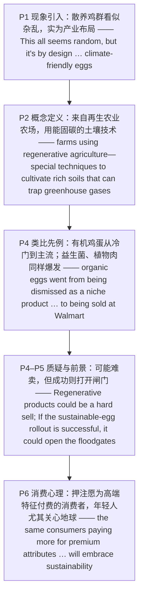

---

# 气候友好型鸡蛋：再生农业的商业考验 精读笔记

---

## 背景

本文选自 **2022 年考研英语（一）Text 1**，主题为**再生农业（regenerative agriculture）能否借"气候友好型鸡蛋"打开市场**。文章从得克萨斯州一处"散养鸡群"的田园画面切入，引出鸡蛋产业押注的"下一件大事"——**气候友好型鸡蛋**，再以**有机鸡蛋**从"冷门"到"主流"的历史作类比，最后落在"**消费者（尤其是年轻人）愿不愿意买单**"这一市场考验上。

文章沿"**现象引入 → 概念定义 → 类比先例 → 质疑与前景 → 消费心理**"的链条展开：

- **现象引入**：得州农场散养的 13,000 只鸡看似杂乱，实为产业**刻意设计**的"气候友好型鸡蛋"（P1）。
- **概念定义**：这类鸡蛋仍标"有机、动物友好"，但来自采用**再生农业**的农场——用能**固碳**的土壤技术（P2）。
- **类比先例**：有机鸡蛋从"天然食品店的冷门产品"到"沃尔玛商品"只用了十多年；益生菌、植物肉也曾遭质疑却终成大品类（P4）。
- **质疑与前景**：再生（农业）产品可能**难卖**（概念难定义、对食品本身改善有限），但若**推广成功**，可为再生牛肉等**打开闸门**（P4–P5）。
- **消费心理**：产业押注"愿为高端特征付费"的消费者也会接纳可持续性；**年轻人**尤其关心地球，其影响之深远"连他们自己都不完全明白"（P6）。

**难度说明**：中等。句式以**并列句**、**定语从句（that / which）**、**名词性从句（that / whether / what 作介词宾语）**、**非谓语动词**（现在分词作后置定语、动名词作介词宾语、不定式作宾补）与**插入语 / 同位语**为主；论证上属于"**新概念 + 历史类比 + 前景研判**"的**商业 / 环保类说明文**，适合练习**态度辨析**、**类比推理**与**主旨概括**。

---

## 文章原文

# 2022 Passage 1

On a recent sunny day, 13,000 chickens **roam** over Larry Brown's 40 **windswept** acres in Shiner, Texas. Some rest in the shade of a parked car. Others drink water with the cows.

This all seems random, but it's **by design**, part of what the $6.1 billion U.S. egg industry bets will be its next big thing: **climate-friendly eggs**.

> [!abstract]- 长难句分析
> **原句**：This all seems random, but it's by design, part of what the $6.1 billion U.S. egg industry bets will be its next big thing: climate-friendly eggs.
>
> **主干提取**：
>
> - 并列分句 1 主语 S1: This all
> - 并列分句 1 谓语 V1: seems
> - 并列分句 1 表语 C1: random
> - 并列连词: but
> - 并列分句 2 主语 S2: it
> - 并列分句 2 谓语 V2: is
> - 并列分句 2 表语 C2: by design
> - 同位语 1: part of what …（补充说明 by design）
> - 同位语 2: climate-friendly eggs（补充说明 its next big thing）
>
> **修饰成分**：
>
> | 类型 | 引导词 / 形式 | 修饰对象 |
> |------|--------------|----------|
> | 并列分句 | but | seems random / is by design |
> | 同位语 | part of … | by design |
> | 介词短语作后置定语 | of | part |
> | 名词性从句（what 作主语） | what | of |
> | 插入的宾语从句（省略 that） | the industry bets | what 从句 |
> | 同位语（冒号） | : climate-friendly eggs | its next big thing |
>
> **结构图解**：
>
> ```
> 并列句 1: This all + seems + random
> 并列连词: but
> 并列句 2: it + is + by design 〔part of what …〕
>   └── 同位语: part of 〔what 从句〕
>         └── 宾语从句（what 作主语）: what + 〔the industry bets〕 + will be + its next big thing
>               ├── 插入的宾语从句（省略 that）: the industry bets
>               └── 同位语（冒号）: : climate-friendly eggs
> ```
>
> **参考译文**：这一切看似杂乱无章，却是刻意为之——这是规模达 61 亿美元的美国鸡蛋产业押注的下一件大事的一部分：气候友好型鸡蛋。
>
> **考点提示**：① 主干是 `but` 连接的**并列句**（`This all seems random` / `it is by design`）。② `part of what …` 是 `by design` 的**同位语**，其中 `what … will be its next big thing` 是**名词性从句作 `of` 的宾语**，`what` 在从句中作**主语**。③ `the industry bets` 是插入的**省略 that 的宾语从句**，插在 `what` 与 `will be` 之间，须先跳过再还原主干 `what … will be its next big thing`。④ 冒号后的 `climate-friendly eggs` 是 `its next big thing` 的**同位语**，点明主题。

These eggs, which are making their **debut** now on shelves for as much as $8 a dozen, are still labeled organic and animal-friendly, but they're also from birds that live on farms using **regenerative agriculture**—special techniques to **cultivate** rich soils that can **trap** greenhouse gases.

> [!abstract]- 长难句分析
> **原句**：These eggs, which are making their debut now on shelves for as much as $8 a dozen, are still labeled organic and animal-friendly, but they're also from birds that live on farms using regenerative agriculture—special techniques to cultivate rich soils that can trap greenhouse gases.
>
> **主干提取**：
>
> - 并列分句 1 主语 S1: These eggs
> - 并列分句 1 谓语 V1: are labeled
> - 并列分句 1 主语补足语 C1: organic and animal-friendly
> - 并列连词: but
> - 并列分句 2 主语 S2: they
> - 并列分句 2 谓语 V2: are
> - 并列分句 2 表语 C2: from birds
>
> **修饰成分**：
>
> | 类型 | 引导词 / 形式 | 修饰对象 |
> |------|--------------|----------|
> | 非限制性定语从句 | which | These eggs |
> | 介词短语作状语 | for as much as $8 a dozen | making their debut |
> | 限制性定语从句 | that | birds |
> | 现在分词短语作后置定语 | using regenerative agriculture | farms |
> | 同位语（破折号） | —special techniques … | regenerative agriculture |
> | 不定式作后置定语 | to cultivate rich soils | special techniques |
> | 限制性定语从句 | that | rich soils |
>
> **结构图解**：
>
> ```
> 并列句 1: These eggs 〔, which are making their debut … ,〕 + are labeled + organic and animal-friendly
>   └── 非限制性定语从句: which + are making + their debut 〔for as much as $8 a dozen〕
> 并列连词: but
> 并列句 2: they + are + from birds 〔that live on farms using regenerative agriculture〕
>   └── 定语从句: that + live + on farms 〔using regenerative agriculture〕
>         ├── 现在分词短语作后置定语: using regenerative agriculture
>         │     └── 同位语（破折号）: —special techniques 〔to cultivate rich soils〕
>         │           └── 不定式作后置定语: to cultivate rich soils 〔that can trap greenhouse gases〕
>         │                 └── 定语从句: that + can trap + greenhouse gases
> ```
>
> **参考译文**：这些鸡蛋如今首次亮相货架，售价高达每打 8 美元，它们仍被贴上有机和动物友好型的标签，但它们还来自采用再生农业的农场里饲养的禽鸟——这是一种培育富含养分、能够捕获温室气体的土壤的特殊技术。
>
> **考点提示**：① 主干是 `but` 连接的**并列句**，两个分句主语分别是 `These eggs`（被非限制性定语从句 `which …` 隔开）和 `they`。② `which are making their debut …` 是**非限制性定语从句**，插入主句主谓之间，阅读时先括起来跳过。③ `using regenerative agriculture` 是**现在分词短语作后置定语**修饰 `farms`，其后破折号引出的 `special techniques …` 是 `regenerative agriculture` 的**同位语（定义）**。④ 句尾 `that can trap greenhouse gases` 是**定语从句**修饰 `rich soils`，是"气候友好"的关键（土壤**固碳**）。

Such eggs could be marketed as helping to fight climate change.

“I’m excited about our progress,” says Brown, who is adding more **cover crops** that draw worms and crickets for the chickens to eat. The birds’ waste then **fertilizes** fields.

Such improvements “allow our hens to **forage** for higher-quality natural feed that will be good for the land, the hens, and the eggs that we supply to our customers.”

> [!abstract]- 长难句分析
> **原句**：Such improvements “allow our hens to forage for higher-quality natural feed that will be good for the land, the hens, and the eggs that we supply to our customers.”
>
> **主干提取**：
>
> - 主语 S: Such improvements
> - 谓语 V: allow
> - 宾语 O: our hens
> - 宾语补足语 C: to forage for higher-quality natural feed
> - 定语从句 1: that will be good for …
> - 定语从句 2: that we supply to our customers
>
> **修饰成分**：
>
> | 类型 | 引导词 / 形式 | 修饰对象 |
> |------|--------------|----------|
> | 不定式作宾语补足语 | to forage for … | our hens |
> | 介词短语 | for higher-quality natural feed | forage |
> | 定语从句 | that | higher-quality natural feed |
> | 三项并列 | the land, the hens, and the eggs | good for 的宾语 |
> | 定语从句 | that | the eggs |
>
> **结构图解**：
>
> ```
> 主句: Such improvements + allow + our hens + 〔to forage for higher-quality natural feed〕
>   └── 不定式作宾语补足语: to forage for higher-quality natural feed 〔that will be good for …〕
>         └── 定语从句: that + will be + good for the land, the hens, and the eggs 〔that we supply …〕
>               └── 定语从句: that + we + supply + to our customers
> ```
>
> **参考译文**：这样的改进"让我们的母鸡能够觅食更优质的天然饲料，这对土地、母鸡，以及我们供应给客户的鸡蛋都有好处"。
>
> **考点提示**：① 主干是 `allow sb to do sth`（`allow our hens to forage`），不定式作**宾语补足语**。② `that will be good for …` 是**定语从句**修饰 `higher-quality natural feed`，从句内 `the land, the hens, and the eggs` 为**三项并列**。③ 句尾 `that we supply to our customers` 是**第二个定语从句**，修饰 `the eggs`（`that` 作 `supply` 的**宾语**）。一句中**两个 that 从句**首尾嵌套，须逐层剥离。

The egg industry's push is the first major test of whether animal products from regenerative farms can become the next **premium offering**.

> [!abstract]- 长难句分析
> **原句**：The egg industry's push is the first major test of whether animal products from regenerative farms can become the next premium offering.
>
> **主干提取**：
>
> - 主语 S: The egg industry's push
> - 谓语 V: is
> - 表语 C: the first major test
> - 介词短语作后置定语: of whether …
> - 宾语从句（作 of 的宾语）: whether animal products … can become …
>
> **修饰成分**：
>
> | 类型 | 引导词 / 形式 | 修饰对象 |
> |------|--------------|----------|
> | 介词短语作后置定语 | of | test |
> | 宾语从句（whether） | whether | of |
> | 介词短语作后置定语 | from regenerative farms | animal products |
>
> **结构图解**：
>
> ```
> 主句: The egg industry's push + is + the first major test 〔of whether …〕
>   └── 介词短语作后置定语: of + 〔whether 从句〕
>         └── 宾语从句: whether + animal products 〔from regenerative farms〕 + can become + the next premium offering
>               └── 介词短语作后置定语: from regenerative farms
> ```
>
> **参考译文**：鸡蛋产业的这一推动，是检验来自再生农场的动物产品能否成为下一个高端产品品类的首次重大考验。
>
> **考点提示**：① 主干是 `push is test`（主系表）。② `of whether …` 是**介词短语作后置定语**修饰 `test`，其中 `whether … can become …` 是**宾语从句作介词 `of` 的宾语**——**介词后只能用 `whether`，不能用 `if`**。③ 从句内 `from regenerative farms` 是**介词短语作后置定语**修饰 `animal products`，把它括起来后从句主干是 `animal products … can become the next premium offering`。

In barely more than a decade, organic eggs went from being dismissed as a **niche** product in natural foods stores to being sold at Walmart.

> [!abstract]- 长难句分析
> **原句**：In barely more than a decade, organic eggs went from being dismissed as a niche product in natural foods stores to being sold at Walmart.
>
> **主干提取**：
>
> - 主语 S: organic eggs
> - 谓语 V: went
> - 状语 A: from being dismissed … to being sold at Walmart
> - 时间状语: In barely more than a decade
>
> **修饰成分**：
>
> | 类型 | 引导词 / 形式 | 修饰对象 |
> |------|--------------|----------|
> | 介词短语作状语 | In barely more than a decade | 全句 |
> | from … to … 结构 | from / to | went |
> | 被动动名词作介词宾语 | being dismissed | from |
> | 被动动名词作介词宾语 | being sold | to |
> | 介词短语作状语 | in natural foods stores | being dismissed |
>
> **结构图解**：
>
> ```
> 主句: organic eggs + went + 〔from being dismissed … to being sold …〕
>   ├── 介词短语作状语: In barely more than a decade
>   └── from … to … 结构:
>         ├── 介词 from + 被动动名词: being dismissed 〔as a niche product〕〔in natural foods stores〕
>         └── 介词 to + 被动动名词: being sold 〔at Walmart〕
> ```
>
> **参考译文**：在短短十多年间，有机鸡蛋从被贬为天然食品店里的冷门产品，变成了在沃尔玛销售的商品。
>
> **考点提示**：① 主干是 `organic eggs went`，`from … to …` 是**介词短语作状语**，表"从……变为……"。② `from` 与 `to` 后均接**被动动名词**（`being dismissed` / `being sold`），表"**被贬低**""**被销售**"，切勿误当现在分词。③ `In barely more than a decade`（仅仅十多年）是**时间状语**，凸显变化之快。

More recently there were similar doubts about **probiotics** and plant-based meats, but both have exploded into major supermarket categories.

If the sustainable-egg **rollout** is successful, it could **open the floodgates** for regenerative beef, broccoli, and beyond.

> [!abstract]- 长难句分析
> **原句**：If the sustainable-egg rollout is successful, it could open the floodgates for regenerative beef, broccoli, and beyond.
>
> **主干提取**：
>
> - 条件状语从句: If the sustainable-egg rollout is successful
> - 主语 S: it
> - 谓语 V: could open
> - 宾语 O: the floodgates
> - 状语: for regenerative beef, broccoli, and beyond
>
> **修饰成分**：
>
> | 类型 | 引导词 / 形式 | 修饰对象 |
> |------|--------------|----------|
> | 条件状语从句 | If | 主句 |
> | 表语（从句内） | successful | is |
> | 介词短语作状语 | for regenerative beef, broccoli, and beyond | open |
>
> **结构图解**：
>
> ```
> 条件状语从句: If + the sustainable-egg rollout + is + successful
> 主句: it + could open + the floodgates 〔for regenerative beef, broccoli, and beyond〕
>   └── 介词短语作状语: for regenerative beef, broccoli, and beyond
> ```
>
> **参考译文**：如果可持续鸡蛋的推广获得成功，就可能为再生牛肉、西兰花乃至更多产品打开闸门。
>
> **考点提示**：① `If` 引导**条件状语从句**，从句用**一般现在时** `is`（**不用** `will be`），主句用 `could` 表**推测**——"主将从现"在情态动词下的变体。② `open the floodgates for …` 是**比喻**（"为……打开闸门"），喻"**使大量事物涌现**"。③ 从句交代**前提**，主句是**推论**，是第 23 题"说明再生农产品潜力"的**逻辑起点**。

Regenerative products could be a **hard sell**, because the concept is tough to define quickly, says Julie Stanton, associate professor of agricultural economics at Pennsylvania State University Brandywine.

> [!abstract]- 长难句分析
> **原句**：Regenerative products could be a hard sell, because the concept is tough to define quickly, says Julie Stanton, associate professor of agricultural economics at Pennsylvania State University Brandywine.
>
> **主干提取**：
>
> - 主句主语 S: Regenerative products
> - 主句谓语 V: could be
> - 主句表语 C: a hard sell
> - 原因状语从句: because the concept is tough to define quickly
> - 插入的主谓: says Julie Stanton
> - 同位语: associate professor of agricultural economics …
>
> **修饰成分**：
>
> | 类型 | 引导词 / 形式 | 修饰对象 |
> |------|--------------|----------|
> | 原因状语从句 | because | could be a hard sell |
> | 不定式主动形式表被动 | tough to define | the concept |
> | 插入的主谓（倒装） | says Julie Stanton | 全句 |
> | 同位语 | associate professor … | Julie Stanton |
>
> **结构图解**：
>
> ```
> 主句: Regenerative products + could be + a hard sell
>   ├── 原因状语从句: because + the concept + is + tough 〔to define quickly〕
>   │     └── 不定式主动形式表被动: to define quickly
>   └── 插入的主谓（倒装）: says + Julie Stanton 〔, associate professor …〕
>         └── 同位语: associate professor of agricultural economics at Pennsylvania State University Brandywine
> ```
>
> **参考译文**：宾夕法尼亚州立大学 Brandywine 分校农业经济学副教授 Julie Stanton 说，再生（农业）产品可能很难推销，因为这一概念难以被快速定义清楚。
>
> **考点提示**：① 主干是 `Regenerative products could be a hard sell`（主系表）。② `because` 引导**原因状语从句**，从句内 `is tough to define quickly` 用**不定式主动形式表被动**（= "难以**被**快速定义"）。③ `says Julie Stanton` 是**插入的主谓倒装**（= `Julie Stanton says`），其后的 `associate professor …` 是 `Julie Stanton` 的**同位语**。阅读时把 `says + 人名` 整体看作"某人说"即可。

Such farming also brings **minimal**, **if any**, improvement to the food products (though some producers say their eggs have more protein).

> [!abstract]- 长难句分析
> **原句**：Such farming also brings minimal, if any, improvement to the food products (though some producers say their eggs have more protein).
>
> **主干提取**：
>
> - 主语 S: Such farming
> - 谓语 V: brings
> - 宾语 O: minimal, if any, improvement
> - 状语: to the food products
> - 让步状语从句: though some producers say …
>
> **修饰成分**：
>
> | 类型 | 引导词 / 形式 | 修饰对象 |
> |------|--------------|----------|
> | 让步插入语 | if any | improvement |
> | 介词短语作状语 | to the food products | brings |
> | 让步状语从句 | though | 主句 |
> | 省略 that 的宾语从句 | (that) their eggs have more protein | say |
>
> **结构图解**：
>
> ```
> 主句: Such farming + brings + minimal, 〔if any,〕 improvement 〔to the food products〕
>   ├── 让步插入语: if any
>   └── 让步状语从句: though + some producers + say + 〔(that) their eggs have more protein〕
>         └── 省略 that 的宾语从句: (that) their eggs + have + more protein
> ```
>
> **参考译文**：这类耕作方式对食品本身的改善也微乎其微——即便有的话（尽管一些生产商称他们的鸡蛋蛋白质含量更高）。
>
> **考点提示**：① 主干是 `Such farming brings improvement`。② `if any` 是**让步插入语**（= `if there is any`），插在 `minimal` 与 `improvement` 之间，表"**即便有也极少**"，须与后面的名词连读。③ `though` 引导**让步状语从句**，从句内 `say their eggs have more protein` 是**省略 that 的宾语从句**。括号使让步语气**弱化**，体现作者**审慎**态度。

The industry is betting that the same consumers paying more for premium attributes such as free-range, non-GMO, and pasture-raised eggs will **embrace** sustainability.

> [!abstract]- 长难句分析
> **原句**：The industry is betting that the same consumers paying more for premium attributes such as free-range, non-GMO, and pasture-raised eggs will embrace sustainability.
>
> **主干提取**：
>
> - 主语 S: The industry
> - 谓语 V: is betting
> - 宾语从句: that the same consumers … will embrace sustainability
> - 从句主语 S: the same consumers
> - 从句谓语 V: will embrace
> - 从句宾语 O: sustainability
>
> **修饰成分**：
>
> | 类型 | 引导词 / 形式 | 修饰对象 |
> |------|--------------|----------|
> | 宾语从句 | that | is betting |
> | 现在分词短语作后置定语 | paying more for premium attributes | consumers |
> | 同位语（举例） | such as … | premium attributes |
> | 三项并列 | free-range, non-GMO, and pasture-raised | eggs 的定语 |
>
> **结构图解**：
>
> ```
> 主句: The industry + is betting + 〔that 从句〕
>   └── 宾语从句: the same consumers 〔paying more for premium attributes〕 + will embrace + sustainability
>         ├── 现在分词短语作后置定语: paying more for premium attributes 〔such as free-range, non-GMO, and pasture-raised eggs〕
>         │     └── 同位语（举例）: such as free-range, non-GMO, and pasture-raised eggs
>         └── （从句主干）: consumers + will embrace + sustainability
> ```
>
> **参考译文**：该产业押注的是：那些愿意为散养、非转基因、牧场饲养等高端特征支付更高价格的消费者，也会接纳可持续性。
>
> **考点提示**：① 主干是 `The industry is betting that …`，`that` 引导**宾语从句**。② 从句主语 `the same consumers` 后接**现在分词短语作后置定语**（`paying more for premium attributes`），阅读时先跳过，从句主干是 `consumers … will embrace sustainability`。③ `such as …` 是**同位语（举例）**，`free-range, non-GMO, and pasture-raised` **三项并列**，共同修饰 `eggs`。

Surveys show that younger generations are more concerned about climate change, and some of the success of plant-based meat can be **chalked up to** shoppers wanting to **signal** their desire to protect the environment.

Young adults “really care about the planet,” says John Brunnquell, president of Egg Innovations.

They are absolutely **altering** the food chain beyond what I think even they understand what they’re doing.

> [!abstract]- 长难句分析
> **原句**：They are absolutely altering the food chain beyond what I think even they understand what they're doing.
>
> **主干提取**：
>
> - 主语 S: They
> - 谓语 V: are altering
> - 宾语 O: the food chain
> - 状语: beyond what …
> - 介词宾语从句: what I think even they understand what they're doing
>
> **修饰成分**：
>
> | 类型 | 引导词 / 形式 | 修饰对象 |
> |------|--------------|----------|
> | 副词状语 | absolutely | are altering |
> | 介词短语作状语 | beyond … | are altering |
> | 宾语从句（what 作宾语） | what | beyond |
> | 插入的主谓 | I think | what 从句 |
> | 嵌套宾语从句 | what they're doing | understand |
>
> **结构图解**：
>
> ```
> 主句: They + are altering + the food chain 〔beyond what …〕
>   └── 介词短语作状语: beyond + 〔what 从句〕
>         └── 宾语从句（what 作宾语）: what + I think + even they understand + 〔what they're doing〕
>               ├── 插入的主谓: I think
>               └── 嵌套宾语从句: what they're doing
> ```
>
> **参考译文**：他们正在彻底改变食物链，其程度之大，我认为甚至连他们自己都不完全明白自己在做什么。
>
> **考点提示**：① 主干是 `They are altering the food chain`。② `beyond what …` 是**介词短语作状语**，`what` 引导**宾语从句作介词 `beyond` 的宾语**（= "超出……的程度"）。③ 从句内 `I think` 是**插入的主谓**，`what they're doing` 是**嵌套的宾语从句**作 `understand` 的宾语。全句**三层从句嵌套**（`beyond what` → `I think` → `what they're doing`），是本文最典型的"**从句套从句**"考点。

---

## 题目

### 21. The climate-friendly eggs are produced ____.

- [A] at a considerably low cost
- [B] at the demand of regular shoppers
- [C] as a replacement for organic eggs
- [D] on specially designed farms

### 22. Larry Brown is excited about his progress in ____.

- [A] reducing the damage of worms
- [B] accelerating the disposal of waste
- [C] creating a sustainable system
- [D] attracting customers to his products

### 23. The example of organic eggs is used in Paragraph 4 to suggest ____.

- [A] the doubts over natural feeds
- [B] the setbacks in the egg industry
- [C] the potential of regenerative products
- [D] the promotional success of supermarkets

### 24. It can be learned from the last paragraph that young people ____.

- [A] are reluctant to change their diet
- [B] are likely to buy climate-friendly eggs
- [C] are curious about new foods
- [D] are amazed at agricultural advances

### 25. John Brunnquell would disagree with Julie Stanton over regenerative products' ____.

- [A] market prospects
- [B] nutritional value
- [C] standard definition
- [D] moral implications

---

## 翻译对照

# 2022 Passage 1 中英对照翻译

## Paragraph 1

On a recent sunny day, 13,000 chickens roam over Larry Brown's 40 windswept acres in Shiner, Texas. Some rest in the shade of a parked car. Others drink water with the cows. This all seems random, but it's by design, part of what the $6.1 billion U.S. egg industry bets will be its next big thing: climate-friendly eggs.

在最近一个阳光明媚的日子里，13,000 只鸡在得克萨斯州 Shiner 镇 Larry Brown 那片 40 英亩、风吹草低的土地上四处游荡。有些鸡在停着的汽车阴影下休息，还有些鸡与奶牛一起喝水。这一切看似杂乱无章，却是刻意为之——这是规模达 61 亿美元的美国鸡蛋产业押注的下一件大事的一部分：气候友好型鸡蛋。

> [!note] 翻译说明
> - `roam` = "漫游、四处走动"，强调无拘无束地游荡。
> - `windswept acres` = "被风吹拂的英亩（土地）"，`windswept` = "受风吹的、当风的"。
> - `by design` = "故意地、有意为之"，与 `by accident`（偶然）相对。
> - `bets will be its next big thing` = "押注它将成为下一件大事"；`bet` = "打赌、押注"。
> - `climate-friendly` = "气候友好型的"。

## Paragraph 2

These eggs, which are making their debut now on shelves for as much as $8 a dozen, are still labeled organic and animal-friendly, but they're also from birds that live on farms using regenerative agriculture—special techniques to cultivate rich soils that can trap greenhouse gases. Such eggs could be marketed as helping to fight climate change.

这些鸡蛋如今首次亮相货架，售价高达每打 8 美元，它们仍被贴上有机和动物友好型的标签，但它们还来自采用再生农业的农场里饲养的禽鸟——这是一种培育富含养分、能够捕获温室气体的土壤的特殊技术。这类鸡蛋可以被打造成"有助于应对气候变化"的产品来营销。

> [!note] 翻译说明
> - `making their debut` = "首次亮相、初次登场"；`debut` 源自法语。
> - `as much as $8 a dozen` = "高达每打 8 美元"；`a dozen` = "一打（12 个）"。
> - `regenerative agriculture` = "再生农业"，指通过恢复土壤健康来固碳的农业模式。
> - `cultivate rich soils` = "培育肥沃（富含养分）的土壤"。
> - `trap greenhouse gases` = "捕获温室气体"；`trap` = "困住、捕获"。
> - `be marketed as` = "被当作……来营销"。

## Paragraph 3

“I’m excited about our progress,” says Brown, who is adding more cover crops that draw worms and crickets for the chickens to eat. The birds’ waste then fertilizes fields. Such improvements “allow our hens to forage for higher-quality natural feed that will be good for the land, the hens, and the eggs that we supply to our customers.”

"我对我们的进展感到兴奋，"Brown 说，他正在增种更多覆盖作物，以吸引蚯蚓和蟋蟀供鸡啄食。这些禽鸟的粪便又为田地施肥。这样的改进"让我们的母鸡能够觅食更优质的天然饲料，这对土地、母鸡，以及我们供应给客户的鸡蛋都有好处"。

> [!note] 翻译说明
> - `cover crops` = "覆盖作物、绿肥作物"，指为保护/改良土壤而种植的作物。
> - `draw worms and crickets` = "吸引蚯蚓和蟋蟀"；`draw` = "吸引"。
> - `waste` = "（动物的）粪便、排泄物"。
> - `fertilizes fields` = "给田地施肥"；`fertilize` = "使肥沃"。
> - `forage` = "（动物）觅食"。
> - `hens` = "母鸡"。

## Paragraph 4

The egg industry's push is the first major test of whether animal products from regenerative farms can become the next premium offering. In barely more than a decade, organic eggs went from being dismissed as a niche product in natural foods stores to being sold at Walmart. More recently there were similar doubts about probiotics and plant-based meats, but both have exploded into major supermarket categories. If the sustainable-egg rollout is successful, it could open the floodgates for regenerative beef, broccoli, and beyond.

鸡蛋产业的这一推动，是检验来自再生农场的动物产品能否成为下一个高端产品品类的首次重大考验。在短短十多年间，有机鸡蛋从被贬为天然食品店里的冷门产品，变成了在沃尔玛销售的商品。更近一些时候，益生菌和植物肉也曾遭遇类似的质疑，但两者都迅速爆发，成为超市里的重要品类。如果可持续鸡蛋的推广获得成功，就可能为再生牛肉、西兰花乃至更多产品打开闸门。

> [!note] 翻译说明
> - `push` 此处作名词 = "推动、努力"。
> - `premium offering` = "高端产品（品类）"；`premium` = "优质的、高端的"。
> - `dismissed as a niche product` = "被贬为冷门（小众）产品"；`niche` = "小众的、专门的"。
> - `probiotics` = "益生菌"。
> - `exploded into major supermarket categories` = "迅速爆发为超市的重要品类"。
> - `rollout` = "（新产品/服务的）推出、推广"。
> - `open the floodgates for` = "为……打开闸门"，喻"使大量涌现"。

## Paragraph 5

Regenerative products could be a hard sell, because the concept is tough to define quickly, says Julie Stanton, associate professor of agricultural economics at Pennsylvania State University Brandywine. Such farming also brings minimal, if any, improvement to the food products (though some producers say their eggs have more protein).

宾夕法尼亚州立大学 Brandywine 分校农业经济学副教授 Julie Stanton 说，再生（农业）产品可能很难推销，因为这一概念难以被快速定义清楚。这类耕作方式对食品本身的改善也微乎其微——即便有的话（尽管一些生产商称他们的鸡蛋蛋白质含量更高）。

> [!note] 翻译说明
> - `a hard sell` = "难以推销的东西、难卖的商品"。
> - `tough to define quickly` = "难以快速定义"。
> - `associate professor` = "副教授"。
> - `minimal, if any` = "几乎没有，即便有也极少"；`if any` 是让步插入语。
> - `protein` = "蛋白质"。

## Paragraph 6

The industry is betting that the same consumers paying more for premium attributes such as free-range, non-GMO, and pasture-raised eggs will embrace sustainability. Surveys show that younger generations are more concerned about climate change, and some of the success of plant-based meat can be chalked up to shoppers wanting to signal their desire to protect the environment. Young adults “really care about the planet,” says John Brunnquell, president of Egg Innovations. “They are absolutely altering the food chain beyond what I think even they understand what they’re doing.”

该产业押注的是：那些愿意为散养、非转基因、牧场饲养等高端特征支付更高价格的消费者，也会接纳可持续性。调查显示，年轻一代更关心气候变化，而植物肉的部分成功可以归因于购物者希望表达自己保护环境的意愿。"年轻人真的很关心地球，"Egg Innovations 公司总裁 John Brunnquell 说，"他们正在彻底改变食物链，其程度之大，我认为甚至连他们自己都不完全明白自己在做什么。"

> [!note] 翻译说明
> - `premium attributes` = "高端特征、优质属性"。
> - `free-range` = "散养的、放养的"；`non-GMO` = "非转基因的"；`pasture-raised` = "牧场饲养的"。
> - `embrace sustainability` = "接纳可持续性"；`embrace` = "拥抱、欣然接受"。
> - `be chalked up to` = "被归因于、被算作……的功劳"。
> - `signal their desire` = "表达（传递出）他们的意愿"；`signal` 作动词 = "示意、表明"。
> - `altering the food chain` = "改变食物链"；`alter` = "改变、更改"。

---

## 题目翻译

### 21. The climate-friendly eggs are produced ____.

21. 气候友好型鸡蛋是在 ____ 生产的。

- [A] 以相当低的成本
- [B] 应普通购物者的需求
- [C] 作为有机鸡蛋的替代品
- [D] 在专门设计的农场上

### 22. Larry Brown is excited about his progress in ____.

22. Larry Brown 对其在 ____ 方面的进展感到兴奋。

- [A] 减少蚯蚓的危害
- [B] 加快废弃物的处理
- [C] 建立一个可持续的系统
- [D] 吸引顾客购买他的产品

### 23. The example of organic eggs is used in Paragraph 4 to suggest ____.

23. 第 4 段引用有机鸡蛋的例子是为了说明 ____。

- [A] 对天然饲料的质疑
- [B] 鸡蛋产业遭遇的挫折
- [C] 再生农产品的潜力
- [D] 超市促销的成功

### 24. It can be learned from the last paragraph that young people ____.

24. 从最后一段可以了解到，年轻人 ____。

- [A] 不愿改变饮食习惯
- [B] 可能购买气候友好型鸡蛋
- [C] 对新食物感到好奇
- [D] 对农业进步感到惊叹

### 25. John Brunnquell would disagree with Julie Stanton over regenerative products' ____.

25. John Brunnquell 会在再生农产品的 ____ 上与 Julie Stanton 意见相左。

- [A] 市场前景
- [B] 营养价值
- [C] 标准定义
- [D] 道德含义

---

## 语法要点

# 2022 Passage 1 语法整理

> [!note] 来源说明
> 本篇**用户未提供语法源笔记**，以下语法点由 `formatted-article.md` 与 `translation.md` **从本文推断提取**，仅收录本篇实际出现的语法现象。
> 每一条均给出**原文语境**，便于回原文核对；标注"（联动）"的条目与相邻专题互为参照。
> 固定搭配与词组见 [[intermediate/2022-passage1-climate-friendly-eggs/固定搭配与词组笔记.md|2022 Passage 1 固定搭配与词组]]。

---

## 一、从句

### 从句：非限制性定语从句（which / who 引导）

**概述**：**非限制性定语从句**用逗号与主句隔开，对先行词作**补充说明**（而非限定），去掉后主句意思仍完整；`which` 指物，`who` 指人。

| 结构 | 用法 | 例句 |
|------|------|------|
| `先行词 + , which + 从句 ,` | 补充说明物 | These eggs, **which are making their debut now on shelves for as much as $8 a dozen**, are still labeled organic … |
| `先行词 + , who + 从句` | 补充说明人 | … says Brown, **who is adding more cover crops** that draw worms and crickets … |

> [!tip] 阅读技巧
> 非限制性定语从句是**插入信息的重灾区**：主干被 `, which … ,` 拦腰切断，阅读时先把从句**整体括起来跳过**，抓住主句主干。第一句去掉从句后主干是 `These eggs … are still labeled organic and animal-friendly`。注意 `which` 从句中 `are making their debut` 用**现在进行时**，强调"正在首次亮相"。（联动）见 2021 Passage 4 语法笔记"从句：省略 that 的定语从句（the ability she called）"。

### 从句：that 引导的限制性定语从句（作主语）

**概述**：`that` 引导**限制性定语从句**，`that` 在从句中作**主语**，紧跟在先行词之后，**不能省略**、**不能用逗号隔开**。

| 结构 | 用法 | 例句 |
|------|------|------|
| `先行词 + that + 谓语` | that 作从句主语 | farms using regenerative agriculture—special techniques to cultivate rich soils **that can trap greenhouse gases** |
| `先行词 + that + 谓语` | that 作从句主语 | cover crops **that draw worms and crickets** for the chickens to eat |
| `先行词 + that + 谓语` | that 作从句主语 | natural feed **that will be good for the land, the hens, and the eggs** |
| `先行词 + that + 主谓宾` | that 作从句宾语 | the eggs **that we supply to our customers** |

> [!warning] 易错点
> 判据：`that` 后的从句**缺主语** → `that` 作**主语**（前两句、第三句）；从句**缺宾语** → `that` 作**宾语**（第四句 `that we supply …` 中 `that` 是 `supply` 的宾语）。本文 `that` 从句密集出现，是**信息堆叠**的主要手段，须逐层剥离。

### 从句：省略 that 的宾语从句（bet / show / say）

**概述**：`bet`、`show`、`say`、`think` 等动词后的**宾语从句**，连词 `that` 常**省略**，从句直接跟在动词后。

| 结构 | 用法 | 例句 |
|------|------|------|
| `动词 + (that) + 完整从句` | 宾语从句，that 省略 | Surveys show **(that) younger generations are more concerned about climate change** |
| `动词 + (that) + 完整从句` | 宾语从句，that 省略 | some producers say **(that) their eggs have more protein** |

> [!tip] 阅读技巧
> 遇到 `show / say / find` 后**直接跟一个完整句子**（而非名词），即知这是**省略 that 的宾语从句**。从句才是信息核心，主句动词只是"引出观点"。（联动）见 2021 Passage 4 语法笔记"从句：省略 that 的宾语从句（shows we're better）"。

### 从句：that 引导的宾语从句

**概述**：`that` 引导**宾语从句**，作及物动词的宾语，`that` 仅起**连接**作用、**不作成分**（区别于定语从句）。

| 结构 | 用法 | 例句 |
|------|------|------|
| `动词 + that + 完整从句` | 宾语从句 | The industry is betting **that the same consumers … will embrace sustainability** |
| `动词 + that + 完整从句` | 宾语从句 | Surveys show **that younger generations are more concerned about climate change** |

> [!warning] 易错点
> 判据：`that` 后从句**结构完整**（主谓宾齐全）→ **宾语从句**；从句**缺主语或宾语** → **定语从句**。第一句 `that the same consumers … will embrace sustainability` 主谓宾完整，故为宾语从句，作 `betting` 的宾语。

### 从句：whether 引导的宾语从句（作介词宾语）

**概述**：`whether` 引导**宾语从句**，表"**是否**"，此处作介词 `of` 的宾语（**介词后的名词性从句**只能用 `whether`，不能用 `if`）。

| 结构 | 用法 | 例句 |
|------|------|------|
| `介词 + whether + 完整从句` | 宾语从句作介词宾语 | the first major test **of whether animal products from regenerative farms can become the next premium offering** |

> [!warning] 易错点
> `whether` 从句在此作 `of` 的**宾语**（`test of whether …` = "对……的检验"）。**介词后只能用 `whether`**，绝不能用 `if`。理解时把 `of whether … offering` 整体看作 `test` 的**后置修饰**。（联动）见 2021 Passage 4 语法笔记"从句：whether ... or ... 引导的宾语从句"。

### 从句：what 引导的宾语从句（作介词宾语）

**概述**：`what` 引导**名词性从句**，`what` 在从句中充当**主语或宾语**，整个从句可作介词 `of`、`beyond` 的宾语。

| 结构 | 用法 | 例句 |
|------|------|------|
| `介词 + what + 从句` | what 作从句主语 | part of **what the $6.1 billion U.S. egg industry bets will be its next big thing** |
| `介词 + what + 从句` | what 作从句宾语 | altering the food chain beyond **what I think even they understand what they're doing** |

> [!note] 补充说明
> 第一句中 `what` 从句作 `of` 的宾语，且从句内**插入**了 `the $6.1 billion U.S. egg industry bets`（一个省略 that 的宾语从句/插入语），主干为 `what … will be its next big thing`（"……将成为它的下一件大事"）。第二句 `beyond what …` = "超出……（的程度）"，`what` 从句作介词 `beyond` 的宾语，从句内再**嵌套** `what they're doing`。`what` 从句因"**既当引导词又当成分**"而成为长难句难点。（联动）见 2021 Passage 3 语法笔记"从句：表语从句与 what 的指代"。

### 从句：because 引导的原因状语从句

**概述**：`because` 引导**原因状语从句**，表"因为"，说明主句动作的**原因**。

| 结构 | 用法 | 例句 |
|------|------|------|
| `主句 + because + 从句` | 原因状语从句 | Regenerative products could be a hard sell, **because the concept is tough to define quickly** |

> [!note] 补充说明
> `because` 从句置于主句之后，是对"**难卖**"（hard sell）的原因解释。注意此句 `says Julie Stanton …` 为**插入的主谓**，`because` 从句归属于 `could be a hard sell`，而非 `says`。

### 从句：if 引导的条件状语从句

**概述**：`if` 引导**条件状语从句**，表"如果"。此处为**真实条件**（非虚拟），主句用 `it could …`（情态动词表推测）。

| 结构 | 用法 | 例句 |
|------|------|------|
| `If + 一般现在时从句, 主句(could + V)` | 真实条件，主句表推测 | **If the sustainable-egg rollout is successful**, it could open the floodgates for regenerative beef … |

> [!warning] 易错点
> 从句用**一般现在时** `is`（**不能用** `will be`），主句用 `could` 表**推测结果**——这是"**主将从现**"逻辑在情态动词下的变体。`If` 从句交代**前提**，是第 23 题"有机鸡蛋的例子说明再生农产品的潜力"的**逻辑起点**。

### 从句：though 引导的让步状语从句

**概述**：`though` 引导**让步状语从句**，表"**虽然、尽管**"，置于括号或句末，对主句作**让步性补充**。

| 结构 | 用法 | 例句 |
|------|------|------|
| `主句 + (though + 从句)` | 让步状语从句（补充） | brings minimal, if any, improvement to the food products (**though some producers say their eggs have more protein**) |

> [!note] 补充说明
> `though` 从句置于**括号**中，是对"改善微乎其微"的**让步补充**（"尽管有人说蛋白更高"），削弱了前句的绝对性，体现作者**客观审慎**的态度。

---

## 二、非谓语动词

### 非谓语：现在分词短语作后置定语

**概述**：现在分词短语作**后置定语**，修饰前面名词，与其构成**主动**或**进行**关系。

| 结构 | 用法 | 例句 |
|------|------|------|
| `名词 + 现在分词短语` | 主动关系，后置定语 | farms **using regenerative agriculture** |
| `名词 + 现在分词短语` | 主动关系，后置定语 | consumers **paying more for premium attributes** such as free-range, non-GMO, and pasture-raised eggs |

> [!tip] 还原技巧
> `farms using regenerative agriculture` = `farms that use regenerative agriculture`，`farms` 与 `use` 是**主动关系**，故用现在分词。`consumers paying more …` 同理 = `consumers who pay more …`。分词作后置定语比从句**更简洁**，是考研长难句的常见压缩手段。（联动）见 2021 Passage 4 语法笔记"非谓语：现在分词短语作后置定语"。

### 非谓语：动名词作介词宾语

**概述**：介词（`of`、`as`、`to`、`for`、`about` 等）后接**动名词**作宾语，构成介词短语。

| 结构 | 用法 | 例句 |
|------|------|------|
| `介词 + 动名词` | from … to … 结构 | went **from being dismissed** as a niche product … **to being sold** at Walmart |
| `介词 + 动名词` | market as + doing | could be marketed **as helping to fight climate change** |
| `介词 + 动名词` | want to …（不定式前置于动名词内） | shoppers **wanting to signal their desire to protect the environment** |
| `介词 + 动名词` | go from doing … to doing … | **go from being dismissed … to being sold …** |

> [!warning] 易错点
> `from … to …` 中两个介词后**一律用动名词**（`being dismissed` / `being sold`），且均为**被动式动名词**（"被贬低""被销售"）。`be marketed as doing` 中 `as` 是介词，后接动名词 `helping`。切勿把 `as` 后的 `-ing` 误当现在分词。（联动）见"语态：被动语态"。

### 非谓语：不定式作后置定语

**概述**：不定式作**后置定语**，修饰前面名词，表"**要做的事**"或"……的能力/意愿"。

| 结构 | 用法 | 例句 |
|------|------|------|
| `名词 + 不定式` | 后置定语（表用途） | special techniques **to cultivate rich soils** |
| `名词 + 不定式` | 后置定语（表意愿/目的） | shoppers wanting to signal their **desire to protect the environment** |
| `名词 + 不定式` | 后置定语（表用途/目的） | feed **to eat** / chickens to eat（`for the chickens to eat`） |

> [!tip] 还原技巧
> `techniques to cultivate rich soils` = "培育肥沃土壤的技术"，`techniques`、`way`、`ability`、`desire`、`chance` 等名词后常接不定式作定语。`for the chickens to eat` 是**不定式复合结构**（`for + 逻辑主语 + to do`），作后置定语修饰 `worms and crickets`。（联动）见 2021 Passage 4 语法笔记"非谓语：不定式作后置定语"。

### 非谓语：不定式作宾语补足语（allow sb to do）

**概述**：`allow / ask / want / tell sb to do sth` 结构中，不定式作**宾语补足语**，补充说明宾语的动作。

| 结构 | 用法 | 例句 |
|------|------|------|
| `allow sb to do sth` | 不定式作宾补 | Such improvements **allow our hens to forage** for higher-quality natural feed … |

> [!note] 补充说明
> `allow our hens to forage` 中 `to forage` 是 `hens` 的**宾语补足语**（"让母鸡去觅食"）。`allow` 属"**允许类**"动词，只能用 `to do`（**不能用** `allow sb do`）。（联动）见 2021 Passage 4 语法笔记"非谓语：不定式作宾语补足语"。

### 非谓语：不定式主动形式表被动（tough to define）

**概述**：`be + 形容词（tough / hard / easy / difficult / nice）+ to do` 结构中，不定式用**主动形式**表达**被动含义**，且**不出现**逻辑主语。

| 结构 | 用法 | 例句 |
|------|------|------|
| `be + adj + to do`（主动表被动） | 不定式主动形式表被动 | the concept is **tough to define** quickly |

> [!warning] 易错点
> `the concept is tough to define quickly` = "这一概念**难以被快速定义**"，虽为被动含义，却用**主动** `to define`，且句中**不出现** `to be defined`。这是英语"**形容词 + 不定式**"结构的固定用法（`tough / hard / easy / difficult / cheap` 等皆然）。

---

## 三、语态

### 语态：被动语态（be + 过去分词 / 情态动词被动）

**概述**：被动语态 `be + 过去分词`，强调**动作的承受者**；含情态动词时用 `情态动词 + be + 过去分词`。

| 结构 | 用法 | 例句 |
|------|------|------|
| `be + 过去分词` | 一般现在时被动 | These eggs … **are still labeled** organic and animal-friendly |
| `情态动词 + be + 过去分词` | 情态被动，表推测 | Such eggs **could be marketed** as helping to fight climate change |
| `情态动词 + be + 过去分词` | 情态被动，表推测 | some of the success of plant-based meat **can be chalked up to** shoppers … |
| `be + 过去分词` | 一般过去时被动（动名词） | organic eggs went from **being dismissed** … to **being sold** at Walmart |

> [!tip] 阅读技巧
> 本文被动句多用于**淡化施动者或突出对象**：`are labeled`（被贴标签）不点名谁贴，`could be marketed`（可被营销）突出"这类鸡蛋"的**潜在定位**。判断被动时看"**主语是否发出动作**"即可。`could be marketed` 与 `can be chalked up to` 均表**推测/可能性**，是作者**谨慎表态**的语言标志。（联动）见"非谓语：动名词作介词宾语"。

---

## 四、同位语与插入语

### 同位语：名词短语作同位语

**概述**：**同位语**紧跟名词之后，用**同一事物的另一说法**对其作**解释或补充**，常用**逗号**或**破折号**引出。

| 结构 | 用法 | 例句 |
|------|------|------|
| `名词 + , + 同位语` | 地名补充（州名） | in **Shiner, Texas** |
| `名词 + — + 同位语` | 破折号引出解释 | regenerative agriculture**—special techniques to cultivate rich soils** … |
| `人名 + , + 同位语` | 职务身份说明 | Julie Stanton, **associate professor of agricultural economics at Pennsylvania State University Brandywine** |
| `人名 + , + 同位语` | 职务身份说明 | John Brunnquell, **president of Egg Innovations** |
| `名词 + : + 同位语` | 冒号引出解释 | its next big thing**:** climate-friendly eggs |

> [!note] 补充说明
> 破折号/冒号引出的同位语是本文**解释核心概念**的主要手段：`regenerative agriculture—special techniques to cultivate rich soils …` 用破折号直接给出定义；`its next big thing: climate-friendly eggs` 用冒号点明主题。同位语**不进入主干**，但常承载**定义性信息**，是理解文章的关键。（联动）见 2021 Passage 4 语法笔记"同位语（举例）"。

### 插入语：if any（让步插入语）

**概述**：`if any` 是**让步性插入语**，插在名词后，表"**即便有（也极少）**"，用逗号与句子隔开。

| 结构 | 用法 | 例句 |
|------|------|------|
| `名词 + , if any, + 名词` | 让步插入语 | Such farming also brings minimal, **if any**, improvement to the food products |

> [!note] 补充说明
> `minimal, if any, improvement` = "微乎其微、即便有也极少的改善"。`if any` 是**让步/条件插入语**（= `if there is any`），使语气**更谨慎**。同类插入语还有 `if ever`（即便有过）、`if anything`（要说有的话）。（联动）见 2021 Passage 4 语法笔记"评注性插入语（Critically / as expected）"。

---

## 五、倒装与引语

### 倒装：直接引语中的主谓倒装（says Brown）

**概述**：报道**直接引语**时，`say / ask` 等动词可**置于主语之前**（`says Brown`），构成**主谓倒装**，尤其当主语后带较长修饰语时。

| 结构 | 用法 | 例句 |
|------|------|------|
| `"引语," + says + 主语` | 引语后的主谓倒装 | "I'm excited about our progress," **says Brown**, who is adding more cover crops … |
| `"引语," + says + 主语` | 引语后的主谓倒装 | "Young adults 'really care about the planet,'" **says John Brunnquell**, president of Egg Innovations |

> [!tip] 阅读技巧
> `says Brown` = `Brown says`，此处用**一般现在时**（"报道性现在时"）使引述**更生动**。倒装的主语后常紧跟**同位语或定语从句**（`who is adding …` / `president of Egg Innovations`），阅读时把 `says + 人名` 整体看作"**某人说**"即可，勿被倒装顺序干扰。

---

## 六、数量与程度表达

### 数量与程度：as much as / barely more than

**概述**：`as much as + 数量` 表"**高达**……"（强调数量之多）；`barely more than + 数量` 表"**仅仅**……多一点"（强调时间之短）。

| 结构 | 用法 | 例句 |
|------|------|------|
| `as much as + 数量` | 强调数量上限（多） | on shelves for **as much as $8 a dozen** |
| `barely more than + 数量` | 强调数量之少（时间短） | In **barely more than a decade**, organic eggs went from … |

> [!tip] 阅读技巧
> `as much as $8 a dozen`（**高达**每打 8 美元）凸显**溢价**，呼应"premium offering"；`barely more than a decade`（**仅仅**十多年）凸显**变化之快**，与 `exploded into major supermarket categories` 呼应。这类**程度副词 + 数量**的组合常暗含作者**态度**，是推断题的高频考点。（联动）见 2021 Passage 4 语法笔记"比较结构（比较级 better / smarter than）"。

### 结构：go from doing ... to doing ... / there be

**概述**：`go from A to B` 表"**从 A 变为 B**"，A、B 为**动名词**时表示状态的变化；`there be` 句型表"**存在**"。

| 结构 | 用法 | 例句 |
|------|------|------|
| `go from doing … to doing …` | 状态变化 | organic eggs **went from being dismissed** … **to being sold** at Walmart |
| `there be + 名词` | 存在句 | More recently **there were similar doubts** about probiotics and plant-based meats |

> [!note] 补充说明
> `go from being dismissed … to being sold …` 用**两个被动动名词**勾勒有机鸡蛋"**从冷门到主流**"的转变轨迹，是第 23 题"说明再生农产品的潜力"的**类比依据**。`there were similar doubts` 是 `there be` 存在句，`doubts` 为真正主语。

---

_最后更新：2026-10-20_

---

## 固定搭配与词组

# 2022 Passage 1 固定搭配与词组

> [!note] 来源说明
> 本篇固定搭配与词组由 `formatted-article.md` **从本文提取**，仅收录本篇实际出现的表达。
> 纯语法内容见 [[intermediate/2022-passage1-climate-friendly-eggs/grammar-notes.md|2022 Passage 1 语法整理]]。

---

## 一、主题词与核心概念

| 搭配 | 释义 | 原文语境 |
|------|------|----------|
| **climate-friendly eggs** | 气候友好型鸡蛋 | its next big thing: **climate-friendly eggs** |
| **regenerative agriculture** | 再生农业（恢复土壤健康、固碳的农业模式） | farms using **regenerative agriculture** |
| **cover crops** | 覆盖作物、绿肥作物 | adding more **cover crops** that draw worms and crickets |
| **greenhouse gases** | 温室气体 | soils that can trap **greenhouse gases** |
| **premium offering** | 高端产品（品类） | become the next **premium offering** |
| **niche product** | 冷门（小众）产品 | dismissed as a **niche product** in natural foods stores |
| **probiotics** | 益生菌 | similar doubts about **probiotics** and plant-based meats |
| **plant-based meats** | 植物肉 | doubts about probiotics and **plant-based meats** |
| **rollout** | （新产品/服务的）推出、推广 | the sustainable-egg **rollout** is successful |
| **free-range** | 散养的、放养的 | premium attributes such as **free-range** |
| **non-GMO** | 非转基因的 | such as free-range, **non-GMO**, and pasture-raised eggs |
| **pasture-raised** | 牧场饲养的 | such as free-range, non-GMO, and **pasture-raised** eggs |
| **food chain** | 食物链 | absolutely altering the **food chain** |
| **sustainability** | 可持续性 | will embrace **sustainability** |

> [!tip] 解题技巧
> 全文围绕"**再生农业 / 气候友好型鸡蛋**"这一**新概念**展开：核心词 `regenerative agriculture`（再生农业）→ `climate-friendly eggs`（气候友好型鸡蛋）→ `sustainability`（可持续性）。作者用 **organic eggs**（有机鸡蛋）的历史作**类比**，说明再生农产品**可能复制其成功**。抓住这条"**新概念 → 类比 → 前景**"主线，第 21、23 题的主旨类题目即可迎刃而解。

## 二、动词短语

| 搭配 | 释义 | 原文语境 |
|------|------|----------|
| **roam over** | 漫游于、在……上四处走动 | 13,000 chickens **roam over** Larry Brown's 40 windswept acres |
| **rest in the shade** | 在阴凉处休息 | Some **rest in the shade** of a parked car |
| **make one's debut** | 首次亮相、初次登场 | making **their debut** now on shelves |
| **be labeled (as)** | 被贴上……标签 | are still **labeled** organic and animal-friendly |
| **trap greenhouse gases** | 捕获温室气体 | soils that can **trap greenhouse gases** |
| **draw (sth)** | 吸引（蚯蚓、蟋蟀等） | cover crops that **draw** worms and crickets |
| **fertilize fields** | 给田地施肥 | The birds' waste then **fertilizes fields** |
| **forage for** | 觅食、搜寻（食物） | allow our hens to **forage for** higher-quality natural feed |
| **supply sth to sb** | 向某人供应某物 | the eggs that we **supply to** our customers |
| **be dismissed as** | 被贬为、被认为不值一提 | **went from being dismissed as** a niche product |
| **explode into** | 迅速爆发为 | both have **exploded into** major supermarket categories |
| **open the floodgates for** | 为……打开闸门（喻大量涌现） | it could **open the floodgates for** regenerative beef |
| **be a hard sell** | 难以推销、难卖 | Regenerative products could be **a hard sell** |
| **embrace (sth)** | 拥抱、欣然接受 | will **embrace** sustainability |
| **be chalked up to** | 被归因于、算作……的功劳 | can be **chalked up to** shoppers wanting to signal … |
| **signal one's desire** | 表达（传递）自己的意愿 | wanting to **signal their desire** to protect the environment |
| **alter the food chain** | 改变食物链 | absolutely **altering the food chain** |
| **be marketed as** | 被当作……来营销 | could be **marketed as** helping to fight climate change |

> [!warning] 易错点
> `be dismissed as` = "**被贬为、被视为不值一提**"（`dismiss` 此处非"解雇"）；`be chalked up to` = "**被归因于**"（`chalk up` 原指"用粉笔记下"，引申为"记在……账上"）；`open the floodgates` 字面"打开泄洪闸"，喻"**使（大量事物）涌现**"。这三个短语都是**比喻性表达**，须按其引申义理解，是词义推断题的常见考点。

## 三、名词与固定表达

| 搭配 | 释义 | 原文语境 |
|------|------|----------|
| **windswept acres** | 被风吹拂的英亩（土地） | 40 **windswept acres** in Shiner, Texas |
| **by design** | 有意为之、故意地 | This all seems random, but it's **by design** |
| **the $6.1 billion U.S. egg industry** | 规模达 61 亿美元的美国鸡蛋产业 | what the **$6.1 billion U.S. egg industry** bets |
| **the next big thing** | 下一件大事、下一个风口 | bets will be its **next big thing** |
| **as much as $8 a dozen** | 高达每打 8 美元 | on shelves for **as much as $8 a dozen** |
| **organic and animal-friendly** | 有机且对动物友好的 | labeled **organic and animal-friendly** |
| **associate professor** | 副教授 | Julie Stanton, **associate professor** of agricultural economics |
| **agricultural economics** | 农业经济学 | associate professor of **agricultural economics** |
| **premium attributes** | 高端特征、优质属性 | paying more for **premium attributes** |
| **minimal, if any** | 几乎没有（即便有也极少） | brings **minimal, if any**, improvement |
| **barely more than a decade** | 仅仅十多年 | In **barely more than a decade** |
| **younger generations** | 年轻一代 | **younger generations** are more concerned about climate change |
| **Young adults** | 年轻人、青年 | **Young adults** "really care about the planet" |

> [!note] 补充说明
> `by design`（有意为之）与 `by accident`（偶然）相对，本文指"鸡群的散养看似随机，**实为刻意设计**"。`minimal, if any` 中的 `if any` 是**让步插入语**（= `if there is any`），使语气更谨慎。`barely more than a decade`（**仅仅**十多年）与 `as much as $8 a dozen`（**高达**每打 8 美元）一"少"一"多"，都是作者**态度信号**。

## 四、副词与连接短语

| 搭配 | 释义 | 原文语境 |
|------|------|----------|
| **barely** | 仅仅、几乎不 | In **barely** more than a decade |
| **more recently** | 更近一些时候 | **More recently** there were similar doubts … |
| **absolutely** | 绝对地、完全地 | They are **absolutely** altering the food chain |
| **beyond** | 超出、在……之外 | beyond what I think even they understand |
| **such as** | 例如 | premium attributes **such as** free-range, non-GMO … |
| **though** | 尽管（让步） | (**though** some producers say their eggs have more protein) |
| **if any** | 即便有（也极少） | minimal, **if any**, improvement |

> [!tip] 解题技巧
> `more recently` 标示**时间递进**（"更近的例子是益生菌与植物肉"），是第 23 题"有机鸡蛋的例子说明再生农产品潜力"的**类比链**信号词。`beyond what …` 表"**超出……的程度**"，末句 `beyond what I think even they understand what they're doing` = "超出（甚至他们自己都不明白的）程度"，强调年轻人影响之**深远**——这是第 24 题"年轻人可能购买气候友好型鸡蛋"的**态度依据**。

---

_最后更新：2026-10-20_

## 生词表

> 说明：下表收录本篇「文章原文」中以 **粗体** 标记的生词与短语，按字母顺序分组；词义以考研常考义项优先，例句取自原文。

### A–C

| 词汇 | 词性 | 含义 | 原文例句 |
|------|------|------|----------|
| **altering** | v.（现在分词） | 改变；更改 | They are absolutely **altering** the food chain beyond what I think even they understand what they're doing. |
| **by design** | phr. | 有意为之；刻意设计（与 by accident 相对） | This all seems random, but it's **by design**, part of what the $6.1 billion U.S. egg industry bets will be its next big thing. |
| **chalked up to** | phr.（be chalked up to） | 被归因于；算作……的功劳 | … some of the success of plant-based meat can be **chalked up to** shoppers wanting to signal their desire to protect the environment. |
| **climate-friendly** | adj. | 气候友好型的 | its next big thing: **climate-friendly** eggs |
| **climate-friendly eggs** | n. | 气候友好型鸡蛋 | its next big thing: **climate-friendly eggs** |
| **cover crops** | n. | 覆盖作物；绿肥作物 | … who is adding more **cover crops** that draw worms and crickets for the chickens to eat. |
| **cultivate** | v. | 培育；耕作；培养 | … special techniques to **cultivate** rich soils that can trap greenhouse gases. |

### D–F

| 词汇 | 词性 | 含义 | 原文例句 |
|------|------|------|----------|
| **debut** | n. | 首次亮相；初次登场 | These eggs, which are making their **debut** now on shelves for as much as $8 a dozen … |
| **embrace** | v. | 拥抱；欣然接受、接纳 | … will **embrace** sustainability. |
| **fertilizes** | v.（第三人称单数） | 给……施肥；使肥沃 | The birds' waste then **fertilizes** fields. |
| **floodgates** | n. | 闸门；泄水闸（喻大量涌现的通道） | it could open the **floodgates** for regenerative beef, broccoli, and beyond. |
| **forage** | v. | （动物）觅食；搜寻（食物） | Such improvements "allow our hens to **forage** for higher-quality natural feed …" |

### G–L

| 词汇 | 词性 | 含义 | 原文例句 |
|------|------|------|----------|
| **hard sell** | n. | 难卖的东西；难以推销 | Regenerative products could be a **hard sell**, because the concept is tough to define quickly … |
| **if any** | phr. | 即便有（也极少） | Such farming also brings minimal, **if any**, improvement to the food products … |

### M–R

| 词汇 | 词性 | 含义 | 原文例句 |
|------|------|------|----------|
| **minimal** | adj. | 极小的；最低限度的 | Such farming also brings **minimal**, if any, improvement to the food products … |
| **niche** | n./adj. | 冷门（小众）的；合适的位置 | organic eggs went from being dismissed as a **niche** product in natural foods stores … |
| **open the floodgates** | phr. | 打开闸门（喻使大量事物涌现） | it could **open the floodgates** for regenerative beef, broccoli, and beyond. |
| **premium** | adj./n. | 优质的；高端的；溢价 | … can become the next **premium** offering. |
| **premium offering** | n. | 高端产品（品类） | the first major test of whether animal products from regenerative farms can become the next **premium offering**. |
| **probiotics** | n. | 益生菌 | More recently there were similar doubts about **probiotics** and plant-based meats … |
| **regenerative** | adj. | 再生的；恢复性的 | … birds that live on farms using **regenerative** agriculture … |
| **regenerative agriculture** | n. | 再生农业（恢复土壤健康、固碳的农业模式） | … birds that live on farms using **regenerative agriculture**—special techniques to cultivate rich soils … |
| **roam** | v. | 漫游；四处走动 | On a recent sunny day, 13,000 chickens **roam** over Larry Brown's 40 windswept acres in Shiner, Texas. |
| **rollout** | n. | （新产品 / 服务的）推出；推广 | If the sustainable-egg **rollout** is successful … |

### S–Z

| 词汇 | 词性 | 含义 | 原文例句 |
|------|------|------|----------|
| **signal** | v. | 表达；示意；发信号 | … shoppers wanting to **signal** their desire to protect the environment. |
| **trap** | v. | 捕获；困住 | … rich soils that can **trap** greenhouse gases. |
| **windswept** | adj. | 受风吹的；当风的 | … Larry Brown's 40 **windswept** acres in Shiner, Texas. |

### 生词练习

**一、选词填空**

从方框中选择合适的词汇填入空白处（每词限用一次）：

> regenerative / forage / niche / embrace / minimal / rollout / trap / premium / chalked up to / windswept

1. The company announced that the ________ of its new electric car would begin next spring.

2. Farmers plant cover crops so that their hens can ________ for natural feed.

3. At first the technology was dismissed as a ________ interest of a few hobbyists.

4. These rich soils can ________ greenhouse gases, helping to slow climate change.

5. The brand charges a ________ price because customers value its eco-friendly image.

6. The improvement in flavor was ________ — hardly anyone could notice the difference.

7. Consumers are increasingly willing to ________ products that claim to be sustainable.

8. Much of the campaign's success can be ________ its enthusiastic young volunteers.

9. The farm uses ________ techniques to restore the health of its soil.

10. She grew up on a ________ hill where the wind never seemed to stop.

> [!abstract]- 答案
> 1. **rollout**（推出、推广）
> 2. **forage**（觅食）
> 3. **niche**（冷门 / 小众的）
> 4. **trap**（捕获、困住）
> 5. **premium**（优质的、高端的）
> 6. **minimal**（极小的）
> 7. **embrace**（欣然接受、接纳）
> 8. **chalked up to**（被归因于）
> 9. **regenerative**（再生的、恢复性的）
> 10. **windswept**（受风吹的）

**二、短语翻译**

将下列短语翻译成中文：

1. climate-friendly eggs

2. open the floodgates for

3. be chalked up to

> [!abstract]- 答案
> 1. **climate-friendly eggs** = 气候友好型鸡蛋
> 2. **open the floodgates for** = 为……打开闸门（喻使大量事物涌现）
> 3. **be chalked up to** = 被归因于；算作……的功劳

**三、语境理解**

根据上下文，选择正确的词义：

1. "This all seems random, but it's **by design**" 中 **by design** 的含义是：
   - A. 按图纸设计
   - B. 有意为之、刻意设计
   - C. 偶然发生
   - D. 由设计师完成

2. "Regenerative products could be a **hard sell**" 中 **hard sell** 最接近的意思是：
   - A. 强硬推销
   - B. 难以推销的东西
   - C. 昂贵的商品
   - D. 硬性规定

3. "the same consumers … will **embrace** sustainability" 中 **embrace** 的含义是：
   - A. 拥抱（身体动作）
   - B. 欣然接受、接纳
   - C. 环绕、围绕
   - D. 排斥、拒绝

> [!abstract]- 答案
> 1. **B** — `by design` = "有意为之、刻意设计"，与 `by accident`（偶然）相对；此处指散养鸡群看似杂乱，实为产业布局。
> 2. **B** — `hard sell` 指"难以推销的东西"，`Regenerative products could be a hard sell` = "再生（农业）产品可能很难卖"。
> 3. **B** — `embrace` 此处为"欣然接受、接纳"（喻"接纳可持续性"），并非"拥抱"的身体动作。

---

## 心得

> [!tip] 主旨把握
> 全文回答的是 **"气候友好型鸡蛋，能否像有机鸡蛋一样从冷门走向主流？"**——作者的立场是 **"这是一场检验再生农产品市场前景的重大考验"**：一边用"散养鸡群 + 再生农业"描绘**新概念**，一边用**有机鸡蛋、益生菌、植物肉**的历史作**类比先例**，最后把落脚点放在"**消费者（尤其年轻人）愿不愿意买单**"上。
>
> - **一层 现象引入**：`13,000 chickens roam over Larry Brown's 40 windswept acres`；`This all seems random, but it's by design … climate-friendly eggs`（P1）。
> - **二层 概念定义**：`farms using regenerative agriculture—special techniques to cultivate rich soils that can trap greenhouse gases`（P2）。
> - **三层 类比先例**：`organic eggs went from being dismissed as a niche product … to being sold at Walmart`；`probiotics and plant-based meats … exploded into major supermarket categories`（P4）。
> - **四层 质疑与前景**：`Regenerative products could be a hard sell`；`If the sustainable-egg rollout is successful, it could open the floodgates for regenerative beef …`（P4–P5）。
> - **五层 消费心理**：`the same consumers paying more for premium attributes … will embrace sustainability`；`They are absolutely altering the food chain beyond what I think even they understand what they're doing`（P6）。
>
> **一句话概括**：文章真正的意思是——**"再生农业想借'气候友好型鸡蛋'打开市场，先例（有机鸡蛋、植物肉）表明新概念可以从小众走向主流，但能否成功最终取决于消费者、尤其是年轻人是否愿意为'可持续'买单。"** 最能定性的是三处：`its next big thing: climate-friendly eggs`（**核心概念**）、`organic eggs went from being dismissed … to being sold at Walmart`（**类比依据**）、`the same consumers … will embrace sustainability`（**市场赌注**）。

> [!tip] 命题线索
> - **细节题（第 21 题）**：题干 `The climate-friendly eggs are produced ____`。P1–P2 `farms using regenerative agriculture—special techniques to cultivate rich soils` + `it's by design` → **[D] on specially designed farms**（`by design` / `regenerative agriculture` ↔ `specially designed`）。[A] `low cost` **反了**（售价高达每打 8 美元）；[B] `at the demand of regular shoppers` **无据**（是产业主动押注）；[C] `a replacement for organic eggs` **曲解**（是**升级补充**而非**替代**）。
> - **细节题（第 22 题）**：题干 `Larry Brown is excited about his progress in ____`。P3 `cover crops that draw worms and crickets for the chickens to eat. The birds' waste then fertilizes fields` + `allow our hens to forage …` → **[C] creating a sustainable system**（`cover crops → 蚯蚓/蟋蟀 → 鸡 → 粪便施肥` 构成**循环可持续系统**）。[A] `reducing the damage of worms` **曲解**（蚯蚓是"吸引"来的饲料）；[B] `accelerating the disposal of waste` **过窄**；[D] `attracting customers` **无据**。
> - **例证题（第 23 题）**：题干 `The example of organic eggs is used in Paragraph 4 to suggest ____`。P4 `organic eggs went from being dismissed as a niche product … to being sold at Walmart` → **[C] the potential of regenerative products**（用有机鸡蛋的**成功轨迹**暗示再生农产品**同样有潜力**）。[A] `doubts over natural feeds` **偏离**；[B] `setbacks` **反了**（是成功）；[D] `promotional success of supermarkets` **曲解**。
> - **推断题（第 24 题）**：题干 `It can be learned from the last paragraph that young people ____`。P6 `younger generations are more concerned about climate change` + `Young adults "really care about the planet"` → **[B] are likely to buy climate-friendly eggs**（关心环保 ↔ 愿为可持续买单）。[A] `reluctant to change their diet` **反了**；[C] `curious about new foods` **无据**；[D] `amazed at agricultural advances` **无据**。
> - **观点题（第 25 题）**：题干 `John Brunnquell would disagree with Julie Stanton over regenerative products' ____`。P5 Julie Stanton `could be a hard sell`（**质疑市场**）vs P6 John Brunnquell `Young adults "really care about the planet"` + `altering the food chain`（**看好市场**）→ **[A] market prospects**（两人分歧在"**能不能卖得动**"）。[B] `nutritional value` / [C] `standard definition` / [D] `moral implications` 均**无据**。

> [!warning] 易错点
> - **`by design`（有意为之）≠ `by accident`（偶然）**：P1 `This all seems random, but it's by design` 中 `by design` = "**刻意设计的**"，指散养看似杂乱、**实为产业布局**，是第 21 题 [D] 的依据。
> - **`be a hard sell` 是"难以推销"**：`Regenerative products could be a hard sell` = "再生（农业）产品可能**很难卖**"，`hard sell` 指"**难卖的东西**"，勿理解为"强硬推销"。
> - **`open the floodgates for` 是比喻**：字面"打开泄洪闸"，喻"**使（大量事物）涌现**"——`could open the floodgates for regenerative beef …` = "为再生牛肉等**打开闸门（带来大量机会）**"。
> - **`minimal, if any, improvement` 的让步插入语**：`if any`（= `if there is any`）插在 `minimal` 与 `improvement` 之间，表"**即便有也极少**"，须与 `minimal` 连读，是 P5 "改善有限"的关键。
> - **`what` 从句"既当引导词又当成分"**：`part of what … will be its next big thing`、`beyond what I think even they understand what they're doing` 中 `what` 在从句中**作主语 / 宾语**，是本文最典型的长难句考点。
> - **`tough to define` 主动形式表被动**：`the concept is tough to define quickly` = "这一概念**难以被快速定义**"，用**主动** `to define` 表**被动**含义，且不出现逻辑主语。
> - **`says Julie Stanton` 是插入的主谓倒装**：= `Julie Stanton says`，阅读时把 `says + 人名` 整体看作"**某人说**"，其后的 `associate professor …` 是**同位语**。
> - **`whether` 作介词宾语**：`the first major test of whether … can become …` 中介词 `of` 后只能用 `whether`，**不能用 `if`**。
> - **`being dismissed` / `being sold` 是被动动名词**：`went from being dismissed … to being sold …` 中 `from` / `to` 后均接**被动动名词**，表"**被贬低**""**被销售**"，勿误当现在分词。
> - **`more recently` 是时间递进信号**：标示"更近的例子"，是第 23 题**类比链**（有机鸡蛋 → 益生菌 / 植物肉）的信号词。

### 论证结构



> [!note] 论证手法
> 全文用"**现象引入 + 概念定义 + 历史类比 + 前景研判 + 消费心理**"五层推进：先用一幅**田园画面**引入新概念（P1），再用**破折号定义**说清"再生农业"是什么（P2），接着以**有机鸡蛋的成长史**与益生菌、植物肉的爆发作**类比**（P4），既指出**质疑**（难卖、改善有限）又给出**前景**（成功则打开闸门）（P4–P5），最后把成败落到"**消费者是否买单**"上（P6）。全文的**态度**是**审慎的乐观**——承认质疑，却更看重**先例与趋势**。

---

## 延伸

- **语体背景**：本篇是典型的**商业 / 环保类说明文（business & environment exposition）**，属考研英语（一）Text 1 高频的"**消费趋势 / 可持续 / 农业科技**"主题；与 [[2021阅读/2021-passage2-food-self-sufficiency-精读笔记.md|2021 Passage 2（food self-sufficiency）]] 同属"**食品与农业**"议题，可对照"**新农业模式如何获得市场认可**"的论证框架。
- **读法建议**：先分清**概念**（"气候友好型鸡蛋"是什么）与**论据**（类比先例、市场数据）——P2 的 `regenerative agriculture—special techniques …` 是**定义**，P4 的 `organic eggs went from … to …`、`probiotics and plant-based meats … exploded …` 是**类比论据**，P6 的 `the same consumers … will embrace sustainability` 是**市场赌注**；读这类文章要盯住**类比信号词**（`In barely more than a decade`、`More recently`、`such as`）与**态度词**（`hard sell`、`could`、`absolutely`）。
- **概念延伸**：`regenerative agriculture`（**再生农业**）、`climate-friendly eggs`（**气候友好型鸡蛋**）、`sustainability`（**可持续性**）构成"**可持续农业**"核心词族；`premium offering`（**高端产品**）、`niche product`（**冷门产品**）、`premium attributes`（**高端特征**）则是"**市场定位**"的一端；`cover crops`（**覆盖作物**）、`trap greenhouse gases`（**捕获温室气体**）是"**固碳**"的机制词。
- **对比阅读**：与 [[2021阅读/2021-passage2-food-self-sufficiency-精读笔记.md|2021 Passage 2（food self-sufficiency）]] 对比"**农业 / 食品类话题如何组织论点与论据**"；与 [[2021阅读/2021-passage3-big-tech-acquisitions-精读笔记.md|2021 Passage 3（big tech acquisitions）]] 对比"**产业趋势类文章的立场与证据**"。
- **词汇复习**：重点吃透 `regenerative agriculture`、`climate-friendly`、`cover crops`、`greenhouse gases`、`premium offering`、`niche product`、`rollout`、`free-range`、`pasture-raised`、`food chain`、`sustainability`、`by design`、`open the floodgates`、`be a hard sell`、`be chalked up to` 十五组；它们既是本篇信号词，也是"**商业 / 环保**"类文章的高频语块。
- **联动复习**：语法上回看 [[intermediate/2022-passage1-climate-friendly-eggs/grammar-notes.md|本篇语法整理]] 的"非限制性定语从句""that 引导的定语从句""what / whether 引导的名词性从句""现在分词作后置定语""不定式作宾补""被动语态""同位语与插入语"七节；搭配上回看 [[intermediate/2022-passage1-climate-friendly-eggs/固定搭配与词组笔记.md|本篇固定搭配与词组]]。

---

## 思考题

### 1. 主旨题

本文主要讨论的是 ____。

- [A] 再生农业如何提高鸡蛋的蛋白质含量
- [B] 气候友好型鸡蛋能否像有机鸡蛋一样打开市场
- [C] 得克萨斯州散养鸡群的养殖技术
- [D] 年轻人为何比老年人更关心气候变化

### 2. 词义题

第一段中 `by design` 一词最接近的意思是 ____。

- [A] 偶然地、随机地
- [B] 有意为之、刻意设计地
- [C] 通过图纸设计地
- [D] 由设计师完成地

### 3. 推断题

第四段提到有机鸡蛋和益生菌、植物肉的经历，主要是为了说明 ____。

- [A] 天然食品店正在衰落
- [B] 超市品类扩张速度过快
- [C] 再生农产品具有市场潜力
- [D] 消费者对新概念总是怀疑

### 4. 细节题

根据第五段，Julie Stanton 认为再生（农业）产品 ____。

- [A] 营养价值明显更高
- [B] 概念清晰易于推广
- [C] 可能很难推销出去
- [D] 对食品本身改善显著

### 5. 态度题

从最后一段看，作者对气候友好型鸡蛋的市场前景持 ____ 态度。

- [A] 完全悲观
- [B] 审慎乐观
- [C] 漠不关心
- [D] 强烈反对

---

## 相关笔记

- [[语法总结笔记.md|语法总结笔记]]（跨篇语法汇总）
- [[固定搭配与词组笔记.md|固定搭配与词组笔记]]（跨篇搭配汇总）
- [[单词辨析.md|易混淆单词辨析]]
- [[阅读心得.md|阅读心得]]
- [[2021阅读/2021-passage1-reskilling-精读笔记.md|2021 Passage 1（reskilling）精读笔记]]
- [[2021阅读/2021-passage2-food-self-sufficiency-精读笔记.md|2021 Passage 2（food self-sufficiency）精读笔记]]
- [[2021阅读/2021-passage3-big-tech-acquisitions-精读笔记.md|2021 Passage 3（big tech acquisitions）精读笔记]]
- [[2021阅读/2021-passage4-intuition-精读笔记.md|2021 Passage 4（intuition）精读笔记]]
- 中间文件：
  - [[intermediate/2022-passage1-climate-friendly-eggs/formatted-article.md|2022 Passage 1 排版原文]]
  - [[intermediate/2022-passage1-climate-friendly-eggs/translation.md|2022 Passage 1 中英对照翻译]]
  - [[intermediate/2022-passage1-climate-friendly-eggs/grammar-notes.md|2022 Passage 1 语法整理]]
  - [[intermediate/2022-passage1-climate-friendly-eggs/固定搭配与词组笔记.md|2022 Passage 1 固定搭配与词组]]
