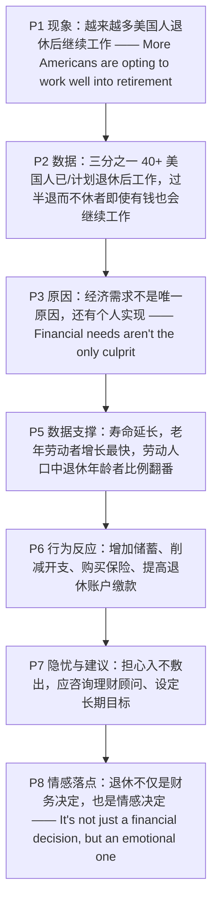

# 退而不休：美国人退休后继续工作的趋势 精读笔记

---

## 背景

本文选自 **2022 年考研英语（一）Text 2**，主题为**越来越多美国人选择"退而不休"（unretirement）**。文章从一项民意调查切入，指出"退休后继续工作"已从个别现象变成**增长趋势**，随后分析其**原因**（经济需求、个人实现、寿命延长），并落到**储蓄行为**与**理财建议**上，最后用受访者的话点出退休决定背后的**情感维度**。

文章沿"**现象引入 → 原因分析 → 数据支撑 → 行为反应 → 隐忧与建议 → 情感总结**"的链条展开：

- **现象引入**：越来越多美国人选择退休后继续工作，这一趋势可能**颠覆传统劳动力模式**（P1）；三分之一 40 岁以上美国人已或计划在退休后工作，"退而不休者"中过半即使有钱也会继续工作（P2）。
- **原因分析**：经济需求不是唯一原因，**个人实现**（保持头脑健康、防止无聊、避免抑郁）同样重要（P3）；退休概念正在**演变**，工作的价值本身也在驱动人们（P4）。
- **数据支撑**：美国人更长寿，老年劳动者是劳动力中**增长最快的群体**；过去三十年劳动人口中退休年龄者比例**翻番**（P5）。
- **行为反应**：由于寿命延长，美国人**增加储蓄**以保住养老钱，十分之六的"退而不休者"在增加储蓄（P6）。
- **隐忧与建议**：不少人是因为担心晚年**入不敷出**才继续工作，理财顾问建议**提前设定长期财务目标**（P7）。
- **情感总结**：退休不仅是财务决定，更是**情感决定**，许多人认为自己"无法退休"（P8）。

**难度说明**：中等。句式以**定语从句（who / that / which）**、**省略 that 的宾语从句**、**表语前置倒装**、**破折号同位语**、**插入主谓**、**非谓语动词**（动名词作介词宾语、不定式作目的状语、过去分词作后置定语）与**虚拟语气**（suggest + should；even if + 过去式）为主；论证上属于"**社会趋势 + 数据 + 建议**"的**社会 / 经济类说明文**，适合练习**原因归纳**、**数据定位**与**观点态度判断**。

---

## 文章原文

More Americans are **opting** to work well into retirement, a growing trend that threatens to **upend** the old workforce model.

> [!abstract]- 长难句分析
> **原句**：More Americans are opting to work well into retirement, a growing trend that threatens to upend the old workforce model.
>
> **主干提取**：
>
> - 主语 S: More Americans
> - 谓语 V: are opting
> - 宾语 O: to work well into retirement（不定式作宾语）
> - 程度状语 A: well into retirement（well 修饰介词短语，表"远远进入"）
>
> **修饰成分**：
>
> | 类型 | 引导词 / 形式 | 修饰对象 |
> |------|--------------|----------|
> | 同位语 | a growing trend | 前文整句内容 |
> | 定语从句 | that | a growing trend |
> | 不定式作宾语 | to upend | threatens |
> | 介词短语作状语 | well into | work |
>
> **结构图解**：
>
> ```
> 主句: More Americans + are opting + 〔to work well into retirement〕
>   └── 同位语: a growing trend〔= 前文整句〕
>         └── 定从: that + threatens + 〔to upend the old workforce model〕
>               └── 不定式宾语: to upend + the old workforce model
> ```
>
> **参考译文**：越来越多的美国人选择在退休之后继续工作很久，这一日益增长的趋势有可能颠覆传统的劳动力模式。
>
> **考点提示**：① 主干是 `More Americans are opting to work`，`opt to do` 中的不定式作**宾语**，不是目的状语。② 逗号后的 `a growing trend` 是**同位语**，指代前面整句内容（不是修饰 retirement）。③ `that threatens to upend …` 是**限制性定语从句**修饰 `a growing trend`，`threaten to do` 在新闻英语中常表"**有可能造成（不良后果）**"，不能译成"威胁要……"。

One in three Americans who are at least 40 have, or plan to have a job in retirement to prepare for a longer life, according to a survey conducted by Harris Poll for TD Ameritrade.

> [!abstract]- 长难句分析
> **原句**：One in three Americans who are at least 40 have, or plan to have a job in retirement to prepare for a longer life, according to a survey conducted by Harris Poll for TD Ameritrade.
>
> **主干提取**：
>
> - 主语 S: One in three Americans
> - 谓语 V: have, or plan to have（并列谓语）
> - 宾语 O: a job
> - 目的状语 A: to prepare for a longer life
> - 来源状语 A: according to a survey …
>
> **修饰成分**：
>
> | 类型 | 引导词 / 形式 | 修饰对象 |
> |------|--------------|----------|
> | 定语从句 | who | Americans |
> | 不定式作宾语 | to have | plan |
> | 不定式作目的状语 | to prepare for | have / plan to have a job |
> | 介词短语作后置定语 | in retirement | a job |
> | 过去分词短语作后置定语 | conducted by | a survey |
> | 介词短语作状语 | according to | 全句 |
>
> **结构图解**：
>
> ```
> 主句: One in three Americans + have, or plan to have + a job
>   ├── 定从: who + are + at least 40 → 修饰 Americans
>   ├── 后置定语: in retirement → 修饰 a job
>   ├── 目的状语: to prepare for + a longer life
>   └── 来源状语: according to + a survey〔conducted by Harris Poll for TD Ameritrade〕
>         └── 过去分词后置定语: conducted by + 施动者
> ```
>
> **参考译文**：哈里斯民意调查公司为 TD Ameritrade 所做的一项调查显示，在 40 岁及以上的美国人中，每三人就有一人已经在退休后工作，或者计划在退休后工作，为更长的寿命做准备。
>
> **考点提示**：① **主谓一致**：`one in three + 复数名词` 作主语时，谓语常与复数名词保持一致，故此处用 `have`（也可用单数 `has`，取决于作者把 "one" 还是 "Americans" 视为核心）。② `have, or plan to have` 是**两个并列谓语**，中间用逗号 + `or` 隔开，不要误把 `plan` 当主语。③ `conducted by …` 是**过去分词短语作后置定语**，修饰 `a survey`，与 `survey` 构成被动关系。④ `according to …` 是**插入的来源状语**，可移至句首理解。

Even more surprising is that more than half of "unretirees"—those who plan to work in retirement or went back to work after retiring—said they would be employed in their later years even if they had enough money to settle down, the survey showed.

> [!abstract]- 长难句分析
> **原句**：Even more surprising is that more than half of "unretirees"—those who plan to work in retirement or went back to work after retiring—said they would be employed in their later years even if they had enough money to settle down, the survey showed.
>
> **主干提取**：
>
> - 表语 C（前置）: even more surprising
> - 系动词 V: is
> - 主语 S: that more than half of "unretirees" … said …（that 从句作主语）
> - that 从句主干: more than half of "unretirees" + said + 〔they would be employed …〕
> - 插入主谓: the survey showed
>
> **修饰成分**：
>
> | 类型 | 引导词 / 形式 | 修饰对象 |
> |------|--------------|----------|
> | 表语前置倒装 | Even more surprising is … | 强调表语 |
> | 破折号同位语 | —those …— | "unretirees" |
> | 定语从句 | who | those |
> | 省略 that 的宾语从句 | said | they would be employed … |
> | 让步状语从句 | even if | would be employed |
> | 插入主谓 | the survey showed | 全句（信息来源） |
> | 介词短语作时间状语 | in their later years | would be employed |
>
> **结构图解**：
>
> ```
> 主句（完全倒装）: Even more surprising + is + 〔that 从句作主语〕
>   └── that 从句: more than half of "unretirees" + said + 〔宾语从句〕
>         ├── 同位语（破折号）: those〔who 从句〕→ 解释 unretirees
>         │     └── 定从: who + plan to work … or went back to work …
>         ├── 宾语从句（省略 that）: they + would be employed + in their later years
>         │     └── 让步状从（虚拟）: even if + they had + enough money〔to settle down〕
>         └── 插入主谓: the survey showed
> ```
>
> **参考译文**：更令人惊讶的是，该调查显示，超过半数的"退而不休者"——即计划在退休后工作、或在退休后重返职场的人——表示，即使他们有足够的钱安顿下来，也会在晚年继续就业。
>
> **考点提示**：① 全句是**完全倒装**：正常语序为 `That … is even more surprising`，作者把表语 `Even more surprising` 提前以承接上文、强调递进。② 破折号之间是 `"unretirees"` 的**同位语**，其中 `who plan … or went back …` 是**两个并列谓语**，时态分别为一般现在时和一般过去时。③ `said` 后是**省略 that 的宾语从句**，`they would be employed` 中的 `would` 表过去将来，**不是虚拟语气**；真正的虚拟在 `even if they had`（与现在事实相反）。④ 句末 `the survey showed` 是**插入的主谓结构**，不是并列句，阅读时先剔除。

Financial needs aren't the only **culprit** for the "**unretirement**" trend. Other reasons, according to the study, include **personal fulfillment** such as staying mentally fit, preventing **boredom** or avoiding **depression**.

> [!abstract]- 长难句分析
> **原句**：Other reasons, according to the study, include personal fulfillment such as staying mentally fit, preventing boredom or avoiding depression.
>
> **主干提取**：
>
> - 主语 S: Other reasons
> - 谓语 V: include
> - 宾语 O: personal fulfillment
>
> **修饰成分**：
>
> | 类型 | 引导词 / 形式 | 修饰对象 |
> |------|--------------|----------|
> | 插入语 | according to the study | 全句（信息来源） |
> | 介词短语作举例 | such as | personal fulfillment |
> | 动名词并列 | staying / preventing / avoiding | such as 的宾语 |
>
> **结构图解**：
>
> ```
> 主句: Other reasons + include + personal fulfillment
>   ├── 插入语: according to + the study
>   └── 举例: such as + 〔staying mentally fit〕, 〔preventing boredom〕 or 〔avoiding depression〕
>         └── 三个动名词并列，共用 such as
> ```
>
> **参考译文**：该研究指出，其他原因还包括个人实现感，例如保持头脑健康、防止无聊或避免抑郁。
>
> **考点提示**：① `according to the study` 是**插入语**，去掉后主干 `Other reasons include personal fulfillment` 依然完整。② `such as` 后接**三个并列动名词短语**，最后一个由 `or` 连接，不是三个独立句子。③ 主语 `reasons` 为复数，谓语用 `include`（**主谓一致**），不要被插入语干扰。

"The concept of retirement is **evolving**," said Christine Russell, senior manager of retirement at TD Ameritrade. "It's not just about finances. The value of work is also driving folks to continue working past retirement."

One reason for the change in retirement patterns: Americans are living longer. Older Americans are also the fastest-growing **segment** of the U.S. workforce. The **percentage** of retirement-age people in the labor force has **doubled** over the past three decades.

> [!abstract]- 长难句分析
> **原句**：The percentage of retirement-age people in the labor force has doubled over the past three decades.
>
> **主干提取**：
>
> - 主语 S: The percentage
> - 谓语 V: has doubled
> - 时间状语 A: over the past three decades
>
> **修饰成分**：
>
> | 类型 | 引导词 / 形式 | 修饰对象 |
> |------|--------------|----------|
> | 介词短语作后置定语 | of retirement-age people | The percentage |
> | 介词短语作后置定语 | in the labor force | retirement-age people |
> | 介词短语作时间状语 | over | the past three decades |
>
> **结构图解**：
>
> ```
> 主句: The percentage + has doubled + 〔over the past three decades〕
>   └── 后置定语: of + retirement-age people
>         └── 后置定语: in + the labor force
> ```
>
> **参考译文**：过去三十年间，劳动人口中达到退休年龄者的比例翻了一番。
>
> **考点提示**：① 主语中心词是 `The percentage`（单数），故谓语用 `has doubled`；`of retirement-age people in the labor force` 是**两层后置定语**，不要误把 `people` 当主语。② `double` 作动词表示"**翻一番**"，`has doubled` 是**现在完成时**，与 `over the past three decades` 搭配。③ 翻译时中文习惯把时间状语前置："过去三十年间……翻了一番"。

About 20% of people 65 and older were in the workforce in February 2019, up from an all-time low of 10% in January 1985, according to money manager United Income.

> [!abstract]- 长难句分析
> **原句**：About 20% of people 65 and older were in the workforce in February 2019, up from an all-time low of 10% in January 1985, according to money manager United Income.
>
> **主干提取**：
>
> - 主语 S: About 20% of people 65 and older
> - 系动词 V: were
> - 表语 C: in the workforce
> - 时间状语 A: in February 2019
>
> **修饰成分**：
>
> | 类型 | 引导词 / 形式 | 修饰对象 |
> |------|--------------|----------|
> | 后置定语（省略 who are） | 65 and older | people |
> | 插入的比较结构 | up from | About 20% |
> | 介词短语作后置定语 | of 10% | an all-time low |
> | 时间状语 | in January 1985 | an all-time low |
> | 来源状语 | according to | 全句 |
>
> **结构图解**：
>
> ```
> 主句: About 20% of people〔65 and older〕+ were + in the workforce
>   ├── 时间状语: in February 2019
>   ├── 插入比较: up from + an all-time low〔of 10%〕
>   │     └── 时间状语: in January 1985
>   └── 来源状语: according to + money manager United Income
> ```
>
> **参考译文**：据资金管理公司 United Income 的数据，2019 年 2 月，65 岁及以上人口中约有 20% 仍在劳动力队伍中，高于 1985 年 1 月 10% 的历史最低点。
>
> **考点提示**：① `people 65 and older` 是**省略了 who are 的后置定语**，`65 and older` 直接修饰 `people`，是新闻英语的压缩写法。② 主语含百分比 `20% of people`，谓语用复数 `were`（**主谓一致**）。③ `up from …` 是**插入的比较结构**，`up` 为副词，`from` 后接比较基准；它不是谓语，全句只有 `were` 一个谓语。④ `according to …` 是**来源状语**，翻译时通常前置。

Because of longer **life spans**, Americans are also **boosting** their savings to preserve their **nest eggs**, the TD Ameritrade study showed, which surveyed 2,000 adults between 40 to 79.

> [!abstract]- 长难句分析
> **原句**：Because of longer life spans, Americans are also boosting their savings to preserve their nest eggs, the TD Ameritrade study showed, which surveyed 2,000 adults between 40 to 79.
>
> **主干提取**：
>
> - 主语 S: Americans
> - 谓语 V: are boosting
> - 宾语 O: their savings
> - 原因状语 A: Because of longer life spans
> - 目的状语 A: to preserve their nest eggs
>
> **修饰成分**：
>
> | 类型 | 引导词 / 形式 | 修饰对象 |
> |------|--------------|----------|
> | 介词短语作原因状语 | Because of | 全句 |
> | 不定式作目的状语 | to preserve | are boosting |
> | 插入主谓 | the TD Ameritrade study showed | 全句（信息来源） |
> | 非限制性定语从句 | which | the TD Ameritrade study |
>
> **结构图解**：
>
> ```
> 主句: Americans + are boosting + their savings
>   ├── 原因状语: Because of + longer life spans
>   ├── 目的状语: to preserve + their nest eggs
>   ├── 插入主谓: the TD Ameritrade study showed → 信息来源
>   └── 非限制性定从: which + surveyed + 2,000 adults〔between 40 to 79〕
> ```
>
> **参考译文**：TD Ameritrade 的这项研究调查了 2,000 名 40 至 79 岁的成年人，研究显示，由于寿命延长，美国人也在增加储蓄以保住自己的养老钱。
>
> **考点提示**：① 句子被切成五段：主干 + 原因状语 + 目的状语 + 插入主谓 + 非限制性定语从句，**主干只有 `Americans are boosting their savings`**。② `Because of + 名词短语` 表原因，若接句子须用 `because`，这是**介词短语 vs 状语从句**的常考点。③ `which surveyed …` 是**非限制性定语从句**，`which` 指代 `the TD Ameritrade study`，`surveyed` 是谓语，不是过去分词。④ `the TD Ameritrade study showed` 是**插入的主谓结构**，不是并列句。

Six in 10 "unretirees" are increasing their savings in **anticipation** of a longer life. Among the most popular ways they are doing this, the company said, is by reducing their overall **expenses**, securing life insurance or **maximizing** their contributions to retirement accounts.

> [!abstract]- 长难句分析
> **原句**：Among the most popular ways they are doing this, the company said, is by reducing their overall expenses, securing life insurance or maximizing their contributions to retirement accounts.
>
> **主干提取**：
>
> - 表语 C（前置）: Among the most popular ways they are doing this
> - 系动词 V: is
> - 主语 S: by reducing their overall expenses, securing life insurance or maximizing their contributions to retirement accounts（介词短语作主语）
> - 插入主谓: the company said
>
> **修饰成分**：
>
> | 类型 | 引导词 / 形式 | 修饰对象 |
> |------|--------------|----------|
> | 表语前置倒装 | Among … is … | 强调表语 |
> | 省略关系词的定语从句 | (that / in which) they are doing this | ways |
> | 插入主谓 | the company said | 全句（信息来源） |
> | 动名词并列 | reducing / securing / maximizing | 介词 by |
> | 介词短语作后置定语 | to retirement accounts | contributions |
>
> **结构图解**：
>
> ```
> 主句（倒装）: Among the most popular ways + is + 〔by + 三个动名词〕
>   ├── 定语从句（省略关系词）: they + are doing + this → 修饰 ways
>   ├── 插入主谓: the company said
>   └── 主语（介词短语）: by + 〔reducing their overall expenses〕, 〔securing life insurance〕 or 〔maximizing their contributions〕
>         └── 后置定语: to + retirement accounts
> ```
>
> **参考译文**：该公司表示，他们最常用的做法包括削减总体开支、购买人寿保险，或尽量提高对退休账户的缴款额。
>
> **考点提示**：① 这是**表语前置的完全倒装**：正常语序为 `By reducing …, securing … or maximizing … is among the most popular ways they are doing this`。② `they are doing this` 是**省略关系词的定语从句**修饰 `ways`（= the ways in which they are doing this）。③ `by` 后接**三个并列动名词**，最后一项由 `or` 连接；`securing life insurance` 不是谓语。④ `the company said` 是**插入主谓**，阅读时先剔除。

Unfortunately, many people who are opting to work in retirement are preparing to do so because they are worried about **making ends meet** in their later years, said Brent Weiss, a co-founder at Baltimore-based financial-planning firm Facet Wealth.

> [!abstract]- 长难句分析
> **原句**：Unfortunately, many people who are opting to work in retirement are preparing to do so because they are worried about making ends meet in their later years, said Brent Weiss, a co-founder at Baltimore-based financial-planning firm Facet Wealth.
>
> **主干提取**：
>
> - 谓语 V: said
> - 主语 S: Brent Weiss（引语动词后置，主语在后）
> - 宾语 O: 前面整个引语内容（宾语前置）
> - 引语部分主干: many people + are preparing + to do so
> - 引语部分原因状语: because they are worried about making ends meet
>
> **修饰成分**：
>
> | 类型 | 引导词 / 形式 | 修饰对象 |
> |------|--------------|----------|
> | 引语倒装 | …, said Brent Weiss | 新闻报道句式 |
> | 定语从句 | who | many people |
> | 不定式作宾语 | to do so | preparing |
> | 原因状语从句 | because | are preparing to do so |
> | 动名词作介词宾语 | making ends meet | about |
> | 时间状语 | in their later years | making ends meet |
> | 同位语 | a co-founder at … | Brent Weiss |
> | 复合形容词 | Baltimore-based / financial-planning | firm |
>
> **结构图解**：
>
> ```
> 主句（引语倒装）: 〔引语内容〕+ said + Brent Weiss〔同位语〕
>   ├── 引语主干: many people + are preparing + 〔to do so〕
>   │     ├── 定从: who + are opting to work + in retirement → 修饰 people
>   │     └── 原因状从: because + they are worried about + 〔making ends meet〕
>   │           └── 时间状语: in their later years
>   └── 同位语: a co-founder at + Baltimore-based financial-planning firm Facet Wealth
> ```
>
> **参考译文**：不幸的是，巴尔的摩理财规划公司 Facet Wealth 的联合创始人布伦特·韦斯说，许多选择退休后工作的人之所以做准备，是因为他们担心晚年入不敷出。
>
> **考点提示**：① 全句是**引语前置 + 主谓倒装**：`…, said Brent Weiss, …`，正常语序为 `Brent Weiss said …`。② 引语部分是长主语结构：`many people` 后接 `who` 定语从句，真正的谓语是 `are preparing`，不要被从句谓语 `are opting` 带偏。③ `because` 引导**原因状语从句**，`about` 后接**动名词** `making ends meet`（固定习语，意为"收支相抵"）。④ 逗号后 `a co-founder at …` 是 `Brent Weiss` 的**同位语**，`Baltimore-based`、`financial-planning` 均为**复合形容词**。

He suggested that **preretirees** should speak with a financial **advisor** to set long-term financial goals.

> [!abstract]- 长难句分析
> **原句**：He suggested that preretirees should speak with a financial advisor to set long-term financial goals.
>
> **主干提取**：
>
> - 主语 S: He
> - 谓语 V: suggested
> - 宾语 O: that preretirees should speak with a financial advisor …（宾语从句）
> - 从句主干: preretirees + should speak + with a financial advisor
> - 目的状语 A: to set long-term financial goals
>
> **修饰成分**：
>
> | 类型 | 引导词 / 形式 | 修饰对象 |
> |------|--------------|----------|
> | 宾语从句 | that | suggested |
> | 虚拟语气 | should + 动词原形 | 宾语从句谓语 |
> | 不定式作目的状语 | to set | should speak |
> | 复合形容词 | long-term | financial goals |
>
> **结构图解**：
>
> ```
> 主句: He + suggested + 〔that 宾语从句〕
>   └── 宾语从句: preretirees + should speak + with a financial advisor
>         └── 目的状语: to set + long-term financial goals
> ```
>
> **参考译文**：他建议临近退休的人应与理财顾问沟通，设定长期财务目标。
>
> **考点提示**：① `suggest` 表"**建议**"时，后接 `that` 从句用**虚拟语气** `(should) + 动词原形`，美式英语中 `should` 常省略，写成 `suggested that preretirees speak …`。② 若 `suggest` 表"暗示、表明"，则从句用**陈述语气**，这是考研高频辨析点。③ `to set long-term financial goals` 是**不定式作目的状语**，不是宾语。

"The most challenging moments in life are getting married, starting a family and ultimately retiring," Weiss said. "It's not just a financial decision, but an **emotional** one. Many people believe they can't retire."

## 题目

### 26. The survey conducted by Harris Poll indicates that ____.

- [A] over half of the retirees are physically fit for work
- [B] the old workforce is as active as the younger one
- [C] one in three Americans enjoy earlier retirement
- [D] more Americans are willing to work in retirement

### 27. It can be inferred from Paragraph 3 that Americans tend to think that ____.

- [A] retirement may cause problems for them
- [B] boredom can be relieved after retirement
- [C] the mental health of retirees is overlooked
- [D] "unretirement" contributes to the economy

### 28. Retirement patterns are changing partly due to ____.

- [A] labor shortages
- [B] population growth
- [C] longer life expectancy
- [D] rising living costs

### 29. Many "unretirees" are increasing their savings by ____.

- [A] investing more in stocks
- [B] taking up odd jobs
- [C] getting well-paid work
- [D] spending less

### 30. With regard to retirement, Brent Weiss thinks that many people are ____.

- [A] unprepared
- [B] unafraid
- [C] disappointed
- [D] enthusiastic

---

## 翻译对照

## Paragraph 1

More Americans are opting to work well into retirement, a growing trend that threatens to upend the old workforce model.

越来越多的美国人选择在退休之后继续工作很久，这一日益增长的趋势有可能颠覆传统的劳动力模式。

> [!note] 翻译说明
> - `opt to do` = "选择做某事"，比 `choose` 更强调在多个选项中主动做出决定。
> - `work well into retirement` = "工作到退休之后很久"，`well into` = "深深地进入……、直到……之后很久"。
> - `upend` = "颠覆、推翻"，原义为"把……倒过来"，此处强调足以改写既有模式。

## Paragraph 2

One in three Americans who are at least 40 have, or plan to have a job in retirement to prepare for a longer life, according to a survey conducted by Harris Poll for TD Ameritrade. Even more surprising is that more than half of "unretirees"—those who plan to work in retirement or went back to work after retiring—said they would be employed in their later years even if they had enough money to settle down, the survey showed.

哈里斯民意调查公司为 TD Ameritrade 所做的一项调查显示，在 40 岁及以上的美国人中，每三人就有一人已经在退休后工作，或者计划在退休后工作，为更长的寿命做准备。更令人惊讶的是，该调查显示，超过半数的"退而不休者"——即计划在退休后工作、或在退休后重返职场的人——表示，即使他们有足够的钱安顿下来，也会在晚年继续就业。

> [!note] 翻译说明
> - `One in three` = "三分之一"，英语中分数比例的常用表达。
> - `unretirees` = "退而不休者"，由 `un-` + `retiree` 构成，指退休后重返或继续工作的人，与下文的 `unretirement` 同源。
> - `even if they had enough money to settle down` = "即使他们有足够的钱安顿下来"，`even if` 引导让步状语从句，用虚拟语气表示假设。
> - `settle down` = "安定下来、安顿"，此处指退休后安稳度日。

## Paragraph 3

Financial needs aren't the only culprit for the "unretirement" trend. Other reasons, according to the study, include personal fulfillment such as staying mentally fit, preventing boredom or avoiding depression.

经济需求并不是"退而不休"趋势的唯一原因。该研究指出，其他原因还包括个人实现感，例如保持头脑健康、防止无聊或避免抑郁。

> [!note] 翻译说明
> - `culprit` = "罪魁祸首、原因"，本义为"罪犯"，此处用作比喻，指造成某种现象的原因。
> - `personal fulfillment` = "个人成就感、自我实现"，`fulfillment` 强调需求得到满足后的充实感。
> - `staying mentally fit` = "保持头脑健康"，与 `physically fit`（身体健康）形成对照。

## Paragraph 4

"The concept of retirement is evolving," said Christine Russell, senior manager of retirement at TD Ameritrade. "It's not just about finances. The value of work is also driving folks to continue working past retirement."

"退休的概念正在演变，"TD Ameritrade 退休业务高级经理克里斯汀·拉塞尔说。"这不仅仅关乎金钱。工作的价值也在推动人们退休后继续工作。"

> [!note] 翻译说明
> - `evolving` = "演变、逐步发展"，强调缓慢而持续的变化，比 `changing` 更正式。
> - `not just about finances` = "不仅仅是钱的问题"，`finances` 指财务状况、经济条件。
> - `driving folks to` = "推动人们去……"，`drive` 在此处表示"驱使、促使"。

## Paragraph 5

One reason for the change in retirement patterns: Americans are living longer. Older Americans are also the fastest-growing segment of the U.S. workforce. The percentage of retirement-age people in the labor force has doubled over the past three decades. About 20% of people 65 and older were in the workforce in February 2019, up from an all-time low of 10% in January 1985, according to money manager United Income.

退休模式发生变化的一个原因是：美国人活得更久了。老年美国人也是美国劳动力中增长最快的群体。过去三十年间，劳动人口中达到退休年龄者的比例翻了一番。据资金管理公司 United Income 的数据，2019 年 2 月，65 岁及以上人口中约有 20% 仍在劳动力队伍中，高于 1985 年 1 月 10% 的历史最低点。

> [!note] 翻译说明
> - `retirement patterns` = "退休模式"，`pattern` 指反复出现的行为方式或结构。
> - `fastest-growing segment` = "增长最快的群体"，`segment` 指整体中的一部分。
> - `up from an all-time low of ...` = "高于……的历史最低点"，`up from` 表示从较低水平上升。
> - `labor force` = "劳动力、劳动人口"，为固定搭配。

## Paragraph 6

Because of longer life spans, Americans are also boosting their savings to preserve their nest eggs, the TD Ameritrade study showed, which surveyed 2,000 adults between 40 to 79. Six in 10 "unretirees" are increasing their savings in anticipation of a longer life. Among the most popular ways they are doing this, the company said, is by reducing their overall expenses, securing life insurance or maximizing their contributions to retirement accounts.

TD Ameritrade 的这项研究调查了 2,000 名 40 至 79 岁的成年人，研究显示，由于寿命延长，美国人也在增加储蓄以保住自己的养老钱。十分之六的"退而不休者"正因预期寿命更长而增加储蓄。该公司表示，他们最常用的做法包括削减总体开支、购买人寿保险，或尽量提高对退休账户的缴款额。

> [!note] 翻译说明
> - `life spans` = "寿命、寿命长度"。
> - `nest eggs` = "养老钱、储蓄金"，源自"巢中之卵"的比喻，指为将来储备的钱。
> - `in anticipation of` = "预期、预料到……而"，表示为将来可能发生的事做准备。
> - `maximizing their contributions to retirement accounts` = "最大化对退休账户的缴款"，`contribution` 在养老金语境中特指"缴款"。

## Paragraph 7

Unfortunately, many people who are opting to work in retirement are preparing to do so because they are worried about making ends meet in their later years, said Brent Weiss, a co-founder at Baltimore-based financial-planning firm Facet Wealth. He suggested that preretirees should speak with a financial advisor to set long-term financial goals.

不幸的是，巴尔的摩理财规划公司 Facet Wealth 的联合创始人布伦特·韦斯说，许多选择退休后工作的人之所以做准备，是因为他们担心晚年入不敷出。他建议临近退休的人应与理财顾问沟通，设定长期财务目标。

> [!note] 翻译说明
> - `making ends meet` = "使收支相抵、勉强维持生计"，固定习语。
> - `preretirees` = "临近退休者"，`pre-` 表示"在……之前"。
> - `Baltimore-based` = "总部位于巴尔的摩的"，`-based` 表示"以……为基地的"。
> - `financial advisor` = "理财顾问、财务顾问"。

## Paragraph 8

"The most challenging moments in life are getting married, starting a family and ultimately retiring," Weiss said. "It's not just a financial decision, but an emotional one. Many people believe they can't retire."

"人生中最具挑战性的时刻是结婚、组建家庭，以及最终退休，"韦斯说。"这不仅是财务决定，也是情感决定。许多人认为自己无法退休。"

> [!note] 翻译说明
> - `starting a family` = "组建家庭"，通常指生育子女。
> - `not just ... but ...` = "不仅是……而且是……"，递进结构。
> - `an emotional one` = "一个情感上的决定"，`one` 替代前文的 `decision`，避免重复。

## 题目翻译

### 26. 哈里斯民意调查公司开展的调查表明 ____。

- [A] 超过半数的退休者身体状况适合工作
- [B] 老年劳动力与年轻劳动力一样活跃
- [C] 三分之一的美国人享受较早退休
- [D] 更多美国人愿意在退休后继续工作

### 27. 从第三段可以推断出，美国人倾向于认为 ____。

- [A] 退休可能给他们带来问题
- [B] 退休后无聊感可以缓解
- [C] 退休者的心理健康被忽视
- [D] "退而不休"对经济有贡献

### 28. 退休模式正在发生变化，部分原因是 ____。

- [A] 劳动力短缺
- [B] 人口增长
- [C] 预期寿命延长
- [D] 生活成本上升

### 29. 许多"退而不休者"通过 ____ 来增加储蓄。

- [A] 更多地投资股票
- [B] 打零工
- [C] 从事高薪工作
- [D] 减少开支

### 30. 关于退休，布伦特·韦斯认为许多人是 ____。

- [A] 没有准备好的
- [B] 不害怕的
- [C] 失望的
- [D] 热情的

---

## 语法要点

> [!note] 来源说明
> 本篇**用户未提供语法源笔记**，以下语法点由 `formatted-article.md` 与 `translation.md` **从本文推断提取**，仅收录本篇实际出现的语法现象。
> 每一条均给出**原文语境**，便于回原文核对；标注"（联动）"的条目与相邻专题互为参照。
> 固定搭配与词组见 [[intermediate/2022-passage2-unretirement/固定搭配与词组笔记.md|2022 Passage 2 固定搭配与词组]]。

---

## 一、从句

### 从句：限制性定语从句（who 引导，指人）

**概述**：`who` 引导**限制性定语从句**，修饰前面的**人**，起限定作用，**不能用逗号隔开**，去掉后先行词范围会改变。

| 结构 | 用法 | 例句 |
|------|------|------|
| `Americans + who + be + 年龄` | who 作从句主语 | One in three Americans **who are at least 40** have, or plan to have, a job in retirement … |
| `those + who + 动词并列` | who 作从句主语，从句内两个谓语并列 | those **who plan to work in retirement or went back to work after retiring** |
| `people + who + be opting to do` | who 作从句主语 | many people **who are opting to work in retirement** |

> [!tip] 阅读技巧
> 三个 `who` 从句都是**限定范围**：第一句把 "Americans" 限定为"40 岁及以上者"，第二句用破折号插入给 `unretirees` 下定义，第三句限定"选择退休后工作的人"。找主干时先把 `who ...` 整体括起，主句分别为 `One in three Americans … have, or plan to have, a job`、`those … said …`、`many people … are preparing to do so`。
>
> [!warning] 易错点
> 第二句 `who plan to work in retirement **or went back to work** after retiring` 中，`plan` 与 `went` 共用 `who` 作主语，是**两个并列谓语**（时态不同：一般现在 / 一般过去），不要误判为 `who plan … or (who) went …` 两个从句。

### 从句：限制性定语从句（that 引导，作主语）

**概述**：`that` 引导**限制性定语从句**，在从句中作**主语**，紧跟先行词，**不可省略、不可加逗号**。

| 结构 | 用法 | 例句 |
|------|------|------|
| `a growing trend + that + threatens to do` | that 作从句主语 | a growing trend **that threatens to upend the old workforce model** |

> [!note] 补充说明
> 该从句紧跟同位语 `a growing trend`，而 `a growing trend` 本身又是前面整句的同位语。阅读时主干是 `More Americans are opting to work well into retirement`，其余全是**层层追加的补充信息**。

### 从句：非限制性定语从句（which 引导）

**概述**：`, which ...` 用逗号与主句隔开，对前面内容作**补充说明**；此处 `which` 指代前面的 `the TD Ameritrade study`。

| 结构 | 用法 | 例句 |
|------|------|------|
| `, which + surveyed + 对象` | which 指代前文名词，补充说明 | … the TD Ameritrade study showed, **which surveyed 2,000 adults between 40 to 79**. |

> [!tip] 阅读技巧
> 本句主干被三部分切断：`the TD Ameritrade study showed`（插入的主谓）+ `, which surveyed …`（非限制性定语从句）。真正的句子主干在最前面：`Americans are also boosting their savings to preserve their nest eggs`。（联动）见 [[语法总结笔记.md|语法总结笔记]] 中"非限制性定语从句"条目。

### 从句：省略 that 的宾语从句

**概述**：`say`、`show`、`believe` 等动词后的**宾语从句**常**省略 that**，从句直接跟在动词后，是考研阅读中最常见的"隐形从句"。

| 结构 | 用法 | 例句 |
|------|------|------|
| `said + (that) + 从句` | 省略 that 的宾语从句 | … said **they would be employed in their later years** … |
| `the survey showed + (that) + 从句` | 省略 that，且主谓插入 | …, **the survey showed**. |
| `Many people believe + (that) + 从句` | 省略 that 的宾语从句 | Many people believe **they can't retire**. |
| `said Brent Weiss, …` | 引语动词 + 主语后置 | …, **said Brent Weiss**, a co-founder at … |

> [!warning] 易错点
> `the survey showed` 出现在句末，是**插入的主谓结构**（= "调查显示"），不是主句谓语；主句谓语是前面的 `said`。这类"主谓插入"是长难句的高频陷阱，须先剔除再还原主干。

### 从句：that 引导的宾语从句 + should 虚拟

**概述**：`suggest` 表"建议"时，后接 `that` 从句用**虚拟语气** `(should) + 动词原形`，美式英语中 `should` 常省略。

| 结构 | 用法 | 例句 |
|------|------|------|
| `suggested that + sb + should + do` | 建议类动词后的虚拟语气 | He **suggested that** preretirees **should speak** with a financial advisor … |

> [!tip] 记忆方法
> 建议、要求、命令类动词（suggest / advise / demand / require / insist / order / propose）后的 `that` 从句一律用 `(should) + 动词原形`，不受主句时态影响。本句主句是过去时 `suggested`，从句仍用 `should speak`，正是**虚拟语气不随主句时态变化**的证据。

### 从句：even if 引导的让步状语从句（虚拟）

**概述**：`even if` = "即使"，引导**让步状语从句**；本句用 `had`（过去式）表示**与现在事实相反的假设**。

| 结构 | 用法 | 例句 |
|------|------|------|
| `even if + 主语 + 过去式 + 宾语` | 对现在情况的虚拟让步 | … **even if they had** enough money to settle down … |

> [!warning] 易错点
> 此处 `had` 不是过去时叙事，而是**虚拟语气**（事实上他们未必有足够的钱）。与 `although / though` 的区别：`even if` 强调"即便是假设的情况"，`although` 强调"确实是事实"。（联动）见本笔记"because 引导的原因状语从句"。

### 从句：because 引导的原因状语从句

**概述**：`because` 引导原因状语从句，说明主句动作的**直接原因**；与介词短语 `because of + 名词` 可互换，但后者不能接句子。

| 结构 | 用法 | 例句 |
|------|------|------|
| `because + 主语 + be + 形容词` | 原因状语从句 | … **because they are worried about** making ends meet in their later years |
| `Because of + 名词短语` | 介词短语表原因 | **Because of longer life spans**, Americans are also boosting their savings … |

> [!tip] 阅读技巧
> 两个原因表达在同一篇中交替出现，是命题点（第 28 题问 changing 的原因，第 30 题涉及 Weiss 对"没准备好"的判断）。看到 `because / because of` 立刻标注**因果箭头**，回原文定位最快。

---

## 二、非谓语动词

### 非谓语：动名词作介词宾语

**概述**：介词后必须接**名词性成分**，动词须变为**动名词（doing）**；这是"介词 + doing"结构的核心判据。

| 结构 | 用法 | 例句 |
|------|------|------|
| `worried about + doing` | 动名词作 about 的宾语 | … worried about **making ends meet** in their later years |
| `in anticipation of + 名词` | 介词短语表预期 | … in **anticipation** of a longer life |
| `by + doing` | 方式状语 | … is **by reducing** their overall expenses, **securing** life insurance or **maximizing** their contributions … |

> [!warning] 易错点
> `by reducing …, securing … or maximizing …` 是**三个动名词并列**，共用介词 `by`；最后一项前的 `or` 不是并列句子，而是并列动名词短语。不要把 `securing life insurance` 误读为谓语。

### 非谓语：动名词并列作 such as 的宾语

**概述**：`such as` 后接**名词或动名词**，用于举例；本句三个动名词短语并列，列举"个人实现感"的具体形式。

| 结构 | 用法 | 例句 |
|------|------|------|
| `such as + doing A, doing B or doing C` | 动名词并列举例 | … such as **staying** mentally fit, **preventing** boredom or **avoiding** depression |

> [!tip] 阅读技巧
> `staying / preventing / avoiding` 三个动名词共用一个逻辑主语 `personal fulfillment`（个人实现感），中文可译为"例如保持头脑健康、防止无聊或避免抑郁"。这类并列是**细节题定位点**（第 27 题考"退休可能带来问题"）。

### 非谓语：不定式作目的状语

**概述**：`to do` 放句末或句中，说明动作的**目的**，可译为"为了……"。

| 结构 | 用法 | 例句 |
|------|------|------|
| `have a job … to prepare for …` | 不定式作目的状语 | … have, or plan to have, a job in retirement **to prepare for a longer life** |
| `boosting their savings to preserve …` | 不定式作目的状语 | … boosting their savings **to preserve their nest eggs** |
| `speak with an advisor to set …` | 不定式作目的状语 | … should speak with a financial advisor **to set long-term financial goals** |

> [!note] 补充说明
> 三个不定式都表**目的**，且都紧跟在核心动作之后，是本文"原因—目的"逻辑链的语法载体：为更长寿命做准备 → 为保住养老钱而储蓄 → 为设定长期目标而咨询顾问。

### 非谓语：不定式作宾语（opt / plan / threaten）

**概述**：部分动词后接**不定式作宾语**，如 `opt to do`（选择做）、`plan to do`（计划做）、`threaten to do`（有……的危险/扬言要）。

| 结构 | 用法 | 例句 |
|------|------|------|
| `opt to do` | 选择做某事 | More Americans are **opting to work** well into retirement |
| `plan to have` | 计划拥有 | … or **plan to have** a job in retirement |
| `threatens to upend` | 有颠覆……之势 | a growing trend that **threatens to upend** the old workforce model |
| `preparing to do so` | 准备这样做 | … are **preparing to do so** because … |

> [!tip] 记忆方法
> `threaten to do` 不一定是"威胁"，在新闻英语中常表"**有可能造成（坏事）**"：`a trend that threatens to upend the model` = "有可能颠覆该模式的趋势"。此处 `to upend` 作 `threatens` 的宾语，不是目的状语。

### 非谓语：过去分词短语作后置定语

**概述**：过去分词（`done`）短语置于名词后，表示**被动**或**已完成**，相当于省略了 `which is/was` 的定语从句。

| 结构 | 用法 | 例句 |
|------|------|------|
| `a survey + conducted by + 施动者` | 过去分词短语作后置定语（被动） | a survey **conducted by Harris Poll for TD Ameritrade** |
| `the study + showed, which surveyed …` | 定语从句（对照） | the TD Ameritrade study showed, **which surveyed** 2,000 adults |

> [!warning] 易错点
> `conducted by Harris Poll` 修饰 `a survey`，**不是**谓语；主句谓语是 `have, or plan to have`。判断依据：`a survey` 与 `conduct` 是**被动关系**（调查被开展），故用过去分词而非现在分词。

---

## 三、语态与时态

### 语态：被动语态（would be employed）

**概述**：`be + 过去分词` 构成被动语态；与情态动词连用时为 `情态动词 + be + done`。本句 `would be employed` 表示**过去将来时的被动**。

| 结构 | 用法 | 例句 |
|------|------|------|
| `would be + 过去分词` | 过去将来时被动 | … said they **would be employed** in their later years … |
| `be + 过去分词`（定语） | 被动意义的后置定语 | a survey **conducted** by Harris Poll |

> [!tip] 阅读技巧
> `they would be employed` 是 `said` 的宾语从句，`would` 表示"（当时看来）将会"，不是虚拟语气。区分：`even if they had` 才是虚拟。

### 时态：现在完成时（have doubled）

**概述**：`have/has + 过去分词` 表示**过去发生并持续到现在**或**对现在有影响**；常与 `over the past + 时间段` 连用。

| 结构 | 用法 | 例句 |
|------|------|------|
| `has doubled over the past three decades` | 现在完成时 + 时间范围 | The percentage … **has doubled over the past three decades**. |
| `have, or plan to have` | 现在完成时与一般现在时并列 | One in three Americans … **have, or plan to have**, a job in retirement |

> [!note] 补充说明
> `over the past three decades` 是现在完成时的**标志性时间状语**；`in February 2019`、`in January 1985` 则是**一般过去时**标志（`were`、`was`）。同一段中两种时态交替，正说明"长期趋势"与"具体时点数据"的区别。

---

## 四、倒装与强调

### 倒装：表语前置倒装（Even more surprising is that ...）

**概述**：为强调表语，把**表语提到句首**，系动词 `is` 提前，真正主语（`that` 从句）后置，构成**完全倒装**。

| 结构 | 用法 | 例句 |
|------|------|------|
| `表语 + be + 主语` | 强调表语，主语后置 | **Even more surprising is that** more than half of "unretirees" … said … |

> [!tip] 阅读技巧
> 正常语序是 `That more than half of "unretirees" … said … is even more surprising`。作者把 `Even more surprising` 前置，是为了**承上启下**：上一句讲"三分之一的人"，这一句用"更令人惊讶的是"递进。还原语序后主干是 `that 从句 + is + even more surprising`。

---

## 五、同位语与插入语

### 同位语：破折号同位语

**概述**：破折号之间的内容对前面名词作**解释说明**，既可视为同位语，也可视为插入语；阅读时可先跳过。

| 结构 | 用法 | 例句 |
|------|------|------|
| `名词 — 解释 — 继续` | 破折号插入解释 | more than half of "unretirees"**—those who plan to work in retirement or went back to work after retiring—**said … |

> [!warning] 易错点
> 破折号内是完整定语从句，`said` 才是主句谓语。若误把 `those who …` 当作主语，会找不到谓语。**遇到破折号先括起来**，主干立刻清晰：`more than half of "unretirees" said …`。

### 同位语：人名 + 职位同位语

**概述**：人名后紧跟的名词短语（职位、身份）作**同位语**，补充说明此人身份，常由逗号隔开。

| 结构 | 用法 | 例句 |
|------|------|------|
| `人名, + 职位 + , + said` | 同位语插入，谓语后置 | "…," said Christine Russell, **senior manager of retirement at TD Ameritrade**. |
| `人名, + 身份 + , + said` | 同位语插入 | …, said Brent Weiss, **a co-founder at Baltimore-based financial-planning firm Facet Wealth**. |

> [!tip] 阅读技巧
> 新闻英语的标准写法是 `"引语," said 人名, 同位语`。同位语只提供**身份背景**，不参与句子主干；但常是**细节题/推断题**的定位线索（如第 30 题问 Weiss 的看法）。

### 插入语：冒号解释

**概述**：冒号后内容对前文作**具体解释或列举**，本句用冒号引出"退休模式变化的一个原因"。

| 结构 | 用法 | 例句 |
|------|------|------|
| `One reason for X: + 完整句` | 冒号引出解释 | **One reason for the change in retirement patterns: Americans are living longer.** |

> [!note] 补充说明
> 冒号后的 `Americans are living longer` 是**完整句子**，与冒号前构成"总—分"关系。此类结构在考研阅读中常被设为**因果题**的答案句（第 28 题 C 项 longer life expectancy）。

---

## 六、数量与程度表达

### 数量与程度：分数与比例表达（one in three / six in 10）

**概述**：英语常用 `one in three`、`six in 10` 表示比例，等于 `one third`、`60 percent`；作主语时谓语单复数**取决于 of 后的名词**。

| 结构 | 用法 | 例句 |
|------|------|------|
| `One in three + 复数名词 + 复数谓语` | 三分之一 | **One in three Americans** … **have**, or plan to have, a job … |
| `Six in 10 + 复数名词 + 复数谓语` | 十分之六 | **Six in 10 "unretirees" are** increasing their savings … |
| `more than half of + 名词` | 超过一半 | **more than half of** "unretirees" … said … |
| `About 20% of people + 复数谓语` | 约 20% | **About 20% of people** 65 and older **were** in the workforce … |

> [!tip] 记忆方法
> 比例表达作主语时，谓语与 `of` 后的名词一致（`one in three Americans` → 复数 `have`；`20% of people` → 复数 `were`）。若 `of` 后是不可数名词，则用单数。

### 数量与程度：比较级与 up from 结构

**概述**：`even more + 形容词` 表**递进比较**；`up from + 低点` 表**从较低水平上升**，常与具体数据连用。

| 结构 | 用法 | 例句 |
|------|------|------|
| `even more + 形容词` | 递进比较，"甚至更……" | **Even more surprising** is that … |
| `up from + 名词短语` | 从……上升 | …, **up from an all-time low of 10%** in January 1985 |
| `the fastest-growing + 名词` | 最高级 + 复合形容词 | Older Americans are also **the fastest-growing segment** of the U.S. workforce. |

> [!warning] 易错点
> `up from an all-time low of 10%` 中 `up` 是**副词**，不是动词；整段没有第二个谓语，主句谓语是 `were`。`an all-time low` = "历史最低点"，`all-time` 是复合形容词，必须带连字符。

### 数量与程度：程度副词 well into / even more

**概述**：`well into` 表示"远远进入……之后"，`even more` 表示"甚至更加"，都是**程度强化**手段，常影响推断题的语气判断。

| 结构 | 用法 | 例句 |
|------|------|------|
| `work well into retirement` | well 修饰介词短语，表程度深 | More Americans are opting to work **well into retirement**. |
| `even if` vs `even more` | 让步 vs 递进 | **Even more** surprising is that … / **even if** they had enough money … |

> [!tip] 阅读技巧
> `well into` 强调"退休后很久仍在工作"，比 `after retirement` 语气更强；`even more surprising` 提示**下文是重点信息**，常对应主旨或推断题。

---

## 固定搭配与词组

> [!note] 来源说明
> 本篇固定搭配与词组由 `formatted-article.md` **从本文提取**，仅收录本篇实际出现的表达。
> 纯语法内容见 [[intermediate/2022-passage2-unretirement/grammar-notes.md|2022 Passage 2 语法整理]]。

---

## 一、主题词与核心概念

| 搭配 | 释义 | 原文语境 |
|------|------|----------|
| **unretirement** | 退而不休（退休后继续工作） | the "**unretirement**" trend |
| **unretirees** | 退而不休者 | more than half of "**unretirees**" |
| **preretirees** | 临近退休者 | He suggested that **preretirees** should speak with a financial advisor |
| **workforce model** | 劳动力模式 | threatens to upend the old **workforce model** |
| **retirement pattern** | 退休模式 | One reason for the change in **retirement patterns** |
| **personal fulfillment** | 个人成就感、自我实现 | include **personal fulfillment** such as staying mentally fit |
| **nest egg** | 养老钱、储备金 | boosting their savings to preserve their **nest eggs** |
| **life span** | 寿命 | Because of longer **life spans** |
| **labor force** | 劳动力、劳动人口 | The percentage of retirement-age people in the **labor force** |
| **retirement account** | 退休账户 | maximizing their contributions to **retirement accounts** |
| **financial advisor** | 理财顾问 | speak with a **financial advisor** |
| **financial-planning firm** | 理财规划公司 | Baltimore-based **financial-planning firm** Facet Wealth |

> [!tip] 解题技巧
> 全文围绕"**unretirement（退而不休）**"展开，逻辑链是：**现象**（越来越多美国人退休后继续工作）→ **原因**（经济需求 + 个人实现 + 寿命延长）→ **应对**（增加储蓄、咨询理财顾问）。抓住 `unretirement` 这个词根（`un- + retirement`）即可判断全文态度是**客观描述趋势**，而非批评或赞扬。

## 二、动词短语

| 搭配 | 释义 | 原文语境 |
|------|------|----------|
| **opt to do sth** | 选择做某事 | More Americans are **opting to work** well into retirement |
| **work well into retirement** | 工作到退休之后很久 | are opting to **work well into retirement** |
| **upend the model** | 颠覆模式 | threatens to **upend the old workforce model** |
| **prepare for** | 为……做准备 | to **prepare for** a longer life |
| **settle down** | 安顿下来、安定度日 | enough money to **settle down** |
| **stay mentally fit** | 保持头脑健康 | such as **staying mentally fit** |
| **prevent boredom** | 防止无聊 | **preventing boredom** or avoiding depression |
| **avoid depression** | 避免抑郁 | preventing boredom or **avoiding depression** |
| **drive sb to do** | 驱使某人做某事 | The value of work is also **driving folks to continue** working |
| **double over** | 在……期间翻一番 | has **doubled over** the past three decades |
| **boost one's savings** | 增加储蓄 | Americans are also **boosting their savings** |
| **reduce overall expenses** | 削减总体开支 | by **reducing their overall expenses** |
| **secure life insurance** | 购买人寿保险 | **securing life insurance** |
| **maximize contributions to** | 最大化对……的缴款 | **maximizing their contributions to** retirement accounts |
| **make ends meet** | 收支相抵、勉强维持生计 | worried about **making ends meet** in their later years |
| **set financial goals** | 设定财务目标 | to **set long-term financial goals** |
| **start a family** | 组建家庭 | getting married, **starting a family** and ultimately retiring |

> [!warning] 易错点
> `make ends meet` 是**固定习语**，意为"使收支相抵"，不可按字面理解为"让两端相遇"；`settle down` 在此处指"安顿下来过安稳日子"，不是"定居某地"；`double` 作动词表示"翻一番"（×2），不是"加倍努力"。

## 三、名词短语与介词搭配

| 搭配 | 释义 | 原文语境 |
|------|------|----------|
| **one in three** | 三分之一 | **One in three** Americans who are at least 40 |
| **six in 10** | 十分之六 | **Six in 10** "unretirees" are increasing their savings |
| **more than half of** | 超过一半 | **more than half of** "unretirees" |
| **the fastest-growing segment** | 增长最快的群体 | the **fastest-growing segment** of the U.S. workforce |
| **the percentage of** | ……的比例 | **The percentage of** retirement-age people |
| **over the past three decades** | 过去三十年间 | doubled **over the past three decades** |
| **an all-time low** | 历史最低点 | up from **an all-time low** of 10% |
| **in anticipation of** | 预期到、预料到 | **in anticipation of** a longer life |
| **be worried about** | 担心 | because they are **worried about** making ends meet |
| **at least** | 至少 | Americans who are **at least** 40 |
| **between ... and ...** | 在……之间 | surveyed 2,000 adults **between** 40 **to** 79 |
| **the concept of** | ……的概念 | **The concept of** retirement is evolving |
| **the value of** | ……的价值 | **The value of** work is also driving folks |
| **the change in** | ……方面的变化 | One reason for **the change in** retirement patterns |
| **a survey conducted by** | 由……开展的调查 | according to **a survey conducted by** Harris Poll |
| **be based in** | 总部位于 | Baltimore-**based** financial-planning firm |
| **a co-founder at** | ……的联合创始人 | **a co-founder at** Facet Wealth |
| **senior manager of** | ……高级经理 | **senior manager of** retirement at TD Ameritrade |

> [!warning] 易错点
> `between 40 to 79` 中 `between ... to ...` 属**口语化/非规范搭配**，标准写法是 `between 40 and 79` 或 `from 40 to 79`；考研阅读中遇到只需理解语义，不必模仿。`Baltimore-based` 是"**总部位于巴尔的摩的**"，`-based` 前必须有连字符。

## 四、固定句式与逻辑连接

| 搭配 | 释义 | 原文语境 |
|------|------|----------|
| **Even more surprising is that ...** | 更令人惊讶的是……（表语前置倒装） | **Even more surprising is that** more than half of "unretirees" … |
| **even if** | 即使（让步） | **even if** they had enough money to settle down |
| **not just ... but ...** | 不仅是……而且是…… | **It's not just** a financial decision, **but** an emotional one. |
| **One reason for ... : ...** | ……的一个原因是：…… | **One reason for the change in retirement patterns:** Americans are living longer. |
| **according to** | 根据 | **according to** a survey conducted by Harris Poll |
| **up from** | 从……上升而来 | up **from** an all-time low of 10% |
| **such as** | 例如 | personal fulfillment **such as** staying mentally fit |
| **Among the most popular ways ... is by doing** | 最流行的方式之一是…… | **Among the most popular ways** they are doing this … **is by reducing** their overall expenses |

> [!tip] 阅读技巧
> 本文的**逻辑连接词**是解题关键：`Even more surprising`（递进）→ `aren't the only culprit`（补充原因）→ `One reason ... :`（列举原因）→ `Unfortunately`（转折，引出隐忧）→ `not just ... but ...`（递进）。第 26、27、28、30 题分别对应这些连接词后的信息，定位时优先扫描它们。

## 生词表

### A-C

| 词汇 | 词性 | 含义 | 原文例句 |
|------|------|------|----------|
| **advisor** | n. | 顾问 | "He suggested that preretirees should speak with a financial **advisor** to set long-term financial goals." |
| **anticipation** | n. | 预期、预料 | "Six in 10 'unretirees' are increasing their savings in **anticipation** of a longer life." |
| **boost** | v. | 增加、促进 | "Americans are also **boosting** their savings to preserve their nest eggs." |
| **boredom** | n. | 无聊、厌倦 | "… include personal fulfillment such as staying mentally fit, preventing **boredom** or avoiding depression." |
| **conduct** | v. | 开展、进行（调查等） | "… according to a survey **conducted** by Harris Poll for TD Ameritrade." |
| **contribution** | n. | 缴款；贡献 | "… maximizing their **contributions** to retirement accounts." |
| **culprit** | n. | 原因、罪魁祸首 | "Financial needs aren't the only **culprit** for the 'unretirement' trend." |

### D-F

| 词汇 | 词性 | 含义 | 原文例句 |
|------|------|------|----------|
| **depression** | n. | 抑郁、沮丧 | "… preventing boredom or avoiding **depression**." |
| **double** | v. | 翻一番 | "The percentage of retirement-age people in the labor force has **doubled** over the past three decades." |
| **emotional** | adj. | 情感的、情绪上的 | "It's not just a financial decision, but an **emotional** one." |
| **evolve** | v. | 演变、逐步发展 | "The concept of retirement is **evolving**." |
| **expense** | n. | 开支、费用 | "… by reducing their overall **expenses** …" |

### G-M

| 词汇 | 词性 | 含义 | 原文例句 |
|------|------|------|----------|
| **insurance** | n. | 保险 | "… securing life **insurance** or maximizing their contributions to retirement accounts." |
| **labor force** | n. | 劳动力、劳动人口 | "The percentage of retirement-age people in the **labor force** has doubled …" |
| **life span** | n. | 寿命 | "Because of longer **life spans**, Americans are also boosting their savings …" |
| **make ends meet** | phr. | 收支相抵、勉强维持生计 | "… because they are worried about **making ends meet** in their later years …" |
| **maximize** | v. | 使最大化 | "… or **maximizing** their contributions to retirement accounts." |

### N-R

| 词汇 | 词性 | 含义 | 原文例句 |
|------|------|------|----------|
| **nest egg** | n. | 养老钱、储备金 | "… to preserve their **nest eggs** …" |
| **opt** | v. | 选择 | "More Americans are **opting** to work well into retirement …" |
| **pattern** | n. | 模式、方式 | "One reason for the change in retirement **patterns**: Americans are living longer." |
| **percentage** | n. | 百分比、比例 | "The **percentage** of retirement-age people in the labor force has doubled …" |
| **personal fulfillment** | n. | 个人成就感、自我实现 | "… include **personal fulfillment** such as staying mentally fit …" |
| **preretiree** | n. | 临近退休者 | "He suggested that **preretirees** should speak with a financial advisor …" |

### S-Z

| 词汇 | 词性 | 含义 | 原文例句 |
|------|------|------|----------|
| **segment** | n. | 群体、部分 | "Older Americans are also the fastest-growing **segment** of the U.S. workforce." |
| **settle down** | phr. v. | 安顿下来、安稳度日 | "… even if they had enough money to **settle down** …" |
| **survey** | n. | 调查 | "… according to a **survey** conducted by Harris Poll for TD Ameritrade." |
| **threaten** | v. | 威胁；有可能造成 | "a growing trend that **threatens** to upend the old workforce model." |
| **unretiree** | n. | 退而不休者 | "more than half of '**unretirees**' … said they would be employed in their later years …" |
| **unretirement** | n. | 退而不休（退休后继续工作） | "Financial needs aren't the only culprit for the '**unretirement**' trend." |
| **upend** | v. | 颠覆、推翻 | "a growing trend that threatens to **upend** the old workforce model." |
| **work well into retirement** | phr. | 工作到退休之后很久 | "More Americans are opting to **work well into retirement** …" |
| **workforce** | n. | 劳动力、职工总数 | "Older Americans are also the fastest-growing segment of the U.S. **workforce**." |

### 生词练习

**一、选词填空**

从方框中选择合适的词汇填入空白处（每词限用一次）：

> opt / upend / culprit / evolving / doubled / boosting / anticipation / expenses / maximize / make ends meet

1. More young people ________ to live in big cities despite high rents.
2. The new technology could ________ the traditional retail model.
3. Rising prices are not the only ________ of the company's decline.
4. The meaning of "family" is ________ in modern society.
5. The number of online learners has ________ in the past five years.
6. The government is ________ investment in clean energy.
7. She bought extra food in ________ of a long holiday.
8. The family cut down its daily ________ to save money.
9. The company is trying to ________ its profits by improving efficiency.
10. After losing his job, he took two part-time jobs to ________.

> [!abstract]- 答案
> 1. **opt**（选择）
> 2. **upend**（颠覆）
> 3. **culprit**（原因、罪魁祸首）
> 4. **evolving**（演变）
> 5. **doubled**（翻一番）
> 6. **boosting**（增加、促进）
> 7. **anticipation**（预期）
> 8. **expenses**（开支）
> 9. **maximize**（使最大化）
> 10. **make ends meet**（收支相抵）

**二、短语翻译**

将下列短语翻译成中文：

1. work well into retirement

2. in anticipation of

3. make ends meet

> [!abstract]- 答案
> 1. **work well into retirement** = 工作到退休之后很久
> 2. **in anticipation of** = 预期到；为……做准备
> 3. **make ends meet** = 收支相抵；勉强维持生计

**三、语境理解**

根据上下文，选择正确的词义：

1. "Financial needs aren't the only **culprit** for the 'unretirement' trend." 中 **culprit** 的含义是：
   - A. 罪犯
   - B. 原因、罪魁祸首
   - C. 受害者
   - D. 辩护人

2. "… even if they had enough money to **settle down**." 中 **settle down** 的含义是：
   - A. 定居某地
   - B. 安顿下来、安稳度日
   - C. 坐下
   - D. 平静下来

3. "a growing trend that threatens to **upend** the old workforce model" 中 **upend** 的含义是：
   - A. 支持
   - B. 颠覆、推翻
   - C. 模仿
   - D. 修补

> [!abstract]- 答案
> 1. **B** — `culprit` 本义为"罪犯"，此处用作比喻，指造成"退而不休"趋势的"原因"。
> 2. **B** — 此处指退休后有钱可以"安顿下来、安稳度日"，并非"定居某地"。
> 3. **B** — `upend` 原义"把……倒过来"，引申为"颠覆、推翻（既有模式）"。

## 心得

> [!tip] 主旨把握
> 全文回答的是 **"为什么越来越多美国人选择退休后继续工作，这意味着什么？"**——作者的态度是**客观描述 + 温和提醒**：一边用调查数据说明"退而不休"已成趋势，一边指出它**不只是钱的问题**（个人实现、情感需求），最后借理财顾问之口提醒人们**提前规划**。
>
> - **一层 现象**：`More Americans are opting to work well into retirement`；`One in three Americans who are at least 40 have, or plan to have a job in retirement`（P1–P2）。
> - **二层 原因**：`Financial needs aren't the only culprit`；`personal fulfillment such as staying mentally fit, preventing boredom or avoiding depression`（P3）。
> - **三层 数据**：`Older Americans are also the fastest-growing segment of the U.S. workforce`；`has doubled over the past three decades`（P5）。
> - **四层 行为**：`Americans are also boosting their savings to preserve their nest eggs`（P6）。
> - **五层 隐忧**：`worried about making ends meet in their later years`；`preretirees should speak with a financial advisor`（P7）。
> - **六层 情感**：`It's not just a financial decision, but an emotional one`；`Many people believe they can't retire`（P8）。
>
> **一句话概括**：文章真正的意思是——**"'退而不休'既是寿命延长与经济压力下的现实选择，也是个人实现与情感需求的体现；与其被动应对，不如提前规划。"** 最能定性的是三处：`a growing trend that threatens to upend the old workforce model`（**趋势定性**）、`Financial needs aren't the only culprit`（**多因解释**）、`It's not just a financial decision, but an emotional one`（**情感落点**）。

> [!tip] 命题线索
> - **细节题（第 26 题）**：题干 `The survey conducted by Harris Poll indicates that ____`。P2 `One in three Americans … have, or plan to have a job in retirement` + `more than half of "unretirees" … would be employed in their later years` → **[D] more Americans are willing to work in retirement**。[A] `over half of the retirees are physically fit for work` **偷换**（原文是"超过半数的退而不休者愿意继续工作"，不是"退休者身体健康"）；[B] `the old workforce is as active as the younger one` **无据**；[C] `one in three Americans enjoy earlier retirement` **反了**（是退休后继续工作，不是提前退休）。
> - **推断题（第 27 题）**：题干 `It can be inferred from Paragraph 3 that Americans tend to think that ____`。P3 `personal fulfillment such as staying mentally fit, preventing boredom or avoiding depression` → 反推退休可能带来**头脑退化、无聊、抑郁** → **[A] retirement may cause problems for them**。[B] `boredom can be relieved after retirement` **反了**（工作是为了防止无聊）；[C] `the mental health of retirees is overlooked` **无据**；[D] `"unretirement" contributes to the economy` **无据**（本段未谈经济贡献）。
> - **细节题（第 28 题）**：题干 `Retirement patterns are changing partly due to ____`。P5 `One reason for the change in retirement patterns: Americans are living longer` → **[C] longer life expectancy**（`living longer` ↔ `longer life expectancy`）。[A] `labor shortages` **无据**；[B] `population growth` **偷换**（原文是老年劳动力增长，不是人口总量增长）；[D] `rising living costs` **无据**（经济需求在 P3 被限定为"不是唯一原因"，且未提生活成本上升）。
> - **细节题（第 29 题）**：题干 `Many "unretirees" are increasing their savings by ____`。P6 `is by reducing their overall expenses, securing life insurance or maximizing their contributions to retirement accounts` → **[D] spending less**（`reducing overall expenses` ↔ `spending less`）。[A] `investing more in stocks` **无据**；[B] `taking up odd jobs` **无据**；[C] `getting well-paid work` **无据**。
> - **观点题（第 30 题）**：题干 `With regard to retirement, Brent Weiss thinks that many people are ____`。P7 `He suggested that preretirees should speak with a financial advisor to set long-term financial goals` + P8 `Many people believe they can't retire` → 说明许多人**缺乏准备** → **[A] unprepared**。[B] `unafraid` **反了**（他们担心入不敷出）；[C] `disappointed` **无据**；[D] `enthusiastic` **反了**（是无奈而非热情）。

> [!warning] 易错点
> - **`unretirees` 的构词**：`un-` + `retiree`（退休者）= "**退而不休者**"，指退休后继续工作或重返职场的人；`unretirement` 是同一词根的抽象名词。不要误读为"未退休者"。
> - **`culprit` 的比喻义**：`Financial needs aren't the only culprit` 中 `culprit` 本义"罪犯"，此处指"**原因、罪魁祸首**"，不能直译为"罪犯"。
> - **`settle down` 的语境义**：`enough money to settle down` = "足够的钱**安顿下来、安稳度日**"，不是"定居某地"。
> - **`make ends meet` 是固定习语**：= "**收支相抵、勉强维持生计**"，不可按字面理解；`worried about making ends meet` 是第 30 题的推断依据。
> - **`Even more surprising is that …` 是完全倒装**：正常语序 `That … is even more surprising`；阅读时先还原再找主干，否则容易把 `that` 从句误当主语以外的成分。
> - **`the survey showed` 是插入主谓**：P2 句末的 `the survey showed` 不是并列句，阅读时先剔除；同理 P6 的 `the TD Ameritrade study showed`、P6 的 `the company said`。
> - **`suggest` 的双重用法**：表"建议"时从句用 `(should) + 动词原形`（P7 `suggested that preretirees should speak`）；表"暗示、表明"时用陈述语气。本句是**建议**义。
> - **`even if they had` 是虚拟语气**：`had` 不是过去时叙事，而是与现在事实相反的假设（他们未必真有足够的钱）。
> - **比例主语的主谓一致**：`One in three Americans … have`、`Six in 10 "unretirees" are`、`About 20% of people … were` 均用**复数谓语**；而 `The percentage … has doubled` 用**单数谓语**（中心词是 percentage）。
> - **`between 40 to 79` 属非规范搭配**：标准写法为 `between 40 and 79` 或 `from 40 to 79`，理解语义即可。

### 论证结构



> [!note] 论证手法
> 全文用"**现象 → 原因 → 数据 → 行为 → 隐忧 → 情感**"六层推进：先用调查数据把"退而不休"**量化**（P2），再用"不止是钱"**拓宽原因**（P3），接着用寿命与劳动参与率**补充结构性解释**（P5），然后写人们的**储蓄反应**（P6），最后以理财顾问的**建议**与受访者的**情感告白**收束（P7–P8）。全文**没有强烈褒贬**，属于**客观报道 + 温和提醒**。

---

## 延伸

- **语体背景**：本篇是典型的**社会 / 经济类说明文（social & economic exposition）**，属考研英语（一）Text 2 高频的"**就业 / 退休 / 人口结构**"主题；与 [[2021阅读/2021-passage1-reskilling-精读笔记.md|2021 Passage 1（reskilling）]] 同属"**劳动力市场变化**"议题，可对照"**技能更新 vs 退休延迟**"两种应对方式。
- **读法建议**：先分清**现象**（谁在退休后工作）、**原因**（为什么）与**建议**（怎么办）——P2 的调查数据是**现象**，P3–P5 是**原因**，P7 的 `speak with a financial advisor` 是**建议**；读这类文章要盯住**数据信号词**（`one in three`、`six in 10`、`about 20%`、`doubled`）与**逻辑信号词**（`aren't the only culprit`、`One reason`、`Unfortunately`、`not just … but …`）。
- **概念延伸**：`unretirement`（**退而不休**）、`unretirees`（**退而不休者**）、`preretirees`（**临近退休者**）构成"**退休阶段**"词族；`nest egg`（**养老钱**）、`retirement account`（**退休账户**）、`life insurance`（**人寿保险**）是"**养老财务**"词族；`labor force`（**劳动力**）、`workforce model`（**劳动力模式**）、`retirement patterns`（**退休模式**）是"**劳动力结构**"词族。
- **对比阅读**：与 [[2021阅读/2021-passage1-reskilling-精读笔记.md|2021 Passage 1（reskilling）]] 对比"**劳动力市场变化类文章如何组织原因与对策**"；与 [[2021阅读/2021-passage4-intuition-精读笔记.md|2021 Passage 4（intuition）]] 对比"**社会科学类文章如何用研究 / 调查支撑观点**"。
- **词汇复习**：重点吃透 `unretirement`、`unretiree`、`preretiree`、`workforce model`、`retirement pattern`、`nest egg`、`life span`、`labor force`、`personal fulfillment`、`culprit`、`opt to`、`upend`、`settle down`、`make ends meet`、`in anticipation of` 十五组；它们既是本篇信号词，也是"**社会 / 经济**"类文章的高频语块。
- **联动复习**：语法上回看 [[intermediate/2022-passage2-unretirement/grammar-notes.md|本篇语法整理]] 的"who / that / which 引导的定语从句""省略 that 的宾语从句""suggest + should 虚拟""even if 虚拟让步""表语前置倒装""破折号同位语与插入主谓""动名词作介词宾语"七节；搭配上回看 [[intermediate/2022-passage2-unretirement/固定搭配与词组笔记.md|本篇固定搭配与词组]]。

---

## 思考题

### 1. 主旨题

本文主要讨论的是 ____。

- [A] 美国老年劳动力的健康状况
- [B] 越来越多美国人选择退休后继续工作的趋势
- [C] 美国养老金制度的改革方向
- [D] 理财顾问如何帮助客户投资

### 2. 词义题

第三段中 `culprit` 一词在文中的意思是 ____。

- [A] 罪犯
- [B] 受害者
- [C] 原因、罪魁祸首
- [D] 证人

### 3. 推断题

从第四段 Christine Russell 的话可以推知 ____。

- [A] 退休后工作纯粹是经济压力所致
- [B] 工作的价值本身也是人们继续工作的动力
- [C] 美国人已经不再重视退休
- [D] 财务规划公司不赞成延迟退休

### 4. 细节题

根据第六段，"退而不休者"增加储蓄的方式**不包括** ____。

- [A] 削减总体开支
- [B] 购买人寿保险
- [C] 提高退休账户缴款
- [D] 投资更多股票

### 5. 态度题

从全文看，作者对"退而不休"趋势持 ____ 态度。

- [A] 客观描述并温和提醒
- [B] 强烈反对
- [C] 完全赞同
- [D] 漠不关心

---

## 相关笔记

- [[语法总结笔记.md|语法总结笔记]]（跨篇语法汇总）
- [[固定搭配与词组笔记.md|固定搭配与词组笔记]]（跨篇搭配汇总）
- [[单词辨析.md|易混淆单词辨析]]
- [[阅读心得.md|阅读心得]]
- [[2022阅读/2022-passage1-climate-friendly-eggs-精读笔记.md|2022 Passage 1（climate-friendly eggs）精读笔记]]
- [[2021阅读/2021-passage1-reskilling-精读笔记.md|2021 Passage 1（reskilling）精读笔记]]
- [[2021阅读/2021-passage2-food-self-sufficiency-精读笔记.md|2021 Passage 2（food self-sufficiency）精读笔记]]
- [[2021阅读/2021-passage4-intuition-精读笔记.md|2021 Passage 4（intuition）精读笔记]]
- 中间文件：
  - [[intermediate/2022-passage2-unretirement/formatted-article.md|2022 Passage 2 排版原文]]
  - [[intermediate/2022-passage2-unretirement/translation.md|2022 Passage 2 中英对照翻译]]
  - [[intermediate/2022-passage2-unretirement/grammar-notes.md|2022 Passage 2 语法整理]]
  - [[intermediate/2022-passage2-unretirement/固定搭配与词组笔记.md|2022 Passage 2 固定搭配与词组]]
