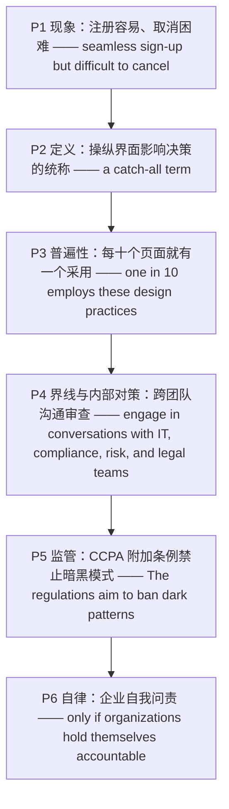

# 暗黑模式：数字界面中的欺骗性设计 精读笔记

---

## 背景

本文选自 **2022 年考研英语（一）Text 3**，主题为**"暗黑模式"（dark patterns）——数字界面中诱导、误导消费者的欺骗性设计**。文章从"注册容易、取消困难"的日常体验切入，给出定义与常见类型，用 2019 年一项覆盖 53,000 个产品页面、11,000 个网站的研究说明其**普遍性**，随后讨论"**说服性设计与欺骗之间的界线**"、企业内部的**跨团队审查**、加州 **CCPA 附加条例**的监管尝试，最后落到**企业自我监管与问责**。

文章沿"**现象引入 → 定义分类 → 普遍性 → 界线与对策 → 监管进展 → 自律问责**"的链条展开：

- **现象引入**：几乎人人遇到过"注册顺畅、取消困难"的会员或订阅，本该简单透明的事被复杂化，**损害消费者选择**（P1）。
- **定义分类**：该词 2010 年由用户体验专家 Harry Brignull 提出，统称**操纵界面以影响用户决策**的做法，共 12 类，从误导、隐藏费用到"**蟑螂旅馆**"（好进难出）（P2）。
- **普遍性**：约**每十个产品页面就有一个**采用这类设计；虽广泛存在，概念却仍**未被充分理解**（P3）。
- **界线与对策**：企业应让 IT、合规、风险、法务与设计、营销团队**共同审查**隐私政策，任何一方都可能制造或避免"**数字欺骗**"（P4）。
- **监管进展**：加州总检察长批准 CCPA 附加条例，**禁止**用令人困惑的措辞或不必要步骤阻碍用户行使数据隐私权（P5）。
- **自律问责**：更多州在考虑**颁布条例**，但暗黑模式也可通过**自我监管**解决——前提是企业不仅对法律、也对**行业最佳做法**负责（P6）。

**难度说明**：中等。句式以**定语从句（that / where）**、**省略关系词的定语从句**、**宾语后置**、**非谓语动词**（过去分词作状语、动名词作介词宾语）与 **`only if` 条件从句**为主；几乎没有倒装和虚拟语气，长句难点集中在**修饰语层层叠加**与**抽象名词化表达**（`the approval of`、`greater accountability`）。题材属"**商业伦理 / 消费者保护 / 数字经济**"，适合练**细节定位**、**同义替换识别**（`dark patterns` ↔ `digital deception`）与**观点态度判断**。

---

## 文章原文


---

We have all **encountered** them, in both our personal and professional lives. Think about the times you felt tricked or frustrated by a membership or subscription that had a seamless sign-up process but was later difficult to cancel.

> [!abstract]- 长难句分析
> **原句**：Think about the times you felt tricked or frustrated by a membership or subscription that had a seamless sign-up process but was later difficult to cancel.
>
> **主干提取**：
>
> - 谓语 V: Think about（祈使句，主语 you 省略）
> - 宾语 O: the times
> - 定从 1（省略关系词）主语 S: you
> - 定从 1 谓语 V: felt
> - 定从 1 表语 C: tricked or frustrated
> - 定从 2 主语 S: that（指 a membership or subscription）
> - 定从 2 并列谓语 V: had … but was …
>
> **修饰成分**：
>
> | 类型 | 引导词 / 形式 | 修饰对象 |
> |------|--------------|----------|
> | 定语从句（省略关系词） | (when / that) you felt … | the times |
> | 介词短语作状语 | by | felt tricked or frustrated |
> | 定语从句 | that | a membership or subscription |
> | 并列谓语 | had … but was … | that |
> | 形容词 + 不定式作表语 | difficult to cancel | was |
>
> **结构图解**：
>
> ```
> 主句（祈使句）: (You) + Think about + the times
>   ├── 定从（省略关系词）: you + felt + tricked or frustrated
>   │     └── 介短: by + a membership or subscription
>   │           └── 定从: that + had + a seamless sign-up process
>   │                 └── 并列谓语: but + was + later difficult to cancel
>   │                       └── 不定式（主动表被动）: to cancel
> ```
>
> **参考译文**：想想那些让你觉得被欺骗或倍感沮丧的时刻：某项会员服务或订阅的注册流程顺畅无比，事后却难以取消。
>
> **考点提示**：① `the times you felt …` 是**省略关系词（when / that）的定语从句**，`times` 后直接跟"主语 + 谓语"，不是同位语从句。② `that had … but was …` 是**同一关系词带两个并列谓语**（`had` 一般过去时 / `was` 过去状态），不要拆成两个定语从句。③ `difficult to cancel` 中不定式**主动形式表被动意义**（= difficult to be cancelled），是"形容词 + to do"的固定用法。

Something that should be simple and transparent can be complicated, intentionally or unintentionally, in ways that impair consumer choice.

> [!abstract]- 长难句分析
> **原句**：Something that should be simple and transparent can be complicated, intentionally or unintentionally, in ways that impair consumer choice.
>
> **主干提取**：
>
> - 主语 S: Something（后接定语从句）
> - 谓语 V: can be
> - 表语 C: complicated
> - 方式状语 A: in ways that impair consumer choice
>
> **修饰成分**：
>
> | 类型 | 引导词 / 形式 | 修饰对象 |
> |------|--------------|----------|
> | 定语从句 | that | Something |
> | 插入语（副词并列） | intentionally or unintentionally | 全句（评注） |
> | 介词短语作方式状语 | in | complicated |
> | 定语从句 | that | ways |
>
> **结构图解**：
>
> ```
> 主句: Something + can be + complicated
>   ├── 定从: that + should be + simple and transparent → 修饰 Something
>   ├── 插入语: intentionally or unintentionally → 评注全句
>   └── 方式状语: in ways〔that + impair + consumer choice〕
>         └── 定从: that + impair + consumer choice → 修饰 ways
> ```
>
> **参考译文**：本该简单透明的事情，可以被做得十分复杂——无论是有意还是无意——其方式损害了消费者的选择。
>
> **考点提示**：① 主语 `Something` 被 `that` 定语从句**分隔**，谓语 `can be` 在从句之后才出现，属"主语 + 长定语 + 谓语"的分隔结构。② `in ways that …` 是**方式状语 + 定语从句**，`that` 在从句中作主语。③ `intentionally or unintentionally` 是**插入的评注性状语**，去掉不影响结构，但透露作者态度——暗示有些复杂化可能是**故意为之**。

These are examples of **dark patterns**.

First coined in 2010 by user experience expert Harry Brignull, "dark patterns" is a catch-all term for practices that manipulate user interfaces to influence the decision-making ability of users.

> [!abstract]- 长难句分析
> **原句**：First coined in 2010 by user experience expert Harry Brignull, "dark patterns" is a catch-all term for practices that manipulate user interfaces to influence the decision-making ability of users.
>
> **主干提取**：
>
> - 主语 S: "dark patterns"
> - 谓语 V: is
> - 表语 C: a catch-all term
> - 后置定语: for practices …（介词短语修饰 term）
>
> **修饰成分**：
>
> | 类型 | 引导词 / 形式 | 修饰对象 |
> |------|--------------|----------|
> | 过去分词短语作状语 | First coined … | 逻辑主语 "dark patterns"（被动） |
> | 前置同位语 | user experience expert | Harry Brignull（身份 + 人名） |
> | 介词短语作后置定语 | for | a catch-all term |
> | 定语从句 | that | practices |
> | 不定式作目的状语 | to influence | manipulate |
> | 介词短语作后置定语 | of | the decision-making ability |
>
> **结构图解**：
>
> ```
> 主句: "dark patterns" + is + a catch-all term
>   ├── 状语（过去分词，被动）: First coined + in 2010 + by user experience expert Harry Brignull
>   │     └── 同位语: user experience expert ↔ Harry Brignull
>   └── 后置定语: for + practices
>         └── 定从: that + manipulate + user interfaces
>               └── 目的状语: to influence + the decision-making ability
>                     └── 后置定语: of users → 修饰 ability
> ```
>
> **参考译文**："暗黑模式"一词最早由用户体验专家哈里·布里格纳尔于 2010 年提出，它是一个统称，指操纵用户界面以影响用户决策能力的种种做法。
>
> **考点提示**：① 句首 `First coined …` 是**过去分词短语作状语**，逻辑主语是主句主语 `"dark patterns"`，与 `coin` 构成**被动**关系（术语被创造），不可写成 `Coining`。② `user experience expert Harry Brignull` 是**前置同位语**（身份 + 人名）。③ `to influence …` 是**不定式作目的状语**，修饰 `manipulate`，不是 `practices` 的定语。④ `practices` 后是 `that` 引导的**限制性定语从句**，`that` 在从句中作主语。

Brignull identifies 12 types of common dark patterns, ranging from **misdirection** and hidden costs to "**roach motel**," where a user experience seems easy and intuitive at the start, but turns difficult when the user tries to get out.

> [!abstract]- 长难句分析
> **原句**：Brignull identifies 12 types of common dark patterns, ranging from misdirection and hidden costs to "roach motel," where a user experience seems easy and intuitive at the start, but turns difficult when the user tries to get out.
>
> **主干提取**：
>
> - 主语 S: Brignull
> - 谓语 V: identifies
> - 宾语 O: 12 types of common dark patterns
> - 伴随状语 A: ranging from … to …
>
> **修饰成分**：
>
> | 类型 | 引导词 / 形式 | 修饰对象 |
> |------|--------------|----------|
> | 现在分词短语作状语 | ranging from … to … | 补充说明 12 types |
> | 定语从句 | where | "roach motel"（抽象地点） |
> | 时间状语 | at the start | seems easy and intuitive |
> | 并列谓语 | but turns | a user experience |
> | 时间状语从句 | when | turns difficult |
>
> **结构图解**：
>
> ```
> 主句: Brignull + identifies + 12 types of common dark patterns
>   └── 状语（现在分词）: ranging from + 〔misdirection and hidden costs〕
>         to + 〔"roach motel"〕
>         └── 定从（where）: a user experience + seems + easy and intuitive
>               ├── 时间状语: at the start
>               └── 并列谓语: but + turns + difficult
>                     └── 时间状从: when + the user tries to get out
> ```
>
> **参考译文**：布里格纳尔归纳出 12 种常见的暗黑模式，从误导、隐藏费用，到"蟑螂旅馆"——即用户体验起初看起来简单直观，但当用户想要退出时就变得困难。
>
> **考点提示**：① `ranging from A to B` 是**现在分词短语作状语**，逻辑主语是 `12 types of common dark patterns`，不是 `Brignull`。② `where` 是**定语从句关系副词**，先行词 `"roach motel"` 被视为抽象地点，`where` = `in which`。③ `a user experience seems … but turns …` 是**同一主语的两个并列谓语**，`but` 后省略主语，不是两个从句。④ `when the user tries to get out` 是**时间状语从句**，修饰 `turns difficult`。

In a 2019 study of 53,000 product pages and 11,000 websites, researchers found that about one in 10 employs these design practices. Though widely **prevalent**, the concept of dark patterns is still not well understood. Business and nonprofit leaders should be aware of dark patterns and try to avoid the gray areas they **engender**.

Where is the line between ethical, **persuasive** design and dark patterns? Businesses should engage in conversations with IT, **compliance**, risk, and legal teams to review their privacy policy, and include in the discussion the customer/user experience designers and coders responsible for the company's user interface, as well as the marketers and advertisers responsible for sign-ups, checkout baskets, pricing, and promotions.

> [!abstract]- 长难句分析
> **原句**：Businesses should engage in conversations with IT, compliance, risk, and legal teams to review their privacy policy, and include in the discussion the customer/user experience designers and coders responsible for the company's user interface, as well as the marketers and advertisers responsible for sign-ups, checkout baskets, pricing, and promotions.
>
> **主干提取**：
>
> - 主语 S: Businesses
> - 谓语 V（并列 1）: should engage in
> - 宾语 O1: conversations
> - 谓语 V（并列 2）: (should) include
> - 宾语 O2（后置）: the customer/user experience designers and coders … as well as the marketers and advertisers …
> - 目的状语 A: to review their privacy policy
>
> **修饰成分**：
>
> | 类型 | 引导词 / 形式 | 修饰对象 |
> |------|--------------|----------|
> | 介词短语作后置修饰 | with | conversations |
> | 不定式作目的状语 | to review | engage in conversations |
> | 介词短语作状语（宾语后置） | in the discussion | include |
> | 形容词短语作后置定语 | responsible for | designers and coders |
> | 形容词短语作后置定语 | responsible for | marketers and advertisers |
> | 并列连词 | as well as | 两个名词短语并列 |
>
> **结构图解**：
>
> ```
> 主句: Businesses + should〔engage in + conversations〕and〔(should) include + 长宾语（后置）〕
>   ├── 谓语 1: engage in + conversations
>   │     ├── 后置修饰: with + IT, compliance, risk, and legal teams
>   │     └── 目的状语: to review + their privacy policy
>   └── 谓语 2: include + in the discussion + 〔宾语（后置）〕
>         └── 宾语 = designers and coders〔responsible for the user interface〕
>               + as well as + marketers and advertisers〔responsible for sign-ups …〕
> ```
>
> **参考译文**：企业应当与 IT、合规、风险和法务团队展开沟通，以审查其隐私政策，并把负责公司用户界面的客户/用户体验设计师与程序员，以及负责注册、购物车、定价和促销的营销人员与广告人员，都纳入讨论之中。
>
> **考点提示**：① `include in the discussion A` 是**宾语后置**：正常语序为 `include A in the discussion`，因宾语过长（带两个 `responsible for` 后置定语）而后移。② 全句有**两个并列谓语** `engage in` 与 `include`，第二个 `should` 承前省略。③ `responsible for …` 是**形容词短语作后置定语**，不是谓语——若作谓语须有 `are`。④ `as well as` 连接两个名词短语，属**附加并列**，重心在前一项。

Any or all these teams can play a role in creating or avoiding "digital deception."

Lawmakers and regulators are slowly starting to address the **ambiguity** around dark patterns, most recently at the state level. In March, the California Attorney General announced the approval of additional regulations under the California Consumer Privacy Act (CCPA) that "ensure that consumers will not be confused or misled when seeking to exercise their data privacy rights."

> [!abstract]- 长难句分析
> **原句**：In March, the California Attorney General announced the approval of additional regulations under the California Consumer Privacy Act (CCPA) that "ensure that consumers will not be confused or misled when seeking to exercise their data privacy rights."
>
> **主干提取**：
>
> - 时间状语 A: In March
> - 主语 S: the California Attorney General
> - 谓语 V: announced
> - 宾语 O: the approval of additional regulations
>
> **修饰成分**：
>
> | 类型 | 引导词 / 形式 | 修饰对象 |
> |------|--------------|----------|
> | 时间状语 | In March | 全句 |
> | 介词短语作后置定语 | of | the approval |
> | 介词短语作后置定语 | under | additional regulations |
> | 括号缩写同位语 | (CCPA) | California Consumer Privacy Act |
> | 定语从句 | that | additional regulations |
> | 宾语从句 | that | ensure |
> | 时间状语从句（省略 they are） | when seeking | will not be confused or misled |
>
> **结构图解**：
>
> ```
> 主句: the California Attorney General + announced + the approval
>   ├── 时间状语: In March
>   └── 后置定语: of + additional regulations
>         ├── 后置定语: under + the California Consumer Privacy Act〔(CCPA)〕
>         └── 定从: that + ensure + 〔宾语从句〕
>               └── 宾从: consumers + will not be + confused or misled
>                     └── 时间状从（省略 they are）: when seeking to exercise their data privacy rights
> ```
>
> **参考译文**：今年 3 月，加州总检察长宣布批准《加州消费者隐私法》（CCPA）框架下的附加条例，这些条例"确保消费者在寻求行使其数据隐私权时不会感到困惑或被误导"。
>
> **考点提示**：① `announced the approval of` 是**动词 + 名词化宾语**的压缩表达（= announced that … were approved），比从句更紧凑，也是新闻文体特征。② `that` 定语从句的先行词是 `regulations`，**不是** `CCPA`——`(CCPA)` 在括号内，作**同位语**。③ `ensure that …` 是**宾语从句套嵌**在定语从句之内，形成"定从 → 宾从 → 状从"三层。④ `when seeking …` 是**省略 "they are" 的时间状语从句**，逻辑主语为 `consumers`。⑤ `confused or misled` 是**两个过去分词并列作表语**，均为被动意义。

The regulations aim to ban dark patterns—this means prohibiting companies from using "confusing language or unnecessary steps such as forcing them to click through multiple screens or listen to reasons why they shouldn't opt out."

> [!abstract]- 长难句分析
> **原句**：The regulations aim to ban dark patterns—this means prohibiting companies from using "confusing language or unnecessary steps such as forcing them to click through multiple screens or listen to reasons why they shouldn't opt out."
>
> **主干提取**：
>
> - 主语 S（前句）: The regulations
> - 谓语 V（前句）: aim to ban
> - 宾语 O（前句）: dark patterns
> - 主语 S（后句）: this（指代前句内容）
> - 谓语 V（后句）: means
> - 宾语 O（后句）: prohibiting companies from using …（动名词短语）
>
> **修饰成分**：
>
> | 类型 | 引导词 / 形式 | 修饰对象 |
> |------|--------------|----------|
> | 不定式作宾语 | to ban | aim |
> | 破折号解释 | — | dark patterns |
> | 动名词作宾语 | prohibiting … | means |
> | 介词短语（固定搭配） | from using | prohibiting companies |
> | 介词短语作举例 | such as | confusing language or unnecessary steps |
> | 不定式作宾语补足语 | to click through / (to) listen | forcing them |
> | 定语从句 | why | reasons |
>
> **结构图解**：
>
> ```
> 句 1: The regulations + aim to ban + dark patterns
>   └── 破折号解释 ↓
> 句 2: this + means + 〔prohibiting …〕（动名词作宾语）
>   └── prohibiting + companies + from + using
>         └── 宾语: confusing language or unnecessary steps
>               └── 举例: such as + forcing + them + 〔to click through … or (to) listen to …〕
>                     ├── 宾补 1: to click through + multiple screens
>                     ├── 宾补 2: (to) listen to + reasons〔why they shouldn't opt out〕
>                     └── 定从: why + they + shouldn't opt out → 修饰 reasons
> ```
>
> **参考译文**：这些条例旨在禁止暗黑模式——这意味着禁止企业使用"令人困惑的措辞或不必要的步骤，例如迫使用户点击浏览多个界面，或迫使用户听取为何自己不应退出的理由"。
>
> **考点提示**：① 破折号前是完整句，破折号后另起主谓 `this means …`，`this` 指代前句整句内容。② `prohibit sb from doing` 是**固定搭配**，`from` 后接动名词，不能接不定式。③ `such as forcing them to click through … or listen to …` 中，`click through` 与 `listen` 是 `force sb to do A or do B` 里**共用 `to` 的并列不定式**，`or` 连接的是两个动作，不是两个 `such as` 例项。④ `why they shouldn't opt out` 是**定语从句**修饰 `reasons`，`why` 在从句中作原因状语。⑤ 引号内 `confusing language or unnecessary steps` 是 `using` 的**宾语**。

As more states consider **promulgating** additional regulations, there is a need for greater **accountability** from within the business community. Dark patterns also can be addressed on a self-regulatory basis, but only if organizations hold themselves accountable, not just to legal requirements, but also to industry best practices and standards.

> [!abstract]- 长难句分析
> **原句**：Dark patterns also can be addressed on a self-regulatory basis, but only if organizations hold themselves accountable, not just to legal requirements, but also to industry best practices and standards.
>
> **主干提取**：
>
> - 主语 S: Dark patterns
> - 谓语 V: can be addressed（被动）
> - 方式状语 A: on a self-regulatory basis
> - 条件状语从句 A: only if organizations hold themselves accountable …
>
> **修饰成分**：
>
> | 类型 | 引导词 / 形式 | 修饰对象 |
> |------|--------------|----------|
> | 被动语态 | can be addressed | Dark patterns |
> | 介词短语作方式状语 | on … basis | can be addressed |
> | 条件状语从句（必要条件） | only if | 全句 |
> | 反身代词作宾语 | themselves | hold |
> | 宾语补足语 | accountable | hold themselves |
> | 并列介词短语 | not just to … but also to … | accountable |
>
> **结构图解**：
>
> ```
> 主句: Dark patterns + can be addressed + on a self-regulatory basis
>   └── 条件状从（必要条件）: only if + organizations + hold + themselves + accountable
>         └── 并列介词短语: not just to + legal requirements
>                           but also to + industry best practices and standards
> ```
>
> **参考译文**：暗黑模式也可以在自我监管的基础上加以应对，但前提是各组织不仅对法律要求负责，也对行业最佳做法与标准负责。
>
> **考点提示**：① `only if` 引导**必要条件**状语从句，意为"只有……才"；与 `if only`（要是……就好了）意义相反，是高频辨析点。② `hold sb accountable` 中 `accountable` 是**宾语补足语**，`hold themselves accountable` = "使自己承担责任、自我约束"。③ `not just to A but also to B` 是**并列介词短语**，与 `accountable` 搭配（`be accountable to sb for sth`），**重心在 `but also` 之后**——这正是第 35 题 `self-discipline` 的依据。④ 主句用**被动语态且省略施动者**，施动者由条件从句的 `organizations` 补出，阅读时须主动追问"谁来做"。

## 题目

### 31. It can be learned from the first two paragraphs that dark patterns ____.

- [A] improve user experiences
- [B] leak user information for profit
- [C] undermine users' decision-making
- [D] remind users of hidden costs

### 32. The 2019 study on dark patterns is mentioned to show ____.

- [A] their major flaws
- [B] their complex designs
- [C] their severe damage
- [D] their strong presence

### 33. To handle digital deception, businesses should ____.

- [A] listen to customer feedback
- [B] talk with relevant teams
- [C] turn to independent agencies
- [D] rely on professional training

### 34. The additional regulations under the CCPA are intended to ____.

- [A] guide users through opt-out processes
- [B] protect consumers from being tricked
- [C] grant companies data privacy rights
- [D] restrict access to problematic content

### 35. According to the last paragraph, a key to coping with dark patterns is ____.

- [A] new legal requirements
- [B] businesses' self-discipline
- [C] strict regulatory standards
- [D] consumers' safety awareness

---

## 翻译对照

## Paragraph 1

We have all encountered them, in both our personal and professional lives. Think about the times you felt tricked or frustrated by a membership or subscription that had a seamless sign-up process but was later difficult to cancel. Something that should be simple and transparent can be complicated, intentionally or unintentionally, in ways that impair consumer choice. These are examples of dark patterns.

无论是在个人生活还是职业生涯中，我们都遇到过它们。想想那些让你觉得被欺骗或倍感沮丧的时刻：某项会员服务或订阅的注册流程顺畅无比，事后却难以取消。本该简单透明的事情，可以被做得十分复杂——无论是有意还是无意——其方式损害了消费者的选择。这些便是"暗黑模式"的例子。

> [!note] 翻译说明
> - `encounter` = "遇到、遭遇"，比 `meet` 更正式，常指遇到困难或不愉快的事物。
> - `seamless` = "无缝的、顺畅的"，`seam` 原义为"接缝"，`seamless sign-up process` 即"毫无阻碍的注册流程"。
> - `transparent` = "透明的、公开的"，此处取"一目了然"义，与后面 `complicated` 形成对照。
> - `intentionally or unintentionally` = "有意或无意地"，两个副词并列，用 `or` 连接，是常见的插入性并列成分。
> - `impair` = "损害、削弱"，比 `damage` 更侧重"使功能变差"，常与 `choice`、`health`、`vision` 等搭配。

## Paragraph 2

First coined in 2010 by user experience expert Harry Brignull, "dark patterns" is a catch-all term for practices that manipulate user interfaces to influence the decision-making ability of users. Brignull identifies 12 types of common dark patterns, ranging from misdirection and hidden costs to "roach motel," where a user experience seems easy and intuitive at the start, but turns difficult when the user tries to get out.

"暗黑模式"一词最早由用户体验专家哈里·布里格纳尔于 2010 年提出，它是一个统称，指操纵用户界面以影响用户决策能力的种种做法。布里格纳尔归纳出 12 种常见的暗黑模式，从误导、隐藏费用，到"蟑螂旅馆"——即用户体验起初看起来简单直观，但当用户想要退出时就变得困难。

> [!note] 翻译说明
> - `coin` = "创造（新词）"；`first coined in 2010 by …` 是过去分词短语作状语，表明该术语的来源。
> - `catch-all term` = "统称、总括性说法"，`catch-all` 意为"包罗万象的"。
> - `manipulate` = "操纵、操控"，含贬义，与后文 `influence` 的中性色彩形成程度差异。
> - `ranging from … to …` = "从……到……不等"，用来列举范围。
> - `roach motel` = "蟑螂旅馆"，源自美国蟑螂诱捕器的广告语"蟑螂进得去、出不来"，比喻"好进难出"的商业模式。
> - `intuitive` = "直觉的、易上手的"，`intuition` 的形容词形式。

## Paragraph 3

In a 2019 study of 53,000 product pages and 11,000 websites, researchers found that about one in 10 employs these design practices. Though widely prevalent, the concept of dark patterns is still not well understood. Business and nonprofit leaders should be aware of dark patterns and try to avoid the gray areas they engender.

在 2019 年一项针对 53,000 个产品页面和 11,000 个网站的研究中，研究人员发现大约每十个就有一个采用了这类设计做法。尽管暗黑模式十分普遍，这一概念却仍未得到充分理解。企业和非营利组织的领导者应当了解暗黑模式，并努力避开它们所产生的灰色地带。

> [!note] 翻译说明
> - `one in 10` = "十中有一"，`one in + 数词` 表比例；此处 `one in 10` 作主语，谓语用 `employs`（单数），视作"每十个中的一个"。
> - `prevalent` = "普遍的、流行的"，比 `common` 更强调"广泛存在"，常与疾病、风气、现象搭配。
> - `be aware of` = "意识到、了解"；`aware` 是形容词，不能说 `be aware about`。
> - `gray areas` = "灰色地带"，指介于合法与违法、合宜与不合宜之间的模糊区域。
> - `engender` = "产生、引起"，正式用语，常接 `fear`、`conflict`、`support` 等抽象名词。

## Paragraph 4

Where is the line between ethical, persuasive design and dark patterns? Businesses should engage in conversations with IT, compliance, risk, and legal teams to review their privacy policy, and include in the discussion the customer/user experience designers and coders responsible for the company's user interface, as well as the marketers and advertisers responsible for sign-ups, checkout baskets, pricing, and promotions. Any or all these teams can play a role in creating or avoiding "digital deception."

合乎道德的说服性设计与暗黑模式之间的界线究竟在哪里？企业应当与 IT、合规、风险和法务团队展开沟通，以审查其隐私政策，并把负责公司用户界面的客户/用户体验设计师与程序员，以及负责注册、购物车、定价和促销的营销人员与广告人员，都纳入讨论之中。这些团队中的任何一个或全部，都可能在制造或避免"数字欺骗"中发挥作用。

> [!note] 翻译说明
> - `Where is the line between A and B` = "A 与 B 的界线在哪里"，议论文常用的设问句式。
> - `persuasive` = "有说服力的、劝诱性的"；`persuade` 的形容词形式，此处中性偏褒。
> - `compliance` = "合规"，指企业遵守法律法规的部门或职能，是商业语境高频词。
> - `include in the discussion …` = "把……纳入讨论"；正常语序为 `include A in B`，此处因宾语过长而后置。
> - `checkout baskets` = "购物车/结账篮"，电商术语。
> - `Any or all these teams` = "这些团队中的任何一个或全部"，`any or all` 是强调"任意组合皆可"的固定搭配。
> - `digital deception` = "数字欺骗"，与 `dark patterns` 同义替换，是阅读题的正确选项线索。

## Paragraph 5

Lawmakers and regulators are slowly starting to address the ambiguity around dark patterns, most recently at the state level. In March, the California Attorney General announced the approval of additional regulations under the California Consumer Privacy Act (CCPA) that "ensure that consumers will not be confused or misled when seeking to exercise their data privacy rights." The regulations aim to ban dark patterns—this means prohibiting companies from using "confusing language or unnecessary steps such as forcing them to click through multiple screens or listen to reasons why they shouldn't opt out."

立法者与监管机构正缓慢着手处理暗黑模式所带来的模糊性问题，最近的一次发生在州一级。今年 3 月，加州总检察长宣布批准《加州消费者隐私法》（CCPA）框架下的附加条例，这些条例"确保消费者在寻求行使其数据隐私权时不会感到困惑或被误导"。这些条例旨在禁止暗黑模式——这意味着禁止企业使用"令人困惑的措辞或不必要的步骤，例如迫使用户点击浏览多个界面，或迫使用户听取为何自己不应退出的理由"。

> [!note] 翻译说明
> - `address` = "处理、应对（问题）"，此处不是"地址"或"演讲"。
> - `ambiguity` = "模糊性、歧义"，指法律或概念界定不清。
> - `Attorney General` = "总检察长"，美国州一级的最高执法官员。
> - `exercise one's rights` = "行使权利"，`exercise` 除"锻炼"外还有"行使、运用"义。
> - `opt out` = "选择退出、退出订阅"，与 `opt in`（选择加入）相对，是暗黑模式讨论的核心术语。
> - `misled` = `mislead` 的过去分词，"被误导"；注意 `mislead` 后直接接宾语，不用 `mislead sb to do`。

## Paragraph 6

As more states consider promulgating additional regulations, there is a need for greater accountability from within the business community. Dark patterns also can be addressed on a self-regulatory basis, but only if organizations hold themselves accountable, not just to legal requirements, but also to industry best practices and standards.

随着越来越多的州考虑颁布附加条例，商界内部需要更强的责任意识。暗黑模式也可以在自我监管的基础上加以应对，但前提是各组织不仅对法律要求负责，也对行业最佳做法与标准负责。

> [!note] 翻译说明
> - `promulgate` = "颁布、公布（法律、规章）"，正式用语，考研高频难词。
> - `accountability` = "问责性、责任心"，强调"须对自身行为作出交代"，比 `responsibility` 更侧重外部监督。
> - `self-regulatory` = "自我监管的"，`self-regulation`（自我监管）的形容词形式，与 `government regulation`（政府监管）相对。
> - `hold sb accountable` = "使某人对……负责、追究某人责任"；`hold oneself accountable` 即"自我约束、自我负责"。
> - `not just … but also …` = "不仅……而且……"，此处与 `to` 搭配，构成 `accountable to A as well as to B` 的并列。

## 题目翻译

### 31. 从开头两段可以得知，暗黑模式 ____。

- [A] 改善用户体验
- [B] 为牟利泄露用户信息
- [C] 削弱用户的决策
- [D] 提醒用户注意隐藏费用

### 32. 文中提到 2019 年关于暗黑模式的研究，是为了说明 ____。

- [A] 它们的重大缺陷
- [B] 它们复杂的设计
- [C] 它们的严重危害
- [D] 它们的普遍存在

### 33. 为应对数字欺骗，企业应当 ____。

- [A] 倾听客户反馈
- [B] 与相关团队沟通
- [C] 求助于独立机构
- [D] 依靠专业培训

### 34. CCPA 下的附加条例旨在 ____。

- [A] 引导用户完成退出流程
- [B] 保护消费者免遭欺骗
- [C] 授予企业数据隐私权
- [D] 限制访问有问题的内容

### 35. 根据最后一段，应对暗黑模式的关键是 ____。

- [A] 新的法律要求
- [B] 企业的自律
- [C] 严格的监管标准
- [D] 消费者的安全意识


---

## 语法要点

> [!note] 来源说明
> 本篇**用户未提供语法源笔记**，以下语法点由 `formatted-article.md` 与 `translation.md` **从本文推断提取**，仅收录本篇实际出现的语法现象。
> 每一条均给出**原文语境**，便于回原文核对；标注"（联动）"的条目与相邻专题互为参照。
> 固定搭配与词组见 [[intermediate/2022-passage3-dark-patterns/固定搭配与词组笔记.md|2022 Passage 3 固定搭配与词组]]。

---

## 一、从句

### 从句：限制性定语从句（that 引导，作主语，双谓语并列）

**概述**：`that` 引导**限制性定语从句**，在从句中作**主语**，紧跟先行词，**不可省略、不可加逗号**；本句中从句内有两个并列谓语。

| 结构 | 用法 | 例句 |
|------|------|------|
| `a subscription + that + had … but was …` | that 作从句主语，两个谓语由 but 并列 | a membership or subscription **that had a seamless sign-up process but was later difficult to cancel** |
| `practices + that + manipulate …` | that 作从句主语 | practices **that manipulate user interfaces** to influence the decision-making ability of users |
| `regulations + that + ensure + that 从句` | that 作从句主语，从句内含宾语从句 | additional regulations … **that "ensure that consumers will not be confused or misled …"** |

> [!tip] 阅读技巧
> 三处 `that` 从句都是**限定先行词**：第一处限定"会员或订阅"，第二处限定"做法"，第三处限定"附加条例"。找主干时先把 `that ...` 整体括起：`a membership or subscription` 是介词 `by` 的宾语；`practices` 是 `for` 的宾语；`regulations` 是 `the approval of` 的宾语。
>
> [!warning] 易错点
> 第一处 `that had a seamless sign-up process **but was later difficult to cancel**` 中，`had` 与 `was` 共用 `that` 作主语，是**两个并列谓语**（一般过去 / 过去状态），不是 `that had … but (that) was …` 两个从句。

### 从句：限制性定语从句（where 引导，先行词为抽象地点）

**概述**：`where` 引导定语从句时，先行词是**地点名词**（包括 `case`、`situation`、`point`、`motel` 等**抽象地点**），`where` 在从句中作**地点状语**，相当于 `in/at which`。

| 结构 | 用法 | 例句 |
|------|------|------|
| `"roach motel," + where + 主句` | where 指代先行词，作地点状语 | "roach motel," **where a user experience seems easy and intuitive at the start, but turns difficult when the user tries to get out** |

> [!warning] 易错点
> 此处 `where` **不是**疑问词，也不是状语从句连词，而是**定语从句关系副词**，先行词是 `roach motel`。若把 `where` 当成"哪里"来理解，会误判为独立句。判断方法：`where` 前有名词 + 逗号，且从句结构完整（主语 `a user experience`、系动词 `seems`、表语 `easy and intuitive`），即为定语从句。（联动）见 [[语法总结笔记.md|语法总结笔记]] 中"关系副词 where"条目。

### 从句：限制性定语从句（省略关系词）

**概述**：关系代词在定语从句中作**宾语**时可省略，形成"名词 + 主谓"的**隐形定语从句**，是考研阅读最容易被误读为并列句的结构。

| 结构 | 用法 | 例句 |
|------|------|------|
| `the gray areas + (that) + they engender` | 省略作宾语的关系代词 | … try to avoid **the gray areas they engender**. |
| `the times + (when/that) + you felt …` | 省略关系副词 | Think about **the times you felt tricked or frustrated** by a membership … |
| `reasons + why + they shouldn't opt out` | why 引导，未省略 | … listen to **reasons why they shouldn't opt out**. |

> [!tip] 阅读技巧
> `the gray areas they engender` = `the gray areas that they engender`（"它们所造成的灰色地带"）；`the times you felt …` = `the times when you felt …`（"你感到……的那些时刻"）。**名词后紧跟"主语 + 谓语"而缺少连接词**，几乎必然是省略关系词的定语从句。

### 从句：that 引导的宾语从句（found / ensure）

**概述**：`find`、`ensure`、`announce` 等动词后接 `that` 从句作**宾语**；`that` 在口语化表达中常省略，在正式文本中多保留。

| 结构 | 用法 | 例句 |
|------|------|------|
| `researchers found that + 从句` | that 引导宾语从句 | researchers **found that** about one in 10 employs these design practices |
| `ensure that + 从句` | that 引导宾语从句（ensure 后不省略） | … that "**ensure that** consumers will not be confused or misled …" |
| `announced the approval of …` | 名词化表达替代宾语从句 | the California Attorney General **announced the approval of** additional regulations |

> [!note] 补充说明
> 第三处值得注意：作者没有写 `announced that additional regulations were approved`，而用 **`announced the approval of`（动词 + 名词化宾语）**，这是新闻英语压缩句长的常见手法，也让 `that` 从句可以紧贴 `regulations` 作定语。

### 从句：Though 引导的让步状语从句（省略形式）

**概述**：`though / although` 引导让步状语从句；当从句主语与主句主语一致且含 `be` 时，可**省略"主语 + be"**，只剩形容词或分词短语。

| 结构 | 用法 | 例句 |
|------|------|------|
| `Though + 形容词, + 主句` | 省略 "it is" 的让步状语 | **Though widely prevalent**, the concept of dark patterns is still not well understood. |

> [!warning] 易错点
> `Though widely prevalent` 补全为 `Though it (= the concept of dark patterns) is widely prevalent`。不要把 `Though` 后的形容词误当主语补足语——它是**从句的表语**。此类省略与 `Although + 形容词` 完全同构，写作中可放心模仿。

### 从句：when 引导的时间状语从句（省略主语与 be）

**概述**：`when` 引导时间状语从句时，若从句主语与主句主语一致且含 `be`，可省略为 `when + doing / done`。

| 结构 | 用法 | 例句 |
|------|------|------|
| `when + doing, + 主句` | 省略 "they are" 的时间状语 | … consumers will not be confused or misled **when seeking to exercise their data privacy rights** |

> [!tip] 阅读技巧
> `when seeking …` 补全为 `when they are seeking …`，逻辑主语是 `consumers`。此类"连词 + doing"结构在考研翻译中常被要求**补出主语**，否则中文会缺主语。

### 从句：only if 引导的条件状语从句

**概述**：`only if` = "只有……才"，引导**必要条件**状语从句；主句常与之形成"唯一条件"逻辑，语气比 `if` 强得多。

| 结构 | 用法 | 例句 |
|------|------|------|
| `…, but only if + 从句` | 必要条件 | Dark patterns also can be addressed on a self-regulatory basis, **but only if organizations hold themselves accountable** … |

> [!warning] 易错点
> `only if` 与 `if only` 意义相反：`only if` = "只有……才"（必要条件）；`if only` = "要是……就好了"（虚拟愿望）。本文第 35 题问"应对暗黑模式的关键"，答案正落在 `only if` 引出的条件上。

### 从句：as 引导的时间状语从句（随着）

**概述**：`as` 作连词可表"随着"，强调两个变化**同时发生**，从句谓语常用一般现在时或进行时。

| 结构 | 用法 | 例句 |
|------|------|------|
| `As + 主语 + 谓语, + 主句` | 随着…… | **As more states consider promulgating additional regulations**, there is a need for greater accountability … |

> [!note] 补充说明
> `consider doing`（考虑做某事）是固定用法，`consider` 后**不能接不定式**。`promulgating` 是动名词作 `consider` 的宾语。

---

## 二、非谓语动词

### 非谓语：过去分词短语作状语（First coined ...）

**概述**：过去分词短语置于句首，作**状语**，其逻辑主语与主句主语一致，且与主语构成**被动**关系。

| 结构 | 用法 | 例句 |
|------|------|------|
| `First + done + by … , + 主句` | 过去分词作状语（被动、完成） | **First coined in 2010 by user experience expert Harry Brignull**, "dark patterns" is a catch-all term … |

> [!warning] 易错点
> 该状语补全为 `First having been coined …` 或 `When it was first coined …`。逻辑主语是主句主语 `"dark patterns"`——术语"被创造"，故用**过去分词**；若写成 `Coining …` 则变成"暗黑模式创造了……"，逻辑错误。

### 非谓语：动名词作介词宾语

**概述**：介词后必须接**名词性成分**，动词须变为**动名词（doing）**；本句有两处高频搭配：`such as + doing`、`prohibit sb from doing`。

| 结构 | 用法 | 例句 |
|------|------|------|
| `prohibiting sb from + doing` | 动名词作 from 的宾语 | this means **prohibiting companies from using** "confusing language or unnecessary steps" |
| `such as + doing A or doing B` | 动名词并列举例 | **such as forcing them to click through multiple screens or listen to reasons** why they shouldn't opt out |
| `engage in + doing/名词` | 动名词/名词作 in 的宾语 | Businesses should **engage in conversations** with IT … |

> [!warning] 易错点
> `such as forcing them to click through … or listen to reasons …` 中，`forcing` 与 `listen` **不是并列的同一层级**：`forcing them to (click through … or listen to reasons …)` 是 `force sb to do A or do B` 结构，`click through` 与 `listen` 是 **forcing 的宾语补足语中的并列不定式**（`to` 可共用）。别误读成 `such as forcing … or (such as) listen …`。

### 非谓语：不定式作目的状语（to influence）

**概述**：`to do` 放句末，说明前面动作的**目的**，可译为"为了……"。

| 结构 | 用法 | 例句 |
|------|------|------|
| `manipulate … to influence …` | 不定式作目的状语 | practices that **manipulate user interfaces to influence** the decision-making ability of users |
| `forcing them to click through` | 不定式作宾语补足语 | … **forcing them to click through** multiple screens |
| `try to avoid` | 不定式作 try 的宾语 | … and **try to avoid** the gray areas they engender |

> [!tip] 记忆方法
> 快速区分三种不定式：① 表**目的**（`manipulate … to influence`，可译为"为了影响"）；② 作**宾补**（`force sb to do`，`them` 是 `forcing` 的宾语，`to click` 补足其动作）；③ 作**宾语**（`try to do`、`aim to do`）。

---

## 三、语态与时态

### 语态：被动语态（was coined / is not well understood / can be addressed）

**概述**：`be + 过去分词` 构成被动语态；本文大量使用被动，体现**学术/新闻文体**的客观性，也是推断题"主语是谁"的线索。

| 结构 | 用法 | 例句 |
|------|------|------|
| `was first coined by …` | 一般过去时被动 | "dark patterns" … **was first coined in 2010 by** user experience expert Harry Brignull |
| `is still not well understood` | 一般现在时被动 + 否定 | the concept of dark patterns **is still not well understood** |
| `can be addressed` | 情态动词 + 被动 | Dark patterns also **can be addressed** on a self-regulatory basis |
| `will not be confused or misled` | 将来时被动 + 两个过去分词并列 | consumers **will not be confused or misled** when seeking … |

> [!tip] 阅读技巧
> 被动句常省略施动者（`by …`），阅读时要主动追问"**谁做的**"。例如 `can be addressed on a self-regulatory basis` 未点明施动者，但下文 `organizations hold themselves accountable` 已给出答案——这正是第 35 题的命题逻辑。

### 时态：现在完成时与一般现在时的分工

**概述**：本文用**现在完成时**交代"从过去到现在的演变"，用**一般现在时**陈述"当前事实与普遍做法"。

| 结构 | 用法 | 例句 |
|------|------|------|
| `have all encountered` | 现在完成时，强调至今的经验 | We **have all encountered** them … |
| `is still not well understood` | 一般现在时，陈述现状 | the concept … **is still not well understood** |
| `are slowly starting to address` | 现在进行时，表渐进过程 | Lawmakers and regulators **are slowly starting to address** the ambiguity … |

> [!note] 补充说明
> `are slowly starting to do` 用**进行时 + slowly** 强调"进展缓慢"，暗含作者对监管滞后的评价，是推断题（如"监管态度"类）的语气线索。

---

## 四、句子结构与语序

### 结构：特殊疑问句（Where is the line between A and B）

**概述**：议论文常用设问句**承上启下**，引出下文的对策；`between A and B` 作 `the line` 的后置定语。

| 结构 | 用法 | 例句 |
|------|------|------|
| `Where is the line between A and B?` | 设问句，引出讨论 | **Where is the line between ethical, persuasive design and dark patterns?** |

> [!tip] 阅读技巧
> 设问句后紧跟的句子就是**答案句**：下一句 `Businesses should engage in conversations with …` 直接回答"界线如何划定"，对应第 33 题 B 项 `talk with relevant teams`。

### 结构：宾语后置（include A in B）

**概述**：当宾语过长（含并列名词 + 后置定语）时，作者会把**介词短语提前**，形成 `include in B A` 的**宾语后置**，造成"动词后紧跟介词"的假象。

| 结构 | 用法 | 例句 |
|------|------|------|
| `include in the discussion + 长宾语` | 宾语后置，避免头重脚轻 | … and **include in the discussion** the customer/user experience designers and coders responsible for the company's user interface, as well as the marketers and advertisers … |

> [!warning] 易错点
> 正常语序是 `include A in the discussion`。此处 `in the discussion` 被提前，`the customer/user experience designers and coders …` 才是 `include` 的**宾语**。若不识别后置，会误以为 `include` 是不及物动词。

### 结构：并列结构（not just ... but also ... / any or all）

**概述**：`not just … but also …` 表**递进并列**，两侧须**语法形式一致**；`any or all` 是固定并列，表"任意一个或全部"。

| 结构 | 用法 | 例句 |
|------|------|------|
| `not just to A, but also to B` | 并列介词短语，形式对称 | … accountable **not just to legal requirements, but also to industry best practices and standards** |
| `Any or all these teams` | 固定并列，强调任意组合 | **Any or all these teams** can play a role in creating or avoiding "digital deception." |
| `intentionally or unintentionally` | 副词并列 | … can be complicated, **intentionally or unintentionally**, in ways that impair consumer choice |

> [!tip] 阅读技巧
> `not just A but also B` 的**重心在 B**：本文强调企业不只对法律负责，**更要**对行业最佳做法负责——这正是"自我监管"的落脚点，直接对应第 35 题 B 项 `businesses' self-discipline`。

---

## 五、名词与修饰

### 修饰：形容词短语作后置定语（responsible for ...）

**概述**：`responsible for …` 等形容词短语置于名词后，作**后置定语**，相当于省略 `who are` 的定语从句。

| 结构 | 用法 | 例句 |
|------|------|------|
| `designers and coders + responsible for + 名词` | 形容词短语后置定语 | the customer/user experience designers and coders **responsible for the company's user interface** |
| `marketers and advertisers + responsible for + 名词` | 同上 | the marketers and advertisers **responsible for sign-ups, checkout baskets, pricing, and promotions** |

> [!warning] 易错点
> `responsible for …` **不是谓语**，主句谓语是 `include`。判断依据：若 `responsible` 作谓语，须有 `be` 动词（`are responsible for`），此处没有。

### 修饰：同位语（身份 + 人名 / 括号缩写）

**概述**：同位语对前面名词作**解释说明**，常见形式有两种：**身份 + 人名**（前置）与**括号缩写**（后置）。

| 结构 | 用法 | 例句 |
|------|------|------|
| `身份 + 人名` | 前置同位语 | user experience expert **Harry Brignull** |
| `全称 + (缩写)` | 括号内为缩写 | the California Consumer Privacy Act **(CCPA)** |
| `"dark patterns" + is …` | 引号标示术语 | **"dark patterns"** is a catch-all term |

> [!tip] 阅读技巧
> `user experience expert Harry Brignull` 中，`expert` 是**身份**，`Harry Brignull` 是**人名**，二者同位。中文习惯说"用户体验专家哈里·布里格纳尔"，顺序一致，翻译时不需调整。

### 修饰：复合形容词（catch-all / self-regulatory）

**概述**：复合形容词由"词 + 词"构成，**必须带连字符**，作前置定语修饰名词。

| 结构 | 用法 | 例句 |
|------|------|------|
| `catch-all + term` | 复合形容词作定语 | a **catch-all** term for practices … |
| `self-regulatory + basis` | 复合形容词作定语 | … can be addressed on a **self-regulatory** basis |
| `decision-making + ability` | 复合形容词作定语 | … the **decision-making** ability of users |

> [!warning] 易错点
> `self-regulatory` 是形容词，`self-regulation` 是名词；`on a self-regulatory basis` = "在自我监管的基础上"，介词 `on` 后接**名词性短语**，中心词是 `basis`，不是 `self-regulatory`。

---

## 六、数量与程度表达

### 数量与程度：比例表达（one in 10）

**概述**：`one in + 数词` 表比例（= 十分之一），作主语时谓语**单复数取决于核心名词**；本文 `one in 10` 指代"每十个页面/网站中的一个"，谓语用**单数** `employs`。

| 结构 | 用法 | 例句 |
|------|------|------|
| `one in 10 + 单数谓语` | 十分之一（视作单数个体） | researchers found that about **one in 10 employs** these design practices |
| `53,000 product pages and 11,000 websites` | 大数字并列，作介词宾语 | In a 2019 study of **53,000 product pages and 11,000 websites** … |

> [!tip] 记忆方法
> 与 2022 Passage 2 的 `one in three Americans **have**`（复数）对比：那里 `one in three Americans` 后接复数谓语，因为强调"三分之一的美国人（一群人）"；此处 `one in 10` 后省略了名词，指"十分之一（的页面/网站中的每一个）"，故用单数 `employs`。**同一结构，谓语单复数取决于说话人把比例看作"个体"还是"群体"**。（联动）见 [[intermediate/2022-passage2-unretirement/grammar-notes.md|2022 Passage 2 语法整理]] 中"分数与比例表达"条目。

### 数量与程度：程度副词（widely / still not well / slowly）

**概述**：程度副词修饰形容词、动词或整个谓语，是**推断题语气判断**的重要依据。

| 结构 | 用法 | 例句 |
|------|------|------|
| `widely prevalent` | widely 修饰形容词，表范围广 | Though **widely prevalent**, the concept … |
| `still not well understood` | still + not well 双重弱化 | … is **still not well understood** |
| `slowly starting to address` | slowly 修饰进行时，表进展迟缓 | Lawmakers and regulators are **slowly** starting to address … |
| `most recently` | 最高级 + 副词，表时间递进 | … **most recently** at the state level |

> [!tip] 阅读技巧
> `Though widely prevalent … still not well understood` 构成**让步 + 转折**的对比：现象普遍，认知却不足。作者用这组程度副词暗示"**监管与认知滞后于现实**"，是第 32 题（研究提及目的 = 说明其普遍存在）与主旨推断的语气基础。

---

## 七、跨节联动复习

> [!note] 联动清单
> - **定语从句 that 作主语（双谓语并列）** ↔ [[intermediate/2022-passage2-unretirement/grammar-notes.md|2022 Passage 2]] 的 `who plan … or went back …`：同为"一个关系词 + 两个并列谓语"，注意不要拆成两个从句。
> - **where 引导定语从句** ↔ 本笔记"省略关系词的定语从句"：二者都考验"名词后是否为从句"的判断；`where` 不可省略，作宾语的关系代词可省略。
> - **only if（必要条件）** ↔ `even if`（让步假设，见 2022 Passage 2）：`only if` 引导真实条件，`even if` 可引导虚拟让步。
> - **被动语态省略施动者** ↔ 第 35 题"self-discipline"：被动句不点明施动者时，须由上下文补出，这是推断题的常设考点。
> - **宾语后置 include A in B** ↔ `prohibit sb from doing`：二者都涉及"动词 + 介词 + 成分"的语序判断，须先确认介词短语是否被提前或是否为固定搭配。

---

## 固定搭配与词组

> [!note] 来源说明
> 本篇固定搭配与词组由 `formatted-article.md` **从本文提取**，仅收录本篇实际出现的表达。
> 纯语法内容见 [[intermediate/2022-passage3-dark-patterns/grammar-notes.md|2022 Passage 3 语法整理]]。

---

## 一、主题词与核心概念

| 搭配 | 释义 | 原文语境 |
|------|------|----------|
| **dark patterns** | 暗黑模式（操纵界面诱导用户的欺骗性设计） | These are examples of **dark patterns**. |
| **digital deception** | 数字欺骗（暗黑模式的同义替换） | play a role in creating or avoiding "**digital deception**." |
| **catch-all term** | 统称、总括性说法 | "dark patterns" is a **catch-all term** for practices that … |
| **user interface** | 用户界面 | manipulate **user interfaces** to influence … |
| **misdirection** | 误导、转移注意力 | ranging from **misdirection** and hidden costs |
| **hidden costs** | 隐藏费用 | from misdirection and **hidden costs** to "roach motel" |
| **roach motel** | 蟑螂旅馆（好进难出的商业模式） | to "**roach motel**," where a user experience seems easy … |
| **seamless sign-up process** | 无缝、顺畅的注册流程 | a subscription that had a **seamless sign-up process** |
| **consumer choice** | 消费者选择 | in ways that impair **consumer choice** |
| **decision-making ability** | 决策能力 | influence the **decision-making ability** of users |
| **gray areas** | 灰色地带（合法与不合法的模糊区） | try to avoid the **gray areas** they engender |
| **persuasive design** | 说服性设计 | the line between ethical, **persuasive design** and dark patterns |
| **privacy policy** | 隐私政策 | to review their **privacy policy** |
| **checkout basket** | 购物车、结账篮 | responsible for sign-ups, **checkout baskets**, pricing, and promotions |
| **industry best practices** | 行业最佳实践 | not just to legal requirements, but also to **industry best practices** and standards |
| **self-regulatory basis** | 自我监管的基础 | can be addressed on a **self-regulatory basis** |
| **accountability** | 问责性、责任意识 | there is a need for greater **accountability** |
| **ambiguity** | 模糊性、歧义 | the **ambiguity** around dark patterns |

> [!tip] 解题技巧
> 全文围绕"**dark patterns（暗黑模式）**"展开，逻辑链是：**现象**（注册容易取消难的欺骗设计）→ **定义与普遍程度**（统称、每十个网页就有一个）→ **界线与对策**（企业内部跨团队讨论）→ **监管**（CCPA 附加条例）→ **自律**（企业自我问责）。抓住 `dark patterns` 与同义替换 `digital deception`，即可定位几乎全部题目。第 35 题的答案词 `self-discipline` 正对应 `self-regulatory basis` + `hold themselves accountable`。

## 二、动词短语

| 搭配 | 释义 | 原文语境 |
|------|------|----------|
| **encounter sth** | 遇到、遭遇 | We have all **encountered** them |
| **feel tricked** | 感到被欺骗 | the times you **felt tricked** or frustrated |
| **be difficult to cancel** | 难以取消 | was later **difficult to cancel** |
| **impair consumer choice** | 损害消费者选择 | in ways that **impair consumer choice** |
| **coin a term** | 创造（新词） | First **coined** in 2010 by user experience expert Harry Brignull |
| **manipulate user interfaces** | 操纵用户界面 | practices that **manipulate user interfaces** |
| **influence the decision-making** | 影响决策 | to **influence the decision-making ability** of users |
| **identify 12 types** | 归纳出 12 种 | Brignull **identifies 12 types** of common dark patterns |
| **range from A to B** | 从……到……不等 | **ranging from** misdirection and hidden costs **to** "roach motel" |
| **get out** | 退出、脱身 | turns difficult when the user tries to **get out** |
| **employ these practices** | 采用这些做法 | about one in 10 **employs these design practices** |
| **be aware of** | 意识到、了解 | Business and nonprofit leaders should **be aware of** dark patterns |
| **avoid the gray areas** | 避开灰色地带 | try to **avoid the gray areas** they engender |
| **engender** | 产生、引起 | the gray areas they **engender** |
| **engage in conversations with** | 与……展开沟通 | Businesses should **engage in conversations with** IT, compliance, risk, and legal teams |
| **review the privacy policy** | 审查隐私政策 | to **review their privacy policy** |
| **include A in the discussion** | 把 A 纳入讨论 | **include in the discussion** the customer/user experience designers |
| **play a role in** | 在……中发挥作用 | can **play a role in** creating or avoiding "digital deception" |
| **address the ambiguity** | 处理模糊性问题 | slowly starting to **address the ambiguity** around dark patterns |
| **ensure that** | 确保 | that "**ensure that** consumers will not be confused or misled" |
| **exercise data privacy rights** | 行使数据隐私权 | when seeking to **exercise their data privacy rights** |
| **aim to ban** | 旨在禁止 | The regulations **aim to ban** dark patterns |
| **prohibit sb from doing** | 禁止某人做某事 | **prohibiting companies from using** "confusing language" |
| **force sb to do** | 迫使某人做 | **forcing them to click through** multiple screens |
| **opt out** | 选择退出、退出订阅 | listen to reasons why they shouldn't **opt out** |
| **promulgate regulations** | 颁布条例 | As more states consider **promulgating additional regulations** |
| **hold sb accountable** | 追究某人责任、使某人负责 | only if organizations **hold themselves accountable** |
| **hold to standards** | 遵守标准 | accountable … to industry best practices and **standards** |

> [!warning] 易错点
> `engender` 是正式及物动词，意为"产生、引起"，常接抽象名词（`gray areas`、`fear`、`conflict`），不要与 `endanger`（危及）混淆；`promulgate` 专指"**颁布（法律、规章）**"，主语通常是有权机关；`opt out` 与 `opt in` 相对，是暗黑模式讨论的关键术语，第 34 题 D 项"限制访问问题内容"属偷换概念，正确项是"保护消费者免受欺骗"。

## 三、名词短语与介词搭配

| 搭配 | 释义 | 原文语境 |
|------|------|----------|
| **in both our personal and professional lives** | 在个人生活与职业生活中 | **in both our personal and professional lives** |
| **the times you felt …** | 你感到……的那些时刻 | Think about **the times you felt** tricked or frustrated |
| **a membership or subscription** | 会员资格或订阅服务 | by **a membership or subscription** |
| **intentionally or unintentionally** | 有意或无意地 | complicated, **intentionally or unintentionally** |
| **a catch-all term for** | ……的统称 | a **catch-all term for** practices that … |
| **one in 10** | 十分之一 | about **one in 10** employs these design practices |
| **a study of + 数量** | 针对……的研究 | In a **2019 study of** 53,000 product pages and 11,000 websites |
| **the line between A and B** | A 与 B 的界线 | Where is **the line between** ethical, persuasive design **and** dark patterns? |
| **IT, compliance, risk, and legal teams** | IT、合规、风险与法务团队 | conversations with **IT, compliance, risk, and legal teams** |
| **the customer/user experience designers** | 客户/用户体验设计师 | **the customer/user experience designers** and coders |
| **responsible for** | 负责……的 | designers and coders **responsible for** the company's user interface |
| **sign-ups, checkout baskets, pricing, and promotions** | 注册、购物车、定价与促销 | responsible for **sign-ups, checkout baskets, pricing, and promotions** |
| **at the state level** | 在州一级 | most recently **at the state level** |
| **the California Attorney General** | 加州总检察长 | **the California Attorney General** announced the approval |
| **the approval of additional regulations** | 附加条例的批准 | announced **the approval of additional regulations** |
| **the California Consumer Privacy Act (CCPA)** | 《加州消费者隐私法》 | under the **California Consumer Privacy Act (CCPA)** |
| **data privacy rights** | 数据隐私权 | exercise their **data privacy rights** |
| **unnecessary steps** | 不必要的步骤 | "confusing language or **unnecessary steps**" |
| **multiple screens** | 多个界面 | click through **multiple screens** |
| **on a self-regulatory basis** | 在自我监管的基础上 | addressed **on a self-regulatory basis** |
| **legal requirements** | 法律要求 | accountable, not just to **legal requirements** |
| **from within the business community** | 来自商界内部 | accountability **from within the business community** |
| **a need for greater accountability** | 更强的问责需求 | there is **a need for greater accountability** |

> [!warning] 易错点
> `on a self-regulatory basis` 中介词是 **`on`**（不是 `in`），`basis` 前用不定冠词 `a`；`responsible for` 是**形容词短语作后置定语**，不是谓语；`the line between A and B` 中 `between` 后接**两个并列名词短语**，A 为 `ethical, persuasive design`，B 为 `dark patterns`。

## 四、固定句式与逻辑连接

| 搭配 | 释义 | 原文语境 |
|------|------|----------|
| **Something that should be simple can be complicated** | 本该简单的事却可变得复杂 | Something that should be simple and transparent **can be complicated** |
| **Where is the line between A and B?** | A 与 B 的界线在哪里？ | **Where is the line between** ethical, persuasive design and dark patterns? |
| **Any or all + 复数名词** | 任何一个或全部 | **Any or all these teams** can play a role |
| **most recently** | 最近一次（时间递进） | **most recently** at the state level |
| **this means …** | 这意味着……（解释前文） | **this means** prohibiting companies from using … |
| **such as + doing** | 例如（举例） | **such as forcing** them to click through multiple screens |
| **only if + 从句** | 只有……才（必要条件） | but **only if** organizations hold themselves accountable |
| **not just to A, but also to B** | 不仅对 A，而且对 B | **not just to** legal requirements, **but also to** industry best practices |
| **As + 从句, + 主句** | 随着…… | **As** more states consider promulgating …, **there is** a need for … |
| **Though + 形容词, + 主句** | 尽管……（让步） | **Though** widely prevalent, the concept … is still not well understood |
| **is still not well understood** | 仍未被充分理解 | the concept of dark patterns **is still not well understood** |

> [!tip] 解题技巧
> 本文是典型的"**现象 → 定义 → 数据 → 对策 → 监管 → 自律**"结构，逻辑连接词是解题路标：
> - `Though widely prevalent … still not well understood`（第三段）→ 第 32 题问研究提及目的，答案 `their strong presence`（普遍存在）而非 `major flaws`；
> - `Where is the line between …`（第四段设问）→ 第 33 题答案紧随其后：`talk with relevant teams`；
> - `aim to ban dark patterns`（第五段）→ 第 34 题答案 `protect consumers from being tricked`（对应 `not be confused or misled`）；
> - `only if organizations hold themselves accountable`（第六段）→ 第 35 题答案 `businesses' self-discipline`。

---

## 生词表

共 30 条，按字母分组。

### A–C

| 词汇 | 词性 | 含义 | 原文例句 |
|------|------|------|----------|
| **accountability** | n. | 问责性、责任意识 | As more states consider promulgating additional regulations, there is a need for greater **accountability** from within the business community. |
| **accountable** | adj. | 负有责任的、须作出交代的 | … but only if organizations hold themselves **accountable**, not just to legal requirements. |
| **ambiguity** | n. | 模糊性、歧义 | Lawmakers and regulators are slowly starting to address the **ambiguity** around dark patterns. |
| **catch-all** | adj. | 包罗万象的、统称的 | "dark patterns" is a **catch-all** term for practices that manipulate user interfaces. |
| **checkout basket** | n. | 购物车、结账篮 | … the marketers and advertisers responsible for sign-ups, **checkout baskets**, pricing, and promotions. |
| **compliance** | n. | 合规（遵守法规） | Businesses should engage in conversations with IT, **compliance**, risk, and legal teams. |
| **consumer choice** | n. | 消费者的选择 | … can be complicated … in ways that impair **consumer choice**. |

### D–H

| 词汇 | 词性 | 含义 | 原文例句 |
|------|------|------|----------|
| **dark pattern** | n. | 暗黑模式（诱导、欺骗用户的界面设计） | These are examples of **dark patterns**. |
| **digital deception** | n. | 数字欺骗 | Any or all these teams can play a role in creating or avoiding "**digital deception**." |
| **encounter** | v. | 遇到、遭遇（多指不愉快的事） | We have all **encountered** them, in both our personal and professional lives. |
| **engender** | v. | 产生、引起（正式用语） | … try to avoid the gray areas they **engender**. |
| **gray area** | n. | 灰色地带（界限模糊之处） | … try to avoid the **gray areas** they engender. |

### I–O

| 词汇 | 词性 | 含义 | 原文例句 |
|------|------|------|----------|
| **impair** | v. | 损害、削弱（功能） | … in ways that **impair** consumer choice. |
| **intuitive** | adj. | 直觉的、无需学习就会用的 | … where a user experience seems easy and **intuitive** at the start. |
| **manipulate** | v. | 操纵、操控（含贬义） | … a catch-all term for practices that **manipulate** user interfaces. |
| **misdirection** | n. | 误导、转移注意力 | … ranging from **misdirection** and hidden costs to "roach motel." |
| **mislead** | v. | 误导（过去分词 misled） | … ensure that consumers will not be confused or **misled**. |
| **opt out** | phr. | 选择退出、退出订阅 | … or listen to reasons why they shouldn't **opt out**. |

### P–R

| 词汇 | 词性 | 含义 | 原文例句 |
|------|------|------|----------|
| **persuasive** | adj. | 有说服力的、劝诱性的 | Where is the line between ethical, **persuasive** design and dark patterns? |
| **prevalent** | adj. | 普遍的、广泛存在的 | Though widely **prevalent**, the concept of dark patterns is still not well understood. |
| **privacy policy** | n. | 隐私政策 | Businesses should engage in conversations with … legal teams to review their **privacy policy**. |
| **prohibit** | v. | 禁止（prohibit sb from doing） | … this means **prohibiting** companies from using "confusing language or unnecessary steps." |
| **promulgate** | v. | 颁布、公布（法律、规章） | As more states consider **promulgating** additional regulations … |
| **roach** | n. | 蟑螂 | … to "**roach** motel," where a user experience seems easy and intuitive at the start. |
| **roach motel** | n. | 蟑螂旅馆（比喻"好进难出"的设计） | … to "**roach motel**," where a user experience seems easy and intuitive at the start. |

### S–Z

| 词汇 | 词性 | 含义 | 原文例句 |
|------|------|------|----------|
| **seamless** | adj. | 无缝的、顺畅无阻的 | … a membership or subscription that had a **seamless** sign-up process. |
| **self-regulatory** | adj. | 自我监管的 | Dark patterns also can be addressed on a **self-regulatory** basis. |
| **sign-up** | n. | 注册、报名 | … that had a seamless **sign-up** process but was later difficult to cancel. |
| **transparent** | adj. | 透明的、一目了然的 | Something that should be simple and **transparent** can be complicated. |
| **user interface** | n. | 用户界面 | … the coders responsible for the company's **user interface**. |

### 生词练习

**一、选词填空**

从方框中选择合适的词汇填入空白处（每词限用一次）：

> impair / prevalent / manipulate / promulgate / accountability / seamless / engender / misled / opt out / intuitive

1. The sign-up page was so ________ that users did not realize they had agreed to a yearly subscription.
2. Some apps ________ consumers into buying extra items by hiding the "skip" button in a corner.
3. The survey shows that such design practices are ________ among major shopping sites.
4. Confusing wording may leave users ________ about what they have actually agreed to.
5. Many subscribers try to ________ but find that the process requires several phone calls.
6. Regulators are expected to ________ new rules on data privacy later this year.
7. A complicated cancellation process can ________ consumer choice without breaking any law.
8. Companies should be held to greater ________ for the interfaces they design.
9. Poorly designed menus can ________ frustration among older users.
10. A good interface should be ________ enough for first-time users to navigate without help.

> [!abstract]- 答案
> 1. **seamless**（顺畅无阻的）
> 2. **manipulate**（操纵）
> 3. **prevalent**（普遍的）
> 4. **misled**（被误导的）
> 5. **opt out**（选择退出）
> 6. **promulgate**（颁布）
> 7. **impair**（损害、削弱）
> 8. **accountability**（问责性）
> 9. **engender**（产生、引起）
> 10. **intuitive**（直觉的、易上手的）

**二、短语翻译**

将下列短语翻译成中文：

1. engage in conversations with IT, compliance, risk, and legal teams

2. hold themselves accountable to legal requirements and industry best practices

3. prohibit companies from using confusing language or unnecessary steps

> [!abstract]- 答案
> 1. **engage in conversations with …** = 与……展开沟通、进行对话
> 2. **hold sb accountable to …** = 使某人对……负责、要求某人向……作出交代
> 3. **prohibit sb from doing sth** = 禁止某人做某事（`from` 后接动名词）

**三、语境理解**

根据上下文，选择正确的词义：

1. 第三段 "Though widely **prevalent**, the concept of dark patterns is still not well understood." 中 **prevalent** 的含义是：
   - A. 有价值的
   - B. 广泛存在的（正确）
   - C. 正在消失的
   - D. 有争议的

2. 第一段 "… in ways that **impair** consumer choice." 中 **impair** 的含义是：
   - A. 改善、提升
   - B. 记录、登记
   - C. 损害、削弱（正确）
   - D. 解释、说明

3. 第六段 "As more states consider **promulgating** additional regulations …" 中 **promulgating** 的含义是：
   - A. 废除（法律）
   - B. 颁布、公布（法规）（正确）
   - C. 宣传、推广（产品）
   - D. 修改（合同）

> [!abstract]- 答案
> 1. **B** — 下文 `still not well understood` 与前文构成"普遍存在但认知不足"的对比，故 `prevalent` = 广泛存在的；A、C、D 均与 `widely` 的语义冲突。
> 2. **C** — 本段讲"本该简单的事被复杂化"，`impair` 与 `frustrated`、`tricked` 同属负面评价，意为"损害"；A 项 `improve` 是本文刻意设置的**反义干扰**。
> 3. **B** — `promulgate` 的宾语是 `additional regulations`（法规），且主语是 `states`（州），只能取"颁布"义；C 项"宣传推广"虽也是常见义，但与 `regulations` 不搭配。

## 心得

> [!tip] 主旨把握
> 全文回答的是 **"什么是暗黑模式、它有多普遍、应该如何应对？"**——作者的态度是**警惕 + 建设性**：先把它从"个别套路"提升为**系统性的设计问题**，再指出监管虽在推进但**缓慢且局部**，最终把落点放在**企业自我监管与问责**上。
>
> - **一层 现象**：`a membership or subscription that had a seamless sign-up process but was later difficult to cancel`；`in ways that impair consumer choice`（P1）。
> - **二层 定义**：`a catch-all term for practices that manipulate user interfaces to influence the decision-making ability of users`（P2）。
> - **三层 普遍**：`about one in 10 employs these design practices`；`Though widely prevalent, the concept … is still not well understood`（P3）。
> - **四层 界线**：`Where is the line between ethical, persuasive design and dark patterns?`（P4）。
> - **五层 监管**：`The regulations aim to ban dark patterns`；`prohibiting companies from using "confusing language or unnecessary steps"`（P5）。
> - **六层 自律**：`only if organizations hold themselves accountable`；`not just to legal requirements, but also to industry best practices and standards`（P6）。
>
> **一句话概括**：文章真正的意思是——**"暗黑模式是界面设计对用户决策的操纵，监管只能划出底线，企业自律才是关键。"** 最能定性的是三处：`in ways that impair consumer choice`（**问题定性**）、`still not well understood`（**认知落差**）、`hold themselves accountable`（**解决落点**）。

> [!tip] 命题线索
> - **细节题（第 31 题）**：题干 `It can be learned from the first two paragraphs that dark patterns ____`。P2 `manipulate user interfaces to **influence the decision-making ability** of users` → **[C] undermine users' decision-making**（`influence` 在此为贬义"操控"，与 `undermine` 对应）。[A] `improve user experiences` **反了**（原文是 `impair consumer choice`）；[B] `leak user information for profit` **无据**（文中未提信息泄露）；[D] `remind users of hidden costs` **反了**（`hidden costs` 是被隐藏，而非被提醒）。
> - **目的题（第 32 题）**：题干 `The 2019 study on dark patterns is mentioned to show ____`。P3 `about one in 10 employs these design practices` 是**比例数据**，作用在说明**普及程度** → **[D] their strong presence**。[A] `their major flaws` 与 [C] `their severe damage` **过度推断**（数据只讲数量，不讲危害）；[B] `their complex designs` **偷换**（"复杂"是手段，数据说明的是"普遍"）。
> - **细节题（第 33 题）**：题干 `To handle digital deception, businesses should ____`。P4 设问后紧跟答案：`Businesses should engage in conversations with IT, compliance, risk, and legal teams …` → **[B] talk with relevant teams**。[A] `listen to customer feedback` **无据**（未提反馈机制）；[C] `turn to independent agencies` **张冠李戴**（"独立机构"指监管者，不是企业对策）；[D] `rely on professional training` **无据**。
> - **细节题（第 34 题）**：题干 `The additional regulations under the CCPA are intended to ____`。P5 `ensure that consumers will not be confused or misled` + `aim to ban dark patterns` → **[B] protect consumers from being tricked**。[A] `guide users through opt-out processes` **曲解**（原文是禁止"强迫点击多个界面或听理由"，不是引导流程）；[C] `grant companies data privacy rights` **主客颠倒**（隐私权属于**消费者**）；[D] `restrict access to problematic content` **偷换**（针对的是设计手法，不是内容）。
> - **细节题（第 35 题）**：题干 `According to the last paragraph, a key to coping with dark patterns is ____`。P6 `can be addressed on a self-regulatory basis, but only if organizations hold themselves accountable` → **[B] businesses' self-discipline**。[A] `new legal requirements` 与 [C] `strict regulatory standards` **是外部条件、非"关键"**（作者用 `not just … but also` 把重心放在行业自律）；[D] `consumers' safety awareness` **无据**。

> [!warning] 易错点
> - **`dark patterns` 的字面陷阱**：不是"黑暗图案/图案样式"，而是**欺骗性的界面设计模式**；`pattern` 在此取"**模式、套路**"义。
> - **`digital deception` 是同义替换**：P4 的 `creating or avoiding "digital deception"` 与 `dark patterns` 指同一事物，正确选项常用它来换词，不能当作新概念。
> - **`roach motel` 是比喻**：源自蟑螂诱捕器"**进得去、出不来**"，指"注册容易、取消困难"的商业模式，不能直译为"蟑螂汽车旅馆"。
> - **`impair` 不是 `improve`**：`impair consumer choice` = "**损害**消费者选择"，与 P1 的 `frustrated`、`tricken` 语气一致；选项若出现 `improve` 类表述，先怀疑。
> - **`that` 定语从句的先行词判断**：P5 `regulations … that "ensure that consumers …"` 中，第一个 `that` 的先行词是 **`regulations`**，不是 `(CCPA)`；括号内容是同位语，不参与修饰。
> - **`include in the discussion A` 是宾语后置**：正常语序 `include A in the discussion`，`A` 是从句宾语而非 `in` 的宾语；不识别后置会读成"把讨论纳入……"。
> - **`only if` ≠ `if only`**：`only if` = "只有……才"（必要条件），`if only` = "要是……就好了"（虚拟愿望），第 35 题的逻辑完全依赖前者。
> - **`prohibit sb from doing`**：`from` 后必须接**动名词**；同类搭配 `prevent / stop / keep sb from doing`，不要写成 `to do`。
> - **`accountable` 的介词**：`be / hold sb accountable **to** sb **for** sth`；P6 的 `not just to legal requirements, but also to industry best practices` 正是 `accountable to` 的并列扩展。
> - **`one in 10 employs` 用单数**：此处指"每十个（页面/网站）中的**一个**"，视作个体；而 2022 Passage 2 的 `one in three Americans … have` 视作群体，用复数——**同一结构，单复数取决于视角**。

### 论证结构



> [!note] 论证手法
> 全文用"**现象 → 定义 → 数据 → 界线 → 监管 → 自律**"六层推进：先用日常体验**唤起共鸣**（P1），再给**术语定义与分类**（P2），用**大样本数据**证明普遍性（P3），用**设问句**引出企业对策（P4），以**加州立法**作为外部约束的实例（P5），最后用 `only if` 把落点收回**企业自身**（P6）。全文**褒贬克制**，属"**问题—对策型说明文**"，作者立场是**支持监管、更强调自律**。

---

## 延伸

- **语体背景**：本篇是典型的**商业伦理 / 消费者保护类说明文（business ethics & consumer protection）**，属考研英语（一）Text 3 高频的"**平台经济 / 数字监管 / 消费者权益**"主题；与 [[2021阅读/2021-passage3-big-tech-acquisitions-精读笔记.md|2021 Passage 3（big tech acquisitions）]] 同属"**科技巨头与监管**"议题，可对照"**反垄断监管 vs 界面设计监管**"两种路径。
- **读法建议**：先分清**问题**（暗黑模式是什么）、**证据**（有多普遍）与**对策**（企业 + 监管 + 自律）——P1–P2 是问题，P3 是证据，P4–P6 是对策；读这类文章要盯住**数据信号词**（`one in 10`、`53,000 product pages`、`12 types`）与**逻辑信号词**（`Where is the line …`、`Though`、`only if`、`not just … but also`）。
- **概念延伸**：`dark patterns`（**暗黑模式**）、`digital deception`（**数字欺骗**）、`misdirection`（**误导**）、`roach motel`（**蟑螂旅馆式设计**）构成"**欺骗性设计**"词族；`user interface`（**用户界面**）、`sign-up`（**注册**）、`checkout basket`（**购物车**）、`opt out`（**退出订阅**）构成"**电商交互**"词族；`compliance`（**合规**）、`accountability`（**问责**）、`self-regulatory`（**自我监管的**）、`promulgate`（**颁布**）构成"**监管治理**"词族。
- **对比阅读**：与 [[2022阅读/2022-passage2-unretirement-精读笔记.md|2022 Passage 2（unretirement）]] 对比"**社会现象类文章如何用调查数据支撑论点**"；与 [[2021阅读/2021-passage3-big-tech-acquisitions-精读笔记.md|2021 Passage 3（big tech acquisitions）]] 对比"**监管类文章如何呈现'问题—立法—执行'三段式**"。
- **词汇复习**：重点吃透 `dark pattern`、`digital deception`、`catch-all term`、`manipulate`、`misdirection`、`roach motel`、`impair`、`prevalent`、`engender`、`persuasive`、`compliance`、`ambiguity`、`promulgate`、`accountability`、`opt out` 十五组；它们既是本篇信号词，也是"**商业 / 监管**"类文章的高频语块。
- **联动复习**：语法上回看 [[intermediate/2022-passage3-dark-patterns/grammar-notes.md|本篇语法整理]] 的"`that` / `where` 引导的定语从句""省略关系词的定语从句""宾语后置""过去分词作状语""动名词作介词宾语""`only if` 条件从句""并列介词短语"七节；搭配上回看 [[intermediate/2022-passage3-dark-patterns/固定搭配与词组笔记.md|本篇固定搭配与词组]]。

---

## 思考题

### 1. 主旨题

本文主要讨论的是 ____。

- [A] 美国加州隐私立法的具体流程
- [B] 暗黑模式的定义、普遍性及应对之策
- [C] 用户体验设计师的职业素养
- [D] 电商平台如何提高注册转化率

### 2. 词义题

第二段中 `"roach motel"` 在文中的含义是 ____。

- [A] 一种廉价的住宿服务
- [B] 进得去、出不来的设计陷阱
- [C] 隐藏费用的一种具体形式
- [D] 用户界面的技术故障

### 3. 推断题

从第五段对加州监管的描述可以推知 ____。

- [A] 监管机构已彻底解决暗黑模式问题
- [B] 监管推进缓慢且目前主要停留在州一级
- [C] 企业普遍欢迎 CCPA 附加条例
- [D] 联邦政府已颁布统一禁令

### 4. 细节题

根据第四段，企业在划定"说服"与"欺骗"界线时应当**不包括** ____。

- [A] 与合规、风险、法务团队沟通
- [B] 让负责界面的设计师与程序员参与讨论
- [C] 让营销与广告人员参与讨论
- [D] 仅由管理层单方面决定隐私政策

### 5. 态度题

从全文看，作者对企业自我监管的态度是 ____。

- [A] 完全否定，认为只有立法有效
- [B] 认可其可能，但强调必须真正问责
- [C] 认为监管毫无必要
- [D] 漠不关心，只陈述事实

---

## 相关笔记

- [[语法总结笔记.md|语法总结笔记]]（跨篇语法汇总）
- [[固定搭配与词组笔记.md|固定搭配与词组笔记]]（跨篇搭配汇总）
- [[单词辨析.md|易混淆单词辨析]]
- [[阅读心得.md|阅读心得]]
- [[2022阅读/2022-passage1-climate-friendly-eggs-精读笔记.md|2022 Passage 1（climate-friendly eggs）精读笔记]]
- [[2022阅读/2022-passage2-unretirement-精读笔记.md|2022 Passage 2（unretirement）精读笔记]]
- [[2021阅读/2021-passage3-big-tech-acquisitions-精读笔记.md|2021 Passage 3（big tech acquisitions）精读笔记]]
- 中间文件：
  - [[intermediate/2022-passage3-dark-patterns/formatted-article.md|2022 Passage 3 排版原文]]
  - [[intermediate/2022-passage3-dark-patterns/translation.md|2022 Passage 3 中英对照翻译]]
  - [[intermediate/2022-passage3-dark-patterns/grammar-notes.md|2022 Passage 3 语法整理]]
  - [[intermediate/2022-passage3-dark-patterns/固定搭配与词组笔记.md|2022 Passage 3 固定搭配与词组]]

