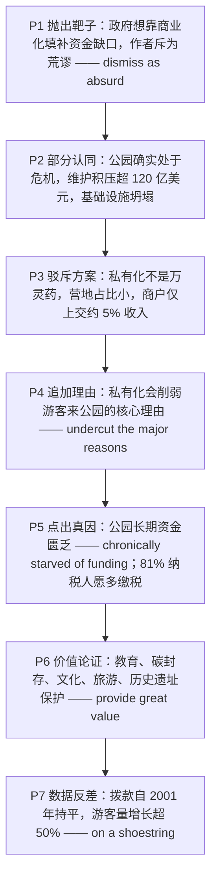

# 国家公园危机：维护积压、资金短缺与私有化的误区 精读笔记

---

## 背景

本文选自 **2023 年考研英语（一）Text 2**，主题为**美国国家公园的资金困境与私有化之争**。文章从联邦政府"让亚马逊把包裹送进帐篷""让餐车开进红杉林"这类**商业化设想**切入，先承认其**荒谬**，再承认其**问题意识正确**（公园确实陷入危机），随后**逐条驳斥**私有化方案，最后指出**真正的病根**——国会拨款长期停滞，而游客量持续攀升。

文章沿"**抛出争议方案 → 承认问题 → 驳斥方案 → 点出真因 → 论证价值 → 数据反差**"的链条展开：

- **抛出方案**：政府想用商业化填补公园的**长期资金缺口**，作者认为这些想法**荒谬**（P1）。
- **承认问题**：公园确实处于危机，**维护积压**超过 120 亿美元，基础设施正在**坍塌**（P2）。
- **驳斥方案**：私有化**不是万灵药**——营地只占积压的一小部分，商户平均只上交约 **5%** 收入（P3）。
- **追加反驳**：私有化还会**削弱**游客来公园的核心理由——享受自然、逃离**商业喧嚣**（P4）。
- **点出真因**：真正问题是公园**长期资金匮乏**；调查显示 **81%** 的纳税人愿意多缴税以避免削减（P5）。
- **论证价值**：公园在教育、**碳封存**、文化、旅游与**历史遗址保护**上价值巨大（P6）。
- **数据反差**：公园靠**极少的钱**运转；拨款自 2001 年起**持平**，游客量却增长超 **50%**（P7）。

**难度说明**：中等偏上。句式密集出现**形式主语 it + 长宾语后置**、**省略 that 的宾语从句**、**reasons why 定语从句**、**破折号同位语 + 定语从句**、**被动语态 + 主语补足语**、**多项并列（变体并列）**与**现在完成时 + since**；论证上属于典型的"**驳论 + 立论**"结构，适合练习**观点态度判断**、**论证方法识别**与**数据定位**。

---

## 文章原文
It's easy to **dismiss as absurd** the federal government's ideas for **plugging** the **chronic** funding gap of our national parks.

> [!abstract]- 长难句分析
> **原句**：It's easy to dismiss as absurd the federal government's ideas for plugging the chronic funding gap of our national parks.
>
> **主干提取**：
>
> - 形式主语: it（占主语位置，无实义）
> - 系动词 V: is
> - 表语 C: easy
> - 真正主语 S: to dismiss …（不定式短语）
> - 宾语 O: the federal government's ideas for plugging the chronic funding gap of our national parks（因过长而后置）
> - 宾语补足语 C: absurd（与 as 构成 `dismiss A as B`）
>
> **修饰成分**：
>
> | 类型 | 引导词 / 形式 | 修饰对象 |
> |------|--------------|----------|
> | 不定式作真正主语 | to dismiss | 形式主语 it |
> | 介词短语作宾语补足语 | as absurd | 宾语 the federal government's ideas |
> | 介词短语作后置定语 | for plugging the chronic funding gap | the federal government's ideas |
> | 动名词作介词宾语 | plugging | 介词 for |
> | 介词短语作后置定语 | of our national parks | the funding gap |
>
> **结构图解**：
>
> ```
> 主句: It + is + easy + 〔to dismiss …〕
>   ├── 形式主语: it → 无实义，真正主语后置
>   └── 真正主语: to dismiss + 〔the federal government's ideas〕+ as absurd
>         ├── 后置宾语: the federal government's ideas（因过长被推后）
>         │     └── 后置定语: for + plugging the chronic funding gap
>         │           └── 后置定语: of + our national parks
>         └── 宾语补足语: as absurd → 说明宾语性质
> ```
>
> **参考译文**：人们很容易把联邦政府为填补国家公园长期资金缺口而提出的那些想法斥为荒谬。
>
> **考点提示**：① 形式主语 `it` 无实义，真正主语是句末不定式 `to dismiss …`；② `dismiss A as B` 中因 A 长达十余词，作者把它**推到 `as absurd` 之后**，还原语序为 `dismiss the federal government's ideas … as absurd`，这是"**宾语后置**"的典型；③ `as absurd` 是**宾语补足语**，不是方式状语，不能译成"荒谬地否定"；④ `plug the gap` 意为"填补缺口"，与后文 `funding gap` 构成语义呼应。

Can anyone really think it's a good idea to allow Amazon deliveries to your tent in Yosemite or food trucks to line up under the redwood trees at Sequoia National Park?

> [!abstract]- 长难句分析
> **原句**：Can anyone really think it's a good idea to allow Amazon deliveries to your tent in Yosemite or food trucks to line up under the redwood trees at Sequoia National Park?
>
> **主干提取**：
>
> - 主语 S: anyone
> - 谓语 V: can think
> - 宾语 O: (that) it's a good idea to allow …（省略 that 的宾语从句）
> - 状语 A: really
> - 从句主干: it + is + a good idea + 〔to allow A or B〕
>
> **修饰成分**：
>
> | 类型 | 引导词 / 形式 | 修饰对象 |
> |------|--------------|----------|
> | 省略 that 的宾语从句 | (that) it's a good idea … | think |
> | 形式主语（从句内） | it | 宾语从句的主语位置 |
> | 不定式作真正主语 | to allow … | 从句内的 it |
> | 并列宾语 | or | allow 的两个宾语 |
> | 介词短语作后置定语 | to your tent（去向） | Amazon deliveries |
> | 介词短语作后置定语 | in Yosemite（地点） | your tent |
> | 不定式作宾语补足语 | to line up | food trucks |
> | 介词短语作状语 | under the redwood trees / at Sequoia National Park | line up |
>
> **结构图解**：
>
> ```
> 主句: Can + anyone + really + think + 〔(that) 宾语从句〕?
>   └── 宾语从句: it + is + a good idea + 〔to allow A or B〕
>         ├── 形式主语: it → 真正主语后置
>         ├── 并列宾语 1: Amazon deliveries〔to your tent〕〔in Yosemite〕
>         │     └── to your tent 修饰 deliveries（去向）；in Yosemite 限定帐篷所在地点
>         └── 并列宾语 2: food trucks〔to line up〕〔under the redwood trees〕〔at Sequoia NP〕
>               └── 不定式作宾补，表"让餐车做什么"
> ```
>
> **参考译文**：真有人会觉得，让亚马逊把包裹送到优胜美地国家公园的帐篷里，或者让餐车在红杉国家公园的巨杉树下排成长队，是个好主意吗？
>
> **考点提示**：① 这是"**宾语从句（省略 that）+ 从句内形式主语 it + 不定式**"的三层嵌套：先找 `think`，再找从句谓语 `is`，最后找不定式；② `or` 连接 `allow` 的**两个并列宾语**，两者相隔较远，不能把 `or` 误读为连接两个句子；③ 并列项中的两个 `to` **词性不同**：`to your tent` 是**介词**（表去向），`to line up` 是**不定式符号**（作宾补），形态相同、功能不同，是本句最大陷阱；④ 反问句形式上是提问，实际表达**强烈否定**，为下段转折铺垫。

But the government is right about one thing: U.S. national parks are in crisis. Collectively, they have a **maintenance backlog** of more than $12 billion. Roads, trails, restrooms, visitor centers and other **infrastructure** are **crumbling**.

But **privatizing** and **commercializing** the campgrounds would not be a **cure-all**.

Campgrounds are a tiny portion of the overall infrastructure backlog, and businesses in the parks hand over, on average, only about 5% of their **revenues** to the National Park Service.

> [!abstract]- 长难句分析
> **原句**：Campgrounds are a tiny portion of the overall infrastructure backlog, and businesses in the parks hand over, on average, only about 5% of their revenues to the National Park Service.
>
> **主干提取**：
>
> - 并列连词: and（连接两个完整分句）
> - 分句 1 主语 S: Campgrounds
> - 分句 1 系动词 V: are
> - 分句 1 表语 C: a tiny portion of the overall infrastructure backlog
> - 分句 2 主语 S: businesses in the parks
> - 分句 2 谓语 V: hand over
> - 分句 2 宾语 O: only about 5% of their revenues
> - 分句 2 状语 A: to the National Park Service
> - 插入语: on average
>
> **修饰成分**：
>
> | 类型 | 引导词 / 形式 | 修饰对象 |
> |------|--------------|----------|
> | 并列句 | and | 两个分句 |
> | 介词短语作后置定语 | of the overall infrastructure backlog | a tiny portion |
> | 介词短语作后置定语 | in the parks | businesses |
> | 插入语 | on average | 分句 2 全句（说明 5% 为平均值） |
> | 介词短语作状语 | to the National Park Service | hand over |
>
> **结构图解**：
>
> ```
> 并列句: 分句 1 + and + 分句 2
>   ├── 分句 1: Campgrounds + are + a tiny portion〔of the overall infrastructure backlog〕
>   └── 分句 2: businesses〔in the parks〕+ hand over + only about 5%〔of their revenues〕+〔to the NPS〕
>         └── 插入语: on average → 插在谓语与宾语之间
> ```
>
> **参考译文**：营地在整个基础设施维护积压中只占极小一部分，而公园内的商户平均只把约 5% 的收入上交给国家公园管理局。
>
> **考点提示**：① `and` 连接的是**两个完整分句**，第二个分句有自己的主语 `businesses`，不能把 `and businesses` 当成 `portion` 的并列成分；② `hand over, on average, only about 5% … to …` 中**插入语把谓语与宾语隔开**，`to` 引出的接收方远在句末，阅读时须跨过插入语找搭配；③ `only about 5%` 中的 `only` 是**作者态度词**，强调商户上交比例之低、远不足以填补 120 亿美元缺口，为下文"真正的问题是资金"铺垫（对应第 30 题 D 项）；④ `a tiny portion` 与同段 `backlog` 呼应，说明营地并非问题主体；第 27 题考的是"私有化会破坏游客体验"，依据在下一段的 `commercial drumbeat`，不在此句。

Moreover, increased privatization would certainly **undercut** one of the major reasons why 300 million visitors come to the parks each year: to enjoy nature and get a break from the **commercial drumbeat** that **overwhelms** daily life.

> [!abstract]- 长难句分析
> **原句**：Moreover, increased privatization would certainly undercut one of the major reasons why 300 million visitors come to the parks each year: to enjoy nature and get a break from the commercial drumbeat that overwhelms daily life.
>
> **主干提取**：
>
> - 状语 A: Moreover
> - 主语 S: increased privatization
> - 谓语 V: would undercut
> - 宾语 O: one of the major reasons（why …）
> - 状语 A: certainly（程度副词）
>
> **修饰成分**：
>
> | 类型 | 引导词 / 形式 | 修饰对象 |
> |------|--------------|----------|
> | 副词作状语 | Moreover | 全句（递进连接） |
> | 过去分词作前置定语 | increased | privatization |
> | 程度副词作状语 | certainly | would undercut |
> | 定语从句 | why | the major reasons |
> | 冒号解释（并列不定式） | to enjoy … and (to) get a break … | the reasons |
> | 介词短语作状语 | from the commercial drumbeat | get a break |
> | 定语从句 | that | the commercial drumbeat |
>
> **结构图解**：
>
> ```
> 主句: Moreover, increased privatization + would certainly undercut + one of the major reasons
>   ├── 定从: why + 300 million visitors + come + to the parks each year → 修饰 reasons
>   └── 冒号解释: to enjoy nature and (to) get a break〔from the commercial drumbeat〕
>         └── 定从: that + overwhelms + daily life → 修饰 drumbeat
> ```
>
> **参考译文**：此外，进一步私有化必定会削弱每年 3 亿游客来到公园的一个主要理由：享受自然，暂时摆脱充斥日常生活的商业喧嚣。
>
> **考点提示**：① `reasons why` 是**定语从句**，`why` 在从句中作原因状语（= for which），不是疑问词；② 冒号后是两个**并列不定式** `to enjoy … and (to) get a break …`，第二个 `to` 承前省略；③ `that overwhelms daily life` 的先行词是 **`commercial drumbeat`**（喧嚣），不是 `a break`，判断依据是"喧嚣淹没生活"语义成立；④ `one of the major reasons` 作宾语，全句只有 `would undercut` 一个谓语，`come` 属从句。

The real problem is that the parks have been chronically **starved of** funding.

An economic survey of 700 U.S. taxpayers found that people would be willing to pay a **significant** amount of money to make sure the parks and their programs are kept **intact**.

> [!abstract]- 长难句分析
> **原句**：An economic survey of 700 U.S. taxpayers found that people would be willing to pay a significant amount of money to make sure the parks and their programs are kept intact.
>
> **主干提取**：
>
> - 主语 S: An economic survey of 700 U.S. taxpayers
> - 谓语 V: found
> - 宾语 O: that people would be willing to pay …（that 宾语从句）
> - 从句主干: people + would be willing + 〔to pay a significant amount of money〕
> - 从句目的状语 A: to make sure the parks and their programs are kept intact
>
> **修饰成分**：
>
> | 类型 | 引导词 / 形式 | 修饰对象 |
> |------|--------------|----------|
> | 介词短语作后置定语 | of 700 U.S. taxpayers | An economic survey |
> | 宾语从句 | that | found |
> | 不定式补充形容词 | to pay … | willing |
> | 不定式作目的状语 | to make sure … | would be willing to pay |
> | 省略 that 的宾语从句 | (that) | make sure |
> | 被动语态 + 主语补足语 | are kept intact | the parks and their programs |
>
> **结构图解**：
>
> ```
> 主句: An economic survey〔of 700 U.S. taxpayers〕+ found + 〔that 宾语从句〕
>   └── 宾语从句: people + would be willing + 〔to pay a significant amount of money〕
>         └── 目的状语: to make sure + 〔(that) 宾语从句〕
>               └── 宾语从句: the parks and their programs + are kept + intact
>                     └── 被动谓语 + 主语补足语（还原主动: keep sth intact）
> ```
>
> **参考译文**：一项针对 700 名美国纳税人的经济调查发现，人们愿意支付可观的金额，以确保公园及其各项项目保持完好。
>
> **考点提示**：① `found that` 引出**宾语从句**，主干是 `An economic survey found`，`of 700 U.S. taxpayers` 只是后置定语；② `be willing to do` 中不定式补充说明形容词 `willing`，不是宾语；③ `make sure` 后**省略 that**，从句 `the parks and their programs are kept intact` 自带被动谓语；④ `are kept intact` 是"**被动 + 主语补足语**"，还原主动为 `keep the parks intact`，`intact` 不是表语，不能译成"是完好的"。

Some 81% of respondents said they would be willing to pay additional taxes for the next 10 years to avoid any cuts to the national parks.

> [!abstract]- 长难句分析
> **原句**：Some 81% of respondents said they would be willing to pay additional taxes for the next 10 years to avoid any cuts to the national parks.
>
> **主干提取**：
>
> - 主语 S: Some 81% of respondents（`Some` 为副词，意为"大约"）
> - 谓语 V: said
> - 宾语 O: (that) they would be willing to pay additional taxes …（省略 that 的宾语从句）
> - 从句主干: they + would be willing + 〔to pay additional taxes〕
> - 时间状语 A: for the next 10 years
> - 目的状语 A: to avoid any cuts to the national parks
>
> **修饰成分**：
>
> | 类型 | 引导词 / 形式 | 修饰对象 |
> |------|--------------|----------|
> | 程度副词 | Some（= about） | 81% |
> | 介词短语作后置定语 | of respondents | 81% |
> | 省略 that 的宾语从句 | (that) they would … | said |
> | 不定式补充形容词 | to pay additional taxes | willing |
> | 介词短语作时间状语 | for the next 10 years | would be willing to pay |
> | 不定式作目的状语 | to avoid … | pay additional taxes |
> | 介词短语作后置定语 | to the national parks | any cuts |
>
> **结构图解**：
>
> ```
> 主句: Some 81%〔of respondents〕+ said + 〔(that) 宾语从句〕
>   └── 宾语从句: they + would be willing + 〔to pay additional taxes〕
>         ├── 时间状语: for the next 10 years
>         └── 目的状语: to avoid + 〔any cuts〕〔to the national parks〕
> ```
>
> **参考译文**：约 81% 的受访者表示，他们愿意在未来 10 年缴纳额外税款，以避免国家公园遭到任何削减。
>
> **考点提示**：① `Some` 置于数字前是**副词**，意为"大约"（= about），不是"一些"；若写成 `Some of the respondents` 才是代词；② **主谓一致**：`X% of + 复数名词` 谓语用复数，故为 `said`；③ `would` 是 `said` 之后的**过去将来时**，不是虚拟语气；④ 两个 `to` 功能不同：`to pay` 补充 `willing`，`to avoid` 是**目的状语**；⑤ `cuts to` 是固定搭配，"对……的削减"，第 28 题 `agree to pay extra` 即此句的同义改写。

The national parks provide great value to U.S. residents both as places to escape and as symbols of nature.

On top of this, they produce value from their extensive educational programs, their positive impact on the climate through **carbon sequestration**, their contribution to our cultural and artistic life, and of course through tourism.

> [!abstract]- 长难句分析
> **原句**：On top of this, they produce value from their extensive educational programs, their positive impact on the climate through carbon sequestration, their contribution to our cultural and artistic life, and of course through tourism.
>
> **主干提取**：
>
> - 状语 A: On top of this
> - 主语 S: they
> - 谓语 V: produce
> - 宾语 O: value
> - 状语 A: from A, B, C, and of course through D（四个并列来源）
>
> **修饰成分**：
>
> | 类型 | 引导词 / 形式 | 修饰对象 |
> |------|--------------|----------|
> | 介词短语作状语 | On top of this | 全句（递进连接） |
> | 介词短语作状语 | from … | produce value |
> | 介词短语作后置定语 | on the climate | their positive impact |
> | 介词短语作方式状语 | through carbon sequestration | their positive impact |
> | 介词短语作后置定语 | to our cultural and artistic life | their contribution |
> | 插入语 | of course | 最后一个并列项 |
> | 介词短语作状语 | through tourism | produce value |
>
> **结构图解**：
>
> ```
> 主句: On top of this, they + produce + value + 〔from A, B, C, and of course through D〕
>   ├── 并列项 1: their extensive educational programs
>   ├── 并列项 2: their positive impact〔on the climate〕〔through carbon sequestration〕
>   ├── 并列项 3: their contribution〔to our cultural and artistic life〕
>   └── 并列项 4: through tourism（介词由 from 换成 through，避免重复）
> ```
>
> **参考译文**：除此之外，它们还通过广泛的教育项目、通过碳封存对气候产生的积极影响、对我们文化和艺术生活的贡献，当然还有旅游业，创造出价值。
>
> **考点提示**：① 这是**四项并列**，共用 `from`，仅最后一项换成 `through`，属"**变体并列**"（避免介词重复），不改变并列关系；② 并列层级靠**逗号 + and** 判断：`and of course through tourism` 是最高层并列的标志；③ 三个 `their + 名词` 是并列的**介词宾语**，不是三个分句，全句只有 `produce` 一个谓语；④ `impact on`、`contribution to` 是固定搭配，介词不可替换。

The parks also help keep America's past alive, working with thousands of local **jurisdictions** around the country to protect historical sites and to bring the stories of these places to life.

> [!abstract]- 长难句分析
> **原句**：The parks also help keep America's past alive, working with thousands of local jurisdictions around the country to protect historical sites and to bring the stories of these places to life.
>
> **主干提取**：
>
> - 主语 S: The parks
> - 谓语 V: help
> - 宾语 O: (to) keep America's past alive（省略 to 的不定式短语作宾语）
> - 不定式内部: keep + America's past + alive（形容词作宾语补足语）
> - 伴随状语 A: working with thousands of local jurisdictions around the country
> - 目的状语 A: to protect historical sites and to bring the stories … to life
>
> **修饰成分**：
>
> | 类型 | 引导词 / 形式 | 修饰对象 |
> |------|--------------|----------|
> | 省略 to 的不定式作宾语 | (to) keep … | help |
> | 形容词作宾语补足语 | alive | America's past |
> | 现在分词作伴随状语 | working with … | 主句（逻辑主语 the parks） |
> | 介词短语作后置定语 | around the country | local jurisdictions |
> | 并列不定式作目的状语 | to protect … and to bring … | working with … |
>
> **结构图解**：
>
> ```
> 主句: The parks + help + 〔(to) keep + America's past + alive〕
>   ├── 宾补: alive → 说明 America's past 的状态
>   └── 伴随状语: working with + thousands of local jurisdictions〔around the country〕
>         └── 目的状语: to protect historical sites and to bring the stories … to life
> ```
>
> **参考译文**：公园还帮助让美国的过去保持鲜活，它们与全国数千个地方辖区合作，保护历史遗址，并让这些地方的故事栩栩如生。
>
> **考点提示**：① `help (to) do` 中 `to` 可省略，此处 `keep` 前就省略了 `to`；② `keep sth alive` 是"**动词 + 宾语 + 形容词宾补**"，`alive` 只作表语或补语，不能换成前置定语 `living`；③ 现在分词 `working with …` 的**逻辑主语是 the parks**，不是 `America's past`，据此排除悬垂分词；④ 句末出现**三个 `to`**，功能不同：`to protect` / `to bring` 是**不定式符号**（并列目的状语），`to life` 是**介词短语**（`bring sth to life`），不能混为一谈。

The parks do all this **on a shoestring**.

Congress **allocates** only $3 billion a year to the national park system—an amount that has been **flat** since 2001 (in **inflation-adjusted** dollars) with the exception of a **onetime** boost in 2009.

> [!abstract]- 长难句分析
> **原句**：Congress allocates only $3 billion a year to the national park system—an amount that has been flat since 2001 (in inflation-adjusted dollars) with the exception of a onetime boost in 2009.
>
> **主干提取**：
>
> - 主语 S: Congress
> - 谓语 V: allocates
> - 宾语 O: only $3 billion a year
> - 状语 A: to the national park system
> - 同位语（破折号）: an amount that has been flat …（解释前面的金额）
>
> **修饰成分**：
>
> | 类型 | 引导词 / 形式 | 修饰对象 |
> |------|--------------|----------|
> | 介词短语作状语 | to the national park system | allocates |
> | 破折号同位语 | an amount | only $3 billion a year |
> | 定语从句 | that | an amount |
> | 时间状语 | since 2001 | has been flat |
> | 插入语（计量口径） | in inflation-adjusted dollars | has been flat |
> | 介词短语作状语（例外） | with the exception of | has been flat |
> | 复合形容词作前置定语 | onetime | boost |
>
> **结构图解**：
>
> ```
> 主句: Congress + allocates + only $3 billion a year + 〔to the national park system〕
>   └── 同位语（破折号）: an amount〔that has been flat since 2001 …〕
>         ├── 定从: that + has been + flat + since 2001
>         ├── 插入语: in inflation-adjusted dollars → 说明计量口径
>         └── 例外状语: with the exception of + a onetime boost in 2009
> ```
>
> **参考译文**：国会每年只向国家公园系统拨款 30 亿美元——按通胀调整后的美元计算，这一数额自 2001 年以来一直持平，只有 2009 年出现过一次性上调。
>
> **考点提示**：① 破折号内是**同位语 + 定语从句**，主句谓语只有 `allocates`，`has been` 属从句，不要把从句谓语当主句；② `since 2001` 是**现在完成时的标志状语**，谓语必须用 `has been`；③ `in inflation-adjusted dollars` 是**插入的计量口径说明**，去掉不影响结构；④ `with the exception of` = "除……之外（其余都如此）"，逻辑上是"只这一次例外"，翻译时须体现"唯一例外"。

Meanwhile, the number of annual visitors has increased by more than 50% since 1980, and now stands at 330 million visitors per year.

> [!abstract]- 长难句分析
> **原句**：Meanwhile, the number of annual visitors has increased by more than 50% since 1980, and now stands at 330 million visitors per year.
>
> **主干提取**：
>
> - 状语 A: Meanwhile
> - 主语 S: the number of annual visitors
> - 谓语 V1: has increased
> - 谓语 V2: (now) stands at
> - 状语 A: by more than 50% / since 1980
> - 介词宾语（作状语）: 330 million visitors per year（介词 at 的宾语）
>
> **修饰成分**：
>
> | 类型 | 引导词 / 形式 | 修饰对象 |
> |------|--------------|----------|
> | 介词短语作后置定语 | of annual visitors | the number |
> | 介词短语作幅度状语 | by more than 50% | has increased |
> | 时间状语 | since 1980 | has increased |
> | 并列谓语 | and | has increased / stands at |
> | 时间副词作状语 | now | stands at |
> | 介词短语作状语 | per year | 330 million visitors |
>
> **结构图解**：
>
> ```
> 主句: Meanwhile, the number〔of annual visitors〕+ has increased + 〔by more than 50%〕〔since 1980〕
>   └── 并列谓语: and + now + stands at + 330 million visitors〔per year〕
> ```
>
> **参考译文**：与此同时，自 1980 年以来年游客量增长超过 50%，如今每年达到 3.3 亿人次。
>
> **考点提示**：① **主谓一致**：`the number of + 复数名词` 中心词是 `number`，谓语用**单数** `has increased` / `stands`，区别于 `a number of`（许多，用复数）；② `increase by 50%` = "**增长了** 50%"，`increase to 50%` 才是"增长到 50%"，数据题高频陷阱；③ `and` 连接**两个谓语**，前后时态不同（现在完成时 + 一般现在时），前者表累积过程，后者表当前数值；④ `stand at` 是统计数据专用搭配，意为"达到（某一数字）"。第 30 题 D 项 `is in need of a funding increase` 正建立在本句"钱不涨、人猛增"的反差上。

---

## 题目

### 26. What problem are U.S. national parks faced with?

- [A] Decline of business profits.
- [B] Inadequate commercialization.
- [C] Lack of transportation services.
- [D] Poorly maintained infrastructure.

### 27. Increased privatization of the campgrounds may ____.

- [A] spoil visitor experience
- [B] help preserve nature
- [C] bring operational pressure
- [D] boost visits to parks

### 28. According to Paragraph 5, most respondents in the survey would ____.

- [A] go to the national parks on a regular basis
- [B] advocate a bigger budget for the national parks
- [C] agree to pay extra for the national parks
- [D] support the national parks' recent reforms

### 29. The national parks are valuable in that they ____.

- [A] lead the way in tourism
- [B] have historical significance
- [C] sponsor research on climate
- [D] provide an income for the locals

### 30. It can be concluded from the text that the national park system ____.

- [A] is able to cope with staff shortages
- [B] is able to meet visitors' demands
- [C] is in need of a new pricing policy
- [D] is in need of a funding increase

---

## 翻译对照

## Paragraph 1

It's easy to dismiss as absurd the federal government's ideas for plugging the chronic funding gap of our national parks. Can anyone really think it's a good idea to allow Amazon deliveries to your tent in Yosemite or food trucks to line up under the redwood trees at Sequoia National Park?

人们很容易把联邦政府填补国家公园长期资金缺口的那些想法斥为荒谬。真有人会觉得，让亚马逊把包裹送到优胜美地国家公园的帐篷里，或者让餐车在红杉国家公园的巨杉树下排成长队，是个好主意吗？

> [!note] 翻译说明
> - `dismiss ... as absurd` = "把……斥为荒谬"，`dismiss A as B` 表示"认为 A 不值得考虑、把 A 视为 B"；此处宾语 `the federal government's ideas for ...` 较长，被后置到 `as absurd` 之后。
> - `plugging the chronic funding gap` = "填补长期资金缺口"，`plug` 本义为"堵住（漏洞）"，`chronic` = "长期的、积重难返的"。
> - `Yosemite`（优胜美地）与 `Sequoia National Park`（红杉国家公园）均为美国著名国家公园，`redwood` = "红杉"。

## Paragraph 2

But the government is right about one thing: U.S. national parks are in crisis. Collectively, they have a maintenance backlog of more than $12 billion. Roads, trails, restrooms, visitor centers and other infrastructure are crumbling.

但在一点上政府是对的：美国国家公园正处于危机之中。所有公园加在一起，积压的维护工作价值超过 120 亿美元。道路、步道、卫生间、游客中心以及其他基础设施正在坍塌损毁。

> [!note] 翻译说明
> - `is right about one thing` = "在某一点上是对的"，用于先否定后让步的转折结构。
> - `Collectively` = "总计、合起来看"，此处强调把所有公园作为一个整体来算。
> - `maintenance backlog` = "积压的维护工作"，`backlog` 指"积压未办的事"，考研常见搭配 `a backlog of orders/work`。
> - `crumbling` = "崩塌、破损不堪"，现在分词表进行中的状态。

## Paragraph 3

But privatizing and commercializing the campgrounds would not be a cure-all. Campgrounds are a tiny portion of the overall infrastructure backlog, and businesses in the parks hand over, on average, only about 5% of their revenues to the National Park Service.

但把营地私有化和商业化并不能包治百病。营地在整个基础设施积压问题中只占极小一部分，而且公园内的商户平均只把约 5% 的收入上交给国家公园管理局。

> [!note] 翻译说明
> - `cure-all` = "万灵药、包治百病的办法"，类比 `cure-all remedy`。
> - `privatizing` / `commercializing` = "私有化 / 商业化"，动名词作主语，谓语用单数 `would not be`。
> - `hand over` = "移交、上交"，`hand over 5% of their revenues to ...` 中 `to` 引出接收方。
> - `on average` 为插入语，翻译时前置为"平均"。

## Paragraph 4

Moreover, increased privatization would certainly undercut one of the major reasons why 300 million visitors come to the parks each year: to enjoy nature and get a break from the commercial drumbeat that overwhelms daily life.

此外，进一步私有化必定会削弱每年 3 亿游客来到公园的一个主要理由：享受自然，暂时摆脱充斥日常生活的商业喧嚣。

> [!note] 翻译说明
> - `undercut` = "削弱、损害"，本义为"从下方切除"，常用于抽象地表示削弱某事物的基础。
> - `why 300 million visitors come ...` 是修饰 `reasons` 的定语从句，冒号后的不定式 `to enjoy ...` 说明具体理由。
> - `get a break from` = "暂时摆脱、从……中喘口气"。
> - `commercial drumbeat` = "商业的鼓点/喧嚣"，比喻不断重复、令人疲惫的商业宣传；`overwhelms daily life` 为其定语从句。

## Paragraph 5

The real problem is that the parks have been chronically starved of funding. An economic survey of 700 U.S. taxpayers found that people would be willing to pay a significant amount of money to make sure the parks and their programs are kept intact. Some 81% of respondents said they would be willing to pay additional taxes for the next 10 years to avoid any cuts to the national parks.

真正的问题在于，公园长期处于资金匮乏状态。一项针对 700 名美国纳税人的经济调查发现，人们愿意支付可观的金额，以确保公园及其各项项目保持完好。约 81% 的受访者表示，他们愿意在未来 10 年缴纳额外税款，以避免国家公园遭到任何削减。

> [!note] 翻译说明
> - `be starved of` = "极度缺乏"，`starve` 本义"挨饿"，此处为被动比喻用法，比 `lack` 语气更强。
> - `be willing to pay a significant amount of money` = "愿意支付一大笔钱"，`significant` 在数据语境中强调"数额可观"。
> - `are kept intact` = "保持完好无损"，`keep + 宾语 + 形容词` 结构，`intact` 为宾语补足语。
> - `avoid any cuts to` = "避免对……的任何削减"，`cut` 作名词指预算削减。

## Paragraph 6

The national parks provide great value to U.S. residents both as places to escape and as symbols of nature. On top of this, they produce value from their extensive educational programs, their positive impact on the climate through carbon sequestration, their contribution to our cultural and artistic life, and of course through tourism. The parks also help keep America's past alive, working with thousands of local jurisdictions around the country to protect historical sites and to bring the stories of these places to life.

国家公园对美国居民具有巨大价值，既是人们逃避喧嚣的去处，也是自然的象征。除此之外，它们还通过广泛的教育项目、通过碳封存对气候产生的积极影响、对我们文化和艺术生活的贡献，当然还有通过旅游业，创造出价值。公园还帮助让美国的过去保持鲜活，它们与全国数千个地方行政辖区合作，保护历史遗址，并让这些地方的故事栩栩如生。

> [!note] 翻译说明
> - `On top of this` = "除此之外、更重要的是"，用于递进补充。
> - `extensive` = "广泛的、大量的"，修饰 `educational programs`。
> - `carbon sequestration` = "碳封存"，指植物吸收并储存二氧化碳的过程，环保话题高频术语。
> - `jurisdictions` = "辖区、管辖区"，指拥有管辖权的行政区域或机构。
> - `bring ... to life` = "使……生动起来、使……复活"，与 `keep America's past alive` 形成呼应。

## Paragraph 7

The parks do all this on a shoestring. Congress allocates only $3 billion a year to the national park system—an amount that has been flat since 2001 (in inflation-adjusted dollars) with the exception of a onetime boost in 2009. Meanwhile, the number of annual visitors has increased by more than 50% since 1980, and now stands at 330 million visitors per year.

公园是靠极少的钱完成这一切的。国会每年只向国家公园系统拨款 30 亿美元——按通胀调整后的美元计算，这一数额自 2001 年以来一直持平，只有 2009 年出现过一次性的上调。与此同时，自 1980 年以来年游客量增长超过 50%，如今每年达到 3.3 亿人次。

> [!note] 翻译说明
> - `on a shoestring` = "以极少的钱、靠微薄预算"，固定习语，`shoestring` 本义"鞋带"，引申为"极少的资金"。
> - `allocates ... to ...` = "向……拨款/分配"，`allocate` 为考研高频动词。
> - `flat` = "持平的、没有涨落的"，形容词作表语。
> - `in inflation-adjusted dollars` = "按通胀调整后的美元计算"，括号内为补充说明口径。
> - `with the exception of` = "除……之外"，`onetime boost` = "一次性上调"。
> - `stands at` = "达到（某一数字）"，用于统计数据的固定说法。

---

## 题目翻译

### 26. 美国国家公园面临什么问题？

- [A] 企业利润下降。
- [B] 商业化不足。
- [C] 交通服务缺乏。
- [D] 基础设施维护不善。

### 27. 营地的进一步私有化可能 ____。

- [A] 破坏游客体验
- [B] 有助于保护自然
- [C] 带来运营压力
- [D] 提升公园的游客量

### 28. 根据第五段，调查中的大多数受访者会 ____。

- [A] 经常去国家公园
- [B] 主张给国家公园更多预算
- [C] 同意为国家公园额外付费
- [D] 支持国家公园近期的改革

### 29. 国家公园之所以有价值，是因为它们 ____。

- [A] 在旅游业中处于领先地位
- [B] 具有历史意义
- [C] 资助气候研究
- [D] 为当地人提供收入

### 30. 从文章可以得出结论：国家公园系统 ____。

- [A] 能够应对人手短缺
- [B] 能够满足游客需求
- [C] 需要新的定价政策
- [D] 需要增加资金

---

## 语法要点
> [!note] 来源说明
> 本篇**用户未提供语法源笔记**，以下语法点由 `formatted-article.md` 与 `translation.md` **从本文推断提取**，仅收录本篇实际出现的语法现象。
> 每一条均给出**原文语境**，便于回原文核对；标注"（联动）"的条目与相邻专题互为参照。
> 固定搭配与词组见 [[intermediate/2023-passage2-national-parks/固定搭配与词组笔记.md|2023 Passage 2 固定搭配与词组]]。

---

## 一、从句

### 从句：that 引导的表语从句

**概述**：`that` 引导的从句放在系动词 `be` 之后作**表语**，说明主语的具体内容；此处 `that` 只起连接作用，在从句中**不作成分**，但**不能省略**。

| 结构 | 用法 | 例句 |
|------|------|------|
| `The real problem is that + 完整句` | that 从句作表语，说明主语内容 | The real problem is **that the parks have been chronically starved of funding**. |
| `But the government is right about one thing: + 完整句` | 冒号后的名词性从句，功能接近表语/同位语 | But the government is right about one thing: **U.S. national parks are in crisis**. |

> [!tip] 阅读技巧
> 表语从句是**主旨句的高发位置**。本篇两处"问题判断句"（`The real problem is that …`、`the government is right about one thing: …`）都是作者**亮明立场**的地方，第 26、30 题的答案依据就落在这些句子上。看到 `is that`、`is right about` 立刻标记为观点句。

### 从句：that 引导的宾语从句

**概述**：`found / said` 等动词后的 `that` 从句作**宾语**，`that` 可省略。本篇两种形式并存：`found that …`（保留 that）与 `said they would …`（省略 that）。

| 结构 | 用法 | 例句 |
|------|------|------|
| `found that + 完整句` | that 宾语从句，保留 that | An economic survey … **found that people would be willing to pay** a significant amount of money … |
| `said (that) + 完整句` | 省略 that 的宾语从句 | Some 81% of respondents **said they would be willing to pay** additional taxes … |

> [!warning] 易错点
> `said they would be willing to pay …` 中 `said` 后**没有 that**，`they` 是新从句的主语，不是 `said` 的宾语。阅读时若把 `they` 当成与 `said` 并列的成分，会误判句子边界。判断依据：`said` 是及物动词，后面必须跟一个**完整的主谓结构**。

### 从句：省略 that 的宾语从句（make sure）

**概述**：`make sure` 后接的宾语从句常**省略 that**，且从句本身又是**被动语态** `are kept intact`，形成"短语动词 + 隐形从句 + 被动"的叠加结构。

| 结构 | 用法 | 例句 |
|------|------|------|
| `make sure (that) + 主语 + be + 过去分词 + 形容词` | 省略 that 的宾语从句 + 被动 + 宾补 | to **make sure the parks and their programs are kept intact** |

> [!tip] 阅读技巧
> 这句可拆成三层：`to make sure`（目的）→ `(that) the parks and their programs are kept`（被动谓语）→ `intact`（主语补足语）。`keep + 宾语 + 形容词` 变被动后，形容词 `intact` 保留在句末，**不要误当成表语从句**。（联动）见本笔记"被动语态 + 宾语补足语"。

### 从句：that 引导的限制性定语从句

**概述**：`that` 在定语从句中作**主语**，紧跟先行词，**不加逗号、不可省略**；从句谓语与先行词保持数的一致。

| 结构 | 用法 | 例句 |
|------|------|------|
| `名词 + that + 谓语 + 宾语` | that 作从句主语，修饰前面的名词 | the commercial drumbeat **that overwhelms daily life** |
| `an amount + that + has been + 形容词 + since …` | that 作从句主语，从句用现在完成时 | an amount **that has been flat since 2001** |

> [!warning] 易错点
> 第一个 `that` 从句的先行词是 **`commercial drumbeat`**（商业喧嚣），不是 `a break`；第二个的先行词是 **`an amount`**（金额），不是 `$3 billion`。判断先行词的方法：把从句去掉，看哪个名词"缺了它句子就不完整"。本篇两处 `that` 都**紧贴先行词**，属于最规范的写法。

### 从句：why 引导的定语从句（reasons why）

**概述**：`reason` 后的定语从句可用 `why` 引导，`why` 在从句中作**原因状语**（= for which）；也可换成 `that` 或直接省略关系词。

| 结构 | 用法 | 例句 |
|------|------|------|
| `the reason(s) why + 完整句` | why 作原因状语，修饰 reasons | one of the major reasons **why 300 million visitors come to the parks each year** |

> [!tip] 阅读技巧
> `the reason why … is that …` 是考研高频句式，注意**表语从句用 that 而不是 because**（中文"原因是……因为……"是母语负迁移）。本篇虽只出现前半截，但该句式在写作与翻译中都要能补全。`why` 从句后的冒号 `: to enjoy nature …` 是对 `reasons` 的**具体展开**，属于"抽象名词 + 冒号"的常见搭配。

### 从句：同位语（an amount 解释金额）

**概述**：破折号后的 `an amount …` 对前面整个数量 `$3 billion a year` 作**同位语**，既解释其性质，又引出定语从句，是典型的"**同位语 + 定从**"套叠。

| 结构 | 用法 | 例句 |
|------|------|------|
| `数量 — an amount that …—` | 破折号同位语 + that 定语从句 | only $3 billion a year **—an amount that has been flat since 2001 …—**with the exception of … |

> [!warning] 易错点
> 破折号之间的部分**不是主句成分**，去掉后主句仍完整：`Congress allocates only $3 billion a year to the national park system`。同位语中的 `that` 从句另有自己的谓语 `has been`，不要把 `has been` 当主句谓语。

---

## 二、非谓语动词

### 非谓语：形式主语 it + 不定式

**概述**：当**不定式短语过长**时，用 `it` 占主语位置，真正主语后置。本篇开篇句就是典型：`It's easy to dismiss … the federal government's ideas …`。

| 结构 | 用法 | 例句 |
|------|------|------|
| `It is + 形容词 + to do sth` | it 作形式主语，不定式为真正主语 | **It's easy to dismiss as absurd** the federal government's ideas for plugging the chronic funding gap … |
| `think it is + 形容词 + to do sth` | 宾语从句内的形式主语 | Can anyone really **think it's a good idea to allow** Amazon deliveries to your tent …? |

> [!tip] 阅读技巧
> 第一句是**"形式主语 + 宾语后置"的双重移位**：`dismiss` 的宾语 `the federal government's ideas for …` 因过长被推到 `as absurd` 之后，正常语序为 `It's easy to dismiss the federal government's ideas … as absurd`。还原顺序是：**先找 it 后的形容词 → 再找 to do → 最后把长宾语接回动词后**。这类句子极易被误读成"it 指代前文某物"。

### 非谓语：动名词并列作主语

**概述**：两个动名词短语由 `and` 并列作主语，表示**同一类行为的两个方面**；此时谓语用**单数**（视为一个整体概念）。

| 结构 | 用法 | 例句 |
|------|------|------|
| `doing A and doing B + 单数谓语` | 动名词并列作主语，谓语用单数 | **Privatizing and commercializing** the campgrounds **would not be** a cure-all. |

> [!warning] 易错点
> `Privatizing and commercializing` 是**两个动名词并列**，不是"现在分词作状语"，也不是复数主语。判断依据：句首、后有谓语 `would not be`、且整体表达一个抽象概念。若写成 `To privatize and to commercialize …`（不定式并列），谓语仍用单数，但语气更具体。

### 非谓语：不定式作目的状语

**概述**：`to do` 说明主句动作的**目的**，可译为"为了……"；本篇密集出现，是作者"问题—对策"论证链的语法载体。

| 结构 | 用法 | 例句 |
|------|------|------|
| `pay money to make sure …` | 不定式表目的 | would be willing to pay a significant amount of money **to make sure the parks … are kept intact** |
| `pay taxes to avoid …` | 不定式表目的 | would be willing to pay additional taxes … **to avoid any cuts** to the national parks |
| `working with … to protect … and to bring …` | 两个并列不定式表目的 | working with thousands of local jurisdictions … **to protect historical sites and to bring the stories … to life** |

> [!note] 补充说明
> 三个目的状语对应文章的**三层主张**：用钱保住公园 → 用税避免削减 → 与地方合作保护遗址。找到 `to do` 就找到了"作者想干什么"，这是推断题（第 30 题"需要增加资金"）的直接依据。

### 非谓语：不定式作宾语与宾补

**概述**：`be willing to do` 中不定式作**形容词的补足成分**；`allow sb to do sth` 中不定式作**宾语补足语**。二者形式相同、句法角色不同。

| 结构 | 用法 | 例句 |
|------|------|------|
| `be willing to do sth` | 不定式补充说明形容词 willing | people **would be willing to pay** a significant amount of money |
| `allow sb to do sth` | 不定式作宾语补足语 | allow **Amazon deliveries to your tent** / allow **food trucks to line up** under the redwood trees |

> [!tip] 阅读技巧
> `allow` 后的不定式**不能换成 doing**（区别于 `allow doing sth` 表"允许某行为"）；`be willing to do` 不能说 `be willing doing`。这两个搭配在第 28 题（愿意多付钱）的选项辨析中直接有用：`agree to pay extra` 与 `be willing to pay additional taxes` 语义对应。

### 非谓语：现在分词作伴随状语

**概述**：`working with …` 用现在分词短语补充说明主句动作的**伴随情况**，逻辑主语与主句主语一致（= the parks）。

| 结构 | 用法 | 例句 |
|------|------|------|
| `主句 + , doing sth` | 现在分词作伴随状语 | The parks also help keep America's past alive, **working with thousands of local jurisdictions …** |

> [!warning] 易错点
> 分词短语的逻辑主语是 **the parks**，不是 `America's past`。判断方法：分词动作的发出者必须能执行该动作——"公园与地方辖区合作"成立，"过去与辖区合作"不成立。若逻辑主语不一致，则构成**悬垂分词**错误。

---

## 三、语态与时态

### 语态：被动语态 + 宾语补足语（are kept intact）

**概述**：`keep + 宾语 + 形容词` 变被动后成为 `be kept + 形容词`，原宾语补足语 `intact` 保留在谓语后，作**主语补足语**。

| 结构 | 用法 | 例句 |
|------|------|------|
| `keep + 宾语 + 形容词`（主动） | 形容词作宾语补足语 | make sure … **are kept intact** |
| `be kept + 形容词`（被动） | 形容词作主语补足语 | the parks and their programs **are kept intact** |

> [!tip] 阅读技巧
> 被动句里"谓语后的形容词"很容易被误判为表语。识别方法：把句子还原成主动语态——`(someone) keeps the parks intact`，`intact` 就是宾补，被动化后成为主补，**不是系表结构**。

### 语态与时态：现在完成时被动（have been starved of）

**概述**：`have/has been + 过去分词` 构成**现在完成时的被动语态**，表示"从过去到现在一直处于某种被动状态"，并对现在造成影响。

| 结构 | 用法 | 例句 |
|------|------|------|
| `have been + 过去分词 + of` | 现在完成时被动，表持续状态 | the parks **have been chronically starved of** funding |

> [!warning] 易错点
> `starve` 原义"挨饿"，`be starved of sth` = "**极度缺乏某物**"，是**比喻性被动**，不能译成"被饿死"。`chronically` 与完成时搭配，强调"长期如此、积重难返"，比 `lack funding` 语气重得多，是作者**态度词**。

### 时态：现在完成时 + since

**概述**：`since + 时间点` 是**现在完成时的标志状语**，表示动作或状态从该时间点持续至今；主句谓语必须用 `have/has + 过去分词`。

| 结构 | 用法 | 例句 |
|------|------|------|
| `has been + 形容词 + since + 年份` | 状态持续至今 | an amount that **has been flat since 2001** |
| `has increased by + 幅度 + since + 年份` | 增长幅度持续累积 | the number of annual visitors **has increased by more than 50% since 1980** |
| `now stands at + 数字` | 与完成时并列，报告当前值 | and **now stands at** 330 million visitors per year |

> [!note] 补充说明
> 同一段里 `since 2001`（拨款持平）与 `since 1980`（游客增长 50%）形成**强对比**：钱不涨、人猛增。这正是第 30 题"需要增加资金"的数据支撑。注意 `increased by 50%` 是**增幅**，`increased to 50%` 才是**增到**。

---

## 四、平行结构与逻辑连接

### 平行结构：both ... and ... 并列介词短语

**概述**：`both ... and ...` 连接两个**结构对称**的成分；本篇连接两个 `as` 介词短语，作方式状语。

| 结构 | 用法 | 例句 |
|------|------|------|
| `both as A and as B` | 并列两个介词短语，结构对称 | provide great value … **both as places to escape and as symbols of nature** |

> [!tip] 阅读技巧
> `both … and …` 是**细节题的同义替换信号**：第 29 题 B 项 `have historical significance` 对应第六段的 `protect historical sites`，而 `both as places to escape and as symbols of nature` 则排除 A、C、D 三个偏窄选项。看到平行结构，先把两侧内容**配对记忆**。

### 平行结构：from ... through ... 的多重并列

**概述**：`produce value from A, B, C, and of course through D` 用四个并列成分列举价值来源；`through` 与 `from` 交替，是英语避免重复的**变体并列**。

| 结构 | 用法 | 例句 |
|------|------|------|
| `from A, B, C, and through D` | 多重并列，介词交替避免重复 | they produce value **from** their extensive educational programs, … **their contribution to our cultural and artistic life, and of course through tourism** |

> [!warning] 易错点
> 四个并列项都是**名词短语**，只有最后一项换了介词 `through`；`and of course` 是**插入的强调语**，不改变并列关系。不要把 `of course` 误认为独立分句。

### 逻辑连接：转折与递进的链条

**概述**：本篇用 `But`（转折）→ `Moreover`（递进）→ `Meanwhile`（对照）串起论证；每个连接词后都是**新论点**，也是命题点。

| 结构 | 用法 | 例句 |
|------|------|------|
| `But ... is right about one thing:` | 先让步后转折，引出作者认同点 | **But** the government **is right about one thing**: U.S. national parks are in crisis. |
| `But ... would not be a cure-all` | 转折否定对方方案 | **But** privatizing … **would not be a cure-all**. |
| `Moreover, ... would certainly undercut ...` | 递进，追加反对理由 | **Moreover**, increased privatization **would certainly undercut** one of the major reasons … |
| `Meanwhile, ...` | 对照，引出反差数据 | **Meanwhile**, the number of annual visitors **has increased** by more than 50% … |

> [!tip] 阅读技巧
> 本篇是典型的"**驳论 + 立论**"结构：前三段驳"商业化能救公园"，四、五段立"真正问题是资金"，六、七段证"价值大但投入少"。**段落首句 + 连接词**即可还原全文骨架，第 27 题（私有化的后果）对应 `Moreover` 句，第 30 题对应 `Meanwhile` 后的反差数据。

---

## 五、数量与程度表达

### 数量：百分比作主语的主谓一致

**概述**：`X% of + 名词` 作主语时，谓语单复数**取决于 of 后的名词**；`respondents` 为复数，故用 `said`。

| 结构 | 用法 | 例句 |
|------|------|------|
| `Some 81% of respondents + 复数谓语` | 百分比 + 复数名词 → 复数谓语 | **Some 81% of respondents said** they would be willing to pay additional taxes … |
| `300 million visitors + 复数谓语` | 数量词 + 复数名词 → 复数谓语 | **300 million visitors come** to the parks each year |
| `more than $12 billion` | 金额作后置定语/表语，不涉及主谓一致 | a maintenance backlog of **more than $12 billion** |

> [!warning] 易错点
> `Some 81% of respondents` 中的 `Some` 是**副词**，意为"大约"，不是"一些"；`some 81%` = "约 81%"。同类用法还有 `some 300 people`（约 300 人）。若写成 `Some of the respondents`，`Some` 才是代词。

### 数量：the number of + 单数谓语

**概述**：`the number of + 复数名词` 意为"……的数量"，中心词是 **number**，谓语用**单数**；区别于 `a number of + 复数名词`（"许多"，谓语用复数）。

| 结构 | 用法 | 例句 |
|------|------|------|
| `the number of + 复数名词 + 单数谓语` | ……的数量（单数） | **the number of annual visitors has increased** by more than 50% |
| `a number of + 复数名词 + 复数谓语` | 许多（复数，对比记忆） | （对比）A number of visitors **are** … |

> [!tip] 记忆方法
> 口诀：**"the 数量"用单数，"a 许多"用复数**。本篇 `the number of annual visitors has increased` 是标准考法；若把 `has` 改成 `have` 即为错误。这一考点在 2006、2013 年真题中反复出现。

### 程度：副词强化与态度色彩

**概述**：`chronically`、`certainly`、`of course`、`only` 等副词不改变句子结构，却**决定作者态度强度**，是推断题的语气依据。

| 结构 | 用法 | 例句 |
|------|------|------|
| `have been chronically starved of` | chronically 强调长期性、积重难返 | the parks **have been chronically** starved of funding |
| `would certainly undercut` | certainly 强化确定性，表必然结果 | increased privatization **would certainly undercut** one of the major reasons |
| `only about 5%` / `only $3 billion` | only 强调"少得不成比例" | hand over … **only about 5%** of their revenues / allocates **only $3 billion** a year |
| `of course through tourism` | of course 表"理所当然还包括" | and **of course** through tourism |

> [!tip] 阅读技巧
> 本篇作者态度是**明确支持增加公共投入、反对商业化**。`only`（少）、`chronically`（长期）、`certainly`（必然）三个词连起来，就是第 30 题 D 项 `is in need of a funding increase` 的语气证据；而 A、B 两项（能应对人手短缺 / 能满足游客需求）与 `crumbling`、`backlog` 直接矛盾。

---

## 固定搭配与词组
> [!note] 来源说明
> 本篇固定搭配与词组由 `formatted-article.md` **从本文提取**，仅收录本篇实际出现的表达。
> 纯语法内容见 [[intermediate/2023-passage2-national-parks/grammar-notes.md|2023 Passage 2 语法整理]]。

---

## 一、主题词与核心概念

| 搭配 | 释义 | 原文语境 |
|------|------|----------|
| **national park** | 国家公园 | the chronic funding gap of our **national parks** |
| **funding gap** | 资金缺口 | plugging the chronic **funding gap** |
| **maintenance backlog** | 积压待办的维护工作 | a **maintenance backlog** of more than $12 billion |
| **infrastructure** | 基础设施 | Roads, trails, restrooms, visitor centers and other **infrastructure** |
| **campground** | 营地、露营地 | privatizing and commercializing the **campgrounds** |
| **cure-all** | 万灵药、包治百病的办法 | would not be a **cure-all** |
| **revenue** | 收入、营收 | only about 5% of their **revenues** |
| **privatization** | 私有化 | increased **privatization** would certainly undercut … |
| **commercial drumbeat** | 商业喧嚣、商业鼓噪 | get a break from the **commercial drumbeat** |
| **carbon sequestration** | 碳封存 | their positive impact on the climate through **carbon sequestration** |
| **jurisdiction** | 辖区、管辖区 | thousands of local **jurisdictions** around the country |
| **inflation-adjusted** | 按通胀调整后的 | in **inflation-adjusted** dollars |
| **National Park Service** | （美国）国家公园管理局 | hand over … to the **National Park Service** |

> [!tip] 解题技巧
> 全文逻辑链：**危机**（maintenance backlog / crumbling infrastructure）→ **否定方案**（privatizing / commercializing 不是 cure-all）→ **真正病根**（starved of funding）→ **证据**（拨款 flat、游客 +50%）。抓住 `backlog`、`cure-all`、`starved of`、`flat` 四个关键词，第 26、27、30 题可直接定位。

## 二、动词短语

| 搭配 | 释义 | 原文语境 |
|------|------|----------|
| **dismiss sth as absurd** | 把某事斥为荒谬 | It's easy to **dismiss as absurd** the federal government's ideas |
| **plug the gap** | 填补缺口 | ideas for **plugging** the chronic funding **gap** |
| **line up** | 排成长队 | allow food trucks to **line up** under the redwood trees |
| **hand over sth to sb** | 把某物上交给某人 | **hand over**, on average, only about 5% of their revenues **to** the National Park Service |
| **undercut** | 削弱、损害 | increased privatization would certainly **undercut** one of the major reasons |
| **get a break from** | 暂时摆脱、从……中喘口气 | **get a break from** the commercial drumbeat |
| **overwhelm** | 淹没、压垮 | the commercial drumbeat that **overwhelms** daily life |
| **be starved of** | 极度缺乏 | the parks have been chronically **starved of** funding |
| **keep sth intact** | 使某物保持完好 | make sure the parks … are **kept intact** |
| **avoid cuts to** | 避免对……的削减 | **to avoid any cuts to** the national parks |
| **keep sth alive** | 使……保持鲜活 | help **keep** America's past **alive** |
| **bring sth to life** | 使……栩栩如生 | **to bring** the stories of these places **to life** |
| **allocate sth to** | 向……拨款/分配 | Congress **allocates** only $3 billion a year **to** the national park system |
| **stand at** | 达到（某数字） | now **stands at** 330 million visitors per year |
| **make sure** | 确保 | **make sure** the parks and their programs are kept intact |

> [!warning] 易错点
> - `be starved of` 是**比喻性被动**，"极度缺乏"，不能译成"被饿死"。
> - `undercut` 本义"从下方切掉"，引申为"**削弱（根基）**"，不是"砍价"。
> - `stand at` 只用于**统计数据**（`stands at 330 million`），不能用于人"站立"。
> - `hand over` 强调的是"**移交、上交**"，比 `give` 正式，常与百分比、权力连用。

## 三、名词短语与介词搭配

| 搭配 | 释义 | 原文语境 |
|------|------|----------|
| **in crisis** | 处于危机之中 | U.S. national parks are **in crisis** |
| **a tiny portion of** | ……的极小一部分 | Campgrounds are **a tiny portion of** the overall infrastructure backlog |
| **on average** | 平均而言 | hand over, **on average**, only about 5% |
| **one of the major reasons why** | ……的主要原因之一 | **one of the major reasons why** 300 million visitors come |
| **on top of this** | 除此之外、更重要的是 | **On top of this**, they produce value from … |
| **impact on** | 对……的影响 | their positive **impact on** the climate |
| **contribution to** | 对……的贡献 | their **contribution to** our cultural and artistic life |
| **on a shoestring** | 以极少的钱、靠微薄预算 | The parks do all this **on a shoestring**. |
| **with the exception of** | 除……之外 | **with the exception of** a onetime boost in 2009 |
| **a onetime boost** | 一次性上调 | a **onetime boost** in 2009 |
| **an increase of + 幅度** | 增长了…… | increased **by more than 50%** since 1980 |

> [!warning] 易错点
> - `on a shoestring` 是**固定习语**，"以极少的钱"；`shoestring` 字面"鞋带"，不可直译。
> - `increase by 50%` = "**增长了** 50%"，`increase to 50%` = "**增长到** 50%"，考研数据题高频陷阱。
> - `a onetime boost` 中 `onetime` 是形容词（一次性的），不是 `one time`（一次）。

## 四、固定句式与逻辑连接

| 搭配 | 释义 | 原文语境 |
|------|------|----------|
| **It's easy to dismiss ... as ...** | 很容易把……视为…… | **It's easy to dismiss as absurd** the federal government's ideas |
| **Can anyone really think it's a good idea to ...?** | 真有人觉得……是好主意吗？（反问） | **Can anyone really think it's a good idea to** allow Amazon deliveries …? |
| **be right about one thing** | 在某一点上是对的 | But the government **is right about one thing** |
| **both ... and ...** | 既……又…… | **both as** places to escape **and as** symbols of nature |
| **from A, B, C, and of course through D** | 从……以及当然还有…… | produce value **from** their extensive educational programs, … **and of course through** tourism |
| **The real problem is that ...** | 真正的问题在于…… | **The real problem is that** the parks have been chronically starved of funding |
| **would be willing to do** | 愿意做某事 | people **would be willing to pay** a significant amount of money |
| **Some + 数字 + %** | 约……% | **Some 81% of** respondents said … |
| **Meanwhile, ...** | 与此同时（对照） | **Meanwhile**, the number of annual visitors has increased … |

> [!tip] 阅读技巧
> 本文的**论证信号词**：`It's easy to dismiss`（先树靶子）→ `But ... is right about one thing`（部分认同）→ `But ... would not be a cure-all`（否定方案）→ `Moreover`（追加理由）→ `The real problem is that`（点出真因）→ `Meanwhile`（数据反差）。第 26 题对应 `in crisis`，第 27 题对应 `undercut`（破坏游客体验），第 28 题对应 `Some 81% ... would be willing to pay`，第 29 题对应 `historical sites`，第 30 题对应 `Meanwhile` 后的资金/客流反差。

## 生词表

### A-C

| 词汇 | 词性 | 含义 | 原文例句 |
|------|------|------|----------|
| **absurd** | adj. | 荒谬的、荒唐的 | "It's easy to dismiss as **absurd** the federal government's ideas …" |
| **allocate** | v. | 拨款；分配 | "Congress **allocates** only $3 billion a year to the national park system …" |
| **backlog** | n. | 积压（待办的事项） | "Collectively, they have a maintenance **backlog** of more than $12 billion." |
| **carbon sequestration** | phr. | 碳封存（植物吸收并储存二氧化碳） | "their positive impact on the climate through **carbon sequestration** …" |
| **chronic** | adj. | 长期的、积重难返的 | "the federal government's ideas for plugging the **chronic** funding gap …" |
| **commercial drumbeat** | phr. | 商业喧嚣、商业鼓噪 | "get a break from the **commercial drumbeat** that overwhelms daily life" |
| **commercialize** | v. | 商业化 | "But privatizing and **commercializing** the campgrounds would not be a cure-all." |
| **crisis** | n. | 危机 | "U.S. national parks are in **crisis**." |
| **crumble** | v. | 崩塌、破损不堪 | "Roads, trails, restrooms, visitor centers and other infrastructure are **crumbling**." |
| **cure-all** | n. | 万灵药、包治百病的办法 | "But privatizing and commercializing the campgrounds would not be a **cure-all**." |

### D-F

| 词汇 | 词性 | 含义 | 原文例句 |
|------|------|------|----------|
| **dismiss ... as absurd** | phr. | 把……斥为荒谬 | "It's easy to **dismiss as absurd** the federal government's ideas …" |
| **drumbeat** | n. | 鼓点；（持续不断的）喧嚣 | "get a break from the commercial **drumbeat** that overwhelms daily life" |
| **exception** | n. | 例外 | "with the **exception** of a onetime boost in 2009" |
| **flat** | adj. | 持平的、无涨落的 | "an amount that has been **flat** since 2001" |
| **funding** | n. | 资金、拨款 | "the parks have been chronically starved of **funding**" |
| **funding gap** | phr. | 资金缺口 | "ideas for plugging the chronic **funding gap** of our national parks" |

### G-M

| 词汇 | 词性 | 含义 | 原文例句 |
|------|------|------|----------|
| **inflation** | n. | 通货膨胀 | "in **inflation**-adjusted dollars" |
| **infrastructure** | n. | 基础设施 | "Roads, trails, restrooms, visitor centers and other **infrastructure** are crumbling." |
| **intact** | adj. | 完好无损的 | "make sure the parks and their programs are kept **intact**" |
| **jurisdiction** | n. | 辖区、管辖区 | "working with thousands of local **jurisdictions** around the country" |
| **maintenance** | n. | 维护、保养 | "a **maintenance** backlog of more than $12 billion" |
| **maintenance backlog** | phr. | 积压的维护工作 | "they have a **maintenance backlog** of more than $12 billion" |

### N-R

| 词汇 | 词性 | 含义 | 原文例句 |
|------|------|------|----------|
| **on a shoestring** | phr. | 以极少的钱、靠微薄预算 | "The parks do all this **on a shoestring**." |
| **onetime** | adj. | 一次性的 | "with the exception of a **onetime** boost in 2009" |
| **overwhelm** | v. | 淹没、压垮 | "the commercial drumbeat that **overwhelms** daily life" |
| **privatize** | v. | 私有化 | "But **privatizing** and commercializing the campgrounds would not be a cure-all." |
| **respondent** | n. | 受访者 | "Some 81% of **respondents** said they would be willing to pay additional taxes …" |
| **revenue** | n. | 收入、营收 | "only about 5% of their **revenues** to the National Park Service" |

### S-Z

| 词汇 | 词性 | 含义 | 原文例句 |
|------|------|------|----------|
| **sequestration** | n. | 封存、隔离 | "their positive impact on the climate through carbon **sequestration**" |
| **shoestring** | n. | 极少的钱、微薄预算 | "The parks do all this on a **shoestring**." |
| **significant** | adj. | 可观的；重要的 | "people would be willing to pay a **significant** amount of money" |
| **starve** | v. | 使匮乏（be starved of 极度缺乏） | "the parks have been chronically **starved** of funding" |
| **survey** | n. | 调查 | "An economic **survey** of 700 U.S. taxpayers found that …" |
| **taxpayer** | n. | 纳税人 | "An economic survey of 700 U.S. **taxpayers** found that …" |
| **undercut** | v. | 削弱、损害 | "increased privatization would certainly **undercut** one of the major reasons …" |

### 生词练习

**一、选词填空**

从方框中选择合适的词汇填入空白处（每词限用一次）：

> absurd / backlog / chronic / crumbling / privatize / undercut / intact / allocate / flat / revenue

1. It is ________ to expect a single policy to solve every social problem.
2. Years of neglect left the city's bridges ________ and unsafe.
3. After the holiday, the office faced a ________ of unanswered emails.
4. The museum needs extra funds to keep its collection ________.
5. The city decided to ________ its bus service in order to cut costs.
6. Rising rents could ________ the project's long-term benefits.
7. The government will ________ an extra $2 million to rural schools.
8. Sales have been ________ for three years, despite several new products.
9. The park's ________ comes mostly from entrance fees and private donations.
10. Doctors warn that the hospital's shortage of nurses is ________, not temporary.

> [!abstract]- 答案
> 1. **absurd**（荒谬的）
> 2. **crumbling**（崩塌、破损）
> 3. **backlog**（积压）
> 4. **intact**（完好无损的）
> 5. **privatize**（私有化）
> 6. **undercut**（削弱）
> 7. **allocate**（拨款）
> 8. **flat**（持平的）
> 9. **revenue**（收入）
> 10. **chronic**（长期的）

**二、短语翻译**

将下列短语翻译成中文：

1. dismiss the plan as absurd

2. be chronically starved of funding

3. do sth on a shoestring

> [!abstract]- 答案
> 1. **dismiss the plan as absurd** = 把这项计划斥为荒谬
> 2. **be chronically starved of funding** = 长期资金匮乏
> 3. **do sth on a shoestring** = 以极少的钱做成某事、靠微薄预算完成

**三、语境理解**

根据上下文，选择正确的词义：

1. "increased privatization would certainly **undercut** one of the major reasons why 300 million visitors come" 中 **undercut** 的含义是：
   - A. 从下方切开
   - B. 削弱、损害
   - C. 降低价格
   - D. 支持、加强

2. "an amount that has been **flat** since 2001" 中 **flat** 的含义是：
   - A. 平坦的
   - B. 乏味的
   - C. 持平的、没有涨落的
   - D. 断然的

3. "the parks have been chronically **starved of** funding" 中 **starved of** 的含义是：
   - A. 被饿死
   - B. 极度缺乏
   - C. 被剥夺食物
   - D. 被大量供应

> [!abstract]- 答案
> 1. **B** — `undercut` 本义"从下方切掉"，引申为"削弱（根基）"，此处指削弱公园的吸引力。
> 2. **C** — 此处谈拨款数额，`flat` 指"多年没有涨落"，并非"平坦的"。
> 3. **B** — `be starved of sth` 是比喻性被动，意为"极度缺乏某物"，不能直译为"被饿死"。

---

## 心得

> [!tip] 主旨把握
> 全文回答的是 **"美国国家公园的真正问题是什么，私有化能不能解决？"**——作者的立场非常明确：**问题意识正确，但方案错误，真因是公共投入不足**。
>
> - **一层 抛出靶子**：`It's easy to dismiss as absurd the federal government's ideas for plugging the chronic funding gap`（P1）——先用"荒谬"定调。
> - **二层 部分认同**：`But the government is right about one thing: U.S. national parks are in crisis`（P2）——**让步**，为后文立论奠基。
> - **三层 驳斥方案**：`would not be a cure-all`；`hand over … only about 5% of their revenues`（P3）——**收益太小**，解决不了 120 亿美元的积压。
> - **四层 追加理由**：`would certainly undercut one of the major reasons why 300 million visitors come`（P4）——**损害核心吸引力**。
> - **五层 点出真因**：`The real problem is that the parks have been chronically starved of funding`（P5）——**真正病根**。
> - **六层 价值论证**：`provide great value … both as places to escape and as symbols of nature`（P6）——**值得投入**。
> - **七层 数据反差**：`allocates only $3 billion a year … has been flat since 2001` vs `visitors has increased by more than 50% since 1980`（P7）——**钱不涨、人猛增**。
>
> **一句话概括**：文章真正的意思是——**"国家公园的危机不是商业化不足，而是公共资金长期缺位；公园的价值远超其获得的拨款。"** 最能定性的三处是：`would not be a cure-all`（**否定方案**）、`The real problem is that … starved of funding`（**点明真因**）、`do all this on a shoestring`（**反差收束**）。

> [!tip] 命题线索
> - **细节题（第 26 题）**：题干 `What problem are U.S. national parks faced with?`。P2 `a maintenance backlog of more than $12 billion` + `Roads, trails, restrooms … are crumbling` → **[D] Poorly maintained infrastructure**（`maintenance backlog` ↔ `poorly maintained`）。[A] `Decline of business profits` **偷换**（原文谈公园维护，不谈企业利润）；[B] `Inadequate commercialization` **反了**（作者反对进一步商业化）；[C] `Lack of transportation services` **无据**（roads/trails 只是列举之一）。
> - **推断题（第 27 题）**：题干 `Increased privatization of the campgrounds may ____`。P4 `would certainly undercut one of the major reasons why 300 million visitors come … to enjoy nature and get a break from the commercial drumbeat` → **破坏游客体验** → **[A] spoil visitor experience**。[B] `help preserve nature` **反了**；[C] `bring operational pressure` **无据**（原文谈游客体验，不谈运营压力）；[D] `boost visits to parks` **反了**（会削弱吸引力）。
> - **细节题（第 28 题）**：题干 `According to Paragraph 5, most respondents in the survey would ____`。P5 `Some 81% of respondents said they would be willing to pay additional taxes` → **[C] agree to pay extra for the national parks**（`willing to pay additional taxes` ↔ `agree to pay extra`）。[A] `go to the national parks on a regular basis` **无据**；[B] `advocate a bigger budget` **过度推断**（原文说愿意多缴税，未提主张预算）；[D] `support the national parks' recent reforms` **无据**（文中无"近期改革"）。
> - **细节题（第 29 题）**：题干 `The national parks are valuable in that they ____`。P6 `working with thousands of local jurisdictions … to protect historical sites` → **[B] have historical significance**（`protect historical sites` ↔ `historical significance`）。[A] `lead the way in tourism` **过度**（原文只说 tourism 是一种价值来源）；[C] `sponsor research on climate` **偷换**（原文是 `carbon sequestration` 的积极影响，不是资助研究）；[D] `provide an income for the locals` **无据**。
> - **推断题（第 30 题）**：题干 `It can be concluded from the text that the national park system ____`。P7 `allocates only $3 billion a year … has been flat since 2001` + `visitors has increased by more than 50%` + P5 `starved of funding` → **[D] is in need of a funding increase**。[A] `is able to cope with staff shortages` **无据/反了**（`crumbling`、`backlog` 说明无力应对）；[B] `is able to meet visitors' demands` **反了**；[C] `is in need of a new pricing policy` **偷换**（作者反对商业化定价，主张增加公共拨款）。

> [!warning] 易错点
> - **`dismiss A as B` 的宾语后置**：P1 `dismiss as absurd the federal government's ideas …` 中宾语被推到 `as absurd` 之后，还原才看得懂；`as absurd` 是**宾补**，不是状语。
> - **`allow` 后两个 `to` 词性不同**：`to your tent` 是**介词**（去向），`to line up` 是**不定式符号**（宾补），形态相同、功能不同。
> - **`backlog` 不是"记录"**：`maintenance backlog` = "**积压待办的维护工作**"，不是"维护记录"。
> - **`cure-all` 的否定**：`would not be a cure-all` = "**不是万灵药**"，是**部分否定方案**，不是全盘否定问题存在。
> - **`be starved of` 是比喻**：= "**极度缺乏**"，不能译成"被饿死"；与 `chronically` 连用强调"积重难返"。
> - **`are kept intact` 是"被动 + 主补"**：还原主动为 `keep the parks intact`，`intact` 不是表语。
> - **`Some 81%` 中的 `Some` 是副词**："大约"，不是"一些"；若为 `Some of the respondents` 才是代词。
> - **`the number of` 用单数谓语**：`the number of annual visitors has increased`；区别于 `a number of`（许多，用复数）。
> - **`increase by` vs `increase to`**：`by` 表**增幅**（增长了 50%），`to` 表**终值**（增长到 50%）。
> - **`reasons why` 从句**：`why` 在从句中作**原因状语**（= for which），不是疑问词；`that` 从句的先行词要按语义判断（`that overwhelms daily life` 修饰 `drumbeat`，不是 `break`）。

### 论证结构



> [!note] 论证手法
> 全文是标准的"**驳论 + 立论**"：先**树靶**（P1 商业化设想）→ **让步**（P2 承认危机）→ **驳论**（P3 收益太小、P4 损害体验）→ **立论**（P5 真因是资金、P6 价值巨大）→ **数据收束**（P7 钱人反差）。作者**没有否定问题、只否定方案**，因此态度是"**批评方案 + 主张增投**"，这正是第 30 题 D 项的依据。注意 `But` 出现三次（P2、P3 开头），每次都在**修正**上一段的判断，是典型的"**让步—转折**"推进。

---

## 延伸

- **语体背景**：本篇是典型的**公共政策 / 社会议题评论（policy commentary）**，属考研英语（一）Text 2 高频的"**公共服务 / 财政投入 / 商业化边界**"主题；与 [[2022阅读/2022-passage2-unretirement-精读笔记.md|2022 Passage 2（unretirement）]] 同属"**社会经济类说明 + 评论**"，可对照"**数据支撑观点**"的两种写法。
- **读法建议**：先分清**问题**（维护积压）、**被否定的方案**（私有化 / 商业化）与**作者主张**（增加公共拨款）——P3、P4 是**驳论段**，P5 是**转折点**（`The real problem is that`），P7 是**证据段**。读这类文章要盯住**转折信号词**（`But`、`Moreover`、`The real problem is`、`Meanwhile`）与**态度副词**（`only`、`chronically`、`certainly`）。
- **概念延伸**：`funding gap`（**资金缺口**）、`maintenance backlog`（**维护积压**）、`infrastructure`（**基础设施**）、`privatization`（**私有化**）构成"**公共财政**"词族；`carbon sequestration`（**碳封存**）、`jurisdiction`（**辖区**）、`historical sites`（**历史遗址**）构成"**公共治理 / 环保**"词族。
- **对比阅读**：与 [[2021阅读/2021-passage2-food-self-sufficiency-精读笔记.md|2021 Passage 2（food self-sufficiency）]] 对比"**公共品供给与政府角色**"的论证方式；与 [[2022阅读/2022-passage1-climate-friendly-eggs-精读笔记.md|2022 Passage 1（climate-friendly eggs）]] 对比"**环保议题如何用数据与消费者行为支撑观点**"。
- **词汇复习**：重点吃透 `dismiss as absurd`、`funding gap`、`maintenance backlog`、`infrastructure`、`cure-all`、`privatization`、`undercut`、`commercial drumbeat`、`be starved of`、`keep intact`、`carbon sequestration`、`jurisdiction`、`on a shoestring`、`allocate`、`inflation-adjusted`、`stand at` 十六组。
- **联动复习**：语法上回看 [[intermediate/2023-passage2-national-parks/grammar-notes.md|本篇语法整理]] 的"形式主语 it + 长宾语后置""that 引导的表语从句 / 宾语从句""reasons why 定语从句""破折号同位语 + 定从""被动 + 主语补足语""the number of 主谓一致""变体并列"七节；搭配上回看 [[intermediate/2023-passage2-national-parks/固定搭配与词组笔记.md|本篇固定搭配与词组]]。

---

## 思考题

### 1. 主旨题

本文主要讨论的是 ____。

- [A] 美国国家公园商业化运营的可行方案
- [B] 美国国家公园面临资金危机，私有化并非解决之道
- [C] 亚马逊等企业参与公共服务的利弊
- [D] 美国旅游业近年来的发展趋势

### 2. 词义题

第三段中 `cure-all` 一词在文中的意思是 ____。

- [A] 治疗方法
- [B] 万灵药、包治百病的办法
- [C] 权宜之计
- [D] 长期规划

### 3. 推断题

从第四段可以推知，作者认为进一步私有化 ____。

- [A] 会提高公园的运营效率
- [B] 会破坏游客最看重的自然体验
- [C] 会增加公园的商业收入
- [D] 会减少政府的财政负担

### 4. 细节题

根据第五段的调查，多数受访者表示愿意 ____。

- [A] 减少前往国家公园的次数
- [B] 为保护国家公园缴纳额外税款
- [C] 支持国家公园提高门票价格
- [D] 参与国家公园的志愿服务

### 5. 态度题

从全文看，作者对联邦政府的国家公园政策持 ____ 态度。

- [A] 完全赞同
- [B] 批评其方案、认同其问题判断
- [C] 漠不关心
- [D] 主张彻底取消国家公园

> [!abstract]- 答案
> 1. **B** — 全文先承认危机，再驳斥私有化，最后点出资金不足，主旨是"危机 + 私有化非解药"。
> 2. **B** — `cure-all` = "万灵药、包治百病的办法"，此处用于否定私有化的万能性。
> 3. **B** — P4 明确说私有化会 `undercut one of the major reasons why 300 million visitors come … to enjoy nature and get a break from the commercial drumbeat`。
> 4. **B** — P5 `Some 81% of respondents said they would be willing to pay additional taxes … to avoid any cuts`。
> 5. **B** — P2 `the government is right about one thing`（认同问题判断）与 P3–P4 `would not be a cure-all` / `would certainly undercut`（批评方案）并存。

---

## 相关笔记

- [[语法总结笔记.md|语法总结笔记]]（跨篇语法汇总）
- [[固定搭配与词组笔记.md|固定搭配与词组笔记]]（跨篇搭配汇总）
- [[单词辨析.md|易混淆单词辨析]]
- [[阅读心得.md|阅读心得]]
- [[2023阅读/2023-passage1-fake-grass-精读笔记.md|2023 Passage 1（fake grass）精读笔记]]
- [[2022阅读/2022-passage2-unretirement-精读笔记.md|2022 Passage 2（unretirement）精读笔记]]
- [[2022阅读/2022-passage1-climate-friendly-eggs-精读笔记.md|2022 Passage 1（climate-friendly eggs）精读笔记]]
- [[2021阅读/2021-passage2-food-self-sufficiency-精读笔记.md|2021 Passage 2（food self-sufficiency）精读笔记]]
- 中间文件：
  - [[intermediate/2023-passage2-national-parks/formatted-article.md|2023 Passage 2 排版原文]]
  - [[intermediate/2023-passage2-national-parks/translation.md|2023 Passage 2 中英对照翻译]]
  - [[intermediate/2023-passage2-national-parks/grammar-notes.md|2023 Passage 2 语法整理]]
  - [[intermediate/2023-passage2-national-parks/固定搭配与词组笔记.md|2023 Passage 2 固定搭配与词组]]
