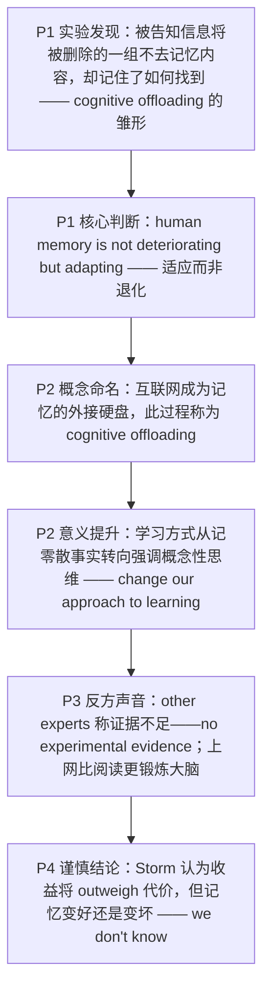

# 互联网与记忆：认知卸载与“适应论”之争 精读笔记

---

## 背景

本文选自 **2023 年考研英语（一）Text 3**，主题为**互联网是否正在削弱人类的记忆**。文章从哥伦比亚大学心理学教授 **Betsy Sparrow** 的"**认知卸载**"实验切入，先给出"记忆没有退化、只是在**适应**新技术"的核心判断，再转向其他专家的**质疑**（证据尚不充分），最后以 **Benjamin Storm** "收益终将大于代价、但好坏未定"的**谨慎结论**收束。

文章沿"**实验发现 → 概念命名 → 学习方式的转变 → 反方声音 → 谨慎结论**"的链条展开，是一篇典型的**多方观点并置型**学术报道：

- **实验发现**：被告知信息"将被删除"的一组**不去记忆**内容，却记住了**如何找到**信息；记忆没有退化，而是在**适应**（P1）。
- **概念命名**：互联网成为记忆的**外接硬盘**，这一过程叫"**认知卸载**"；它可能把学习从"记事实"推向"**概念性思维**"（P2）。
- **反方声音**：也有专家认为**为时过早**——目前没有实验证据表明互联网干扰注意力，甚至有研究显示**上网比阅读更锻炼大脑**（P3）。
- **谨慎结论**：**Storm** 承认代价存在，但认为收益终将**超过**代价；记忆确在改变，但**好坏未定**（P4）。

**难度说明**：中等。句式上密集出现**引述倒装**（`suggests … Sparrow` / `wrote … Simons` / `observes … Storm`）、**名词性从句**（`what we remember` / `how the Internet affects our brains`）、**替代结构**（`do so` / `does` / `did`）、**not A but B 并列**、`when + 过去分词` 省略、**多层介词短语长尾**；论证上属于"**观点综述**"，适合练习**观点归属判断**、**同义替换识别**与**态度辨析**。

---

## 文章原文

The Internet may be changing merely what we remember, not our **capacity** to do so, suggests Columbia University psychology professor Betsy Sparrow.

> [!abstract]- 长难句分析
> **原句**：The Internet may be changing merely what we remember, not our capacity to do so, suggests Columbia University psychology professor Betsy Sparrow.
>
> **主干提取**：
>
> - 引述谓语 V: suggests
> - 引述主语 S: Columbia University psychology professor Betsy Sparrow（后置）
> - 宾语从句主语 S: The Internet
> - 宾语从句谓语 V: may be changing
> - 宾语从句宾语 O: what we remember（`what` 从句）
> - 并列否定宾语 O: not our capacity to do so
> - 状语 A: merely
>
> **修饰成分**：
>
> | 类型 | 引导词 / 形式 | 修饰对象 |
> |------|--------------|----------|
> | 引述倒装 | suggests + 主语后置 | 整个宾语从句 |
> | 省略 that 的宾语从句 | (that) The Internet may be changing ... | suggests |
> | 名词性从句（what） | what we remember | may be changing 的宾语 |
> | 否定并列宾语 | not | our capacity to do so |
> | 不定式作后置定语 | to do so（= to remember） | our capacity |
> | 前置定语 | Columbia University psychology | professor |
>
> **结构图解**：
>
> ```
> 倒装句: suggests + 〔Columbia University psychology professor Betsy Sparrow〕
>   └── 宾语从句（省略 that）: The Internet + may be changing + 〔what we remember〕+ not 〔our capacity to do so〕
>         ├── 名从（what）: what + we + remember → 作 changing 的宾语
>         └── 并列宾语（否定）: our capacity〔to do so〕
>               └── 不定式: to do so = to remember（替代前文动词）
> ```
>
> **参考译文**：哥伦比亚大学心理学教授贝齐·斯帕罗认为，互联网也许只是在改变我们记住的内容，而不是我们记忆的能力。
>
> **考点提示**：① **引述倒装**：正常语序是 `Betsy Sparrow suggests that ...`，作者把 `suggests` 提前、主语后置，读到句末才发现主语，极易把 `suggests` 当成前一句的谓语；② `what we remember` 是**名词性从句作宾语**，`what` 在从句中作 `remember` 的宾语，不能换 `that`；③ `not our capacity to do so` 与前一宾语 `what we remember` **并列**，共同作 `changing` 的宾语，`not` 否定第二项（此处 `but` 并未出现，属 `not A but B` 的省略式语义，`merely` 进一步限定范围）；④ `do so` 替代 `remember`，这是第 31 题 C 项 `switch its focus of memory` 的语言依据。

In 2011, Sparrow led a study in which participants were asked to record 40 **factoids** in a computer (“an ostrich’s eye is bigger than its brain,” for example).

Half of the participants were told the information would be erased, while the other half were told it would be saved.

Guess what?

The latter group made no effort to **recall** the information when quizzed on it later, because they knew they could find it on their computers.

> [!abstract]- 长难句分析
> **原句**：The latter group made no effort to recall the information when quizzed on it later, because they knew they could find it on their computers.
>
> **主干提取**：
>
> - 主语 S: The latter group
> - 谓语 V: made
> - 宾语 O: no effort
> - 不定式作后置定语（定语）: to recall the information
> - 时间状语 A: when quizzed on it later（= when they were quizzed）
> - 原因状语从句 A: because they knew (that) they could find it on their computers
>
> **修饰成分**：
>
> | 类型 | 引导词 / 形式 | 修饰对象 |
> |------|--------------|----------|
> | 不定式作后置定语 | to recall the information | effort |
> | 时间状语从句（省略形式） | when (they were) quizzed | made no effort |
> | 过去分词（被动） | quizzed on it | 逻辑主语 they |
> | 原因状语从句 | because | 整个主句 |
> | 省略 that 的宾语从句 | (that) they could find it | knew |
> | 介词短语作地点状语 | on their computers | could find |
>
> **结构图解**：
>
> ```
> 主句: The latter group + made + no effort〔to recall the information〕
>   ├── 时间状语从句（省略 they were）: when + quizzed on it later
>   └── 原因状语从句: because + they + knew + 〔(that) 宾语从句〕
>         └── 宾语从句: they + could find + it + 〔on their computers〕
> ```
>
> **参考译文**：后一组人事后被考查时根本不去努力回忆这些信息，因为他们知道自己能在电脑上找到。
>
> **考点提示**：① `when quizzed on it later` 是**状语从句省略**，完整形式 `when they were quizzed on it later`，省略条件是**从句主语与主句主语一致且含 be 动词**；② `made no effort to recall` = "连试都不试"，`make an effort to do` 是固定搭配，介词后用 `to do` 不用 `doing`；③ `knew` 后**省略 that**，从句 `they could find it ...` 自带完整主谓，不要误把 `they` 当成 `knew` 的并列成分；④ `be quizzed on` 是**被动**"被就……提问"，不是主动"提问别人"。

In the same study, a group was asked to remember both the information and the folders it was stored in.

> [!abstract]- 长难句分析
> **原句**：In the same study, a group was asked to remember both the information and the folders it was stored in.
>
> **主干提取**：
>
> - 状语 A: In the same study
> - 主语 S: a group
> - 谓语 V: was asked
> - 主语补足语 C: to remember both the information and the folders (it was stored in)
> - 并列宾语 1: the information
> - 并列宾语 2: the folders + 省略关系词的定语从句
>
> **修饰成分**：
>
> | 类型 | 引导词 / 形式 | 修饰对象 |
> |------|--------------|----------|
> | 介词短语作状语 | In the same study | 全句 |
> | 不定式作主语补足语 | to remember ... | a group（还原主动：asked a group to remember） |
> | 并列连词 | both ... and ... | remember 的两个宾语 |
> | 省略关系词的定语从句 | (which) it was stored in | the folders |
> | 介词悬空 | in（留在句末） | 从句谓语 was stored |
>
> **结构图解**：
>
> ```
> 主句: In the same study, a group + was asked + 〔to remember A and B〕
>   ├── 主补（不定式）: to remember → 还原主动: (someone) asked a group to remember
>   ├── 并列宾语 1: the information
>   └── 并列宾语 2: the folders〔(which) it was stored in〕
>         └── 定从（省略关系词）: it + was stored + in (the folders) → 介词悬空
> ```
>
> **参考译文**：在同一项研究中，还有一组人被要求同时记住信息本身以及存放这些信息的文件夹。
>
> **考点提示**：① `both the information and the folders` 是**并列宾语**，但后面的定语从句**只修饰 `the folders`**——"信息"不会"被存放在文件夹里"，判断依据是语义搭配；② 定语从句**省略了关系词** `which`，且介词 `in` **留在句末**（介词悬空），还原为 `the folders in which it was stored`；③ `was asked to remember` 是"**被动 + 不定式作主补**"，还原主动为 `asked a group to remember`，`to remember` 不是目的状语；④ 句末的 `in` 不是多余介词，读漏它会丢掉"记住的是**找文件夹的方法**"这一关键结论。

They didn’t remember the information, but they remembered how to find the folders.

In other words, human memory is not **deteriorating** but “**adapting to** new communications technology,” Sparrow says.

> [!abstract]- 长难句分析
> **原句**：In other words, human memory is not deteriorating but “adapting to new communications technology,” Sparrow says.
>
> **主干提取**：
>
> - 连接语 A: In other words
> - 主语 S: human memory
> - 谓语 V1: is not deteriorating
> - 谓语 V2: but (is) adapting to ...
> - 引述分句: Sparrow says（后置）
>
> **修饰成分**：
>
> | 类型 | 引导词 / 形式 | 修饰对象 |
> |------|--------------|----------|
> | 连接语（同义复述） | In other words | 全句 |
> | 并列谓语（not A but B） | not ... but ... | is deteriorating / (is) adapting |
> | 介词短语作状语 | to new communications technology | adapting |
> | 引述分句（后置） | Sparrow says | 全句的观点归属 |
>
> **结构图解**：
>
> ```
> 主句: In other words, human memory + is + not deteriorating + but (is) adapting〔to new communications technology〕
>   └── 引述分句（后置）: Sparrow says → 标明该判断的来源
> ```
>
> **参考译文**：斯帕罗说，换句话说，人类记忆并没有退化，而是在"适应新的通信技术"。
>
> **考点提示**：① `not A but B` 连接**两个并列谓语**，第二个 `is` **承前省略**，还原为 `is not deteriorating but is adapting`；② `deteriorate` 是**不及物动词**，不能带宾语；③ `adapt to` 中 `to` 是介词，后接名词；表示"适应"时也可用 `adapt oneself to`；④ 引述分句 `Sparrow says` **置于句末**，翻译时按汉语习惯提前；引号内的 `adapting` 是**作者的措辞**，暗示"主动调整"而非"被动退化"，这正是全文论点。

In a very practical way, the Internet is becoming an **external hard drive** for our memories, a process known as “**cognitive offloading**.” Traditionally, this role was fulfilled by **data banks**, libraries, and other humans. Your father may never remember birthdays because your mother does, for instance. Some worry that this is having a **destructive** effect on society, but Sparrow sees an **upside**.

Perhaps, she suggests, the trend will change our **approach to** learning from a focus on individual facts and memorization to an emphasis on more **conceptual thinking**—something that is not available on the Internet.

> [!abstract]- 长难句分析
> **原句**：Perhaps, she suggests, the trend will change our approach to learning from a focus on individual facts and memorization to an emphasis on more conceptual thinking—something that is not available on the Internet.
>
> **主干提取**：
>
> - 插入语 A: Perhaps（语气）
> - 插入语: she suggests（观点来源）
> - 主语 S: the trend
> - 谓语 V: will change
> - 宾语 O: our approach to learning
> - 状语 A: from a focus on ... to an emphasis on ...（变化的两个端点）
> - 同位语（App）: something that is not available on the Internet
>
> **修饰成分**：
>
> | 类型 | 引导词 / 形式 | 修饰对象 |
> |------|--------------|----------|
> | 插入语（副词） | Perhaps | 全句语气 |
> | 插入语（主谓） | she suggests | 全句，标明观点来源 |
> | 介词短语作后置定语 | to learning | our approach（to 为介词） |
> | 介词框架 from ... to ... | from / to | change 的起点与终点 |
> | 介词短语作后置定语 | on individual facts / on more conceptual thinking | a focus / an emphasis |
> | 并列连词 | and | individual facts 与 memorization |
> | 破折号同位语 | something | more conceptual thinking |
> | 定语从句 | that | something |
>
> **结构图解**：
>
> ```
> 主句: (Perhaps,) (she suggests,) the trend + will change + our approach〔to learning〕
>   ├── 变化框架: from + a focus〔on individual facts and memorization〕
>   │                to + an emphasis〔on more conceptual thinking〕
>   └── 同位语（破折号）: something〔that is not available on the Internet〕
>         └── 定从: that + is + not available + on the Internet → 修饰 something
> ```
>
> **参考译文**：她提出，这一趋势或许会改变我们的学习方式：从专注于零散事实和死记硬背，转向更强调概念性思维——而这是互联网上得不到的。
>
> **考点提示**：① `Perhaps, she suggests,` 是**插入语**，把主语 `the trend` 与谓语 `will change` 隔开，阅读时先跳过插入语抓主干；② `change A from B to C` 的框架被 `our approach to learning` 拉开，`from` 的宾语是 `a focus on ...`、`to` 的宾语是 `an emphasis on ...`，中间的 `learning` 不属于框架；③ `approach to` 中的 `to` 是**介词**，后接动名词 `learning`，不能写 `approach to learn`；④ 破折号后 `something` 是 `conceptual thinking` 的**同位语**，再带 `that` 定语从句；⑤ 本句是第 33 题 A 项 `reform our learning approach` 的原文依据。

“I personally have never seen all that much **intellectual** value in memorizing things,” Sparrow says, adding that we haven’t lost our ability to do it.

> [!abstract]- 长难句分析
> **原句**：“I personally have never seen all that much intellectual value in memorizing things,” Sparrow says, adding that we haven’t lost our ability to do it.
>
> **主干提取**：
>
> - 引语（前置宾语）: I personally have never seen all that much intellectual value in memorizing things
> - 引述主语 S: Sparrow
> - 引述谓语 V: says
> - 伴随状语 A: adding that we haven’t lost our ability to do it
> - 引语主干: I + have never seen + value + in memorizing things
>
> **修饰成分**：
>
> | 类型 | 引导词 / 形式 | 修饰对象 |
> |------|--------------|----------|
> | 引语前置 | “I ... things,” | says 的宾语 |
> | 现在完成时 + never | have never seen | 表"从过去到现在从未" |
> | 程度限定 | all that much | intellectual value |
> | 介词短语作后置定语 | in memorizing things | value |
> | 动名词作介词宾语 | memorizing | 介词 in |
> | 现在分词作伴随状语 | adding that ... | Sparrow（逻辑主语） |
> | 宾语从句 | that we haven’t lost our ability | adding |
> | 不定式作后置定语 | to do it（= to remember） | our ability |
>
> **结构图解**：
>
> ```
> 主句: 〔引语〕+ Sparrow + says + 〔, adding that ...〕
>   ├── 引语（前置宾语）: I + have never seen + all that much intellectual value〔in memorizing things〕
>   └── 伴随状语: adding + 〔that 宾语从句〕
>         └── 宾语从句: we + haven’t lost + our ability〔to do it〕
> ```
>
> **参考译文**：斯帕罗说："就我个人而言，我从未觉得死记硬背有多大智力价值。"她补充说，我们并没有丧失这种能力。
>
> **考点提示**：① 引语**前置**、`Sparrow says` **后置**，是英语转述观点的常见语序，翻译时把说话人提前；② `all that much` = "那么大的（程度）"，`not/never ... all that much` 是**口语化弱否定**，不能直译"所有那么多"；③ `value in doing sth` 中 `in` 后接**动名词**，表示"在某方面的价值"；④ `adding` 是**现在分词作伴随状语**，逻辑主语是 `Sparrow`（人能"补充说"），不是 `Sparrow says` 这件事；⑤ `to do it` 中 `it` 替代 `remember`，与首句 `do so` 呼应，共同支撑"能力未丧失"的结论。

Still other experts say it’s too soon to understand how the Internet affects our brains.

There is no **experimental evidence** showing that it **interferes with** our ability to focus, for instance, wrote psychologists Christopher Chabris and Daniel J. Simons.

> [!abstract]- 长难句分析
> **原句**：There is no experimental evidence showing that it interferes with our ability to focus, for instance, wrote psychologists Christopher Chabris and Daniel J. Simons.
>
> **主干提取**：
>
> - 引述谓语 V: wrote（前置）
> - 引述主语 S: psychologists Christopher Chabris and Daniel J. Simons（后置）
> - 引语主干（there be 句型）: There + is + no experimental evidence
> - 分词后置定语（定语）: showing that it interferes with our ability to focus
> - 宾语从句 O: that it interferes with our ability to focus
> - 插入语: for instance
>
> **修饰成分**：
>
> | 类型 | 引导词 / 形式 | 修饰对象 |
> |------|--------------|----------|
> | 引述倒装 | wrote + 主语后置 | 整个引语 |
> | there be 存在句 | There is | 引语的主干 |
> | 现在分词作后置定语 | showing that ... | evidence |
> | 宾语从句 | that it interferes with ... | showing（`show that ...`，从句作 showing 的宾语） |
> | 代词指代 | it | the Internet |
> | 介词短语作状语 | with our ability to focus | interferes |
> | 不定式作后置定语 | to focus | our ability |
> | 插入语 | for instance | 引语（举例说明） |
>
> **结构图解**：
>
> ```
> 倒装句: wrote + 〔psychologists Christopher Chabris and Daniel J. Simons〕
>   └── 引语（宾语从句）: There + is + no experimental evidence〔showing that ...〕
>         ├── 分词后置定语: showing → 修饰 evidence
>         └── 宾语从句: that + it + interferes with + our ability〔to focus〕
>               └── it 指代 the Internet
> ```
>
> **参考译文**：例如，心理学家克里斯托弗·查布里斯和丹尼尔·J. 西蒙斯写道，目前没有实验证据表明互联网会干扰我们的注意力。
>
> **考点提示**：① 句首的 `There is` **不是主句开头**——真正的引述动词 `wrote` 在句末，主语又在其后，形成"**引语 + 引述倒装**"的双重移位；② `evidence showing that ...` 是"**名词 + 现在分词后置定语 + 宾语从句**"三层结构：`showing` 作后置定语修饰 `evidence`，`that` 从句是 `showing` 的**宾语**（`show that ...`），整块说明"证据所表明的内容"；③ `it` 指代 **the Internet**，不是 `evidence`；④ `interfere with` 后接**被妨碍的对象**，`interfere in` 才接"干涉的事务"；⑤ `for instance` 是**插入在引语内部的举例**，说明"没有证据"这一点是举例性质，翻译时提前。

And surfing the web **exercised** the brain more than reading did among computer-**savvy** older adults in a 2008 study **involving** 24 participants at the Semel Institute for Neuroscience and Human Behavior at the University of California, Los Angeles.

> [!abstract]- 长难句分析
> **原句**：And surfing the web exercised the brain more than reading did among computer-savvy older adults in a 2008 study involving 24 participants at the Semel Institute for Neuroscience and Human Behavior at the University of California, Los Angeles.
>
> **主干提取**：
>
> - 连词: And（承接上文）
> - 主语 S: surfing the web（动名词短语）
> - 谓语 V: exercised
> - 宾语 O: the brain
> - 比较状语 A: more than reading did（= more than reading exercised the brain）
> - 范围状语 A: among computer-savvy older adults
> - 来源状语 A: in a 2008 study involving 24 participants at ...
>
> **修饰成分**：
>
> | 类型 | 引导词 / 形式 | 修饰对象 |
> |------|--------------|----------|
> | 动名词短语作主语 | surfing the web | 谓语 exercised 的主语 |
> | 比较结构 + 助动词替代 | more than reading did | exercised the brain |
> | 介词短语作范围状语 | among computer-savvy older adults | 比较的适用范围 |
> | 介词短语作状语 | in a 2008 study | exercised |
> | 现在分词作后置定语 | involving 24 participants | a 2008 study |
> | 介词短语层层后置 | at the Semel Institute ... / at the University of California, Los Angeles | 机构的从属关系 |
> | 复合形容词作前置定语 | computer-savvy | older adults |
>
> **结构图解**：
>
> ```
> 主句: And surfing the web + exercised + the brain + 〔more than reading did〕
>   ├── 比较结构: more than + reading + did（= exercised the brain）
>   └── 状语链（自后向前限定范围）:
>         among computer-savvy older adults
>           └── in a 2008 study〔involving 24 participants〕
>                 └── at the Semel Institute for Neuroscience and Human Behavior
>                       └── at the University of California, Los Angeles
> ```
>
> **参考译文**：而在 2008 年加州大学洛杉矶分校塞梅尔神经科学与人类行为研究所一项涉及 24 名参与者的研究中，对于熟悉电脑的老年人来说，上网浏览比阅读更能锻炼大脑。
>
> **考点提示**：① `surfing the web` 是**动名词短语作主语**，谓语用**单数** `exercised`，不要误读为现在分词作状语；② `more than reading did` 中 `did` **替代** `exercised the brain`，比较两端必须对等（动名词 vs 动名词）；③ `involving 24 participants` 是**现在分词作后置定语**，修饰 `a 2008 study`；④ 后接**四层介词短语**（among → in a study → at the Institute → at the University），汉语翻译要**由大到小重排**为"加州大学洛杉矶分校塞梅尔研究所……的研究"；⑤ 第 34 题 C 项 `is reflected in our reading speed` 属**偷换比较对象**——原文比较的是"上网 vs 阅读对大脑的锻炼"，不是"阅读速度"。

“There may be **costs associated with** our increased **reliance on** the Internet, but I’d have to imagine that overall the benefits are going to **outweigh** those costs,” observes psychology professor Benjamin Storm.

> [!abstract]- 长难句分析
> **原句**：“There may be costs associated with our increased reliance on the Internet, but I’d have to imagine that overall the benefits are going to outweigh those costs,” observes psychology professor Benjamin Storm.
>
> **主干提取**：
>
> - 引述谓语 V: observes（前置）
> - 引述主语 S: psychology professor Benjamin Storm（后置）
> - 引语分句 1: There + may be + costs + associated with our increased reliance on the Internet
> - 引语分句 2: I + ’d (= would) have to imagine + that 从句
> - 宾语从句主干: overall the benefits + are going to outweigh + those costs
>
> **修饰成分**：
>
> | 类型 | 引导词 / 形式 | 修饰对象 |
> |------|--------------|----------|
> | 引述倒装 | observes + 主语后置 | 整个引语 |
> | there be + 情态动词 | There may be | 存在句，表推测 |
> | 过去分词作后置定语 | associated with ... | costs |
> | 介词短语作后置定语 | on the Internet | reliance |
> | 让步转折并列 | but | 两个分句 |
> | 委婉语气（would） | I’d have to | imagine |
> | 宾语从句 | that overall the benefits ... | imagine |
> | 插入语 | overall | 宾语从句 |
> | be going to 表预测 | are going to outweigh | benefits |
>
> **结构图解**：
>
> ```
> 倒装句: observes + 〔psychology professor Benjamin Storm〕
>   └── 引语（but 并列两个分句）:
>         分句 1: There + may be + costs〔associated with our increased reliance〕〔on the Internet〕
>         分句 2: I + ’d have to imagine + 〔that 宾语从句〕
>               └── 宾语从句: (overall) the benefits + are going to outweigh + those costs
> ```
>
> **参考译文**：心理学教授本杰明·斯托姆评论说："我们对互联网的依赖日益加深，这可能会带来代价，但我只能认为，总体而言收益将会超过这些代价。"
>
> **考点提示**：① `costs associated with ...` 是**过去分词作后置定语**，与 `costs` 构成**被动关系**（代价"被"关联），不能换成 `associating`；② `I’d` = `I would`，此处是**委婉语气**，不是虚拟语气，译为"我只能认为"；③ `overall` 是**插入语**，修饰整个宾语从句，翻译时前置为"总体而言"；④ `are going to outweigh` 表**基于现有迹象的预测**，`outweigh` 是及物动词，**不能加 `than`**；⑤ 句末 `observes psychology professor Benjamin Storm` 又是**引述倒装**，与第 1 句的 `suggests ... Sparrow` 完全同型，可对照记忆。

“It seems pretty clear that memory is changing, but is it changing for the better? At this point, we don’t know.”

> [!abstract]- 长难句分析
> **原句**：“It seems pretty clear that memory is changing, but is it changing for the better? At this point, we don’t know.”
>
> **主干提取**：
>
> - 分句 1 形式主语: It
> - 分句 1 系动词 V: seems
> - 分句 1 表语 C: pretty clear
> - 分句 1 真正主语 S: that memory is changing（主语从句）
> - 分句 2（反问）: is it changing for the better?
> - 分句 3: we don’t know
> - 时间状语 A: At this point
>
> **修饰成分**：
>
> | 类型 | 引导词 / 形式 | 修饰对象 |
> |------|--------------|----------|
> | 形式主语 it | It | 真正主语是 that 从句 |
> | 程度副词作状语 | pretty | clear（弱化断言） |
> | 主语从句 | that memory is changing | 形式主语 it |
> | 转折并列 | but | 分句 1 与分句 2 |
> | 反问句 | is it changing ...? | 引出疑问，不需回答 |
> | 介词短语作状语 | for the better | changing |
> | 时间状语 | At this point | we don’t know |
>
> **结构图解**：
>
> ```
> 并列句: 分句 1 + but + 分句 2（反问）+ 分句 3
>   ├── 分句 1: It（形式主语）+ seems + pretty clear + 〔that 主语从句〕
>   │     └── 主语从句: memory + is changing
>   ├── 分句 2（反问）: is + it + changing + 〔for the better〕?
>   └── 分句 3: (At this point,) we + don’t know
> ```
>
> **参考译文**："有一点相当清楚：记忆正在改变，但它是变得更好吗？就目前而言，我们并不知道。"
>
> **考点提示**：① `It seems pretty clear that ...` 中 `it` 是**形式主语**，真正主语是 `that` 从句，`seems` 是系动词，`pretty clear` 作表语；② `pretty` 在此是**程度副词**（= fairly），不是形容词"漂亮的"；③ `for the better` 是**固定搭配**"向好的方向"，反义为 `for the worse`，不能直译"为了更好"；④ 反问句 `is it changing for the better?` **形式提问、实为质疑**，不要求回答，下文 `we don’t know` 才是正面回应；⑤ `At this point` = "**目前**"，与 `on this point`（在这一点上）只差一词，是选项常见陷阱；⑥ 本句体现 Storm 的**谨慎态度**：承认记忆在变，但拒绝判定好坏，第 35 题 B 项 `the Internet is weakening our memory` 因此被他与 Sparrow 共同否定。

---

## 题目

### 31. Sparrow's study shows that with the Internet, the human brain will ____.

- [A] analyze information in detail
- [B] collect information efficiently
- [C] switch its focus of memory
- [D] extend its memory duration

### 32. The process of “cognitive offloading” ____.

- [A] helps us identify false information
- [B] keeps our memory from failing
- [C] enables us to classify trivial facts
- [D] lessens our memory burdens

### 33. Which of the following would Sparrow support about the Internet?

- [A] It may reform our learning approach.
- [B] It may impact our society negatively.
- [C] It may enhance our adaptability to technology.
- [D] It may interfere with our conceptual thinking.

### 34. It is indicated in Paragraph 3 that how the Internet affects our brains ____.

- [A] requires further academic research
- [B] is most studied in older adults
- [C] is reflected in our reading speed
- [D] depends on our web-surfing habits

### 35. Neither Sparrow nor Storm would agree that ____.

- [A] our reliance on the Internet will be costly
- [B] the Internet is weakening our memory
- [C] memory exercise is a must for our brains
- [D] our ability to focus declines with age

---

## 翻译对照

## Paragraph 1

The Internet may be changing merely what we remember, not our capacity to do so, suggests Columbia University psychology professor Betsy Sparrow. In 2011, Sparrow led a study in which participants were asked to record 40 factoids in a computer (“an ostrich’s eye is bigger than its brain,” for example). Half of the participants were told the information would be erased, while the other half were told it would be saved. Guess what? The latter group made no effort to recall the information when quizzed on it later, because they knew they could find it on their computers. In the same study, a group was asked to remember both the information and the folders it was stored in. They didn’t remember the information, but they remembered how to find the folders. In other words, human memory is not deteriorating but “adapting to new communications technology,” Sparrow says.

哥伦比亚大学心理学教授贝齐·斯帕罗（Betsy Sparrow）认为，互联网也许只是在改变我们**记什么**，而不是我们记忆的**能力**。2011 年，斯帕罗主持了一项研究，要求参与者在电脑中记录 40 条零碎的事实（例如"鸵鸟的眼睛比它的大脑还大"）。一半参与者被告知这些信息将被删除，另一半则被告知会被保存。结果如何？后一组人事后被考查时根本不去努力回忆这些信息，因为他们知道自己能在电脑上找到。在同一项研究中，还有一组人被要求同时记住信息本身以及存放这些信息的文件夹。他们没记住信息，却记住了如何找到文件夹。斯帕罗说，换句话说，人类记忆并没有退化，而是在"适应新的通信技术"。

> [!note] 翻译说明
> - `what we remember` 与 `our capacity to do so` 对比：`do so` 回指 `remember`，"记忆的内容" vs "记忆的能力"，这是全文的核心区分，也是第 31 题 C 项 `switch its focus of memory` 的语言基础。
> - `factoid` = "零碎的小事实、冷知识"（真假难辨的短信息），不是 `fact` 的一般形式。
> - `Guess what?` 是口语化的设问，用来引出结果，可译"结果如何？/你猜怎样？"，不必直译"猜猜是什么"。
> - `made no effort to recall` = "根本不去努力回想"，`make an effort to do` = "努力做某事"，否定式强调"毫无尝试"。
> - `be quizzed on` = "被就……提问/考查"，此处被动语态不宜译成"被测验"。
> - `record 40 factoids in a computer` 中 `record` 是"录入、记入"，不是"记录在案"。

## Paragraph 2

In a very practical way, the Internet is becoming an external hard drive for our memories, a process known as “cognitive offloading.” Traditionally, this role was fulfilled by data banks, libraries, and other humans. Your father may never remember birthdays because your mother does, for instance. Some worry that this is having a destructive effect on society, but Sparrow sees an upside. Perhaps, she suggests, the trend will change our approach to learning from a focus on individual facts and memorization to an emphasis on more conceptual thinking—something that is not available on the Internet. “I personally have never seen all that much intellectual value in memorizing things,” Sparrow says, adding that we haven’t lost our ability to do it.

从非常实际的意义上说，互联网正在成为我们记忆的一块"外接硬盘"，这一过程被称为"**认知卸载**"。传统上，这一角色由数据库、图书馆和其他人来承担。例如，你父亲可能从来不记得生日，因为有你母亲记着。有人担心这正在对社会产生破坏性影响，但斯帕罗看到了积极的一面。她提出，这一趋势或许会改变我们的学习方式：从专注于零散事实和死记硬背，转向更强调**概念性思维**——而这是互联网上得不到的。斯帕罗说："就我个人而言，我从未觉得死记硬背有多大智力价值。"她补充说，我们并没有丧失这种能力。

> [!note] 翻译说明
> - `external hard drive` = "外接硬盘"，`cognitive offloading` = "认知卸载"（把记忆负担转移给外部工具），是本文的**核心术语**。
> - `this role was fulfilled by ...` 被动句，`fulfil a role` = "承担/履行某一角色"，翻译时转成主动更自然："由……来承担"。
> - `because your mother does` 中 `does` 替代 `remembers birthdays`，避免重复。
> - `sees an upside` = "看到好的一面"，`upside` 与上文 `destructive effect` 形成对照；`upside` / `downside` 是考研高频的态度对照词。
> - `change our approach to learning from A to B` 是 `change sth from A to B` 的变体，`from ... to ...` 说明变化的**起点与终点**，中间被 `our approach to learning` 隔开，容易误读。
> - `something that is not available on the Internet` 是 `conceptual thinking` 的同位语补充，破折号起解释作用。
> - `all that much` = "那么大的（程度）"，`not ... all that much` 是口语化的弱否定。

## Paragraph 3

Still other experts say it’s too soon to understand how the Internet affects our brains. There is no experimental evidence showing that it interferes with our ability to focus, for instance, wrote psychologists Christopher Chabris and Daniel J. Simons. And surfing the web exercised the brain more than reading did among computer-savvy older adults in a 2008 study involving 24 participants at the Semel Institute for Neuroscience and Human Behavior at the University of California, Los Angeles.

还有一些专家表示，现在就弄清互联网如何影响我们的大脑还为时过早。例如，心理学家克里斯托弗·查布里斯（Christopher Chabris）和丹尼尔·J. 西蒙斯（Daniel J. Simons）写道，目前没有实验证据表明互联网会干扰我们的注意力。而在 2008 年加州大学洛杉矶分校塞梅尔神经科学与人类行为研究所一项涉及 24 名参与者的研究中，对于熟悉电脑的老年人来说，上网浏览比阅读更能锻炼大脑。

> [!note] 翻译说明
> - `too soon to understand` = "要弄清……还为时过早"，`too ... to` 结构表否定结果。
> - `There is no experimental evidence showing that ...` 是"**there be + 名词 + 现在分词作后置定语**"，`showing` 的逻辑主语是 `evidence`。
> - `wrote psychologists ...` 是**引述动词前置 + 主语后置**的倒装（正常语序为 `psychologists ... wrote`），新闻英语中常见，翻译时按正常语序处理。
> - `more than reading did` 中 `did` 替代 `exercised the brain`，比较结构省略，完整为 `more than reading exercised the brain`。
> - `computer-savvy` = "熟悉电脑的、电脑上手的"，`savvy` = "有实际知识的、精通的"。
> - `involving 24 participants` 是现在分词短语作后置定语修饰 `study`；后面一连串 `at ... at ...` 是**机构从属关系**的层层限定，翻译时可整体处理为"某校某研究所的一项研究"。

## Paragraph 4

“There may be costs associated with our increased reliance on the Internet, but I’d have to imagine that overall the benefits are going to outweigh those costs,” observes psychology professor Benjamin Storm. “It seems pretty clear that memory is changing, but is it changing for the better? At this point, we don’t know.”

心理学教授本杰明·斯托姆（Benjamin Storm）评论说："我们对互联网的依赖日益加深，这可能会带来代价，但我只能认为，总体而言收益将会超过这些代价。""有一点相当清楚：记忆正在改变，但它是变得更好吗？就目前而言，我们并不知道。"

> [!note] 翻译说明
> - `costs associated with ...` 是**过去分词短语作后置定语**，`be associated with` = "与……相关"，此处可译"由……带来的代价"。
> - `I'd have to imagine` 中 `have to` 表"不得不、只能"，语气比 `I imagine` 更弱、更谨慎，体现学者口吻。
> - `outweigh` = "在重要性/数量上超过"，比 `exceed` 更强调"两相权衡后胜过"。
> - `observes` 与上段 `wrote` 同属**引述动词**，`observe` 此处意为"评论说、指出"，不是"观察"。
> - `changing for the better` = "向好的方向改变"，`for the better` 是固定搭配，反义为 `for the worse`。
> - `At this point` = "在现阶段、目前"，不是"在这一点上"。

---

## 题目翻译

### 31. 斯帕罗的研究表明，有了互联网，人脑将会 ____。

- [A] 详细分析信息
- [B] 高效收集信息
- [C] 转移其记忆的焦点
- [D] 延长其记忆的持续时间

### 32. "认知卸载"这一过程 ____。

- [A] 帮助我们识别虚假信息
- [B] 使我们的记忆免于失效
- [C] 使我们能够对琐碎事实进行分类
- [D] 减轻我们的记忆负担

### 33. 关于互联网，斯帕罗会支持以下哪一项？

- [A] 它可能改变我们的学习方式。
- [B] 它可能对社会产生负面影响。
- [C] 它可能增强我们对技术的适应能力。
- [D] 它可能干扰我们的概念性思维。

### 34. 第三段表明，互联网如何影响我们的大脑 ____。

- [A] 需要进一步的学术研究
- [B] 在老年人中研究得最多
- [C] 反映在我们的阅读速度上
- [D] 取决于我们上网浏览的习惯

### 35. 斯帕罗和斯托姆都不会同意 ____。

- [A] 我们对互联网的依赖将代价高昂
- [B] 互联网正在削弱我们的记忆
- [C] 记忆训练对我们的大脑是必需的
- [D] 我们的注意力会随年龄下降

---

---

## 语法要点

> [!note] 来源说明
> 本篇**用户未提供语法源笔记**，以下语法点由 `formatted-article.md` 与 `translation.md` **从本文推断提取**，仅收录本篇实际出现的语法现象。
> 每一条均给出**原文语境**，便于回原文核对；标注"（联动）"的条目与相邻专题互为参照。
> 固定搭配与词组见 [[intermediate/2023-passage3-internet-memory/固定搭配与词组笔记.md|2023 Passage 3 固定搭配与词组]]。

---

## 一、从句

### 从句：what 引导的名词性从句作宾语

**概述**：`what` 引导的名词性从句相当于"**the thing(s) that ...**"，在句中作**宾语**；`what` 在从句中充当 `remember` 的宾语，不能省略，也不能换成 `that`。

| 结构 | 用法 | 例句 |
|------|------|------|
| `changing + what + 主谓` | what 从句作 changing 的宾语 | The Internet may be changing merely **what we remember** |
| `not + 名词 + to do so` | 与前一宾语并列，`do so` 替代前文动词短语 | not **our capacity to do so**（= to remember） |

> [!tip] 阅读技巧
> 本篇首句是**全文主旨句**：`changing merely what we remember, not our capacity to do so` 把"记什么"与"记忆能力"对立起来。第 31 题 C 项 `switch its focus of memory`（转换记忆的焦点）正是对本句的改写；D 项 `extend its memory duration`（延长记忆时长）属偷换概念，原文谈的是**内容**而非**时长**。

### 从句：in which 引导的定语从句

**概述**：`介词 + which` 引导定语从句，`which` 指代先行词 `a study`；介词前置是因为从句中 `in the study` 作地点状语，书面语中比 `a study which participants were asked to record ... in` 更正式。

| 结构 | 用法 | 例句 |
|------|------|------|
| `a study in which + 完整句` | 介词 + which 引导定从，which 作介词宾语 | a study **in which participants were asked to record 40 factoids in a computer** |

> [!warning] 易错点
> `in which` 中的 `in` **不能丢**：从句还原为 `participants were asked to record ... in the study`，介词来自从句内部。若把 `in which` 当成"其中"一带而过，就会漏掉"研究**中**"这层限定，误判 `participants` 是主句成分。

### 从句：省略关系词的定语从句（the folders it was stored in）

**概述**：先行词 `the folders` 后的关系代词被省略，从句为 `it was stored in (the folders)`，**介词 `in` 留在句末**（介词悬空）。这是口语与新闻英语中极常见的省略式定从。

| 结构 | 用法 | 例句 |
|------|------|------|
| `名词 + (which) + 主谓 + 介词` | 省略关系词，介词后置 | the folders **(which) it was stored in** |
| `both A and B + (which) ...` | 并列先行词共用一个定从 | both the information and the folders **it was stored in** |

> [!warning] 易错点
> 句末的 `in` **不是多余的介词**，它属于定语从句。判断方法：把 `in` 移回名词前——`stored in the folders` 成立，说明 `the folders` 是从句的介词宾语。若误读为"它被存放在里面"，就会把 `the folders` 与从句割裂，读不出"记住的是**找文件夹的方法**"这一关键结论。

### 从句：that 引导的宾语从句

**概述**：`worry / knew / imagine / say` 等动词后的 `that` 从句作宾语；本篇**全部省略 that**（口语化转述），从句自带完整主谓。

| 结构 | 用法 | 例句 |
|------|------|------|
| `worry that + 完整句` | that 宾从，表担忧内容 | Some **worry that this is having a destructive effect** on society |
| `knew (that) + 完整句` | 省略 that 的宾从，从句内又套宾从 | because they **knew they could find it** on their computers |
| `imagine that + 完整句` | that 宾从，`overall` 为插入语 | I'd have to **imagine that overall the benefits are going to outweigh** those costs |
| `adding that + 完整句` | 分词 + that 宾从 | Sparrow says, **adding that we haven't lost our ability** to do it |

> [!tip] 阅读技巧
> 本篇的观点归属靠**引述结构**层层转手：`Sparrow says` → `she suggests` → `Chabris and Simons wrote` → `Storm observes`。做题时先给每句话**贴上说话人标签**，第 33 题（Sparrow 会支持什么）、第 35 题（Sparrow 与 Storm 都不同意什么）都靠标签定位，避免把"其他专家的观点"算到 Sparrow 头上。

### 从句：分词 + that 宾语从句（evidence showing that ...）

**概述**：`show / prove / suggest` 等动词的 `that` 宾语从句，可跟在**作后置定语的现在分词**之后，形成"名词 + 分词 + that 从句"的三层结构。此时 `that` 从句是**分词（动词）的宾语**，不是名词的同位语。

| 结构 | 用法 | 例句 |
|------|------|------|
| `evidence + showing + that 从句` | 现在分词作后置定语，that 从句作 showing 的宾语 | There is no experimental **evidence showing that it interferes with our ability to focus** |
| `fact + 同位语从句`（对比） | 抽象名词直接接 that 从句，that 不作成分 | （对比）the **fact that** memory is changing |

> [!warning] 易错点
> 不要把 `evidence showing that ...` 判成**同位语从句**。判别方法：同位语从句**直接**跟在抽象名词后，中间不能插入动词性成分；此处 `showing` 是现在分词，`that` 从句里有自己的主谓 `it interferes with ...`，它充当 `showing` 的宾语，整块 `showing that ...` 才是 `evidence` 的后置定语。译成"**表明……的证据**"最符合这层关系。（联动）见本笔记"非谓语：现在分词作后置定语"。

### 从句：how 引导的宾语从句

**概述**：`how` 引导的名词性从句作 `understand / affects` 相关成分的宾语，`how` 在从句中作**方式状语**；与 `how to do`（疑问词 + 不定式）功能相近，但前者是完整从句、后者是短语。

| 结构 | 用法 | 例句 |
|------|------|------|
| `understand how + 主谓` | how 从句作 understand 的宾语 | too soon to **understand how the Internet affects our brains** |
| `say how + 主谓`（隐含） | how 从句作宾语 | experts say it's too soon to understand **how ...** |
| `remember how to do` | 疑问词 + 不定式作宾语 | they **remembered how to find the folders** |

> [!tip] 阅读技巧
> `too soon to understand how ...` 是第 34 题 A 项 `requires further academic research` 的**直接同义替换**：`too soon to understand` = "尚需进一步研究"。看到 `how` 从句，先确认它回答的是"**如何**"，而不是"**是否**"。

---

## 二、非谓语动词

### 非谓语：形式主语 it + 不定式

**概述**：`It is + 形容词 + to do` 中 `it` 占主语位置无实义，真正主语是后置的不定式短语；本篇两处，一处表判断，一处与 `too ... to` 套用。

| 结构 | 用法 | 例句 |
|------|------|------|
| `It is + 形容词 + to do sth` | it 作形式主语，不定式为真正主语 | **it's too soon to understand** how the Internet affects our brains |
| `It seems + 形容词 + that 从句` | it 作形式主语，真正主语是 that 从句 | **It seems pretty clear that memory is changing** |

> [!tip] 阅读技巧
> `It seems pretty clear that ...` 是**弱化断言**的典型句式：表面"似乎很清楚"，实际是作者在给出**倾向性结论**。第 35 题要求"双方都不同意"的观点，`It seems pretty clear that memory is changing` 与 `the Internet is weakening our memory`（B 项）方向相反，是排除依据。

### 非谓语：too ... to ... 结构

**概述**：`too + 形容词/副词 + to do` 形式肯定、**意义否定**，表示"太……以致不能……"；与 `so ... that ...`（结果）不同，`too ... to` 不含否定词却表否定。

| 结构 | 用法 | 例句 |
|------|------|------|
| `too soon to understand` | too + 形容词 + to do，表"尚不能" | it's **too soon to understand** how the Internet affects our brains |
| `too ... to ...`（对比记忆） | 形式肯定、意义否定 | （对比）He is **too** young **to** go to school. = 他太小，不能上学。 |

> [!warning] 易错点
> `too soon` 不是"太快"，而是"**（时间上）还太早**"，`too soon to understand` = "现在就弄清……为时过早"。若句中另有否定词（如 `never too old to learn`），则 `too ... to` 转为肯定意义，需按语境判断。

### 非谓语：不定式作宾语与宾补

**概述**：`be asked to do` 中不定式作**主语补足语**（被动化后的宾补）；`make an effort to do` 中不定式补充说明 `effort` 的内容；`be willing to do` 中不定式补充形容词。

| 结构 | 用法 | 例句 |
|------|------|------|
| `be asked to do sth` | 被动语态 + 不定式作主补 | participants **were asked to record** 40 factoids in a computer |
| `make no effort to do sth` | 不定式说明 effort 的内容 | The latter group **made no effort to recall** the information |
| `have the ability to do sth` | 不定式作后置定语修饰 ability | we haven't lost our **ability to do** it |

> [!warning] 易错点
> `made no effort to recall` 不能译成"没有努力去回忆"之外的意思——`make an effort` 是"**付出努力**"，`no effort` 强调"**连试都不试**"，这是作者论证"记忆被外包"的关键证据。另注意 `effort` 后接 `to do` 而非 `doing`。

### 非谓语：动名词作主语

**概述**：动名词短语置于句首作主语，谓语用**单数**；本篇 `Surfing the web` 与 `reading` 构成比较的两端。

| 结构 | 用法 | 例句 |
|------|------|------|
| `Doing sth + 单数谓语` | 动名词作主语，视为一个整体概念 | **Surfing the web exercised** the brain more than **reading** did |

> [!tip] 阅读技巧
> 比较结构 `more than reading did` 中，比较的两端必须是**同类成分**：`surfing the web`（动名词短语）与 `reading`（动名词）对等，`did` 替代 `exercised the brain`。若把 `reading` 当成名词"阅读材料"，比较就失衡了。（联动）见本笔记"倒装与替代：助动词替代"。

### 非谓语：动名词作介词宾语

**概述**：介词后接动名词，本篇集中在 `in memorizing`、`to learning`（`approach to` 中的 to 是介词）等位置。

| 结构 | 用法 | 例句 |
|------|------|------|
| `value in doing sth` | 介词 in + 动名词 | have never seen all that much intellectual **value in memorizing** things |
| `approach to doing sth` | 介词 to + 动名词（to 不是不定式符号） | change our **approach to learning** from a focus on individual facts |
| `reliance on doing / sth` | 介词 on + 名词/动名词 | our increased **reliance on** the Internet |

> [!warning] 易错点
> `approach to learning` 中的 `to` 是**介词**，后接动名词，不能写成 `approach to learn`。同类还有 `key to solving`、`objection to doing`、`devote to doing`。这是考研语法填空与改错的高频陷阱。

### 非谓语：现在分词作后置定语

**概述**：现在分词短语紧跟在名词后作定语，相当于一个**主动语态的定语从句**；本篇三处，均修饰抽象名词。

| 结构 | 用法 | 例句 |
|------|------|------|
| `evidence showing that ...` | 现在分词作后置定语（= which shows） | no experimental **evidence showing that** it interferes with our ability to focus |
| `a study involving 24 participants` | 现在分词作后置定语（= which involved） | a 2008 **study involving 24 participants** |
| `something that is not available`（对比） | 定语从句形式 | something **that is not available** on the Internet |

> [!tip] 阅读技巧
> 现在分词后置定语与定语从句可互换，但分词更紧凑，常用来**塞入额外信息**（研究规模、证据内容）。阅读时先剥离分词短语，抓住主句主干：`There is no experimental evidence` / `surfing the web exercised the brain`。

### 非谓语：现在分词作伴随状语

**概述**：`adding that ...` 用现在分词补充说明说话时的**伴随动作**，逻辑主语与主句主语一致（= Sparrow）。

| 结构 | 用法 | 例句 |
|------|------|------|
| `主句 + , doing sth` | 现在分词作伴随状语 | Sparrow says, **adding that we haven't lost our ability to do it** |

> [!warning] 易错点
> `adding` 的逻辑主语是 **Sparrow**，不是 `Sparrow says` 这件事。判断依据：能"补充说"的只能是人。若逻辑主语不一致，即构成**悬垂分词**错误。（联动）本篇 `working with ...`（见 2023 Passage 2）同属伴随状语，可对照复习。

### 非谓语：过去分词作后置定语

**概述**：过去分词短语作后置定语表**被动**或**完成**，相当于被动语态的定语从句；本篇两处，均修饰抽象名词。

| 结构 | 用法 | 例句 |
|------|------|------|
| `名词 + 过去分词短语` | 过去分词作后置定语（= which are associated with） | costs **associated with our increased reliance on the Internet** |
| `a process known as ...` | 过去分词 + as，作同位语性后置定语 | a process **known as "cognitive offloading"** |

> [!warning] 易错点
> `costs associated with ...` 中 `associated` 与 `costs` 是**被动关系**（代价"被"与依赖相关联），不能换成 `associating`。`known as` 是固定结构"被称为"，`as` 后接名词，不接句子。

### 非谓语：when + 过去分词（状语从句省略）

**概述**：`when / while / if / though + 过去分词` 是状语从句的**省略形式**，省略了"主语 + be"，完整形式为 `when they were quizzed on it`。条件是**从句主语与主句主语一致**。

| 结构 | 用法 | 例句 |
|------|------|------|
| `when + 过去分词` | 时间状语从句省略（= when they were quizzed） | **when quizzed on it later**, because they knew ... |
| `while + 完整句`（对比） | while 表对比，两个分句主语不同 | **while the other half were told** it would be saved |

> [!tip] 阅读技巧
> 省略后的分词短语**没有主语**，容易被误读成主句谓语的一部分。还原方法：补出 `they were`，确认 `quizzed` 的逻辑主语是 `The latter group`。另注意本句 `when` 从句中 `quizzed` 是**被动**（被考查），不是主动"提问"。

---

## 三、语态与时态

### 语态：被动语态（were told / were asked / was fulfilled）

**概述**：本篇大量使用被动，因为主语是**被试者**或**角色**，施动者（研究者、传统载体）不重要或已知。被动句的识别关键是把 `be + 过去分词` 与后面的**宾语从句**分开。

| 结构 | 用法 | 例句 |
|------|------|------|
| `were told (that) + 从句` | 被动 + 省略 that 的宾从 | Half of the participants **were told the information would be erased** |
| `were asked to do` | 被动 + 不定式作主补 | participants **were asked to record** 40 factoids |
| `was fulfilled by` | 被动 + by 引出施动者 | this role **was fulfilled by** data banks, libraries, and other humans |

> [!warning] 易错点
> `were told the information would be erased` 中，`the information` 是**从句主语**，不是 `told` 的宾语；`would be erased` 是从句谓语（过去将来时被动）。这类"**被动 + 无 that 宾从**"结构最易把 `the information` 误读为 `told` 的直接宾语，导致把后面整句当成一个简单句。

### 时态：现在进行时表变化趋势

**概述**：现在进行时除"正在进行"外，还可表示**正在发生的变化、发展趋势**，常与 `becoming / changing / having an effect` 等动词连用。

| 结构 | 用法 | 例句 |
|------|------|------|
| `is becoming + 名词` | 进行时表渐进变化 | the Internet **is becoming** an external hard drive for our memories |
| `is having + 名词 + on` | 进行时表持续影响 | this **is having** a destructive effect on society |
| `may be changing` | 情态动词 + 进行时，表推测中的变化 | The Internet **may be changing** merely what we remember |
| `memory is changing` | 进行时表当前趋势 | It seems pretty clear that **memory is changing** |

> [!tip] 阅读技巧
> 进行时 + 变化类动词 = **作者在描述趋势而非事实**，语气比一般现在时弱。第 31 题问"研究表明大脑将会怎样"，答案 C 项 `switch its focus of memory` 正是对 `is changing what we remember` 的趋势概括；`may be changing` 中的 `may` 则是**限定词**，提示结论是"可能"而非"必然"。

### 时态：现在完成时 + never

**概述**：`have/has never + 过去分词` 表示"**从过去到现在从未**"，强调经验的有无；与 `didn't` 的区别在于后者只谈过去某时。

| 结构 | 用法 | 例句 |
|------|------|------|
| `have never seen + 名词 + in doing` | 现在完成时 + 动名词作介词宾语 | I personally **have never seen** all that much intellectual value **in memorizing** things |
| `haven't lost + 名词` | 现在完成时，强调状态延续至今 | we **haven't lost** our ability to do it |

> [!note] 补充说明
> `have never seen` 与 `haven't lost` 都是**态度句**：前者否定"背诵有价值"，后者肯定"能力未丧失"。两句合起来就是 Sparrow 的核心立场——记忆**没有退化**，只是**换了用途**，第 35 题 B 项 `the Internet is weakening our memory` 因此被排除。

### 时态：be going to 表预测

**概述**：`be going to do` 表**基于现有证据的预测**，比 `will` 更强调"已有迹象"；本篇两处均用于预测收益与代价的对比。

| 结构 | 用法 | 例句 |
|------|------|------|
| `is/are going to + 动词原形` | 预测将来结果 | the benefits **are going to outweigh** those costs |
| `may + 动词原形`（对比） | 情态动词表可能性 | There **may be** costs associated with ... |

> [!warning] 易错点
> `are going to outweigh` 中 `going to` 不是"去"，而是**将来预测**；`outweigh` 是及物动词，后直接接宾语，不能加 `than`（区别于 `more than`）。

---

## 四、倒装与替代

### 倒装：引述动词前置 + 主语后置

**概述**：新闻报道中常把引述动词（`says / wrote / observes`）提到主语前，形成**部分倒装**或**完全倒装**，目的是先给出信息来源、突出说话内容。

| 结构 | 用法 | 例句 |
|------|------|------|
| `..., suggests + 主语` | 引述动词前置，主语后置（完全倒装） | ..., **suggests Columbia University psychology professor Betsy Sparrow** |
| `..., wrote + 主语` | 同上，`wrote` 在前、主语在后 | ..., **wrote psychologists Christopher Chabris and Daniel J. Simons** |
| `..., observes + 主语` | 同上，句末引出说话人 | ..., **observes psychology professor Benjamin Storm** |

> [!warning] 易错点
> 这类倒装**没有助动词提前**，只是"动词 + 主语"语序，容易被误读成 `suggests` 的宾语在句首。还原为正常语序：`Betsy Sparrow suggests that the Internet may be changing ...`。识别信号：**引述动词后紧跟一个"人名/头衔 + 姓名"的名词短语**，且句子语义完整。注意 `suggests` 的主语是单数教授，故用 `-s`。

### 替代：助动词 do / does / did

**概述**：`do / does / did` 可替代前文出现的**动词短语**，避免重复；`so` 可替代**名词性内容**。这是英语"**避免重复**"的主要手段，也是比较结构与简答句的基础。

| 结构 | 用法 | 例句 |
|------|------|------|
| `because + 主语 + does` | does 替代 remembers birthdays | Your father may never remember birthdays because your mother **does** |
| `more than + 名词 + did` | did 替代 exercised the brain | surfing the web exercised the brain more than reading **did** |
| `our capacity to do so` | do so 替代 remember | not our capacity **to do so** |

> [!tip] 阅读技巧
> 遇到 `does / did / do so`，**立刻回前文找被替代的动词短语**，否则会读成"残缺句"。第 34 题 C 项 `is reflected in our reading speed` 就是拿 `reading` 做文章，而原文的比较结论是"**上网比阅读更锻炼大脑**"，不是"阅读速度"——替代结构读错，选项必错。

### 倒装与替代：比较结构 more than

**概述**：`more than` 引导比较，两端需**成分对等**；本篇 `surfing the web` 与 `reading` 对等，`exercised the brain` 与 `did` 对等。

| 结构 | 用法 | 例句 |
|------|------|------|
| `A + 动词 + more than + B + did` | 同类比较，B 后用助动词替代 | surfing the web **exercised the brain more than reading did** |
| `more than + 数词` | 表"超过"，非比较 | **more than** 50% / **more than** $12 billion |

> [!warning] 易错点
> 同一篇中 `more than` 有两种功能：① 与 `did` 连用是**比较结构**；② 直接修饰数字是"**超过**"。判断依据：后面跟的是**从句/替代词**还是比较对象。

---

## 五、平行结构与逻辑连接

### 平行结构：not A but B

**概述**：`not A but B` 连接两个**结构对称**的成分，语义为"不是 A 而是 B"，重点落在 B 上；本篇用于对比"记忆内容"与"记忆能力"。

| 结构 | 用法 | 例句 |
|------|------|------|
| `not + 名词 + but + 名词` | 并列两个名词短语，肯定后者 | human memory is **not deteriorating but "adapting to"** new communications technology |
| `not + 名词短语 + but + 名词短语` | 并列宾语，省略重复的动词 | changing merely **what we remember, not our capacity** to do so |

> [!tip] 阅读技巧
> `not A but B` 是**作者立场句**的标志，B 才是作者要强调的。本篇两处 `not ... but ...` 都指向"记忆在**适应**而非**退化**"，这正是第 35 题 B 项被排除的语法依据。翻译时务必把重音放在 but 之后。

### 平行结构：both ... and ... 并列

**概述**：`both A and B` 连接两个并列成分，谓语用**复数**（因为主语是两者）；本篇连接两个名词短语作宾语。

| 结构 | 用法 | 例句 |
|------|------|------|
| `both + 名词 + and + 名词` | 并列两个宾语 | remember **both the information and the folders** it was stored in |
| `both ... and ...`（对比记忆） | 连接主语时谓语用复数 | （对比）**Both** Sparrow **and** Storm **agree** that memory is changing. |

> [!warning] 易错点
> `both the information and the folders it was stored in` 中，**定语从句只修饰 `the folders`**（信息不"存放在文件夹里"），不是同时修饰两者。判断依据是语义搭配：`stored in` 只能与 `folders` 搭配。

### 逻辑连接：while 表对比

**概述**：`while` 引导的从句可表**时间**（当……时）或**对比**（而、然而）；本篇两句 `while` 均为**对比**，把两组被试的处理方式并列对照。

| 结构 | 用法 | 例句 |
|------|------|------|
| `A ..., while B ...` | while 表对比，前后分句结构对称 | Half of the participants were told the information would be erased, **while the other half were told** it would be saved |
| `while`（对比记忆） | 与 `whereas` 同义，书面语更正式 | （联动）**whereas** = 然而，语气比 while 更强 |

> [!tip] 阅读技巧
> 实验类文章里，`while` 往往标记**实验分组**：一组"删除"、一组"保存"，结果的差异（后一组不记忆）就是全文论据。第 31 题的答案就从这组对比里推出——**记忆的焦点从"内容"转向"位置"**。（联动）转折与对比连接的完整链条见 `固定搭配与词组笔记.md`。

### 逻辑连接：让步与转折链条

**概述**：本篇用 `Still other experts`（另一些）→ `but`（转折）→ `but`（转折）→ `At this point`（限定时点）串起多方观点的**并置**，而非单一论证。这是"**观点综述型**"文章的标志结构。

| 结构 | 用法 | 例句 |
|------|------|------|
| `Some worry that ..., but Sparrow sees an upside` | 先摆对立观点，再转折提出己方 | Some worry that this is having a destructive effect, **but Sparrow sees an upside** |
| `Still other experts say ...` | `still` 表"还有、另外"，追加第三方观点 | **Still other experts** say it's too soon to understand ... |
| `..., but I'd have to imagine that ...` | 让步 + 谨慎断言 | There may be costs ..., **but I'd have to imagine that** overall the benefits ... |

> [!tip] 阅读技巧
> 全文观点分配：**Sparrow**＝记忆在适应（乐观）→ **Chabris & Simons**＝尚无证据（中立）→ **Storm**＝收益大于代价但不确定（谨慎乐观）。第 33 题问"Sparrow 会支持什么"，只有 A 项 `reform our learning approach` 对应第二段的 `change our approach to learning`；第 35 题问"两人都不同意什么"，B 项"互联网正在削弱记忆"与两人的立场同时冲突。

---

## 固定搭配与词组

> [!note] 来源说明
> 本篇固定搭配与词组由 `formatted-article.md` **从本文提取**，仅收录本篇实际出现的表达。
> 纯语法内容见 [[intermediate/2023-passage3-internet-memory/grammar-notes.md|2023 Passage 3 语法整理]]。

---

## 一、主题词与核心概念

| 搭配 | 释义 | 原文语境 |
|------|------|----------|
| **cognitive offloading** | 认知卸载（把记忆负担转移给外部工具） | a process known as "**cognitive offloading**" |
| **external hard drive** | 外接硬盘 | the Internet is becoming an **external hard drive** for our memories |
| **data bank** | 数据库、资料库 | this role was fulfilled by **data banks**, libraries, and other humans |
| **conceptual thinking** | 概念性思维 | an emphasis on more **conceptual thinking** |
| **factoid** | 零碎（未必可靠的）小事实、冷知识 | participants were asked to record 40 **factoids** in a computer |
| **memorization** | 死记硬背、记忆 | a focus on individual facts and **memorization** |
| **communications technology** | 通信技术 | adapting to new **communications technology** |
| **intellectual value** | 智力价值 | have never seen all that much **intellectual value** in memorizing things |
| **upside** | 好处、积极的一面 | Sparrow sees an **upside** |
| **experimental evidence** | 实验证据 | There is no **experimental evidence** showing that ... |
| **computer-savvy** | 熟悉电脑的、电脑上手的 | among **computer-savvy** older adults |
| **neuroscience** | 神经科学 | the Semel Institute for **Neuroscience** and Human Behavior |

> [!tip] 解题技巧
> 全文核心概念链：**cognitive offloading**（现象）→ **external hard drive**（比喻）→ **conceptual thinking**（结果）→ **memory is changing**（结论）。第 32 题问 `cognitive offloading` 的作用，D 项 `lessens our memory burdens`（减轻记忆负担）就是"卸载"的字面含义；A、B、C 三项分别偷换成"识别假信息""防止记忆衰退""给琐事分类"，原文均无依据。

## 二、动词短语

| 搭配 | 释义 | 原文语境 |
|------|------|----------|
| **make an effort to do** | 努力做某事（否定式＝连试都不试） | The latter group **made no effort to recall** the information |
| **be quizzed on** | 被就……提问、被考查 | when **quizzed on** it later |
| **adapt to** | 适应 | memory is **adapting to** new communications technology |
| **deteriorate** | 退化、恶化 | memory is not **deteriorating** but "adapting" |
| **interfere with** | 干扰、妨碍 | no evidence showing that it **interferes with** our ability to focus |
| **be associated with** | 与……相关联 | costs **associated with** our increased reliance |
| **outweigh** | 在分量上超过、胜过 | the benefits are going to **outweigh** those costs |
| **exercise the brain** | 锻炼大脑 | surfing the web **exercised the brain** more than reading did |
| **surf the web** | 上网浏览 | **surfing the web** exercised the brain |
| **record sth in** | 把……录入/记录在…… | **record** 40 factoids **in** a computer |
| **fulfil a role** | 承担某一角色 | this role **was fulfilled by** data banks |
| **change for the better** | 向好的方向改变 | is it **changing for the better**? |

> [!warning] 易错点
> - `make no effort to do` 是"**根本不去努力**"，语气强于 `didn't try`；不能译成"没有效果"。
> - `be quizzed on` 是**被动**，"被提问"，不是"去测验别人"。
> - `interfere with` 后接**被妨碍的对象**（ability to focus），`interfere in` 才接"干涉的事务"（如 `interfere in politics`）。
> - `outweigh` 是及物动词，**不加 than**；`A outweighs B` = A 比 B 重要/多。
> - `deteriorate` 是不及物动词，不能说 `deteriorate sth`。

## 三、名词短语与介词搭配

| 搭配 | 释义 | 原文语境 |
|------|------|----------|
| **reliance on** | 对……的依赖 | our increased **reliance on** the Internet |
| **approach to** | 对……的方法/途径（to 是介词） | change our **approach to** learning |
| **a focus on** | 对……的专注 | **a focus on** individual facts and memorization |
| **an emphasis on** | 对……的强调 | **an emphasis on** more conceptual thinking |
| **have a ... effect on** | 对……有……影响 | this is having a **destructive effect on** society |
| **ability to do** | 做某事的能力 | our **ability to focus** / our **ability to do** it |
| **in other words** | 换句话说 | **In other words**, human memory is not deteriorating |
| **at this point** | 在现阶段、目前 | **At this point**, we don't know |
| **for instance** | 例如 | because your mother does, **for instance** |
| **not available on** | 在……上得不到 | something that is **not available on** the Internet |
| **change from A to B** | 从 A 转变为 B | **change** our approach to learning **from** a focus on facts **to** an emphasis on conceptual thinking |

> [!warning] 易错点
> - `approach to`、`reliance on`、`emphasis on`、`focus on` 中的介词都是**固定搭配**，不可替换：`approach to doing`（不是 `approach for`），`reliance on`（不是 `reliance of`）。
> - `at this point` = "**目前**"；`on this point` 才是"在这一点上"。两者只差一个介词，语义完全不同，是选项陷阱的高发点。
> - `not available on the Internet` 中 `available` 后接 `on`（平台）或 `to`（人），如 `available to users`。

## 四、固定句式与逻辑连接

| 搭配 | 释义 | 原文语境 |
|------|------|----------|
| **may be changing merely A, not B** | 也许只是在改变 A，而非 B（限定范围） | The Internet **may be changing merely what we remember, not our capacity** |
| **not A but B** | 不是 A 而是 B（肯定后者） | memory is **not deteriorating but "adapting to"** new technology |
| **Some worry that ..., but ... sees an upside** | 有人担心……，但……看到积极面 | **Some worry that** this is having a destructive effect, **but Sparrow sees an upside** |
| **Still other experts say ...** | 还有一些专家说……（追加第三方观点） | **Still other experts say** it's too soon to understand ... |
| **it's too soon to ...** | 现在就……还为时过早 | **it's too soon to understand** how the Internet affects our brains |
| **There may be costs ..., but I'd have to imagine that ...** | 也许有代价，但我只能认为……（让步 + 谨慎断言） | **There may be costs** associated with ..., **but I'd have to imagine that** overall the benefits ... |
| **It seems pretty clear that ...** | 相当清楚的是……（弱化断言） | **It seems pretty clear that** memory is changing |
| **Guess what?** | 结果如何？（口语设问，引出结论） | **Guess what?** The latter group made no effort to recall ... |

> [!tip] 阅读技巧
> 本文是**多方观点并置型**（不同于单线论证文章）：`Sparrow`（记忆在适应）→ `Chabris & Simons`（尚无证据）→ `Storm`（收益大于代价但不确定）。
> 论证信号词链：`In other words`（同义复述，往往紧跟结论）→ `Some worry ... but`（摆对立面）→ `Still other experts`（引入第三方）→ `At this point`（限定结论的时效）。
> 选项定位：第 31 题对应 `changing what we remember`（C 项）；第 32 题对应 `cognitive offloading` 字面义（D 项）；第 33 题对应 `change our approach to learning`（A 项）；第 34 题对应 `too soon to understand`（A 项）；第 35 题对应 Sparrow 与 Storm 共同否定的 `weakening our memory`（B 项）。

---

## 生词表

本篇共提取 **30 组**生词与短语（含短语中的独立词条），按首字母分组。

### A-C

| 词汇 | 词性 | 含义 | 原文例句 |
|------|------|------|----------|
| **adapt / adapting to** | v. | 适应；作出调整以适应 | "human memory is not deteriorating but "**adapting to** new communications technology"" |
| **approach (to sth)** | n. | 方法，途径（`approach to` 中 `to` 是**介词**，后接动名词） | "the trend will change our **approach to** learning" |
| **be associated with** | phr. | 与……相关；伴随……而来 | "There may be costs **associated with** our increased reliance on the Internet" |
| **capacity** | n. | 能力；容量 | "changing merely what we remember, not our **capacity** to do so" |
| **cognitive** | adj. | 认知的 | "a process known as "**cognitive offloading**"" |
| **cognitive offloading** | n. phr. | 认知卸载（把记忆负担交给外部载体） | "the Internet is becoming an external hard drive for our memories, a process known as "**cognitive offloading**"" |
| **communications technology** | n. phr. | 通信技术 | ""adapting to" new **communications technology**" |
| **computer-savvy** | adj. | 精通电脑的；懂计算机的 | "surfing the web ... among **computer-savvy** older adults" |
| **conceptual thinking** | n. phr. | 概念性思维 | "an emphasis on more **conceptual thinking**" |

### D-F

| 词汇 | 词性 | 含义 | 原文例句 |
|------|------|------|----------|
| **data bank** | n. | 数据库；资料库 | "this role was fulfilled by **data banks**, libraries, and other humans" |
| **destructive** | adj. | 破坏性的；有害的 | "Some worry that this is having a **destructive** effect on society" |
| **deteriorate / deteriorating** | v. | 退化；恶化 | "human memory is not **deteriorating** but "adapting to" new communications technology" |
| **evidence** | n. | 证据 | "There is no **experimental evidence** showing that ..." |
| **exercise (the brain)** | v. | 锻炼；使（大脑）得到活动 | "surfing the web **exercised** the brain more than reading did" |
| **experimental evidence** | n. phr. | 实验证据 | "no **experimental evidence** showing that it interferes with our ability to focus" |
| **external hard drive** | n. phr. | 外接硬盘（喻指**外部记忆载体**） | "the Internet is becoming an **external hard drive** for our memories" |
| **factoid** | n. | 零碎事实；（看似真实的）趣闻轶事 | "participants were asked to record 40 **factoids** in a computer" |
| **for the better** | phr. | 向好的方向（反义 `for the worse`） | "is it changing **for the better**?" |
| **fulfil a role** | phr. | 承担某种角色；发挥某种作用 | "this role was **fulfilled** by data banks, libraries, and other humans" |

### G-M

| 词汇 | 词性 | 含义 | 原文例句 |
|------|------|------|----------|
| **intellectual** | adj. | 智识的；智力的 | "never seen all that much **intellectual** value in memorizing things" |
| **interfere with** | v. | 干扰；妨碍 | "it **interferes with** our ability to focus" |
| **involving** | 现在分词 | 涉及；包含（作后置定语，= which involved） | "a 2008 study **involving** 24 participants" |
| **memorize / memorization** | v. / n. | 记忆；背诵 | "a focus on individual facts and **memorization**" |

### N-R

| 词汇 | 词性 | 含义 | 原文例句 |
|------|------|------|----------|
| **neuroscience** | n. | 神经科学 | "the Semel Institute for Neuroscience and Human Behavior" |
| **outweigh** | v. | 超过；比……更重要（**及物**，不加 `than`） | "the benefits are going to **outweigh** those costs" |
| **quiz / be quizzed on** | v. | 考查；提问（原文为**被动**，被考查） | "when **quizzed on** it later" |
| **recall** | v. | 回忆起；回想 | "made no effort to **recall** the information" |
| **reliance on** | n. | 依赖；依靠 | "our increased **reliance on** the Internet" |

### S-Z

| 词汇 | 词性 | 含义 | 原文例句 |
|------|------|------|----------|
| **savvy** | adj. | 精通的；有实际知识的 | "**computer-savvy** older adults" |
| **upside** | n. | 好处；积极的一面（反义 `downside`） | "but Sparrow sees an **upside**" |

### 生词练习

**一、选词填空**

从方框中选择合适的词汇填入空白处（必要时改变词形，每词限用一次）：

> capacity / recall / deteriorate / interfere with / outweigh / reliance on / external / conceptual / fulfil

1. The professor argued that the benefits of online learning ________ the drawbacks for most students.

2. Using a search engine is a form of cognitive offloading: we no longer try to ________ every fact we come across.

3. Her memory of that summer has ________ badly over the past ten years.

4. Constant notifications can seriously ________ our ability to concentrate on a single task.

5. The children's ________ to absorb new languages surprised the researchers.

6. Our growing ________ the smartphone has changed the way we plan trips.

7. He keeps a(n) ________ drive with all his research data.

8. Good teachers help students move from memorizing facts to ________ understanding.

9. The old library once ________ the role of the Internet: people went there to look things up.

> [!abstract]- 答案
> 1. **outweigh**（超过；比……更重要）
> 2. **recall**（回忆起）
> 3. **deteriorated**（退化；恶化）
> 4. **interfere with**（干扰；妨碍）
> 5. **capacity**（能力）
> 6. **reliance on**（依赖）
> 7. **external**（外部的）
> 8. **conceptual**（概念的）
> 9. **fulfilled**（承担；发挥）

**二、短语翻译**

将下列短语翻译成中文，并说明其在本文中的语境义：

1. adapting to new communications technology

2. costs associated with our increased reliance on the Internet

3. changing for the better

> [!abstract]- 答案
> 1. **adapting to new communications technology** = 适应新的通信技术。语境义：记忆**没有退化**，只是为适应技术而**改变用途**（第 31、35 题的判断依据）。
> 2. **costs associated with our increased reliance on the Internet** = 与我们日益依赖互联网相关联的代价。注意 `associated with` 是**过去分词作后置定语**（= which are associated with），`reliance on` 的 `on` 不能换成 `to`。
> 3. **changing for the better** = 向好的方向改变。`for the better` 是固定搭配，不能直译"为了更好"；反义为 `for the worse`。

**三、语境理解**

根据上下文，选择正确的词义：

1. "Some worry that this is having a destructive effect on society, but Sparrow sees an **upside**." 中 `upside` 的含义是：

   - [A] 上面部分
   - [B] 增长幅度
   - [C] 积极的一面、好处
   - [D] 反转

2. "Traditionally, this role was fulfilled by data banks, libraries, and other humans." 中 `role` 的含义是：

   - [A] 戏剧角色
   - [B] 作用、职能
   - [C] 台词
   - [D] 身份地位

3. "Perhaps, she suggests, the trend will change our approach **to** learning." 中 `to` 的用法是：

   - [A] 不定式符号，后接动词原形
   - [B] 介词，后接动名词
   - [C] 副词，表示方向
   - [D] 连词，连接两个分句

> [!abstract]- 答案
> 1. **C** — `but` 引出对立：前面说"破坏性影响"，后面 Sparrow 却看到 `upside`，因此是"**积极的一面**"，与 `downside`（弊端）相对。
> 2. **B** — 这里指"（记忆的）**职能**过去由数据库、图书馆和他人承担"，不是戏剧角色。
> 3. **B** — `approach to` 中的 `to` 是**介词**，故后接动名词 `learning`，不能写成 `approach to learn`。同类还有 `key to solving`、`objection to doing`、`devote to doing`。

---

## 心得

> [!tip] 主旨把握
> 全文回答的是 **"互联网会不会让人类变笨？"**——Sparrow 的答案是：**记忆没有退化，只是换了用途**，从"记住内容"转向"记住去哪找"。
>
> - **一层 实验发现**：`The latter group made no effort to recall the information … they remembered how to find the folders`（P1）——**记住位置，不记内容**。
> - **二层 核心判断**：`human memory is not deteriorating but "adapting to new communications technology"`（P1 末）——**适应，而非退化**，全文论点句。
> - **三层 概念命名**：`an external hard drive for our memories, a process known as "cognitive offloading"`（P2）——把现象**术语化**。
> - **四层 意义提升**：`change our approach to learning from a focus on individual facts … to an emphasis on more conceptual thinking`（P2）——**不是变差，是变方式**。
> - **五层 反方声音**：`too soon to understand`；`no experimental evidence showing that it interferes with our ability to focus`（P3）——**证据不足**，不能断言危害。
> - **六层 谨慎结论**：`the benefits are going to outweigh those costs`；`is it changing for the better? … we don't know`（P4）——**收益大于代价，但好坏未定**。
>
> **一句话概括**：文章真正的意思是——**"互联网没有削弱记忆，而是把记忆从'储存'改造成了'索引'；这种改变是利是弊，目前尚无定论。"** 最能定性的三处是：`not deteriorating but "adapting"`（**核心判断**）、`cognitive offloading`（**概念标签**）、`we don't know`（**结论留白**）。

> [!tip] 命题线索
> - **细节题（第 31 题）**：题干 `Sparrow's study shows that with the Internet, the human brain will ____`。P1 `made no effort to recall the information … they remembered how to find the folders` + `changing merely what we remember` → **[C] switch its focus of memory**（记忆的**焦点**从内容转向位置）。[A] `analyze information in detail` **无据**；[B] `collect information efficiently` **偷换**（原文谈"不记内容"，不谈收集效率）；[D] `extend its memory duration` **偷换概念**（原文谈记忆的**内容/焦点**，不是**时长**）。
> - **词义题（第 32 题）**：题干 `The process of "cognitive offloading" ____`。P2 `the Internet is becoming an external hard drive for our memories` → **卸载**即"把记忆负担交给外部" → **[D] lessens our memory burdens**。[A] `identify false information` **无据**；[B] `keeps our memory from failing` **过度**（原文说记忆在改变，未说"防止衰退"）；[C] `classify trivial facts` **偷换**（`factoid` 只出现在实验中，与"分类"无关）。
> - **推断题（第 33 题）**：题干 `Which of the following would Sparrow support about the Internet?`。P2 `the trend will change our approach to learning … to an emphasis on more conceptual thinking` → **[A] It may reform our learning approach**。[B] `impact our society negatively` **反了**（`Sparrow sees an upside`）；[C] `enhance our adaptability to technology` **偷换**（"记忆**在适应**技术"是描述，不是"增强适应力"的主张）；[D] `interfere with our conceptual thinking` **反了**（她认为概念性思维恰恰是互联网**催生**的方向）。
> - **细节题（第 34 题）**：题干 `It is indicated in Paragraph 3 that how the Internet affects our brains ____`。P3 `Still other experts say it's too soon to understand` + `There is no experimental evidence showing …` → **[A] requires further academic research**。[B] `is most studied in older adults` **偷换**（只提到一项以老年人为对象的研究，未说"研究最多"）；[C] `is reflected in our reading speed` **偷换比较对象**（原文比较"上网 vs 阅读对大脑的锻炼"）；[D] `depends on our web-surfing habits` **无据**（原文无"习惯"变量）。
> - **态度题（第 35 题）**：题干 `Neither Sparrow nor Storm would agree that ____`。Sparrow：`not deteriorating but "adapting"`（P1）；Storm：`memory is changing, but is it changing for the better? … we don't know`（P4）——两人都**拒绝"记忆正在变差"** → **[B] the Internet is weakening our memory**。[A] `our reliance … will be costly` **Storm 部分承认**（`There may be costs associated`）；[C] `memory exercise is a must` **Sparrow 明确反对**（`never seen all that much intellectual value in memorizing`），但 Storm 未表态，不构成"两人都不同意"；[D] `our ability to focus declines with age` **无据**（全文未讨论年龄与注意力的关系）。

> [!warning] 易错点
> - **引述倒装**：`..., suggests Columbia University psychology professor Betsy Sparrow`（P1）、`..., wrote psychologists ... Simons`（P3）、`..., observes ... Storm`（P4）都是"**动词 + 主语后置**"，正常语序应还原为"主语 + 引述动词"；不还原就会把 `suggests` 误当上一句的谓语。
> - **`what` 从句不是疑问**：`changing merely what we remember` 中 `what` = "the thing that"，作 `remember` 的宾语，不能换成 `that`。
> - **替代结构要找前文**：`our capacity to do so`（P1）、`because your mother does`（P2）、`more than reading did`（P3）三处替代分别指 `remember` / `remembers birthdays` / `exercised the brain`；漏读替代会把句子读成残句。
> - **`not A but B` 的重点在 B**：`not deteriorating but "adapting to"`、`not our capacity` 都强调**后者**，翻译时重音应落在 but 之后。
> - **`when + 过去分词` 是省略句**：`when quizzed on it later` = `when they were quizzed`，`quizzed` 是**被动**，不是主句谓语的一部分。
> - **`approach to` 的 `to` 是介词**：`our approach to learning` 后接**动名词**，不能写 `approach to learn`。
> - **`too soon to` 形式肯定、意义否定**：`it's too soon to understand` = "现在就弄清**为时过早**"，不是"太快"。
> - **`at this point` ≠ `on this point`**：前者"**目前**"，后者"在这一点上"，只差一个介词，是选项陷阱高发点。
> - **`outweigh` 及物，不加 `than`**：`A outweighs B` = A 超过 B；`be going to outweigh` 表**基于迹象的预测**。
> - **`for the better` 是固定搭配**："向好的方向"，反义 `for the worse`；不能直译"为了更好"。

### 论证结构



> [!note] 论证手法
> 全文是**多方观点并置**而非单线论证：**Sparrow（乐观的适应论）→ 其他专家（证据不足的中立）→ Storm（谨慎乐观的权衡）**。作者**不下定论**，只呈现分歧，因此第 35 题只能选"两人共同反对"的那一项——`the Internet is weakening our memory`。
> 注意本篇的"**观点标签**"分布：`suggests / says / adds` 属 Sparrow，`wrote` 属 Chabris 与 Simons，`observes` 属 Storm。做观点归属题时**先贴标签再判断**，是这篇最有效的读法。

---

## 延伸

- **语体背景**：本篇是典型的**科技与社会评论（technology & society commentary）**，属考研英语（一）Text 3 高频的"**技术如何改变人的心智**"主题；与 [[2016阅读/2016-passage3-deep-reading-精读笔记.md|2016 Passage 3（deep reading）]] 同属"**阅读 / 注意力 / 认知能力**"议题，可对照"**担忧派**"与"**适应派**"两种截然相反的立场。
- **读法建议**：本篇不是"提出问题—解决问题"型，而是**观点并置型**。读的时候先给每句话**贴说话人标签**（`Sparrow suggests` / `Sparrow says, adding` / `Chabris and Simons wrote` / `Storm observes`），再看**转折信号词**（`but`、`Still other experts`、`At this point`）。作者的立场藏在**信号词的排列顺序**里：先给"适应论"，再插"质疑"，最后用"收益大于代价、但好坏未定"收尾——**越往后越谨慎**，这是态度题的判断依据。
- **概念延伸**：`cognitive offloading`（**认知卸载**）、`external hard drive`（**外接硬盘**）、`data banks`（**数据库**）、`factoid`（**零碎事实**）构成"**记忆外包**"词族；`conceptual thinking`（**概念性思维**）、`intellectual value`（**智识价值**）、`deteriorating`（**退化**）、`adapting to`（**适应**）构成"**认知能力评价**"词族。注意 `offloading` 由 `off` + `load` + `-ing` 构成，"把负载卸下来"，与 `download`（下载）形近义反，是选项干扰的高发点。
- **对比阅读**：与 [[2018阅读/2018-passage4-deep-work-精读笔记.md|2018 Passage 4（deep work）]] 对比"**注意力稀缺**"的论证方式（后者主张"深度工作需要刻意保护"，与本篇"记忆会自动适应"形成对照）；与 [[2016阅读/2016-passage4-young-americans-success-精读笔记.md|2016 Passage 4（young Americans' success）]] 对比"**研究结论 + 专家引述**"的报道结构；与 [[2017阅读/2017-passage2-screen-time-精读笔记.md|2017 Passage 2（screen time）]] 对比"**技术使用的代价**"这一共同话题下，家长视角与学术视角的差别。
- **词汇复习**：重点吃透 `capacity`、`factoid`、`recall`、`be quizzed on`、`deteriorating`、`adapting to`、`external hard drive`、`cognitive offloading`、`data banks`、`destructive`、`upside`、`approach to`、`conceptual thinking`、`intellectual`、`experimental evidence`、`interfere with`、`exercised`、`computer-savvy`、`involving`、`costs associated with`、`reliance on`、`outweigh`、`for the better` 二十三组。
- **联动复习**：语法上回看 [[intermediate/2023-passage3-internet-memory/grammar-notes.md|本篇语法整理]] 的"引述倒装""`what` 名词性从句""`evidence showing that` 分词 + 宾从""`when` + 过去分词省略""助动词替代 `do / does / did`""`not A but B`"六节；搭配上回看 [[intermediate/2023-passage3-internet-memory/固定搭配与词组笔记.md|本篇固定搭配与词组]]。

---

## 思考题

### 1. 主旨题

本文主要讨论 ____。

- [A] 互联网公司如何收集用户数据
- [B] 互联网对教师教学方式的影响
- [C] 互联网正在改变人类记忆的方式及其利弊
- [D] 老年人使用互联网的困难

### 2. 词义题

第一段中 `adapting to new communications technology` 的意思是 ____。

- [A] 记忆能力因技术而衰退
- [B] 记忆方式为适应技术而作出调整
- [C] 人类拒绝使用新的通信技术
- [D] 通信技术取代了人类记忆

### 3. 推断题

从第四段可以推知，Storm 对"依赖互联网"的态度是 ____。

- [A] 完全否定，认为代价不可避免
- [B] 完全肯定，认为没有任何代价
- [C] 谨慎乐观，认为收益可能超过代价但结论未定
- [D] 漠不关心，认为这个问题无关紧要

### 4. 结构题

第三段在全文中的作用是 ____。

- [A] 提出全文的中心论点
- [B] 为第一段的实验提供数据细节
- [C] 引入相反观点，说明现有证据尚不充分
- [D] 总结全文并给出最终结论

### 5. 态度题

关于"记忆训练（memorizing）的价值"，Sparrow 的看法是 ____。

- [A] 高度肯定，认为是教育的核心
- [B] 明确否定，认为其智识价值有限
- [C] 未表态，全文没有提及
- [D] 认为只对老年人重要

> [!abstract]- 答案
> 1. **C** — 全文围绕 `human memory is not deteriorating but "adapting to" new communications technology`（P1）展开，既讲**方式改变**（`cognitive offloading`、`change our approach to learning`），也讲**利弊权衡**（P3 质疑、P4 `benefits … outweigh those costs` / `we don't know`）。[A] 只在 **P3** `data banks` 一句被提及作为对比，非主题；[B] 原文谈的是**学生的学习方式**，不是教师教学；[D] 只提到一项以老年人为对象的研究，属细节。
> 2. **B** — `adapting to` 是"**适应**"，与 `deteriorating`（退化）构成 `not A but B` 的对立结构，作者肯定的是 **B（适应）**。[A] 恰好是原文明确否定的 `deteriorating`；[C] 与 `the Internet is becoming an external hard drive` 相反；[D] 原文说的是"记忆**方式**改变"，不是"被取代"。
> 3. **C** — P4 `There may be costs associated with our increased reliance on the Internet, but I'd have to imagine that overall the benefits are going to outweigh those costs`（承认代价 + 预测收益更大）+ `is it changing for the better? … we don't know`（结论留白）。[A] 与 `the benefits … outweigh` 矛盾；[B] 与 `There may be costs` 矛盾；[D] 与整段大篇幅表态矛盾。
> 4. **C** — P3 以 `Still other experts say it's too soon to understand` 起首，随后用 `There is no experimental evidence showing that it interferes with our ability to focus` 反证"危害说"证据不足，作用正是**引入对立观点**。[A] 中心论点在 P1；[B] 数据细节在 P1 的 `40 factoids` / `24 participants`；[D] 总结在 P4（`At this point, we don't know`）。
> 5. **B** — P2 `I personally have never seen all that much intellectual value in memorizing things` 是**明确否定**，"从未见过背记有多大智识价值"。[A] 与原文相反；[C] 该句就是正面表态，并非未提及；[D] 原文提到老年人的那句（P3 `a study involving older adults`）讨论的是**上网对大脑的锻炼**，与"记忆训练的价值"无关。

---

## 相关笔记

- [[语法总结笔记.md|语法总结笔记]]（跨篇语法汇总）
- [[固定搭配与词组笔记.md|固定搭配与词组笔记]]（跨篇搭配汇总）
- [[单词辨析.md|易混淆单词辨析]]
- [[阅读心得.md|阅读心得]]
- [[2023阅读/2023-passage2-national-parks-精读笔记.md|2023 Passage 2（national parks）精读笔记]]
- [[2023阅读/2023-passage1-fake-grass-精读笔记.md|2023 Passage 1（fake grass）精读笔记]]
- [[2018阅读/2018-passage4-deep-work-精读笔记.md|2018 Passage 4（deep work）精读笔记]]
- [[2017阅读/2017-passage2-screen-time-精读笔记.md|2017 Passage 2（screen time）精读笔记]]
- [[2016阅读/2016-passage3-deep-reading-精读笔记.md|2016 Passage 3（deep reading）精读笔记]]
- [[2016阅读/2016-passage4-young-americans-success-精读笔记.md|2016 Passage 4（young Americans' success）精读笔记]]
- 中间文件：
  - [[intermediate/2023-passage3-internet-memory/formatted-article.md|2023 Passage 3 排版原文]]
  - [[intermediate/2023-passage3-internet-memory/translation.md|2023 Passage 3 中英对照翻译]]
  - [[intermediate/2023-passage3-internet-memory/grammar-notes.md|2023 Passage 3 语法整理]]
  - [[intermediate/2023-passage3-internet-memory/固定搭配与词组笔记.md|2023 Passage 3 固定搭配与词组]]
