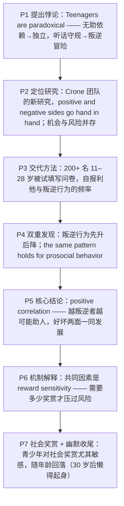

---

title: "青少年悖论：亲社会与叛逆为何并肩而来 精读笔记"
type: study-note
topic: "2023-passage4-teenage-paradox"
tags:
  - english-reading
  - intensive-reading
  - study-note
  - exam-prep
difficulty: intermediate
created: 2026-10-27
updated: 2026-10-27
sources:
  - "2023 考研英语（一）Text 4（the teenage paradox / prosociality and risk-taking）"
  - "intermediate/2023-passage4-teenage-paradox/formatted-article.md"
  - "intermediate/2023-passage4-teenage-paradox/translation.md"
  - "intermediate/2023-passage4-teenage-paradox/grammar-notes.md"
  - "intermediate/2023-passage4-teenage-paradox/固定搭配与词组笔记.md"

---

# 青少年悖论：亲社会与叛逆为何并肩而来 精读笔记

---

## 背景

本文选自 **2023 年考研英语（一）Text 4**，主题是**青春期为什么既叛逆又乐于助人**。文章从"青少年是**矛盾的**"这一常识性判断切入，介绍莱顿大学 **Eveline Crone** 团队发表在《儿童发展》上的新研究：**亲社会行为与叛逆行为在青春期同步上升，且两者正相关**，并用"**奖赏敏感性**"（reward sensitivity）解释这一悖论。

文章沿"**提出悖论 → 定位新研究 → 交代方法 → 双重发现 → 机制解释**"的链条展开，是一篇典型的**科研报道型**文章：

- **提出悖论**：无助依赖的孩子变成独立的人，听话的孩子变成冒险的少年——**同一群人身上同时出现相反变化**（P1）。
- **定位新研究**：新研究属于"重新认识青春期"的思潮，与旧观念（"青少年是需要解决的问题"）形成对照（P2）。
- **交代方法**：200 多名 11–28 岁被试填写问卷，分别报告利他与叛逆行为的频率（P3）。
- **双重发现**：叛逆行为"先升后降"，**亲社会行为遵循同一模式**；两者甚至**正相关**——越叛逆越愿助人（P4–P5）。
- **机制解释**：共同因素是"**奖赏敏感性**"，青少年对社会性奖赏尤其敏感，随年龄增长而回落（P6–P7）。

**难度说明**：中等。句式上密集出现**对称定语从句**（`children who ... become people who ...`）、**同位语从句与定语从句的对照**（`the idea that ... a problem that ...` / `the chance that ...`）、**主语与谓语被长修饰隔开**（`A new study published ..., by ..., suggests ...`）、**比较结构的省略**（`more likely than younger children or adults to report`）与**插入语**（`Reward sensitivity, like ..., seems to ...`）；论证上属于"**现象—研究—机制**"三段式，适合练习**研究结论定位**、**同义替换识别**与**主谓分离句的抓干**。

---

---

## 文章原文

Teenagers are **paradoxical**.

That's a mild and detached way of saying something that parents often express with considerably stronger language.

But the paradox is scientific as well as personal.

In adolescence, helpless and dependent children who have relied on grown-ups for just about everything become **independent** people who can take care of themselves and help each other.

> [!abstract]- 长难句分析
> **原句**：In adolescence, helpless and dependent children who have relied on grown-ups for just about everything become **independent** people who can take care of themselves and help each other.
>
> **主干提取**：
>
> - 状语 A: In adolescence
> - 主语 S: helpless and dependent children
> - 谓语 V: become
> - 表语 C: independent people
> - 定从 1（修饰 children）: who have relied on grown-ups for just about everything
> - 定从 2（修饰 people）: who can take care of themselves and help each other
>
> **修饰成分**：
>
> | 类型 | 引导词 / 形式 | 修饰对象 |
> |------|--------------|----------|
> | 介词短语作时间状语 | In adolescence | 全句 |
> | 形容词并列作前置定语 | helpless and dependent | children |
> | 定语从句 | who | children |
> | 现在完成时（定从内） | have relied on | 强调"一直以来" |
> | 介词短语作状语 | for just about everything | relied on |
> | 定语从句 | who | people |
> | 并列谓语（情态动词承前省略） | and (can) help | 与 take care of 并列，共享主语 who |
> | 不定代词作宾语 | themselves / each other | take care of / help |
>
> **结构图解**：
>
> ```
> 主句: (In adolescence,) 〔helpless and dependent children〕+ become + 〔independent people〕
>   ├── 定从 1: who + have relied on + grown-ups + 〔for just about everything〕→ 修饰 children
>   └── 定从 2: who + can take care of + themselves + and (can) help + each other → 修饰 people
> ```
>
> **参考译文**：在青春期，那些几乎事事依赖大人的、无助而依附的孩子，会变成能够照顾自己、也能互相帮助的独立的人。
>
> **考点提示**：① 主谓被两个 `who` 定从**夹峙隔开**，主干是 `children ... become ... people`，先删定从再读；② 两个定从分饰对比两端（`helpless / dependent` ↔ `independent`），这是第 36 题 A 项 `develop opposite personality traits` 的语言依据；③ 第二个定从内 `can take care of ... and help ...` 为并列谓语，`can` 承前省略；④ `rely on sb for sth` = "在……方面依赖某人"，介词 `for` 不可换成 `on`。

At the same time, once cheerful and **compliant** children become **rebellious** teenage risk-takers.

A new study published in the journal *Child Development*, by Eveline Crone of the University of Leiden and colleagues, suggests that the positive and negative sides of teenagers go **hand in hand**.

> [!abstract]- 长难句分析
> **原句**：A new study published in the journal *Child Development*, by Eveline Crone of the University of Leiden and colleagues, suggests that the positive and negative sides of teenagers go **hand in hand**.
>
> **主干提取**：
>
> - 主语 S: A new study
> - 后置定语 1: published in the journal *Child Development*
> - 后置定语 2: by Eveline Crone of the University of Leiden and colleagues
> - 谓语 V: suggests
> - 宾语从句 O: that the positive and negative sides of teenagers go hand in hand
> - 宾从主干: the positive and negative sides + go + hand in hand
>
> **修饰成分**：
>
> | 类型 | 引导词 / 形式 | 修饰对象 |
> |------|--------------|----------|
> | 过去分词短语作后置定语 | published in ... | a new study |
> | 介词短语作后置定语（施动者） | by Eveline Crone ... and colleagues | a new study（研究由谁完成） |
> | 介词短语作后置定语 | of the University of Leiden | Eveline Crone |
> | 宾语从句 | that | suggests |
> | 介词短语作后置定语 | of teenagers | the positive and negative sides |
> | 形容词并列作前置定语 | positive and negative | sides |
> | 固定短语（方式状语） | hand in hand | go（共同构成谓语 go hand in hand） |
>
> **结构图解**：
>
> ```
> 主句: A new study〔published in ...〕〔by Eveline Crone of ... and colleagues〕+ suggests + 〔that 宾语从句〕
>   └── 宾语从句: the positive and negative sides〔of teenagers〕+ go + hand in hand
> ```
>
> **参考译文**：莱顿大学伊芙琳·克龙及其同事发表在《儿童发展》期刊上的一项新研究表明，青少年身上积极与消极的两面是并行相伴的。
>
> **考点提示**：① `published` 是**过去分词作后置定语**，不是谓语——真正谓语是 `suggests`（单三呼应单数主语 `A new study`），这是"主语后挂长修饰"的典型；② `by ...` 引出研究的实施者，语义相当于被动式 `was published by`，但本句 `study` 是 `suggests` 的施动者；③ `go hand in hand` 是固定短语"密切相关、并行不悖"，是全文**论点句**；④ `suggest that` 后接宾语从句时 `that` 通常保留，不省略。

The study is part of a new wave of thinking about adolescence.

For a long time, scientists and policy makers concentrated on the idea that teenagers were a problem that needed to be solved.

> [!abstract]- 长难句分析
> **原句**：For a long time, scientists and policy makers concentrated on the idea that teenagers were a problem that needed to be solved.
>
> **主干提取**：
>
> - 状语 A: For a long time
> - 主语 S: scientists and policy makers
> - 谓语 V: concentrated on
> - 宾语 O: the idea
> - 同位语从句（说明 idea）: that teenagers were a problem that needed to be solved
> - 同位从主干: teenagers + were + a problem
> - 定语从句（修饰 problem）: that needed to be solved
>
> **修饰成分**：
>
> | 类型 | 引导词 / 形式 | 修饰对象 |
> |------|--------------|----------|
> | 介词短语作时间状语 | For a long time | 全句 |
> | 并列主语 | and | scientists / policy makers |
> | 同位语从句 | that（不作成分） | the idea |
> | 定语从句 | that（作从句主语） | a problem |
> | 不定式被动式 | to be solved | needed（表被动需要） |
>
> **结构图解**：
>
> ```
> 主句: (For a long time,) scientists and policy makers + concentrated on + the idea
>   └── 同位语从句: that + teenagers + were + a problem
>         └── 定从: that + needed + 〔to be solved〕→ 修饰 a problem
> ```
>
> **参考译文**：长期以来，科学家和决策者都集中于这样一种观念：青少年是一个需要被解决的问题。
>
> **考点提示**：① 两个 `that` **层级与身份都不同**：第一个引导同位语从句说明 `idea` 的内容（`that` 不作成分），第二个引导定语从句修饰 `a problem`（`that` 作从句主语）——判别口诀是"看 `that` 在从句里有没有活干"；② `need to be solved` = `need solving`，表被动需要，不能写 `need to solve`（除非主语是施动者）；③ `concentrate on` 后须接名词性成分，故用 `on the idea that ...` 而非 `concentrate that ...`；④ 本句代表**旧观点**，与下句 `The new work emphasizes ...` 构成"旧说—新说"框架，第 37 题 C 项 `provides a new insight into adolescence` 由此对照而来。

The new work emphasizes that adolescence is a time of **opportunity** as well as risk.

The researchers studied "**prosocial**" and rebellious traits in more than 200 children and young adults, ranging from 11 to 28 years old.

The participants filled out **questionnaires** about how often they did things that were **altruistic** and positive, like sacrificing their own interests to help a friend, or rebellious and negative, like getting drunk or staying out late.

> [!abstract]- 长难句分析
> **原句**：The participants filled out **questionnaires** about how often they did things that were **altruistic** and positive, like sacrificing their own interests to help a friend, or rebellious and negative, like getting drunk or staying out late.
>
> **主干提取**：
>
> - 主语 S: The participants
> - 谓语 V: filled out
> - 宾语 O: questionnaires
> - 后置定语: about how often they did things that were altruistic and positive ...
> - 介词宾语从句: how often they did things
> - 宾从主干: they + did + things
> - 定语从句（修饰 things）: that were altruistic and positive
> - 举例成分: like sacrificing ... / like getting drunk ...
>
> **修饰成分**：
>
> | 类型 | 引导词 / 形式 | 修饰对象 |
> |------|--------------|----------|
> | 介词短语作后置定语 | about how often ... | questionnaires |
> | 名词性从句（how often 作频度状语） | how often | 介词 about |
> | 定语从句 | that | things |
> | 形容词并列作表语 | altruistic and positive | that（= things） |
> | 介词短语表举例 | like + 动名词 | things（that were altruistic ...） |
> | 不定式作目的状语 | to help a friend | sacrificing |
> | 省略式并列（对比项） | or rebellious and negative | 与 altruistic and positive 并列 |
> | 动名词并列作介词宾语 | getting drunk / staying out late | like |
>
> **结构图解**：
>
> ```
> 主句: The participants + filled out + questionnaires〔about how often ...〕
>   └── 宾从（how often 作状语）: they + did + things
>         ├── 定从: that + were + altruistic and positive
>         │     └── 举例（like + 动名词）: like〔sacrificing their own interests〕〔to help a friend〕
>         └── 并列对比（省略 things that were）: or + rebellious and negative
>               └── 举例: like〔getting drunk〕or〔staying out late〕
> ```
>
> **参考译文**：参与者填写了问卷，说明自己多久做一次利他而积极的事，比如牺牲自身利益去帮助朋友；又多久做一次叛逆而消极的事，比如喝醉或夜不归宿。
>
> **考点提示**：① `about how often ...` 是"**介词 + 名词性从句**"，`how often` 在从句中作频度状语，不能换成 `that`；② `things that were ...` 的定从只修饰 `things`，与前面的 `questionnaires` 无关；③ `or rebellious and negative` 是**省略式并列**，承前省略 `things that were`，读不通时须补全两端；④ `like` 在此是**介词**"比如"，不是动词"喜欢"；⑤ `sacrifice A to do B` 中不定式表目的，`for` 则偏"换取"；⑥ 若题目问"研究如何测量两类行为"，答案即本句的 `questionnaires` + `how often`。

Other studies have shown that rebellious behavior increases as you become a teenager and then **fades away** as you grow older.

> [!abstract]- 长难句分析
> **原句**：Other studies have shown that rebellious behavior increases as you become a teenager and then **fades away** as you grow older.
>
> **主干提取**：
>
> - 主语 S: Other studies
> - 谓语 V: have shown
> - 宾语从句 O: that rebellious behavior increases ... and then fades away ...
> - 宾从主干: rebellious behavior + increases + and then fades away
> - 时间状语从句: as you become a teenager / as you grow older
>
> **修饰成分**：
>
> | 类型 | 引导词 / 形式 | 修饰对象 |
> |------|--------------|----------|
> | 现在完成时 | have shown | 综述已有研究 |
> | 宾语从句 | that | have shown |
> | 时间状语从句（表"随着"） | as you become a teenager | increases |
> | 并列谓语（主语承前省略） | and then fades away | 与 increases 并列，共享主语 rebellious behavior |
> | 时间状语从句（表"随着"） | as you grow older | fades away |
>
> **结构图解**：
>
> ```
> 主句: Other studies + have shown + 〔that 宾语从句〕
>   └── 宾语从句: rebellious behavior + increases〔as you become a teenager〕
>         └── 并列谓语: and then + fades away〔as you grow older〕
> ```
>
> **参考译文**：其他研究表明，叛逆行为在进入青春期后增多，随后随着年龄增长逐渐消退。
>
> **考点提示**：① `as` 引导时间状语从句表"**随着**"，含同步渐变义，比 `when` 更贴合"逐年消退"；② 宾从内两个谓语 `increases` / `fades away` 并列，第二个主语 `rebellious behavior` 承前省略；③ `have shown` 的现在完成时标记"**已有研究**"，与下句 `the new study shows`（一般现在时）构成新旧对照；④ `fade away` 强调**渐进消失**，不等于 `disappear`，也不含"突然"义。

But the new study shows that, interestingly, the same **pattern** holds for prosocial behavior.

Teenagers were more likely than younger children or adults to report that they did things like unselfishly help a friend.

> [!abstract]- 长难句分析
> **原句**：Teenagers were more likely than younger children or adults to report that they did things like unselfishly help a friend.
>
> **主干提取**：
>
> - 主语 S: Teenagers
> - 系动词 V: were
> - 表语 C: more likely (than younger children or adults) to report that ...
> - 比较状语（从句省略形式）: than younger children or adults
> - 不定式作补足语: to report that ...
> - 宾语从句: that they did things like unselfishly help a friend
>
> **修饰成分**：
>
> | 类型 | 引导词 / 形式 | 修饰对象 |
> |------|--------------|----------|
> | 比较结构 | more ... than ... | 表概率比较 |
> | 比较状语从句（省略 were likely to report） | than younger children or adults | more likely |
> | 不定式作 be likely 的补足语 | to report that ... | likely |
> | 宾语从句 | that | report |
> | 介词 like 表举例 | like unselfishly help a friend | things |
> | 副词作方式状语 | unselfishly | help |
>
> **结构图解**：
>
> ```
> 主句: Teenagers + were + more likely〔than younger children or adults〕〔to report that ...〕
>   ├── 比较从句（省略）: than + younger children or adults + (were likely to report)
>   └── 宾语从句: that + they + did + things〔like unselfishly help a friend〕
> ```
>
> **参考译文**：与更年幼的儿童或成年人相比，青少年更可能报告自己做过无私帮助朋友之类的事。
>
> **考点提示**：① `be likely to do` 的比较级为 `be more likely to do`，`than` 后必须接**同类对象**（人比人），换成"比童年时期"即比较错位；② `than` 从句省略了 `were likely to report`，只留比较基准，阅读时要自动补全；③ `things like ... help a friend` 中 `like` 是介词，后接动词原形短语（口语化省略），意为"像……这样的事"；④ `unselfishly` 修饰 `help`，不是修饰 `things`；⑤ 本句直接支撑第 38 题 D 项 `It tends to peak in adolescence`——"青少年比儿童和成人更可能助人"即"青春期达峰"。

Most significantly, there was a positive **correlation** between prosociality and rebelliousness.

The teenagers who were more rebellious were also more likely to help others.

The good and bad sides of adolescence seem to develop together.

Is there some common factor that **underlies** these apparently **contradictory** developments?

One idea is that teenage behavior is related to what researchers call "**reward sensitivity**."

> [!abstract]- 长难句分析
> **原句**：One idea is that teenage behavior is related to what researchers call "**reward sensitivity**."
>
> **主干提取**：
>
> - 主语 S: One idea
> - 系动词 V: is
> - 表语从句 C: that teenage behavior is related to what researchers call "reward sensitivity"
> - 表从主干: teenage behavior + is related to + what 从句
> - 名词性从句（作介词宾语）: what researchers call "reward sensitivity"
>
> **修饰成分**：
>
> | 类型 | 引导词 / 形式 | 修饰对象 |
> |------|--------------|----------|
> | 表语从句 | that | One idea |
> | 被动结构（表状态） | is related to | teenage behavior |
> | 名词性从句作介词宾语 | what | 介词 to |
> | 宾语 + 宾语补足语 | call + A + B | what（= the thing）/ "reward sensitivity" |
>
> **结构图解**：
>
> ```
> 主句: One idea + is + 〔that 表语从句〕
>   └── 表语从句: teenage behavior + is related to + 〔what 从句〕
>         └── 名从（what 作 call 的宾语）: what + researchers + call + "reward sensitivity"（宾补）
> ```
>
> **参考译文**：一种观点认为，青少年的行为与研究者所称的"奖赏敏感性"有关。
>
> **考点提示**：① `One idea is that ...` 是**表语从句**，`that` 不作成分但不可省；② `what researchers call X` 中 `what` 作 `call` 的**宾语**、`X` 作**宾补**（`call A B` 结构），`what` 不能换成 `that`；③ `be related to` 的 `to` 是**介词**，后接名词性从句而非动词原形；④ `be related to` 只表"相关"，**不表因果**，选项若写成"由……导致/造成"即为过度推断。

Decision-making always involves balancing rewards and risks, benefits and costs.

"Reward sensitivity" measures how much reward it takes to **outweigh** risk.

Teenagers are particularly **sensitive** to social rewards—winning the game, impressing a new friend, getting that boy to notice you.

Reward sensitivity, like prosocial behavior and risk-taking, seems to go up in adolescence and then down again as we age.

> [!abstract]- 长难句分析
> **原句**：Reward sensitivity, like prosocial behavior and risk-taking, seems to go up in adolescence and then down again as we age.
>
> **主干提取**：
>
> - 主语 S: Reward sensitivity
> - 插入语（介词短语）: like prosocial behavior and risk-taking
> - 谓语 V: seems
> - 表语补足（不定式）: to go up ... and then down again
> - 时间状语 A: in adolescence
> - 时间状语从句: as we age
>
> **修饰成分**：
>
> | 类型 | 引导词 / 形式 | 修饰对象 |
> |------|--------------|----------|
> | 介词短语作插入语 | like（= 如同） | 主语的类比对象 |
> | 不定式作表语补足 | to go up ... | seems（seem to do） |
> | 介词短语作时间状语 | in adolescence | go up |
> | 并列谓语（go 承前省略） | and then (go) down again | to go up |
> | 时间状语从句 | as we age | down again |
>
> **结构图解**：
>
> ```
> 主句: Reward sensitivity,〔like prosocial behavior and risk-taking〕,+ seems + 〔to go up〕
>   ├── 时间状语: in adolescence
>   └── 并列谓语（省略 go）: and then + down again〔as we age〕
> ```
>
> **参考译文**：奖赏敏感性如同亲社会行为和冒险行为一样，在青春期上升，随年龄增长又回落。
>
> **考点提示**：① `like ...` 是**介词短语插入主谓之间**，`like` = "像……一样"，既不是动词"喜欢"，也不是举例的 `such as`；② `seem to do` 中不定式作表语补足，`seem` 后不能接 `doing`；③ `go up ... and then down again` 是**并列谓语省略**，第二个 `go` 承前省；④ `as we age` 中 `age` 作动词"变老"，与第 4 段 `as you grow older` 构成**同义复现**；⑤ 本句把"奖赏敏感性"与"亲社会行为""冒险行为"并列，正是"好坏两面同涨同落"的论据。

Somehow, when you hit 30, the chance that something exciting and new will happen at that party just doesn't seem to outweigh the effort of getting up off the **couch**.

> [!abstract]- 长难句分析
> **原句**：Somehow, when you hit 30, the chance that something exciting and new will happen at that party just doesn't seem to outweigh the effort of getting up off the **couch**.
>
> **主干提取**：
>
> - 评注性状语 A: Somehow
> - 时间状语从句 A: when you hit 30
> - 主语 S: the chance that ...
> - 同位语从句（说明 chance）: that something exciting and new will happen at that party
> - 谓语 V: doesn't seem to outweigh
> - 宾语 O: the effort of getting up off the couch
>
> **修饰成分**：
>
> | 类型 | 引导词 / 形式 | 修饰对象 |
> |------|--------------|----------|
> | 评注性状语（带调侃） | Somehow | 全句语气 |
> | 时间状语从句 | when | 全句 |
> | 同位语从句 | that（不作成分） | the chance |
> | 形容词并列作后置定语 | exciting and new | something |
> | 介词短语作地点状语 | at that party | will happen |
> | 否定谓语 + seem to | doesn't seem to outweigh | 委婉否定 |
> | 动名词作介词宾语 | getting up | the effort of |
> | 介词短语作方向补足 | off the couch | get up |
>
> **结构图解**：
>
> ```
> 主句: (Somehow,) (when you hit 30,) the chance〔that ...〕+ doesn't seem to outweigh + the effort〔of getting up off the couch〕
>   ├── 时间状语从句: when + you + hit + 30（hit = 达到）
>   ├── 同位语从句: that + something〔exciting and new〕+ will happen〔at that party〕
>   └── 动名词短语作介词宾语: of + getting up〔off the couch〕
> ```
>
> **参考译文**：不知怎的，人一到 30 岁，就觉得那个聚会上会发生什么新鲜刺激之事的可能性，似乎已经抵不上从沙发上起身的那点力气了。
>
> **考点提示**：① `the chance that ...` 是**同位语从句**（从句主谓齐全、`that` 不作成分），区别于 `the chance of doing`；② `something exciting and new` 中形容词**后置**，因为 `-thing` 类不定代词的定语必须后置；③ `doesn't seem to outweigh` 是**委婉否定**，语义为"似乎并不比……更重要"，比 `isn't more important than` 弱得多；④ `get up off the couch` 中 `off` 引出起点，`the effort of doing` 的 `of` 后接动名词；⑤ `Somehow` 带**调侃口吻**，是"作者语气/态度"题的高发标志；⑥ `hit 30` 的 `hit` 取"达到（年龄）"，属熟词僻义。

---

## 题目

### 36. According to Paragraph 1, children growing into adolescence tend to \_\_\_\_.

- [A] develop opposite personality traits
- [B] see the world in an unreasonable way
- [C] have fond memories of their past
- [D] show affection for their parents

### 37. It can be learned from Paragraph 2 that Crone's study \_\_\_\_.

- [A] explores teenagers' social responsibilities
- [B] examines teenagers' emotional problems
- [C] provides a new insight into adolescence
- [D] highlights negative adolescent behavior

### 38. What does Crone's study find about prosocial behavior?

- [A] It results from the wish to cooperate.
- [B] It is cultivated through education.
- [C] It is subject to family influence.
- [D] It tends to peak in adolescence.

### 39. It can be learned from the last two paragraphs that teenagers \_\_\_\_.

- [A] overstress their influence on others
- [B] care a lot about social recognition
- [C] become anxious about their future
- [D] endeavor to live a joyful life

### 40. What is the text mainly about?

- [A] Why teenagers are self-contradictory.
- [B] Why teenagers are risk-sensitive.
- [C] How teenagers develop prosociality.
- [D] How teenagers become independent.

---

## 翻译对照

## Paragraph 1

Teenagers are paradoxical. That's a mild and detached way of saying something that parents often express with considerably stronger language. But the paradox is scientific as well as personal. In adolescence, helpless and dependent children who have relied on grown-ups for just about everything become independent people who can take care of themselves and help each other. At the same time, once cheerful and compliant children become rebellious teenage risk-takers.

青少年是**矛盾的**。"矛盾"这个词说得温和而超然，而父母们表达同一件事时，用词往往要激烈得多。但这种矛盾不仅是个人感受，也是科学问题。在青春期，那些几乎事事依赖大人、无助而依附的孩子，会变成能够照顾自己、也能互相帮助的独立的人。与此同时，一度开朗听话的孩子会变成叛逆的、敢于冒险的少年。

> [!note] 翻译说明
> - `paradoxical` / `paradox` = "自相矛盾的（人/现象）/ 悖论"，本文标题式概念，第 40 题 A 项 `self-contradictory` 与之对应。
> - `a mild and detached way of saying ...` 结构是"用一种温和超然的方式说……"，`detached` = "客观超然的、不动感情的"，不是"分开的"。
> - `with considerably stronger language` = "用激烈得多的措辞"，`considerably` 修饰比较级，表程度。
> - `the paradox is scientific as well as personal` 中 `as well as` 连接两个并列表语，重点是后者："既是个人层面的，也是科学层面的"。
> - `helpless and dependent children who have relied on ... become independent people who can ...` 是**两个 who 定语从句对称**的对比结构，翻译时可保留"曾经……的孩子，变成……的人"。
> - `compliant` = "顺从的、听话的"，与 `rebellious`（叛逆的）构成反义对；`risk-takers` = "敢于冒险的人"，是本文第 39–40 题的关键概念。

## Paragraph 2

A new study published in the journal Child Development, by Eveline Crone of the University of Leiden and colleagues, suggests that the positive and negative sides of teenagers go hand in hand. The study is part of a new wave of thinking about adolescence. For a long time, scientists and policy makers concentrated on the idea that teenagers were a problem that needed to be solved. The new work emphasizes that adolescence is a time of opportunity as well as risk.

莱顿大学伊芙琳·克龙（Eveline Crone）及其同事发表在《儿童发展》期刊上的一项新研究表明，青少年身上积极与消极的两面是**并肩而行**的。这项研究属于一股重新认识青春期的思潮。长期以来，科学家和决策者都集中于这样一种观念：青少年是一个需要被解决的问题。而这项新研究强调，青春期既是风险期，也是**机遇期**。

> [!note] 翻译说明
> - `A new study published in ..., by Eveline Crone ... , suggests that ...` 是**过去分词 + 介词短语作后置定语**把主语和谓语隔开，主干为 `A new study suggests that ...`，阅读时先跳过修饰部分。
> - `go hand in hand` = "密切相关、并行不悖"，此处指"积极面与消极面**同时出现**"，是全文论点，第 40 题 A 项由此而来。
> - `a new wave of thinking about adolescence` = "一股关于青春期的新思潮"，`wave` 此处指"（思潮的）浪潮"。
> - `concentrated on the idea that ...` 中 `that` 引导**同位语从句**，说明 `idea` 的内容，不修饰前面的名词性成分。
> - `a time of opportunity as well as risk` 中 `as well as` 侧重前者，可译"既是风险期，更是机遇期"，但新闻语体常平列处理为"既是风险期，也是机遇期"。

## Paragraph 3

The researchers studied “prosocial” and rebellious traits in more than 200 children and young adults, ranging from 11 to 28 years old. The participants filled out questionnaires about how often they did things that were altruistic and positive, like sacrificing their own interests to help a friend, or rebellious and negative, like getting drunk or staying out late.

研究者对 200 多名 11 至 28 岁的儿童与青年成年人身上的"**亲社会**"特质和叛逆特质进行了研究。参与者填写了问卷，回答自己多久会做一次利他而积极的事，比如牺牲自身利益去帮助朋友；又多久会做一次叛逆而消极的事，比如喝醉或夜不归宿。

> [!note] 翻译说明
> - `prosocial` = "亲社会的"（对社会、他人有益的倾向），本文核心术语，与 `altruistic`（利他的）近义。
> - `ranging from 11 to 28 years old` 是现在分词短语作**后置定语**，修饰 `children and young adults`，说明年龄跨度。
> - `filled out questionnaires about how often they did things that ...` 是"**about + how often 宾语从句 + that 定语从句**"的嵌套，`things` 后接两类举例。
> - `altruistic` = "利他的、无私的"，与 `selfish` 相对；`rebellious` = "叛逆的"。
> - `sacrificing their own interests to help a friend` 中 `sacrifice ... to do` = "牺牲……去做某事"，`to help` 表目的。
> - `getting drunk or staying out late` 用动名词并列，与前面 `sacrificing ...` 并列，都作 `like` 的宾语。

## Paragraph 4

Other studies have shown that rebellious behavior increases as you become a teenager and then fades away as you grow older. But the new study shows that, interestingly, the same pattern holds for prosocial behavior. Teenagers were more likely than younger children or adults to report that they did things like unselfishly help a friend.

其他研究表明，叛逆行为在进入青春期后增多，随着年龄增长又逐渐消退。但这项新研究显示，有趣的是，亲社会行为也遵循同样的模式。与更年幼的儿童或成年人相比，青少年更可能报告自己做过无私帮助朋友之类的事。

> [!note] 翻译说明
> - `as you become a teenager` / `as you grow older` 两个 `as` 引导**时间状语从句**，表"随着……"。
> - `fade away` = "逐渐消失、退去"，比 `disappear` 更强调**渐进**过程。
> - `the same pattern holds for ...` 中 `hold` 意为"（规律）成立、适用"，不是"握住"；`pattern` 指"（行为变化的）模式"。
> - `Teenagers were more likely than younger children or adults to report that ...` 是**比较结构 + 不定式**，`be likely to do` 的比较对象要与 `than` 后成分对等（人比人）。
> - `did things like unselfishly help a friend` 中 `like` 是介词，后接**动词原形并列短语**（口语化省略 `to` 或 `-ing`），不可理解为"喜欢"。

## Paragraph 5

Most significantly, there was a positive correlation between prosociality and rebelliousness. The teenagers who were more rebellious were also more likely to help others. The good and bad sides of adolescence seem to develop together.

最重要的是，亲社会性与叛逆性之间存在**正相关**。更叛逆的青少年也往往更愿意帮助他人。青春期好的一面与坏的一面似乎是一同发展的。

> [!note] 翻译说明
> - `Most significantly` = "最重要的是、尤其值得注意的是"，是段落**结论信号词**，常在题目中考"作者强调什么"。
> - `a positive correlation between A and B` = "A 与 B 之间的正相关"，`positive` 此处是统计术语"正的"，不是"积极的"；反义为 `negative correlation`。
> - `more rebellious` / `more likely` 两个比较级并列，构成"越……越……"的语义：越叛逆，越可能帮助他人。
> - `The good and bad sides of adolescence seem to develop together` 是本文结论句，呼应首段 `paradoxical`，第 40 题主旨由此确定。

## Paragraph 6

Is there some common factor that underlies these apparently contradictory developments? One idea is that teenage behavior is related to what researchers call “reward sensitivity.” Decision-making always involves balancing rewards and risks, benefits and costs. “Reward sensitivity” measures how much reward it takes to outweigh risk.

这些看似矛盾的发展背后是否存在某种共同因素？一种观点认为，青少年的行为与研究者所称的"**奖赏敏感性**"有关。做决策总要权衡奖赏与风险、收益与成本。"奖赏敏感性"衡量的是：需要多少奖赏才足以**压过**风险。

> [!note] 翻译说明
> - `underlie` = "构成……的基础、是……的根源"，不是"在……下面"；此处为定语从句谓语，修饰 `factor`。
> - `apparently contradictory` = "表面上矛盾的"，`apparently` 常表"看似（实则未必）"，语气留有余地。
> - `what researchers call "reward sensitivity"` 是**名词性从句**，`what` 作 `call` 的宾语，整体作 `to` 的宾语。
> - `balancing rewards and risks, benefits and costs` 用两组并列名词做对称搭配，翻译时保留四字对仗更清晰。
> - `how much reward it takes to outweigh risk` 是 `measures` 的宾语从句，`it takes ... to do` 是**形式主语**结构（真正主语为 `to outweigh risk`），可译"需要多少奖赏才能超过风险"。
> - `outweigh` = "在分量上超过、胜过"，与 2023 Passage 3 中 `outweigh those costs` 同词，可跨篇对照记忆。

## Paragraph 7

Teenagers are particularly sensitive to social rewards—winning the game, impressing a new friend, getting that boy to notice you. Reward sensitivity, like prosocial behavior and risk-taking, seems to go up in adolescence and then down again as we age. Somehow, when you hit 30, the chance that something exciting and new will happen at that party just doesn't seem to outweigh the effort of getting up off the couch.

青少年对**社会性奖赏**尤其敏感——赢下比赛、给新朋友留下好印象、让那个男生注意到你。奖赏敏感性如同亲社会行为和冒险行为一样，在青春期上升，随年龄增长又回落。不知怎的，人一到 30 岁，就觉得聚会上会发生什么新鲜刺激之事的可能性，似乎已经抵不上从沙发上起身的那点力气了。

> [!note] 翻译说明
> - `be sensitive to` = "对……敏感"，`social rewards` = "社会性奖赏（来自他人的认可、关注、赞许）"，第 39 题 B 项 `social recognition` 即此义的改写。
> - 破折号后的三个动名词短语 `winning ... / impressing ... / getting ... to notice you` 是**举例说明** `social rewards` 的同位成分。
> - `go up ... and then down again` = "上升……然后回落"，与第 4 段 `increases ... fades away` 构成**同一模式的复现**。
> - `Somehow` = "不知怎么地、说来也怪"，此处带**幽默口吻**，不可译"以某种方式"。
> - `the chance that something exciting and new will happen at that party` 中 `that` 引导**同位语从句**说明 `chance` 的内容。
> - `doesn't seem to outweigh the effort of getting up off the couch` 是**降格幽默**：用"从沙发上起来"的力气对比"聚会的刺激"，暗示随年龄增长奖赏敏感度下降。

---

---

## 题目翻译

### 36. 根据第一段，孩子成长为青少年时往往 ____。

- [A] 发展出相反的人格特征
- [B] 以不合理的方式看世界
- [C] 对过去怀有美好回忆
- [D] 对父母表现出亲昵

### 37. 从第二段可以得知，克龙的研究 ____。

- [A] 探讨青少年的社会责任
- [B] 考察青少年的情感问题
- [C] 为青春期提供了新的认识
- [D] 强调青少年的消极行为

### 38. 克龙的研究关于亲社会行为发现了什么？

- [A] 它源于合作的愿望。
- [B] 它通过教育培养而成。
- [C] 它受家庭影响。
- [D] 它往往在青春期达到高峰。

### 39. 从最后两段可以得知，青少年 ____。

- [A] 过分强调自己对他人的影响
- [B] 非常在意社会认可
- [C] 对未来感到焦虑
- [D] 努力过快乐的生活

### 40. 本文主要讨论什么？

- [A] 青少年为何自相矛盾。
- [B] 青少年为何对风险敏感。
- [C] 青少年如何发展亲社会性。
- [D] 青少年如何变得独立。

---

---

## 语法要点

> [!note] 来源说明
> 本篇**用户未提供语法源笔记**，以下语法点由 `formatted-article.md` 与 `translation.md` **从本文推断提取**，仅收录本篇实际出现的语法现象。
> 每一条均给出**原文语境**，便于回原文核对；标注"（联动）"的条目与相邻专题互为参照。
> 固定搭配与词组见 [[intermediate/2023-passage4-teenage-paradox/固定搭配与词组笔记.md|2023 Passage 4 固定搭配与词组]]。

---

## 一、从句

### 从句：对称的 who 定语从句（对比结构）

**概述**：同一句中用两个 `who` 定语从句分别修饰前后对立的两个名词，形成"**曾经的 A，变成如今的 B**"的对照。这种对称定从是议论文立论段最常用的铺陈手段。

| 结构 | 用法 | 例句 |
|------|------|------|
| `名词 A + who + 谓语 ... become ... 名词 B + who + 谓语` | 两个定从分饰对比两端 | helpless and dependent children **who have relied on grown-ups** become independent people **who can take care of themselves** |
| `名词 + who + 定语从句（后置）` | 长定从后置，保持主句紧凑 | independent people **who can take care of themselves and help each other** |

> [!tip] 阅读技巧
> 读这类句子先**删掉两个 `who` 从句**，主干立刻显现：`helpless and dependent children become independent people`——"孩子变成大人"。第 36 题问"孩子长大进入青春期会怎样"，四个选项都在这句里埋伏：A 项 `develop opposite personality traits` 对应首句 `paradoxical` 与"无助→独立""听话→叛逆"的双重反差；B、C、D 三项原文均无依据。

### 从句：that 引导的定语从句与同位语从句

**概述**：`that` 后接从句时有两种身份——**定语从句**（`that` 在从句中作主语或宾语）与**同位语从句**（`that` 不作成分，只起连接作用，说明前面抽象名词的内容）。本篇两种都出现，且相邻分布，是绝佳的对比材料。

| 结构 | 用法 | 例句 |
|------|------|------|
| `some factor that + 谓语` | 定从，`that` 作从句主语 | some common factor **that underlies these apparently contradictory developments** |
| `a problem that + 谓语` | 定从，`that` 作从句主语 | teenagers were **a problem that needed to be solved** |
| `the chance that + 完整句` | 同位语从句，`that` 不作成分 | **the chance that something exciting and new will happen at that party** |
| `the idea that + 完整句` | 同位语从句，说明 idea 的内容 | concentrated on **the idea that teenagers were a problem** |

> [!warning] 易错点
> 判别口诀：**看 `that` 在从句里有没有"活干"**。
> - `the chance that something will happen`：从句 `something will happen` 主谓齐全，`that` 无成分 → **同位语从句**。
> - `a problem that needed to be solved`：从句缺主语，`that` 顶上 → **定语从句**。
> 同位语从句只能用 `that / whether / how / when` 等引导且**不省略**；定语从句的 `that` 作宾语时可省略。

### 从句：嵌套 that 从句（the idea that ... a problem that ...）

**概述**：本篇第 2 段出现"`the idea that` + 内含 `that` 定从"的双层嵌套，读到第二个 `that` 时极易错判层级。

| 结构 | 用法 | 例句 |
|------|------|------|
| `concentrate on the idea that [ teenagers were a problem that needed to be solved ]` | 外层同位语从句，内层定语从句 | scientists concentrated on **the idea that** teenagers were **a problem that** needed to be solved |

> [!tip] 阅读技巧
> 从句套从句时，**按括号配对着读**：外层 `that` 管到第二个 `that` 之前，内层 `that` 只修饰 `a problem`。第 37 题 C 项 `provides a new insight into adolescence` 正是由"旧观念（problem）→ 新研究（opportunity as well as risk）"的**对比**推出，读懂第二章的层级才能把握转折方向。

### 从句：what 引导的名词性从句作介词宾语

**概述**：`what researchers call "reward sensitivity"` 整体是**名词性从句**，作介词 `to` 的宾语；`what` 在从句中作 `call` 的宾语（`call A B` 的 A）。

| 结构 | 用法 | 例句 |
|------|------|------|
| `be related to what + 主谓` | what 从句作介词 to 的宾语 | teenage behavior is related to **what researchers call "reward sensitivity"** |
| `what + 主谓 + 宾补` | what 作 call 的宾语，名词短语作宾补 | **what researchers call "reward sensitivity"** |

> [!warning] 易错点
> `what` 不能换成 `that`：`that` 引导的从句本身完整，不充当成分；此处从句缺 `call` 的宾语，必须用 `what`。另外 `related to` 的 `to` 是**介词**，后面接从句而非句子原形。

### 从句：how often 引导的宾语从句

**概述**：`about` 后接 `how often` 引导的宾语从句，`how often` 在从句中作**频度状语**，回答"多久一次"。

| 结构 | 用法 | 例句 |
|------|------|------|
| `questionnaires about how often + 主谓` | how often 从句作 about 的宾语 | questionnaires **about how often they did things** |
| `how often they did things that ...` | 从句内再套 that 定从 | how often they did things **that were altruistic and positive** |

> [!note] 补充说明
> `how often`（频度）、`how long`（时长）、`how soon`（多久之后）三个疑问词组在考研阅读的细节题中常被互换设错，须按"**问的是什么维度**"逐一核对。

### 从句：as 引导的时间状语从句（随着）

**概述**：`as` 引导时间状语从句，表"**随着……（逐渐）**"，含**同步变化**的意味，比 `when` 更能体现渐进性。

| 结构 | 用法 | 例句 |
|------|------|------|
| `as + 主语 + 谓语` | 表"随着"，从句与主句同步变化 | **as you become a teenager** ... / **as you grow older** |
| `as we age` | 简式（主语 we，谓语 age） | then down again **as we age** |

> [!tip] 阅读技巧
> 本篇两处"上升—回落"的表述同构：第 4 段 `increases as you become a teenager and then fades away as you grow older`，第 7 段 `go up in adolescence and then down again as we age`。**同义复现**是主旨题（第 40 题）与细节题（第 38 题 D 项 `It tends to peak in adolescence`）的共同依据。

### 从句：when 引导的时间状语从句

**概述**：`when you hit 30` 是口语化的时间状语从句，`hit` 在此为"达到（某年龄）"，属**熟词僻义**。

| 结构 | 用法 | 例句 |
|------|------|------|
| `when + 主语 + hit + 年龄` | 时间状语从句，hit = 达到 | **when you hit 30**, the chance ... doesn't seem to outweigh ... |

> [!note] 补充说明
> `hit` 的常见僻义还有"（灾难、坏消息）侵袭、打击"（`be hit by`）、"突然想到"（`it hit me that ...`）。考研阅读中遇到"人 + hit + 数字/年龄"几乎都取"达到"义。

### 从句：than 引导的比较状语从句（省略）

**概述**：`more likely than ... to report` 中 `than` 后是**省略形式**的比较状语从句，省略了与主句重复的 `were likely to report`。

| 结构 | 用法 | 例句 |
|------|------|------|
| `A were more likely than B to do` | than 后省略重复谓语，比较对象对等（人与人） | Teenagers were **more likely than younger children or adults** to report that ... |

> [!warning] 易错点
> 比较结构必须**同类相比**：`teenagers`（人）比 `younger children or adults`（人），不能比成"青少年比童年时期"。若 `than` 后换成 `in childhood`（时间），就成了**比较对象错位**——这是选项设置的经典陷阱。

---

## 二、非谓语动词

### 非谓语：过去分词作后置定语

**概述**：`study` 后的三项修饰（`published in ...`、`by Eveline Crone ...`、`suggests`）层层叠加，要靠**主谓一致**辨认真正的谓语。

| 结构 | 用法 | 例句 |
|------|------|------|
| `a new study published in + 期刊` | 过去分词短语作后置定语（被动关系） | **A new study published in the journal Child Development** |
| `study, by + 人名 + of + 机构` | 介词短语补出研究者 | the study **by Eveline Crone of the University of Leiden and colleagues** |
| `be related to` | 过去分词表状态 | teenage behavior **is related to** what researchers call ... |

> [!tip] 阅读技巧
> 主句是 `A new study ... suggests that ...`，中间 20 多个词全是 `study` 的修饰语。**跳过定语先抓 `suggests`**，再看从句内容——这是所有"主语后挂长定语"句式的通用读法。（联动）见"四、插入语与语序：主谓之间插入后置定语"。

### 非谓语：现在分词作后置定语

**概述**：`ranging from 11 to 28 years old` 用现在分词短语补充说明年龄跨度，与先行词是**主动关系**（儿童与青年"跨越"了这些年龄）。

| 结构 | 用法 | 例句 |
|------|------|------|
| `名词 + ranging from A to B` | 现在分词作后置定语，表范围 | more than 200 children and young adults, **ranging from 11 to 28 years old** |

> [!warning] 易错点
> `ranging` 不能改成 `ranged`：分词与逻辑主语是**主动**关系（人"跨越"年龄区间），只有被动的 `a range of ages` 之类才用过去分词。考试中常见 `ranging from ... to ...` 与 `ranging between ... and ...` 两种搭配，**不加 `from` 就不能用 `to`**。

### 非谓语：形式主语 it + 不定式

**概述**：`it takes + 名词 + to do` 中 `it` 是**形式主语**，真正主语是不定式短语"要付出多少……才……"。

| 结构 | 用法 | 例句 |
|------|------|------|
| `it takes + 数量 + to do` | 形式主语 it，不定式为真正主语 | measures **how much reward it takes to outweigh risk** |
| `it takes + 时间/努力 + to do` | 表"需要（多少代价）才能" | **it takes** a lot of effort **to get up off the couch**（语义对应） |

> [!note] 补充说明
> `it takes ... to do` 与 `it is + adj. + to do` 都是形式主语，区别在**谓语**：`take` 表"耗费"，`be + 形容词` 表"评价"。第 6 段用 `measuring how much reward it takes` 表达"以奖赏换风险的**代价**"，正是"奖赏敏感性"的操作化定义。

### 非谓语：不定式作目的状语

**概述**：`to help a friend` 说明"牺牲个人利益"的**目的**，与 `sacrificing their own interests` 构成"手段—目的"关系。

| 结构 | 用法 | 例句 |
|------|------|------|
| `do sth to do sth` | 不定式表目的 | sacrificing their own interests **to help a friend** |
| `help sb (to) do` | help 后不定式可省略 to | **help a friend** / **help others** |

> [!note] 补充说明
> `sacrifice A to do B` 与 `sacrifice A for B` 都可表"为 B 牺牲 A"，但前者强调**目的**、后者强调**换取**。写作时 `in order to` 更正式，阅读时只需识别"**to do 跟在动作后＝目的**"。

### 非谓语：动名词并列作介词宾语

**概述**：破折号后用三个动名词短语并列，作介词 `to` 的宾语（`sensitive to ...`），具体列举"社会性奖赏"。

| 结构 | 用法 | 例句 |
|------|------|------|
| `be sensitive to A, B, and C` | 介词 to 后接三个动名词并列 | particularly sensitive to social rewards—**winning the game, impressing a new friend, getting that boy to notice you** |
| `get sb to do` | get + 宾语 + 不定式（使役） | **getting that boy to notice you** |

> [!warning] 易错点
> `sensitive to` 的 `to` 是**介词**，后接名词或动名词，不能接动词原形（`sensitive to win` ✗）。同类还有 `used to doing`（习惯于）、`look forward to doing`（期待）、`object to doing`（反对）——`to` 作介词的固定搭配要整体记忆。

### 非谓语：动名词作介词宾语（评价性表达）

**概述**：`the effort of getting up off the couch` 中 `getting up` 作 `of` 的宾语；`off the couch` 是 `get up` 的**补足成分**（get up off sth = 从……上起身）。

| 结构 | 用法 | 例句 |
|------|------|------|
| `the effort of doing sth` | 动名词作 of 的宾语，表"做某事的力气" | the effort of **getting up off the couch** |
| `get up off + 名词` | 复合动词短语，off 引出起点 | **getting up off the couch** |

> [!tip] 阅读技巧
> 全句 `the chance that ... doesn't seem to outweigh the effort of getting up off the couch` 用一个**生活化对比**（聚会的刺激 vs 起身的力气）说明"奖赏敏感性下降"。这类**幽默降格**结尾常被用来考"作者语气/态度"，注意 `Somehow` 带来的调侃意味。

---

## 三、语态与时态

### 语态：被动语态

**概述**：本篇被动语态集中在"研究如何被开展"的客观叙述中，施动者或隐含或后置，语气** impersonal**。

| 结构 | 用法 | 例句 |
|------|------|------|
| `be published in + 期刊` | 被动，说明发表载体 | A new study **was published in** the journal *Child Development* |
| `be related to` | 被动表状态，"与……相关" | teenage behavior **is related to** reward sensitivity |
| `be solved`（定语从句内） | 被动不定式，"需要被解决" | a problem that **needed to be solved** |

> [!warning] 易错点
> `be related to` 是**状态被动**，通常不译成"被关联"，而译"与……有关"；`be related with` 属误用，固定搭配只有 `be related to`。（联动）见固定搭配笔记"名词短语与介词搭配"。

### 时态：现在完成时

**概述**：`have shown / have relied on` 表"**从过去延续到现在**"的既有事实，是文献综述与研究背景的标准时态。

| 结构 | 用法 | 例句 |
|------|------|------|
| `Other studies have shown that ...` | 现在完成时，综述已有研究 | **Other studies have shown** that rebellious behavior increases |
| `children who have relied on ...` | 完成时定从，强调"一直以来" | children **who have relied on** grown-ups for just about everything |

> [!tip] 阅读技巧
> 时态是**论点的路标**：`have shown`（已有研究）→ `But the new study shows`（新研究）→ `seem to develop together`（结论）。第 38 题问"新研究关于亲社会行为发现了什么"，答案必须取**新研究**（现在时 `shows`）而非**旧研究**（完成时 `have shown`），D 项 `It tends to peak in adolescence` 正是"同一模式"的转述。

### 时态：一般现在时表普遍规律

**概述**：全文主体用一般现在时，把青少年的表现当作**普遍规律**陈述，而非某个时点的具体事件。

| 结构 | 用法 | 例句 |
|------|------|------|
| `主语 + be + 形容词` | 一般现在时下判断 | Teenagers **are** paradoxical |
| `主语 + 动词单三` | 表规律性变化 | rebellious behavior **increases** ... then **fades away** |

> [!note] 补充说明
> 说明文/科普文的时态格局：**一般现在时讲规律，现在完成时讲已有研究，一般过去时讲某次具体研究**（本篇第 3 段 `The researchers studied ...`、`The participants filled out ...`）。把握好这三层时态，可快速区分"结论"与"过程"。

### 比较级：more likely ... than

**概述**：`more likely than ... to do` 是概率比较的固定框架，`than` 后的成分承担比较基准。

| 结构 | 用法 | 例句 |
|------|------|------|
| `be more likely than X to do` | 比较两个群体的发生概率 | Teenagers were **more likely than younger children or adults to report** that ... |
| `more rebellious` / `more likely` 叠用 | 比较级叠加表"越……越……" | The teenagers who were **more rebellious** were also **more likely to help others** |

> [!tip] 阅读技巧
> 第 5 段"越叛逆越愿帮人"是**全文核心发现**，句式上靠两个 `more` 叠用实现。第 40 题主旨 A 项 `Why teenagers are self-contradictory` 针对的是"好坏两面同时发展"这一现象，B 项 `risk-sensitive`、C 项 `prosociality`、D 项 `independent` 都只覆盖局部。

---

## 四、插入语与语序

### 插入语：评注性状语

**概述**：`interestingly / Most significantly / Somehow / apparently` 等副词或短语独立于主句之外，标记作者的**评价与态度**，是议论文的"信号词"。

| 结构 | 用法 | 例句 |
|------|------|------|
| `Most significantly, + 主句` | 段落结论的最高级标记 | **Most significantly**, there was a positive correlation |
| `主语 + 谓语, interestingly, + 主句` | 句中插入，缓和断言 | the new study shows that, **interestingly**, the same pattern holds |
| `Somehow, + 主句` | 口语化评注，带调侃 | **Somehow**, when you hit 30, ... |
| `apparently + 形容词` | 表"表面上"，留有余地 | these **apparently** contradictory developments |

> [!tip] 阅读技巧
> 看到 `Most significantly / Above all / Crucially` 立即在其后**画结论线**：本篇的 `positive correlation` 就在这个标记之后，第 39 题 B 项 `care a lot about social recognition` 与第 40 题主旨也都由此链出。`apparently` 则提示"**看似如此**"，作者往往随后要修正或解释。

### 语序：主谓之间插入后置定语

**概述**：主语 `A new study` 与谓语 `suggests` 之间被"过去分词 + by 短语"隔开约 20 词，是**主语后挂长修饰**的典型。

| 结构 | 用法 | 例句 |
|------|------|------|
| `主语 + [分词短语] + [by 短语] + 谓语` | 修饰成分后置，主谓被拉远 | A new study **published in the journal Child Development, by Eveline Crone of the University of Leiden and colleagues,** suggests that ... |
| `主语 + [同位语] + 谓语` | 人名 + 机构作同位语 | Eveline Crone **of the University of Leiden** |

> [!warning] 易错点
> 读到 `published` 不要当成谓语——**过去分词不作谓语**；真正的谓语是后面的 `suggests`（单三形式呼应单数主语 `A new study`）。判断方法：**找带时态标记的动词**。（联动）见"二、非谓语动词：过去分词作后置定语"。

---

## 五、平行结构与逻辑连接

### 平行结构：对称并列

**概述**：本篇大量使用"**形容词并列 + 名词并列**"的对称结构，把"好的一面"与"坏的一面"成对摆放，服务于"矛盾并存"的主题。

| 结构 | 用法 | 例句 |
|------|------|------|
| `形容词 A and 形容词 B + 名词` | 两个形容词并列修饰同一名词 | **helpless and dependent** children / **cheerful and compliant** children |
| `形容词 + 名词 + and + 形容词 + 名词` | 两组"形+名"对称 | the **positive and negative sides** / **prosocial and rebellious traits** |
| `名词 + and + 名词`（同类并列） | 列举同类项目 | **rewards and risks, benefits and costs** |
| `形容词 A and 形容词 B`（对立搭配） | 一正一负，构成张力 | **altruistic and positive** ... **rebellious and negative** |

> [!tip] 阅读技巧
> 平行结构是**主旨的可视化**：凡是出现"好 + 坏"成对并列的地方（第 1、2、3、5 段），都在强化 `the positive and negative sides ... go hand in hand`。第 40 题 A 项 `Why teenagers are self-contradictory` 直接对应这条贯穿全文的平行链。

### 平行结构：形容词并列的顺序与逻辑

**概述**：`altruistic and positive` / `rebellious and negative` 中前后两项是"**性质 + 评价**"的递进，不是随意堆叠；翻译时保留"利他而积极""叛逆而消极"的对仗。

| 结构 | 用法 | 例句 |
|------|------|------|
| `性质形容词 + and + 评价形容词` | 先客观性质、后主观定性 | things that were **altruistic and positive** ... or **rebellious and negative** |
| `副词 + 动词`（评价副词） | 修饰行为方式 | **unselfishly** help a friend |

> [!note] 补充说明
> 考研翻译题中，并列形容词常需**拆分重组**：`altruistic and positive` 直译"利他的和积极的"生硬，译为"**利他而积极**"更符合汉语双音节对仗习惯。

### 逻辑连接：as well as 侧重前者

**概述**：`A as well as B` 语义上**侧重 A**（B 是追加信息），与 `not only B but also A` 方向一致；但汉语常平列处理。

| 结构 | 用法 | 例句 |
|------|------|------|
| `形容词 A as well as 形容词 B` | 侧重 A，B 为附带 | the paradox is **scientific as well as personal** |
| `名词 A as well as 名词 B` | 侧重 A，B 为附带 | a time of **opportunity as well as risk** |

> [!warning] 易错点
> `as well as` 连接两个主语时，谓语**与前者一致**：`The teacher as well as the students is ...`。本篇两处都是表语并列，不涉及主谓一致，但考点集中在此，务必区分 `as well as`（并列，侧重前者）与 `as well`（句末"也"）。

### 逻辑连接：转折与递进链条

**概述**：全文用"**让步 → 转折 → 递进**"三步推进论点：先摆旧观念，再用 `But` 转折，最后用 `Most significantly` 抬到结论。

| 结构 | 用法 | 例句 |
|------|------|------|
| `But + 主句` | 段内转折，引出新发现 | **But** the new study shows that ... the same pattern holds |
| `At the same time, + 主句` | 补充并存事实（非时间） | **At the same time**, once cheerful and compliant children become rebellious |
| `Most significantly, + 主句` | 递进至最高级结论 | **Most significantly**, there was a positive correlation |
| `For a long time, ... The new work emphasizes ...` | 旧观点 vs 新观点的对照框架 | **For a long time**, scientists ... / **The new work emphasizes** that ... |

> [!tip] 阅读技巧
> `At the same time` 在此**不表时间**，而表"与此同时（并存）"；`For a long time ... The new work ...` 是标准的"**旧说—新说**"框架。第 37 题 C 项 `provides a new insight into adolescence` 就是对这个框架的概括——注意 `insight` 对应"新认识"，而不是"解决青少年问题"。

### 标点：破折号列举解释

**概述**：破折号后接三项动名词，对前面的抽象概念 `social rewards` 作**具体化举例**。

| 结构 | 用法 | 例句 |
|------|------|------|
| `抽象名词—A, B, C` | 破折号引出列举，解释前文 | social rewards—**winning the game, impressing a new friend, getting that boy to notice you** |
| `名词—同位语` | 破折号引出同位成分 | more conceptual thinking—something that is not available on the Internet（2023 P3 对照） |

> [!note] 补充说明
> 破折号在考研阅读中承担三种功能：**举例**（本篇）、**同位解释**、**语义突转**。判断方法：看破折号后是"具体项"（举例）、"名词短语"（同位）还是"相反论断"（突转）。

### 标点：引号表术语

**概述**：`"prosocial"`、`"reward sensitivity"` 加引号表示**术语的提出与界定**，而非反讽。

| 结构 | 用法 | 例句 |
|------|------|------|
| `"术语"` + 定义句 | 引号标示新术语，随后给出定义 | what researchers call **"reward sensitivity"** ... "Reward sensitivity" **measures** how much reward it takes |
| `"形容词"` + 名词 | 引号强调该词的特殊性 | "**prosocial**" and rebellious traits |

> [!tip] 阅读技巧
> 考研阅读中，**加引号的词往往是题目考点的定位词**：本篇 `reward sensitivity` 决定了第 39 题（青少年重社会认可）的答案，`prosocial` 决定第 38 题（亲社会行为在青春期达峰）。看到引号先记下位置，再回原文找它的定义句。

---

## 固定搭配与词组

> [!note] 来源说明
> 本篇固定搭配与词组由 `formatted-article.md` **从本文提取**，仅收录本篇实际出现的表达。
> 纯语法内容见 [[intermediate/2023-passage4-teenage-paradox/grammar-notes.md|2023 Passage 4 语法整理]]。

---

## 一、主题词与核心概念

| 搭配 | 释义 | 原文语境 |
|------|------|----------|
| **paradoxical** | 自相矛盾的、悖论的 | Teenagers are **paradoxical** |
| **paradox** | 悖论、矛盾现象 | the **paradox** is scientific as well as personal |
| **detached** | 超然的、不动感情的 | a mild and **detached** way of saying ... |
| **compliant** | 顺从的、听话的 | once cheerful and **compliant** children |
| **rebellious** | 叛逆的、反抗的 | become **rebellious** teenage risk-takers |
| **risk-taker** | 敢于冒险的人 | teenage **risk-takers** |
| **prosocial** | 亲社会的（乐于助人、利他的） | "**prosocial**" and rebellious traits |
| **altruistic** | 利他的、无私的 | things that were **altruistic** and positive |
| **correlation** | 相关性、关联 | a positive **correlation** between prosociality and rebelliousness |
| **reward sensitivity** | 奖赏敏感性 | what researchers call "**reward sensitivity**" |
| **decision-making** | 决策 | **Decision-making** always involves balancing rewards and risks |
| **adolescence** | 青春期 | In **adolescence**, helpless and dependent children ... |
| **young adult** | 青年成年人（约 18–28 岁） | more than 200 children and **young adults** |
| **counterpart / common factor**（对照） | 对应物 / 共同因素 | some **common factor** that underlies these developments |

> [!tip] 解题技巧
> 全文核心概念链：**paradoxical**（现象）→ **prosocial + rebellious**（两面）→ **positive correlation**（发现）→ **reward sensitivity**（解释）。第 40 题主旨 A 项 `Why teenagers are self-contradictory` 对应第一环；第 39 题 B 项 `care a lot about social recognition` 对应最后一环（`social rewards` 的改写）。

## 二、动词短语

| 搭配 | 释义 | 原文语境 |
|------|------|----------|
| **rely on** | 依赖、依靠 | children who have **relied on** grown-ups for just about everything |
| **take care of** | 照顾、照料 | people who can **take care of** themselves |
| **go hand in hand** | 密切相关、并行不悖 | the positive and negative sides go **hand in hand** |
| **fill out** | 填写（表格、问卷） | The participants **filled out** questionnaires |
| **range from A to B** | 从 A 到 B 不等 | **ranging from** 11 to 28 years old |
| **fade away** | 逐渐消退、淡去 | then **fades away** as you grow older |
| **hold for** | （规律）适用于、对……成立 | the same pattern **holds for** prosocial behavior |
| **concentrate on** | 集中于、专注于 | scientists **concentrated on** the idea that ... |
| **emphasize** | 强调 | The new work **emphasizes** that adolescence is a time of opportunity |
| **be related to** | 与……相关联 | teenage behavior **is related to** reward sensitivity |
| **underlie** | 构成……的基础、是……的根源 | some common factor that **underlies** these developments |
| **outweigh** | 在分量上超过、胜过 | how much reward it takes to **outweigh** risk |
| **go up / go down** | 上升 / 下降 | seems to **go up** in adolescence and then **down** again |
| **hit 30** | 到 30 岁（hit = 达到） | when you **hit 30** |
| **get up off the couch** | 从沙发上起身 | the effort of **getting up off the couch** |
| **impress** | 给……留下深刻印象 | **impressing** a new friend |
| **get sb to do** | 让某人做某事（使役） | **getting** that boy **to notice** you |

> [!warning] 易错点
> - `rely on` 后接名词或动名词，`rely on sb to do` 表"指望某人做某事"；不要与 `rely in`（不存在的搭配）混用。
> - `go hand in hand` 是**固定短语**，`hand in hand` 不能改成 `hands in hands`，也不用冠词。
> - `hold for` 中 `hold` 意为"成立、适用"（`The rule holds for all cases.`），不是"握住、举办"。
> - `underlie` 是**及物动词**（原形 `underlie`，三单 `underlies`），不要写成 `underly`；名词形式是 `underlying`（"潜在的、根本的"）。
> - `outweigh` 是及物动词，**不加 `than`**：`A outweighs B` = A 比 B 更重要。
> - `hit 30` 中的 `hit` 取"达到（年龄、数量）"，不是"打击"。

## 三、名词短语与介词搭配

| 搭配 | 释义 | 原文语境 |
|------|------|----------|
| **in adolescence** | 在青春期 | **In adolescence**, helpless and dependent children ... |
| **at the same time** | 与此同时（表并存） | **At the same time**, once cheerful children become rebellious |
| **for a long time** | 长期以来 | **For a long time**, scientists and policy makers concentrated on ... |
| **as well as** | 以及（语义侧重前者） | the paradox is scientific **as well as** personal |
| **a time of opportunity as well as risk** | 既是风险期也是机遇期 | adolescence is **a time of opportunity as well as risk** |
| **a problem that needs to be solved** | 一个待解决的问题 | teenagers were **a problem that needed to be solved** |
| **a new wave of thinking** | 一股新思潮 | a **new wave of thinking** about adolescence |
| **sensitive to** | 对……敏感 | particularly **sensitive to** social rewards |
| **social rewards** | 社会性奖赏（他人的认可与关注） | **social rewards**—winning the game, impressing a new friend |
| **the chance that ...** | ……的可能性 | **the chance that** something exciting will happen |
| **the effort of doing** | 做某事的力气/努力 | **the effort of** getting up off the couch |
| **the good and bad sides of** | ……的好与坏两面 | **The good and bad sides of** adolescence |
| **in more than 200 ...** | 在 200 多名……中 | studied ... **in more than 200** children and young adults |
| **at that party** | 在那个聚会上 | will happen **at that party** |

> [!warning] 易错点
> - `sensitive to` 中 `to` 是**介词**，后接名词/动名词（`sensitive to criticism`），不能接动词原形。
> - `as well as` 与 `as well` 不同：前者连接并列成分（侧重前者），后者只能置于句末表"也"。
> - `a problem that needs to be solved` 用 **need to be done** 或 **need doing** 均可（`needs solving`），但不能写 `needs to solve`（除非主语是施动者）。
> - `the chance that ...` 是**同位语从句**，`that` 不作成分也不可省；对比 `the chance of doing`（介词短语）。

## 四、固定句式与逻辑连接

| 搭配 | 释义 | 原文语境 |
|------|------|----------|
| **be more likely than ... to do** | 比……更可能做某事 | Teenagers were **more likely than younger children or adults to report** that ... |
| **more ... , more ...**（叠用） | 越……越…… | The teenagers who were **more rebellious** were also **more likely to help others** |
| **it takes ... to do** | 需要（多少代价）才能 | how much reward **it takes to outweigh** risk |
| **the same pattern holds for ...** | 同样的模式也适用于…… | **the same pattern holds for** prosocial behavior |
| **go up ... and then down again** | 先上升，随后又回落 | **go up** in adolescence and then **down again** as we age |
| **A as well as B**（表语并列） | 既是 B，也是 A（侧重 A） | The paradox is **scientific as well as personal** |
| **For a long time, ... The new work emphasizes ...** | 旧说与新说的对照框架 | **For a long time**, scientists concentrated on ... **The new work emphasizes** ... |
| **Most significantly, ...** | 最重要的是（结论信号） | **Most significantly**, there was a positive correlation |
| **But the new study shows that ...** | 转折引出新发现 | **But the new study shows that**, interestingly, the same pattern holds |
| **seem to do** | 似乎、看来（留有余地） | The good and bad sides **seem to develop** together |

> [!tip] 解题技巧
> 本篇的逻辑骨架是"**旧说 → 转折 → 新发现 → 解释**"：
> 1. 旧说：`For a long time, ... teenagers were a problem that needed to be solved` → 第 37 题 C 项 `provides a new insight` 正是旧说的反面。
> 2. 新发现：`But the new study shows ... the same pattern holds` → 第 38 题 D 项 `It tends to peak in adolescence`。
> 3. 解释：`reward sensitivity` + `social rewards` → 第 39 题 B 项 `care a lot about social recognition`。
> 4. 主旨：好与坏"同时发展"→ 第 40 题 A 项 `Why teenagers are self-contradictory`。
> 看到 `Most significantly` 与 `But` 就要意识到其后是出题区。

---

## 生词表

本篇共提取 **26 组**生词与短语（含短语中的独立词条），按字母顺序排列。

| 词汇 | 词性 | 含义 | 原文例句 |
|------|------|------|----------|
| **altruistic** | adj. | 利他的、无私的（名词 `altruism` 利他主义） | "things that were **altruistic** and positive, like sacrificing their own interests to help a friend" |
| **compliant** | adj. | 顺从的、听话的（动词 `comply with` 遵守） | "once cheerful and **compliant** children become rebellious teenage risk-takers" |
| **contradictory** | adj. | 相互矛盾的、对立的 | "Is there some common factor that underlies these apparently **contradictory** developments?" |
| **correlation** | n. | 相关性、关联（`positive correlation` 正相关） | "there was a positive **correlation** between prosociality and rebelliousness" |
| **couch** | n. | 沙发（`get up off the couch` 从沙发上起身） | "the effort of getting up off the **couch**" |
| **dependent** | adj. | 依赖的、依附的（反义 `independent`；动词 `depend on`） | "helpless and **dependent** children who have relied on grown-ups for just about everything" |
| **detached** | adj. | 超然的、不动感情的（`a detached way of saying` 一种克制的说法） | "That's a mild and **detached** way of saying something that parents often express with considerably stronger language." |
| **fade away** | phr. | 逐渐消退、淡去（强调**渐进消失**，非突然） | "rebellious behavior increases as you become a teenager and then **fades away** as you grow older" |
| **fill out** | phr. | 填写（表格、问卷） | "The participants **filled out** questionnaires about how often they did things" |
| **go hand in hand** | phr. | 密切相关、并行不悖（**固定短语**，不加冠词、不用复数） | "the positive and negative sides of teenagers go **hand in hand**" |
| **independent** | adj. | 独立的、自主的（名词 `independence`） | "become **independent** people who can take care of themselves and help each other" |
| **opportunity** | n. | 机会、机遇（`a time of opportunity as well as risk` 机遇与风险并存的时期） | "adolescence is a time of **opportunity** as well as risk" |
| **outweigh** | v. | 在分量上超过、胜过（**及物**，不加 `than`） | "how much reward it takes to **outweigh** risk" |
| **paradox** | n. | 悖论、自相矛盾的现象 | "But the **paradox** is scientific as well as personal." |
| **paradoxical** | adj. | 自相矛盾的、悖论的 | "Teenagers are **paradoxical**." |
| **pattern** | n. | 模式、规律（`the same pattern holds for ...` 同一模式也适用于……） | "the same **pattern** holds for prosocial behavior" |
| **prosocial** | adj. | 亲社会的（乐于助人、对他人与社会有益的，**不是**"支持社会的"） | "The researchers studied "**prosocial**" and rebellious traits in more than 200 children and young adults" |
| **prosociality** | n. | 亲社会性（乐于助人的倾向） | "there was a positive correlation between **prosociality** and rebelliousness" |
| **questionnaire** | n. | 问卷（`fill out a questionnaire` 填写问卷） | "The participants filled out **questionnaires** about how often they did things that were altruistic and positive" |
| **rebellious** | adj. | 叛逆的、反抗的（名词 `rebellion`，动词 `rebel against`） | "The teenagers who were more **rebellious** were also more likely to help others." |
| **reward sensitivity** | n. phr. | 奖赏敏感性（需要多少奖赏才值得冒一次险） | "teenage behavior is related to what researchers call "**reward sensitivity**."" |
| **risk-taker** | n. | 敢于冒险的人（`risk-taking` 冒险行为） | "once cheerful and compliant children become rebellious teenage **risk-takers**" |
| **sensitive** | adj. | 敏感的（`be sensitive to sth` 对……敏感，`to` 是**介词**） | "Teenagers are particularly **sensitive** to social rewards" |
| **social rewards** | n. phr. | 社会性奖赏（他人的认可、关注与赞许） | "Teenagers are particularly sensitive to **social rewards**—winning the game, impressing a new friend, getting that boy to notice you." |
| **underlie** | v. | 构成……的基础、是……的根源（三单 `underlies`，形容词 `underlying` 潜在的） | "Is there some common factor that **underlies** these apparently contradictory developments?" |
| **unselfishly** | adv. | 无私地（形容词 `unselfish`，反义 `selfish`） | "they did things like **unselfishly** help a friend" |

### 生词练习

**一、选词填空**

从方框中选择合适的词汇填入空白处（必要时改变词形，每词限用一次）：

> paradoxical / compliant / detached / altruistic / contradictory / correlation / outweigh / opportunity / couch / underlie

1. It is ________ that the same stage of life brings both the greatest recklessness and the greatest generosity.

2. The researchers found a strong positive ________ between hours of practice and final performance.

3. For most teenagers the thrill of a new experience can easily ________ the risk involved.

4. She had been a ________ child who never questioned what her parents asked of her.

5. Scientists are still trying to identify the factors that ________ these striking differences.

6. Adolescence is a window of ________ as well as a period of vulnerability.

7. After losing his job he spent the whole week on the ________ in front of the television.

8. Offering to carry a stranger's bags is a small but genuinely ________ act.

9. The report gives a ________ account of the accident, without blaming anyone.

10. The two findings seem ________ at first, but they are in fact two sides of one mechanism.

> [!abstract]- 答案
> 1. **paradoxical**（自相矛盾的）
> 2. **correlation**（相关性）
> 3. **outweigh**（超过、胜过）
> 4. **compliant**（顺从的）
> 5. **underlie**（构成……的基础；此处用原形）
> 6. **opportunity**（机会、机遇）
> 7. **couch**（沙发）
> 8. **altruistic**（利他的）
> 9. **detached**（超然的、不动感情的）
> 10. **contradictory**（相互矛盾的）

**二、短语翻译**

将下列短语翻译成中文，并说明其在本文中的语境义：

1. a time of opportunity as well as risk

2. the positive and negative sides of teenagers go hand in hand

3. reward sensitivity measures how much reward it takes to outweigh risk

> [!abstract]- 答案
> 1. **a time of opportunity as well as risk** = 一个既有机遇又有风险的时期。`as well as` 连接并列成分且**语义侧重前者**，故重心在 `opportunity`（机遇），这正是新研究区别于旧观点的关键（第 37 题 C 项的语境）。
> 2. **the positive and negative sides of teenagers go hand in hand** = 青少年身上积极与消极的两面并肩而行、密不可分。`go hand in hand` 是**固定短语**，`hand in hand` 不加冠词、不用复数，语义等于"密切相关、相伴发生"，是全文论点句。
> 3. **reward sensitivity measures how much reward it takes to outweigh risk** = 奖赏敏感性衡量的是需要多少奖赏才值得冒一次险。`it takes ... to do` 中 `it` 是**形式主语**；`outweigh` 为及物动词，**后面不加 `than`**。

**三、语境理解**

根据上下文，选择正确的词义：

1. "the same **pattern** holds for prosocial behavior" 中 `holds` 的含义是：

   - [A] 握住、抓住
   - [B] 举办、举行
   - [C] （规律、结论）成立、适用
   - [D] 保持不变、停留

2. "Somehow, when you **hit** 30, the chance that something exciting and new will happen ..." 中 `hit` 的含义是：

   - [A] 打击、袭击
   - [B] 达到（某个年龄、数量）
   - [C] 碰撞、撞击
   - [D] 突然想到

3. "the chance ... just **doesn't seem to outweigh** the effort of getting up off the couch" 的语气是：

   - [A] 强烈的完全否定
   - [B] 委婉否定，意为"似乎并不比……更重要"
   - [C] 假设性的推测
   - [D] 反问式的质疑

> [!abstract]- 答案
> 1. **C** — `hold` 在此为不及物动词，意为"（规律、说法）成立、适用"，`hold for` = "对……也成立"。同类：`The rule holds in all cases.` 与"握住""举办"无关。
> 2. **B** — `hit 30` 的 `hit` 取"达到（年龄、数量）"，属**熟词僻义**。同类：`hit a record high`（创历史新高）、`hit the target`（达标）。
> 3. **B** — `doesn't seem to outweigh` 是**委婉否定**：字面"似乎并不比……更重"，实际表达"已经抵不上"，语气远弱于 `is less important than`，也呼应句首 `Somehow` 的调侃口吻。

---

## 心得

> [!tip] 主旨把握
> 全文回答的是 **"为什么青少年既叛逆又善良？"**——新研究的答案是：**这两面不是互相排斥，而是同一套机制的两面**，共同源于青春期的"**奖赏敏感性**"高峰。
>
> - **一层 提出悖论**：`Teenagers are paradoxical.` + `helpless and dependent children ... become independent people` + `once cheerful and compliant children become rebellious teenage risk-takers`（P1）——**同一群人同时朝相反方向变化**。
> - **二层 研究定位**：`the positive and negative sides of teenagers go hand in hand`；`a time of opportunity as well as risk`（P2）——新旧观念的**分水岭**：旧说把青少年当"待解决的问题"，新说强调"机遇"。
> - **三层 方法**：`The participants filled out questionnaires about how often ...`（P3）——用**自报频率**同时测量利他与叛逆两类行为。
> - **四层 双重发现**：`rebellious behavior increases ... then fades away`（P4）＋ `the same pattern holds for prosocial behavior`（P4）——两条曲线**同形**。
> - **五层 核心结论**：`there was a positive correlation between prosociality and rebelliousness`；`The teenagers who were more rebellious were also more likely to help others`（P5）——**越叛逆越愿助人**。
> - **六层 机制解释**：`what researchers call "reward sensitivity"`（P6）＋ `particularly sensitive to social rewards`（P7）——同一种"对社会奖赏的敏感"同时驱动冒险与助人。
> - **七层 幽默收尾**：`the chance that something exciting and new will happen at that party just doesn't seem to outweigh the effort of getting up off the couch`（P7）——奖赏敏感性随年龄**回落**。
>
> **一句话概括**：文章的真正意思是——**"青少年的坏与好不是彼此抵消的两极，而是同一股'渴望被看见'的能量：青春期把它推到峰值，30 岁以后又慢慢退潮。"** 最能定性的三处是：`paradoxical`（**问题**）、`positive correlation`（**发现**）、`reward sensitivity`（**解释**）。

> [!tip] 命题线索
> - **细节题（第 36 题）**：题干 `children growing into adolescence tend to ____`。P1 `helpless and dependent ... become independent` + `cheerful and compliant ... become rebellious` → **[A] develop opposite personality traits**（同一批人身上出现**相反特征**）。[B] `see the world in an unreasonable way` **无据**（`paradoxical` 指"自相矛盾"，不是"不讲理"）；[C] `have fond memories of their past` **无据**；[D] `show affection for their parents` **无据**（原文谈的是**依赖→独立**，不是亲昵）。
> - **推断题（第 37 题）**：题干 `Crone's study ____`。P2 `The study is part of a new wave of thinking about adolescence` + 与 `For a long time ... a problem that needed to be solved` 的对照 → **[C] provides a new insight into adolescence**。[A] `social responsibilities` **偷换**（研究的是行为特质，不是责任）；[B] `emotional problems` **无据**（原文是 prosocial 与 rebellious traits）；[D] `highlights negative adolescent behavior` **片面**（原文强调**两面并重**）。
> - **细节题（第 38 题）**：题干 `What does Crone's study find about prosocial behavior?`。P4 `Teenagers were more likely than younger children or adults to report that they did things like unselfishly help a friend` + `the same pattern holds` → **[D] It tends to peak in adolescence**（在青春期达峰）。[A] `results from the wish to cooperate` **无据**；[B] `cultivated through education` **无据**；[C] `subject to family influence` **无据**——三项都是"常识性但原文未提"的干扰项。
> - **推断题（第 39 题）**：题干 `It can be learned from the last two paragraphs that teenagers ____`。P7 `particularly sensitive to social rewards—winning the game, impressing a new friend, getting that boy to notice you` → **[B] care a lot about social recognition**（社会认可）。[A] `overstress their influence on others` **偷换**（原文是"在意别人怎么看自己"，不是"强调自己对他人的影响"）；[C] `become anxious about their future` **无据**；[D] `endeavor to live a joyful life` **过度**（原文讲的是**奖赏敏感**，不是"追求快乐"的人生观）。
> - **主旨题（第 40 题）**：全文由 `paradoxical` 起、以 `reward sensitivity` 收，中间是"两面同升 + 正相关" → **[A] Why teenagers are self-contradictory**。[B] `risk-sensitive` 只覆盖冒险一面；[C] `prosociality` 只覆盖助人一面；[D] `become independent` 只是 P1 的一个细节。**只覆盖一半的选项不能当主旨**，这是本篇最主要的干扰设计。

> [!warning] 易错点
> - **同位语从句 ≠ 定语从句**：`the idea that teenagers were a problem`（`that` 不作成分 → 同位语）、`a problem that needed to be solved`（`that` 作主语 → 定语）；`the chance that something will happen`（同位语）与 `the chance of doing`（介词短语）也要分清。
> - **`published` 不是谓语**：`A new study published in ... , by ... , suggests that ...` 中真正的谓语是 `suggests`，主谓被 20 余词隔开，务必先抓主干。
> - **比较对象必须对等**：`more likely than younger children or adults`（人比人）；若选项写成"比童年时期更……"即比较错位。
> - **`what` 不可换成 `that`**：`what researchers call "reward sensitivity"` 中 `what` 作 `call` 的宾语、术语作宾补（`call A B`）。
> - **`like` 两副面孔**：`things like unselfishly help a friend` 与 `like prosocial behavior` 中 `like` 都是**介词**"像/比如"，不是动词"喜欢"。
> - **`as` 表"随着"**：`as you become a teenager`、`as we age` 都是**同步渐变**，不是"当……时"的一次性事件。
> - **`At the same time` 不表时间**：此处是"**与此同时（并存）**"，用于并置青少年的两面。
> - **`be related to` 只表相关**：`teenage behavior is related to ... reward sensitivity` 不能推成"奖赏敏感性**导致**青少年行为"，因果化即过度推断。
> - **`doesn't seem to outweigh` 是委婉否定**：等于"似乎并不比……更重要"，语气远弱于 `is less important than`。
> - **`Somehow` 带调侃**：`Somehow, when you hit 30 ...` 是**语气标记**，态度题据此判断作者并不严肃批判，而是轻松调侃。
> - **`hit 30` 的 `hit` = 达到**：不是"打击"；同类还有 `hit a record high`、`it hit me that ...`。
> - **`go hand in hand` 是固定短语**：不能改成 `hands in hands`，也不加冠词；`hold for` 的 `hold` = "（规律）成立"。

### 论证结构



> [!note] 论证手法
> 全文是"**现象—研究—机制**"的标准科研报道结构：**先立现象**（P1 悖论）→ **给证据**（P3 方法、P4 双曲线、P5 相关系数）→ **给解释**（P6–P7 奖赏敏感性）。
> 三处值得注意的写法：① **新旧对照**——`For a long time ... concentrated on the idea that teenagers were a problem` 对 `The new work emphasizes that adolescence is a time of opportunity as well as risk`，用一句话完成"研究范式转换"；② **同义复现**——`increases ... fades away`（P4）与 `go up ... and then down again`（P7）是同一曲线的两种说法，选项常在两处之间做替换；③ **幽默降格**——结尾用"从沙发上起身的力气"消解学术感，`Somehow` 一词即作者态度的落点。

---

## 延伸

- **语体背景**：本篇是典型的**心理学科研报道（psychology research report）**，属考研英语（一）Text 4 高频的"**研究发现 + 机制解释**"类型；与 [[2023阅读/2023-passage3-internet-memory-精读笔记.md|2023 Passage 3（internet memory）]] 结构同源（都是"新研究挑战旧观念"），但本篇的落点是**同一现象的两面**，而非"利弊权衡"。
- **读法建议**：这类文章只需锁定三句话——**现象句**（P1 `Teenagers are paradoxical`）、**发现句**（P5 `there was a positive correlation`）、**机制句**（P6 `reward sensitivity`）。其余段落都是围绕这三句的方法与数据。特别注意 P4 的 `But` 与 `interestingly`：新研究"反直觉"的地方（叛逆与助人同涨）正是出题区。
- **概念延伸**：`prosocial`（亲社会的）、`altruistic`（利他的）、`rebellious`（叛逆的）、`compliant`（顺从的）、`risk-taking`（冒险）构成"**行为倾向**"词族；`correlation`（相关）、`reward sensitivity`（奖赏敏感性）、`outweigh`（压过）、`balancing rewards and risks`（权衡奖赏与风险）构成"**决策机制**"词族。注意 `prosocial` 不是"支持社会的"，而是"**对他人与社会有益的**"；`altruistic` 强调"**牺牲自身利益**"。
- **对比阅读**：与 [[2019阅读/2019-passage1-guilt-精读笔记.md|2019 Passage 1（guilt）]] 对读——后者讨论"内疚如何促进合作"，与本篇"亲社会行为"同一议题，可比较**道德情感**与**奖赏敏感**两种解释路径；与 [[2016阅读/2016-passage4-young-americans-success-精读笔记.md|2016 Passage 4（young Americans' success）]] 对读"**研究结论 + 专家引述**"的报道结构；与 [[2022阅读/2022-passage2-unretirement-精读笔记.md|2022 Passage 2（unretirement）]] 对读"**年龄改变行为动机**"这一共同话题。
- **词汇复习**：重点吃透 `paradoxical`、`detached`、`compliant`、`rebellious`、`risk-taker`、`prosocial`、`altruistic`、`correlation`、`reward sensitivity`、`outweigh`、`underlie`、`go hand in hand`、`fade away`、`hold for`、`rely on`、`concentrate on`、`be related to`、`be sensitive to`、`social rewards`、`as well as` 二十组。
- **联动复习**：语法上回看 [[intermediate/2023-passage4-teenage-paradox/grammar-notes.md|本篇语法整理]] 的"对称 `who` 定语从句""同位语从句 vs 定语从句""`what` 名词性从句""形式主语 it + 不定式""主谓之间插入后置定语""比较级 `more likely ... than`""`as` 表随着"七节；搭配上回看 [[intermediate/2023-passage4-teenage-paradox/固定搭配与词组笔记.md|本篇固定搭配与词组]]。

---

## 思考题

### 1. 主旨题

本文主要说明 ____。

- [A] 青少年的叛逆行为随年龄增长而不断增多
- [B] 亲社会行为与叛逆行为在青春期同时上升，且可能同源
- [C] 家庭教育方式决定青少年的行为走向
- [D] 青春期是人生中最危险的阶段

### 2. 细节题

根据第三段，研究者测量两类行为的方式是 ____。

- [A] 在实验室中观察被试的行为
- [B] 访谈被试的家长与老师
- [C] 让被试以问卷自报行为发生频率
- [D] 通过生理指标测定奖赏反应

### 3. 句意题

"Reward sensitivity measures how much reward it takes to outweigh risk" 最接近的意思是 ____。

- [A] 奖赏越少，风险就越大
- [B] 需要多大的奖赏才值得冒一次险
- [C] 青少年无法正确评估风险
- [D] 奖赏与风险在任何时候都相等

### 4. 推断题

从最后一段可以推知，30 岁以后的人 ____。

- [A] 不再参加任何社交聚会
- [B] 对新鲜刺激的奖赏敏感度明显下降
- [C] 完全丧失了冒险的能力
- [D] 比青少年更愿意帮助朋友

### 5. 结构题

第一段在全文中的作用是 ____。

- [A] 提出全文要解释的核心现象
- [B] 详细介绍研究的方法与样本
- [C] 反驳旧有的研究结论
- [D] 归纳全文的最终解释

> [!abstract]- 答案
> 1. **B** — 全文由 `Teenagers are paradoxical` 起，经 `the same pattern holds for prosocial behavior`（P4）到 `positive correlation`（P5），最后用 `reward sensitivity`（P6–P7）解释两面**同源**。[A] 只讲叛逆一面且方向错（原文是"先升后降"）；[C] 全文未讨论家庭教育；[D] 原文强调"机会 as well as risk"，并非单纯危险。
> 2. **C** — P3 `The participants filled out questionnaires about how often they did things that were altruistic and positive ... or rebellious and negative`：**自报频率**。[A][B][D] 原文均未提及，属"看起来很科学"的干扰项。
> 3. **B** — 该句是 `reward sensitivity` 的**操作化定义**：`how much reward it takes to outweigh risk` = "要多少奖赏才能压过风险"，即以奖赏换取冒险的**阈值**。[A] 把"奖赏"与"风险"的关系说反；[C] 原文未评价青少年评估能力；[D] 与 `balancing`（权衡）矛盾。
> 4. **B** — P7 `when you hit 30, the chance that something exciting and new will happen at that party just doesn't seem to outweigh the effort of getting up off the couch`，说明**社会奖赏的吸引力下降**。[A] 把"懒得去"夸大为"不再参加"；[C] "完全丧失"过度；[D] 原文只说 30 岁后奖赏敏感性回落，未比较助人意愿。
> 5. **A** — P1 用 `Teenagers are paradoxical` 提出全文要解释的**核心悖论**（依赖→独立、听话→叛逆）。[B] 方法与样本在 P3；[C] 对旧观点的反驳在 P2；[D] 最终解释在 P6–P7。

---

## 相关笔记

- [[语法总结笔记.md|语法总结笔记]]（跨篇语法汇总）
- [[固定搭配与词组笔记.md|固定搭配与词组笔记]]（跨篇搭配汇总）
- [[单词辨析.md|易混淆单词辨析]]
- [[阅读心得.md|阅读心得]]
- [[2023阅读/2023-passage3-internet-memory-精读笔记.md|2023 Passage 3（internet memory）精读笔记]]
- [[2023阅读/2023-passage2-national-parks-精读笔记.md|2023 Passage 2（national parks）精读笔记]]
- [[2023阅读/2023-passage1-fake-grass-精读笔记.md|2023 Passage 1（fake grass）精读笔记]]
- [[2019阅读/2019-passage1-guilt-精读笔记.md|2019 Passage 1（guilt）精读笔记]]
- [[2016阅读/2016-passage4-young-americans-success-精读笔记.md|2016 Passage 4（young Americans' success）精读笔记]]
- 中间文件：
  - [[intermediate/2023-passage4-teenage-paradox/formatted-article.md|2023 Passage 4 排版原文]]
  - [[intermediate/2023-passage4-teenage-paradox/translation.md|2023 Passage 4 中英对照翻译]]
  - [[intermediate/2023-passage4-teenage-paradox/grammar-notes.md|2023 Passage 4 语法整理]]
  - [[intermediate/2023-passage4-teenage-paradox/固定搭配与词组笔记.md|2023 Passage 4 固定搭配与词组]]
