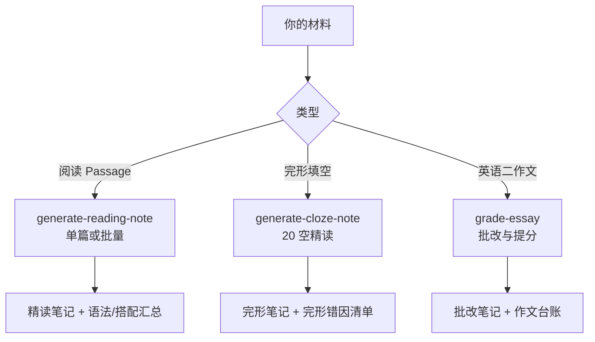

# 考研英语阅读精读 Vault 使用说明

这是一套在 Obsidian 中完成考研英语精读的学习库，覆盖三条互不混用的学习路线：

- **阅读 Passage 精读**：排版 → 翻译 → 语法 → 长难句 → 综合笔记 → 生词练习；
- **完形填空精读**：原文与选项固化 → 翻译 → 搭配 → 逐空分析 → 十章笔记 → 错因清单；
- **英语二作文批改**：转写确认 → 任务点核对 → 错误归类 → 定档评分 → 双版本改稿。

你只需准备文章或作答材料，再按下面的流程向 Codex 或 Claude Code 提出请求。

> [!tip] 先转成 Markdown，效果最好
> 对电子版 PDF 或扫描资料，建议先用 [MinerU](https://mineru.net/) 转换为 Markdown，再交给本 Vault 处理。这样能最大程度保留段落、标题与文字顺序，后续的排版、翻译和长难句定位会更稳定。

## 使用前准备

1. 用 Obsidian 打开本文件夹。
2. 为本篇材料确定一个完整 topic：
   - 阅读 Passage：`<year>-passage<n>-<topic>`，例如 `2024-passage2-uk-timber`；
   - 完形填空：`<year>-cloze-<topic>`，例如 `2010-cloze-swine-flu`；
   - 作文：`<YYYY-MM-DD>-<类型>-<话题>`，例如 `2026-11-04-大作文-柱状图-mobile-phone-subscriptions`。
3. 同一篇文章的中间目录、最终笔记文件名和 YAML 中的 `topic` 应使用同一个 topic。
4. 将 PDF 或扫描资料上传到 MinerU，导出 Markdown 文件；快速检查标题、段落和乱码，并保留原文件路径以便交给 AI 助手读取。

> [!note] 资料质量会影响后续效果
> MinerU 的转档结果不必完美。页眉页脚、题号、断行或识别错误可以先保留，`format-article` 会清理文章结构；但请先手动确认正文没有整段缺失或顺序颠倒。

## 选择学习路线



| 路线 | 入口技能 | 是否有工作流状态文件 | 最终产物 |
| --- | --- | --- | --- |
| 阅读 Passage 精读 | `generate-reading-note` | 有（单篇 / 批量） | `<年份>阅读/<topic>-精读笔记.md` |
| 完形填空精读 | `generate-cloze-note` | 有 | `完形填空/<topic>-精读笔记.md` |
| 英语二作文批改 | `grade-essay` | 无 | `作文/<topic>-批改.md` |

下文用 `2005-passage2-global-warming`、`2010-cloze-swine-flu` 作为示例 topic。把其中的路径替换成你自己的即可。

---

# 路线一：阅读 Passage 精读

## 一条指令走完（推荐）

`generate-reading-note` 会自动串联排版、翻译、语法、长难句、整合、生词与全局汇总，并把进度记录到 `workspace/workflow-runs/`。中途可以打断，下次说「继续」即可从上次阶段恢复。

**可直接复制的指令**：

```text
请使用 generate-reading-note 生成精读笔记。

文章：<英文原文路径，或直接粘贴>
年份与篇号：2005 passage2
主题 slug：global-warming
输出路径：2005阅读/2005-passage2-global-warming-精读笔记.md
```

> [!warning] 中途有两个确认关口
> 启动时会确认最终输出路径（P0），分析前会请你确认长难句候选清单（P4）。未确认前工作流不会继续写入。请用文本直接回答，不要只回「可以」。

## 分步执行（想自己控制节奏时）

如果只想做其中几步，可以逐个调用技能。

### 1. 用 MinerU 把资料转换为 Markdown

**什么时候用**：你拿到的是 PDF、扫描件或图片版电子资料时。

**建议操作**：打开 [MinerU](https://mineru.net/)，完成转换后检查以下内容：

- 文章标题和各段文字是否齐全；
- 段落顺序是否正确；
- 表格、图片说明或试题选项是否被错误拼接；
- 是否存在明显乱码、断词或重复页眉页脚。

转换后的 Markdown 不需要自己精细排版；下一步会专门处理这件事。

### 2. 使用 `format-article` 模板化原文

**会得到什么**：`intermediate/2005-passage2-global-warming/formatted-article.md`。它会保留英文原文，只清理格式、段落和标题层级。

```text
请使用 format-article 格式化“<MinerU 导出的 Markdown 文件路径>”中的英文文章。
目标文件夹为 intermediate/2005-passage2-global-warming/。
请只改善排版，不修改或删减原文内容。
```

> [!warning] 不要跳过这一步
> 先排版再翻译，能让中英对照与后续长难句定位保持正确的段落结构。

### 3. 使用 `translate` 生成中英对照

**会得到什么**：`intermediate/2005-passage2-global-warming/translation.md`。每段英文后紧跟对应中文，翻译说明会使用 Obsidian callout 标注。

```text
请使用 translate 翻译
intermediate/2005-passage2-global-warming/formatted-article.md。
目标文件夹仍为 intermediate/2005-passage2-global-warming/，
请生成逐段中英对照翻译。
```

### 4. 在精读过程中使用 `analyze-sentence`

**什么时候用**：读原文或对照翻译时，遇到难以拆解的 1–5 个长难句就可以使用；不必等全文翻译完成后集中处理。

**会得到什么**：每个句子后紧跟一个可折叠的 `> [!abstract]- 长难句分析` 块，包含主干、修饰成分、结构图解、参考译文和考点提示。

```text
请使用 analyze-sentence 分析下面的长难句：

<粘贴 1–5 个英文句子>

这些句子来自
intermediate/2005-passage2-global-warming/formatted-article.md。
请在确认定位后，把每个分析块紧跟插入对应原句之后。
```

> [!important] 分析块的位置
> 同一段有多个长难句时，正确结构应是“原句 → 对应分析 → 下一句”。不要把多个分析统一堆放到段落末尾，也不要移到翻译部分或笔记底部。

### 5. 按需整理语法笔记

`compile-note` 整合时默认会读取 `grammar-notes.md`。如果你有做题时记下的零散语法点，建议在整合前补齐它。

```text
请使用 organize-grammar 整理“<语法笔记文件路径>”中的内容。
目标文件夹为 intermediate/2005-passage2-global-warming/。
请保留原笔记中的例句、考点和易错提示。
```

### 6. 使用 `compile-note` 整合精读笔记

**会得到什么**：一份自包含的精读笔记，含背景、文章原文、翻译对照、语法要点、心得、延伸与思考题。原文中已经内联的长难句分析会保留在对应句子之后。

```text
请使用 compile-note 整合
intermediate/2005-passage2-global-warming/ 中的学习材料。
最终笔记请保存到：
2005阅读/2005-passage2-global-warming-精读笔记.md
```

> [!note] 输出路径必须说清楚
> `compile-note` 不会凭主题名猜测你想把最终笔记放在哪里。请始终在请求中给出完整输出路径。

### 7. 使用 `extract-vocabulary` 生成词汇表与练习

**会得到什么**：最终笔记中的“生词表”和“生词练习”。练习包含选词填空、短语翻译、语境理解及折叠答案。

```text
请使用 extract-vocabulary 处理
2005阅读/2005-passage2-global-warming-精读笔记.md。
请提取加粗生词，替换 VOCABULARY_SLOT，并补全生词表和三类练习。
```

> [!warning] 占位符不存在怎么办？
> 不要让 AI 随意改动笔记章节。先确认最终笔记中是否已有生词表与练习；若两者都没有，请先让 AI 说明建议插入的位置，再确认修改。

## 批量处理多篇

当你要处理一个目录或多篇积压文章时，`generate-reading-note` 会自动切换到批量工作流：

```text
请使用 generate-reading-note 批量生成精读笔记。

源目录：<英文原文目录>
输出根目录：2005阅读/
并发数：3（上限 5）
完成后是否更新全局汇总：是
```

批量流程会为每篇建立独立状态文件，单篇内容并行生成、最终笔记串行写入，最后统一更新 `语法总结笔记.md` 与 `固定搭配与词组笔记.md`。

## 全局汇总（P9）

每篇阅读笔记收尾时，`summarize-grammar` 会把本篇的语法与搭配合并进根目录两个汇总笔记：

- `语法总结笔记.md`：只收纯语法内容；
- `固定搭配与词组笔记.md`：收固定搭配与词组。

两个文件通过 wikilink 双向引用。汇总后会更新 `updated`、`total_sources`、`processed_sources`、`categories` 与快速索引表。

---

# 路线二：完形填空精读

## 需要准备什么

| 输入 | 说明 |
| --- | --- |
| 原文 | 全文，空格用 `【n】` 标出 |
| 选项 | 20 组 A–D；截图或图片也可以 |
| 官方答案 | 必须确认来源；未确认前工作流不会进入分析阶段 |
| 你的作答 | 逐空作答，**空着的必须单独说明** |
| 年份与主题 | 例如 `2010-cloze-swine-flu` |
| 输出路径 | 默认 `完形填空/<topic>-精读笔记.md`，需要你确认 |

> [!warning] 漏答不等于错
> 空着的题必须单独告诉 AI。工作流会把它记为「漏答」，不会混入错题统计，否则五类错因的计数会失真。

## 可直接复制的指令

```text
请使用 generate-cloze-note 做完形填空精读。

原文：<路径或粘贴全文>
选项：<20 组 A-D>
答案：<官方答案>
我的作答：1-5 A B C D A；6-10 ...；第 12、17 空漏答
年份与主题：2010-cloze-swine-flu
输出路径：完形填空/2010-cloze-swine-flu-精读笔记.md
```

## 会得到什么

- `intermediate/2010-cloze-swine-flu/formatted-article.md`：原文、选项表、答案、结构速览；
- `intermediate/2010-cloze-swine-flu/translation.md`：逐段中英对照，英文行内标 `【n 答案】`；
- `intermediate/2010-cloze-swine-flu/grammar-notes.md`：只收与空格或陷阱相关的语法；
- `intermediate/2010-cloze-swine-flu/固定搭配与词组笔记.md`：📌 标注本篇考点；
- `intermediate/2010-cloze-swine-flu/逐空分析.md`：20 行判定依据 + 五类错因标签；
- `完形填空/2010-cloze-swine-flu-精读笔记.md`：固定十章综合笔记；
- `完形填空/素材/2010-cloze-swine-flu-原文.md`：原始素材留档；
- 根目录 `完形错因清单.md` 追加本篇记录。

笔记固定十章，顺序不可增删：作答记录、全文主旨与段落功能、逐空分析、逻辑关系地图、选项词汇辨析、固定搭配与介词、语法与长难句、生词表、错因复盘、二刷自测。

五类错因标签固定为 **词义辨析 / 逻辑关系 / 固定搭配 / 语法 / 粗心超纲**，每空只归一类，计数必须等于失分空数。

---

# 路线三：英语二作文批改

## 适用范围

- 小作文 10 分：书信、通知，约 100 词；
- 大作文 15 分：柱状图、折线图、饼图、表格，约 150 词。

> [!warning] 只支持英语二
> 英语一作文当前没有内置评分标准。收到英语一作文时，请先确认是否按英语二标准近似处理。

## 需要准备什么

- 作文题目：文字、截图或图片路径；
- 你的作答：手写图片路径，或直接粘贴英文文本；
- 作文类型：小作文-书信 / 小作文-通知 / 大作文-柱状图 / 大作文-折线图 / 大作文-饼图 / 大作文-表格；
- 题目来源：真题年份或模拟题。

## 可直接复制的指令

```text
请使用 grade-essay 批改这篇英语二作文。

类型：大作文-柱状图
题目：<题目文字，或题目截图路径>
作答：<手写图片路径，或英文原文>
来源：2010 年真题
```

## 流程与确认关口

| 步 | 动作 | 你需要做什么 |
| --- | --- | --- |
| P0 | 输入确认 | 补齐题目、作答、类型、来源 |
| P1 | 转写 | **必须确认转写稿**；有笔迹含糊处会标 `⟦存疑：推测为 X⟧` |
| P2 | 题目解析 | 查看任务点清单是否漏项 |
| P3 | 结构分析 | 查看段落功能与任务点落位 |
| P4 | 错误归类 | 六类标签逐处对应 |
| P5 | 定档评分 | 先定档、再给分，不做维度加权 |
| P6 | 改稿 | A 最小改动版 / B 高分重写版 |
| P7 | 提分路径 | 3 条动作 + 5–8 个可迁移表达 + 3 条自查 |
| P8 | 落盘 | 笔记、原图、错因清单、表达库、索引 |

> [!important] P1 转写是硬门禁
> 未经你确认的存疑处不得用于扣分。请逐段核对转写稿，改过的版本才是评分依据。

## 会得到什么

- `作文/<YYYY-MM-DD>-<类型>-<话题>-批改.md`：批改笔记；
- `作文/素材/`：手写原文图片归档；
- `作文/作文错因清单.md`：篇目登记 + 六类标签计数；
- `作文/高分表达库.md`：只收从你本人作文升级而来的表达；
- `作文/作文索引.md`：分数、档位、稿次。

六类错因标签固定为 **内容要点缺失 / 语言准确性 / 词汇与搭配 / 句式与衔接 / 篇章结构 / 字数与格式**，每处失分只归一类。

二稿重批时，在文件名后加 `-二稿`，并说明「这是二稿，对比上一稿看提分与错因复发」。

---

# 完成检查清单

## 阅读 Passage

- [ ] MinerU 转出的正文没有明显缺段、乱序或乱码。
- [ ] `intermediate/<topic>/formatted-article.md` 已生成，英文原文段落结构清晰。
- [ ] `intermediate/<topic>/translation.md` 已生成，且中英段落一一对应。
- [ ] 需要分析的长难句都在原文对应句子后紧跟分析块。
- [ ] 最终精读笔记保存在 `<年份>阅读/`，YAML `topic` 与目录名一致。
- [ ] `<!-- VOCABULARY_SLOT -->` 已被替换为生词表和完整练习。
- [ ] `语法总结笔记.md` 与 `固定搭配与词组笔记.md` 已包含本篇内容。

## 完形填空

- [ ] 原文空格数与选项组数一致（标准 20 空）。
- [ ] 答案来源已确认，你的逐空作答（含漏答）已提供。
- [ ] 五类错因计数之和等于失分空数。
- [ ] 笔记十章齐全且顺序正确。
- [ ] `完形错因清单.md` 已追加本篇记录。

## 英语二作文

- [ ] P1 转写稿已由你确认。
- [ ] 错误清单行数等于六类标签计数之和。
- [ ] 评分依据只来自官方标准文件。
- [ ] 改稿 A/B 都覆盖了全部任务点。
- [ ] 三个作文台账（错因清单、表达库、索引）都已更新。

## 通用

- [ ] 在 Obsidian 阅读视图中检查标题、表格、callout 和 Mermaid 流程图是否正常显示。
- [ ] 修改共享技能或规则后运行 `bash scripts/verify-vault.sh`。

# 常见问题

### MinerU 转出的 Markdown 很乱，还能用吗？

可以。先确保正文没有遗漏或乱序，再把文件交给 `format-article`。它负责清理多余空行、断行和标题层级，但不会补回转档时丢失的原文。

### 可以直接翻译 PDF 吗？

可以，但推荐先经 MinerU 转成 Markdown，再依次使用 `format-article` 和 `translate`。这样对段落、题干和长难句位置的识别更稳定。

### 长难句分析应该放在翻译前还是翻译后？

不必固定。阅读原文或核对翻译时，遇到难句就立即使用 `analyze-sentence`。最重要的是，分析结果必须内联在原文的对应句子之后。

### 没有语法笔记，可以直接整合吗？

先检查 `intermediate/<topic>/` 中是否已有 `grammar-notes.md`。完整工作流会自动生成；手动分步时，建议先用 `organize-grammar` 整理，再运行 `compile-note`。

### 完形填空只记得答案，不记得自己错了哪些怎么办？

必须提供你的逐空作答。只给答案无法做逐空错因分析；如果确实想不起来，可以按「全部按正确答案作答」记录，并在报告中注明这是假设，不能据此统计错因。

### 作文评分为什么不给维度分数？

官方大纲是「先定档、再按档给分」，没有把总分拆成若干维度分值相加。因此批改只做整体定档，避免自造公式。

### 为什么 AI 反复询问目标文件夹或输出路径？

这是为了避免把笔记写入错误位置。`format-article`、`translate` 和 `organize-grammar` 需要目标中间目录；`compile-note`、`generate-cloze-note` 和 `grade-essay` 还需要最终输出路径或台账位置。

# 相关入口

- [[README]]：项目结构、三条路线与校验方式。
- [[AGENTS]]：完整项目规则与技能协作约定。
- [[语法总结笔记]]：跨篇语法复习入口。
- [[固定搭配与词组笔记]]：跨篇搭配复习入口。
- [[完形错因清单]]：完形错因跨篇登记。
- [[作文/作文索引]]：作文分数与稿次索引。
